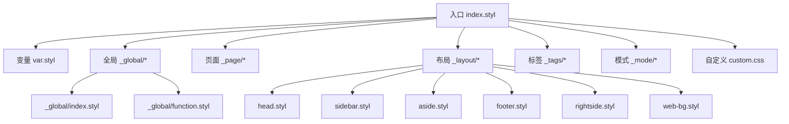
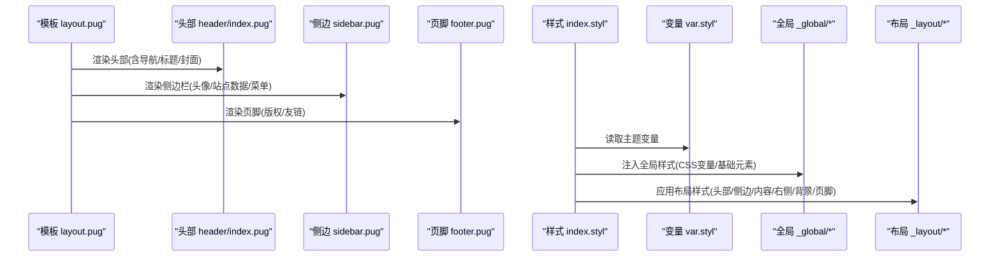
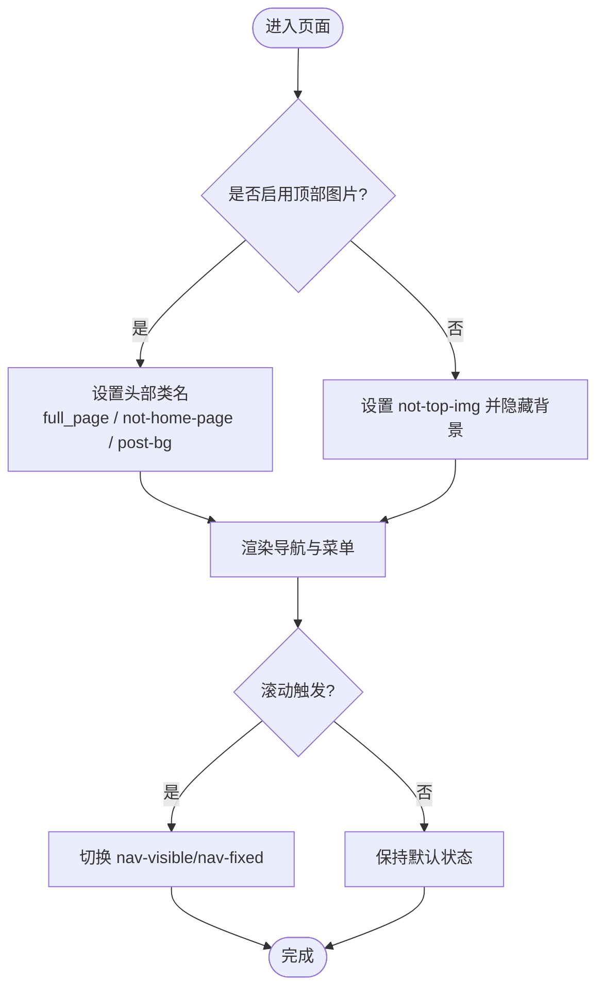
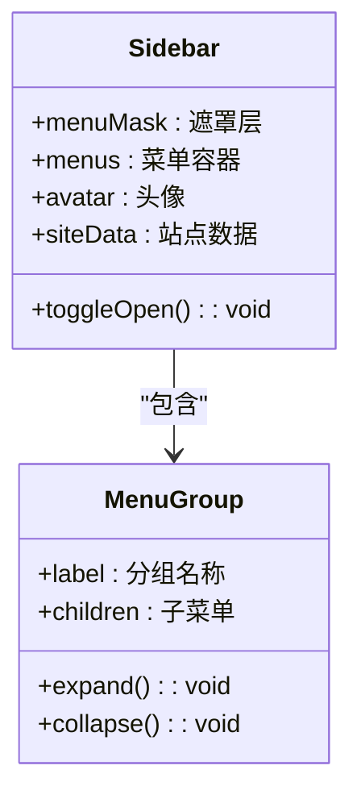
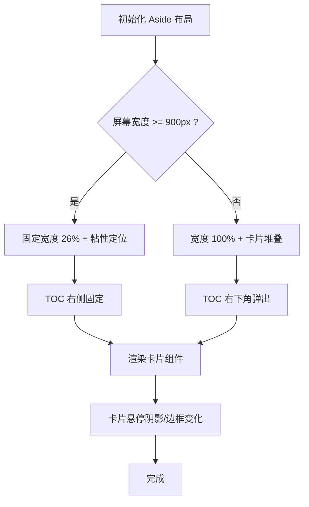
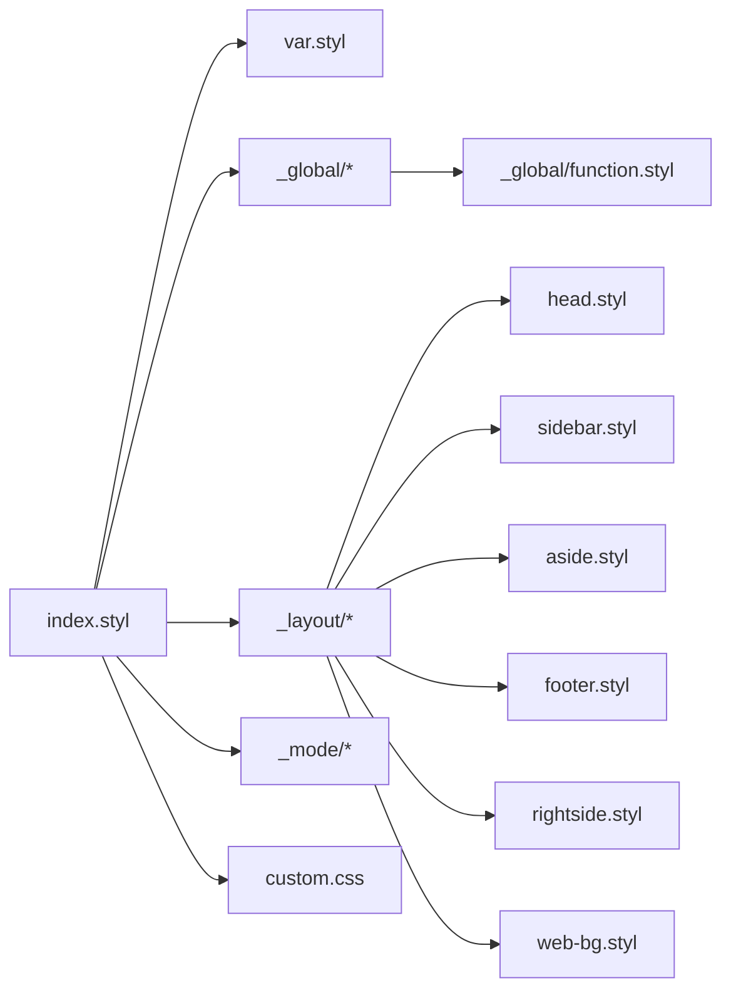

# 布局样式系统

<cite>
**本文引用的文件**   
- [index.styl](file://themes/fomalhaut/source/css/index.styl)
- [var.styl](file://themes/fomalhaut/source/css/var.styl)
- [_global/index.styl](file://themes/fomalhaut/source/css/_global/index.styl)
- [_global/function.styl](file://themes/fomalhaut/source/css/_global/function.styl)
- [_layout/head.styl](file://themes/fomalhaut/source/css/_layout/head.styl)
- [_layout/sidebar.styl](file://themes/fomalhaut/source/css/_layout/sidebar.styl)
- [_layout/aside.styl](file://themes/fomalhaut/source/css/_layout/aside.styl)
- [_layout/footer.styl](file://themes/fomalhaut/source/css/_layout/footer.styl)
- [_layout/rightside.styl](file://themes/fomalhaut/source/css/_layout/rightside.styl)
- [_layout/web-bg.styl](file://themes/fomalhaut/source/css/_layout/web-bg.styl)
- [layout.pug](file://themes/fomalhaut/layout/includes/layout.pug)
- [header/index.pug](file://themes/fomalhaut/layout/includes/header/index.pug)
- [sidebar.pug](file://themes/fomalhaut/layout/includes/sidebar.pug)
- [footer.pug](file://themes/fomalhaut/layout/includes/footer.pug)
</cite>

## 目录
1. [简介](#简介)
2. [项目结构](#项目结构)
3. [核心组件](#核心组件)
4. [架构总览](#架构总览)
5. [详细组件分析](#详细组件分析)
6. [依赖关系分析](#依赖关系分析)
7. [性能与可维护性](#性能与可维护性)
8. [故障排查指南](#故障排查指南)
9. [结论](#结论)
10. [附录：定制示例与最佳实践](#附录定制示例与最佳实践)

## 简介
本文件系统性说明博客主题的布局样式体系，聚焦 _layout 目录下的头部、侧边栏、内容区域、页脚等核心布局元素的样式职责；解释响应式策略（媒体查询与断点）、移动端适配方案；梳理布局组件之间的层级关系与样式隔离机制；并提供可操作的定制示例与最佳实践。该样式系统基于 Stylus 预处理器，通过统一的变量、函数与模块化导入组织样式，确保主题在桌面端与移动端均具备一致的视觉与交互体验。

## 项目结构
布局样式采用“全局变量 + 通用工具 + 页面模块 + 布局模块”的分层组织方式：
- 入口聚合：统一导入各模块，保证样式加载顺序可控。
- 变量层：集中定义颜色、字体、尺寸、主题色等变量。
- 全局层：定义 CSS 变量、基础元素、滚动条、表格、引用块等通用样式。
- 工具层：提供常用工具类与媒体查询函数。
- 布局层：按功能拆分 head、sidebar、aside、footer、rightside、web-bg 等。
- 模式层与自定义层：支持深色模式、阅读模式与站点自定义覆盖。

图表来源
- [index.styl:1-26](file://themes/fomalhaut/source/css/index.styl#L1-L26)
- [_global/index.styl:1-220](file://themes/fomalhaut/source/css/_global/index.styl#L1-L220)
- [_global/function.styl:1-252](file://themes/fomalhaut/source/css/_global/function.styl#L1-L252)
- [_layout/head.styl:1-370](file://themes/fomalhaut/source/css/_layout/head.styl#L1-L370)
- [_layout/sidebar.styl:1-68](file://themes/fomalhaut/source/css/_layout/sidebar.styl#L1-L68)
- [_layout/aside.styl:1-411](file://themes/fomalhaut/source/css/_layout/aside.styl#L1-L411)
- [_layout/footer.styl:1-43](file://themes/fomalhaut/source/css/_layout/footer.styl#L1-L43)
- [_layout/rightside.styl:1-50](file://themes/fomalhaut/source/css/_layout/rightside.styl#L1-L50)
- [_layout/web-bg.styl:1-24](file://themes/fomalhaut/source/css/_layout/web-bg.styl#L1-L24)

章节来源
- [index.styl:1-26](file://themes/fomalhaut/source/css/index.styl#L1-L26)

## 核心组件
- 变量与主题色：集中管理主题主色、按钮色、滚动条色、卡片背景、侧边栏宽度等，便于全局一致性与一键换肤。
- 全局样式：CSS 变量映射、基础排版、滚动条、链接、图片、引用块等。
- 工具与动画：单行/多行省略、卡片悬停、图片缩放、菜单展开动画、滚动提示动画等。
- 布局模块：
  - 头部：首页全屏头图、非首页固定高度头图、文章封面、导航吸顶与显隐、社交图标、滚动提示。
  - 侧边栏：抽屉菜单、遮罩、头像、站点数据、菜单分组与子菜单。
  - 侧边内容区：作者信息、归档/分类/标签、最近文章、目录 TOC、粘性定位。
  - 右侧工具栏：回到顶部、切换侧边栏、移动端目录按钮等。
  - 背景层：桌面/移动端的亮/暗模式背景图适配。
  - 页脚：半透明遮罩、版权信息与友链展示容器。

章节来源
- [var.styl:1-185](file://themes/fomalhaut/source/css/var.styl#L1-L185)
- [_global/index.styl:1-220](file://themes/fomalhaut/source/css/_global/index.styl#L1-L220)
- [_global/function.styl:1-252](file://themes/fomalhaut/source/css/_global/function.styl#L1-L252)
- [_layout/head.styl:1-370](file://themes/fomalhaut/source/css/_layout/head.styl#L1-L370)
- [_layout/sidebar.styl:1-68](file://themes/fomalhaut/source/css/_layout/sidebar.styl#L1-L68)
- [_layout/aside.styl:1-411](file://themes/fomalhaut/source/css/_layout/aside.styl#L1-L411)
- [_layout/footer.styl:1-43](file://themes/fomalhaut/source/css/_layout/footer.styl#L1-L43)
- [_layout/rightside.styl:1-50](file://themes/fomalhaut/source/css/_layout/rightside.styl#L1-L50)
- [_layout/web-bg.styl:1-24](file://themes/fomalhaut/source/css/_layout/web-bg.styl#L1-L24)

## 架构总览
布局由模板生成 DOM，样式通过 Stylus 编译输出。整体流程如下：

图表来源
- [layout.pug:1-127](file://themes/fomalhaut/layout/includes/layout.pug#L1-L127)
- [header/index.pug:1-73](file://themes/fomalhaut/layout/includes/header/index.pug#L1-L73)
- [sidebar.pug:1-19](file://themes/fomalhaut/layout/includes/sidebar.pug#L1-L19)
- [footer.pug:1-112](file://themes/fomalhaut/layout/includes/footer.pug#L1-L112)
- [index.styl:1-26](file://themes/fomalhaut/source/css/index.styl#L1-L26)
- [var.styl:1-185](file://themes/fomalhaut/source/css/var.styl#L1-L185)
- [_global/index.styl:1-220](file://themes/fomalhaut/source/css/_global/index.styl#L1-L220)
- [_layout/head.styl:1-370](file://themes/fomalhaut/source/css/_layout/head.styl#L1-L370)
- [_layout/sidebar.styl:1-68](file://themes/fomalhaut/source/css/_layout/sidebar.styl#L1-L68)
- [_layout/aside.styl:1-411](file://themes/fomalhaut/source/css/_layout/aside.styl#L1-L411)
- [_layout/footer.styl:1-43](file://themes/fomalhaut/source/css/_layout/footer.styl#L1-L43)
- [_layout/rightside.styl:1-50](file://themes/fomalhaut/source/css/_layout/rightside.styl#L1-L50)
- [_layout/web-bg.styl:1-24](file://themes/fomalhaut/source/css/_layout/web-bg.styl#L1-L24)

## 详细组件分析

### 头部（Head）
职责与要点：
- 首页全屏头图与非首页固定高度头图，文章封面使用独立类名区分。
- 导航吸顶与显隐：根据滚动状态切换类名，控制导航位置与阴影。
- 标题与副标题在不同屏幕下字号自适应。
- 社交图标在小屏显示，在大屏隐藏。
- 滚动提示箭头动画。

响应式与交互：
- 使用 min/max-width 混合函数进行断点控制。
- 导航菜单项下拉子菜单的显示与旋转箭头动效。
- 小屏下调整内边距与底部信息位置。

图表来源
- [_layout/head.styl:1-370](file://themes/fomalhaut/source/css/_layout/head.styl#L1-L370)
- [header/index.pug:1-73](file://themes/fomalhaut/layout/includes/header/index.pug#L1-L73)

章节来源
- [_layout/head.styl:1-370](file://themes/fomalhaut/source/css/_layout/head.styl#L1-L370)
- [header/index.pug:1-73](file://themes/fomalhaut/layout/includes/header/index.pug#L1-L73)

### 侧边栏（Sidebar）
职责与要点：
- 抽屉菜单从右侧滑入，带遮罩层。
- 头像、站点数据（文章数、标签数、分类数）。
- 菜单分组与子菜单折叠/展开。
- 小屏下菜单项高亮与圆角优化（站点自定义增强）。

响应式与交互：
- 打开时 translate3d 位移，关闭时恢复。
- 菜单项 hover 背景色变化。
- 分组图标旋转指示展开状态。

图表来源
- [_layout/sidebar.styl:1-68](file://themes/fomalhaut/source/css/_layout/sidebar.styl#L1-L68)
- [sidebar.pug:1-19](file://themes/fomalhaut/layout/includes/sidebar.pug#L1-L19)

章节来源
- [_layout/sidebar.styl:1-68](file://themes/fomalhaut/source/css/_layout/sidebar.styl#L1-L68)
- [sidebar.pug:1-19](file://themes/fomalhaut/layout/includes/sidebar.pug#L1-L19)

### 内容区域与侧边内容（Aside）
职责与要点：
- 侧边内容区宽度在大屏为 26%，小屏占满整行。
- 卡片组件统一悬停阴影与圆角。
- 作者信息、社交图标、按钮。
- 归档/分类/标签列表、最近文章、网站信息。
- 目录 TOC：大屏右侧固定，小屏右下角弹出。
- 粘性定位 sticky_layout 在滚动时吸附顶部。

响应式与交互：
- 小屏隐藏部分卡片（可通过配置开关）。
- TOC 在小屏以浮层形式出现，带缩放动画。
- 卡片列表项 hover 高亮与间距变化。

图表来源
- [_layout/aside.styl:1-411](file://themes/fomalhaut/source/css/_layout/aside.styl#L1-L411)

章节来源
- [_layout/aside.styl:1-411](file://themes/fomalhaut/source/css/_layout/aside.styl#L1-L411)

### 右侧工具栏（Rightside）
职责与要点：
- 固定在右下区域，默认隐藏，滚动或交互后显示。
- 包含回到顶部、隐藏侧边栏、移动端目录按钮等快捷操作。
- 小屏下隐藏“隐藏侧边栏”按钮，避免遮挡。

响应式与交互：
- 按钮 hover 背景色变化。
- 小屏显示移动端目录按钮。

章节来源
- [_layout/rightside.styl:1-50](file://themes/fomalhaut/source/css/_layout/rightside.styl#L1-L50)

### 背景层（Web Background）
职责与要点：
- 桌面端与移动端分别设置背景图。
- 支持深色模式切换背景图。
- 移动端强制 local 背景附着以避免滚动抖动。

响应式与交互：
- 通过 data-theme 属性切换深色背景。
- 小屏下覆盖默认背景规则，确保一致性。

章节来源
- [_layout/web-bg.styl:1-24](file://themes/fomalhaut/source/css/_layout/web-bg.styl#L1-L24)

### 页脚（Footer）
职责与要点：
- 可选背景遮罩，提升文字可读性。
- 页脚容器居中排版，链接 hover 下划线。
- 友链与推荐内容容器（模板中实现）。

章节来源
- [_layout/footer.styl:1-43](file://themes/fomalhaut/source/css/_layout/footer.styl#L1-L43)
- [footer.pug:1-112](file://themes/fomalhaut/layout/includes/footer.pug#L1-L112)

## 依赖关系分析
样式模块间的依赖关系清晰，遵循“入口聚合 → 变量 → 全局 → 布局 → 模式/自定义”的顺序，避免循环依赖与样式冲突。

图表来源
- [index.styl:1-26](file://themes/fomalhaut/source/css/index.styl#L1-L26)
- [_global/function.styl:1-252](file://themes/fomalhaut/source/css/_global/function.styl#L1-L252)
- [_layout/head.styl:1-370](file://themes/fomalhaut/source/css/_layout/head.styl#L1-L370)
- [_layout/sidebar.styl:1-68](file://themes/fomalhaut/source/css/_layout/sidebar.styl#L1-L68)
- [_layout/aside.styl:1-411](file://themes/fomalhaut/source/css/_layout/aside.styl#L1-L411)
- [_layout/footer.styl:1-43](file://themes/fomalhaut/source/css/_layout/footer.styl#L1-L43)
- [_layout/rightside.styl:1-50](file://themes/fomalhaut/source/css/_layout/rightside.styl#L1-L50)
- [_layout/web-bg.styl:1-24](file://themes/fomalhaut/source/css/_layout/web-bg.styl#L1-L24)

章节来源
- [index.styl:1-26](file://themes/fomalhaut/source/css/index.styl#L1-L26)

## 性能与可维护性
- 变量集中化：所有颜色、尺寸、字体等集中在 var.styl，便于主题扩展与一致性维护。
- 工具函数复用：function.styl 提供常用媒体查询函数与动画，减少重复代码。
- 模块化导入：index.styl 按模块顺序导入，保证样式优先级与可预测性。
- 响应式断点统一：minWidth/maxWidth 函数统一断点，降低维护成本。
- 样式隔离：布局样式通过 ID 选择器与模块文件隔离，避免跨模块污染。
- 动画与过渡：合理使用 transform 与 opacity，减少重排重绘，提升滚动与交互流畅度。

[本节为通用指导，不直接分析具体文件]

## 故障排查指南
常见问题与定位建议：
- 头部导航未吸顶或显示异常：检查头部类名是否正确添加（nav-visible/nav-fixed），确认滚动监听逻辑是否生效。
- 侧边栏无法滑出：检查 #sidebar-menus 的 open 类是否存在，确认遮罩层 z-index 是否被其他元素覆盖。
- TOC 在小屏不显示：确认 rightside 中的移动端目录按钮是否可见，检查 aside 中 TOC 的 fixed 定位与 max-height。
- 背景图在移动端错位：检查 web-bg.styl 中移动端背景规则是否被 !important 覆盖，确认 data-theme 属性是否正确设置。
- 页脚文字不可读：确认 footer 的遮罩伪元素是否生效，检查背景图与遮罩透明度。

章节来源
- [_layout/head.styl:130-157](file://themes/fomalhaut/source/css/_layout/head.styl#L130-L157)
- [_layout/sidebar.styl:1-68](file://themes/fomalhaut/source/css/_layout/sidebar.styl#L1-L68)
- [_layout/aside.styl:216-293](file://themes/fomalhaut/source/css/_layout/aside.styl#L216-L293)
- [_layout/web-bg.styl:1-24](file://themes/fomalhaut/source/css/_layout/web-bg.styl#L1-L24)
- [_layout/footer.styl:1-43](file://themes/fomalhaut/source/css/_layout/footer.styl#L1-L43)

## 结论
该布局样式系统通过清晰的模块化结构与统一的变量/工具函数，实现了头部、侧边栏、内容区、右侧工具栏、背景层与页脚的完整布局能力。响应式策略基于统一的媒体查询函数，兼顾桌面端与移动端体验。样式隔离良好，易于扩展与维护。建议在定制时优先使用变量与工具函数，避免直接覆盖复杂选择器，以保持系统的可维护性与一致性。

[本节为总结性内容，不直接分析具体文件]

## 附录：定制示例与最佳实践
- 修改主题主色：在 var.styl 中调整 theme-color 相关变量，影响按钮、链接、滚动条等。
- 调整侧边栏宽度：修改 $sidebar-width，同步更新 sidebar.styl 与 aside.styl 的布局计算。
- 更换背景图：在 var.styl 中设置 background.default/darkmode/mobileday/mobilenight，或在模板中通过 page.background 动态注入。
- 隐藏侧边栏：在 layout.pug 中通过 hide-aside 类控制，aside.styl 中已有对应规则。
- 自定义页脚样式：在 custom.css 中追加样式，覆盖 #footer-wrap 的 padding、链接样式等。
- 移动端菜单增强：参考站点级 mobile-drawer.css 的做法，在不改动主题源码的前提下增强抽屉菜单的视觉与交互。

章节来源
- [var.styl:1-185](file://themes/fomalhaut/source/css/var.styl#L1-L185)
- [_layout/sidebar.styl:1-68](file://themes/fomalhaut/source/css/_layout/sidebar.styl#L1-L68)
- [_layout/aside.styl:1-411](file://themes/fomalhaut/source/css/_layout/aside.styl#L1-L411)
- [_layout/web-bg.styl:1-24](file://themes/fomalhaut/source/css/_layout/web-bg.styl#L1-L24)
- [layout.pug:1-127](file://themes/fomalhaut/layout/includes/layout.pug#L1-L127)
- [footer.pug:1-112](file://themes/fomalhaut/layout/includes/footer.pug#L1-L112)