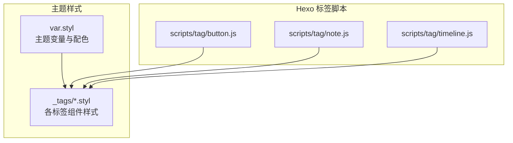
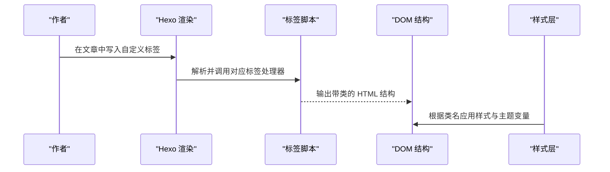
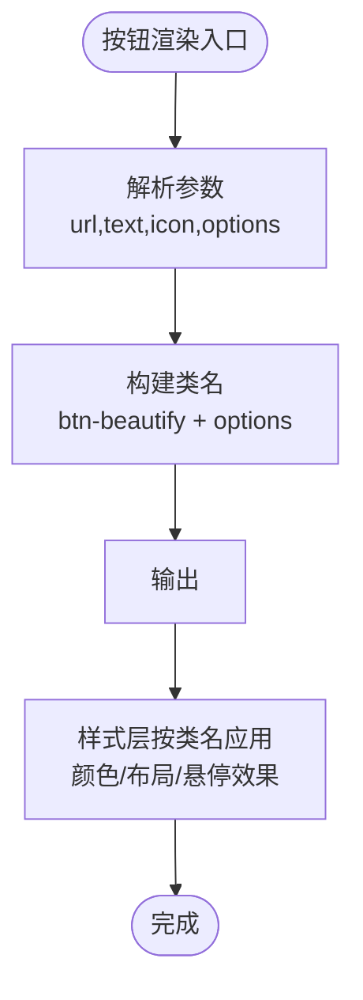
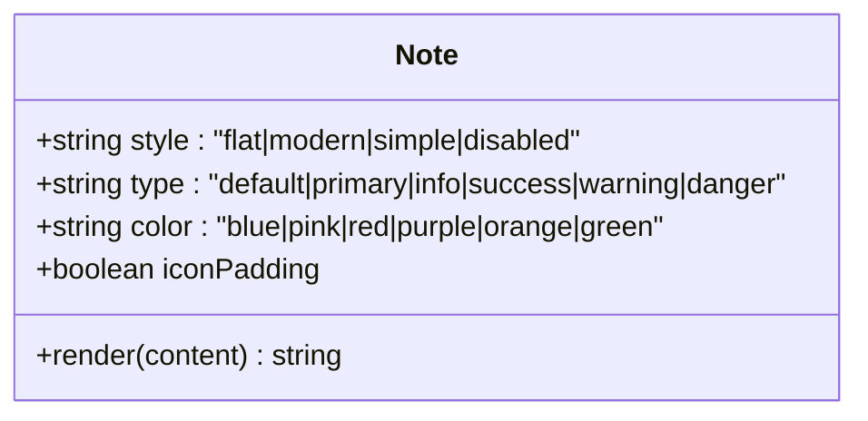
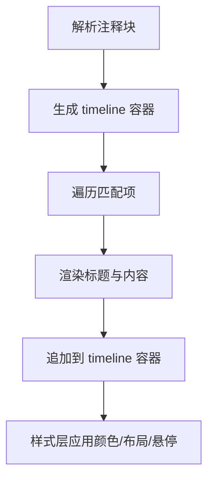
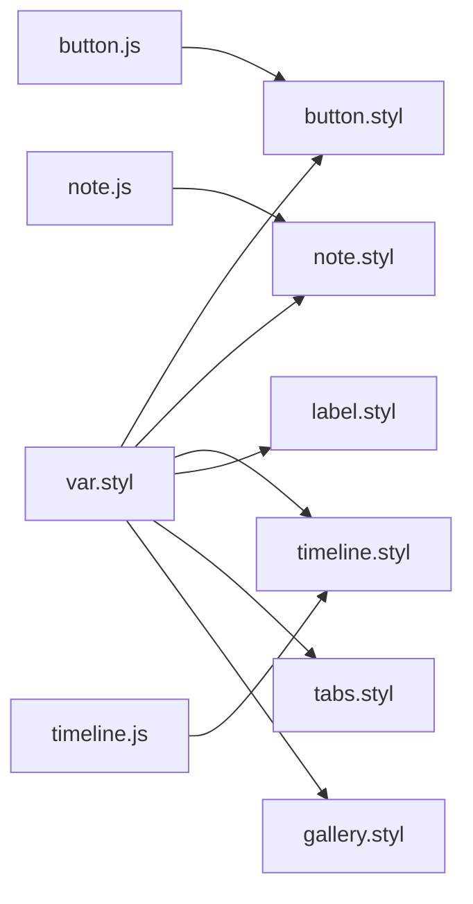

# 标签组件样式

<cite>
**本文引用的文件**   
- [themes/fomalhaut/source/css/var.styl](file://themes/fomalhaut/source/css/var.styl)
- [themes/fomalhaut/source/css/_tags/button.styl](file://themes/fomalhaut/source/css/_tags/button.styl)
- [themes/fomalhaut/source/css/_tags/note.styl](file://themes/fomalhaut/source/css/_tags/note.styl)
- [themes/fomalhaut/source/css/_tags/timeline.styl](file://themes/fomalhaut/source/css/_tags/timeline.styl)
- [themes/fomalhaut/source/css/_tags/label.styl](file://themes/fomalhaut/source/css/_tags/label.styl)
- [themes/fomalhaut/source/css/_tags/tabs.styl](file://themes/fomalhaut/source/css/_tags/tabs.styl)
- [themes/fomalhaut/source/css/_tags/gallery.styl](file://themes/fomalhaut/source/css/_tags/gallery.styl)
- [themes/fomalhaut/source/css/_tags/hexo.styl](file://themes/fomalhaut/source/css/_tags/hexo.styl)
- [themes/fomalhaut/source/css/_tags/hide.styl](file://themes/fomalhaut/source/css/_tags/hide.styl)
- [themes/fomalhaut/source/css/_tags/inlineImg.styl](file://themes/fomalhaut/source/css/_tags/inlineImg.styl)
- [themes/fomalhaut/scripts/tag/button.js](file://themes/fomalhaut/scripts/tag/button.js)
- [themes/fomalhaut/scripts/tag/note.js](file://themes/fomalhaut/scripts/tag/note.js)
- [themes/fomalhaut/scripts/tag/timeline.js](file://themes/fomalhaut/scripts/tag/timeline.js)
</cite>

## 目录
1. [引言](#引言)
2. [项目结构](#项目结构)
3. [核心组件](#核心组件)
4. [架构总览](#架构总览)
5. [详细组件分析](#详细组件分析)
6. [依赖关系分析](#依赖关系分析)
7. [性能与可访问性](#性能与可访问性)
8. [故障排查指南](#故障排查指南)
9. [结论](#结论)
10. [附录：使用示例与自定义方法](#附录使用示例与自定义方法)

## 引言
本文件系统性说明主题中“标签组件”的样式组织与实现，覆盖按钮、卡片（note）、时间线、标签云（label）、选项卡（tabs）、图库（gallery）等 UI 组件。重点阐述：
- 样式变量化与主题色体系
- 多风格与多颜色变体
- 可配置性与扩展点
- 使用方式与自定义样式的最佳实践

## 项目结构
标签组件样式集中在主题的 CSS 目录下的 _tags 子目录，并通过全局变量文件 var.styl 提供主题色与通用变量。脚本侧通过 Hexo 标签插件生成 HTML 结构，CSS 负责视觉呈现。

图表来源
- [themes/fomalhaut/source/css/var.styl:1-185](file://themes/fomalhaut/source/css/var.styl#L1-L185)
- [themes/fomalhaut/source/css/_tags/button.styl:1-56](file://themes/fomalhaut/source/css/_tags/button.styl#L1-L56)
- [themes/fomalhaut/source/css/_tags/note.styl:1-122](file://themes/fomalhaut/source/css/_tags/note.styl#L1-L122)
- [themes/fomalhaut/source/css/_tags/timeline.styl:1-68](file://themes/fomalhaut/source/css/_tags/timeline.styl#L1-L68)
- [themes/fomalhaut/scripts/tag/button.js:1-29](file://themes/fomalhaut/scripts/tag/button.js#L1-L29)
- [themes/fomalhaut/scripts/tag/note.js:1-28](file://themes/fomalhaut/scripts/tag/note.js#L1-L28)
- [themes/fomalhaut/scripts/tag/timeline.js:1-42](file://themes/fomalhaut/scripts/tag/timeline.js#L1-L42)

章节来源
- [themes/fomalhaut/source/css/var.styl:1-185](file://themes/fomalhaut/source/css/var.styl#L1-L185)

## 核心组件
- 按钮（button）：支持多种颜色、轮廓、居中/块级、尺寸放大等变体
- 笔记卡片（note）：支持 flat/modern/simple 风格与多类型配色，可选图标
- 时间线（timeline）：带节点与内容区块，支持主题色与多颜色变体
- 标签（label）：轻量高亮标签，支持默认与多颜色
- 选项卡（tabs）：导航式标签页，含激活态与动画
- 图库（gallery）：图片网格与悬停动效
- Hexo 内置增强：pullquote、视频容器
- 隐藏/折叠（hide）：行内/块级隐藏内容与切换按钮
- 行内图片（inlineImg）：文本基线对齐的小图

章节来源
- [themes/fomalhaut/source/css/_tags/button.styl:1-56](file://themes/fomalhaut/source/css/_tags/button.styl#L1-L56)
- [themes/fomalhaut/source/css/_tags/note.styl:1-122](file://themes/fomalhaut/source/css/_tags/note.styl#L1-L122)
- [themes/fomalhaut/source/css/_tags/timeline.styl:1-68](file://themes/fomalhaut/source/css/_tags/timeline.styl#L1-L68)
- [themes/fomalhaut/source/css/_tags/label.styl:1-12](file://themes/fomalhaut/source/css/_tags/label.styl#L1-L12)
- [themes/fomalhaut/source/css/_tags/tabs.styl:1-75](file://themes/fomalhaut/source/css/_tags/tabs.styl#L1-L75)
- [themes/fomalhaut/source/css/_tags/gallery.styl:1-102](file://themes/fomalhaut/source/css/_tags/gallery.styl#L1-L102)
- [themes/fomalhaut/source/css/_tags/hexo.styl:1-31](file://themes/fomalhaut/source/css/_tags/hexo.styl#L1-L31)
- [themes/fomalhaut/source/css/_tags/hide.styl:1-46](file://themes/fomalhaut/source/css/_tags/hide.styl#L1-L46)
- [themes/fomalhaut/source/css/_tags/inlineImg.styl:1-6](file://themes/fomalhaut/source/css/_tags/inlineImg.styl#L1-L6)

## 架构总览
标签组件由“脚本生成结构 + 样式定义外观”两部分组成。脚本将 Markdown 中的自定义标签转换为标准 HTML 类名；样式基于 Stylus 变量与 CSS 变量实现主题化与多变体。

图表来源
- [themes/fomalhaut/scripts/tag/button.js:12-28](file://themes/fomalhaut/scripts/tag/button.js#L12-L28)
- [themes/fomalhaut/scripts/tag/note.js:9-26](file://themes/fomalhaut/scripts/tag/note.js#L9-L26)
- [themes/fomalhaut/scripts/tag/timeline.js:8-41](file://themes/fomalhaut/scripts/tag/timeline.js#L8-L41)
- [themes/fomalhaut/source/css/_tags/button.styl:6-55](file://themes/fomalhaut/source/css/_tags/button.styl#L6-L55)
- [themes/fomalhaut/source/css/_tags/note.styl:1-122](file://themes/fomalhaut/source/css/_tags/note.styl#L1-L122)
- [themes/fomalhaut/source/css/_tags/timeline.styl:1-68](file://themes/fomalhaut/source/css/_tags/timeline.styl#L1-L68)

## 详细组件分析

### 按钮（Button）
- 结构：由脚本输出 <a class="btn-beautify ...">，支持 color、outline、center、block、larger 等选项
- 样式要点：
  - 基础背景与文字颜色来自变量
  - 通过循环 $color-types 生成多颜色变体，使用 CSS 变量 --btn-beautify-color 注入颜色
  - outline 模式以边框和透明背景为主，hover 填充背景
  - block/center/right 控制布局，larger 调整内边距
- 交互：hover 保持无下划线，颜色过渡自然

图表来源
- [themes/fomalhaut/scripts/tag/button.js:12-28](file://themes/fomalhaut/scripts/tag/button.js#L12-L28)
- [themes/fomalhaut/source/css/_tags/button.styl:6-55](file://themes/fomalhaut/source/css/_tags/button.styl#L6-L55)

章节来源
- [themes/fomalhaut/scripts/tag/button.js:1-29](file://themes/fomalhaut/scripts/tag/button.js#L1-L29)
- [themes/fomalhaut/source/css/_tags/button.styl:1-56](file://themes/fomalhaut/source/css/_tags/button.styl#L1-L56)

### 笔记卡片（Note）
- 结构：脚本输出 
，内部为渲染后的 Markdown 内容，可选图标
- 样式要点：
  - 支持 flat/modern/simple 三种风格
  - 支持 default/primary/info/success/warning/danger 类型，以及 blue/pink/red/purple/orange/green 颜色
  - 现代风格（modern）强调边框与背景色，链接颜色跟随类型
  - 图标区域可通过 note.icons 配置开关，自动添加 padding-left
- 可配置项：note.style、note.icons、note.border_radius

图表来源
- [themes/fomalhaut/scripts/tag/note.js:9-26](file://themes/fomalhaut/scripts/tag/note.js#L9-L26)
- [themes/fomalhaut/source/css/_tags/note.styl:1-122](file://themes/fomalhaut/source/css/_tags/note.styl#L1-L122)

章节来源
- [themes/fomalhaut/scripts/tag/note.js:1-28](file://themes/fomalhaut/scripts/tag/note.js#L1-L28)
- [themes/fomalhaut/source/css/_tags/note.styl:1-122](file://themes/fomalhaut/source/css/_tags/note.styl#L1-L122)

### 时间线（Timeline）
- 结构：脚本解析注释块，生成 .timeline 容器与多个 .timeline-item，包含标题与内容
- 样式要点：
  - 左侧竖线作为主轴，节点圆点与悬停变色
  - 支持主题色与多颜色变体，通过 CSS 变量 --timeline-color 与 --timeline-bg 注入
  - headline 条目加粗放大，内容区圆角背景
- 可配置项：颜色通过类名或脚本参数传入

图表来源
- [themes/fomalhaut/scripts/tag/timeline.js:8-41](file://themes/fomalhaut/scripts/tag/timeline.js#L8-L41)
- [themes/fomalhaut/source/css/_tags/timeline.styl:1-68](file://themes/fomalhaut/source/css/_tags/timeline.styl#L1-L68)

章节来源
- [themes/fomalhaut/scripts/tag/timeline.js:1-42](file://themes/fomalhaut/scripts/tag/timeline.js#L1-L42)
- [themes/fomalhaut/source/css/_tags/timeline.styl:1-68](file://themes/fomalhaut/source/css/_tags/timeline.styl#L1-L68)

### 标签（Label）
- 结构：轻量高亮标签，类名为 .hl-label，支持 default 与多颜色
- 样式要点：
  - 默认背景与文字颜色来自变量
  - 通过 $color-types 循环生成多颜色背景

章节来源
- [themes/fomalhaut/source/css/_tags/label.styl:1-12](file://themes/fomalhaut/source/css/_tags/label.styl#L1-L12)

### 选项卡（Tabs）
- 结构：.tabs > .nav-tabs > .tab + .tab-contents
- 样式要点：
  - 顶部导航条背景与边框使用 CSS 变量
  - 激活态顶部边框与背景变化，非激活态 hover 反馈
  - 内容区淡入动画 tabshow
- 响应式：小屏下 tab 按钮自适应宽度

章节来源
- [themes/fomalhaut/source/css/_tags/tabs.styl:1-75](file://themes/fomalhaut/source/css/_tags/tabs.styl#L1-L75)

### 图库（Gallery）
- 结构：figure.gallery-group 包裹 img 与 figcaption
- 样式要点：
  - 双列网格布局，移动端单列
  - 悬停时图片透明度降低，标题与描述滑入显示
  - 名称底部线条滑动动画

章节来源
- [themes/fomalhaut/source/css/_tags/gallery.styl:1-102](file://themes/fomalhaut/source/css/_tags/gallery.styl#L1-L102)

### Hexo 内置增强
- pullquote：左右浮动引用块
- video-container：16:9 响应式视频容器

章节来源
- [themes/fomalhaut/source/css/_tags/hexo.styl:1-31](file://themes/fomalhaut/source/css/_tags/hexo.styl#L1-L31)

### 隐藏/折叠（Hide）
- 结构：.hide-inline/.hide-block 内含 .hide-button 与 .hide-content
- 样式要点：
  - 按钮点击后切换显示状态
  - toggle 样式用于块级折叠面板

章节来源
- [themes/fomalhaut/source/css/_tags/hide.styl:1-46](file://themes/fomalhaut/source/css/_tags/hide.styl#L1-L46)

### 行内图片（InlineImg）
- 结构：.inline-img 用于行内小图
- 样式要点：高度与文本基线对齐，水平间距统一

章节来源
- [themes/fomalhaut/source/css/_tags/inlineImg.styl:1-6](file://themes/fomalhaut/source/css/_tags/inlineImg.styl#L1-L6)

## 依赖关系分析
- 变量依赖：所有标签组件样式均依赖 var.styl 中的主题色与通用变量
- 脚本依赖：button.js、note.js、timeline.js 分别生成对应 HTML 结构
- 样式耦合：_tags 下各 stylus 文件相互独立，通过公共变量与 CSS 变量解耦

图表来源
- [themes/fomalhaut/source/css/var.styl:1-185](file://themes/fomalhaut/source/css/var.styl#L1-L185)
- [themes/fomalhaut/source/css/_tags/button.styl:1-56](file://themes/fomalhaut/source/css/_tags/button.styl#L1-L56)
- [themes/fomalhaut/source/css/_tags/note.styl:1-122](file://themes/fomalhaut/source/css/_tags/note.styl#L1-L122)
- [themes/fomalhaut/source/css/_tags/timeline.styl:1-68](file://themes/fomalhaut/source/css/_tags/timeline.styl#L1-L68)
- [themes/fomalhaut/scripts/tag/button.js:1-29](file://themes/fomalhaut/scripts/tag/button.js#L1-L29)
- [themes/fomalhaut/scripts/tag/note.js:1-28](file://themes/fomalhaut/scripts/tag/note.js#L1-L28)
- [themes/fomalhaut/scripts/tag/timeline.js:1-42](file://themes/fomalhaut/scripts/tag/timeline.js#L1-L42)

章节来源
- [themes/fomalhaut/source/css/var.styl:1-185](file://themes/fomalhaut/source/css/var.styl#L1-L185)

## 性能与可访问性
- 性能
  - 大量使用 CSS 变量减少重复计算，利于主题切换
  - 动画与过渡仅在必要时启用（如 tabs 切换动画）
  - 图库悬停采用 transform 与 opacity，避免重排
- 可访问性
  - 按钮与标签使用语义化元素与类名，便于键盘操作
  - 颜色对比度遵循主题变量，建议在高对比度模式下测试

[本节为通用指导，不直接分析具体文件]

## 故障排查指南
- 主题色未生效
  - 检查 var.styl 中 theme_color 相关配置是否开启
  - 确认 CSS 变量 --timeline-color、--btn-beautify-color 是否正确注入
- 笔记图标不显示
  - 检查 note.icons 配置是否开启
  - 确认 note.style 是否为 modern/simple/flat 之一
- 时间线颜色异常
  - 检查传入的颜色类名是否在 $color-types 范围内
  - 确认 .timeline 容器未被父级样式覆盖
- 选项卡切换无效
  - 确认 .tab-contents 中 .active 类是否正确切换
  - 检查动画 keyframes 是否被其他样式覆盖

章节来源
- [themes/fomalhaut/source/css/var.styl:1-185](file://themes/fomalhaut/source/css/var.styl#L1-L185)
- [themes/fomalhaut/source/css/_tags/note.styl:1-122](file://themes/fomalhaut/source/css/_tags/note.styl#L1-L122)
- [themes/fomalhaut/source/css/_tags/timeline.styl:1-68](file://themes/fomalhaut/source/css/_tags/timeline.styl#L1-L68)
- [themes/fomalhaut/source/css/_tags/tabs.styl:1-75](file://themes/fomalhaut/source/css/_tags/tabs.styl#L1-L75)

## 结论
该标签组件体系通过“脚本生成结构 + 样式定义外观”的方式，实现了高度可配置与可扩展的 UI 组件。借助 var.styl 的主题变量与 CSS 变量，按钮、笔记、时间线、标签、选项卡、图库等组件具备一致的主题化能力与丰富的变体。开发者可通过修改变量、扩展颜色类型与样式类名，快速定制视觉表现。

[本节为总结，不直接分析具体文件]

## 附录：使用示例与自定义方法

### 使用示例
- 按钮
  - 语法参考：
  - 选项：color、outline、center、block、larger
  - 示例路径：[themes/fomalhaut/scripts/tag/button.js:1-29](file://themes/fomalhaut/scripts/tag/button.js#L1-L29)
- 笔记
  - 语法参考：...
  - 风格：flat、modern、simple、disabled
  - 示例路径：[themes/fomalhaut/scripts/tag/note.js:1-28](file://themes/fomalhaut/scripts/tag/note.js#L1-L28)
- 时间线
  - 语法参考：使用注释块标记 timeline 与 endtimeline
  - 示例路径：[themes/fomalhaut/scripts/tag/timeline.js:1-42](file://themes/fomalhaut/scripts/tag/timeline.js#L1-L42)

### 自定义样式方法
- 修改主题色
  - 在 var.styl 中调整 theme_color 相关变量，影响按钮、时间线、标签等组件
  - 参考路径：[themes/fomalhaut/source/css/var.styl:1-185](file://themes/fomalhaut/source/css/var.styl#L1-L185)
- 新增颜色变体
  - 在 var.styl 中扩展 $color-types 与对应的 $tagsP-*-color 变量
  - 在 _tags 下相应样式文件中循环生成新变体
- 调整组件风格
  - 针对 note 的 border_radius、icons 等配置项进行开关与数值调整
  - 参考路径：[themes/fomalhaut/source/css/_tags/note.styl:1-122](file://themes/fomalhaut/source/css/_tags/note.styl#L1-L122)
- 覆盖默认样式
  - 在主题自定义样式文件中引入更具体的选择器覆盖默认样式
  - 注意优先级与 CSS 变量的作用域

章节来源
- [themes/fomalhaut/scripts/tag/button.js:1-29](file://themes/fomalhaut/scripts/tag/button.js#L1-L29)
- [themes/fomalhaut/scripts/tag/note.js:1-28](file://themes/fomalhaut/scripts/tag/note.js#L1-L28)
- [themes/fomalhaut/scripts/tag/timeline.js:1-42](file://themes/fomalhaut/scripts/tag/timeline.js#L1-L42)
- [themes/fomalhaut/source/css/var.styl:1-185](file://themes/fomalhaut/source/css/var.styl#L1-L185)
- [themes/fomalhaut/source/css/_tags/note.styl:1-122](file://themes/fomalhaut/source/css/_tags/note.styl#L1-L122)