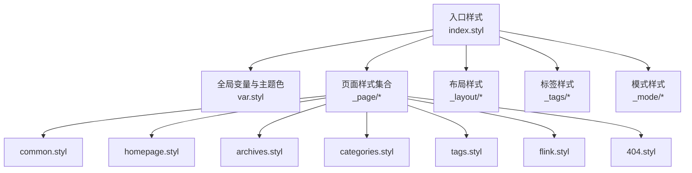
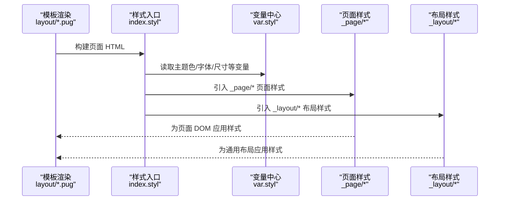
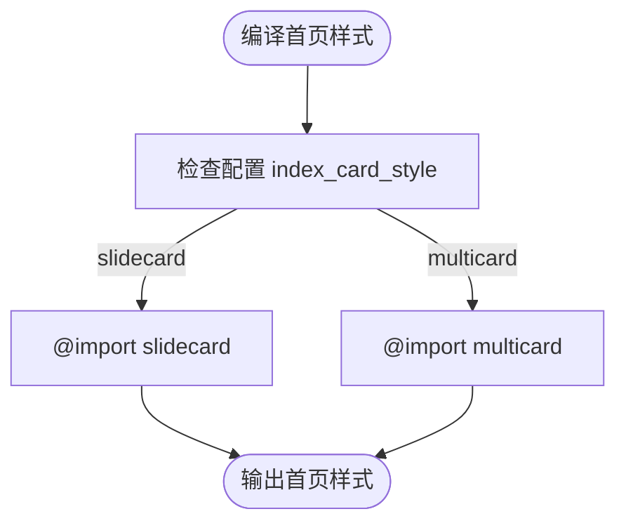
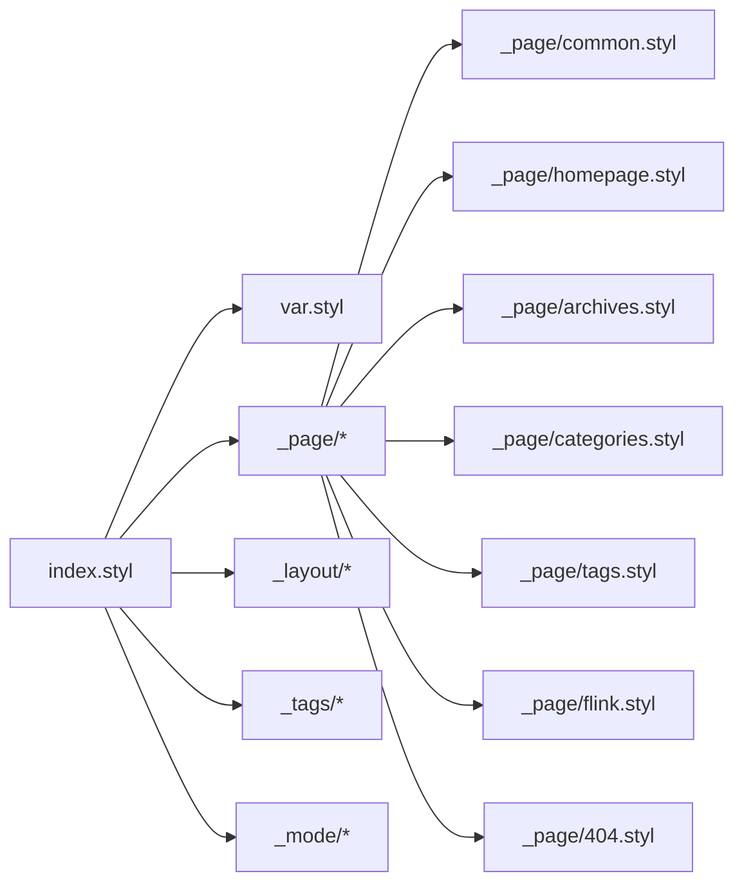

# 页面样式系统

<cite>
**本文引用的文件**   
- [index.styl](file://themes/fomalhaut/source/css/index.styl)
- [var.styl](file://themes/fomalhaut/source/css/var.styl)
- [_page/common.styl](file://themes/fomalhaut/source/css/_page/common.styl)
- [_page/homepage.styl](file://themes/fomalhaut/source/css/_page/homepage.styl)
- [_page/archives.styl](file://themes/fomalhaut/source/css/_page/archives.styl)
- [_page/categories.styl](file://themes/fomalhaut/source/css/_page/categories.styl)
- [_page/tags.styl](file://themes/fomalhaut/source/css/_page/tags.styl)
- [_page/404.styl](file://themes/fomalhaut/source/css/_page/404.styl)
- [_page/flink.styl](file://themes/fomalhaut/source/css/_page/flink.styl)
- [layout/index.pug](file://themes/fomalhaut/layout/index.pug)
- [layout/archive.pug](file://themes/fomalhaut/layout/archive.pug)
- [layout/category.pug](file://themes/fomalhaut/layout/category.pug)
- [layout/tag.pug](file://themes/fomalhaut/layout/tag.pug)
</cite>

## 目录
1. [引言](#引言)
2. [项目结构](#项目结构)
3. [核心组件](#核心组件)
4. [架构总览](#架构总览)
5. [详细组件分析](#详细组件分析)
6. [依赖分析](#依赖分析)
7. [性能考虑](#性能考虑)
8. [故障排查指南](#故障排查指南)
9. [结论](#结论)
10. [附录](#附录)

## 引言
本文件系统性说明站点“页面特定样式”的设计与管理方式，重点覆盖 _page 目录下不同页面类型（首页、文章归档页、分类页、标签页、友链页、404 页等）的专属样式组织与实现。文档同时阐述样式的模块化设计、复用机制、页面间隔离与冲突避免策略，并提供可操作的定制与扩展方法，帮助读者在不破坏整体主题的前提下进行个性化调整。

## 项目结构
主题采用按职责分层的样式组织：
- 入口聚合：统一入口 index.styl 负责引入全局变量、通用样式、页面样式、布局样式、标签样式、模式样式以及可选模块（搜索、灯笼等）。
- 变量与主题色：var.styl 集中定义颜色、字体、尺寸、交互态等全局变量，供各页面样式复用。
- 页面样式：_page 目录按页面维度拆分样式文件，每个文件对应一类页面或功能区域。
- 布局模板：layout 目录下的 pug 模板决定页面 DOM 结构，从而与 _page 中的选择器一一对应。

图示来源
- [index.styl:1-26](file://themes/fomalhaut/source/css/index.styl#L1-L26)

章节来源
- [index.styl:1-26](file://themes/fomalhaut/source/css/index.styl#L1-L26)

## 核心组件
- 入口聚合器 index.styl：通过条件导入按需加载搜索、灯笼等模块；统一引入 _page/*，确保所有页面样式被编译输出。
- 变量中心 var.styl：提供主题色、字体、间距、卡片背景、滚动条、注释框、按钮、标签、时间线等变量，是页面样式一致性的基础。
- 页面公共样式 common.styl：定义 #body-wrap 与 .layout 的基础布局、响应式断点、隐藏侧边栏时的宽度变化，以及 Apple 设备的兼容处理。
- 页面专属样式：
  - homepage.styl：首页卡片样式根据配置动态引入 slidecard 或 multicard。
  - archives.styl：归档页时间轴与条目样式。
  - categories.styl：分类列表与层级缩进样式。
  - tags.styl：标签云与标题样式。
  - flink.styl：友链样式根据配置切换 butterfly/volantis/flexcard 风格。
  - 404.styl：错误页布局与内容区样式。

章节来源
- [index.styl:1-26](file://themes/fomalhaut/source/css/index.styl#L1-L26)
- [var.styl:1-185](file://themes/fomalhaut/source/css/var.styl#L1-L185)
- [_page/common.styl:1-61](file://themes/fomalhaut/source/css/_page/common.styl#L1-L61)
- [_page/homepage.styl:116-119](file://themes/fomalhaut/source/css/_page/homepage.styl#L116-L119)
- [_page/archives.styl:1-111](file://themes/fomalhaut/source/css/_page/archives.styl#L1-L111)
- [_page/categories.styl:1-42](file://themes/fomalhaut/source/css/_page/categories.styl#L1-L42)
- [_page/tags.styl:1-24](file://themes/fomalhaut/source/css/_page/tags.styl#L1-L24)
- [_page/flink.styl:91-96](file://themes/fomalhaut/source/css/_page/flink.styl#L91-L96)
- [_page/404.styl:1-69](file://themes/fomalhaut/source/css/_page/404.styl#L1-L69)

## 架构总览
页面样式由“入口聚合 + 变量中心 + 页面模块 + 布局模板”共同构成。模板生成稳定的 DOM 类名，样式文件通过选择器精准命中目标节点，并通过变量与 mixin 保证一致性。

图示来源
- [index.styl:1-26](file://themes/fomalhaut/source/css/index.styl#L1-L26)
- [var.styl:1-185](file://themes/fomalhaut/source/css/var.styl#L1-L185)

## 详细组件分析

### 首页样式（homepage.styl）
- 设计要点：
  - 首页卡片样式支持两种视觉风格：slidecard 与 multicard，通过 hexo-config('index_card_style') 在编译期选择引入。
  - 未启用的旧版 inline 样式以注释保留，便于回退参考。
- 复用机制：
  - 通过 @import 按需引入 _index_card_style 下的具体风格文件，避免无关样式进入产物。
- 定制建议：
  - 修改主题配置 index_card_style 的值即可切换风格。
  - 如需新增风格，可在 _index_card_style 下新建 styl 文件并在 homepage.styl 中增加分支引入。

图示来源
- [_page/homepage.styl:116-119](file://themes/fomalhaut/source/css/_page/homepage.styl#L116-L119)

章节来源
- [_page/homepage.styl:1-119](file://themes/fomalhaut/source/css/_page/homepage.styl#L1-L119)
- [layout/index.pug:1-11](file://themes/fomalhaut/layout/index.pug#L1-L11)

### 归档页样式（archives.styl）
- 设计要点：
  - 使用 .article-sort 作为容器，左侧竖线+圆点形成时间轴效果。
  - 年份条目 .year 与普通条目 .article-sort-item 区分显示，标题悬停位移与变色增强交互感。
  - 图片缩略图 .article-sort-img 统一圆角与缩放动效。
- 复用机制：
  - 复用全局变量 $light-blue、$theme-meta-color 与工具类 .imgHover、.limit-more-line。
- 定制建议：
  - 调整时间轴颜色、圆点大小、条目间距等变量或选择器属性。
  - 若需改变时间轴方向或布局，可基于现有结构扩展 flex/grid 布局。

章节来源
- [_page/archives.styl:1-111](file://themes/fomalhaut/source/css/_page/archives.styl#L1-L111)
- [layout/archive.pug:1-10](file://themes/fomalhaut/layout/archive.pug#L1-L10)

### 分类页样式（categories.styl）
- 设计要点：
  - .category-lists 包含标题与列表，列表采用 flex 换行居中展示。
  - 分类计数 .category-list-count 使用伪元素包裹括号，语义清晰。
  - 嵌套 ul 缩进体现层级关系。
- 复用机制：
  - 复用全局文本色 var(--font-color)、元信息色 $theme-meta-color 与工具类 .list-beauty。
- 定制建议：
  - 调整列表间距、字号、悬停色等。
  - 如需网格化展示，可在 .category-list 上改用 grid 布局。

章节来源
- [_page/categories.styl:1-42](file://themes/fomalhaut/source/css/_page/categories.styl#L1-L42)
- [layout/category.pug:1-14](file://themes/fomalhaut/layout/category.pug#L1-L14)

### 标签页样式（tags.styl）
- 设计要点：
  - .tag-cloud-list 内 a 标签采用内联块展示，悬停放大并高亮。
  - 移动端通过 zoom 缩小以适应窄屏。
  - h1.page-title 后的标签列表左对齐，提升可读性。
- 复用机制：
  - 复用 $text-hover 与响应式 mixin。
- 定制建议：
  - 调整缩放比例、悬停动画时长、字号等。
  - 如需标签权重可视化，可在 JS 层控制 class 或 style 后在此处扩展样式。

章节来源
- [_page/tags.styl:1-24](file://themes/fomalhaut/source/css/_page/tags.styl#L1-L24)
- [layout/tag.pug:1-14](file://themes/fomalhaut/layout/tag.pug#L1-L14)

### 友链页样式（flink.styl）
- 设计要点：
  - 通过 hexo-config('flink_style') 在编译期选择 butterfly、volantis 或 flexcard 三种风格之一。
  - 旧版 inline 样式以注释保留，便于参考与回退。
- 复用机制：
  - 通过 @import 引入 _flink_style 下的具体风格文件，保持样式解耦。
- 定制建议：
  - 修改 flink_style 配置值切换风格。
  - 新增风格时，在 _flink_style 下创建新 styl 文件并在 flink.styl 中增加分支。

章节来源
- [_page/flink.styl:1-96](file://themes/fomalhaut/source/css/_page/flink.styl#L1-L96)

### 404 页样式（404.styl）
- 设计要点：
  - 仅在启用 error_404.enable 时生效，避免无用样式污染。
  - 错误页主体居中，左右分栏（图片与信息），移动端自适应全宽。
  - 右侧悬浮面板在 404 页隐藏，避免干扰。
- 复用机制：
  - 复用主题色 $theme-color、字体变量 $site-name-font 与工具类 .cardHover、.imgHover、.limit-more-line。
- 定制建议：
  - 调整高度、字号、间距等适配品牌风格。
  - 可替换图片资源或文案，配合模板语言国际化。

章节来源
- [_page/404.styl:1-69](file://themes/fomalhaut/source/css/_page/404.styl#L1-L69)

### 页面公共布局（common.styl）
- 设计要点：
  - #body-wrap 与 .layout 定义主容器弹性布局与最大宽度。
  - 响应式断点：<=900px 纵向排列，<=768px 减小内边距，>=2000px 放宽最大宽度。
  - 首列内容默认带卡片阴影与内边距，hide-aside 模式下占满宽度。
  - Apple 设备特殊处理：禁用 fixed 背景滚动与开启硬件加速。
- 复用机制：
  - 作为所有页面的基础布局，被 _page/* 与 _layout/* 共同依赖。
- 定制建议：
  - 调整主内容区宽度、内边距、断点阈值等。
  - 如需自定义 hide-aside 行为，可在此基础上扩展。

章节来源
- [_page/common.styl:1-61](file://themes/fomalhaut/source/css/_page/common.styl#L1-L61)

## 依赖分析
- 入口依赖：
  - index.styl 依次引入 var、_global、_highlight、_page、_layout、_tags、_mode，并按配置引入搜索与灯笼模块。
- 页面样式依赖：
  - 各 _page/* 文件主要依赖 var.styl 提供的变量与工具类，不直接相互引用，降低耦合。
- 模板与样式映射：
  - layout/*.pug 生成的 DOM 结构与 _page/* 的选择器严格对应，如 #archive、.article-sort、.category-lists、.tag-cloud-list 等。

图示来源
- [index.styl:1-26](file://themes/fomalhaut/source/css/index.styl#L1-L26)

章节来源
- [index.styl:1-26](file://themes/fomalhaut/source/css/index.styl#L1-L26)

## 性能考虑
- 按需引入：
  - 通过 hexo-config 条件判断引入搜索、灯笼、友链风格与首页卡片风格，减少无效 CSS。
- 变量复用：
  - 将主题色、字体、尺寸等集中在 var.styl，避免重复定义，利于缓存与优化。
- 选择器简洁：
  - 页面样式尽量使用稳定且具体的类名，避免深层嵌套，提高匹配效率。
- 移动端优化：
  - 合理使用 transform 与 will-change（如 translateZ(0)）触发 GPU 加速，改善滚动与动画性能。

[本节为通用指导，无需列出具体文件来源]

## 故障排查指南
- 样式未生效
  - 确认入口 index.styl 已正确引入 _page/*。
  - 检查 hexo-config 开关是否启用对应模块（如 error_404、flink_style、index_card_style）。
- 样式冲突
  - 优先使用主题提供的类名与变量，避免自定义选择器与主题选择器同名。
  - 在 _custom/custom.css 中追加覆盖样式，避免直接修改主题源文件。
- 移动端异常
  - 检查响应式断点是否与设备宽度匹配，必要时在 common.styl 基础上扩展。
- 友链/首页风格不生效
  - 核对配置项 flink_style 与 index_card_style 的值是否在允许范围内。

章节来源
- [index.styl:1-26](file://themes/fomalhaut/source/css/index.styl#L1-L26)
- [_page/404.styl:1-69](file://themes/fomalhaut/source/css/_page/404.styl#L1-L69)
- [_page/flink.styl:91-96](file://themes/fomalhaut/source/css/_page/flink.styl#L91-L96)
- [_page/homepage.styl:116-119](file://themes/fomalhaut/source/css/_page/homepage.styl#L116-L119)

## 结论
该页面样式系统以“入口聚合 + 变量中心 + 页面模块 + 布局模板”为核心，实现了清晰的职责分离与良好的可扩展性。通过配置驱动的按需引入与统一的变量体系，既保证了多页面的一致性，又提供了灵活的定制空间。遵循本文的隔离与复用策略，可以在不破坏主题结构的前提下完成个性化的页面样式扩展。

[本节为总结性内容，无需列出具体文件来源]

## 附录
- 页面模板与样式对照
  - 首页：layout/index.pug -> _page/homepage.styl
  - 归档页：layout/archive.pug -> _page/archives.styl
  - 分类页：layout/category.pug -> _page/categories.styl
  - 标签页：layout/tag.pug -> _page/tags.styl
  - 友链页：_page/flink.styl（风格由配置驱动）
  - 404 页：_page/404.styl（受配置开关控制）

章节来源
- [layout/index.pug:1-11](file://themes/fomalhaut/layout/index.pug#L1-L11)
- [layout/archive.pug:1-10](file://themes/fomalhaut/layout/archive.pug#L1-L10)
- [layout/category.pug:1-14](file://themes/fomalhaut/layout/category.pug#L1-L14)
- [layout/tag.pug:1-14](file://themes/fomalhaut/layout/tag.pug#L1-L14)
- [_page/homepage.styl:116-119](file://themes/fomalhaut/source/css/_page/homepage.styl#L116-L119)
- [_page/archives.styl:1-111](file://themes/fomalhaut/source/css/_page/archives.styl#L1-L111)
- [_page/categories.styl:1-42](file://themes/fomalhaut/source/css/_page/categories.styl#L1-L42)
- [_page/tags.styl:1-24](file://themes/fomalhaut/source/css/_page/tags.styl#L1-L24)
- [_page/flink.styl:91-96](file://themes/fomalhaut/source/css/_page/flink.styl#L91-L96)
- [_page/404.styl:1-69](file://themes/fomalhaut/source/css/_page/404.styl#L1-L69)