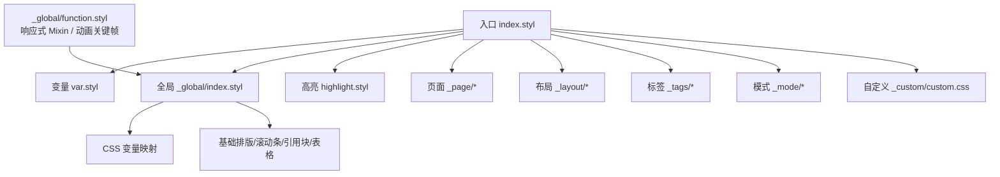
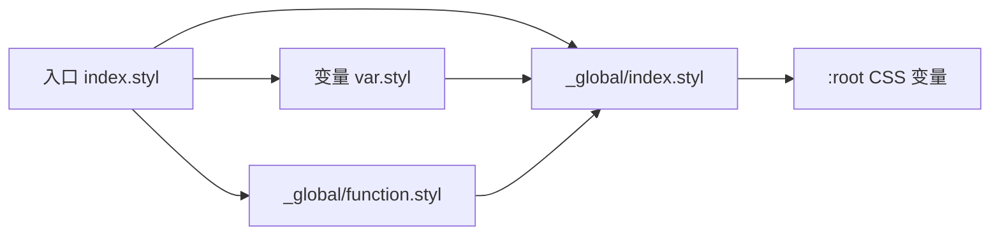
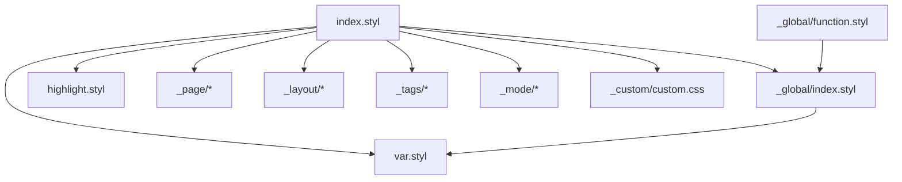

# Stylus 函数库

<cite>
**本文引用的文件**   
- [index.styl](file://themes/fomalhaut/source/css/index.styl)
- [var.styl](file://themes/fomalhaut/source/css/var.styl)
- [_global/index.styl](file://themes/fomalhaut/source/css/_global/index.styl)
- [_global/function.styl](file://themes/fomalhaut/source/css/_global/function.styl)
</cite>

## 目录
1. [简介](#简介)
2. [项目结构](#项目结构)
3. [核心组件](#核心组件)
4. [架构总览](#架构总览)
5. [详细组件分析](#详细组件分析)
6. [依赖关系分析](#依赖关系分析)
7. [性能与最佳实践](#性能与最佳实践)
8. [故障排查指南](#故障排查指南)
9. [结论](#结论)

## 简介
本文件面向使用 Fomalhaut 主题进行样式开发的开发者，系统化梳理并说明该主题中基于 Stylus 的“函数/工具”能力。需要特别说明的是：仓库中并未定义传统意义上的 Stylus 自定义函数（如 color、size、animation 等纯计算型函数），而是通过以下机制实现“可复用、可配置、可扩展”的样式工具体系：
- 变量集中管理：统一的主题色、字体、间距、阴影等变量，便于全局派生和切换。
- 响应式 Mixin：提供一组媒体查询封装，用于在不同断点下复用样式块。
- 动画与关键帧：集中维护页面级动画与关键帧，配合配置开关控制启用。
- CSS 变量映射：将 Stylus 变量映射为运行时 CSS 变量，支持动态主题与深色模式。

本文将围绕上述机制展开，给出参数约定、返回值类型、调用示例、扩展方式以及性能优化建议。

## 项目结构
主题样式入口与组织方式如下：
- 入口聚合：index.styl 负责按条件引入各模块，包括变量、全局样式、高亮、页面、布局、标签、模式与自定义样式。
- 变量层：var.styl 集中定义主题色、字体、边距、卡片、滚动条、搜索、评论、标签插件等变量。
- 全局样式层：_global/index.styl 将 Stylus 变量映射为 :root 下的 CSS 变量，并定义基础排版、滚动条、引用块、表格等通用样式。
- 工具与动画层：_global/function.styl 提供响应式 Mixin 与动画关键帧，供其他样式复用。

图表来源
- [index.styl:1-26](file://themes/fomalhaut/source/css/index.styl#L1-L26)
- [var.styl:1-185](file://themes/fomalhaut/source/css/var.styl#L1-L185)
- [_global/index.styl:1-220](file://themes/fomalhaut/source/css/_global/index.styl#L1-L220)
- [_global/function.styl:1-252](file://themes/fomalhaut/source/css/_global/function.styl#L1-L252)

章节来源
- [index.styl:1-26](file://themes/fomalhaut/source/css/index.styl#L1-L26)

## 核心组件
本节聚焦三类“工具能力”，对应主题中的实际实现位置与用法。

- 颜色处理工具（变量与派生）
  - 作用：统一管理主题色、链接色、代码前景/背景、引用块配色、按钮悬浮色、滚动条色等，并通过 hexo-config 注入用户配置。
  - 参数来源：hexo-config('theme_color.*') 等配置项；未配置时回退到默认值。
  - 返回值类型：Stylus 颜色值（十六进制或 rgba）。
  - 典型路径：[var.styl:1-185](file://themes/fomalhaut/source/css/var.styl#L1-L185)

- 尺寸与布局工具（响应式 Mixin）
  - 作用：封装常用断点的媒体查询，避免重复书写 @media。
  - 参数：无参，内部以 {block} 包裹使用者传入的样式块。
  - 返回值类型：生成带 @media 的规则块。
  - 典型路径：[_global/function.styl:74-104](file://themes/fomalhaut/source/css/_global/function.styl#L74-L104)

- 动画辅助工具（关键帧与条件动画）
  - 作用：集中定义页面级动画关键帧，并通过 hexo-config 控制是否启用。
  - 参数：部分动画受配置开关影响（如 enter_transitions、avatar.effect）。
  - 返回值类型：@keyframes 规则与选择器上的 animation 应用。
  - 典型路径：[_global/function.styl:106-252](file://themes/fomalhaut/source/css/_global/function.styl#L106-L252)

章节来源
- [var.styl:1-185](file://themes/fomalhaut/source/css/var.styl#L1-L185)
- [_global/function.styl:74-104](file://themes/fomalhaut/source/css/_global/function.styl#L74-L104)
- [_global/function.styl:106-252](file://themes/fomalhaut/source/css/_global/function.styl#L106-L252)

## 架构总览
下图展示从入口到变量、全局样式与工具层的依赖关系，以及 CSS 变量的映射流程。

图表来源
- [index.styl:1-26](file://themes/fomalhaut/source/css/index.styl#L1-L26)
- [var.styl:1-185](file://themes/fomalhaut/source/css/var.styl#L1-L185)
- [_global/index.styl:1-220](file://themes/fomalhaut/source/css/_global/index.styl#L1-L220)
- [_global/function.styl:1-252](file://themes/fomalhaut/source/css/_global/function.styl#L1-L252)

## 详细组件分析

### 颜色处理工具（变量与派生）
- 设计要点
  - 所有颜色相关变量集中在 var.styl，优先读取 hexo-config 配置，否则使用默认值。
  - 通过 convert() 确保字符串配置被转换为 Stylus 颜色对象，便于后续 lighten/darken/alpha 等操作。
  - 衍生变量（如 $light-blue、$blockquote-background-color）由主题主色派生，保证视觉一致性。
- 参数与返回值
  - 输入：hexo-config('theme_color.*') 等配置键。
  - 输出：Stylus 颜色值（十六进制或 rgba）。
- 使用示例（概念性）
  - 在任意样式中使用 $theme-color、$button-hover-color、$scrollbar-color 等变量。
  - 通过修改 _config.fomalhaut.yml 的 theme_color 节点，即可全局换肤。
- 扩展方法
  - 新增颜色变量：在 var.styl 中追加新变量，并在 _global/index.styl 中映射为 CSS 变量，以便 JS 动态读取。
  - 增加派生逻辑：使用 lighten/darken/alpha/spin 等内置函数对基础色进行派生。

章节来源
- [var.styl:1-185](file://themes/fomalhaut/source/css/var.styl#L1-L185)

### 尺寸与布局工具（响应式 Mixin）
- 设计要点
  - 提供 maxWidth/minWidth 系列 Mixin，简化媒体查询写法。
  - 使用 {block} 语法接收样式块，提高复用性。
- 参数与返回值
  - 参数：无（内部固定断点）。
  - 返回值：生成 @media screen and (max-width/min-width: ...) 的规则块。
- 使用示例（概念性）
  - 在某个组件样式中调用 maxWidth600() 或 minWidth768()，将响应式样式放入其中。
- 扩展方法
  - 新增断点：在 function.styl 中追加新的 Mixin，例如 maxWidth1200()。
  - 组合使用：多个 Mixin 嵌套或并列使用，构建复杂响应式布局。

章节来源
- [_global/function.styl:74-104](file://themes/fomalhaut/source/css/_global/function.styl#L74-L104)

### 动画辅助工具（关键帧与条件动画）
- 设计要点
  - 动画关键帧集中在 function.styl，包含页面进入、标题缩放、侧边菜单、头像旋转等。
  - 通过 hexo-config('enter_transitions')、hexo-config('avatar.effect') 等开关控制动画启用。
- 参数与返回值
  - 参数：部分动画受配置开关影响。
  - 返回值：@keyframes 定义与选择器上的 animation 应用。
- 使用示例（概念性）
  - 在页面元素上添加类名（如 .cardHover、.imgHover）以触发预设动画。
  - 关闭不必要的动画以提升低端设备性能。
- 扩展方法
  - 新增关键帧：在 function.styl 末尾追加 @keyframes 定义，并在需要的选择器上引用。
  - 条件启用：结合 hexo-config 判断是否注入动画规则。

章节来源
- [_global/function.styl:106-252](file://themes/fomalhaut/source/css/_global/function.styl#L106-L252)

### CSS 变量映射层（运行时主题）
- 设计要点
  - 在 _global/index.styl 中将 Stylus 变量映射为 :root 下的 CSS 变量，供 JS 与运行时样式读取。
  - 同时定义 body、滚动条、引用块、表格等基础样式，确保全站一致的基础体验。
- 参数与返回值
  - 输入：Stylus 变量（来自 var.styl）。
  - 输出：CSS 变量与基础样式规则。
- 使用示例（概念性）
  - 在 JS 中读取 var(--theme-color)、var(--btn-hover-color) 等，实现动态主题切换。
- 扩展方法
  - 新增 CSS 变量：在 _global/index.styl 中追加 --xxx 变量映射。
  - 在 var.styl 中定义对应的 Stylus 变量，保持单一数据源。

章节来源
- [_global/index.styl:1-220](file://themes/fomalhaut/source/css/_global/index.styl#L1-L220)

## 依赖关系分析
- 入口依赖
  - index.styl 按顺序引入 var、_global/*、highlight、_page/*、_layout/*、_tags/*、_mode/*、_custom/custom.css。
  - 可选引入搜索与灯笼样式，取决于 hexo-config 开关。
- 变量依赖
  - var.styl 是样式系统的“单一事实来源”，所有颜色、字体、边距等均由此导出。
- 全局样式依赖
  - _global/index.styl 依赖 var.styl 提供的变量，并输出 CSS 变量与基础样式。
- 工具依赖
  - _global/function.styl 不依赖其他样式文件，独立提供 Mixin 与动画。

图表来源
- [index.styl:1-26](file://themes/fomalhaut/source/css/index.styl#L1-L26)
- [var.styl:1-185](file://themes/fomalhaut/source/css/var.styl#L1-L185)
- [_global/index.styl:1-220](file://themes/fomalhaut/source/css/_global/index.styl#L1-L220)
- [_global/function.styl:1-252](file://themes/fomalhaut/source/css/_global/function.styl#L1-L252)

章节来源
- [index.styl:1-26](file://themes/fomalhaut/source/css/index.styl#L1-L26)

## 性能与最佳实践
- 颜色与主题
  - 尽量复用 var.styl 中的变量，避免硬编码颜色值，减少冗余与不一致。
  - 使用 convert() 将字符串配置转为颜色对象，再进行 lighten/darken/alpha 操作，避免运行时计算。
- 响应式与布局
  - 使用 Mixin 替代重复的 @media 语句，降低编译产物体积与维护成本。
  - 合理设置断点，避免过多细粒度媒体查询导致样式膨胀。
- 动画与交互
  - 仅在必要时启用动画（通过 hexo-config 开关），低端设备上谨慎使用 transform/opacity 以外的属性。
  - 将动画关键帧集中管理，避免分散定义造成重复。
- CSS 变量
  - 将频繁变化的样式（如主题色、按钮悬浮色）映射为 CSS 变量，便于 JS 动态更新，减少重排重绘。
- 扩展建议
  - 新增工具时遵循现有命名与组织规范，保持 var.styl 与 _global/index.styl 的一致性。
  - 对新增变量提供默认值与 fallback，确保配置缺失时的稳定性。

## 故障排查指南
- 主题色未生效
  - 检查 _config.fomalhaut.yml 中 theme_color.enable 与具体颜色键是否配置正确。
  - 确认 var.styl 中 convert() 能正确解析配置值。
- 响应式样式未生效
  - 检查是否正确使用了 Mixin（如 maxWidth600()），并确保样式块置于 Mixin 内。
  - 核对断点是否与预期一致，必要时在 function.styl 中新增或调整 Mixin。
- 动画未播放
  - 检查 hexo-config('enter_transitions') 与 hexo-config('avatar.effect') 等开关是否开启。
  - 确认目标元素是否添加了相应的类名（如 .cardHover、.imgHover）。
- CSS 变量未更新
  - 确认 _global/index.styl 中已将该变量映射为 :root 下的 CSS 变量。
  - 检查 JS 读取的变量名是否与映射一致。

章节来源
- [var.styl:1-185](file://themes/fomalhaut/source/css/var.styl#L1-L185)
- [_global/function.styl:74-104](file://themes/fomalhaut/source/css/_global/function.styl#L74-L104)
- [_global/function.styl:106-252](file://themes/fomalhaut/source/css/_global/function.styl#L106-L252)
- [_global/index.styl:1-220](file://themes/fomalhaut/source/css/_global/index.styl#L1-L220)

## 结论
本主题的“Stylus 函数库”以变量集中管理、响应式 Mixin 与动画关键帧为核心，辅以 CSS 变量映射，形成一套稳定、可配置、易扩展的样式工具体系。尽管没有传统意义上的自定义函数，但通过变量派生、Mixin 封装与条件动画，已经能够覆盖颜色处理、尺寸计算与动画辅助等常见需求。建议在开发中严格遵循现有结构与命名规范，按需扩展变量与 Mixin，并结合 hexo-config 开关控制功能启用，以获得一致的视觉效果与良好的性能表现。