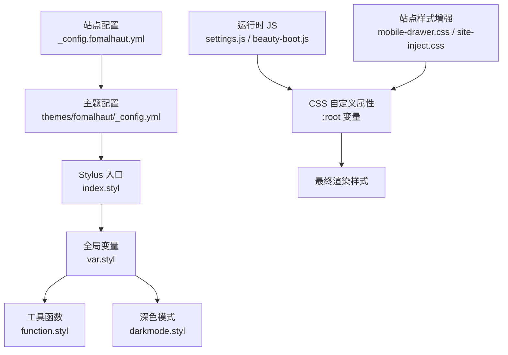
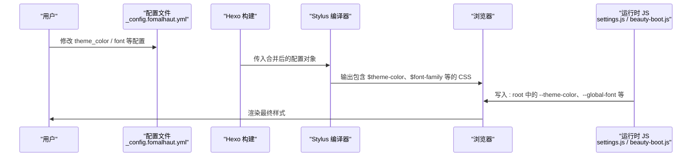
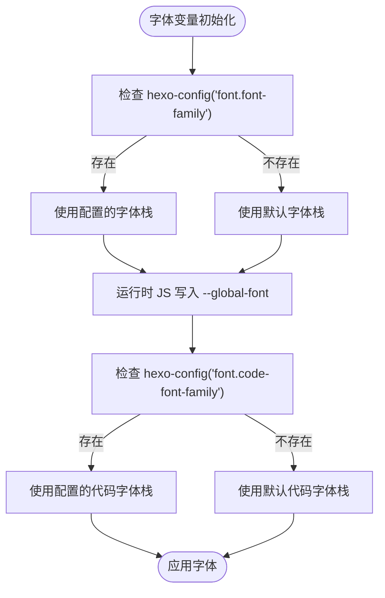
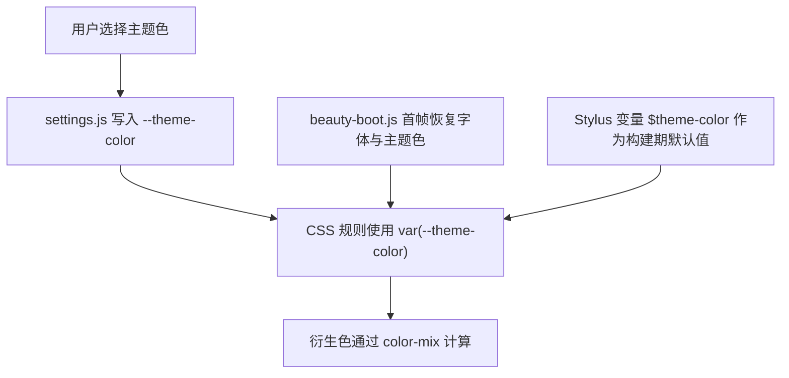
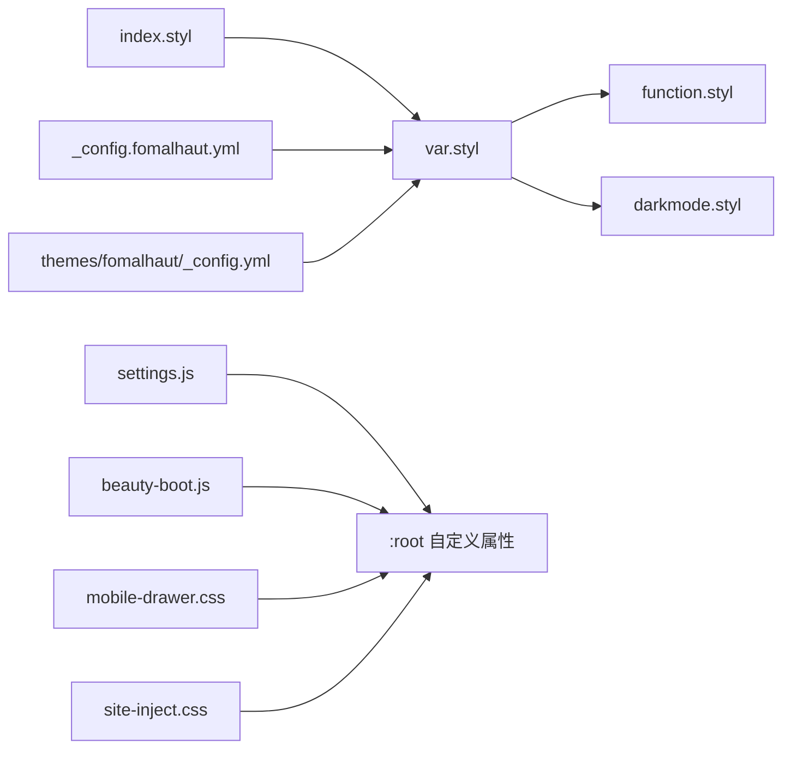

# Stylus 变量系统

<cite>
**本文引用的文件**   
- [themes/fomalhaut/source/css/var.styl](file://themes/fomalhaut/source/css/var.styl)
- [themes/fomalhaut/source/css/index.styl](file://themes/fomalhaut/source/css/index.styl)
- [themes/fomalhaut/source/css/_global/function.styl](file://themes/fomalhaut/source/css/_global/function.styl)
- [themes/fomalhaut/source/css/_mode/darkmode.styl](file://themes/fomalhaut/source/css/_mode/darkmode.styl)
- [themes/fomalhaut/_config.yml](file://themes/fomalhaut/_config.yml)
- [_config.fomalhaut.yml](file://_config.fomalhaut.yml)
- [source/js/modules/settings.js](file://source/js/modules/settings.js)
- [source/js/inject/beauty-boot.js](file://source/js/inject/beauty-boot.js)
- [source/css/mobile-drawer.css](file://source/css/mobile-drawer.css)
- [source/css/site-inject.css](file://source/css/site-inject.css)
</cite>

## 目录
1. [引言](#引言)
2. [项目结构](#项目结构)
3. [核心组件](#核心组件)
4. [架构总览](#架构总览)
5. [详细组件分析](#详细组件分析)
6. [依赖关系分析](#依赖关系分析)
7. [性能与可维护性](#性能与可维护性)
8. [故障排查](#故障排查)
9. [结论](#结论)

## 引言
本文聚焦于 Fomalhaut 主题中 Stylus 变量系统的架构设计，重点说明：
- 颜色变量的分类与组织方式，包括主题色、文本色、背景色等。
- 字体变量的配置机制，包括默认字体和代码字体的设置。
- 响应式变量与全局变量的使用模式。
- 如何通过 `hexo-config` 动态获取配置值，以及变量的优先级与覆盖机制。
- 具体的变量定义示例和使用场景（以路径引用代替直接粘贴源码）。

该体系由三层构成：
- 构建期：Stylus 通过 `hexo-config` 读取 `_config.yml` 与站点级 `_config.fomalhaut.yml`，生成编译后的 CSS 变量与常量。
- 运行时：JavaScript 将用户选择的主题色、字体等写入 CSS 自定义属性，供样式层消费。
- 样式层：Stylus 变量与 CSS 自定义属性共同驱动页面外观，支持深浅模式与响应式布局。

## 项目结构
与 Stylus 变量系统直接相关的文件分布如下：
- 主题样式入口：`themes/fomalhaut/source/css/index.styl`
- 全局变量定义：`themes/fomalhaut/source/css/var.styl`
- 工具函数与动画：`themes/fomalhaut/source/css/_global/function.styl`
- 深色模式变量覆盖：`themes/fomalhaut/source/css/_mode/darkmode.styl`
- 主题默认配置：`themes/fomalhaut/_config.yml`
- 站点级覆盖配置：`_config.fomalhaut.yml`
- 运行时主题色注入：`source/js/modules/settings.js`、`source/js/inject/beauty-boot.js`
- 站点级样式增强：`source/css/mobile-drawer.css`、`source/css/site-inject.css`

**图表来源**
- [themes/fomalhaut/source/css/index.styl:1-26](file://themes/fomalhaut/source/css/index.styl#L1-L26)
- [themes/fomalhaut/source/css/var.styl:1-185](file://themes/fomalhaut/source/css/var.styl#L1-L185)
- [themes/fomalhaut/source/css/_global/function.styl:107-140](file://themes/fomalhaut/source/css/_global/function.styl#L107-L140)
- [themes/fomalhaut/source/css/_mode/darkmode.styl:1-40](file://themes/fomalhaut/source/css/_mode/darkmode.styl#L1-L40)
- [source/js/modules/settings.js:242-291](file://source/js/modules/settings.js#L242-L291)
- [source/js/inject/beauty-boot.js:49-66](file://source/js/inject/beauty-boot.js#L49-L66)

**章节来源**
- [themes/fomalhaut/source/css/index.styl:1-26](file://themes/fomalhaut/source/css/index.styl#L1-L26)

## 核心组件
- 变量入口与加载顺序：`index.styl` 负责引入 `var.styl`、`_global/*`、`_page/*`、`_layout/*`、`_tags/*`、`_mode/*`，确保变量先于具体样式生效。
- 全局变量集中地：`var.styl` 定义颜色、字体、尺寸、组件相关变量，并通过 `hexo-config` 从配置中取值或回退到默认值。
- 工具函数与媒体查询：`function.styl` 提供响应式 mixin 与通用动画，部分逻辑受配置开关控制。
- 深色模式变量覆盖：`darkmode.styl` 在 `[data-theme='dark']` 下重写大量 CSS 自定义属性，实现深浅模式切换。
- 运行时主题色注入：`settings.js` 与 `beauty-boot.js` 将用户选择的主题色、字体等写入 `:root` 的 CSS 自定义属性，供样式层实时消费。

**章节来源**
- [themes/fomalhaut/source/css/index.styl:4-13](file://themes/fomalhaut/source/css/index.styl#L4-L13)
- [themes/fomalhaut/source/css/var.styl:1-36](file://themes/fomalhaut/source/css/var.styl#L1-L36)
- [themes/fomalhaut/source/css/_global/function.styl:74-104](file://themes/fomalhaut/source/css/_global/function.styl#L74-L104)
- [themes/fomalhaut/source/css/_mode/darkmode.styl:1-40](file://themes/fomalhaut/source/css/_mode/darkmode.styl#L1-L40)
- [source/js/modules/settings.js:242-291](file://source/js/modules/settings.js#L242-L291)
- [source/js/inject/beauty-boot.js:49-66](file://source/js/inject/beauty-boot.js#L49-L66)

## 架构总览
Stylus 变量系统采用“构建期静态变量 + 运行时动态变量”的双轨制：
- 构建期：Stylus 通过 `hexo-config('theme_color.*')`、`hexo-config('font.*')` 等读取配置，生成 `$theme-color`、`$font-family` 等变量，并派生出按钮、链接、滚动条、注释块等组件变量。
- 运行时：JS 将用户选择的主题色写入 `--theme-color`，并在首帧恢复自定义色；同时设置 `--global-font`、`--code-font` 等字体变量。
- 样式层：CSS 自定义属性优先于 Stylus 编译出的常量，从而允许用户在运行时覆盖主题外观。

**图表来源**
- [themes/fomalhaut/source/css/var.styl:6-31](file://themes/fomalhaut/source/css/var.styl#L6-L31)
- [source/js/modules/settings.js:242-291](file://source/js/modules/settings.js#L242-L291)
- [source/js/inject/beauty-boot.js:49-66](file://source/js/inject/beauty-boot.js#L49-L66)

## 详细组件分析

### 颜色变量分类与组织
`var.styl` 将颜色变量分为以下几类：
- 主题主色与派生色：`$bright-blue`、`$strong-cyan`、`$light-orange`、`$light-red`，以及通过 `hexo-config('theme_color.main')` 等覆盖的 `$theme-color`、`$theme-paginator-color`、`$theme-text-selection-color`、`$theme-link-color`、`$theme-hr-color`、`$theme-toc-color`、`$scrollbar-color`、`$button-hover-color`、`$button-bg` 等。
- 代码相关颜色：`$code-foreground`、`$code-background`，用于代码高亮与行内代码背景。
- 文本与背景色：`$font-color`、`$body-bg`、`$card-bg`、`$text-highlight-color`、`$text-hover`、`$text-bg-hover`。
- 组件专用色：如注释块 `$blockquote-padding-color`、`$blockquote-background-color`，搜索 `$search-bg`、`$search-input-color`、`$search-keyword-highlight`，标签插件 `$note-*`、`$tab-*`、`$timeline-default-color` 等。

这些变量大多遵循“启用开关 + hexo-config 取值 + convert/unquote 转换 + 默认回退”的模式，例如：
- `$themeColorEnable = hexo-config('theme_color') && hexo-config('theme_color.enable')`
- `$theme-color = $themeColorEnable && hexo-config('theme_color.main') ? convert(hexo-config('theme_color.main')) : $bright-blue`

这意味着：
- 若未启用 `theme_color.enable`，则回退到内置默认色。
- 若启用了但某项未配置，则继续回退到内置默认色。
- 若配置了合法颜色值，则通过 `convert()` 转换为 Stylus 可识别的颜色类型。

**章节来源**
- [themes/fomalhaut/source/css/var.styl:1-15](file://themes/fomalhaut/source/css/var.styl#L1-L15)
- [themes/fomalhaut/source/css/var.styl:38-75](file://themes/fomalhaut/source/css/var.styl#L38-L75)
- [themes/fomalhaut/source/css/var.styl:51-55](file://themes/fomalhaut/source/css/var.styl#L51-L55)
- [themes/fomalhaut/source/css/var.styl:109-185](file://themes/fomalhaut/source/css/var.styl#L109-L185)

### 字体变量配置机制
字体变量同样集中在 `var.styl`，分为：
- 默认字体栈：`$dafault-font-family`
- 默认代码字体栈：`$dafault-code-font`
- 全局字体：`$font-family = hexo-config('font.font-family') ? unquote(hexo-config('font.font-family')) : $dafault-font-family`
- 代码字体：`$code-font-family = hexo-config('font.code-font-family') ? unquote(hexo-config('font.code-font-family')) : $dafault-code-font`
- 站点标题字体：`$site-name-font = hexo-config('blog_title_font.font-family') && unquote(...)`

此外，站点级 `_config.fomalhaut.yml` 提供了更贴近实际使用的字体配置：
- `font.global-font-size`
- `font.code-font-size`
- `font.font-family` 使用 `var(--global-font)` 作为首位，再拼接系统字体栈，使运行时设置的字体优先生效。
- `font.code-font-family` 使用 `var(--code-font)` 作为首位，再拼接等宽字体栈，使运行时设置的代码字体优先生效。

运行时层面：
- `beauty-boot.js` 根据用户选择设置 `--global-font`，并在某些情况下直接注入 `body{font-family:...}` 以确保首屏字体正确。
- `appearance-fonts.js` 提供字体选择器，区分正文字体与代码字体，并将选择结果持久化到 localStorage。

**图表来源**
- [themes/fomalhaut/source/css/var.styl:15-20](file://themes/fomalhaut/source/css/var.styl#L15-L20)
- [_config.fomalhaut.yml:884-895](file://_config.fomalhaut.yml#L884-L895)
- [source/js/inject/beauty-boot.js:49-66](file://source/js/inject/beauty-boot.js#L49-L66)

**章节来源**
- [themes/fomalhaut/source/css/var.styl:15-20](file://themes/fomalhaut/source/css/var.styl#L15-L20)
- [_config.fomalhaut.yml:884-895](file://_config.fomalhaut.yml#L884-L895)
- [source/js/inject/beauty-boot.js:49-66](file://source/js/inject/beauty-boot.js#L49-L66)

### 响应式变量与全局变量
Stylus 层通过 `function.styl` 提供一组响应式 mixin，例如：
- `maxWidth600()`
- `maxWidth768()`
- `minWidth768()`
- `maxWidth1024()`
- `maxWidth900()`
- `minWidth901()`
- `minWidth900()`
- `minWidth2000()`

这些 mixin 被各模块用于在不同视口下调整布局与交互。例如侧边栏、卡片、导航等在窄屏下的行为可通过这些 mixin 控制。

全局变量方面，`var.styl` 定义了：
- 字号：`$font-size`、`$code-font-size`
- 文本行高：`$text-line-height`
- 背景：`$web-bg`、`$body-bg`、`$card-bg`
- 组件尺寸：`$sidebar-width`、`$rightside-bottom`、`$toc-mobile-width`、`$toc-mobile-maxWidth`

这些变量为整个主题提供统一的视觉基线，便于后续扩展与维护。

**章节来源**
- [themes/fomalhaut/source/css/_global/function.styl:74-104](file://themes/fomalhaut/source/css/_global/function.styl#L74-L104)
- [themes/fomalhaut/source/css/var.styl:29-37](file://themes/fomalhaut/source/css/var.styl#L29-L37)
- [themes/fomalhaut/source/css/var.styl:57-68](file://themes/fomalhaut/source/css/var.styl#L57-L68)

### 通过 hexo-config 动态获取配置值
Stylus 中使用 `hexo-config()` 读取配置的方式贯穿 `var.styl` 与多个样式模块：
- 主题色开关与主色：`hexo-config('theme_color')`、`hexo-config('theme_color.enable')`、`hexo-config('theme_color.main')`
- 字体配置：`hexo-config('font.font-family')`、`hexo-config('font.code-font-family')`、`hexo-config('font.global-font-size')`、`hexo-config('font.code-font-size')`
- 分隔线图标：`hexo-config('hr_icon')`、`hexo-config('hr_icon.icon')`、`hexo-config('hr_icon.icon-top')`
- 美化开关：`hexo-config('beautify.enable')`、`hexo-config('beautify.title-prefix-icon')`、`hexo-config('beautify.title-prefix-icon-color')`
- 背景图：`hexo-config('background.default')`
- 其他功能开关：`hexo-config('enter_transitions')`、`hexo-config('avatar.effect')`、`hexo-config('canvas_ribbon.alpha')` 等

典型模式是“布尔开关 + 条件取值 + convert/unquote 转换 + 默认回退”，保证即使配置缺失也不会导致编译错误。

**章节来源**
- [themes/fomalhaut/source/css/var.styl:6-31](file://themes/fomalhaut/source/css/var.styl#L6-L31)
- [themes/fomalhaut/source/css/var.styl:21-28](file://themes/fomalhaut/source/css/var.styl#L21-L28)
- [themes/fomalhaut/source/css/_global/function.styl:107-140](file://themes/fomalhaut/source/css/_global/function.styl#L107-L140)
- [themes/fomalhaut/source/css/_global/function.styl:220-227](file://themes/fomalhaut/source/css/_global/function.styl#L220-L227)

### 变量的优先级与覆盖机制
变量覆盖遵循以下优先级：
1. 运行时 CSS 自定义属性：`--theme-color`、`--global-font`、`--on-theme`、`--on-theme-away` 等由 JS 写入 `:root`，优先级最高，适合用户动态选择。
2. Stylus 编译出的变量：`$theme-color`、`$font-family` 等由 `hexo-config` 决定，适合站点级统一配置。
3. 内置默认值：当配置未启用或未设置时，Stylus 使用内置默认色与默认字体栈。

运行时主题色注入流程：
- `settings.js` 将用户选择的主题色写入 `<style id="themeColor">`，并设置 `--theme-color`、`--on-theme`、`--on-theme-away`、`--text-bg-hover`、`--high-trans-color`、`--hh-trans-color` 等。
- `beauty-boot.js` 在首帧恢复用户选择的字体与主题色，确保首屏体验一致。
- 站点级样式如 `mobile-drawer.css`、`site-inject.css` 通过 `color-mix(in srgb, var(--theme-color, ...), ...)` 等方式派生衍生色，避免硬编码颜色。

**图表来源**
- [source/js/modules/settings.js:242-291](file://source/js/modules/settings.js#L242-L291)
- [source/js/inject/beauty-boot.js:49-66](file://source/js/inject/beauty-boot.js#L49-L66)
- [source/css/mobile-drawer.css:21-44](file://source/css/mobile-drawer.css#L21-L44)
- [source/css/site-inject.css:210-226](file://source/css/site-inject.css#L210-L226)

**章节来源**
- [source/js/modules/settings.js:242-291](file://source/js/modules/settings.js#L242-L291)
- [source/js/inject/beauty-boot.js:49-66](file://source/js/inject/beauty-boot.js#L49-L66)
- [source/css/mobile-drawer.css:21-44](file://source/css/mobile-drawer.css#L21-L44)
- [source/css/site-inject.css:210-226](file://source/css/site-inject.css#L210-L226)

### 具体变量定义示例与使用场景
- 主题主色：`$theme-color` 来自 `hexo-config('theme_color.main')`，用于按钮背景、链接色、滚动条色等。
- 分页器色：`$theme-paginator-color` 来自 `hexo-config('theme_color.paginator')`，用于分页控件。
- 文本选中色：`$theme-text-selection-color` 来自 `hexo-config('theme_color.text_selection')`，用于选中文本的高亮色。
- 链接色：`$theme-link-color` 来自 `hexo-config('theme_color.link_color')`，用于文章内链接。
- 分割线色：`$theme-hr-color` 来自 `hexo-config('theme_color.hr_color')`，用于水平分割线。
- 代码前景/背景：`$code-foreground`、`$code-background` 来自 `hexo-config('theme_color.code_foreground'/'code_background')`，用于代码块与行内代码。
- 目录色：`$theme-toc-color` 来自 `hexo-config('theme_color.toc_color')`，用于目录高亮。
- 引用块边框/背景：`$blockquote-padding-color`、`$blockquote-background-color` 来自 `hexo-config('theme_color.blockquote_padding_color'/'blockquote_background_color')`。
- 全局字号：`$font-size` 来自 `hexo-config('font.global-font-size')`。
- 代码字号：`$code-font-size` 来自 `hexo-config('font.code-font-size')`，否则回退到 `var(--global-font-size)`。
- 背景图：`$web-bg` 来自 `hexo-config('background.default')`，用于页面背景。

这些变量在 `_layout/*`、`_page/*`、`_tags/*`、`_highlight/*` 等模块中被广泛使用，形成统一的视觉语言。

**章节来源**
- [themes/fomalhaut/source/css/var.styl:6-15](file://themes/fomalhaut/source/css/var.styl#L6-L15)
- [themes/fomalhaut/source/css/var.styl:38-75](file://themes/fomalhaut/source/css/var.styl#L38-L75)
- [themes/fomalhaut/source/css/var.styl:51-55](file://themes/fomalhaut/source/css/var.styl#L51-L55)
- [themes/fomalhaut/source/css/var.styl:29-31](file://themes/fomalhaut/source/css/var.styl#L29-L31)
- [themes/fomalhaut/source/css/var.styl:34-36](file://themes/fomalhaut/source/css/var.styl#L34-L36)

## 依赖关系分析
Stylus 变量系统的依赖关系如下：
- `index.styl` 依赖 `var.styl`，后者是所有变量的单一事实来源。
- `var.styl` 依赖 `_config.yml` 与 `_config.fomalhaut.yml`，通过 `hexo-config` 读取配置。
- `function.styl` 提供响应式 mixin 与动画，被各模块复用。
- `darkmode.styl` 依赖 `var.styl` 中的变量，并在深色模式下覆盖 CSS 自定义属性。
- 运行时 JS 依赖 `settings.js` 与 `beauty-boot.js`，负责将用户选择写入 CSS 自定义属性。
- 站点级样式 `mobile-drawer.css`、`site-inject.css` 依赖 `--theme-color` 等运行时变量进行衍生配色。

**图表来源**
- [themes/fomalhaut/source/css/index.styl:4-13](file://themes/fomalhaut/source/css/index.styl#L4-L13)
- [themes/fomalhaut/source/css/var.styl:1-36](file://themes/fomalhaut/source/css/var.styl#L1-L36)
- [themes/fomalhaut/source/css/_global/function.styl:74-104](file://themes/fomalhaut/source/css/_global/function.styl#L74-L104)
- [themes/fomalhaut/source/css/_mode/darkmode.styl:1-40](file://themes/fomalhaut/source/css/_mode/darkmode.styl#L1-L40)
- [source/js/modules/settings.js:242-291](file://source/js/modules/settings.js#L242-L291)
- [source/js/inject/beauty-boot.js:49-66](file://source/js/inject/beauty-boot.js#L49-L66)
- [source/css/mobile-drawer.css:21-44](file://source/css/mobile-drawer.css#L21-L44)
- [source/css/site-inject.css:210-226](file://source/css/site-inject.css#L210-L226)

**章节来源**
- [themes/fomalhaut/source/css/index.styl:4-13](file://themes/fomalhaut/source/css/index.styl#L4-L13)
- [themes/fomalhaut/source/css/var.styl:1-36](file://themes/fomalhaut/source/css/var.styl#L1-L36)

## 性能与可维护性
- 构建期优化：Stylus 在编译阶段解析 `hexo-config`，减少运行时判断开销。
- 运行时优化：JS 仅在用户操作或首帧恢复时写入 CSS 自定义属性，避免频繁重绘。
- 可维护性：颜色与字体变量集中在 `var.styl`，新增变量应遵循“开关 + hexo-config + 默认回退”的模式，保持风格一致。
- 兼容性：站点级样式使用 `color-mix` 与 fallback 值，兼顾老浏览器与新浏览器。

[本节为一般性指导，不直接分析具体文件]

## 故障排查
常见问题与定位方法：
- 主题色未生效：
  - 检查 `_config.fomalhaut.yml` 中 `theme_color.enable` 是否开启。
  - 检查 `settings.js` 是否正确写入 `--theme-color`。
  - 检查 `beauty-boot.js` 是否在首帧恢复主题色。
- 字体未生效：
  - 检查 `_config.fomalhaut.yml` 中 `font.font-family` 与 `font.code-font-family` 是否配置。
  - 检查 `beauty-boot.js` 是否写入 `--global-font`。
  - 检查 `appearance-fonts.js` 是否正确加载当前字体。
- 深色模式异常：
  - 检查 `darkmode.styl` 是否覆盖了必要的 CSS 自定义属性。
  - 检查 `data-theme` 属性是否正确切换。

**章节来源**
- [themes/fomalhaut/source/css/_mode/darkmode.styl:1-40](file://themes/fomalhaut/source/css/_mode/darkmode.styl#L1-L40)
- [source/js/modules/settings.js:242-291](file://source/js/modules/settings.js#L242-L291)
- [source/js/inject/beauty-boot.js:49-66](file://source/js/inject/beauty-boot.js#L49-L66)

## 结论
Fomalhaut 主题的 Stylus 变量系统通过“构建期静态变量 + 运行时动态变量”的组合，实现了高度可配置、可定制的外观体系。颜色变量按主题主色、文本色、背景色、组件色分类组织；字体变量通过 `hexo-config` 与运行时 JS 协同工作；响应式变量与全局变量为布局与视觉一致性提供基础。通过 `hexo-config` 动态获取配置值，并结合默认回退机制，系统在灵活性与健壮性之间取得平衡。

[本节为总结性内容，不直接分析具体文件]