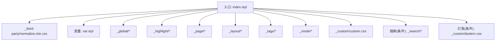
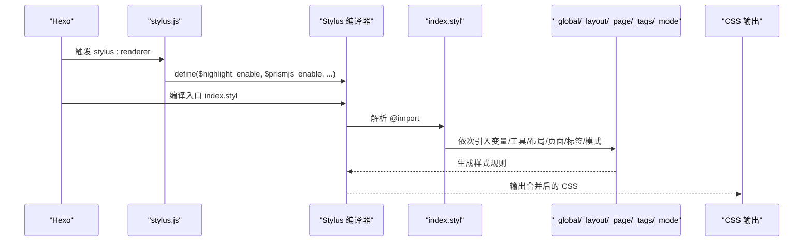
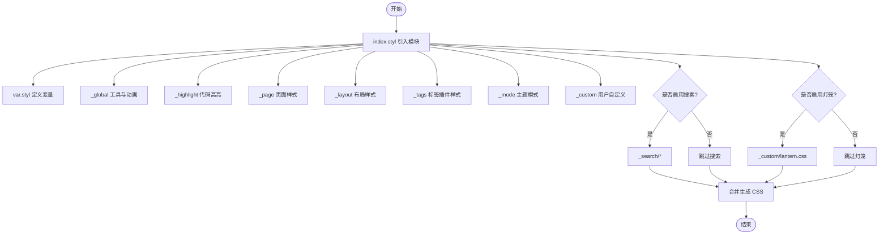
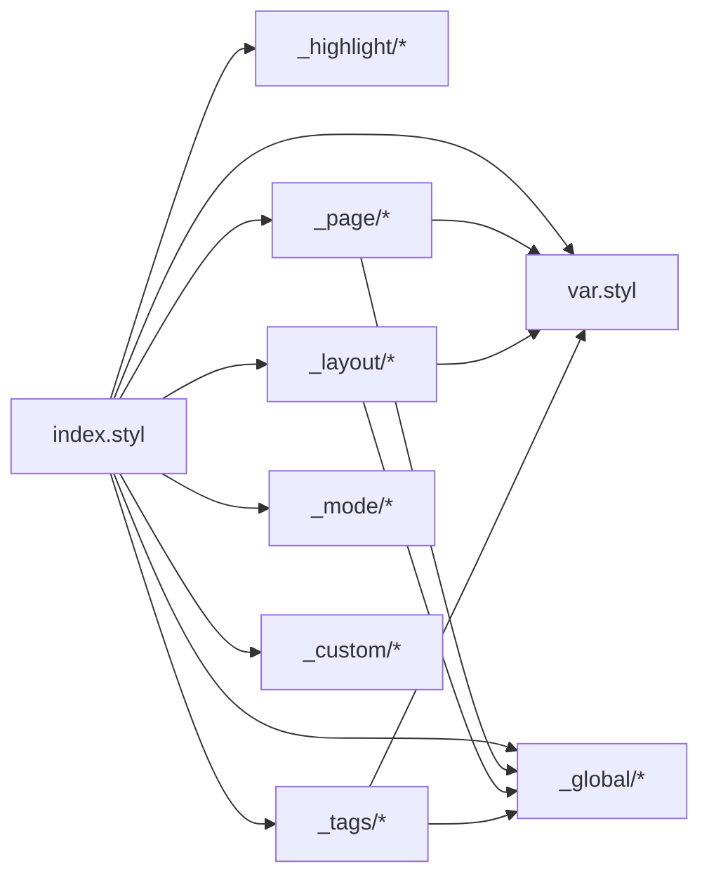

# 样式系统架构

<cite>
**本文引用的文件**   
- [themes/fomalhaut/source/css/index.styl](file://themes/fomalhaut/source/css/index.styl)
- [themes/fomalhaut/source/css/var.styl](file://themes/fomalhaut/source/css/var.styl)
- [themes/fomalhaut/source/css/_global/function.styl](file://themes/fomalhaut/source/css/_global/function.styl)
- [themes/fomalhaut/source/css/_layout/post.styl](file://themes/fomalhaut/source/css/_layout/post.styl)
- [themes/fomalhaut/source/css/_page/homepage.styl](file://themes/fomalhaut/source/css/_page/homepage.styl)
- [themes/fomalhaut/source/css/_tags/note.styl](file://themes/fomalhaut/source/css/_tags/note.styl)
- [themes/fomalhaut/scripts/events/stylus.js](file://themes/fomalhaut/scripts/events/stylus.js)
</cite>

## 目录
1. [引言](#引言)
2. [项目结构](#项目结构)
3. [核心组件](#核心组件)
4. [架构总览](#架构总览)
5. [详细组件分析](#详细组件分析)
6. [依赖关系分析](#依赖关系分析)
7. [性能与可维护性](#性能与可维护性)
8. [故障排查指南](#故障排查指南)
9. [结论](#结论)

## 引言
本文件系统性解析基于 Stylus 的样式系统，重点覆盖：
- 变量系统（var.styl）的设计与使用方式
- 样式文件的组织结构与命名约定
- 全局函数与工具类（function.styl）的作用与扩展点
- 功能模块划分（_layout、_page、_tags 等）的职责边界
- 样式编译流程与最终 CSS 输出结构

该文档面向主题开发者与维护者，帮助快速定位样式职责、理解变量注入机制，并掌握在 Hexo + Stylus 环境下的编译链路。

## 项目结构
主题样式位于 themes/fomalhaut/source/css 下，采用“入口聚合 + 模块化拆分”的组织方式：
- index.styl 作为唯一入口，负责引入第三方库、变量、全局工具、页面、布局、标签、模式与自定义样式
- var.styl 集中定义主题色板、字体、间距、组件默认值等变量
- _global 提供通用工具类、媒体查询函数与动画关键帧
- _layout 负责站点级布局（侧边栏、页脚、文章容器、分页等）
- _page 按页面类型拆分（首页、归档、分类、标签、友链、404 等）
- _tags 为 Hexo 标签插件提供样式（note、tabs、timeline、button 等）
- _mode 提供深色/阅读模式等主题变体
- _custom 允许用户覆盖或追加样式

图表来源
- [themes/fomalhaut/source/css/index.styl:1-26](file://themes/fomalhaut/source/css/index.styl#L1-L26)

章节来源
- [themes/fomalhaut/source/css/index.styl:1-26](file://themes/fomalhaut/source/css/index.styl#L1-L26)

## 核心组件
- 变量系统（var.styl）
  - 主题色板与可配置项：通过 hexo-config 读取主题配置，支持动态覆盖默认色板
  - 字体与字号：全局字体栈、代码字体、博客标题字体
  - 组件默认值：按钮、滚动条、表格、评论、搜索、标签插件等
  - Note 系列变量：多风格（default/modern/flat）与多语义（primary/info/success/warning/danger）
- 全局函数与工具（function.styl）
  - 文本截断、卡片/图片悬停效果、列表美化
  - 媒体查询函数：maxWidth/minWidth 系列，便于响应式复用
  - 动画关键帧与条件动画开关
- 布局层（_layout）
  - 文章正文容器、版权信息、过期提示、分享与标签、广告位等
- 页面层（_page）
  - 首页卡片样式、归档/分类/标签/友链/404 等页面专属样式
- 标签插件（_tags）
  - note、tabs、timeline、button、gallery、hide、inlineImg、label、hexo 等

章节来源
- [themes/fomalhaut/source/css/var.styl:1-185](file://themes/fomalhaut/source/css/var.styl#L1-L185)
- [themes/fomalhaut/source/css/_global/function.styl:1-252](file://themes/fomalhaut/source/css/_global/function.styl#L1-L252)
- [themes/fomalhaut/source/css/_layout/post.styl:254-517](file://themes/fomalhaut/source/css/_layout/post.styl#L254-L517)
- [themes/fomalhaut/source/css/_page/homepage.styl:116-119](file://themes/fomalhaut/source/css/_page/homepage.styl#L116-L119)
- [themes/fomalhaut/source/css/_tags/note.styl:1-122](file://themes/fomalhaut/source/css/_tags/note.styl#L1-L122)

## 架构总览
Stylus 编译由 Hexo 事件驱动，主题通过 stylus:renderer 钩子向 Stylus 运行时注入全局常量，随后入口文件按顺序引入各模块，最终生成单一 CSS 输出。

图表来源
- [themes/fomalhaut/scripts/events/stylus.js:7-15](file://themes/fomalhaut/scripts/events/stylus.js#L7-L15)
- [themes/fomalhaut/source/css/index.styl:1-26](file://themes/fomalhaut/source/css/index.styl#L1-L26)

章节来源
- [themes/fomalhaut/scripts/events/stylus.js:7-15](file://themes/fomalhaut/scripts/events/stylus.js#L7-L15)
- [themes/fomalhaut/source/css/index.styl:1-26](file://themes/fomalhaut/source/css/index.styl#L1-L26)

## 详细组件分析

### 变量系统（var.styl）
- 设计要点
  - 以 hexo-config 为唯一配置来源，保证构建期可定制
  - 对颜色进行统一转换与透明度处理，避免硬编码
  - 将组件默认值与主题色解耦，便于切换主题色板
- 主要分组
  - 主题色板：主色、链接色、引用块背景/边框、滚动条、按钮悬停等
  - 字体与字号：全局字体栈、代码字体、博客标题字体、全局字号
  - 页面与布局：背景图、顶部高度、侧边栏宽度、卡片背景等
  - 组件默认值：搜索、评论、标签隐藏、预加载器、右侧面板位置等
  - Note 系列：多语义类型的边框、背景、文字、图标与现代化风格变量
  - 标签插件：按钮、Tab、时间线等默认配色与交互色
- 使用建议
  - 新增组件时优先从 var.styl 抽取变量，保持样式与数据分离
  - 对需要运行时切换的主题色，尽量使用 CSS 变量配合 var(--*) 渲染

章节来源
- [themes/fomalhaut/source/css/var.styl:1-185](file://themes/fomalhaut/source/css/var.styl#L1-L185)

### 全局函数与工具（function.styl）
- 工具类
  - .limit-one-line / .limit-more-line：单行/多行文本省略
  - .cardHover / .imgHover / .postImgHover：卡片与图片悬停动效
  - .fontawesomeIcon：统一 Font Awesome 图标基础样式
  - .list-beauty：美化列表前缀与悬停态
- 媒体查询函数
  - maxWidth600/maxWidth768/minWidth768/maxWidth900/minWidth901/minWidth2000 等，封装 @media 块，提升可读性与复用性
- 动画与关键帧
  - 根据 hexo-config('enter_transitions') 控制页面元素入场动画
  - 定义 scroll-down、header-effect、titleScale、to_show/to_hide、sidebarItem 等关键帧
- 扩展点
  - 可通过 hexo-config 控制 avatar.effect、canvas_ribbon.alpha 等开关，按需启用动画

章节来源
- [themes/fomalhaut/source/css/_global/function.styl:1-252](file://themes/fomalhaut/source/css/_global/function.styl#L1-L252)

### 布局层（_layout）
- post.styl 职责
  - 文章正文容器 #article-container 的基础排版、链接、图片、iframe、有序/无序列表
  - 可选的标题装饰美化（beautify），受 hexo-config('beautify.enable'/'field') 控制
  - 锚点链接 a.headerlink 的显示逻辑与悬停态
  - 文章元信息与标签/分享区域 #post 的布局与样式
  - 版权信息 .post-copyright 的渐变背景、阴影与深色模式适配
  - 过期提示 .post-outdate-notice 的扁平化样式与图标
  - 广告位 .ads-wrap 的间距控制
- 其他布局文件（aside、footer、sidebar、comments、pagination、rightside、loading、sun_moon、third-party、web-bg 等）分别承担对应区域的样式职责

章节来源
- [themes/fomalhaut/source/css/_layout/post.styl:254-517](file://themes/fomalhaut/source/css/_layout/post.styl#L254-L517)

### 页面层（_page）
- homepage.styl 职责
  - 首页文章卡片布局与交互（注释中展示了常见实现思路）
  - 通过 hexo-config('index_card_style') 动态引入 slidecard 或 multicard 两种卡片风格
- 其他页面文件（archives、categories、tags、flink、common、404 等）分别承载对应页面的样式

章节来源
- [themes/fomalhaut/source/css/_page/homepage.styl:116-119](file://themes/fomalhaut/source/css/_page/homepage.styl#L116-L119)

### 标签插件（_tags）
- note.styl 职责
  - 支持多种外观：simple、modern、flat
  - 支持多语义类型：default、primary、info、success、warning、danger
  - 支持图标开关与自动插入伪元素图标
  - 通过 lookup('$tagsP-' + type + '-color') 与 lookup('$note-*') 动态获取变量
- 其他标签样式（button、gallery、hexo、hide、inlineImg、label、tabs、timeline 等）分别对应不同标签插件

章节来源
- [themes/fomalhaut/source/css/_tags/note.styl:1-122](file://themes/fomalhaut/source/css/_tags/note.styl#L1-L122)

### 样式编译流程与 CSS 输出结构
- 编译入口
  - index.styl 按固定顺序引入 normalize、var、_global、_highlight、_page、_layout、_tags、_mode、_custom
  - 条件引入搜索与灯笼样式
- 运行时常量注入
  - scripts/events/stylus.js 注册 stylus:renderer，向 Stylus 注入 highlight/prismjs 相关布尔与 line_number 常量
- 输出结构
  - 最终 CSS 包含：基础重置、主题变量、全局工具、代码高亮、页面样式、布局样式、标签插件样式、模式样式、自定义样式、搜索与灯笼（若启用）

图表来源
- [themes/fomalhaut/source/css/index.styl:1-26](file://themes/fomalhaut/source/css/index.styl#L1-L26)
- [themes/fomalhaut/scripts/events/stylus.js:7-15](file://themes/fomalhaut/scripts/events/stylus.js#L7-L15)

章节来源
- [themes/fomalhaut/source/css/index.styl:1-26](file://themes/fomalhaut/source/css/index.styl#L1-L26)
- [themes/fomalhaut/scripts/events/stylus.js:7-15](file://themes/fomalhaut/scripts/events/stylus.js#L7-L15)

## 依赖关系分析
- 入口依赖
  - index.styl 依赖 var.styl 与 _global/*，确保所有模块均可使用变量与工具
- 模块内聚与耦合
  - _layout 与 _page 均依赖 var.styl 与 function.styl，但彼此之间无直接依赖，符合低耦合原则
  - _tags 独立于布局与页面，仅依赖变量与工具，便于复用
- 外部依赖
  - 通过 hexo-config 读取主题配置，决定样式分支与开关
  - 通过 stylus:renderer 注入 highlight/prismjs 相关常量，影响代码高亮样式分支

图表来源
- [themes/fomalhaut/source/css/index.styl:1-26](file://themes/fomalhaut/source/css/index.styl#L1-L26)

章节来源
- [themes/fomalhaut/source/css/index.styl:1-26](file://themes/fomalhaut/source/css/index.styl#L1-L26)

## 性能与可维护性
- 编译性能
  - 入口文件集中管理 @import，避免重复引入；条件引入减少不必要的样式体积
  - 使用 Stylus 的 mixin 与函数（如媒体查询函数）减少重复代码
- 可维护性
  - 变量集中管理，便于主题色板与字体策略的统一调整
  - 工具类与动画关键帧集中在 _global，降低散落风险
  - 页面与布局分层清晰，新增页面只需在 _page 添加文件并在 index.styl 按需引入
- 扩展建议
  - 新增组件时，先在 var.styl 定义变量，再在 _tags 或 _layout 实现样式
  - 对需要运行时切换的主题色，优先使用 CSS 变量，减少构建期分支

[本节为通用指导，不直接分析具体文件]

## 故障排查指南
- 样式未生效
  - 检查 index.styl 是否正确引入对应模块
  - 确认 hexo-config 配置项是否开启（例如 search、lantern、index_card_style）
- 变量未生效
  - 检查 var.styl 中的 hexo-config 路径是否与主题配置一致
  - 确认 Stylus 编译阶段是否注入了必要常量（highlight/prismjs）
- 动画异常
  - 检查 function.styl 中的 hexo-config('enter_transitions') 与 avatar.effect 开关
- 搜索/灯笼样式缺失
  - 检查 index.styl 的条件引入逻辑与对应 hexo-config 配置

章节来源
- [themes/fomalhaut/source/css/index.styl:15-26](file://themes/fomalhaut/source/css/index.styl#L15-L26)
- [themes/fomalhaut/scripts/events/stylus.js:7-15](file://themes/fomalhaut/scripts/events/stylus.js#L7-L15)
- [themes/fomalhaut/source/css/_global/function.styl:107-140](file://themes/fomalhaut/source/css/_global/function.styl#L107-L140)

## 结论
该样式系统以 index.styl 为入口，采用“变量集中 + 工具复用 + 模块分层”的架构，结合 Hexo 的配置系统与 Stylus 的编译能力，实现了高内聚、低耦合且易于扩展的样式体系。通过 var.styl 统一管理主题色板与默认值，function.styl 提供通用工具与动画，_layout/_page/_tags 明确职责边界，整体具备良好的可维护性与可扩展性。建议在后续迭代中继续遵循现有约定，逐步完善变量与工具抽象，以提升主题的一致性与可定制性。