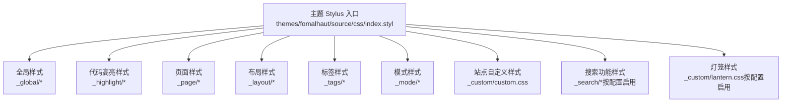
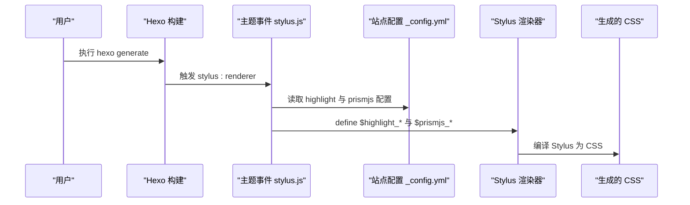
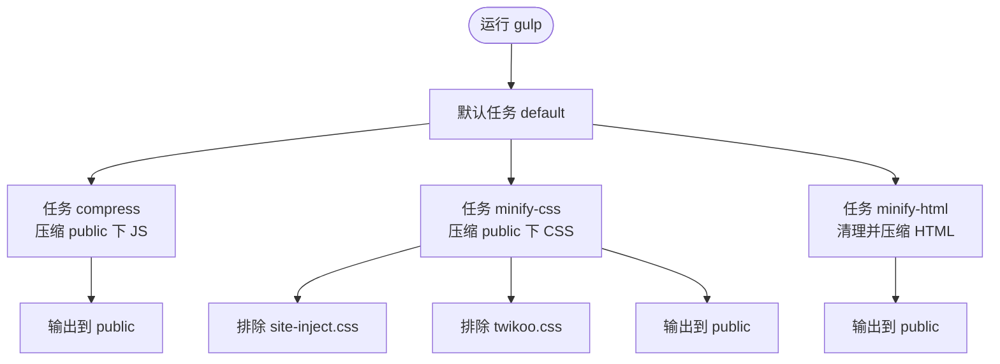

# 样式编译流程

<cite>
**本文引用的文件**   
- [gulpfile.js](file://gulpfile.js)
- [package.json](file://package.json)
- [stylus.js](file://themes/fomalhaut/scripts/events/stylus.js)
- [index.styl](file://themes/fomalhaut/source/css/index.styl)
- [_config.yml](file://_config.yml)
- [_config.fomalhaut.yml](file://_config.fomalhaut.yml)
- [README.md](file://README.md)
</cite>

## 目录
1. [引言](#引言)
2. [项目结构与样式入口](#项目结构与样式入口)
3. [Stylus 编译与变量注入](#stylus-编译与变量注入)
4. [Gulp 构建任务与 CSS 压缩](#gulp-构建任务与-css-压缩)
5. [依赖管理与版本控制策略](#依赖管理与版本控制策略)
6. [开发环境与生产环境的编译差异](#开发环境与生产环境的编译差异)
7. [常见编译错误与调试方法](#常见编译错误与调试方法)
8. [性能与优化建议](#性能与优化建议)
9. [结论](#结论)

## 引言
本文面向需要理解本仓库“样式如何从 Stylus 源码变成最终站点 CSS”的开发者与维护者。重点说明：
- Hexo 主题如何通过 Stylus 渲染器把配置变量注入到样式中。
- Gulp 在生成产物后对 JS、CSS、HTML 做压缩处理。
- 依赖管理方式、版本控制策略，以及开发与生产环境在样式构建上的差异。
- 常见编译错误原因和排查步骤。

## 项目结构与样式入口
本项目的样式分为两层：
- 主题层 Stylus 源码位于 `themes/fomalhaut/source/css/`，由主题自带的 Stylus 入口聚合。
- 站点层静态 CSS 位于 `source/css/`，作为站点级样式直接参与 Hexo 生成过程。

主题 Stylus 入口通过聚合多个模块目录组织样式，包括全局样式、高亮主题、页面样式、布局样式、标签样式、模式样式以及自定义样式等。搜索与灯笼等功能则根据配置条件引入对应模块。

**图表来源**
- [index.styl:1-26](file://themes/fomalhaut/source/css/index.styl#L1-L26)

**章节来源**
- [index.styl:1-26](file://themes/fomalhaut/source/css/index.styl#L1-L26)
- [README.md:506-525](file://README.md#L506-L525)

## Stylus 编译与变量注入
Stylus 编译由 Hexo 的 Stylus 渲染器完成。主题在启动事件中注册 `stylus:renderer`，向 Stylus 环境注入以下变量：
- `$highlight_enable`：是否启用代码高亮。
- `$highlight_line_number`：是否显示行号。
- `$prismjs_enable`：是否启用 PrismJS。
- `$prismjs_line_number`：是否显示 PrismJS 行号。

这些变量来自站点根配置 `_config.yml` 中的 `highlight` 与 `prismjs` 配置项。也就是说，Stylus 编译阶段能感知站点是否启用了 Highlight.js 或 PrismJS，从而决定是否引入相关样式逻辑。

**图表来源**
- [stylus.js:7-14](file://themes/fomalhaut/scripts/events/stylus.js#L7-L14)
- [_config.yml:55-66](file://_config.yml#L55-L66)

**章节来源**
- [stylus.js:1-16](file://themes/fomalhaut/scripts/events/stylus.js#L1-L16)
- [_config.yml:55-66](file://_config.yml#L55-L66)

## Gulp 构建任务与 CSS 压缩
Gulp 在本项目中主要负责“生成后的产物压缩”，而不是负责 Stylus 编译本身。它定义了三个任务：
- `compress`：压缩 `public` 下的 JS 文件，排除已带 `.min.js` 的文件。
- `minify-css`：压缩 `public` 下的 CSS 文件，但排除 `site-inject.css` 与 `twikoo.css`。
- `minify-html`：清理并压缩 HTML，同时压缩页面内联的 JS、CSS 与 URL。

默认任务会并行执行上述三个子任务。

**图表来源**
- [gulpfile.js:12-64](file://gulpfile.js#L12-L64)

需要注意的关键点：
- CSS 压缩使用 `clean-css`，兼容目标设为 IE11。
- 含 `@container` 的两个文件被明确排除，因为旧版 clean-css 会把容器查询规则误删或展开，导致部署后公告栏样式异常。
- 这两个被排除的文件体积较小，项目选择交给 Vercel 的 Brotli 压缩，而非在 Gulp 中强压。

**章节来源**
- [gulpfile.js:1-64](file://gulpfile.js#L1-L64)

## 依赖管理与版本控制策略
### 依赖管理
项目依赖集中在 `package.json` 中，主要包含：
- Hexo 核心与渲染器：Markdown、Pug、Stylus。
- 主题相关插件与功能扩展。
- Gulp 及压缩工具：`gulp`、`gulp-clean-css`、`gulp-terser`、`gulp-html-minifier-terser`、`gulp-htmlclean`。
- 其他前端工具链依赖，如 Babel、Workbox 等。

Node 引擎要求为 Node 18 及以上。

**章节来源**
- [package.json:1-75](file://package.json#L1-L75)

### 版本控制策略
从 README 可知，项目存在较完整的变更记录与回归测试机制，例如：
- 版本号解耦：上游 Butterfly 的版本与主题自身版本分开管理，避免 CDN 地址引用不存在的上游包版本。
- 回归脚本覆盖多个前端模块，用于验证开关状态、颜色、面板行为、特效生命周期等。
- 文档中记录了多次样式与脚本修复，体现持续集成式的维护习惯。

此外，项目还包含 GitHub Dependabot 配置文件，可用于自动化依赖更新提醒。

**章节来源**
- [README.md:156-158](file://README.md#L156-L158)
- [README.md:626-643](file://README.md#L626-L643)
- [.github/dependabot.yml](file://.github/dependabot.yml)

## 开发环境与生产环境的编译差异
### 开发环境
开发环境通常通过 Hexo 本地服务进行预览：
- 修改 `.styl` 或 `.css` 文件时，Hexo 会重新渲染样式，无需重启整个服务。
- 模板 `.pug` 修改通常需要重启 `hexo server`。
- 此时一般不需要手动运行 Gulp 压缩任务，因为开发阶段更关注可调试性与快速反馈。

**章节来源**
- [README.md:1269-1273](file://README.md#L1269-L1273)

### 生产环境
生产环境构建流程大致如下：
1. 执行 `hexo generate`，生成 `public` 目录下的静态资源。
2. 可选执行 Gulp 默认任务，对 JS、CSS、HTML 进行压缩。
3. 部署到 Git 或 Vercel 等平台。

项目根脚本提供了常用命令：
- `build`：执行 Hexo 生成，并运行静态链接处理脚本。
- `server`：启动本地服务。
- `deploy`：执行 Hexo 部署。
- `deploy:vercel`：调用 Vercel 部署脚本。

**章节来源**
- [package.json:10-16](file://package.json#L10-L16)
- [gulpfile.js:61-64](file://gulpfile.js#L61-L64)

## 常见编译错误与调试方法
### 1. Stylus 变量未生效
**可能原因：**
- 站点配置 `_config.yml` 中的 `highlight` 或 `prismjs` 配置缺失或结构不正确。
- 主题 Stylus 入口没有正确引入相关模块。

**排查方法：**
- 检查 `_config.yml` 中 `highlight.enable`、`highlight.line_number`、`prismjs.enable`、`prismjs.line_number`。
- 确认主题 Stylus 入口 `index.styl` 是否正确聚合所需模块。

**章节来源**
- [_config.yml:55-66](file://_config.yml#L55-L66)
- [index.styl:1-26](file://themes/fomalhaut/source/css/index.styl#L1-L26)

### 2. CSS 压缩后布局异常
**可能原因：**
- 使用了 `@container` 等现代 CSS 特性，而 clean-css 的兼容性设置将其误处理。
- 被排除的文件未被正确引入，导致样式缺失。

**排查方法：**
- 检查 `gulpfile.js` 中 `minify-css` 任务的排除列表。
- 确认 `site-inject.css` 与 `twikoo.css` 是否在站点中被正确引入。
- 若必须压缩，考虑升级 clean-css 或调整兼容性配置，但要谨慎回归测试。

**章节来源**
- [gulpfile.js:20-38](file://gulpfile.js#L20-L38)
- [README.md:506-525](file://README.md#L506-L525)

### 3. 构建缓慢
**可能原因：**
- 首次安装依赖较慢。
- Gulp 压缩阶段耗时较长。

**缓解方法：**
- 复用 `node_modules`。
- 仅在发布前运行 Gulp 压缩。
- 关注 README 中关于构建耗时的说明。

**章节来源**
- [README.md:1284-1285](file://README.md#L1284-L1285)

### 4. 主题配置与默认配置混淆
**可能原因：**
- 修改了主题目录下的 `_config.yml`，但该文件只是默认值模板。
- 实际应修改站点根目录的 `_config.fomalhaut.yml`。

**排查方法：**
- 确认修改的是根目录的 `_config.fomalhaut.yml`。
- 主题目录中的配置会被根目录配置覆盖。

**章节来源**
- [README.md:1272-1273](file://README.md#L1272-L1273)

## 性能与优化建议
- **按需引入样式模块**：主题 Stylus 入口已通过条件判断引入搜索与灯笼样式，避免无关样式进入最终 CSS。
- **谨慎压缩现代 CSS**：对于 `@container` 等新特性，优先保持可读性，交由平台 Brotli 压缩，减少兼容性问题。
- **区分开发与生产构建**：开发阶段关闭重压缩任务，提升迭代速度；生产阶段统一压缩，减小资源体积。
- **关注依赖版本**：使用 Dependabot 或定期审查 `package.json`，避免因第三方库升级导致样式或构建行为变化。

[本节为通用建议，不直接分析具体文件]

## 结论
本项目的样式构建由 Hexo 与 Gulp 分工协作：
- Hexo 负责解析主题 Stylus 源码，并通过 `stylus:renderer` 将站点配置注入为 Stylus 变量。
- Gulp 负责在生成产物后对 JS、CSS、HTML 进行压缩，其中 CSS 压缩对现代特性做了保守处理。
- 依赖管理集中在 `package.json`，版本控制与变更记录体现在 README 与回归脚本中。
- 开发环境侧重可调试与快速反馈，生产环境侧重资源体积与稳定性。

理解这一流程后，你可以更安全地修改主题样式、调整配置，并在发布前验证构建结果。