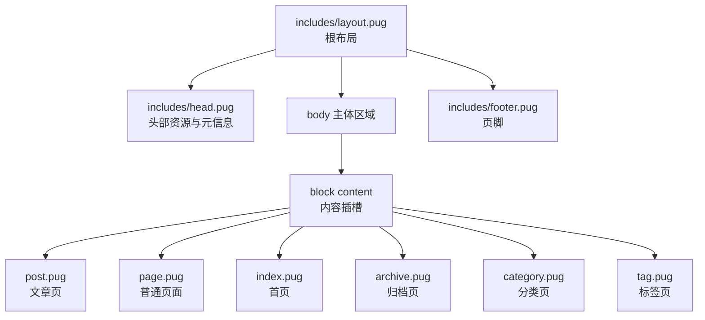
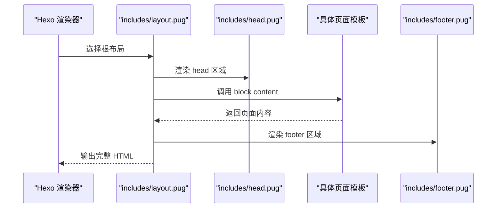
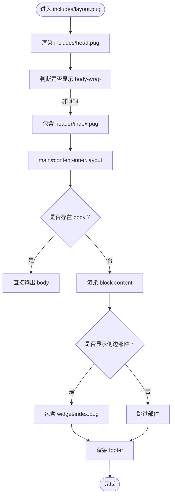
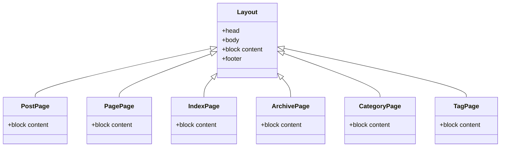
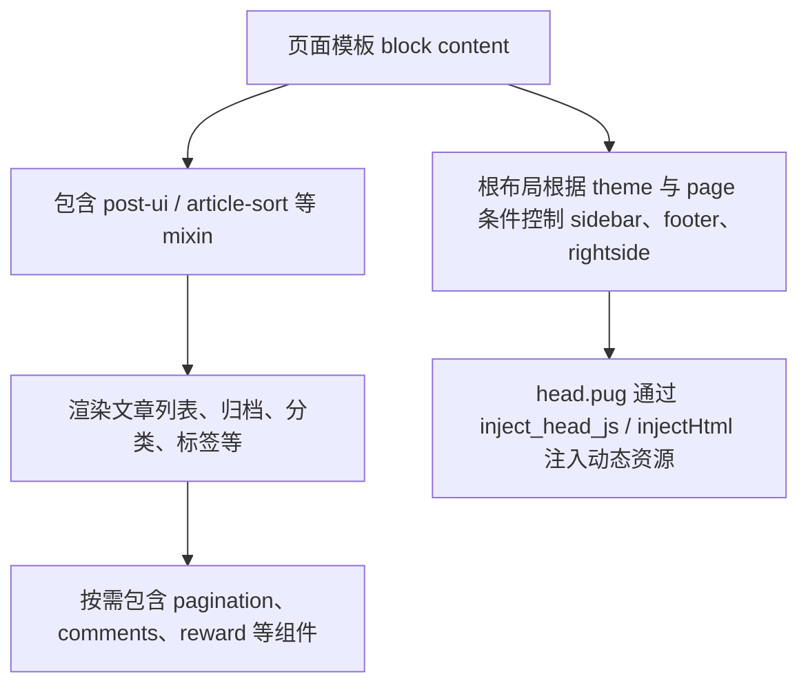
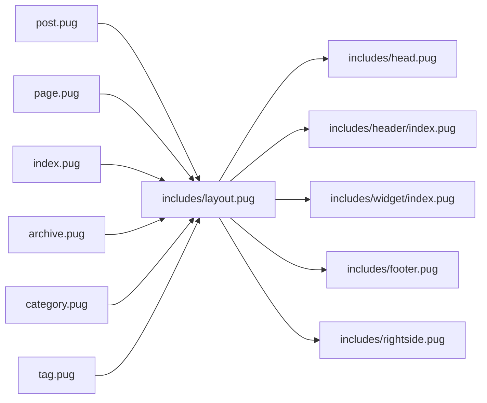

# 块系统详解

<cite>
**本文引用的文件**   
- [layout.pug](file://themes/fomalhaut/layout/includes/layout.pug)
- [head.pug](file://themes/fomalhaut/layout/includes/head.pug)
- [footer.pug](file://themes/fomalhaut/layout/includes/footer.pug)
- [post.pug](file://themes/fomalhaut/layout/post.pug)
- [page.pug](file://themes/fomalhaut/layout/page.pug)
- [index.pug](file://themes/fomalhaut/layout/index.pug)
- [archive.pug](file://themes/fomalhaut/layout/archive.pug)
- [category.pug](file://themes/fomalhaut/layout/category.pug)
- [tag.pug](file://themes/fomalhaut/layout/tag.pug)
- [widget/index.pug](file://themes/fomalhaut/layout/includes/widget/index.pug)
- [sidebar.pug](file://themes/fomalhaut/layout/includes/sidebar.pug)
</cite>

## 目录
1. [引言](#引言)
2. [项目结构中的块定位](#项目结构中的块定位)
3. [核心组件与块职责](#核心组件与块职责)
4. [架构总览](#架构总览)
5. [详细组件分析](#详细组件分析)
6. [依赖关系分析](#依赖关系分析)
7. [性能与扩展建议](#性能与扩展建议)
8. [故障排查指南](#故障排查指南)
9. [结论](#结论)

## 引言
本文聚焦 Fomalhaut 主题中 Pug 的块（block）系统，说明以下要点：
- 模板如何定义和继承块。
- 默认块内容在哪里设置。
- 子模板如何重写 `content` 块。
- `head`、`content`、`footer` 等关键区域的作用与扩展点。
- 结合现有代码给出块嵌套、条件渲染和动态内容注入的实际案例。

本说明以仓库中实际存在的 Pug 模板为依据，不虚构未出现的块或钩子。

## 项目结构中的块定位
Fomalhaut 主题的布局入口是 `includes/layout.pug`，所有页面模板通过 `extends includes/layout.pug` 继承根布局，并通过 `block content` 提供各自的内容区域。

**图表来源**
- [layout.pug:47-119](file://themes/fomalhaut/layout/includes/layout.pug#L47-L119)
- [post.pug:1-36](file://themes/fomalhaut/layout/post.pug#L1-L36)
- [page.pug:1-24](file://themes/fomalhaut/layout/page.pug#L1-L24)
- [index.pug:1-11](file://themes/fomalhaut/layout/index.pug#L1-L11)
- [archive.pug:1-10](file://themes/fomalhaut/layout/archive.pug#L1-L10)
- [category.pug:1-14](file://themes/fomalhaut/layout/category.pug#L1-L14)
- [tag.pug:1-14](file://themes/fomalhaut/layout/tag.pug#L1-L14)

**章节来源**
- [layout.pug:47-119](file://themes/fomalhaut/layout/includes/layout.pug#L47-L119)
- [post.pug:1-36](file://themes/fomalhaut/layout/post.pug#L1-L36)
- [page.pug:1-24](file://themes/fomalhaut/layout/page.pug#L1-L24)
- [index.pug:1-11](file://themes/fomalhaut/layout/index.pug#L1-L11)
- [archive.pug:1-10](file://themes/fomalhaut/layout/archive.pug#L1-L10)
- [category.pug:1-14](file://themes/fomalhaut/layout/category.pug#L1-L14)
- [tag.pug:1-14](file://themes/fomalhaut/layout/tag.pug#L1-L14)

## 核心组件与块职责
- `includes/layout.pug`：根布局，负责 HTML 骨架、Service Worker、背景、侧边栏、主内容区、页脚、右侧工具栏、第三方脚本等。它只声明一个可被覆盖的 `block content`。
- `includes/head.pug`：`head` 区域的实现，负责标题、SEO 元信息、预连接、站点验证、PWA、样式、字体、全局配置、注入脚本与注入 HTML。
- `includes/footer.pug`：页脚展示，包括推荐链接、友链头像墙、版权信息、框架/主题标识、站点徽章等。
- 页面模板：`post.pug`、`page.pug`、`index.pug`、`archive.pug`、`category.pug`、`tag.pug`，均继承根布局并实现 `block content`。

**章节来源**
- [layout.pug:47-127](file://themes/fomalhaut/layout/includes/layout.pug#L47-L127)
- [head.pug:1-79](file://themes/fomalhaut/layout/includes/head.pug#L1-L79)
- [footer.pug:1-112](file://themes/fomalhaut/layout/includes/footer.pug#L1-L112)
- [post.pug:1-36](file://themes/fomalhaut/layout/post.pug#L1-L36)
- [page.pug:1-24](file://themes/fomalhaut/layout/page.pug#L1-L24)
- [index.pug:1-11](file://themes/fomalhaut/layout/index.pug#L1-L11)
- [archive.pug:1-10](file://themes/fomalhaut/layout/archive.pug#L1-L10)
- [category.pug:1-14](file://themes/fomalhaut/layout/category.pug#L1-L14)
- [tag.pug:1-14](file://themes/fomalhaut/layout/tag.pug#L1-L14)

## 架构总览
下图展示“根布局 → 页面模板 → 内容块”的继承与渲染关系，以及 `head` 与 `footer` 在整体结构中的位置。

**图表来源**
- [layout.pug:47-119](file://themes/fomalhaut/layout/includes/layout.pug#L47-L119)
- [head.pug:1-79](file://themes/fomalhaut/layout/includes/head.pug#L1-L79)
- [footer.pug:1-112](file://themes/fomalhaut/layout/includes/footer.pug#L1-L112)
- [post.pug:1-36](file://themes/fomalhaut/layout/post.pug#L1-L36)
- [page.pug:1-24](file://themes/fomalhaut/layout/page.pug#L1-L24)
- [index.pug:1-11](file://themes/fomalhaut/layout/index.pug#L1-L11)

## 详细组件分析

### 根布局与内容块
- 根布局使用 `doctype html` 构建文档结构，并在 `head` 中引入 `includes/head.pug`。
- 在 `body` 中，根据配置决定是否显示加载动画、背景层、侧边栏、主内容区、页脚、右侧工具栏、搜索与右键菜单等。
- 主内容区的关键是 `block content`：如果页面没有显式提供 `body`，则渲染 `block content`；否则直接输出 `body`。
- 非 404 页面会包含 header、main、footer；404 页面走独立分支。

**图表来源**
- [layout.pug:47-127](file://themes/fomalhaut/layout/includes/layout.pug#L47-L127)

**章节来源**
- [layout.pug:47-127](file://themes/fomalhaut/layout/includes/layout.pug#L47-L127)

### 头部区域 head
`includes/head.pug` 并非用 `block` 暴露给子模板覆盖，而是作为 `head` 区域的实现被根布局包含。它负责：
- 计算页面标题、副标题、关键词、作者、版权。
- 输出基础 meta、主题色、Open Graph、favicon、canonical。
- 预连接、站点验证、PWA、主样式、图标库、Snackbar、Fancybox。
- Google AdSense、分析统计、字体、全局配置、noscript。
- 通过辅助函数注入 JS 与 HTML：`inject_head_js()` 与 `injectHtml(theme.inject.head)`。
- 最后引入自定义日月切换组件。

这意味着：如果你需要向 `<head>` 追加资源，应优先使用主题提供的注入机制，而不是直接修改 `head.pug`。

**章节来源**
- [head.pug:1-79](file://themes/fomalhaut/layout/includes/head.pug#L1-L79)

### 页脚区域 footer
`includes/footer.pug` 是页脚的静态实现，包含：
- 格言与“猜你想看”导航。
- 推荐友链头像墙。
- 版权年份与作者。
- 框架与主题标识。
- 自定义文本。
- 站点徽章集合。

页脚不是通过 `block` 暴露，而是由根布局直接包含。若需扩展页脚，建议在站点级 CSS/JS 或通过主题配置的注入能力进行增强，避免直接改动主题源码。

**章节来源**
- [footer.pug:1-112](file://themes/fomalhaut/layout/includes/footer.pug#L1-L112)

### 页面模板如何重写 content 块
所有页面模板都遵循同一模式：
- 使用 `extends includes/layout.pug` 继承根布局。
- 使用 `block content` 提供页面具体内容。
- 在内容中根据需要包含 mixin、卡片、分页、评论等组件。

示例路径：
- 文章页：[post.pug:1-36](file://themes/fomalhaut/layout/post.pug#L1-L36)
- 普通页面：[page.pug:1-24](file://themes/fomalhaut/layout/page.pug#L1-L24)
- 首页：[index.pug:1-11](file://themes/fomalhaut/layout/index.pug#L1-L11)
- 归档页：[archive.pug:1-10](file://themes/fomalhaut/layout/archive.pug#L1-L10)
- 分类页：[category.pug:1-14](file://themes/fomalhaut/layout/category.pug#L1-L14)
- 标签页：[tag.pug:1-14](file://themes/fomalhaut/layout/tag.pug#L1-L14)

**图表来源**
- [layout.pug:47-119](file://themes/fomalhaut/layout/includes/layout.pug#L47-L119)
- [post.pug:1-36](file://themes/fomalhaut/layout/post.pug#L1-L36)
- [page.pug:1-24](file://themes/fomalhaut/layout/page.pug#L1-L24)
- [index.pug:1-11](file://themes/fomalhaut/layout/index.pug#L1-L11)
- [archive.pug:1-10](file://themes/fomalhaut/layout/archive.pug#L1-L10)
- [category.pug:1-14](file://themes/fomalhaut/layout/category.pug#L1-L14)
- [tag.pug:1-14](file://themes/fomalhaut/layout/tag.pug#L1-L14)

**章节来源**
- [post.pug:1-36](file://themes/fomalhaut/layout/post.pug#L1-L36)
- [page.pug:1-24](file://themes/fomalhaut/layout/page.pug#L1-L24)
- [index.pug:1-11](file://themes/fomalhaut/layout/index.pug#L1-L11)
- [archive.pug:1-10](file://themes/fomalhaut/layout/archive.pug#L1-L10)
- [category.pug:1-14](file://themes/fomalhaut/layout/category.pug#L1-L14)
- [tag.pug:1-14](file://themes/fomalhaut/layout/tag.pug#L1-L14)

### 块嵌套、条件渲染与动态内容注入
- 块嵌套：根布局包含 `includes/head.pug`、`includes/header/index.pug`、`includes/widget/index.pug`、`includes/footer.pug` 等组件；页面模板再在 `block content` 中包含更细粒度的组件。
- 条件渲染：根布局根据 `theme.aside.enable`、`page.aside`、`is_post()`、`is_home()`、`page.type` 等条件决定显示哪些区域。
- 动态内容注入：`head.pug` 通过 `inject_head_js()` 与 `injectHtml(theme.inject.head)` 注入脚本与 HTML，这是主题推荐的扩展方式。

**图表来源**
- [layout.pug:47-127](file://themes/fomalhaut/layout/includes/layout.pug#L47-L127)
- [head.pug:70-79](file://themes/fomalhaut/layout/includes/head.pug#L70-L79)
- [widget/index.pug:1-37](file://themes/fomalhaut/layout/includes/widget/index.pug#L1-L37)

**章节来源**
- [layout.pug:47-127](file://themes/fomalhaut/layout/includes/layout.pug#L47-L127)
- [head.pug:70-79](file://themes/fomalhaut/layout/includes/head.pug#L70-L79)
- [widget/index.pug:1-37](file://themes/fomalhaut/layout/includes/widget/index.pug#L1-L37)

## 依赖关系分析
- 页面模板依赖根布局提供的 HTML 骨架与 `block content` 插槽。
- 根布局依赖 `includes/head.pug`、`includes/header/index.pug`、`includes/widget/index.pug`、`includes/footer.pug`、`includes/rightside.pug`、第三方搜索与右键菜单组件。
- `head.pug` 依赖主题配置与辅助函数，用于生成 SEO、样式、脚本与注入内容。
- `widget/index.pug` 根据是否为文章页、是否显示目录等条件渲染不同卡片。

**图表来源**
- [post.pug:1-36](file://themes/fomalhaut/layout/post.pug#L1-L36)
- [page.pug:1-24](file://themes/fomalhaut/layout/page.pug#L1-L24)
- [index.pug:1-11](file://themes/fomalhaut/layout/index.pug#L1-L11)
- [archive.pug:1-10](file://themes/fomalhaut/layout/archive.pug#L1-L10)
- [category.pug:1-14](file://themes/fomalhaut/layout/category.pug#L1-L14)
- [tag.pug:1-14](file://themes/fomalhaut/layout/tag.pug#L1-L14)
- [layout.pug:47-127](file://themes/fomalhaut/layout/includes/layout.pug#L47-L127)

**章节来源**
- [layout.pug:47-127](file://themes/fomalhaut/layout/includes/layout.pug#L47-L127)
- [head.pug:1-79](file://themes/fomalhaut/layout/includes/head.pug#L1-L79)
- [widget/index.pug:1-37](file://themes/fomalhaut/layout/includes/widget/index.pug#L1-L37)

## 性能与扩展建议
- 优先使用主题提供的注入机制扩展 `<head>`，例如通过 `inject_head_js()` 与 `injectHtml(theme.inject.head)`，避免直接修改 `head.pug`。
- 尽量复用已有 mixin 与 partial，减少重复模板逻辑。
- 对大型组件使用缓存参数（如 `cache: true`）可减少重复渲染开销。
- 侧边栏与部件按页面类型与配置条件渲染，避免不必要的 DOM 与事件绑定。

**章节来源**
- [head.pug:70-79](file://themes/fomalhaut/layout/includes/head.pug#L70-L79)
- [layout.pug:85-127](file://themes/fomalhaut/layout/includes/layout.pug#L85-L127)

## 故障排查指南
- 页面空白或内容未显示：检查页面模板是否正确继承根布局并实现 `block content`。
- 样式或脚本未生效：确认是否在 `head.pug` 中正确引入，或通过注入机制添加。
- 侧边栏异常：检查 `theme.aside.enable` 与 `page.aside` 的配置，以及 `widget/index.pug` 的条件渲染。
- 页脚不符合预期：确认是否被其他注入或自定义 CSS 覆盖，必要时调整站点级样式而非直接改主题源码。

**章节来源**
- [layout.pug:85-127](file://themes/fomalhaut/layout/includes/layout.pug#L85-L127)
- [head.pug:1-79](file://themes/fomalhaut/layout/includes/head.pug#L1-L79)
- [widget/index.pug:1-37](file://themes/fomalhaut/layout/includes/widget/index.pug#L1-L37)

## 结论
Fomalhaut 主题的块系统以 `includes/layout.pug` 为根，统一提供 HTML 骨架与 `block content` 插槽；各页面模板通过继承与重写 `content` 块组织页面内容。`head` 与 `footer` 作为固定区域，分别承担资源与页脚展示职责。扩展时推荐使用主题提供的注入机制与组件化结构，保持主题升级时的可维护性。