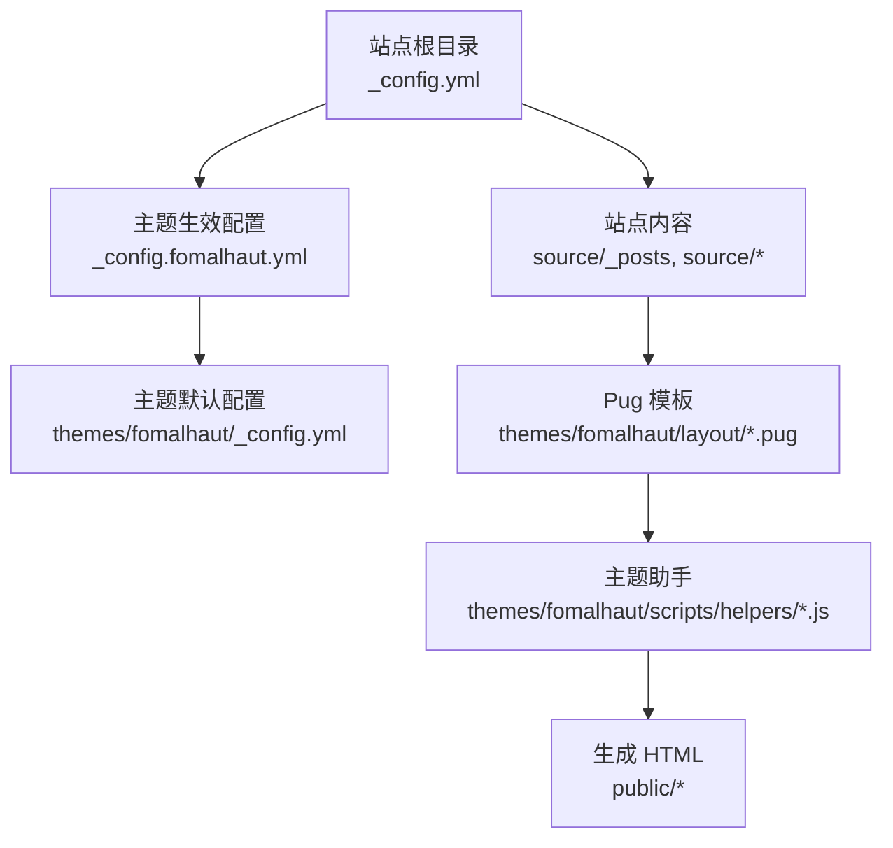
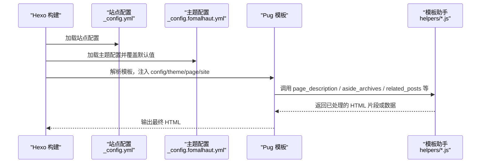
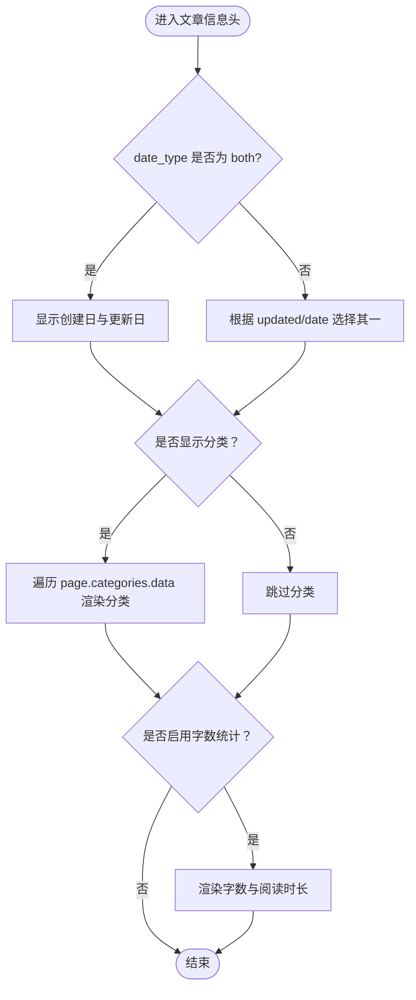
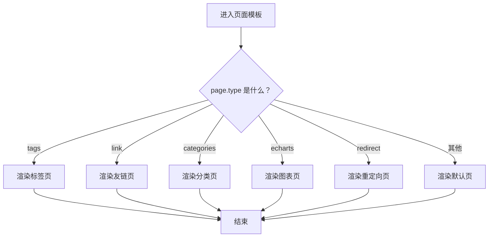
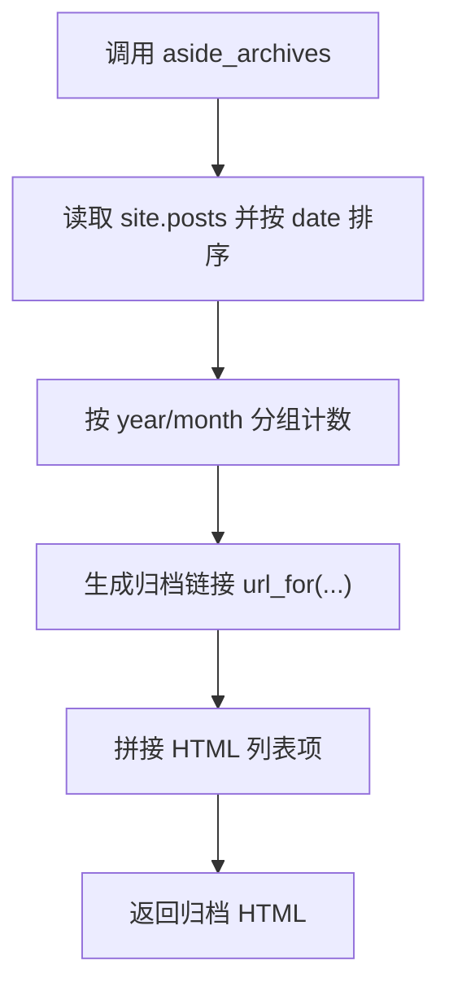
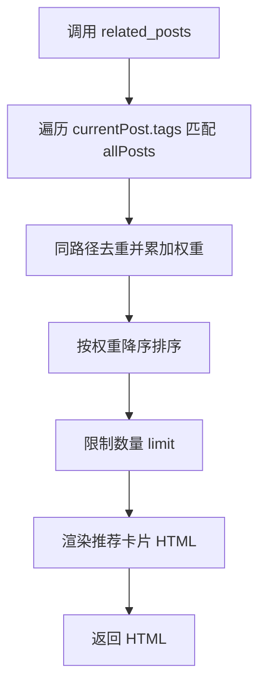
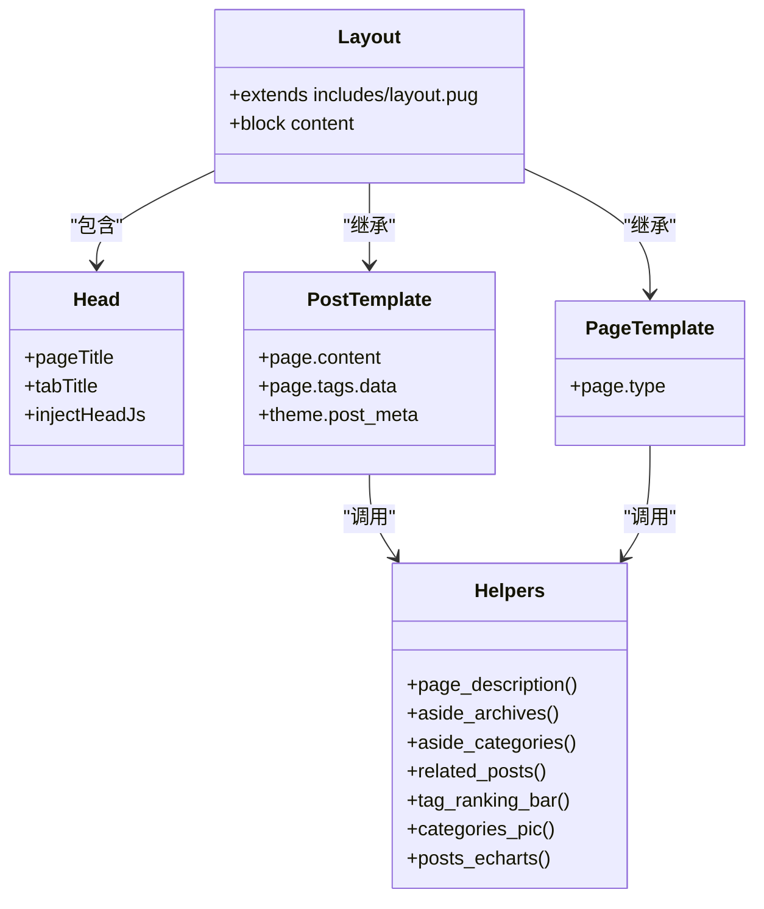
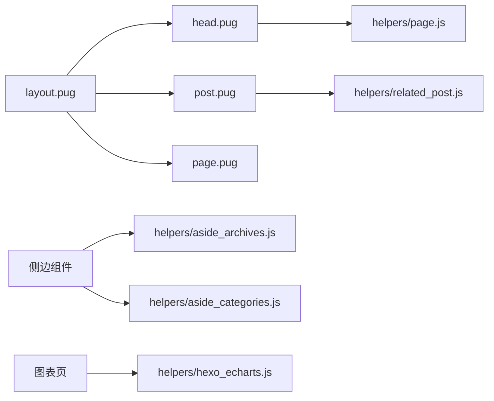

# 模板数据流

<cite>
**本文引用的文件**   
- [根配置 _config.yml](file://_config.yml)
- [主题配置 _config.fomalhaut.yml](file://_config.fomalhaut.yml)
- [站点说明 README.md](file://README.md)
- [主题说明 themes/fomalhaut/README.md](file://themes/fomalhaut/README.md)
- [布局模板 includes/layout.pug](file://themes/fomalhaut/layout/includes/layout.pug)
- [头部模板 includes/head.pug](file://themes/fomalhaut/layout/includes/head.pug)
- [首页模板 index.pug](file://themes/fomalhaut/layout/index.pug)
- [文章模板 post.pug](file://themes/fomalhaut/layout/post.pug)
- [页面模板 page.pug](file://themes/fomalhaut/layout/page.pug)
- [文章信息头 includes/header/post-info.pug](file://themes/fomalhaut/layout/includes/header/post-info.pug)
- [页面助手 helpers/page.js](file://themes/fomalhaut/scripts/helpers/page.js)
- [侧边归档助手 helpers/aside_archives.js](file://themes/fomalhaut/scripts/helpers/aside_archives.js)
- [侧边分类助手 helpers/aside_categories.js](file://themes/fomalhaut/scripts/helpers/aside_categories.js)
- [相关文章助手 helpers/related_post.js](file://themes/fomalhaut/scripts/helpers/related_post.js)
- [图表助手 helpers/hexo_echarts.js](file://themes/fomalhaut/scripts/helpers/hexo_echarts.js)
</cite>

## 目录
1. [引言](#引言)
2. [项目结构](#项目结构)
3. [核心组件](#核心组件)
4. [架构总览](#架构总览)
5. [详细组件分析](#详细组件分析)
6. [依赖关系分析](#依赖关系分析)
7. [性能与渲染特性](#性能与渲染特性)
8. [故障排查指南](#故障排查指南)
9. [结论](#结论)

## 引言
本文聚焦 Hexo 模板系统中的数据流转机制，结合当前仓库中的站点配置、主题配置与 Pug 模板、Hexo 助手函数，系统说明：
- Hexo 如何将站点数据与主题配置注入到模板引擎；
- helpers 如何为模板提供数据处理能力；
- 全局变量与局部变量的作用域划分；
- 在模板中访问文章元数据、站点配置与用户状态的方式；
- 数据绑定与条件渲染的具体实践路径。

## 项目结构
本仓库采用“站点内容 + 主题本体”的分离结构：
- 站点根目录负责站点级配置、站点脚本与站点资源；
- `themes/fomalhaut/` 是主题本体，包含 Pug 模板、Stylus 样式、主题脚本与主题级 Hexo 插件（标签、过滤器、助手、事件）；
- 构建流程由 `hexo generate` 驱动，最终输出静态产物。

**图示来源**
- [站点说明 README.md:259-284](file://README.md#L259-L284)
- [主题说明 themes/fomalhaut/README.md:7-20](file://themes/fomalhaut/README.md#L7-L20)

**章节来源**
- [站点说明 README.md:259-284](file://README.md#L259-L284)
- [主题说明 themes/fomalhaut/README.md:7-20](file://themes/fomalhaut/README.md#L7-L20)

## 核心组件
- 站点配置层：`_config.yml` 定义站点标题、作者、URL、分页、插件等基础信息。
- 主题配置层：`_config.fomalhaut.yml` 覆盖主题默认配置，控制导航、封面、评论、统计、主题色等展示开关。
- 模板层：Pug 模板通过继承与 partial 组合页面骨架，并调用 helpers 完成数据加工。
- 助手层：helpers 注册为模板函数，读取 `this.config`、`this.site`、`this.page` 等上下文，返回可渲染字符串或结构化数据。

**章节来源**
- [根配置 _config.yml:1-131](file://_config.yml#L1-L131)
- [主题配置 _config.fomalhaut.yml:1-100](file://_config.fomalhaut.yml#L1-L100)

## 架构总览
下图展示从配置到模板渲染的关键数据流：站点配置与主题配置被合并后进入 Hexo 上下文，模板通过 `config`、`theme`、`page`、`site` 等对象访问数据，并通过 helpers 进行二次处理。

**图示来源**
- [根配置 _config.yml:1-131](file://_config.yml#L1-L131)
- [主题配置 _config.fomalhaut.yml:1-100](file://_config.fomalhaut.yml#L1-L100)
- [布局模板 includes/layout.pug:1-127](file://themes/fomalhaut/layout/includes/layout.pug#L1-L127)
- [页面助手 helpers/page.js:13-23](file://themes/fomalhaut/scripts/helpers/page.js#L13-L23)
- [侧边归档助手 helpers/aside_archives.js:8-29](file://themes/fomalhaut/scripts/helpers/aside_archives.js#L8-L29)
- [相关文章助手 helpers/related_post.js:9-45](file://themes/fomalhaut/scripts/helpers/related_post.js#L9-L45)

## 详细组件分析

### 配置合并与模板可用对象
- 站点配置 `_config.yml` 提供站点级常量，如 `title`、`author`、`url`、`language`、`per_page`、`pagination_dir`、`theme` 等。
- 主题配置 `_config.fomalhaut.yml` 覆盖主题默认配置，决定导航、封面、评论、统计、主题色、背景等显示行为。
- 模板中可通过以下对象访问数据：
  - `config`：站点配置；
  - `theme`：主题配置；
  - `page`：当前页面数据（含文章元数据、页面类型、自定义字段）；
  - `site`：站点聚合数据（如 `site.posts`、`site.categories`、`site.tags`）。

示例引用位置：
- 站点配置键位参考：[根配置 _config.yml:5-131](file://_config.yml#L5-L131)
- 主题配置键位参考：[主题配置 _config.fomalhaut.yml:1-100](file://_config.fomalhaut.yml#L1-L100)

**章节来源**
- [根配置 _config.yml:5-131](file://_config.yml#L5-L131)
- [主题配置 _config.fomalhaut.yml:1-100](file://_config.fomalhaut.yml#L1-L100)

### 全局变量与局部变量作用域
- 全局变量（构建期）：
  - `config`：站点配置；
  - `theme`：主题配置；
  - `site`：站点聚合数据；
  - `hexo`：Hexo 运行时对象（助手内部常用）。
- 页面级变量（构建期）：
  - `page`：当前页面数据，包括 `page.title`、`page.content`、`page.date`、`page.updated`、`page.tags`、`page.categories`、`page.type`、`page.lang` 等。
- 局部变量（模板内）：
  - 使用 `- var ...` 或 `- let ...` 声明，仅在当前模板块有效；
  - 通过 mixin 传入的参数也属于局部作用域。

模板中可见这些变量的典型位置：
- 布局模板中根据 `theme.aside.enable`、`page.aside`、`is_archive()`、`is_category()`、`is_tag()` 计算侧栏显示逻辑；
- 头部模板中根据 `page.title`、`config.title`、`page.keywords`、`page.tags` 推导页面标题与关键词。

**章节来源**
- [布局模板 includes/layout.pug:1-12](file://themes/fomalhaut/layout/includes/layout.pug#L1-L12)
- [头部模板 includes/head.pug:1-20](file://themes/fomalhaut/layout/includes/head.pug#L1-L20)

### 文章元数据的访问方式
- 文章标题与正文：`page.title`、`page.content`；
- 创建时间与更新时间：`page.date`、`page.updated`；
- 分类与标签：`page.categories.data`、`page.tags.data`；
- 页面类型：`page.type`（例如 `post`、`tags`、`categories`、`echarts`、`redirect`、`404` 等）。

模板中的实际用法：
- 文章模板中使用 `page.content` 渲染正文，并根据 `theme.post_meta.post.*` 决定是否显示分类、标签、字数与阅读时长；
- 页面模板根据 `page.type` 分支渲染不同子页面；
- 文章信息头模板根据 `theme.post_meta.post.date_type` 选择显示创建日、更新日或两者。

**章节来源**
- [文章模板 post.pug:1-36](file://themes/fomalhaut/layout/post.pug#L1-L36)
- [页面模板 page.pug:1-24](file://themes/fomalhaut/layout/page.pug#L1-L24)
- [文章信息头 includes/header/post-info.pug:1-64](file://themes/fomalhaut/layout/includes/header/post-info.pug#L1-L64)

### 站点配置的访问方式
- 站点标题、副标题、语言、域名、分页等来自 `config`；
- 主题开关、主题色、背景、导航、评论系统等来自 `theme`。

模板中的典型用法：
- 头部模板根据 `config.subtitle`、`config.title`、`page.title` 拼接页面标题；
- 布局模板根据 `theme.display_mode`、`theme.theme_color.meta_theme_color_*` 设置主题色；
- 布局模板根据 `theme.background.default`、`theme.background.darkmode`、`page.defaultbg`、`page.darkmodebg` 设置背景。

**章节来源**
- [头部模板 includes/head.pug:1-20](file://themes/fomalhaut/layout/includes/head.pug#L1-L20)
- [布局模板 includes/layout.pug:57-83](file://themes/fomalhaut/layout/includes/layout.pug#L57-L83)

### 用户状态的访问方式
- 构建期模板无法直接访问浏览器端用户状态；
- 主题通过 `<html data-theme="...">` 暴露当前主题模式，供前端脚本读取；
- 前端脚本可在运行期切换主题，但不会反向影响构建期生成的 HTML。

模板中的体现：
- 布局模板将 `theme.display_mode` 写入 `data-theme`，用于首屏主题模式；
- 前端脚本会读取该属性以初始化图表主题或 UI 行为。

**章节来源**
- [布局模板 includes/layout.pug:8](file://themes/fomalhaut/layout/includes/layout.pug#L8)
- [图表助手 helpers/hexo_echarts.js:20-22](file://themes/fomalhaut/scripts/helpers/hexo_echarts.js#L20-L22)

### 数据绑定与条件渲染示例

#### 条件渲染：文章元数据展示
- 当 `theme.post_meta.post.date_type` 为 `both` 时，同时显示创建日与更新日；
- 当 `theme.post_meta.post.categories` 为真且 `page.categories.data.length > 0` 时，渲染分类列表；
- 当 `theme.wordcount.enable` 开启时，渲染字数与阅读时长。

**图示来源**
- [文章信息头 includes/header/post-info.pug:10-64](file://themes/fomalhaut/layout/includes/header/post-info.pug#L10-L64)

#### 条件渲染：页面类型分支
- 根据 `page.type` 渲染不同子页面：`tags`、`link`、`categories`、`echarts`、`redirect`、默认页。

**图示来源**
- [页面模板 page.pug:8-20](file://themes/fomalhaut/layout/page.pug#L8-L20)

#### 数据绑定：助手生成侧边归档
- 助手 `aside_archives` 读取 `this.site.posts`，按年份/月份分组，生成带链接与计数的归档列表；
- 模板可直接调用 `aside_archives(options)` 获得已渲染的 HTML 片段。

**图示来源**
- [侧边归档助手 helpers/aside_archives.js:8-99](file://themes/fomalhaut/scripts/helpers/aside_archives.js#L8-L99)

#### 数据绑定：助手生成相关文章
- 助手 `related_posts(currentPost, allPosts)` 基于标签匹配权重，筛选并排序相关文章，再渲染推荐卡片。

**图示来源**
- [相关文章助手 helpers/related_post.js:9-70](file://themes/fomalhaut/scripts/helpers/related_post.js#L9-L70)

### 模板与助手的交互关系
- 模板通过 `!=partial(...)`、`include`、`block content` 组合页面结构；
- 模板通过 `page.*`、`config.*`、`theme.*` 直接访问数据；
- 模板通过 `helperName(...)` 调用助手，助手内部通过 `this.config`、`this.site`、`this.page`、`hexo.*` 获取数据并返回 HTML 或数据。

**图示来源**
- [布局模板 includes/layout.pug:1-127](file://themes/fomalhaut/layout/includes/layout.pug#L1-L127)
- [头部模板 includes/head.pug:1-79](file://themes/fomalhaut/layout/includes/head.pug#L1-L79)
- [文章模板 post.pug:1-36](file://themes/fomalhaut/layout/post.pug#L1-L36)
- [页面模板 page.pug:1-24](file://themes/fomalhaut/layout/page.pug#L1-L24)
- [页面助手 helpers/page.js:13-99](file://themes/fomalhaut/scripts/helpers/page.js#L13-L99)
- [侧边归档助手 helpers/aside_archives.js:8-114](file://themes/fomalhaut/scripts/helpers/aside_archives.js#L8-L114)
- [侧边分类助手 helpers/aside_categories.js:8-98](file://themes/fomalhaut/scripts/helpers/aside_categories.js#L8-L98)
- [相关文章助手 helpers/related_post.js:9-100](file://themes/fomalhaut/scripts/helpers/related_post.js#L9-L100)
- [图表助手 helpers/hexo_echarts.js:1-249](file://themes/fomalhaut/scripts/helpers/hexo_echarts.js#L1-L249)

## 依赖关系分析
- 模板对配置的依赖：
  - `layout.pug` 依赖 `theme.aside`、`theme.background`、`theme.footer_bg`、`theme.display_mode`；
  - `head.pug` 依赖 `config.subtitle`、`theme.theme_color`、`theme.pwa`、`theme.asset.*`；
  - `post.pug` 依赖 `theme.post_meta`、`theme.reward`、`theme.related_post`、`theme.comments`；
  - `page.pug` 依赖 `page.type`、`theme.comments`。
- 模板对助手的依赖：
  - `head.pug` 调用 `findArchivesTitle`、`inject_head_js`、`injectHtml`；
  - `post.pug` 调用 `related_posts`；
  - 侧边组件通常调用 `aside_archives`、`aside_categories`；
  - 图表页调用 `tag_ranking_bar`、`categories_pic`、`posts_echarts`。

**图示来源**
- [布局模板 includes/layout.pug:1-127](file://themes/fomalhaut/layout/includes/layout.pug#L1-L127)
- [头部模板 includes/head.pug:1-79](file://themes/fomalhaut/layout/includes/head.pug#L1-L79)
- [文章模板 post.pug:1-36](file://themes/fomalhaut/layout/post.pug#L1-L36)
- [页面模板 page.pug:1-24](file://themes/fomalhaut/layout/page.pug#L1-L24)
- [页面助手 helpers/page.js:13-99](file://themes/fomalhaut/scripts/helpers/page.js#L13-L99)
- [侧边归档助手 helpers/aside_archives.js:8-114](file://themes/fomalhaut/scripts/helpers/aside_archives.js#L8-L114)
- [侧边分类助手 helpers/aside_categories.js:8-98](file://themes/fomalhaut/scripts/helpers/aside_categories.js#L8-L98)
- [相关文章助手 helpers/related_post.js:9-100](file://themes/fomalhaut/scripts/helpers/related_post.js#L9-L100)
- [图表助手 helpers/hexo_echarts.js:1-249](file://themes/fomalhaut/scripts/helpers/hexo_echarts.js#L1-L249)

**章节来源**
- [布局模板 includes/layout.pug:1-127](file://themes/fomalhaut/layout/includes/layout.pug#L1-L127)
- [头部模板 includes/head.pug:1-79](file://themes/fomalhaut/layout/includes/head.pug#L1-L79)
- [文章模板 post.pug:1-36](file://themes/fomalhaut/layout/post.pug#L1-L36)
- [页面模板 page.pug:1-24](file://themes/fomalhaut/layout/page.pug#L1-L24)
- [页面助手 helpers/page.js:13-99](file://themes/fomalhaut/scripts/helpers/page.js#L13-L99)
- [侧边归档助手 helpers/aside_archives.js:8-114](file://themes/fomalhaut/scripts/helpers/aside_archives.js#L8-L114)
- [侧边分类助手 helpers/aside_categories.js:8-98](file://themes/fomalhaut/scripts/helpers/aside_categories.js#L8-L98)
- [相关文章助手 helpers/related_post.js:9-100](file://themes/fomalhaut/scripts/helpers/related_post.js#L9-L100)
- [图表助手 helpers/hexo_echarts.js:1-249](file://themes/fomalhaut/scripts/helpers/hexo_echarts.js#L1-L249)

## 性能与渲染特性
- 模板缓存：多处使用 `!=partial(...,{cache:true})` 与 `fragment_cache` 提升重复片段渲染性能；
- 懒加载与按需引入：CSS/JS 通过 `media="print" onload="this.media='all'"` 延迟加载非关键资源；
- 本地开发环境自动注销 Service Worker，避免拦截请求导致资源加载失败；
- 图表助手监听窗口 resize 事件，保证图表自适应。

**章节来源**
- [布局模板 includes/layout.pug:9-25](file://themes/fomalhaut/layout/includes/layout.pug#L9-L25)
- [头部模板 includes/head.pug:50-57](file://themes/fomalhaut/layout/includes/head.pug#L50-L57)
- [图表助手 helpers/hexo_echarts.js:106-108](file://themes/fomalhaut/scripts/helpers/hexo_echarts.js#L106-L108)

## 故障排查指南
- 页面标题为空：检查 `page.title` 是否存在，或回退到 `config.title`；确认 `head.pug` 中标题拼接逻辑。
- 关键词缺失：若 `page.keywords` 未设置，模板会尝试从 `page.tags.data` 或 `config.keywords` 推导；检查 Front-matter 是否遗漏 keywords。
- 侧边归档不显示：确认 `site.posts` 存在且排序正常，检查 `aside_archives` 的 `format`、`type`、`limit`、`show_count` 参数。
- 相关文章为空：检查文章标签是否重叠，确认 `related_posts` 的 `limit` 与 `date_type` 配置。
- 主题色异常：检查 `theme.theme_color.enable` 与 `meta_theme_color_light/dark` 配置，以及 `display_mode`。
- 背景不生效：检查 `page.defaultbg`、`page.darkmodebg`、`theme.background.default`、`theme.background.darkmode` 的值与优先级。

**章节来源**
- [头部模板 includes/head.pug:1-20](file://themes/fomalhaut/layout/includes/head.pug#L1-L20)
- [侧边归档助手 helpers/aside_archives.js:8-99](file://themes/fomalhaut/scripts/helpers/aside_archives.js#L8-L99)
- [相关文章助手 helpers/related_post.js:9-70](file://themes/fomalhaut/scripts/helpers/related_post.js#L9-L70)
- [布局模板 includes/layout.pug:57-83](file://themes/fomalhaut/layout/includes/layout.pug#L57-L83)

## 结论
在本仓库中，Hexo 的数据流遵循“配置合并 → 模板注入 → 助手处理 → 输出 HTML”的路径：
- 站点配置与主题配置分别位于 `_config.yml` 与 `_config.fomalhaut.yml`，后者覆盖主题默认配置；
- 模板通过 `config`、`theme`、`page`、`site` 访问数据，并通过 helpers 进行复杂数据处理；
- 全局变量作用于构建期模板上下文，局部变量仅在模板块或 mixin 内有效；
- 文章元数据、站点配置与用户状态（主题模式）分别在模板与前端脚本中以约定方式访问；
- 条件渲染与数据绑定通过 Pug 语法与 helpers 协作实现，既保证可读性，又便于扩展与维护。