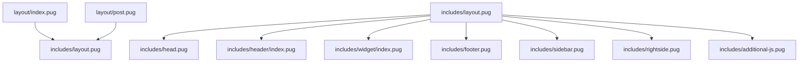
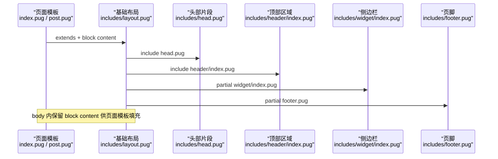
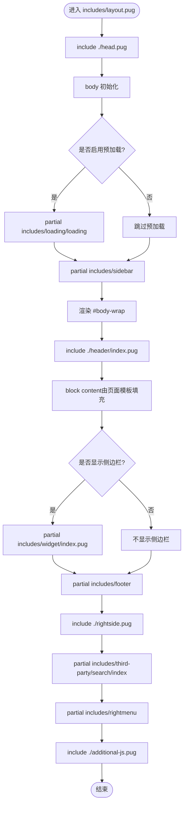
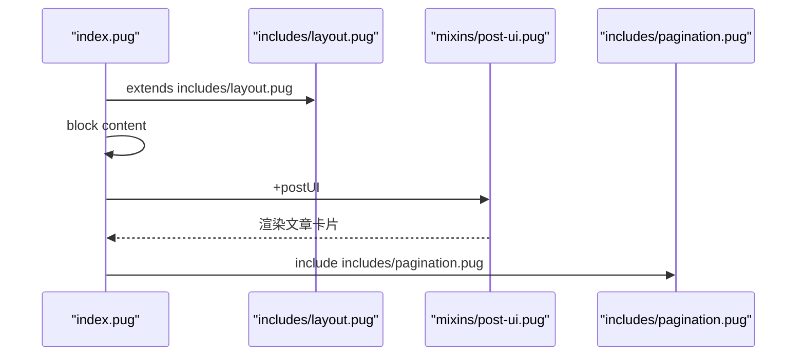
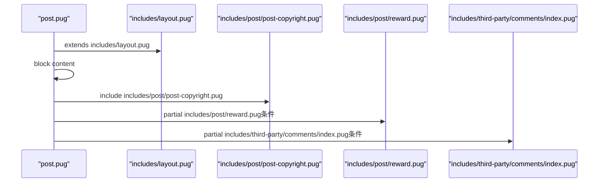
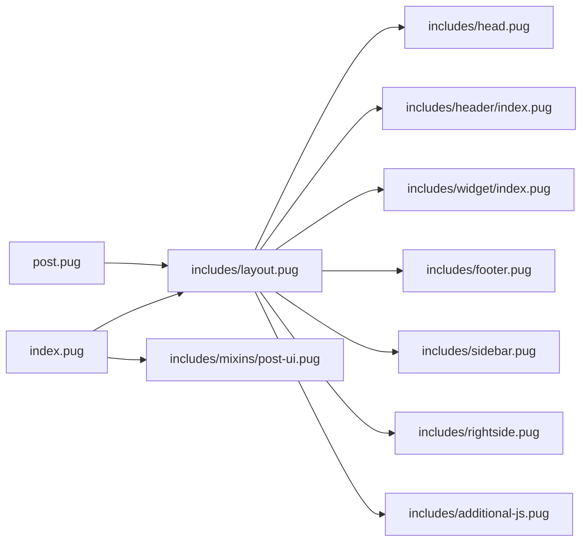

# 模板系统原理

<cite>
**本文引用的文件**   
- [themes/fomalhaut/layout/includes/layout.pug](file://themes/fomalhaut/layout/includes/layout.pug)
- [themes/fomalhaut/layout/index.pug](file://themes/fomalhaut/layout/index.pug)
- [themes/fomalhaut/layout/post.pug](file://themes/fomalhaut/layout/post.pug)
- [themes/fomalhaut/layout/includes/head.pug](file://themes/fomalhaut/layout/includes/head.pug)
- [themes/fomalhaut/layout/includes/header/index.pug](file://themes/fomalhaut/layout/includes/header/index.pug)
- [themes/fomalhaut/layout/includes/mixins/post-ui.pug](file://themes/fomalhaut/layout/includes/mixins/post-ui.pug)
- [themes/fomalhaut/layout/includes/widget/index.pug](file://themes/fomalhaut/layout/includes/widget/index.pug)
</cite>

## 目录
1. [简介](#简介)
2. [项目结构](#项目结构)
3. [核心组件](#核心组件)
4. [架构总览](#架构总览)
5. [详细组件分析](#详细组件分析)
6. [依赖关系分析](#依赖关系分析)
7. [性能与缓存](#性能与缓存)
8. [故障排查指南](#故障排查指南)
9. [结论](#结论)

## 简介
本文件深入解析基于 Pug 的模板系统，重点说明：
- 模板继承机制：页面模板通过 extends 继承基础布局。
- 块（block）与包含（include）：如何在布局中预留内容区，并在页面模板中填充；如何通过 include 复用头部、侧边栏、页脚等公共片段。
- 布局文件 layout.pug 作为基础模板的职责与渲染流程。
- 页面模板 index.pug、post.pug 如何继承并扩展布局。
- includes/ 目录下组件化模板的组织方式与复用机制。
- 提供具体代码示例路径，帮助快速定位实现位置。

## 项目结构
主题模板位于 themes/fomalhaut/layout 下，其中：
- layout/ 根目录存放页面级模板：index.pug、post.pug、page.pug、archive.pug、category.pug、tag.pug 等。
- layout/includes/ 存放可复用的布局片段与组件：head、header、widget、mixins、third-party、loading、pagination、sidebar、footer 等。
- layout/includes/layout.pug 是全局基础布局，所有页面模板均继承它。

图表来源
- [themes/fomalhaut/layout/includes/layout.pug:47-126](file://themes/fomalhaut/layout/includes/layout.pug#L47-L126)
- [themes/fomalhaut/layout/index.pug:1-11](file://themes/fomalhaut/layout/index.pug#L1-L11)
- [themes/fomalhaut/layout/post.pug:1-36](file://themes/fomalhaut/layout/post.pug#L1-L36)

章节来源
- [themes/fomalhaut/layout/includes/layout.pug:1-127](file://themes/fomalhaut/layout/includes/layout.pug#L1-L127)
- [themes/fomalhaut/layout/index.pug:1-11](file://themes/fomalhaut/layout/index.pug#L1-L11)
- [themes/fomalhaut/layout/post.pug:1-36](file://themes/fomalhaut/layout/post.pug#L1-L36)

## 核心组件
- 基础布局 includes/layout.pug：定义 HTML 骨架、head/body、头部、主体内容区 block content、侧边栏、页脚、右侧工具栏、第三方脚本注入点等。
- 页面模板 index.pug：首页列表，继承布局并通过 block content 填充内容，调用 postUI mixin 渲染文章卡片。
- 文章模板 post.pug：文章详情页，继承布局，渲染文章内容、标签、打赏、评论、相关推荐等。
- 头部 includes/head.pug：负责 meta、SEO、PWA、预连接、字体、站点配置、注入脚本等。
- 顶部 includes/header/index.pug：根据页面类型渲染顶部背景图、站点标题、导航、波浪动画等。
- 侧边栏 includes/widget/index.pug：按文章页/普通页展示不同卡片组合（作者、公告、最近文章、分类、标签、归档、友链等）。
- 混入 includes/mixins/post-ui.pug：定义 postUI mixin，用于首页文章卡片渲染逻辑。

章节来源
- [themes/fomalhaut/layout/includes/layout.pug:1-127](file://themes/fomalhaut/layout/includes/layout.pug#L1-L127)
- [themes/fomalhaut/layout/index.pug:1-11](file://themes/fomalhaut/layout/index.pug#L1-L11)
- [themes/fomalhaut/layout/post.pug:1-36](file://themes/fomalhaut/layout/post.pug#L1-L36)
- [themes/fomalhaut/layout/includes/head.pug:1-79](file://themes/fomalhaut/layout/includes/head.pug#L1-L79)
- [themes/fomalhaut/layout/includes/header/index.pug:1-73](file://themes/fomalhaut/layout/includes/header/index.pug#L1-L73)
- [themes/fomalhaut/layout/includes/widget/index.pug:1-37](file://themes/fomalhaut/layout/includes/widget/index.pug#L1-L37)
- [themes/fomalhaut/layout/includes/mixins/post-ui.pug:141-298](file://themes/fomalhaut/layout/includes/mixins/post-ui.pug#L141-L298)

## 架构总览
下图展示了从页面模板到基础布局再到各组件的渲染顺序与依赖关系。

图表来源
- [themes/fomalhaut/layout/index.pug:1-11](file://themes/fomalhaut/layout/index.pug#L1-L11)
- [themes/fomalhaut/layout/post.pug:1-36](file://themes/fomalhaut/layout/post.pug#L1-L36)
- [themes/fomalhaut/layout/includes/layout.pug:47-126](file://themes/fomalhaut/layout/includes/layout.pug#L47-L126)
- [themes/fomalhaut/layout/includes/head.pug:1-79](file://themes/fomalhaut/layout/includes/head.pug#L1-L79)
- [themes/fomalhaut/layout/includes/header/index.pug:1-73](file://themes/fomalhaut/layout/includes/header/index.pug#L1-L73)
- [themes/fomalhaut/layout/includes/widget/index.pug:1-37](file://themes/fomalhaut/layout/includes/widget/index.pug#L1-L37)

## 详细组件分析

### 基础布局 includes/layout.pug
职责与关键点：
- 定义 doctype、html 标签及语言、主题模式、类名等。
- 在 head 中 include ./head.pug，并根据配置条件性引入灯笼等片段。
- 在 body 中按需加载 loading、背景、侧边栏、主体内容区、页脚、右侧工具栏、搜索与右键菜单等。
- 使用 block content 作为内容插槽，由页面模板填充。
- 使用 !=partial(...) 和 include 组合，将可复用片段以“组件”形式组织。

图表来源
- [themes/fomalhaut/layout/includes/layout.pug:47-126](file://themes/fomalhaut/layout/includes/layout.pug#L47-L126)

章节来源
- [themes/fomalhaut/layout/includes/layout.pug:1-127](file://themes/fomalhaut/layout/includes/layout.pug#L1-L127)

### 页面模板 index.pug（首页）
- 通过 extends includes/layout.pug 继承基础布局。
- 通过 block content 覆盖布局中的内容区。
- 引入 mixins/post-ui.pug 中的 postUI mixin，用于渲染文章列表卡片。
- 最后 include includes/pagination.pug 分页组件。

图表来源
- [themes/fomalhaut/layout/index.pug:1-11](file://themes/fomalhaut/layout/index.pug#L1-L11)
- [themes/fomalhaut/layout/includes/mixins/post-ui.pug:151-298](file://themes/fomalhaut/layout/includes/mixins/post-ui.pug#L151-L298)

章节来源
- [themes/fomalhaut/layout/index.pug:1-11](file://themes/fomalhaut/layout/index.pug#L1-L11)
- [themes/fomalhaut/layout/includes/mixins/post-ui.pug:151-298](file://themes/fomalhaut/layout/includes/mixins/post-ui.pug#L151-L298)

### 文章模板 post.pug（文章详情）
- 继承基础布局 includes/layout.pug。
- 在 block content 中渲染文章容器、文章内容、版权信息、标签、打赏、广告、分页、相关文章、评论等。
- 使用 !=partial(...) 与 include 组合，按需加载评论、打赏等第三方或可选功能。

图表来源
- [themes/fomalhaut/layout/post.pug:1-36](file://themes/fomalhaut/layout/post.pug#L1-L36)

章节来源
- [themes/fomalhaut/layout/post.pug:1-36](file://themes/fomalhaut/layout/post.pug#L1-L36)

### 头部 includes/head.pug
- 计算页面标题、关键词、作者、主题色等元数据。
- 引入 Open Graph、favicon、canonical、预连接、站点验证、PWA、主样式、字体、站点配置、noscript、注入脚本等。
- 通过 !=partial(...) 与 include 组合，模块化地组织 SEO、统计、广告、字体等资源。

章节来源
- [themes/fomalhaut/layout/includes/head.pug:1-79](file://themes/fomalhaut/layout/includes/head.pug#L1-L79)

### 顶部 includes/header/index.pug
- 根据配置与页面类型决定是否渲染顶部背景图。
- 渲染导航、站点标题、副标题、社交图标、滚动提示、波浪动画等。
- 区分文章页与普通页面的顶部展示差异。

章节来源
- [themes/fomalhaut/layout/includes/header/index.pug:1-73](file://themes/fomalhaut/layout/includes/header/index.pug#L1-L73)

### 侧边栏 includes/widget/index.pug
- 根据 is_post() 判断文章页或普通页，分别渲染不同的卡片组合。
- 文章页优先显示目录（TOC），否则显示作者、公告、置顶卡片等。
- 普通页显示更多通用卡片：友链、微博、最近文章、广告、最新评论、分类、标签、归档、网站信息等。

章节来源
- [themes/fomalhaut/layout/includes/widget/index.pug:1-37](file://themes/fomalhaut/layout/includes/widget/index.pug#L1-L37)

### 混入 includes/mixins/post-ui.pug
- 定义 postStickyBadge mixin 用于置顶角标。
- 定义 postUI(posts) mixin，遍历 page.posts.data，渲染每篇文章的封面、标题、元信息（日期、分类、标签）、评论数、摘要等。
- 支持多种评论系统的计数显示，以及首页文章内容的截取与展示策略。

章节来源
- [themes/fomalhaut/layout/includes/mixins/post-ui.pug:141-298](file://themes/fomalhaut/layout/includes/mixins/post-ui.pug#L141-L298)

## 依赖关系分析
- 页面模板（index.pug、post.pug）强依赖基础布局 includes/layout.pug。
- 基础布局依赖 head、header、widget、footer、sidebar、rightside、additional-js 等片段。
- 首页通过 mixins/post-ui.pug 渲染文章卡片，体现“mixin 复用”的模式。
- 侧边栏通过 partial('includes/widget/card_*') 组合多个卡片组件，体现“组件拼装”的模式。

图表来源
- [themes/fomalhaut/layout/index.pug:1-11](file://themes/fomalhaut/layout/index.pug#L1-L11)
- [themes/fomalhaut/layout/post.pug:1-36](file://themes/fomalhaut/layout/post.pug#L1-L36)
- [themes/fomalhaut/layout/includes/layout.pug:47-126](file://themes/fomalhaut/layout/includes/layout.pug#L47-L126)

章节来源
- [themes/fomalhaut/layout/includes/layout.pug:47-126](file://themes/fomalhaut/layout/includes/layout.pug#L47-L126)
- [themes/fomalhaut/layout/index.pug:1-11](file://themes/fomalhaut/layout/index.pug#L1-L11)
- [themes/fomalhaut/layout/post.pug:1-36](file://themes/fomalhaut/layout/post.pug#L1-L36)

## 性能与缓存
- 多处使用 !=partial(..., {}, {cache: true}) 对常用片段进行缓存，减少重复渲染开销。
- head.pug 中对部分资源采用 media="print" onload="this.media='all'" 延迟加载 CSS，提升首屏性能。
- additional-js.pug 与 third-party 模块按需加载，避免不必要的 JS/CSS 阻塞。

章节来源
- [themes/fomalhaut/layout/includes/layout.pug:54-55](file://themes/fomalhaut/layout/includes/layout.pug#L54-L55)
- [themes/fomalhaut/layout/includes/layout.pug:85-85](file://themes/fomalhaut/layout/includes/layout.pug#L85-L85)
- [themes/fomalhaut/layout/includes/layout.pug:119-126](file://themes/fomalhaut/layout/includes/layout.pug#L119-L126)
- [themes/fomalhaut/layout/includes/head.pug:50-57](file://themes/fomalhaut/layout/includes/head.pug#L50-L57)

## 故障排查指南
- 页面空白或无内容：检查页面模板是否正确 extends includes/layout.pug 并定义了 block content。
- 头部缺失或 SEO 异常：确认 includes/head.pug 被正确 include，且站点配置项存在。
- 顶部背景未显示：检查 includes/header/index.pug 的条件判断与 top_img 变量来源。
- 侧边栏不显示：确认 theme.aside.enable 与 page.aside 设置，以及 includes/widget/index.pug 的分支逻辑。
- 评论/打赏未加载：检查 post.pug 中相关 partial 的条件开关与第三方配置。

章节来源
- [themes/fomalhaut/layout/includes/layout.pug:87-97](file://themes/fomalhaut/layout/includes/layout.pug#L87-L97)
- [themes/fomalhaut/layout/includes/head.pug:1-79](file://themes/fomalhaut/layout/includes/head.pug#L1-L79)
- [themes/fomalhaut/layout/includes/header/index.pug:1-73](file://themes/fomalhaut/layout/includes/header/index.pug#L1-L73)
- [themes/fomalhaut/layout/includes/widget/index.pug:1-37](file://themes/fomalhaut/layout/includes/widget/index.pug#L1-L37)
- [themes/fomalhaut/layout/post.pug:21-35](file://themes/fomalhaut/layout/post.pug#L21-L35)

## 结论
该模板系统以 includes/layout.pug 为统一基础布局，通过 Pug 的 extends/block/include/partial 机制，实现了清晰的模板继承与组件化复用。页面模板仅关注自身业务内容，公共结构与可复用组件集中在 includes/ 目录，便于维护与扩展。同时，通过 partial 缓存与资源延迟加载等手段，兼顾了可维护性与性能表现。