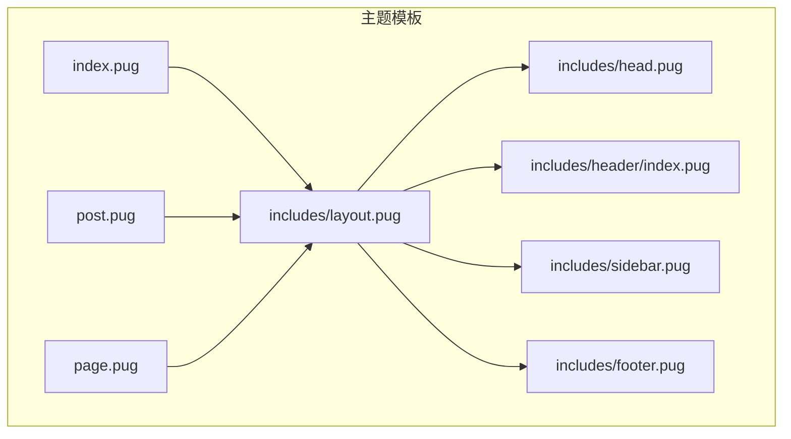
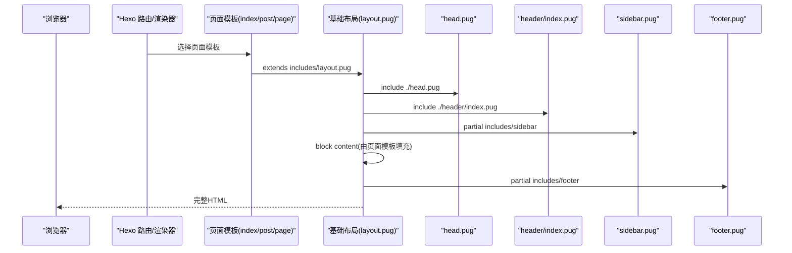
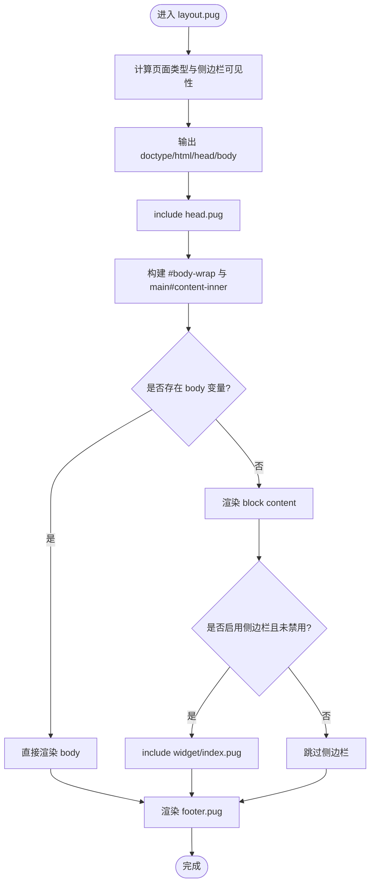
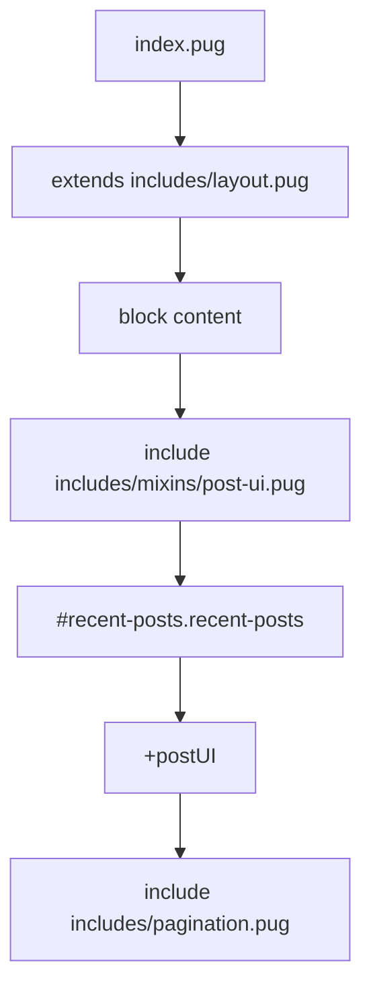
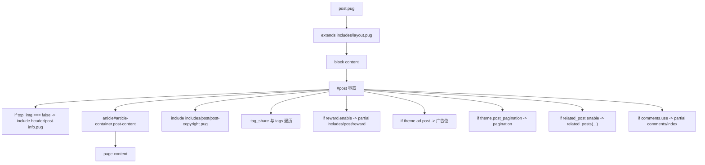
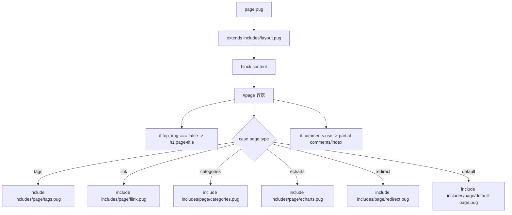
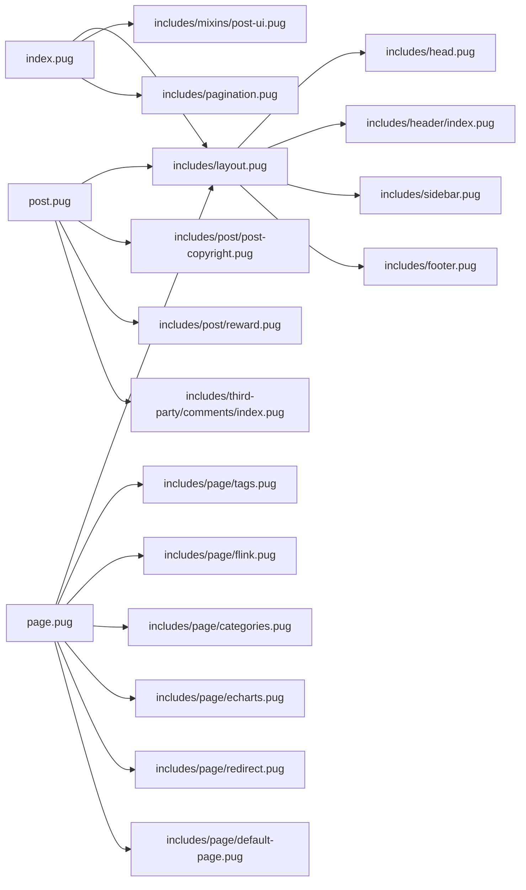

# 模板继承机制

<cite>
**本文引用的文件**   
- [layout.pug](file://themes/fomalhaut/layout/includes/layout.pug)
- [index.pug](file://themes/fomalhaut/layout/index.pug)
- [post.pug](file://themes/fomalhaut/layout/post.pug)
- [page.pug](file://themes/fomalhaut/layout/page.pug)
- [head.pug](file://themes/fomalhaut/layout/includes/head.pug)
- [header/index.pug](file://themes/fomalhaut/layout/includes/header/index.pug)
- [footer.pug](file://themes/fomalhaut/layout/includes/footer.pug)
- [sidebar.pug](file://themes/fomalhaut/layout/includes/sidebar.pug)
</cite>

## 目录
1. [简介](#简介)
2. [项目结构](#项目结构)
3. [核心组件](#核心组件)
4. [架构总览](#架构总览)
5. [详细组件分析](#详细组件分析)
6. [依赖关系分析](#依赖关系分析)
7. [性能与可维护性](#性能与可维护性)
8. [故障排查](#故障排查)
9. [结论](#结论)

## 简介
本文聚焦 Fomalhaut 主题中基于 Pug 的模板继承机制，系统说明：
- extends 指令的使用方式
- 基础布局 includes/layout.pug 的结构设计
- 页面模板 index.pug、post.pug、page.pug 如何继承并扩展基础布局
- 块覆盖（block content）机制与具体渲染流程
- 模板层次结构与最佳实践建议

## 项目结构
Fomalhaut 主题的模板位于 themes/fomalhaut/layout 及其 includes 子目录。关键文件组织如下：
- 基础布局：includes/layout.pug
- 页面模板：index.pug、post.pug、page.pug
- 头部、导航、侧边栏、页脚等公共片段：includes/head.pug、includes/header/index.pug、includes/sidebar.pug、includes/footer.pug

图表来源
- [layout.pug:1-127](file://themes/fomalhaut/layout/includes/layout.pug#L1-L127)
- [index.pug:1-11](file://themes/fomalhaut/layout/index.pug#L1-L11)
- [post.pug:1-36](file://themes/fomalhaut/layout/post.pug#L1-L36)
- [page.pug:1-24](file://themes/fomalhaut/layout/page.pug#L1-L24)
- [head.pug:1-79](file://themes/fomalhaut/layout/includes/head.pug#L1-L79)
- [header/index.pug:1-73](file://themes/fomalhaut/layout/includes/header/index.pug#L1-L73)
- [sidebar.pug:1-19](file://themes/fomalhaut/layout/includes/sidebar.pug#L1-L19)
- [footer.pug:1-112](file://themes/fomalhaut/layout/includes/footer.pug#L1-L112)

章节来源
- [layout.pug:1-127](file://themes/fomalhaut/layout/includes/layout.pug#L1-L127)
- [index.pug:1-11](file://themes/fomalhaut/layout/index.pug#L1-L11)
- [post.pug:1-36](file://themes/fomalhaut/layout/post.pug#L1-L36)
- [page.pug:1-24](file://themes/fomalhaut/layout/page.pug#L1-L24)

## 核心组件
- 基础布局 includes/layout.pug：定义 HTML 骨架、全局样式注入、头尾区域、主体容器、侧边栏与内容区、以及 block content 插槽。
- 页面模板：
  - index.pug：首页列表，继承 layout 并通过 block content 注入文章卡片 UI 与分页。
  - post.pug：文章详情，继承 layout 并在 block content 中渲染文章内容、标签、打赏、评论等。
  - page.pug：通用页面，继承 layout 并根据 page.type 分支渲染不同页面片段。

章节来源
- [layout.pug:1-127](file://themes/fomalhaut/layout/includes/layout.pug#L1-L127)
- [index.pug:1-11](file://themes/fomalhaut/layout/index.pug#L1-L11)
- [post.pug:1-36](file://themes/fomalhaut/layout/post.pug#L1-L36)
- [page.pug:1-24](file://themes/fomalhaut/layout/page.pug#L1-L24)

## 架构总览
Pug 模板继承采用“extends + block”模式。所有页面模板通过 extends includes/layout.pug 复用基础布局；各自在 block content 中提供页面级内容。基础布局负责：
- 文档类型与 html 根节点
- head 区域（meta、SEO、资源加载）
- body 区域（背景、侧边栏、主内容、页脚）
- 条件逻辑（如是否显示侧边栏、是否为文章页、是否为 404）

图表来源
- [layout.pug:47-127](file://themes/fomalhaut/layout/includes/layout.pug#L47-L127)
- [head.pug:1-79](file://themes/fomalhaut/layout/includes/head.pug#L1-L79)
- [header/index.pug:1-73](file://themes/fomalhaut/layout/includes/header/index.pug#L1-L73)
- [sidebar.pug:1-19](file://themes/fomalhaut/layout/includes/sidebar.pug#L1-L19)
- [footer.pug:1-112](file://themes/fomalhaut/layout/includes/footer.pug#L1-L112)

## 详细组件分析

### 基础布局 includes/layout.pug
- 作用：统一站点外壳，包含 doctype、html、head、body、侧边栏、主内容区、页脚、右侧工具栏、第三方脚本注入等。
- 关键点：
  - 使用 include 引入 head.pug、header/index.pug、sidebar.pug、footer.pug 等公共片段。
  - 使用 block content 作为内容插槽，供页面模板覆盖。
  - 根据 is_home()/is_post() 等判断设置 body class 与页面类型，影响样式与行为。
  - 条件渲染侧边栏、背景图、预加载、Service Worker 等。

图表来源
- [layout.pug:1-127](file://themes/fomalhaut/layout/includes/layout.pug#L1-L127)

章节来源
- [layout.pug:1-127](file://themes/fomalhaut/layout/includes/layout.pug#L1-L127)

### 首页模板 index.pug
- 继承：extends includes/layout.pug
- 覆盖：block content
- 内容：引入 post-ui 混入，渲染最近文章列表，并包含分页。

图表来源
- [index.pug:1-11](file://themes/fomalhaut/layout/index.pug#L1-L11)

章节来源
- [index.pug:1-11](file://themes/fomalhaut/layout/index.pug#L1-L11)

### 文章模板 post.pug
- 继承：extends includes/layout.pug
- 覆盖：block content
- 内容：文章容器、顶部信息（可选）、正文、版权、标签、打赏、广告、分页、相关文章、评论。

图表来源
- [post.pug:1-36](file://themes/fomalhaut/layout/post.pug#L1-L36)

章节来源
- [post.pug:1-36](file://themes/fomalhaut/layout/post.pug#L1-L36)

### 通用页面模板 page.pug
- 继承：extends includes/layout.pug
- 覆盖：block content
- 内容：根据 page.type 分支渲染 tags/flink/categories/echarts/redirect/default-page 等片段，并支持评论。

图表来源
- [page.pug:1-24](file://themes/fomalhaut/layout/page.pug#L1-L24)

章节来源
- [page.pug:1-24](file://themes/fomalhaut/layout/page.pug#L1-L24)

### 头部 includes/head.pug
- 职责：标题、SEO meta、Open Graph、favicon、canonical、预连接、站点验证、PWA、CSS/字体加载、Google AdSense、Analytics、全局配置、注入脚本与 HTML。
- 与布局的关系：被 layout.pug 通过 include ./head.pug 引入。

章节来源
- [head.pug:1-79](file://themes/fomalhaut/layout/includes/head.pug#L1-L79)

### 头部导航 includes/header/index.pug
- 职责：根据 top_img 与页面类型渲染头部背景、站点标题、副标题、社交图标、滚动提示、波浪动画等。
- 与布局的关系：被 layout.pug 通过 include ./header/index.pug 引入。

章节来源
- [header/index.pug:1-73](file://themes/fomalhaut/layout/includes/header/index.pug#L1-L73)

### 侧边栏 includes/sidebar.pug
- 职责：头像、站点数据（文章/标签/分类计数）、菜单项。
- 与布局的关系：被 layout.pug 通过 partial('includes/sidebar') 引入。

章节来源
- [sidebar.pug:1-19](file://themes/fomalhaut/layout/includes/sidebar.pug#L1-L19)

### 页脚 includes/footer.pug
- 职责：推荐友链、版权信息、框架与主题标识、自定义文本、徽章展示等。
- 与布局的关系：被 layout.pug 通过 partial('includes/footer') 引入。

章节来源
- [footer.pug:1-112](file://themes/fomalhaut/layout/includes/footer.pug#L1-L112)

## 依赖关系分析
- 页面模板对基础布局的依赖：
  - index.pug、post.pug、page.pug 均 extends includes/layout.pug
- 基础布局对公共片段的依赖：
  - include ./head.pug
  - include ./header/index.pug
  - partial('includes/sidebar')
  - partial('includes/footer')
- 页面模板内部对局部片段的依赖：
  - index.pug 依赖 includes/mixins/post-ui.pug 与 includes/pagination.pug
  - post.pug 依赖 includes/post/post-copyright.pug、includes/pagination.pug、partial('includes/post/reward')、partial('includes/third-party/comments/index')
  - page.pug 依赖 includes/page/* 多个页面片段与 partial('includes/third-party/comments/index')

图表来源
- [index.pug:1-11](file://themes/fomalhaut/layout/index.pug#L1-L11)
- [post.pug:1-36](file://themes/fomalhaut/layout/post.pug#L1-L36)
- [page.pug:1-24](file://themes/fomalhaut/layout/page.pug#L1-L24)
- [layout.pug:1-127](file://themes/fomalhaut/layout/includes/layout.pug#L1-L127)
- [head.pug:1-79](file://themes/fomalhaut/layout/includes/head.pug#L1-L79)
- [header/index.pug:1-73](file://themes/fomalhaut/layout/includes/header/index.pug#L1-L73)
- [sidebar.pug:1-19](file://themes/fomalhaut/layout/includes/sidebar.pug#L1-L19)
- [footer.pug:1-112](file://themes/fomalhaut/layout/includes/footer.pug#L1-L112)

章节来源
- [layout.pug:1-127](file://themes/fomalhaut/layout/includes/layout.pug#L1-L127)
- [index.pug:1-11](file://themes/fomalhaut/layout/index.pug#L1-L11)
- [post.pug:1-36](file://themes/fomalhaut/layout/post.pug#L1-L36)
- [page.pug:1-24](file://themes/fomalhaut/layout/page.pug#L1-L24)

## 性能与可维护性
- 性能优化点
  - 使用 partial(..., {cache: true}) 缓存常用片段（如 sidebar、footer、comments），减少重复渲染开销。
  - 使用 fragment_cache 包裹动态注入的 head 脚本与 HTML，避免每次请求重复生成。
  - CSS/字体等资源采用 print media + onload 延迟加载策略，提升首屏性能。
- 可维护性建议
  - 将页面特定逻辑下沉到 includes/page/* 或 includes/post/* 片段，保持页面模板简洁。
  - 通过 page.type 分支集中处理多类页面，便于扩展新页面类型。
  - 在基础布局中集中管理全局样式与脚本注入，避免在各页面模板重复声明。

[本节为通用指导，不直接分析具体文件]

## 故障排查
- 页面空白或内容未渲染
  - 检查页面模板是否正确 extends includes/layout.pug 并定义了 block content。
  - 确认基础布局中的 block content 未被意外覆盖或未正确输出。
- 侧边栏不显示
  - 检查 theme.aside.enable 与 page.aside 配置，确保未在页面层禁用侧边栏。
- 评论模块不加载
  - 检查 theme.comments.use 与 page.comments !== false 条件，确保评论开关已开启。
- 顶部图片未显示
  - 检查 theme.disable_top_img 与 page.top_img 配置，确认图片路径有效。

章节来源
- [layout.pug:87-127](file://themes/fomalhaut/layout/includes/layout.pug#L87-L127)
- [post.pug:21-35](file://themes/fomalhaut/layout/post.pug#L21-L35)
- [page.pug:8-24](file://themes/fomalhaut/layout/page.pug#L8-L24)

## 结论
Fomalhaut 主题通过 Pug 的 extends 与 block 机制，构建了清晰稳定的模板层次：
- 基础布局 includes/layout.pug 提供统一的站点外壳与公共片段集成点
- 页面模板 index.pug、post.pug、page.pug 仅关注自身业务内容的渲染
- 通过 include/partial 组合与条件渲染，实现高内聚、低耦合的可扩展架构

遵循上述结构与最佳实践，可在不破坏整体一致性的前提下，快速扩展新的页面类型与功能模块。