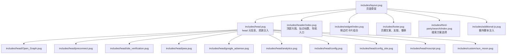
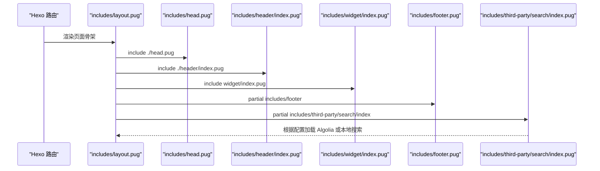
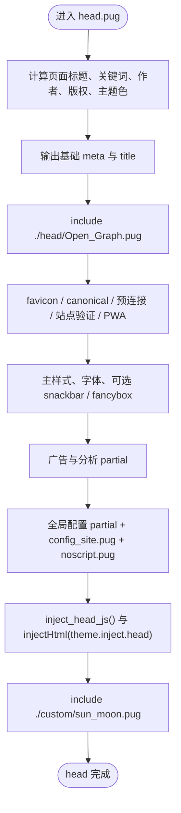
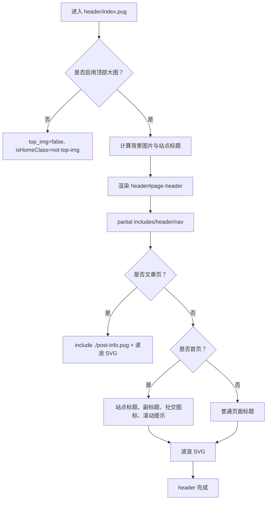
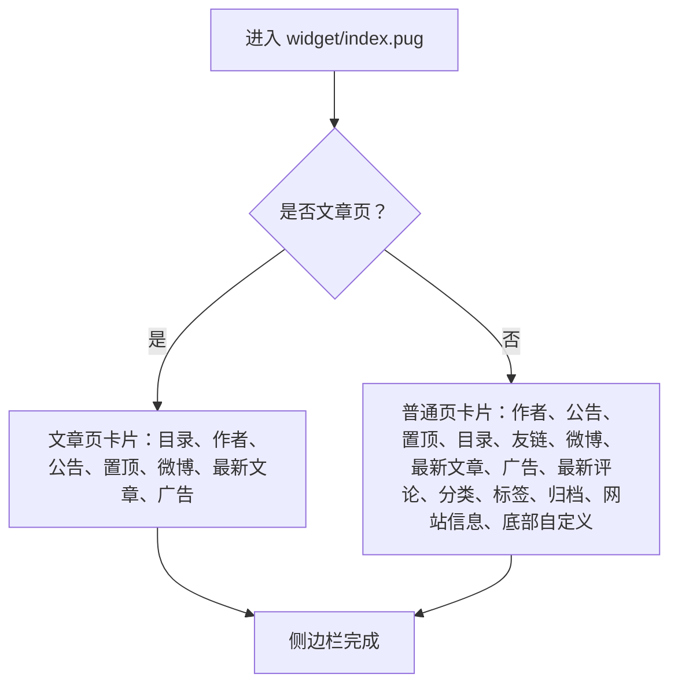
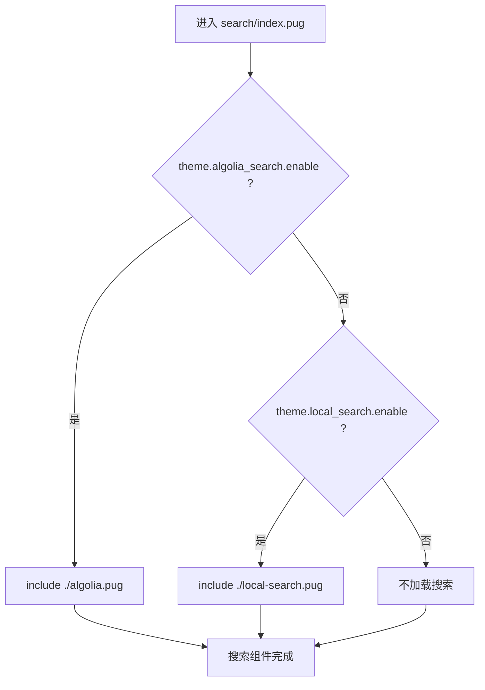
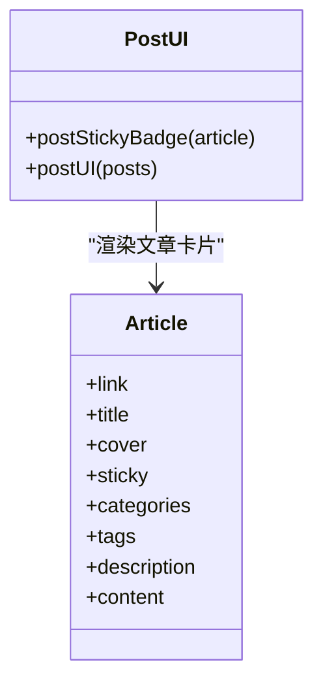

# Include 复用机制

<cite>
**本文引用的文件**   
- [layout.pug](file://themes/fomalhaut/layout/includes/layout.pug)
- [head.pug](file://themes/fomalhaut/layout/includes/head.pug)
- [footer.pug](file://themes/fomalhaut/layout/includes/footer.pug)
- [header/index.pug](file://themes/fomalhaut/layout/includes/header/index.pug)
- [widget/index.pug](file://themes/fomalhaut/layout/includes/widget/index.pug)
- [third-party/search/index.pug](file://themes/fomalhaut/layout/includes/third-party/search/index.pug)
- [mixins/post-ui.pug](file://themes/fomalhaut/layout/includes/mixins/post-ui.pug)
</cite>

## 目录
1. [引言](#引言)
2. [项目结构总览](#项目结构总览)
3. [核心组件与职责划分](#核心组件与职责划分)
4. [架构总览：主布局如何组装页面](#架构总览主布局如何组装页面)
5. [详细组件分析](#详细组件分析)
6. [依赖关系与数据传递](#依赖关系与数据传递)
7. [性能与缓存特性](#性能与缓存特性)
8. [创建新 include 组件的最佳实践](#创建新-include-组件的最佳实践)
9. [常见问题排查](#常见问题排查)
10. [结论](#结论)

## 引言
本文聚焦 Fomalhaut 主题的 Pug 模板复用机制，重点解析 `themes/fomalhaut/layout/includes/` 目录下的组织方式、各子目录职责、Pug `include` 指令的使用模式，以及主布局 `layout.pug` 如何把 head、header、footer、第三方组件和侧边栏拼装成完整页面。读者可以据此理解组件间依赖、数据来源，并学会在主题中新增可复用的 include 片段。

## 项目结构总览
Fomalhaut 的模板位于 `themes/fomalhaut/layout/`，其中 `includes/` 是主题级公共组件目录；具体页面路由（如首页、文章页、分类页等）则位于 `themes/fomalhaut/layout/` 根目录下，并通过 `!= partial('includes/...')` 或 `include ./xxx.pug` 引用公共片段。

**图表来源**
- [layout.pug:47-126](file://themes/fomalhaut/layout/includes/layout.pug#L47-L126)
- [head.pug:33-79](file://themes/fomalhaut/layout/includes/head.pug#L33-L79)
- [header/index.pug:31-73](file://themes/fomalhaut/layout/includes/header/index.pug#L31-L73)
- [widget/index.pug:1-37](file://themes/fomalhaut/layout/includes/widget/index.pug#L1-L37)
- [third-party/search/index.pug:1-4](file://themes/fomalhaut/layout/includes/third-party/search/index.pug#L1-L4)

**章节来源**
- [layout.pug:1-127](file://themes/fomalhaut/layout/includes/layout.pug#L1-L127)

## 核心组件与职责划分
`includes/` 下按功能域拆分子目录，便于维护与扩展：

| 子目录 | 主要职责 | 典型文件 |
|---|---|---|
| `head/` | `<head>` 中的 SEO、预连接、站点验证、PWA、广告与分析、字体、全局配置、noscript、自定义图标等 | `Open_Graph.pug`、`analytics.pug`、`config.pug`、`preconnect.pug`、`pwa.pug`、`site_verification.pug`、`google_adsense.pug`、`noscript.pug`、`config_site.pug` |
| `header/` | 页面顶部区域：导航、社交图标、文章页头信息、站点标题与副标题、波浪装饰等 | `index.pug`、`nav.pug`、`menu_item.pug`、`post-info.pug`、`social.pug` |
| `footer/` | 页脚内容：格言、猜你想看、推荐友链、版权信息、框架与主题徽章等 | `footer.pug` |
| `third-party/` | 第三方能力开关与加载：评论、数学公式、代码高亮、播放器、效果、PJAX、搜索等 | `aplayer.pug`、`effect.pug`、`pjax.pug`、`prismjs.pug`、`subtitle.pug`、`search/index.pug`、`comments/`、`math/`、`share/` 等 |
| `widget/` | 侧边栏卡片组合与渲染：作者、公告、置顶、微博、最新文章、广告、最新评论、分类、标签、归档、网站信息等 | `index.pug`、`card_*.pug` |
| `page/` | 特殊页面片段：分类页、标签页、友情链接、重定向、ECharts 示例页等 | `categories.pug`、`tags.pug`、`flink.pug`、`redirect.pug`、`echarts.pug`、`default-page.pug` |
| `post/` | 文章级通用片段：版权声明、打赏等 | `post-copyright.pug`、`reward.pug` |
| `loading/` | 页面加载动画样式与 JS 注入 | `loading.pug`、`loading-js.pug`、`load_style/*.pug` |
| `mixins/` | Pug mixin 复用逻辑：文章列表 UI、排序等 | `post-ui.pug`、`article-sort.pug` |
| `custom/` | 站点自定义片段：例如太阳月亮切换图标等 | `sun_moon.pug` |
| 顶层 pug | 页面骨架、右侧工具栏、分页、404、灯笼、附加脚本等 | `layout.pug`、`rightside.pug`、`pagination.pug`、`404.pug`、`lantern.pug`、`additional-js.pug`、`sidebar.pug`、`rightmenu.pug` |

**章节来源**
- [layout.pug:47-126](file://themes/fomalhaut/layout/includes/layout.pug#L47-L126)
- [head.pug:33-79](file://themes/fomalhaut/layout/includes/head.pug#L33-L79)
- [header/index.pug:31-73](file://themes/fomalhaut/layout/includes/header/index.pug#L31-L73)
- [widget/index.pug:1-37](file://themes/fomalhaut/layout/includes/widget/index.pug#L1-L37)
- [third-party/search/index.pug:1-4](file://themes/fomalhaut/layout/includes/third-party/search/index.pug#L1-L4)

## 架构总览：主布局如何组装页面
`layout.pug` 是整个页面的装配中心，负责：
- 设置 HTML 语言、主题模式、隐藏侧边栏类名、页面类型；
- 注册 Service Worker；
- 引入 `head.pug`；
- 根据配置决定是否显示灯笼、预加载、背景图；
- 引入侧边栏；
- 非 404 页面时渲染 header、main 内容与可选 widget；
- 渲染 footer；
- 引入右侧工具栏、搜索、右键菜单与附加脚本。

**图表来源**
- [layout.pug:47-126](file://themes/fomalhaut/layout/includes/layout.pug#L47-L126)
- [head.pug:33-79](file://themes/fomalhaut/layout/includes/head.pug#L33-L79)
- [header/index.pug:31-73](file://themes/fomalhaut/layout/includes/header/index.pug#L31-L73)
- [widget/index.pug:1-37](file://themes/fomalhaut/layout/includes/widget/index.pug#L1-L37)
- [third-party/search/index.pug:1-4](file://themes/fomalhaut/layout/includes/third-party/search/index.pug#L1-L4)

**章节来源**
- [layout.pug:1-127](file://themes/fomalhaut/layout/includes/layout.pug#L1-L127)

## 详细组件分析

### head.pug：头部元信息与资源注入
`head.pug` 负责生成页面标题、关键词、作者、版权、主题色、Open Graph、favicon、canonical、预连接、站点验证、PWA、主样式、字体、广告与分析、全局配置、noscript、注入脚本与 HTML 片段，以及自定义太阳月亮图标。

关键点：
- 标题与关键词会根据当前页面类型（首页、标签、分类、404、普通页面）动态计算；
- 通过 `partial('includes/head/...')` 按需注入预连接、站点验证、PWA、广告与分析、全局配置等；
- 使用 `fragment_cache` 缓存注入的脚本与 HTML，避免重复构建；
- 最终引入自定义 `sun_moon.pug`。

**图表来源**
- [head.pug:1-79](file://themes/fomalhaut/layout/includes/head.pug#L1-L79)

**章节来源**
- [head.pug:1-79](file://themes/fomalhaut/layout/includes/head.pug#L1-L79)

### header/index.pug：顶部区域与导航
`header/index.pug` 根据是否启用顶部大图、是否为文章页或首页，决定渲染站点标题、副标题、社交图标、文章头信息、波浪 SVG 等。导航部分通过 `partial('includes/header/nav', ...)` 引入。

关键点：
- 顶部大图来源优先级由配置与页面 front-matter 共同决定；
- 文章页会包含文章头信息；
- 首页与非文章页会展示站点标题与社交图标；
- 波浪 SVG 作为视觉装饰。

**图表来源**
- [header/index.pug:1-73](file://themes/fomalhaut/layout/includes/header/index.pug#L1-L73)

**章节来源**
- [header/index.pug:1-73](file://themes/fomalhaut/layout/includes/header/index.pug#L1-L73)

### widget/index.pug：侧边栏卡片组合
`widget/index.pug` 根据页面类型（文章页或普通页面）组合不同的侧边栏卡片，包括目录、作者、公告、置顶、微博、最新文章、广告、最新评论、分类、标签、归档、网站信息、底部自定义卡片等。

关键点：
- 文章页与普通页的卡片顺序和内容不同；
- 目录卡片受 `showToc` 与 `toc_style_simple` 控制；
- 大量卡片通过 `partial('includes/widget/card_xxx', ...)` 引入，便于单独维护。

**图表来源**
- [widget/index.pug:1-37](file://themes/fomalhaut/layout/includes/widget/index.pug#L1-L37)

**章节来源**
- [widget/index.pug:1-37](file://themes/fomalhaut/layout/includes/widget/index.pug#L1-L37)

### third-party/search/index.pug：搜索方案选择
该文件根据主题配置选择 Algolia 搜索或本地搜索，分别 include 对应实现。

**图表来源**
- [third-party/search/index.pug:1-4](file://themes/fomalhaut/layout/includes/third-party/search/index.pug#L1-L4)

**章节来源**
- [third-party/search/index.pug:1-4](file://themes/fomalhaut/layout/includes/third-party/search/index.pug#L1-L4)

### mixins/post-ui.pug：文章列表 UI 复用
`mixins/post-ui.pug` 提供文章列表渲染的 mixin，用于在不同页面复用文章卡片结构，包括封面、置顶角标、标题、元信息（日期、分类、标签）、评论数、摘要等。

关键点：
- 使用 `mixin postUI(posts)` 遍历文章数据；
- 使用 `mixin postStickyBadge(article)` 渲染置顶角标；
- 支持多种评论系统的评论数展示；
- 支持首页摘要截断与配置化显示。

**图表来源**
- [mixins/post-ui.pug:143-298](file://themes/fomalhaut/layout/includes/mixins/post-ui.pug#L143-L298)

**章节来源**
- [mixins/post-ui.pug:1-298](file://themes/fomalhaut/layout/includes/mixins/post-ui.pug#L1-L298)

## 依赖关系与数据传递
Fomalhaut 的主题模板依赖 Hexo 提供的上下文对象与主题配置：

| 数据来源 | 说明 | 典型用途 |
|---|---|---|
| `config` | Hexo 站点配置 | 站点标题、语言、作者、邮箱、关键词、版权、favicon 等 |
| `theme` | Fomalhaut 主题配置 | 主题开关、样式、CDN、第三方服务、外观行为等 |
| `page` | 当前页面上下文 | 页面标题、front-matter、类型、侧边栏开关、封面、背景图等 |
| `is_home()` / `is_post()` / `is_category()` / `is_tag()` / `is_archive()` | 页面类型判断 | 控制不同页面渲染分支 |
| `_p(...)` | 多语言文案 | 标题、按钮、标签等国际化文本 |
| `url_for(...)` / `full_url_for(...)` | URL 生成 | 静态资源、链接、canonical 等 |
| `date(...)` / `full_date(...)` / `date_xml(...)` | 时间格式化 | 文章发布时间、更新时间 |
| `fragment_cache(...)` / `partial(...)` | 缓存与局部渲染 | 提升构建与渲染性能 |

数据流向示例：
- `layout.pug` 根据 `theme.aside.enable`、`page.aside`、页面类型计算 `hideAside` 与 `pageType`；
- `head.pug` 根据 `page.title`、`config.title`、`config.subtitle`、`page.keywords`、`page.tags` 计算标题与关键词；
- `header/index.pug` 根据 `theme.disable_top_img`、`page.top_img`、`is_post()`、`is_home()` 决定顶部大图与站点信息；
- `widget/index.pug` 根据 `is_post()`、`showToc`、`toc_style_simple` 决定侧边栏卡片；
- `third-party/search/index.pug` 根据 `theme.algolia_search.enable`、`theme.local_search.enable` 决定加载哪个搜索实现。

**章节来源**
- [layout.pug:1-127](file://themes/fomalhaut/layout/includes/layout.pug#L1-L127)
- [head.pug:1-79](file://themes/fomalhaut/layout/includes/head.pug#L1-L79)
- [header/index.pug:1-73](file://themes/fomalhaut/layout/includes/header/index.pug#L1-L73)
- [widget/index.pug:1-37](file://themes/fomalhaut/layout/includes/widget/index.pug#L1-L37)
- [third-party/search/index.pug:1-4](file://themes/fomalhaut/layout/includes/third-party/search/index.pug#L1-L4)

## 性能与缓存特性
Fomalhaut 在模板层使用了两种主要优化手段：

1. **`partial(..., {cache: true})`**  
   将常用片段（如 loading、sidebar、footer、search、rightmenu）进行缓存，减少重复渲染开销。

2. **`fragment_cache(name, fn)`**  
   对动态生成的 HTML 或脚本进行缓存，例如注入的 head 脚本与 HTML 片段。

这些机制在 `layout.pug`、`head.pug`、`header/index.pug`、`widget/index.pug`、`third-party/search/index.pug` 中广泛使用，有助于降低构建与渲染成本。

**章节来源**
- [layout.pug:55-126](file://themes/fomalhaut/layout/includes/layout.pug#L55-L126)
- [head.pug:40-79](file://themes/fomalhaut/layout/includes/head.pug#L40-L79)
- [header/index.pug:32-57](file://themes/fomalhaut/layout/includes/header/index.pug#L32-L57)
- [widget/index.pug:10-36](file://themes/fomalhaut/layout/includes/widget/index.pug#L10-L36)
- [third-party/search/index.pug:1-4](file://themes/fomalhaut/layout/includes/third-party/search/index.pug#L1-L4)

## 创建新 include 组件的最佳实践
以下流程适用于在 Fomalhaut 主题中新增一个可复用的 include 组件：

1. **确定组件归属目录**  
   - 如果是 `<head>` 相关资源或元信息，放入 `includes/head/`；  
   - 如果是顶部区域，放入 `includes/header/`；  
   - 如果是侧边栏卡片，放入 `includes/widget/`；  
   - 如果是第三方能力，放入 `includes/third-party/`；  
   - 如果是通用 mixin，放入 `includes/mixins/`；  
   - 如果是站点自定义片段，放入 `includes/custom/`。

2. **编写 Pug 片段**  
   - 使用相对路径引用同级或子目录组件；  
   - 需要复用逻辑时使用 `mixin`；  
   - 需要条件渲染时使用 `if` / `else`；  
   - 需要调用 Hexo 助手时使用 `url_for`、`date`、`_p` 等。

3. **在主布局或父组件中引入**  
   - 使用 `include ./path/to/component.pug` 引入直接依赖；  
   - 使用 `partial('includes/path/to/component', {}, {cache: true})` 引入可缓存片段；  
   - 如需动态生成 HTML 或脚本，使用 `fragment_cache('name', function(){ return ... })`。

4. **通过主题配置控制开关**  
   - 在 `theme.xxx.enable` 或 `theme.xxx.field` 中暴露开关；  
   - 在 include 文件中根据配置决定是否渲染。

5. **测试与验证**  
   - 在首页、文章页、分类页、标签页等不同页面验证渲染结果；  
   - 检查控制台是否有未定义变量或函数错误；  
   - 检查构建日志是否有缓存或 partial 解析异常。

示例路径参考：
- 新增 `<head>` 片段：[head.pug:33-79](file://themes/fomalhaut/layout/includes/head.pug#L33-L79)
- 新增侧边栏卡片：[widget/index.pug:10-36](file://themes/fomalhaut/layout/includes/widget/index.pug#L10-L36)
- 新增第三方能力：[third-party/search/index.pug:1-4](file://themes/fomalhaut/layout/includes/third-party/search/index.pug#L1-L4)
- 复用文章列表 UI：[mixins/post-ui.pug:143-298](file://themes/fomalhaut/layout/includes/mixins/post-ui.pug#L143-L298)

**章节来源**
- [head.pug:33-79](file://themes/fomalhaut/layout/includes/head.pug#L33-L79)
- [widget/index.pug:10-36](file://themes/fomalhaut/layout/includes/widget/index.pug#L10-L36)
- [third-party/search/index.pug:1-4](file://themes/fomalhaut/layout/includes/third-party/search/index.pug#L1-L4)
- [mixins/post-ui.pug:143-298](file://themes/fomalhaut/layout/includes/mixins/post-ui.pug#L143-L298)

## 常见问题排查
| 问题现象 | 可能原因 | 排查建议 |
|---|---|---|
| 页面缺少某个组件 | include 路径错误或未引入 | 检查 `layout.pug` 或父组件是否正确 `include` 或 `partial` |
| 组件未生效但无报错 | 主题配置关闭了该功能 | 检查 `theme.xxx.enable` 或相关字段 |
| 标题或关键词不正确 | `page.title`、`page.keywords`、`page.tags` 未正确设置 | 检查文章 front-matter 与 `head.pug` 的计算逻辑 |
| 侧边栏卡片顺序不符合预期 | `widget/index.pug` 中卡片顺序或条件判断 | 调整 `widget/index.pug` 中的 `partial` 顺序 |
| 搜索框不出现 | Algolia 与本地搜索均未启用 | 检查 `third-party/search/index.pug` 的条件 |
| 构建缓慢 | 大量未缓存的 partial 或 fragment | 为常用片段添加 `{cache: true}` 或使用 `fragment_cache` |

**章节来源**
- [layout.pug:47-126](file://themes/fomalhaut/layout/includes/layout.pug#L47-L126)
- [head.pug:1-79](file://themes/fomalhaut/layout/includes/head.pug#L1-L79)
- [widget/index.pug:1-37](file://themes/fomalhaut/layout/includes/widget/index.pug#L1-L37)
- [third-party/search/index.pug:1-4](file://themes/fomalhaut/layout/includes/third-party/search/index.pug#L1-L4)

## 结论
Fomalhaut 主题的 Include 复用机制以 `layout.pug` 为核心，通过 `includes/` 目录下的模块化组件实现清晰的职责划分。`head/`、`header/`、`footer/`、`third-party/`、`widget/`、`mixins/`、`custom/` 等子目录各司其职，配合 Hexo 的 `partial`、`fragment_cache`、`include` 与主题配置，形成高内聚、低耦合的模板体系。掌握这套机制后，你可以安全地新增组件、灵活引用片段，并在不同页面中复用相同的 UI 与逻辑。