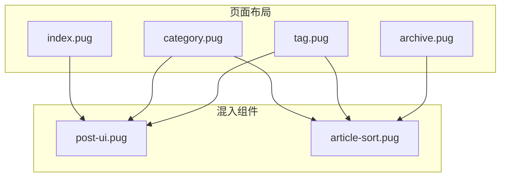
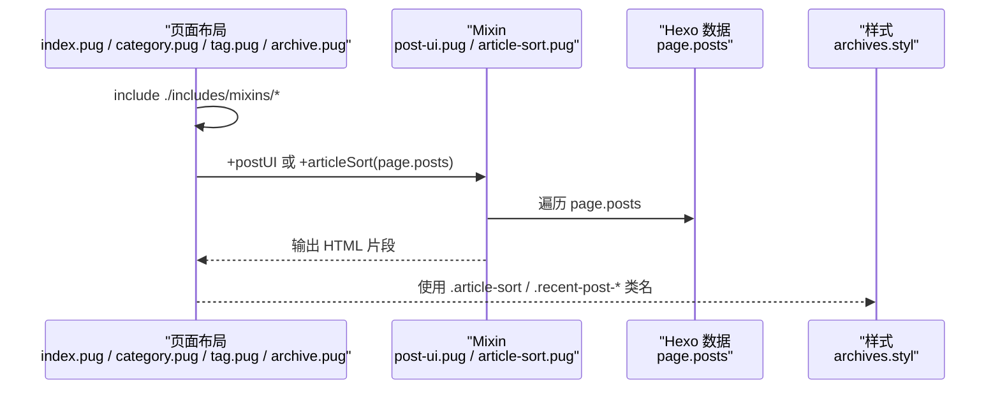
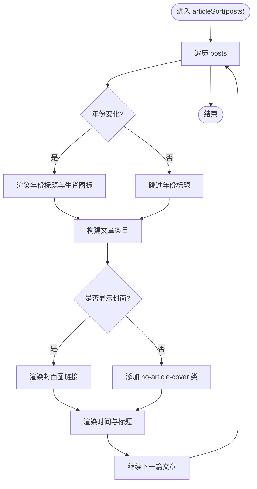
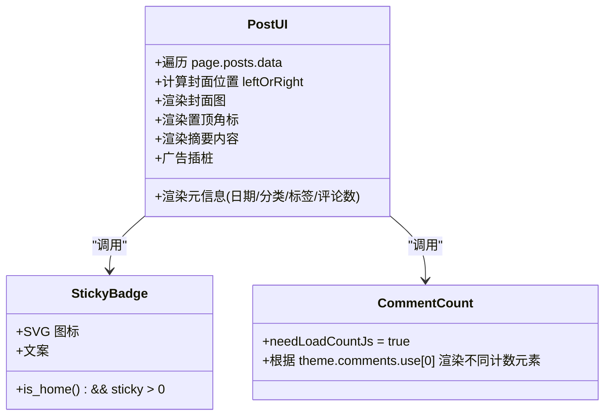
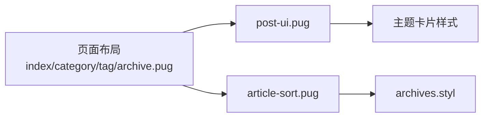

# Mixins 混合器系统

<cite>
**本文引用的文件**   
- [article-sort.pug](file://themes/fomalhaut/layout/includes/mixins/article-sort.pug)
- [post-ui.pug](file://themes/fomalhaut/layout/includes/mixins/post-ui.pug)
- [index.pug](file://themes/fomalhaut/layout/index.pug)
- [category.pug](file://themes/fomalhaut/layout/category.pug)
- [tag.pug](file://themes/fomalhaut/layout/tag.pug)
- [archive.pug](file://themes/fomalhaut/layout/archive.pug)
- [archives.styl](file://themes/fomalhaut/source/css/_page/archives.styl)
</cite>

## 目录
1. [引言](#引言)
2. [项目结构](#项目结构)
3. [核心组件](#核心组件)
4. [架构总览](#架构总览)
5. [详细组件分析](#详细组件分析)
6. [依赖关系分析](#依赖关系分析)
7. [性能与可维护性](#性能与可维护性)
8. [故障排查指南](#故障排查指南)
9. [结论](#结论)
10. [附录：自定义 Mixin 开发指南与最佳实践](#附录自定义-mixin-开发指南与最佳实践)

## 引言
本文聚焦 Fomalhaut 主题中的 Pug Mixins 混合器系统，重点解析 article-sort.pug 与 post-ui.pug 两个关键 mixin 的实现原理、调用方式与扩展方法。文章将说明如何在不同页面中复用相同的文章排序逻辑和帖子界面组件，涵盖参数传递、条件渲染、循环处理等常见模式，并给出自定义 mixin 的开发指南与最佳实践。

## 项目结构
Fomalhaut 主题的模板位于 themes/fomalhaut/layout 下，其中 mixins 集中在 includes/mixins 目录。页面布局文件通过 include 引入 mixin，并通过 + 调用 mixin，从而把“列表渲染”与“页面骨架”解耦。

图表来源
- [index.pug:4-10](file://themes/fomalhaut/layout/index.pug#L4-L10)
- [category.pug:4-13](file://themes/fomalhaut/layout/category.pug#L4-L13)
- [tag.pug:4-13](file://themes/fomalhaut/layout/tag.pug#L4-L13)
- [archive.pug:4-8](file://themes/fomalhaut/layout/archive.pug#L4-L8)

章节来源
- [index.pug:1-11](file://themes/fomalhaut/layout/index.pug#L1-L11)
- [category.pug:1-14](file://themes/fomalhaut/layout/category.pug#L1-L14)
- [tag.pug:1-14](file://themes/fomalhaut/layout/tag.pug#L1-L14)
- [archive.pug:1-10](file://themes/fomalhaut/layout/archive.pug#L1-L10)

## 核心组件
- articleSort(posts)：按年份分组渲染归档/分类/标签的文章列表，包含封面图、时间、标题等元信息，支持无封面降级样式。
- postUI(posts)：首页卡片式文章列表，包含置顶角标、封面图、标题、元信息（日期、分类、标签）、评论数入口、摘要内容以及广告插桩位。

章节来源
- [article-sort.pug:1-25](file://themes/fomalhaut/layout/includes/mixins/article-sort.pug#L1-L25)
- [post-ui.pug:143-298](file://themes/fomalhaut/layout/includes/mixins/post-ui.pug#L143-L298)

## 架构总览
Pug 模板层通过“页面布局 → 引入 mixin → 调用 mixin”的方式组织。页面负责数据上下文（如 page.posts），mixin 负责具体 UI 渲染。

图表来源
- [index.pug:4-10](file://themes/fomalhaut/layout/index.pug#L4-L10)
- [category.pug:4-13](file://themes/fomalhaut/layout/category.pug#L4-L13)
- [tag.pug:4-13](file://themes/fomalhaut/layout/tag.pug#L4-L13)
- [archive.pug:4-8](file://themes/fomalhaut/layout/archive.pug#L4-L8)
- [archives.styl:1-63](file://themes/fomalhaut/source/css/_page/archives.styl#L1-L63)

## 详细组件分析

### articleSort(posts) 组件
- 功能要点
  - 接收 posts 数组作为参数。
  - 按文章年份分组，同一年份只渲染一次年份标题。
  - 根据 theme.cover.archives_enable 与 article.cover 控制是否显示封面图；若无封面则添加 no-article-cover 类以走降级样式。
  - 为每篇文章渲染时间、标题链接，并使用 _p() 进行国际化文本。
  - 使用 getAnimalIcon(tempYear) 获取对应年份的生肖图标资源。
- 数据结构与复杂度
  - 输入：posts 数组。
  - 时间复杂度：O(n)，n 为文章数量。
  - 空间复杂度：O(1) 额外变量（year）。
- 条件渲染与循环
  - 使用 each 遍历文章。
  - 使用 if 判断封面显示与年份分组。
- 可访问性与健壮性
  - 图片 onerror 回退到主题错误图。
  - 标题缺失时使用 _p('no_title') 兜底。

图表来源
- [article-sort.pug:1-25](file://themes/fomalhaut/layout/includes/mixins/article-sort.pug#L1-L25)

章节来源
- [article-sort.pug:1-25](file://themes/fomalhaut/layout/includes/mixins/article-sort.pug#L1-L25)

### postUI(posts) 组件
- 功能要点
  - 遍历 page.posts.data，渲染卡片式文章列表。
  - 根据 theme.cover.position 计算封面左右位置（left/right/both）。
  - 置顶角标：当 is_home() 且 article.sticky > 0 时渲染置顶徽章，sticky >= 2 时为强置顶样式。
  - 元信息：根据 theme.post_meta.page.date_type 显示创建/更新时间；分类与标签列表；评论数入口（根据 theme.comments.use[0] 切换不同评论系统的计数元素）。
  - 摘要内容：根据 theme.index_post_content.method 决定是否展示 description 或截取 content。
  - 广告插桩：每隔若干条插入广告容器。
- 内部子 mixin
  - postStickyBadge(article)：封装置顶角标的 SVG 与文案。
  - countBlockInIndex：封装评论数区块，按需注入 block 内容。
- 数据结构与复杂度
  - 输入：page.posts.data。
  - 时间复杂度：O(n)。
  - 空间复杂度：O(1) 额外变量（link/title/leftOrRight/no_cover 等）。
- 条件渲染与循环
  - each 遍历文章。
  - case/when 分支处理评论系统与摘要策略。
  - 三元表达式与布尔组合用于封面位置与显示控制。

图表来源
- [post-ui.pug:143-149](file://themes/fomalhaut/layout/includes/mixins/post-ui.pug#L143-L149)
- [post-ui.pug:151-298](file://themes/fomalhaut/layout/includes/mixins/post-ui.pug#L151-L298)

章节来源
- [post-ui.pug:143-298](file://themes/fomalhaut/layout/includes/mixins/post-ui.pug#L143-L298)

### 页面如何调用 Mixins
- 首页 index.pug
  - include post-ui.pug
  - +postUI
- 分类页 category.pug
  - 若 theme.category_ui == 'index'：include post-ui.pug 并 +postUI
  - 否则：include article-sort.pug 并 +articleSort(page.posts)
- 标签页 tag.pug
  - 若 theme.tag_ui == 'index'：include post-ui.pug 并 +postUI
  - 否则：include article-sort.pug 并 +articleSort(page.posts)
- 归档页 archive.pug
  - include article-sort.pug 并 +articleSort(page.posts)

章节来源
- [index.pug:4-10](file://themes/fomalhaut/layout/index.pug#L4-L10)
- [category.pug:4-13](file://themes/fomalhaut/layout/category.pug#L4-L13)
- [tag.pug:4-13](file://themes/fomalhaut/layout/tag.pug#L4-L13)
- [archive.pug:4-8](file://themes/fomalhaut/layout/archive.pug#L4-L8)

## 依赖关系分析
- 模板依赖
  - 页面布局依赖 mixins 提供的 UI 片段。
  - mixins 依赖 Hexo 全局函数与配置：url_for、full_url_for、date、date_xml、_p、is_home、theme、config。
- 样式依赖
  - article-sort.pug 输出 .article-sort 相关类名，由 archives.styl 提供样式。
  - post-ui.pug 输出 .recent-post-* 相关类名，由主题样式体系统一处理。

图表来源
- [archives.styl:1-63](file://themes/fomalhaut/source/css/_page/archives.styl#L1-L63)

章节来源
- [archives.styl:1-63](file://themes/fomalhaut/source/css/_page/archives.styl#L1-L63)

## 性能与可维护性
- 性能
  - 两个 mixin 均为 O(n) 线性遍历，适合常规博客规模。
  - 图片 onerror 回退避免加载失败导致的空白。
  - 评论计数在需要时才标记 needLoadCountJs，便于后续按需加载脚本。
- 可维护性
  - 将“列表渲染”下沉至 mixin，页面布局保持简洁。
  - 通过 theme.* 配置项控制行为，减少硬编码分支。
  - 使用 _p() 实现多语言，便于国际化扩展。

## 故障排查指南
- 问题：归档列表未显示年份分组
  - 检查 article-sort.pug 中年份比较逻辑与 year 变量更新是否正确。
  - 确认传入的 posts 已按时间排序。
- 问题：封面图不显示或显示错误图
  - 检查 theme.cover.archives_enable 与 article.cover 字段。
  - 确认 url_for(theme.error_img.post_page) 路径有效。
- 问题：置顶角标未出现
  - 确认当前页面 is_home() 返回 true。
  - 检查 article.sticky 是否大于 0。
- 问题：评论数未渲染
  - 检查 theme.comments.card_post_count 与 theme.comments.use[0] 配置。
  - 确认对应评论系统的 JS 已正确加载。

章节来源
- [article-sort.pug:1-25](file://themes/fomalhaut/layout/includes/mixins/article-sort.pug#L1-L25)
- [post-ui.pug:143-298](file://themes/fomalhaut/layout/includes/mixins/post-ui.pug#L143-L298)

## 结论
Fomalhaut 主题通过 article-sort.pug 与 post-ui.pug 两个 mixin 实现了“归档式列表”与“卡片式列表”两种文章展示模式，并在首页、分类页、标签页与归档页中灵活复用。mixin 的参数化、条件渲染与循环处理清晰明确，配合 theme 配置与 _p() 国际化，具备良好的可扩展性与可维护性。

## 附录：自定义 Mixin 开发指南与最佳实践
- 命名与职责
  - 文件名采用小写加连字符（如 card-summary.pug），mixin 名称使用驼峰（如 cardSummary）。
  - 每个 mixin 仅承担单一职责，复杂逻辑拆分为多个子 mixin。
- 参数设计
  - 优先使用对象参数（如 options）承载可选配置，便于向后兼容。
  - 对必填参数做显式校验，并提供合理的默认值。
- 条件与循环
  - 使用 each 遍历集合，结合 if/else 与三元表达式控制分支。
  - 对可能为空的数据提供兜底文案（如 _p('no_title')）。
- 可访问性与健壮性
  - 图片增加 onerror 回退。
  - 为交互元素提供 aria-* 属性与语义化标签。
- 样式耦合
  - 输出稳定的类名，避免在 mixin 内直接编写样式。
  - 通过主题样式文件统一管理视觉表现。
- 测试与验证
  - 在不同页面（首页、分类、标签、归档）验证 mixin 的输出。
  - 检查国际化文案、SEO 元信息、无障碍属性是否符合预期。