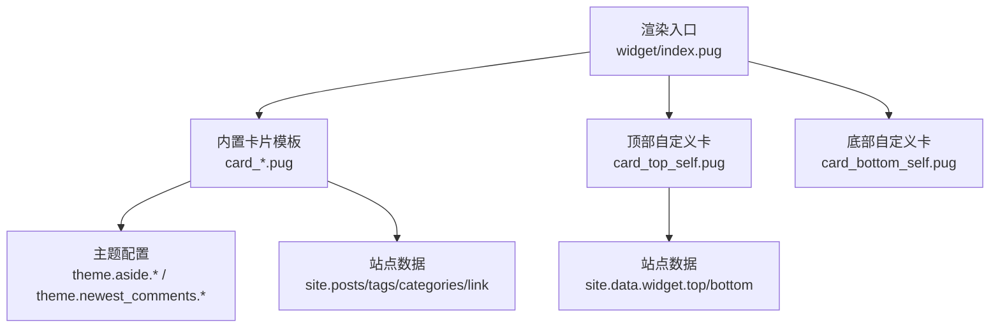
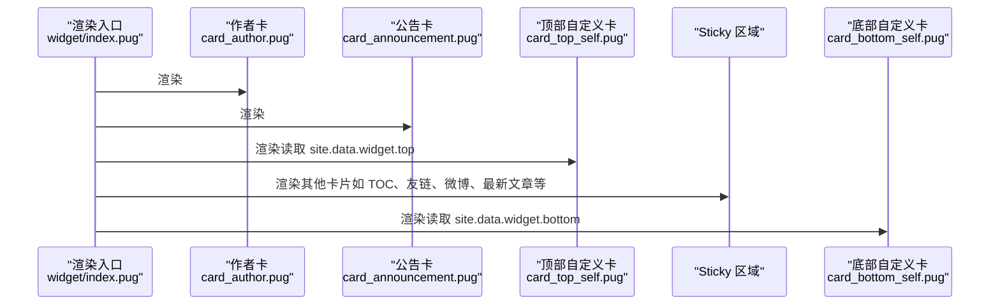
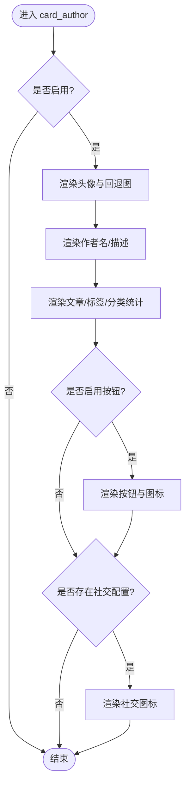
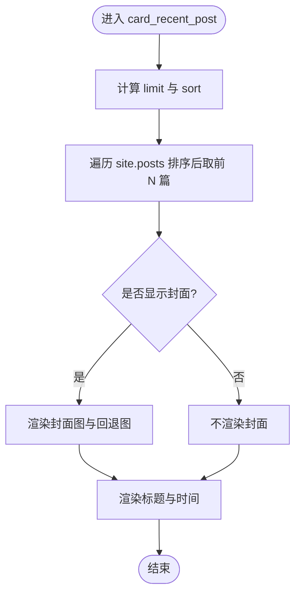
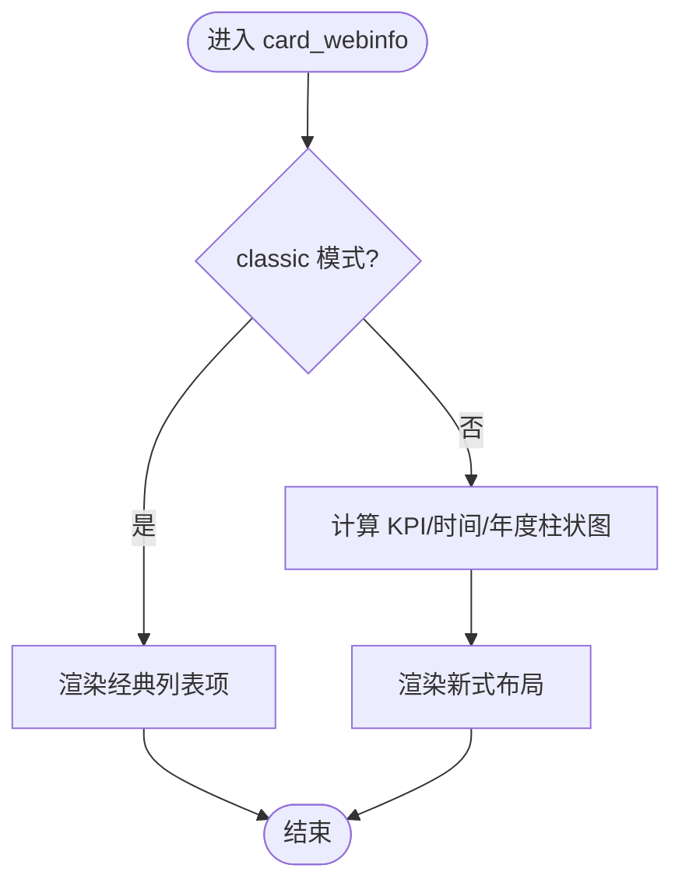
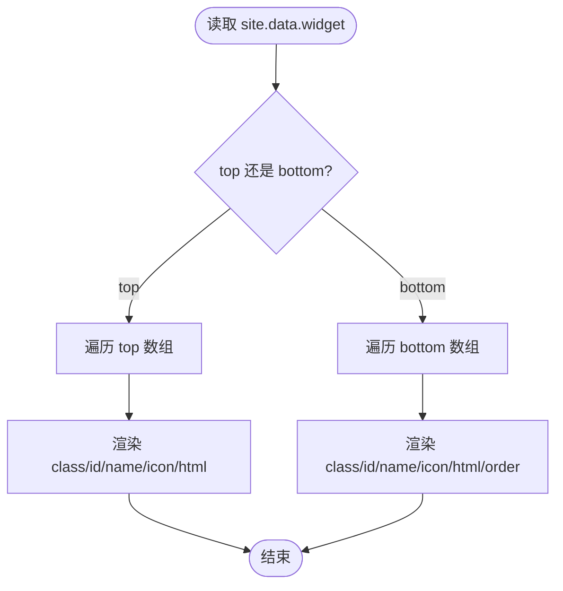
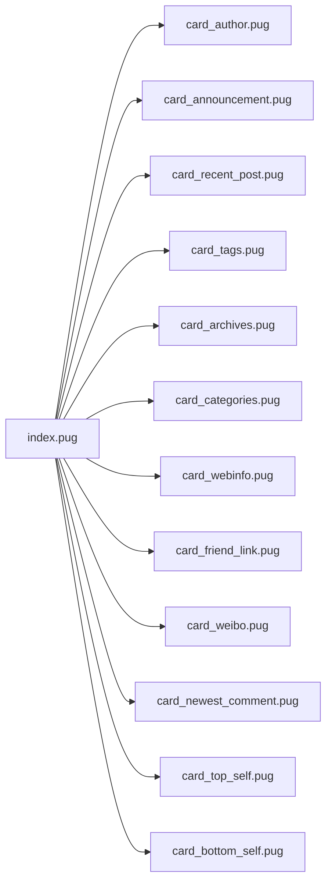
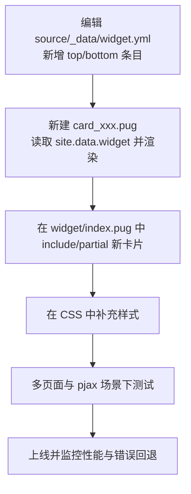

# Widget 组件系统

<cite>
**本文引用的文件**   
- [themes/fomalhaut/layout/includes/widget/index.pug](file://themes/fomalhaut/layout/includes/widget/index.pug)
- [themes/fomalhaut/layout/includes/widget/card_author.pug](file://themes/fomalhaut/layout/includes/widget/card_author.pug)
- [themes/fomalhaut/layout/includes/widget/card_announcement.pug](file://themes/fomalhaut/layout/includes/widget/card_announcement.pug)
- [themes/fomalhaut/layout/includes/widget/card_top_self.pug](file://themes/fomalhaut/layout/includes/widget/card_top_self.pug)
- [themes/fomalhaut/layout/includes/widget/card_bottom_self.pug](file://themes/fomalhaut/layout/includes/widget/card_bottom_self.pug)
- [themes/fomalhaut/layout/includes/widget/card_recent_post.pug](file://themes/fomalhaut/layout/includes/widget/card_recent_post.pug)
- [themes/fomalhaut/layout/includes/widget/card_tags.pug](file://themes/fomalhaut/layout/includes/widget/card_tags.pug)
- [themes/fomalhaut/layout/includes/widget/card_archives.pug](file://themes/fomalhaut/layout/includes/widget/card_archives.pug)
- [themes/fomalhaut/layout/includes/widget/card_categories.pug](file://themes/fomalhaut/layout/includes/widget/card_categories.pug)
- [themes/fomalhaut/layout/includes/widget/card_webinfo.pug](file://themes/fomalhaut/layout/includes/widget/card_webinfo.pug)
- [themes/fomalhaut/layout/includes/widget/card_friend_link.pug](file://themes/fomalhaut/layout/includes/widget/card_friend_link.pug)
- [themes/fomalhaut/layout/includes/widget/card_weibo.pug](file://themes/fomalhaut/layout/includes/widget/card_weibo.pug)
- [themes/fomalhaut/layout/includes/widget/card_newest_comment.pug](file://themes/fomalhaut/layout/includes/widget/card_newest_comment.pug)
- [source/_data/widget.yml](file://source/_data/widget.yml)
- [themes/fomalhaut/_config.yml](file://themes/fomalhaut/_config.yml)
</cite>

## 目录
1. [简介](#简介)
2. [项目结构](#项目结构)
3. [核心组件](#核心组件)
4. [架构总览](#架构总览)
5. [详细组件分析](#详细组件分析)
6. [依赖关系分析](#依赖关系分析)
7. [性能与优化](#性能与优化)
8. [故障排查](#故障排查)
9. [结论](#结论)
10. [附录：自定义 Widget 开发指南](#附录自定义-widget-开发指南)

## 简介
本文件全面解析 Fomalhaut 主题的侧栏 Widget 组件系统，覆盖以下方面：
- 组件目录结构与渲染入口
- 配置方式（主题配置与 YAML 数据）
- 数据绑定机制（Pug 模板、Hexo 全局对象、辅助函数）
- 样式定制方法
- 通过 YAML 动态加载与管理 widget
- 自定义 widget 的完整开发流程
- 生命周期管理与性能优化策略

## 项目结构
Widget 系统由“渲染入口 + 卡片模板 + 主题配置 + 站点数据”四部分组成：
- 渲染入口：themes/fomalhaut/layout/includes/widget/index.pug
- 卡片模板：themes/fomalhaut/layout/includes/widget/card_*.pug
- 主题配置：themes/fomalhaut/_config.yml
- 站点数据：source/_data/widget.yml（以及 site.data.link 等）

**图示来源**
- [themes/fomalhaut/layout/includes/widget/index.pug:1-37](file://themes/fomalhaut/layout/includes/widget/index.pug#L1-L37)
- [themes/fomalhaut/layout/includes/widget/card_top_self.pug:1-8](file://themes/fomalhaut/layout/includes/widget/card_top_self.pug#L1-L8)
- [themes/fomalhaut/layout/includes/widget/card_bottom_self.pug:1-10](file://themes/fomalhaut/layout/includes/widget/card_bottom_self.pug#L1-L10)
- [themes/fomalhaut/_config.yml:625-694](file://themes/fomalhaut/_config.yml#L625-L694)
- [source/_data/widget.yml:1-50](file://source/_data/widget.yml#L1-L50)

**章节来源**
- [themes/fomalhaut/layout/includes/widget/index.pug:1-37](file://themes/fomalhaut/layout/includes/widget/index.pug#L1-L37)
- [themes/fomalhaut/_config.yml:625-694](file://themes/fomalhaut/_config.yml#L625-L694)
- [source/_data/widget.yml:1-50](file://source/_data/widget.yml#L1-L50)

## 核心组件
- 作者信息卡：展示头像、描述、文章/标签/分类统计、社交链接。
- 公告栏：展示可配置的欢迎或公告内容。
- 最新文章：按日期或更新时间排序，支持封面图与限制数量。
- 标签云：支持颜色与字体大小范围控制。
- 归档：按月/年分组，支持排序与限制。
- 分类：支持展开与限制数量。
- 小站资讯：提供经典模式与新式 KPI+时间条+年度产出柱状图两种布局。
- 友链：按类别分组，在线/离线状态区分。
- 微博热搜：第三方脚本注入容器。
- 最新评论：根据评论系统开关与类型决定是否显示。
- 顶部/底部自定义卡：从 YAML 动态渲染 HTML、图标、标题。

**章节来源**
- [themes/fomalhaut/layout/includes/widget/card_author.pug:1-37](file://themes/fomalhaut/layout/includes/widget/card_author.pug#L1-L37)
- [themes/fomalhaut/layout/includes/widget/card_announcement.pug:1-14](file://themes/fomalhaut/layout/includes/widget/card_announcement.pug#L1-L14)
- [themes/fomalhaut/layout/includes/widget/card_recent_post.pug:1-26](file://themes/fomalhaut/layout/includes/widget/card_recent_post.pug#L1-L26)
- [themes/fomalhaut/layout/includes/widget/card_tags.pug:1-13](file://themes/fomalhaut/layout/includes/widget/card_tags.pug#L1-L13)
- [themes/fomalhaut/layout/includes/widget/card_archives.pug:1-8](file://themes/fomalhaut/layout/includes/widget/card_archives.pug#L1-L8)
- [themes/fomalhaut/layout/includes/widget/card_categories.pug:1-5](file://themes/fomalhaut/layout/includes/widget/card_categories.pug#L1-L5)
- [themes/fomalhaut/layout/includes/widget/card_webinfo.pug:1-148](file://themes/fomalhaut/layout/includes/widget/card_webinfo.pug#L1-L148)
- [themes/fomalhaut/layout/includes/widget/card_friend_link.pug:1-40](file://themes/fomalhaut/layout/includes/widget/card_friend_link.pug#L1-L40)
- [themes/fomalhaut/layout/includes/widget/card_weibo.pug:1-14](file://themes/fomalhaut/layout/includes/widget/card_weibo.pug#L1-L14)
- [themes/fomalhaut/layout/includes/widget/card_newest_comment.pug:1-8](file://themes/fomalhaut/layout/includes/widget/card_newest_comment.pug#L1-L8)
- [themes/fomalhaut/layout/includes/widget/card_top_self.pug:1-8](file://themes/fomalhaut/layout/includes/widget/card_top_self.pug#L1-L8)
- [themes/fomalhaut/layout/includes/widget/card_bottom_self.pug:1-10](file://themes/fomalhaut/layout/includes/widget/card_bottom_self.pug#L1-L10)

## 架构总览
Widget 渲染入口根据页面类型（文章页/非文章页）决定不同卡片组合，并统一将“顶部自定义卡”和“底部自定义卡”分别插入到非 sticky 区域与 sticky 区域。

**图示来源**
- [themes/fomalhaut/layout/includes/widget/index.pug:1-37](file://themes/fomalhaut/layout/includes/widget/index.pug#L1-L37)
- [themes/fomalhaut/layout/includes/widget/card_top_self.pug:1-8](file://themes/fomalhaut/layout/includes/widget/card_top_self.pug#L1-L8)
- [themes/fomalhaut/layout/includes/widget/card_bottom_self.pug:1-10](file://themes/fomalhaut/layout/includes/widget/card_bottom_self.pug#L1-L10)

**章节来源**
- [themes/fomalhaut/layout/includes/widget/index.pug:1-37](file://themes/fomalhaut/layout/includes/widget/index.pug#L1-L37)

## 详细组件分析

### 作者信息卡 card_author
- 功能要点
  - 头像与错误回退图
  - 作者名与描述（优先使用主题配置，否则回退站点描述）
  - 文章/标签/分类数量统计
  - 可选按钮（GitHub 跳转）
  - 社交图标聚合
- 配置项
  - theme.aside.card_author.enable
  - theme.aside.card_author.description
  - theme.aside.card_author.button.enable/text/link/icon
- 数据绑定
  - config.author、config.description
  - site.posts.length、site.tags.length、site.categories.length
  - fragment_cache('social', ...) 复用社交图标片段

**图示来源**
- [themes/fomalhaut/layout/includes/widget/card_author.pug:1-37](file://themes/fomalhaut/layout/includes/widget/card_author.pug#L1-L37)

**章节来源**
- [themes/fomalhaut/layout/includes/widget/card_author.pug:1-37](file://themes/fomalhaut/layout/includes/widget/card_author.pug#L1-L37)
- [themes/fomalhaut/_config.yml:635-643](file://themes/fomalhaut/_config.yml#L635-L643)

### 公告栏 card_announcement
- 功能要点
  - 标题与内容来自主题配置
  - 预留欢迎信息容器
- 配置项
  - theme.aside.card_announcement.enable/content

**章节来源**
- [themes/fomalhaut/layout/includes/widget/card_announcement.pug:1-14](file://themes/fomalhaut/layout/includes/widget/card_announcement.pug#L1-L14)
- [themes/fomalhaut/_config.yml:643-646](file://themes/fomalhaut/_config.yml#L643-L646)

### 最新文章 card_recent_post
- 功能要点
  - 支持按 date 或 updated 排序
  - 支持限制显示数量（0 表示全部）
  - 支持封面图与无封面类名
- 配置项
  - theme.aside.card_recent_post.enable/limit/sort/sort_order

**图示来源**
- [themes/fomalhaut/layout/includes/widget/card_recent_post.pug:1-26](file://themes/fomalhaut/layout/includes/widget/card_recent_post.pug#L1-L26)

**章节来源**
- [themes/fomalhaut/layout/includes/widget/card_recent_post.pug:1-26](file://themes/fomalhaut/layout/includes/widget/card_recent_post.pug#L1-L26)
- [themes/fomalhaut/_config.yml:646-651](file://themes/fomalhaut/_config.yml#L646-L651)

### 标签云 card_tags
- 功能要点
  - 支持 color 开关切换不同渲染器
  - 支持限制标签数量
- 配置项
  - theme.aside.card_tags.enable/limit/color

**章节来源**
- [themes/fomalhaut/layout/includes/widget/card_tags.pug:1-13](file://themes/fomalhaut/layout/includes/widget/card_tags.pug#L1-L13)
- [themes/fomalhaut/_config.yml:656-660](file://themes/fomalhaut/_config.yml#L656-L660)

### 归档 card_archives
- 功能要点
  - 支持 yearly/monthly 分组
  - 支持 format 与 order 与 limit
- 配置项
  - theme.aside.card_archives.enable/type/format/order/limit

**章节来源**
- [themes/fomalhaut/layout/includes/widget/card_archives.pug:1-8](file://themes/fomalhaut/layout/includes/widget/card_archives.pug#L1-L8)
- [themes/fomalhaut/_config.yml:661-667](file://themes/fomalhaut/_config.yml#L661-L667)

### 分类 card_categories
- 功能要点
  - 支持 expand 与 limit
- 配置项
  - theme.aside.card_categories.enable/limit/expand

**章节来源**
- [themes/fomalhaut/layout/includes/widget/card_categories.pug:1-5](file://themes/fomalhaut/layout/includes/widget/card_categories.pug#L1-L5)
- [themes/fomalhaut/_config.yml:651-655](file://themes/fomalhaut/_config.yml#L651-L655)

### 小站资讯 card_webinfo
- 功能要点
  - 经典模式：列表式站点指标（文章数、运行时间、字数、UV/PV、最后推送时间）
  - 新式模式：KPI（总字数/篇均字/友链）、时间条（已运行/距上次发文/更新）、年度产出柱状图、访客位
  - 构建期预计算统计数据，运行时由 JS 修正部署时间
- 配置项
  - theme.aside.card_webinfo.enable/classic/post_count/last_push_date
  - theme.wordcount.total_wordcount
  - theme.busuanzi.site_uv/site_pv
  - theme.runtimeshow.enable/publish_date

**图示来源**
- [themes/fomalhaut/layout/includes/widget/card_webinfo.pug:1-148](file://themes/fomalhaut/layout/includes/widget/card_webinfo.pug#L1-L148)

**章节来源**
- [themes/fomalhaut/layout/includes/widget/card_webinfo.pug:1-148](file://themes/fomalhaut/layout/includes/widget/card_webinfo.pug#L1-L148)
- [themes/fomalhaut/_config.yml:668-672](file://themes/fomalhaut/_config.yml#L668-L672)
- [themes/fomalhaut/_config.yml:681-686](file://themes/fomalhaut/_config.yml#L681-L686)

### 友链 card_friend_link
- 功能要点
  - 按类别分组，显示在线/离线链接
  - 自动统计每类在线数量
  - 图片失败回退
- 配置项
  - theme.aside.card_friend_link.enable
  - 站点数据 site.data.link（class_name/class_desc/link_list）

**章节来源**
- [themes/fomalhaut/layout/includes/widget/card_friend_link.pug:1-40](file://themes/fomalhaut/layout/includes/widget/card_friend_link.pug#L1-L40)

### 微博热搜 card_weibo
- 功能要点
  - 渲染容器与第三方脚本引入
- 配置项
  - theme.aside.card_weibo.enable
  - theme.CDN.card_weibo

**章节来源**
- [themes/fomalhaut/layout/includes/widget/card_weibo.pug:1-14](file://themes/fomalhaut/layout/includes/widget/card_weibo.pug#L1-L14)

### 最新评论 card_newest_comment
- 功能要点
  - 根据评论系统类型决定是否渲染
- 配置项
  - theme.newest_comments.enable
  - theme.comments.use

**章节来源**
- [themes/fomalhaut/layout/includes/widget/card_newest_comment.pug:1-8](file://themes/fomalhaut/layout/includes/widget/card_newest_comment.pug#L1-L8)
- [themes/fomalhaut/_config.yml:687-694](file://themes/fomalhaut/_config.yml#L687-L694)

### 顶部/底部自定义卡 card_top_self / card_bottom_self
- 功能要点
  - 从 site.data.widget.top/bottom 读取配置，动态渲染卡片
  - 支持 class_name、id_name、name、icon、html、order（bottom）
- 配置项
  - source/_data/widget.yml 中的 top/bottom 数组

**图示来源**
- [themes/fomalhaut/layout/includes/widget/card_top_self.pug:1-8](file://themes/fomalhaut/layout/includes/widget/card_top_self.pug#L1-L8)
- [themes/fomalhaut/layout/includes/widget/card_bottom_self.pug:1-10](file://themes/fomalhaut/layout/includes/widget/card_bottom_self.pug#L1-L10)
- [source/_data/widget.yml:1-50](file://source/_data/widget.yml#L1-L50)

**章节来源**
- [themes/fomalhaut/layout/includes/widget/card_top_self.pug:1-8](file://themes/fomalhaut/layout/includes/widget/card_top_self.pug#L1-L8)
- [themes/fomalhaut/layout/includes/widget/card_bottom_self.pug:1-10](file://themes/fomalhaut/layout/includes/widget/card_bottom_self.pug#L1-L10)
- [source/_data/widget.yml:1-50](file://source/_data/widget.yml#L1-L50)

## 依赖关系分析
- 渲染入口依赖所有内置卡片模板与两个自定义卡模板
- 各卡片模板依赖：
  - 主题配置 theme.*
  - 站点数据 site.*（posts/tags/categories/data.link）
  - 辅助函数 partial/fragment_cache/cloudTags/tagcloud/aside_archives/aside_categories
  - 国际化 _p()
  - URL 工具 url_for()

**图示来源**
- [themes/fomalhaut/layout/includes/widget/index.pug:1-37](file://themes/fomalhaut/layout/includes/widget/index.pug#L1-L37)

**章节来源**
- [themes/fomalhaut/layout/includes/widget/index.pug:1-37](file://themes/fomalhaut/layout/includes/widget/index.pug#L1-L37)

## 性能与优化
- 模板缓存
  - 渲染入口对多数卡片使用 {cache: true}，减少重复渲染开销。
- 条件渲染
  - 大量 if(theme.*) 判断避免不必要的 DOM 与逻辑执行。
- 数据预处理
  - 小站资讯在构建期预计算统计与图表数据，降低运行时压力。
- 资源按需加载
  - 微博热搜通过 defer 与 data-pjax 延迟加载，避免阻塞首屏。
- 图片回退
  - 多处 onerror 回退到默认占位图，提升鲁棒性。
- 顺序稳定
  - 顶部/底部自定义卡通过统一的 layoutCards 保证顺序幂等，避免 pjax 换页导致顺序错乱。

**章节来源**
- [themes/fomalhaut/layout/includes/widget/index.pug:1-37](file://themes/fomalhaut/layout/includes/widget/index.pug#L1-L37)
- [themes/fomalhaut/layout/includes/widget/card_webinfo.pug:1-148](file://themes/fomalhaut/layout/includes/widget/card_webinfo.pug#L1-L148)
- [themes/fomalhaut/layout/includes/widget/card_weibo.pug:1-14](file://themes/fomalhaut/layout/includes/widget/card_weibo.pug#L1-L14)
- [source/_data/widget.yml:1-50](file://source/_data/widget.yml#L1-L50)

## 故障排查
- 卡片未显示
  - 检查对应 theme.aside.card_xxx.enable 是否为 true
  - 确认渲染入口中该卡片是否被 include/partial
- 自定义卡不生效
  - 检查 source/_data/widget.yml 的 top/bottom 数组结构是否正确
  - 确保 html 字段包含必要的 CSS/JS 引用
- 图片加载失败
  - 检查 onerror 回退路径与 theme.error_img.flink 配置
- 最新评论不显示
  - 检查 theme.newest_comments.enable 与 theme.comments.use 的类型匹配
- 微博热搜空白
  - 检查 theme.CDN.card_weibo 是否配置正确，容器 #weibo-container 是否存在

**章节来源**
- [themes/fomalhaut/layout/includes/widget/card_newest_comment.pug:1-8](file://themes/fomalhaut/layout/includes/widget/card_newest_comment.pug#L1-L8)
- [themes/fomalhaut/layout/includes/widget/card_weibo.pug:1-14](file://themes/fomalhaut/layout/includes/widget/card_weibo.pug#L1-L14)
- [themes/fomalhaut/layout/includes/widget/card_author.pug:1-37](file://themes/fomalhaut/layout/includes/widget/card_author.pug#L1-L37)
- [source/_data/widget.yml:1-50](file://source/_data/widget.yml#L1-L50)

## 结论
Fomalhaut 的 Widget 系统以清晰的渲染入口组织多类卡片，结合主题配置与站点数据实现高度可定制的侧栏体验。通过 YAML 数据驱动的自定义卡机制，用户可在不修改模板的情况下扩展侧栏能力。配合模板缓存、条件渲染与资源延迟加载，系统在易用性与性能之间取得良好平衡。

## 附录：自定义 Widget 开发指南
本节给出从零创建并注册一个自定义 widget 的完整流程。

- 步骤一：准备站点数据
  - 在 source/_data/widget.yml 中添加 top 或 bottom 条目，至少包含 class_name、id_name、name、icon、html。
  - 如需调整 sticky 区域顺序，可为 bottom 条目添加 order 字段。

- 步骤二：编写卡片模板
  - 在 themes/fomalhaut/layout/includes/widget/ 下新建 card_xxx.pug。
  - 使用 site.data.widget.xxx 获取配置，渲染标题、图标与内容。
  - 若需要外部样式/脚本，建议在 html 字段中以 <link>/<script> 引入，并在 widget.yml 中维护版本参数。

- 步骤三：在渲染入口集成
  - 在 widget/index.pug 中按需 include/partial 你的新卡片模板。
  - 若为通用卡片，建议放在非 sticky 或 sticky 区域的合适位置。

- 步骤四：样式定制
  - 在 themes/fomalhaut/source/css/_layout/aside.styl 或自定义 CSS 中为新卡片添加样式。
  - 遵循现有 .card-widget/.item-headline/.item-content 命名约定，保持视觉一致性。

- 步骤五：测试与优化
  - 验证在不同页面（首页、文章页、归档页等）的显示效果。
  - 检查 pjax 切换时顺序与行为是否符合预期。
  - 对大图或第三方脚本进行懒加载与错误回退处理。

**图示来源**
- [source/_data/widget.yml:1-50](file://source/_data/widget.yml#L1-L50)
- [themes/fomalhaut/layout/includes/widget/card_top_self.pug:1-8](file://themes/fomalhaut/layout/includes/widget/card_top_self.pug#L1-L8)
- [themes/fomalhaut/layout/includes/widget/card_bottom_self.pug:1-10](file://themes/fomalhaut/layout/includes/widget/card_bottom_self.pug#L1-L10)
- [themes/fomalhaut/layout/includes/widget/index.pug:1-37](file://themes/fomalhaut/layout/includes/widget/index.pug#L1-L37)