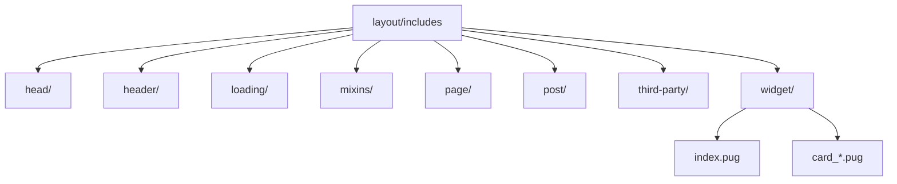
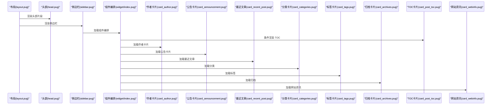
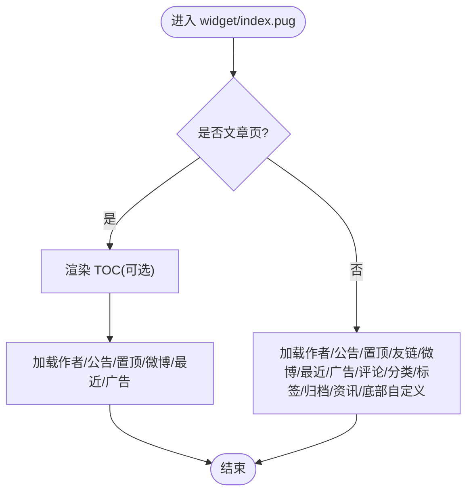
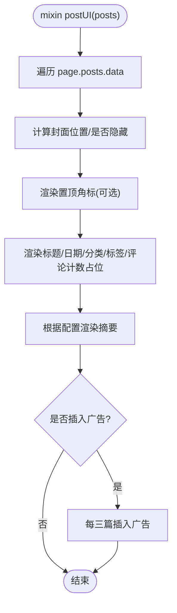
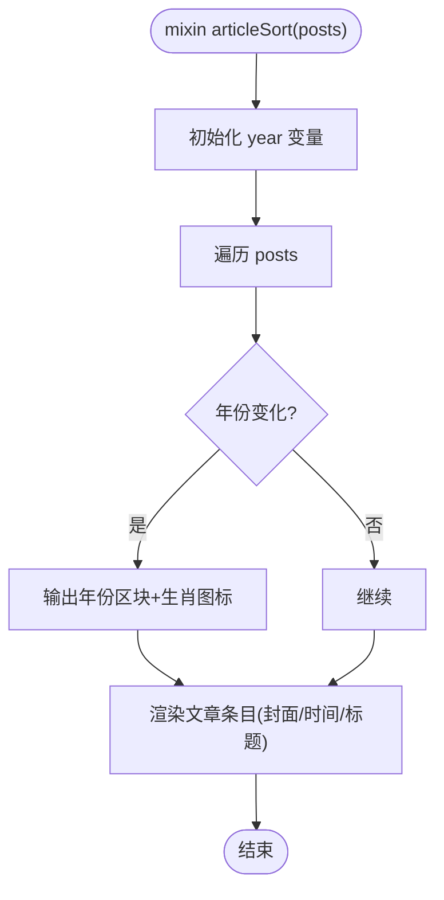
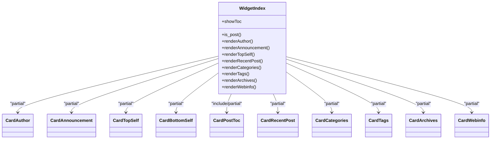
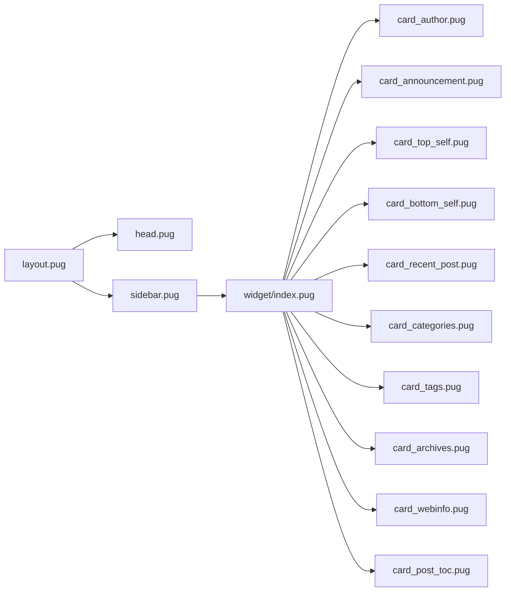

# 组件化设计

<cite>
**本文引用的文件**   
- [includes/layout.pug](file://themes/fomalhaut/layout/includes/layout.pug)
- [includes/head.pug](file://themes/fomalhaut/layout/includes/head.pug)
- [includes/sidebar.pug](file://themes/fomalhaut/layout/includes/sidebar.pug)
- [includes/widget/index.pug](file://themes/fomalhaut/layout/includes/widget/index.pug)
- [includes/mixins/post-ui.pug](file://themes/fomalhaut/layout/includes/mixins/post-ui.pug)
- [includes/mixins/article-sort.pug](file://themes/fomalhaut/layout/includes/mixins/article-sort.pug)
- [includes/widget/card_author.pug](file://themes/fomalhaut/layout/includes/widget/card_author.pug)
- [includes/widget/card_recent_post.pug](file://themes/fomalhaut/layout/includes/widget/card_recent_post.pug)
- [includes/widget/card_categories.pug](file://themes/fomalhaut/layout/includes/widget/card_categories.pug)
- [includes/widget/card_tags.pug](file://themes/fomalhaut/layout/includes/widget/card_tags.pug)
- [includes/widget/card_archives.pug](file://themes/fomalhaut/layout/includes/widget/card_archives.pug)
- [includes/widget/card_post_toc.pug](file://themes/fomalhaut/layout/includes/widget/card_post_toc.pug)
- [includes/widget/card_announcement.pug](file://themes/fomalhaut/layout/includes/widget/card_announcement.pug)
- [includes/widget/card_top_self.pug](file://themes/fomalhaut/layout/includes/widget/card_top_self.pug)
- [includes/widget/card_bottom_self.pug](file://themes/fomalhaut/layout/includes/widget/card_bottom_self.pug)
- [includes/widget/card_webinfo.pug](file://themes/fomalhaut/layout/includes/widget/card_webinfo.pug)
</cite>

## 目录
1. [引言](#引言)
2. [项目结构](#项目结构)
3. [核心组件](#核心组件)
4. [架构总览](#架构总览)
5. [详细组件分析](#详细组件分析)
6. [依赖关系分析](#依赖关系分析)
7. [性能与可维护性](#性能与可维护性)
8. [故障排查指南](#故障排查指南)
9. [结论](#结论)
10. [附录：自定义组件开发指南](#附录自定义组件开发指南)

## 引言
本文件聚焦 Fomalhaut 主题的组件化架构，围绕 includes/ 目录下的组织方式、mixins 混合器使用模式、widget 组件复用机制展开。重点说明 include 指令的使用场景、组件参数传递方式，以及如何创建可复用的 UI 组件，并给出具体调用示例与自定义组件开发规范。

## 项目结构
Fomalhaut 主题在 layout/includes/ 下采用“按职责分目录”的组织方式：
- head/：页面头部元信息、预连接、PWA、站点验证等片段
- header/：导航、菜单项、社交图标、文章页头信息等
- loading/：加载动画样式与脚本片段
- mixins/：可复用的 Pug 混合器（如 postUI、articleSort）
- page/：通用页面模板片段
- post/：文章页相关片段（版权、打赏等）
- third-party/：第三方集成（评论、数学公式、搜索、分享等）
- widget/：侧边栏卡片组件集合，统一由 index.pug 编排

图表来源
- [includes/layout.pug:1-200](file://themes/fomalhaut/layout/includes/layout.pug#L1-L200)
- [includes/widget/index.pug:1-37](file://themes/fomalhaut/layout/includes/widget/index.pug#L1-L37)

章节来源
- [includes/layout.pug:1-200](file://themes/fomalhaut/layout/includes/layout.pug#L1-L200)

## 核心组件
- 布局入口：layout.pug 负责组装 head、header、main、sidebar、footer 等区域，并通过 partial/include 引入各功能片段。
- 头部片段：head.pug 聚合 Open Graph、Analytics、PWA、Site Verification 等 head 子片段。
- 侧边栏容器：sidebar.pug 渲染 aside-content，并包含 widget/index.pug 以统一加载各类卡片。
- 组件编排：widget/index.pug 根据页面类型（文章页/普通页）决定展示哪些卡片，并对 TOC 进行条件渲染。
- 混合器：mixins/post-ui.pug 提供首页文章列表渲染逻辑；mixins/article-sort.pug 提供归档页按年分组渲染逻辑。

章节来源
- [includes/layout.pug:1-200](file://themes/fomalhaut/layout/includes/layout.pug#L1-L200)
- [includes/head.pug:1-200](file://themes/fomalhaut/layout/includes/head.pug#L1-L200)
- [includes/sidebar.pug:1-200](file://themes/fomalhaut/layout/includes/sidebar.pug#L1-L200)
- [includes/widget/index.pug:1-37](file://themes/fomalhaut/layout/includes/widget/index.pug#L1-L37)
- [includes/mixins/post-ui.pug:141-298](file://themes/fomalhaut/layout/includes/mixins/post-ui.pug#L141-L298)
- [includes/mixins/article-sort.pug:1-25](file://themes/fomalhaut/layout/includes/mixins/article-sort.pug#L1-L25)

## 架构总览
下图展示了从布局到组件的调用链：布局通过 partial/include 引入 head、sidebar；sidebar 再引入 widget/index.pug；widget/index.pug 按需加载具体卡片组件。

图表来源
- [includes/layout.pug:1-200](file://themes/fomalhaut/layout/includes/layout.pug#L1-L200)
- [includes/sidebar.pug:1-200](file://themes/fomalhaut/layout/includes/sidebar.pug#L1-L200)
- [includes/widget/index.pug:1-37](file://themes/fomalhaut/layout/includes/widget/index.pug#L1-L37)

## 详细组件分析

### 组件编排器：widget/index.pug
- 作用：作为侧边栏组件的统一入口，根据 is_post() 判断文章页或普通页，选择性渲染 TOC 与各卡片。
- 关键行为：
  - 文章页优先显示 TOC，随后依次加载作者、公告、置顶自定义、微博、最近文章、广告等。
  - 普通页加载作者、公告、置顶自定义，然后加载友链、微博、最近文章、广告、最新评论、分类、标签、归档、网站资讯、底部自定义等。
- 复用策略：通过 partial('includes/widget/...') 加载具体卡片，便于独立维护与缓存。

图表来源
- [includes/widget/index.pug:1-37](file://themes/fomalhaut/layout/includes/widget/index.pug#L1-L37)

章节来源
- [includes/widget/index.pug:1-37](file://themes/fomalhaut/layout/includes/widget/index.pug#L1-L37)

### 混合器：post-ui.pug
- 作用：封装首页文章列表的渲染逻辑，包括封面位置、置顶角标、标题、日期、分类、标签、评论数占位、摘要截取等。
- 关键点：
  - 通过 mixin postUI(posts) 接收文章数组，遍历生成 .recent-post-item。
  - 内置 postStickyBadge(article) 用于置顶角标渲染。
  - 支持多种评论系统的计数占位（Disqus、Valine、Waline、Twikoo、Artalk 等）。
  - 摘要输出受 theme.index_post_content.method 控制，可选择禁用、直接 description、或截断 content。

图表来源
- [includes/mixins/post-ui.pug:141-298](file://themes/fomalhaut/layout/includes/mixins/post-ui.pug#L141-L298)

章节来源
- [includes/mixins/post-ui.pug:141-298](file://themes/fomalhaut/layout/includes/mixins/post-ui.pug#L141-L298)

### 混合器：article-sort.pug
- 作用：归档页按年份分组渲染文章列表，支持封面开关与生肖图标。
- 关键点：
  - 通过 mixin articleSort(posts) 接收文章集合。
  - 按 year 分组，同一年份内渲染文章条目，含封面图、时间、标题。

图表来源
- [includes/mixins/article-sort.pug:1-25](file://themes/fomalhaut/layout/includes/mixins/article-sort.pug#L1-L25)

章节来源
- [includes/mixins/article-sort.pug:1-25](file://themes/fomalhaut/layout/includes/mixins/article-sort.pug#L1-L25)

### 侧边栏卡片组件族
- card_author.pug：作者信息、站点统计、按钮、社交图标。
- card_announcement.pug：公告内容区。
- card_top_self.pug / card_bottom_self.pug：读取 site.data.widget.top/bottom 动态注入自定义卡片。
- card_post_toc.pug：文章目录，支持展开状态与编号开关。
- card_recent_post.pug：最近文章列表，支持排序字段与数量限制。
- card_categories.pug：分类列表，调用 aside_categories helper。
- card_tags.pug：标签云，支持颜色与字体大小范围。
- card_archives.pug：归档列表，支持按月/年、格式、排序、数量。
- card_webinfo.pug：网站资讯卡，支持经典版与新式 KPI 视图，含运行时长、写作天数、年度产出柱状图等。

图表来源
- [includes/widget/index.pug:1-37](file://themes/fomalhaut/layout/includes/widget/index.pug#L1-L37)
- [includes/widget/card_author.pug:1-37](file://themes/fomalhaut/layout/includes/widget/card_author.pug#L1-L37)
- [includes/widget/card_announcement.pug:1-14](file://themes/fomalhaut/layout/includes/widget/card_announcement.pug#L1-L14)
- [includes/widget/card_top_self.pug:1-8](file://themes/fomalhaut/layout/includes/widget/card_top_self.pug#L1-L8)
- [includes/widget/card_bottom_self.pug:1-10](file://themes/fomalhaut/layout/includes/widget/card_bottom_self.pug#L1-L10)
- [includes/widget/card_post_toc.pug:1-17](file://themes/fomalhaut/layout/includes/widget/card_post_toc.pug#L1-L17)
- [includes/widget/card_recent_post.pug:1-26](file://themes/fomalhaut/layout/includes/widget/card_recent_post.pug#L1-L26)
- [includes/widget/card_categories.pug:1-5](file://themes/fomalhaut/layout/includes/widget/card_categories.pug#L1-L5)
- [includes/widget/card_tags.pug:1-13](file://themes/fomalhaut/layout/includes/widget/card_tags.pug#L1-L13)
- [includes/widget/card_archives.pug:1-8](file://themes/fomalhaut/layout/includes/widget/card_archives.pug#L1-L8)
- [includes/widget/card_webinfo.pug:1-148](file://themes/fomalhaut/layout/includes/widget/card_webinfo.pug#L1-L148)

章节来源
- [includes/widget/card_author.pug:1-37](file://themes/fomalhaut/layout/includes/widget/card_author.pug#L1-L37)
- [includes/widget/card_announcement.pug:1-14](file://themes/fomalhaut/layout/includes/widget/card_announcement.pug#L1-L14)
- [includes/widget/card_top_self.pug:1-8](file://themes/fomalhaut/layout/includes/widget/card_top_self.pug#L1-L8)
- [includes/widget/card_bottom_self.pug:1-10](file://themes/fomalhaut/layout/includes/widget/card_bottom_self.pug#L1-L10)
- [includes/widget/card_post_toc.pug:1-17](file://themes/fomalhaut/layout/includes/widget/card_post_toc.pug#L1-L17)
- [includes/widget/card_recent_post.pug:1-26](file://themes/fomalhaut/layout/includes/widget/card_recent_post.pug#L1-L26)
- [includes/widget/card_categories.pug:1-5](file://themes/fomalhaut/layout/includes/widget/card_categories.pug#L1-L5)
- [includes/widget/card_tags.pug:1-13](file://themes/fomalhaut/layout/includes/widget/card_tags.pug#L1-L13)
- [includes/widget/card_archives.pug:1-8](file://themes/fomalhaut/layout/includes/widget/card_archives.pug#L1-L8)
- [includes/widget/card_webinfo.pug:1-148](file://themes/fomalhaut/layout/includes/widget/card_webinfo.pug#L1-L148)

## 依赖关系分析
- 布局层：layout.pug 依赖 head.pug、sidebar.pug 等片段。
- 侧边栏层：sidebar.pug 依赖 widget/index.pug。
- 组件层：widget/index.pug 依赖各 card_*.pug。
- 数据层：各卡片依赖 theme.* 配置与 site/page 对象，部分卡片调用 helpers（如 aside_categories、aside_archives、cloudTags、tagcloud）。

图表来源
- [includes/layout.pug:1-200](file://themes/fomalhaut/layout/includes/layout.pug#L1-L200)
- [includes/sidebar.pug:1-200](file://themes/fomalhaut/layout/includes/sidebar.pug#L1-L200)
- [includes/widget/index.pug:1-37](file://themes/fomalhaut/layout/includes/widget/index.pug#L1-L37)

章节来源
- [includes/layout.pug:1-200](file://themes/fomalhaut/layout/includes/layout.pug#L1-L200)
- [includes/sidebar.pug:1-200](file://themes/fomalhaut/layout/includes/sidebar.pug#L1-L200)
- [includes/widget/index.pug:1-37](file://themes/fomalhaut/layout/includes/widget/index.pug#L1-L37)

## 性能与可维护性
- 组件缓存：widget/index.pug 对多数卡片使用 partial(..., {cache: true})，减少重复渲染开销。
- 条件渲染：大量 if(theme.*) 开关避免无用 DOM 生成，降低首屏压力。
- 懒加载与异步：评论计数、统计类数据通过客户端脚本或占位符延迟填充。
- 可维护性：每个卡片独立文件，职责单一；通过 widget/index.pug 集中编排，便于扩展与裁剪。

[本节为通用指导，不直接分析具体文件]

## 故障排查指南
- 侧边栏未显示：检查 sidebar.pug 是否正确引入 widget/index.pug，以及对应卡片 enable 开关是否开启。
- 文章列表异常：确认 mixins/post-ui.pug 被正确调用，且 theme.cover.index_enable、theme.post_meta.page.* 配置符合预期。
- 归档页分组错乱：核对 mixins/article-sort.pug 中 date 格式化与 theme.cover.archives_enable 设置。
- 自定义卡片不生效：检查 site.data.widget.top/bottom 数据结构是否包含 class_name、id_name、icon、name、html 字段。
- 网站资讯卡数据为空：确认 theme.aside.card_webinfo.enable 与 wordcount、busuanzi 等插件配置正确。

章节来源
- [includes/widget/index.pug:1-37](file://themes/fomalhaut/layout/includes/widget/index.pug#L1-L37)
- [includes/mixins/post-ui.pug:141-298](file://themes/fomalhaut/layout/includes/mixins/post-ui.pug#L141-L298)
- [includes/mixins/article-sort.pug:1-25](file://themes/fomalhaut/layout/includes/mixins/article-sort.pug#L1-L25)
- [includes/widget/card_top_self.pug:1-8](file://themes/fomalhaut/layout/includes/widget/card_top_self.pug#L1-L8)
- [includes/widget/card_bottom_self.pug:1-10](file://themes/fomalhaut/layout/includes/widget/card_bottom_self.pug#L1-L10)
- [includes/widget/card_webinfo.pug:1-148](file://themes/fomalhaut/layout/includes/widget/card_webinfo.pug#L1-L148)

## 结论
Fomalhaut 主题通过 includes/ 目录的职责划分与 widget 组件化编排，实现了高内聚、低耦合的 UI 体系。mixins 将复杂渲染逻辑抽象为可复用单元，配合 partial/include 的组合方式，使主题具备强大的可扩展性与可定制性。遵循本文的组件开发规范，可快速构建新的侧边栏卡片或复用现有混合器，提升整体开发效率与代码质量。

[本节为总结性内容，不直接分析具体文件]

## 附录：自定义组件开发指南

### 组件组织与命名
- 新增卡片组件：在 includes/widget/ 下新建 card_xxx.pug，遵循已有卡片结构（外层 .card-widget，.item-headline，.item-content）。
- 在 widget/index.pug 中按需引入：使用 !=partial('includes/widget/card_xxx', {}, {cache: true}) 注册。

章节来源
- [includes/widget/index.pug:1-37](file://themes/fomalhaut/layout/includes/widget/index.pug#L1-L37)

### 组件参数传递
- 通过 partial 的第三个参数传入上下文对象，例如：!=partial('includes/widget/card_xxx', { limit: 10, expand: true }, {cache: true})。
- 在 card_xxx.pug 中直接使用传入的变量，并结合 theme.* 与 site/page 数据进行渲染。

章节来源
- [includes/widget/index.pug:1-37](file://themes/fomalhaut/layout/includes/widget/index.pug#L1-L37)

### 使用 site.data.widget 动态注入
- 在 source/_data/widget.yml 中定义 top/bottom 列表，每项包含 class_name、id_name、icon、name、html。
- 通过 card_top_self.pug 与 card_bottom_self.pug 自动渲染，无需修改主题源码。

章节来源
- [includes/widget/card_top_self.pug:1-8](file://themes/fomalhaut/layout/includes/widget/card_top_self.pug#L1-L8)
- [includes/widget/card_bottom_self.pug:1-10](file://themes/fomalhaut/layout/includes/widget/card_bottom_self.pug#L1-L10)

### 复用 mixins 编写新组件
- 若需要文章列表或归档列表，可直接复用 mixins/post-ui.pug 与 mixins/article-sort.pug，减少重复代码。
- 在自定义卡片中按需调用 mixin，传入相应数据源。

章节来源
- [includes/mixins/post-ui.pug:141-298](file://themes/fomalhaut/layout/includes/mixins/post-ui.pug#L141-L298)
- [includes/mixins/article-sort.pug:1-25](file://themes/fomalhaut/layout/includes/mixins/article-sort.pug#L1-L25)

### 常见 include 指令使用场景
- 在布局或页面模板中使用 include 引入固定片段（如 includes/footer.pug、includes/pagination.pug）。
- 在组件内部使用 include 组合更细粒度的子片段（如 card_post_toc.pug 内部的结构片段）。

章节来源
- [includes/widget/index.pug:1-37](file://themes/fomalhaut/layout/includes/widget/index.pug#L1-L37)