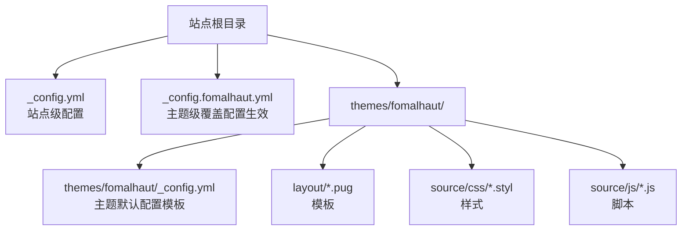
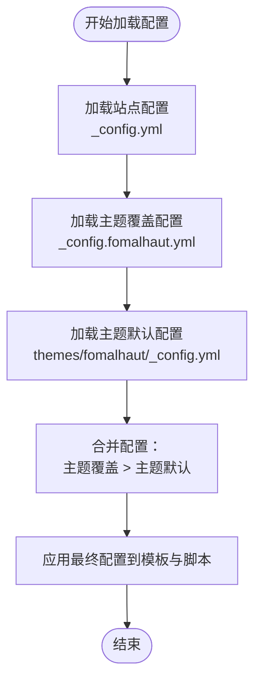
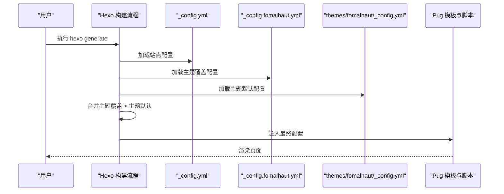

# 配置管理机制

<cite>
**本文引用的文件**   
- [README.md](file://README.md)
- [_config.yml](file://_config.yml)
- [_config.fomalhaut.yml](file://_config.fomalhaut.yml)
- [themes/fomalhaut/_config.yml](file://themes/fomalhaut/_config.yml)
- [themes/fomalhaut/README.md](file://themes/fomalhaut/README.md)
</cite>

## 目录
1. [引言](#引言)
2. [项目结构与配置文件定位](#项目结构与配置文件定位)
3. [配置层次与优先级规则](#配置层次与优先级规则)
4. [配置项分类与组织方式](#配置项分类与组织方式)
5. [配置加载顺序、验证机制与默认值处理](#配置加载顺序验证机制与默认值处理)
6. [关键配置场景示例](#关键配置场景示例)
7. [配置最佳实践](#配置最佳实践)
8. [常见问题排查](#常见问题排查)
9. [结论](#结论)

## 引言
本文聚焦本仓库的**主题配置管理机制**，围绕以下目标展开：
- 说明配置文件层次结构：**站点默认配置 `_config.yml`**、**站点覆盖配置 `_config.fomalhaut.yml`**、**主题默认配置 `themes/fomalhaut/_config.yml`**。
- 明确三层配置的优先级规则与生效范围。
- 解释配置项的分类和组织方式，包括导航菜单、外观设置、功能开关等。
- 梳理配置的加载顺序、验证机制和默认值处理方式。
- 提供常用配置场景示例与最佳实践，帮助读者安全、可维护地管理站点与主题行为。

## 项目结构与配置文件定位
本仓库采用“站点 + 主题”分离的结构：
- **站点层**：根目录下的 `_config.yml` 负责站点基础信息、部署、插件等；根目录下的 `_config.fomalhaut.yml` 是本站实际使用的主题配置入口。
- **主题层**：`themes/fomalhaut/_config.yml` 是主题自带的默认配置模板，用于参考和兜底，不应直接作为主要修改入口。

**图表来源**
- [README.md:260-284](file://README.md#L260-L284)
- [themes/fomalhaut/README.md:33-36](file://themes/fomalhaut/README.md#L33-L36)

**章节来源**
- [README.md:260-284](file://README.md#L260-L284)
- [themes/fomalhaut/README.md:33-36](file://themes/fomalhaut/README.md#L33-L36)

## 配置层次与优先级规则
本项目遵循 Hexo 5+ 的配置机制，形成三层配置体系：

| 层级 | 文件 | 作用 | 优先级 |
| --- | --- | --- | --- |
| 站点 | 根 `_config.yml` | 站点名、作者、URL、部署、插件、Algolia 等站点级配置 | 基础层 |
| 主题（生效） | 根 `_config.fomalhaut.yml` | 主题开关、外观、导航、社交、评论、分析等主题相关配置 | 覆盖层（最高） |
| 主题（默认） | `themes/fomalhaut/_config.yml` | 主题自带默认值模板，留作参考 / 兜底 | 最低层 |

核心规则：
- 当同一配置键在多个文件中出现时，**根 `_config.fomalhaut.yml` 会覆盖主题默认配置中的同名键**。
- 站点级配置 `_config.yml` 与主题级配置 `_config.fomalhaut.yml` 属于不同命名空间：前者侧重站点元数据与构建期插件，后者侧重主题渲染与前端行为。
- 主题目录内的 `_config.yml` 不是主要修改入口，仅作为默认值模板。

**图表来源**
- [README.md:286-292](file://README.md#L286-L292)
- [themes/fomalhaut/README.md:33-36](file://themes/fomalhaut/README.md#L33-L36)

**章节来源**
- [README.md:286-292](file://README.md#L286-L292)
- [themes/fomalhaut/README.md:33-36](file://themes/fomalhaut/README.md#L33-L36)

## 配置项分类与组织方式
根据仓库中的配置文件内容，可将配置项划分为以下几类：

### 站点级配置（根 `_config.yml`）
- **站点基础信息**：标题、副标题、描述、关键词、作者、语言、时区。
- **URL 与永久链接**：`url`、`permalink`、`permalink_defaults`、`pretty_urls`。
- **目录与构建行为**：`source_dir`、`public_dir`、`tag_dir`、`archive_dir`、`category_dir`、`skip_render`。
- **写作与渲染**：`new_post_name`、`default_layout`、`external_link`、`highlight`、`prismjs`、`math`。
- **首页与归档生成器**：`index_generator`、`archive_generator`。
- **分类与标签**：`default_category`、`category_map`、`tag_map`。
- **分页与扩展插件**：`per_page`、`pagination_dir`、`plugins`、`feed`、`sitemap`、`baidusitemap`、`baidu_url_submit`、`nofollow`。
- **第三方服务与特效**：`algolia`、`swiper`、`gitcalendar`、`magnet`、`markdown.anchors.level`。

典型用途：
- 控制站点元数据、部署策略、搜索索引、统计与 SEO 相关插件。
- 控制归档页每页篇数、分类磁贴展示、轮播图挂载容器等。

**章节来源**
- [_config.yml:5-12](file://_config.yml#L5-L12)
- [_config.yml:19-26](file://_config.yml#L19-L26)
- [_config.yml:28-40](file://_config.yml#L28-L40)
- [_config.yml:42-66](file://_config.yml#L42-L66)
- [_config.yml:68-78](file://_config.yml#L68-L78)
- [_config.yml:80-97](file://_config.yml#L80-L97)
- [_config.yml:99-102](file://_config.yml#L99-L102)
- [_config.yml:117-120](file://_config.yml#L117-L120)
- [_config.yml:128-131](file://_config.yml#L128-L131)
- [_config.yml:133-143](file://_config.yml#L133-L143)
- [_config.yml:145-167](file://_config.yml#L145-L167)
- [_config.yml:168-184](file://_config.yml#L168-L184)
- [_config.yml:186-207](file://_config.yml#L186-L207)
- [_config.yml:203-219](file://_config.yml#L203-L219)
- [_config.yml:221-268](file://_config.yml#L221-L268)
- [_config.yml:270-319](file://_config.yml#L270-L319)

### 主题级覆盖配置（根 `_config.fomalhaut.yml`）
这是**真正生效的主题配置入口**，涵盖导航、代码块、复制、社交、搜索、数学公式、图片、404、文章元信息、字数统计、目录、版权、打赏、相关文章、分享、评论、聊天、页脚、分析、广告、站长验证、美化效果、主题色、背景、侧边栏、字体、暗色模式、Pjax、弹窗、Service Worker 注入等。

典型分类：
- **导航菜单**：`menu`，定义顶部导航项、子菜单、图标与动画。
- **代码与复制**：`highlight_*`、`code_word_wrap`、`copy`。
- **社交与搜索**：`social`、`algolia_search`、`local_search`。
- **数学与图片**：`mathjax`、`favicon`、`avatar`、`disable_top_img`、`index_img`、`cover`。
- **文章与阅读体验**：`post_meta`、`wordcount`、`index_post_content`、`anchor`、`toc`、`post_copyright`、`reward`、`related_post`、`photofigcaption`、`post_pagination`、`noticeOutdate`。
- **分享与评论**：`addThis`、`sharejs`、`addtoany`、`comments`、`twikoo`、`giscus` 等。
- **页脚与分析**：`footer`、`baidu_analytics`、`google_analytics`、`cnzz_analytics`、`cloudflare_analytics`、`microsoft_clarity`。
- **广告与验证**：`google_adsense`、`site_verification`。
- **美化与主题色**：`theme_color`、`background`、`display_mode`、`beautify`、`font`、`darkmode`、`rightside_item_order`。
- **侧边栏与挂件**：`aside`、`busuanzi`、`runtimeshow`、`newest_comments`。
- **交互与性能**：`pjax`、`aplayerInject`、`snackbar`、`inject.head`、`inject.bottom`。

**章节来源**
- [_config.fomalhaut.yml:1-24](file://_config.fomalhaut.yml#L1-L24)
- [_config.fomalhaut.yml:25-33](file://_config.fomalhaut.yml#L25-L33)
- [_config.fomalhaut.yml:35-42](file://_config.fomalhaut.yml#L35-L42)
- [_config.fomalhaut.yml:43-63](file://_config.fomalhaut.yml#L43-L63)
- [_config.fomalhaut.yml:65-84](file://_config.fomalhaut.yml#L65-L84)
- [_config.fomalhaut.yml:85-102](file://_config.fomalhaut.yml#L85-L102)
- [_config.fomalhaut.yml:103-142](file://_config.fomalhaut.yml#L103-L142)
- [_config.fomalhaut.yml:144-410](file://_config.fomalhaut.yml#L144-L410)
- [_config.fomalhaut.yml:411-417](file://_config.fomalhaut.yml#L411-L417)
- [_config.fomalhaut.yml:418-447](file://_config.fomalhaut.yml#L418-L447)
- [_config.fomalhaut.yml:449-516](file://_config.fomalhaut.yml#L449-L516)
- [_config.fomalhaut.yml:517-537](file://_config.fomalhaut.yml#L517-L537)
- [_config.fomalhaut.yml:538-654](file://_config.fomalhaut.yml#L538-L654)
- [_config.fomalhaut.yml:655-694](file://_config.fomalhaut.yml#L655-L694)
- [_config.fomalhaut.yml:695-703](file://_config.fomalhaut.yml#L695-L703)
- [_config.fomalhaut.yml:704-727](file://_config.fomalhaut.yml#L704-L727)
- [_config.fomalhaut.yml:728-738](file://_config.fomalhaut.yml#L728-L738)
- [_config.fomalhaut.yml:745-753](file://_config.fomalhaut.yml#L745-L753)
- [_config.fomalhaut.yml:754-800](file://_config.fomalhaut.yml#L754-L800)

### 主题默认配置（`themes/fomalhaut/_config.yml`）
该文件是主题的默认值模板，包含与 `_config.fomalhaut.yml` 相似的结构，但多数键处于注释或默认状态，用于参考主题支持的配置项。例如：
- 导航菜单模板注释。
- 代码高亮主题默认值。
- 社交图标模板。
- 搜索、数学公式、图片、404、文章元信息、目录、版权、打赏、相关文章、分享、评论、聊天、页脚、分析、广告、站长验证、美化效果、背景、侧边栏、字体、暗色模式、Pjax、弹窗等默认值。

注意：
- 修改此文件不会直接生效，应优先通过根 `_config.fomalhaut.yml` 覆盖。
- 升级主题时可直接替换 `themes/fomalhaut/`，而无需担心站点配置丢失。

**章节来源**
- [themes/fomalhaut/_config.yml:1-32](file://themes/fomalhaut/_config.yml#L1-L32)
- [themes/fomalhaut/_config.yml:34-73](file://themes/fomalhaut/_config.yml#L34-L73)
- [themes/fomalhaut/_config.yml:75-151](file://themes/fomalhaut/_config.yml#L75-L151)
- [themes/fomalhaut/_config.yml:153-234](file://themes/fomalhaut/_config.yml#L153-L234)
- [themes/fomalhaut/_config.yml:236-362](file://themes/fomalhaut/_config.yml#L236-L362)
- [themes/fomalhaut/_config.yml:364-411](file://themes/fomalhaut/_config.yml#L364-L411)
- [themes/fomalhaut/_config.yml:413-505](file://themes/fomalhaut/_config.yml#L413-L505)
- [themes/fomalhaut/_config.yml:507-581](file://themes/fomalhaut/_config.yml#L507-L581)
- [themes/fomalhaut/_config.yml:582-667](file://themes/fomalhaut/_config.yml#L582-L667)
- [themes/fomalhaut/_config.yml:674-732](file://themes/fomalhaut/_config.yml#L674-L732)
- [themes/fomalhaut/_config.yml:734-800](file://themes/fomalhaut/_config.yml#L734-L800)

## 配置加载顺序、验证机制与默认值处理
### 加载顺序
Hexo 在构建时会按以下顺序读取并合并配置：
1. 读取站点配置 `_config.yml`。
2. 读取主题覆盖配置 `_config.fomalhaut.yml`。
3. 读取主题默认配置 `themes/fomalhaut/_config.yml`。
4. 将主题覆盖配置合并到主题默认配置之上，得到最终主题配置对象。
5. 模板与脚本从最终配置对象中读取所需字段。

**图表来源**
- [README.md:260-284](file://README.md#L260-L284)
- [README.md:286-292](file://README.md#L286-L292)

### 验证机制
仓库未提供独立的 YAML Schema 校验逻辑，配置验证主要通过以下方式实现：
- **构建期报错**：缺失必填字段（如 Algolia 的 appId、apiKey、indexName）会在构建阶段抛出错误，便于快速发现配置问题。
- **运行时容错**：部分前端模块对缺失字段做降级处理，例如主题色回退到 CSS 变量或默认颜色。
- **测试用例约束**：`tools/tests/navigation.test.cjs` 等测试脚本检查配置注入行为，确保导航样式与脚本注入符合预期。

### 默认值处理
- 主题默认配置提供完整字段结构，即使某些字段未显式设置，模板也能读到默认值。
- 站点覆盖配置 `_config.fomalhaut.yml` 只写需要变更的键，其余沿用主题默认值。
- 对于复杂对象（如 `menu`、`social`、`comments`），建议保持结构完整，避免遗漏导致模板渲染异常。

**章节来源**
- [README.md:260-292](file://README.md#L260-L292)
- [tools/tests/navigation.test.cjs:107-129](file://tools/tests/navigation.test.cjs#L107-L129)

## 关键配置场景示例
以下示例基于仓库现有配置，说明常见场景如何配置：

### 导航菜单
- 使用 `_config.fomalhaut.yml` 的 `menu` 段定义主导航与子菜单。
- 支持路径、图标类名、动画类名，以及隐藏选项。
- 示例结构已在当前配置中体现，可直接调整名称、路径与图标。

**章节来源**
- [_config.fomalhaut.yml:1-24](file://_config.fomalhaut.yml#L1-L24)

### 头像与社交图标
- 头像通过 `avatar.img` 设置，支持本地路径或外链。
- 社交图标通过 `social` 段配置，格式为“名称: 链接 || 图标类名 || 动画类名”。

**章节来源**
- [_config.fomalhaut.yml:106-113](file://_config.fomalhaut.yml#L106-L113)
- [_config.fomalhaut.yml:43-63](file://_config.fomalhaut.yml#L43-L63)

### 主题色与背景
- 主题色通过 `theme_color` 段设置，包括主色、按钮悬停色、链接色、滚动条色等。
- 背景通过 `background.default` 与 `background.darkmode` 设置，支持 CSS 变量或图片 URL。

**章节来源**
- [_config.fomalhaut.yml:754-800](file://_config.fomalhaut.yml#L754-L800)

### 评论系统
- 通过 `comments.use` 选择评论系统，例如 Twikoo。
- 对应系统的配置段（如 `twikoo.envId`）填写服务地址或环境 ID。

**章节来源**
- [_config.fomalhaut.yml:538-654](file://_config.fomalhaut.yml#L538-L654)

### 分析与统计
- 通过 `baidu_analytics`、`google_analytics`、`cnzz_analytics`、`cloudflare_analytics`、`microsoft_clarity` 等段接入不同分析服务。
- 站点级统计与 SEO 插件可在 `_config.yml` 中配置，如 `algolia`、`sitemap`、`baidusitemap`。

**章节来源**
- [_config.fomalhaut.yml:704-727](file://_config.fomalhaut.yml#L704-L727)
- [_config.yml:145-167](file://_config.yml#L145-L167)
- [_config.yml:203-219](file://_config.yml#L203-L219)

## 配置最佳实践
- **优先修改根 `_config.fomalhaut.yml`**：所有主题开关都应在此文件中配置，不要直接修改 `themes/fomalhaut/_config.yml`。
- **保持配置结构完整**：对于 `menu`、`social`、`comments` 等复杂对象，尽量保留完整结构，避免遗漏字段导致渲染异常。
- **区分站点与主题职责**：站点元数据、部署、插件放在 `_config.yml`；主题外观、交互、功能开关放在 `_config.fomalhaut.yml`。
- **使用注释与分组**：利用 YAML 注释说明配置意图，便于团队协作与后续维护。
- **谨慎启用第三方服务**：开启 Algolia、Twikoo、Giscus 等服务前，先确认密钥与环境配置正确，避免构建失败或运行时错误。
- **渐进式优化**：先启用必要功能，再逐步添加美化与特效，避免一次性引入过多依赖影响性能。
- **版本化资源注入**：通过 `inject.head` 与 `inject.bottom` 引入 CSS/JS 时，建议使用带版本号的资源，便于缓存更新。

[无章节来源：本节为通用实践总结]

## 常见问题排查
- **修改主题默认配置不生效**：请确认是否修改了 `themes/fomalhaut/_config.yml`。应改为根 `_config.fomalhaut.yml`。
- **Algolia 构建报错**：检查 `_config.yml` 中的 `algolia.appId`、`algolia.apiKey`、`algolia.adminApiKey`、`algolia.indexName` 是否已填写。
- **导航样式或脚本未注入**：检查 `_config.fomalhaut.yml` 的 `inject.head` 与 `inject.bottom` 是否正确引入导航相关资源。
- **主题色未生效**：确认 `theme_color.enable` 与具体颜色字段是否被引用，且颜色值使用双引号包裹。
- **评论系统无法加载**：检查 `comments.use` 与对应系统配置段（如 `twikoo.envId`）是否填写正确。

**章节来源**
- [themes/fomalhaut/README.md:33-36](file://themes/fomalhaut/README.md#L33-L36)
- [_config.yml:145-167](file://_config.yml#L145-L167)
- [_config.fomalhaut.yml:538-654](file://_config.fomalhaut.yml#L538-L654)
- [_config.fomalhaut.yml:754-800](file://_config.fomalhaut.yml#L754-L800)

## 结论
本仓库通过三层配置机制实现了站点与主题的清晰分离：
- `_config.yml` 负责站点基础信息与构建期插件。
- `_config.fomalhaut.yml` 是主题配置的实际入口，覆盖主题默认值。
- `themes/fomalhaut/_config.yml` 提供默认值模板，便于参考与升级。

掌握这一机制后，你可以：
- 安全地自定义导航、外观、功能开关。
- 避免主题升级时丢失站点配置。
- 通过清晰的配置分类与最佳实践，提升可维护性与协作效率。

[无章节来源：本节为总结性内容]