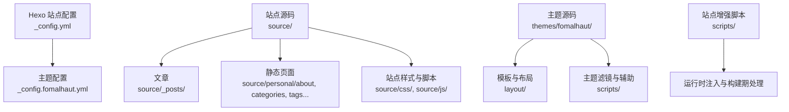
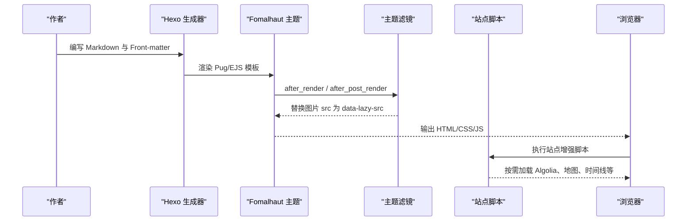
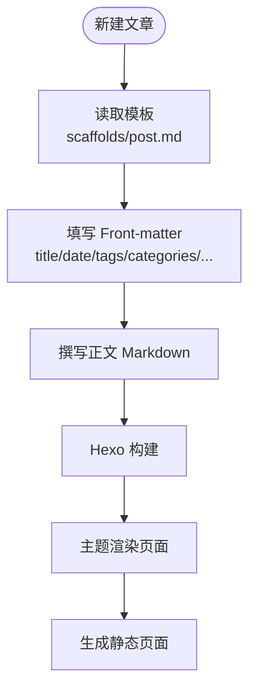
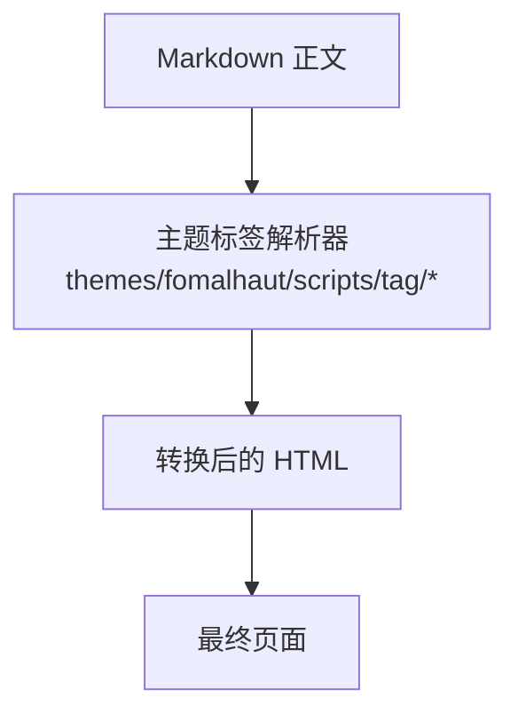
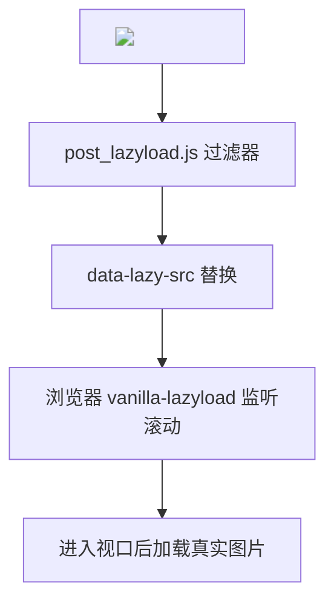
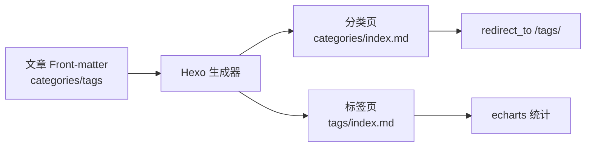
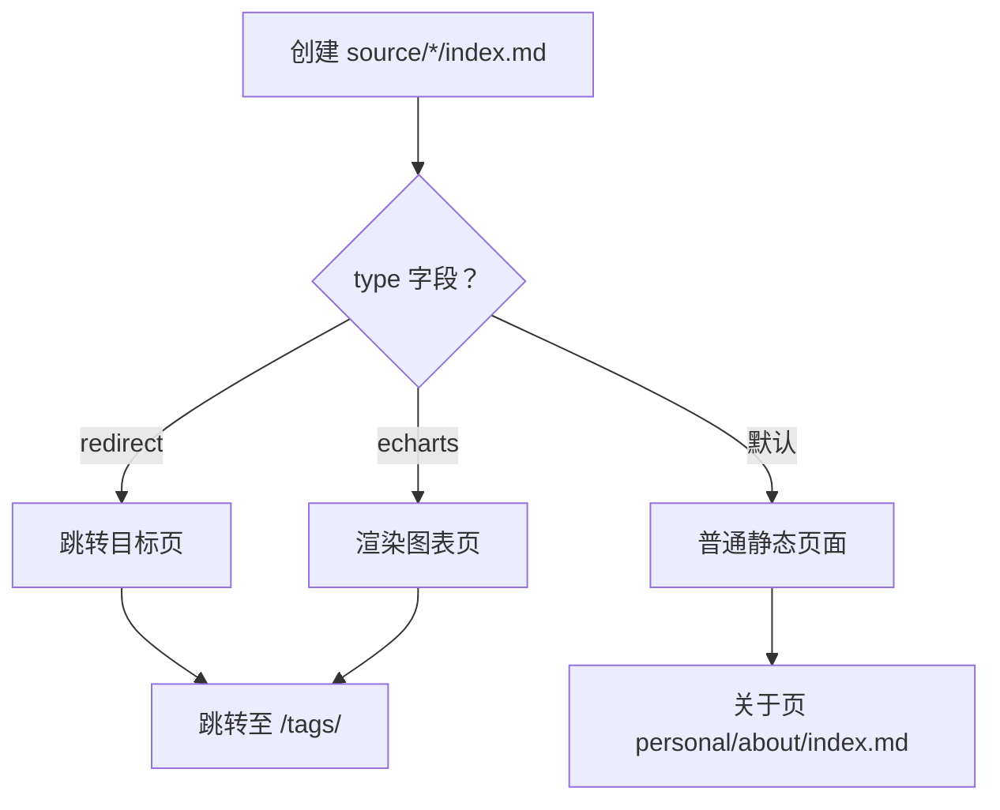
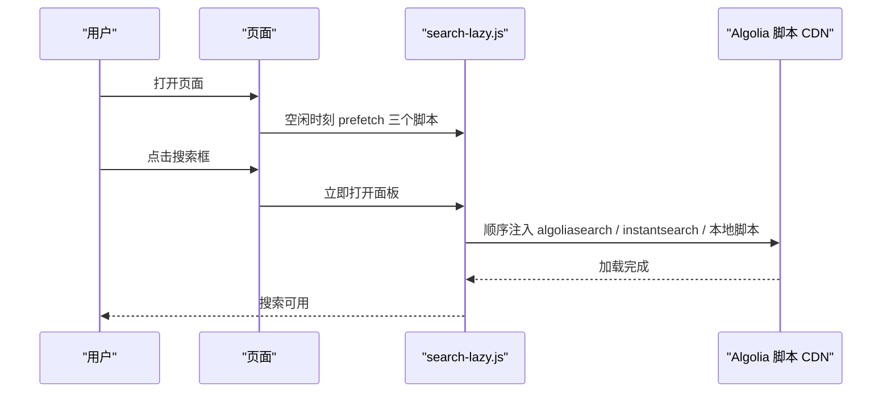
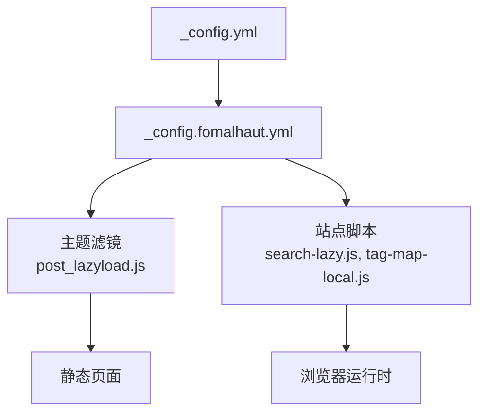

# 内容管理系统

<cite>
**本文引用的文件**   
- [_config.yml](file://_config.yml)
- [_config.fomalhaut.yml](file://_config.fomalhaut.yml)
- [post.md](file://scaffolds/post.md)
- [page.md](file://scaffolds/page.md)
- [draft.md](file://scaffolds/draft.md)
- [Hello-World.md](file://source/_posts/2026-10-01-Hello-World.md)
- [外挂标签速查.md](file://source/_posts/2026-10-02-外挂标签速查.md)
- [index.md（关于页）](file://source/personal/about/index.md)
- [index.md（分类入口）](file://source/categories/index.md)
- [index.md（标签统计页）](file://source/tags/index.md)
- [post_lazyload.js](file://themes/fomalhaut/scripts/filters/post_lazyload.js)
- [search-lazy.js](file://source/js/inject/search-lazy.js)
- [tag-map-local.js](file://scripts/tag-map-local.js)
</cite>

## 目录
1. [引言](#引言)
2. [项目结构](#项目结构)
3. [核心组件](#核心组件)
4. [架构总览](#架构总览)
5. [详细组件分析](#详细组件分析)
6. [依赖关系分析](#依赖关系分析)
7. [性能考量](#性能考量)
8. [故障排查指南](#故障排查指南)
9. [结论](#结论)
10. [附录](#附录)

## 引言
本文件面向使用 Hexo + Fomalhaut 主题的内容创作者与站点维护者，系统化说明“文章结构规范、Front-matter 元数据、Markdown 扩展语法、图片与媒体资源管理、分类与标签体系、静态页面与特殊页面类型、CDN 与懒加载配置”，并给出可落地的创作最佳实践与性能优化建议。文档同时提供架构图、流程图和时序图，帮助读者从全局到细节理解整个内容管理系统。

## 项目结构
仓库采用“站点源码 + 主题源码”的常见 Hexo 组织方式：
- 站点源码位于 source 目录，包含文章、静态页面、站点级样式与脚本、第三方库本地副本等。
- 主题源码位于 themes/fomalhaut，负责模板渲染、主题配置、滤镜与辅助函数。
- 根目录 _config.yml 为 Hexo 站点配置；_config.fomalhaut.yml 为主题配置。
- scaffolds 提供文章、页面、草稿模板，统一 Front-matter 结构。
- scripts 存放站点级构建期或运行期增强脚本。

**图示来源**
- [_config.yml:1-41](file://_config.yml#L1-L41)
- [_config.fomalhaut.yml:1-24](file://_config.fomalhaut.yml#L1-L24)

**章节来源**
- [_config.yml:1-41](file://_config.yml#L1-L41)
- [_config.fomalhaut.yml:1-24](file://_config.fomalhaut.yml#L1-L24)

## 核心组件
- 站点配置层：定义站点信息、URL 规则、目录、默认布局、分页、插件、搜索、Algolia、Sitemap、百度推送等。
- 主题配置层：定义导航菜单、封面图、评论系统、数学公式、图片懒加载、PWA、Open Graph、CDN、侧栏卡片、标签插件等。
- 内容层：文章 Markdown、静态页面 Markdown、站点级 CSS/JS、第三方库本地副本。
- 构建与运行层：Hexo 生成静态页面，Gulp 压缩与优化，主题滤镜对图片懒加载、随机封面等进行后处理，站点脚本在运行期增强体验。

**章节来源**
- [_config.yml:14-131](file://_config.yml#L14-L131)
- [_config.fomalhaut.yml:103-1547](file://_config.fomalhaut.yml#L103-L1547)

## 架构总览
下图展示从“作者写 Markdown”到“浏览器渲染页面”的关键路径，以及分类、标签、归档、时间线、画廊等能力如何被主题与脚本协同实现。

**图示来源**
- [post_lazyload.js:1-29](file://themes/fomalhaut/scripts/filters/post_lazyload.js#L1-L29)
- [search-lazy.js:1-19](file://source/js/inject/search-lazy.js#L1-L19)

## 详细组件分析

### 文章结构与 Front-matter 规范
- 文章模板统一在 scaffolds/post.md，包含 title、date、description、tags、categories、mathjax 等字段，作为新文章的默认结构。
- 示例文章 Hello-World.md 展示了 cover、comments、abbrlink、updated 等常用字段的实际用法。
- 推荐遵循以下约定：
  - 标题与描述：title 简洁明确，description 用于摘要与 SEO。
  - 日期与更新时间：date 为创建时间，updated 为最后修改时间，便于显示“更新于”。
  - 封面图：cover 指定文章封面，未设置时由主题 default_cover 随机选取。
  - 固定链接：abbrlink 可自定义短链，配合 abbrlink 插件生成稳定 URL。
  - 数学公式：mathjax 控制是否在该页加载 MathJax。
  - 评论开关：comments 控制是否启用评论。

**图示来源**
- [post.md:1-11](file://scaffolds/post.md#L1-L11)
- [Hello-World.md:1-14](file://source/_posts/2026-10-01-Hello-World.md#L1-L14)

**章节来源**
- [post.md:1-11](file://scaffolds/post.md#L1-L11)
- [Hello-World.md:1-14](file://source/_posts/2026-10-01-Hello-World.md#L1-L14)

### Markdown 语法扩展与外挂标签
主题通过 hexo-butterfly-tag-plugins-plus 提供丰富的外挂标签，包括 note 提示块、tabs 标签页、hideToggle 折叠、btn 按钮、label 标签、span 居中、timeline 时间线、galleryGroup 画廊、mermaid 图表等。这些标签在文章中直接以 Nunjucks 风格调用，并在构建期由主题脚本转换为 HTML。

- 典型用法参考《外挂标签速查》一文，涵盖提示块、标签页、折叠、按钮、标签、时间线与画廊、Mermaid 图表等。
- 新增自定义标签时，可在 themes/fomalhaut/scripts/tag/ 下仿照已有文件添加。

**图示来源**
- [外挂标签速查.md:19-115](file://source/_posts/2026-10-02-外挂标签速查.md#L19-L115)

**章节来源**
- [外挂标签速查.md:19-115](file://source/_posts/2026-10-02-外挂标签速查.md#L19-L115)

### 图片引用与媒体资源管理
- 图片懒加载：主题提供 post_lazyload.js 过滤器，将  替换为 data-lazy-src，并由 vanilla-lazyload 在滚动进入视口时加载。可通过 _config.fomalhaut.yml 中 lazyload.enable、field、placeholder、blur 控制行为。
- 占位图与模糊效果：lazyload.placeholder 为空时使用透明 GIF 占位；blur=true 开启模糊过渡。
- CDN 与预连接：_config.fomalhaut.yml 的 inject.head 中已配置多个外部域名的 preconnect，减少 DNS/TCP/TLS 握手开销。
- 第三方库本地化：scripts/tag-map-local.js 将 hexo-tag-map 的 jsDelivr CDN 地址改写为站内路径，避免国内访问不稳定。

**图示来源**
- [post_lazyload.js:1-29](file://themes/fomalhaut/scripts/filters/post_lazyload.js#L1-L29)
- [_config.fomalhaut.yml:1147-1154](file://_config.fomalhaut.yml#L1147-L1154)
- [tag-map-local.js:1-27](file://scripts/tag-map-local.js#L1-L27)

**章节来源**
- [post_lazyload.js:1-29](file://themes/fomalhaut/scripts/filters/post_lazyload.js#L1-L29)
- [_config.fomalhaut.yml:1147-1154](file://_config.fomalhaut.yml#L1147-L1154)
- [tag-map-local.js:1-27](file://scripts/tag-map-local.js#L1-L27)

### 分类与标签系统
- 分类与标签由 Hexo 自动生成，目录分别为 category_dir 与 tag_dir。
- 默认分类：default_category 设置为 uncategorized。
- 分类映射与标签映射：category_map 与 tag_map 可用于别名或重命名。
- 分类入口页：source/categories/index.md 使用 type: redirect 跳转到 /tags/，使分类入口与标签统计页合并。
- 标签统计页：source/tags/index.md 使用 type: echarts，结合主题侧栏 card_tags 与相关脚本展示标签云与统计图表。
- 首页磁贴分类：_config.fomalhaut.yml 中的 magnet 配置可展示分类磁贴，支持名称、显示名、图标与颜色设置。

**图示来源**
- [_config.yml:99-102](file://_config.yml#L99-L102)
- [index.md（分类入口）:1-9](file://source/categories/index.md#L1-L9)
- [index.md（标签统计页）:1-6](file://source/tags/index.md#L1-L6)
- [_config.fomalhaut.yml:274-313](file://_config.fomalhaut.yml#L274-L313)

**章节来源**
- [_config.yml:99-102](file://_config.yml#L99-L102)
- [index.md（分类入口）:1-9](file://source/categories/index.md#L1-L9)
- [index.md（标签统计页）:1-6](file://source/tags/index.md#L1-L6)
- [_config.fomalhaut.yml:274-313](file://_config.fomalhaut.yml#L274-L313)

### 页面管理与特殊页面类型
- 页面模板：scaffolds/page.md 提供基础 Front-matter（title、date）。
- 静态页面：在 source 下按路由创建目录与 index.md，例如 personal/about/index.md 为“关于”页。
- 特殊页面类型：
  - 关于页：personal/about/index.md 使用丰富 HTML/CSS 展示站点线路、技术栈与个人档案。
  - 分类入口：categories/index.md 使用 type: redirect 跳转到 /tags/。
  - 标签统计：tags/index.md 使用 type: echarts 展示标签云与统计。
  - 归档页：由 Hexo archive_generator 生成，主题提供 archive.pug 布局与样式。
  - 时间线归档：通过 site/time 与 timeline-archive.css/js 增强归档页的时间线展示。

**图示来源**
- [page.md:1-5](file://scaffolds/page.md#L1-L5)
- [index.md（关于页）:1-297](file://source/personal/about/index.md#L1-L297)
- [index.md（分类入口）:1-9](file://source/categories/index.md#L1-L9)
- [index.md（标签统计页）:1-6](file://source/tags/index.md#L1-L6)

**章节来源**
- [page.md:1-5](file://scaffolds/page.md#L1-L5)
- [index.md（关于页）:1-297](file://source/personal/about/index.md#L1-L297)
- [index.md（分类入口）:1-9](file://source/categories/index.md#L1-L9)
- [index.md（标签统计页）:1-6](file://source/tags/index.md#L1-L6)

### 搜索与懒加载优化
- Algolia 搜索：主题默认在每页加载 algoliasearch-lite 与 instantsearch.js，存在首屏阻塞风险。站点脚本 search-lazy.js 通过空闲预取与点击兜底的方式延迟加载搜索脚本，降低首屏压力。
- 懒加载策略：图片懒加载在站点范围或仅文章范围生效，placeholder 与 blur 提升视觉体验。
- CDN 配置：_config.fomalhaut.yml 的 CDN 段统一管理内部与第三方资源的提供者与版本，MathJax 等关键库已切换至更稳定的源。

**图示来源**
- [search-lazy.js:1-19](file://source/js/inject/search-lazy.js#L1-L19)
- [_config.fomalhaut.yml:1378-1420](file://_config.fomalhaut.yml#L1378-L1420)

**章节来源**
- [search-lazy.js:1-19](file://source/js/inject/search-lazy.js#L1-L19)
- [_config.fomalhaut.yml:1378-1420](file://_config.fomalhaut.yml#L1378-L1420)

## 依赖关系分析
- Hexo 站点配置与主题配置分离：_config.yml 控制站点级行为，_config.fomalhaut.yml 控制主题级行为。
- 主题滤镜与站点脚本互补：post_lazyload.js 在构建期处理图片懒加载；search-lazy.js 在运行期优化搜索脚本加载。
- 第三方库本地化与 CDN 并存：tag-map-local.js 将特定库改写为站内路径，CDN 段则集中管理其他第三方资源。

**图示来源**
- [_config.yml:1-41](file://_config.yml#L1-L41)
- [_config.fomalhaut.yml:1147-1154](file://_config.fomalhaut.yml#L1147-L1154)
- [post_lazyload.js:1-29](file://themes/fomalhaut/scripts/filters/post_lazyload.js#L1-L29)
- [search-lazy.js:1-19](file://source/js/inject/search-lazy.js#L1-L19)
- [tag-map-local.js:1-27](file://scripts/tag-map-local.js#L1-L27)

**章节来源**
- [_config.yml:1-41](file://_config.yml#L1-L41)
- [_config.fomalhaut.yml:1147-1154](file://_config.fomalhaut.yml#L1147-L1154)
- [post_lazyload.js:1-29](file://themes/fomalhaut/scripts/filters/post_lazyload.js#L1-L29)
- [search-lazy.js:1-19](file://source/js/inject/search-lazy.js#L1-L19)
- [tag-map-local.js:1-27](file://scripts/tag-map-local.js#L1-L27)

## 性能考量
- 图片懒加载：启用 lazyload.enable，合理设置 field（site/post），使用 placeholder 与 blur 提升首屏体验。
- 搜索脚本延迟加载：使用 search-lazy.js 的空闲预取与点击兜底，避免每页同步加载大体积脚本。
- CDN 与预连接：在 inject.head 中配置 preconnect，减少跨域握手开销；CDN 段统一管理第三方库版本与源。
- 第三方库本地化：对国内不稳定的 CDN 进行本地化改写，如 tag-map-local.js 将 hexo-tag-map 的资源改为站内路径。
- 构建期优化：Gulp 压缩 HTML/CSS/JS，主题滤镜减少不必要的渲染与请求。

[本节为通用性能建议，不直接分析具体文件]

## 故障排查指南
- 图片不显示或懒加载失效：
  - 检查 lazyload.enable 与 field 配置是否正确。
  - 确认 placeholder 路径有效，或保留默认透明 GIF。
  - 查看 post_lazyload.js 是否在 after_render 与 after_post_render 中正确注册。
- 搜索功能卡顿或未加载：
  - 检查 search-lazy.js 是否被引入，algoliasearch 与 instantsearch 的 CDN 是否可达。
  - 确认 CDN 段中 mathjax 等关键库的地址未被墙或失效。
- 分类/标签页异常：
  - 检查 categories/index.md 与 tags/index.md 的 type 字段是否正确。
  - 确认 Hexo 已生成对应目录与页面。
- 第三方库加载失败：
  - 检查 tag-map-local.js 的 CDN_PREFIX 与 LOCAL_PREFIX 映射是否正确。
  - 确认 source/js/tag-map/ 下的本地文件存在且路径一致。

**章节来源**
- [post_lazyload.js:1-29](file://themes/fomalhaut/scripts/filters/post_lazyload.js#L1-L29)
- [search-lazy.js:1-19](file://source/js/inject/search-lazy.js#L1-L19)
- [tag-map-local.js:1-27](file://scripts/tag-map-local.js#L1-L27)

## 结论
本内容管理系统基于 Hexo 与 Fomalhaut 主题，提供了标准化的文章结构、丰富的 Markdown 扩展、完善的分类与标签体系、灵活的静态页面与特殊页面类型，以及图片懒加载、搜索延迟加载、CDN 与第三方库本地化等性能优化手段。遵循本文档的规范与最佳实践，可以在保证内容质量的同时显著提升站点性能与用户体验。

[本节为总结性内容，不直接分析具体文件]

## 附录
- Front-matter 字段速查：
  - 必需：title、date
  - 可选：description、tags、categories、cover、comments、abbrlink、updated、mathjax
- 页面类型：
  - 默认：普通静态页面
  - redirect：跳转到目标 URL
  - echarts：渲染图表页
- 媒体资源建议：
  - 优先 WebP，合理尺寸与压缩
  - 使用 lazyload 与 placeholder
  - 对不稳定 CDN 进行本地化

[本节为补充信息，不直接分析具体文件]