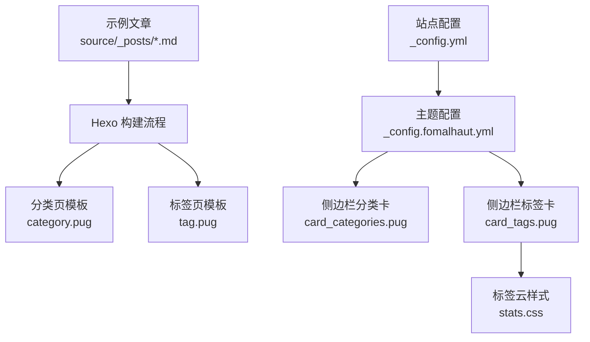
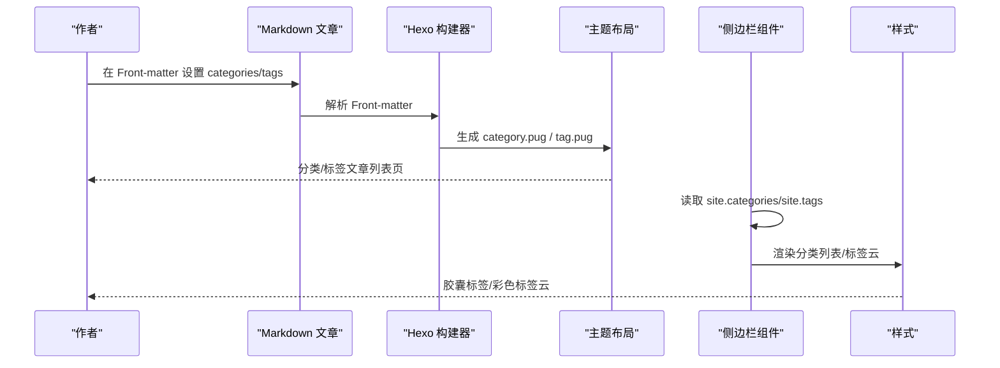
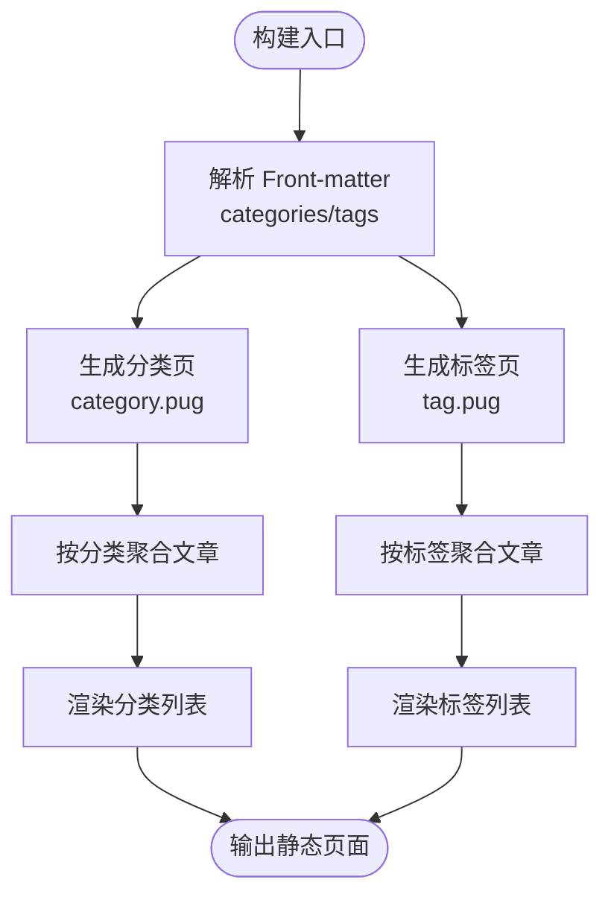
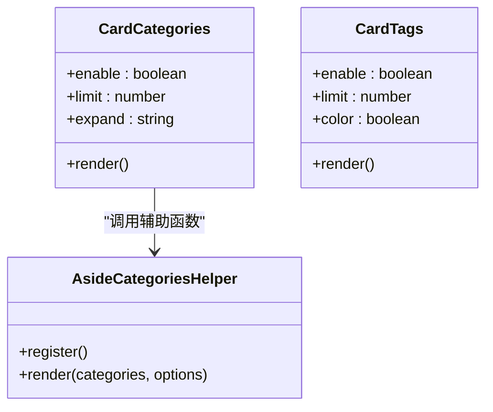
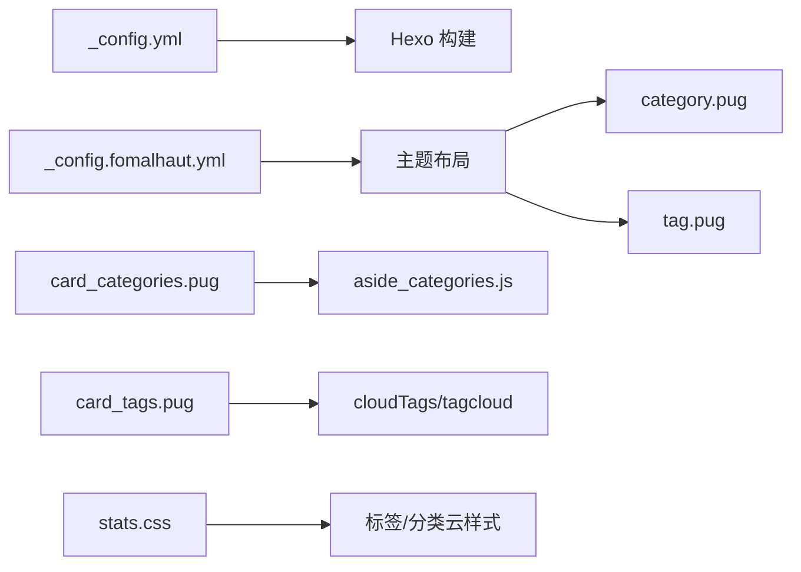

# 分类与标签系统

<cite>
**本文引用的文件**   
- [_config.yml](file://_config.yml)
- [_config.fomalhaut.yml](file://_config.fomalhaut.yml)
- [source/_posts/2026-10-01-Hello-World.md](file://source/_posts/2026-10-01-Hello-World.md)
- [source/_posts/2026-10-02-外挂标签速查.md](file://source/_posts/2026-10-02-外挂标签速查.md)
- [themes/fomalhaut/layout/includes/widget/card_categories.pug](file://themes/fomalhaut/layout/includes/widget/card_categories.pug)
- [themes/fomalhaut/layout/includes/widget/card_tags.pug](file://themes/fomalhaut/layout/includes/widget/card_tags.pug)
- [themes/fomalhaut/scripts/helpers/aside_categories.js](file://themes/fomalhaut/scripts/helpers/aside_categories.js)
- [themes/fomalhaut/layout/category.pug](file://themes/fomalhaut/layout/category.pug)
- [themes/fomalhaut/layout/tag.pug](file://themes/fomalhaut/layout/tag.pug)
- [source/css/stats.css](file://source/css/stats.css)
</cite>

## 目录
1. [简介](#简介)
2. [项目结构](#项目结构)
3. [核心组件](#核心组件)
4. [架构总览](#架构总览)
5. [详细组件分析](#详细组件分析)
6. [依赖关系分析](#依赖关系分析)
7. [性能考虑](#性能考虑)
8. [故障排查指南](#故障排查指南)
9. [结论](#结论)
10. [附录](#附录)

## 简介
本文件系统性说明本仓库中“分类”和“标签”的概念、差异、使用方式与生成机制，覆盖以下目标：
- 明确分类与标签的区别及适用场景。
- 说明为文章添加分类与标签的方法（自动与手动）。
- 解释分类页面与标签页面的生成机制，包括归档、标签云等。
- 说明侧边栏中分类与标签组件的配置方法。
- 提供组织策略与最佳实践，帮助作者建立清晰的内容结构。

## 项目结构
与分类和标签直接相关的代码与配置分布在站点根配置、主题配置、示例文章、主题布局模板、侧边栏组件以及样式文件中：
- 站点级配置定义分类/标签目录、默认分类、映射表等。
- 主题配置控制侧边栏卡片开关、数量、颜色、排序等。
- 示例文章演示在 Markdown Front-matter 中声明分类与标签。
- 主题布局负责渲染分类页与标签页。
- 侧边栏组件负责渲染分类列表与标签云。
- 统计页面样式对标签云做了胶囊化视觉增强。

**图表来源**
- [_config.yml:99-102](file://_config.yml#L99-L102)
- [_config.fomalhaut.yml:984-990](file://_config.fomalhaut.yml#L984-L990)
- [source/_posts/2026-10-01-Hello-World.md:1-14](file://source/_posts/2026-10-01-Hello-World.md#L1-L14)
- [themes/fomalhaut/layout/category.pug](file://themes/fomalhaut/layout/category.pug)
- [themes/fomalhaut/layout/tag.pug](file://themes/fomalhaut/layout/tag.pug)
- [themes/fomalhaut/layout/includes/widget/card_categories.pug](file://themes/fomalhaut/layout/includes/widget/card_categories.pug)
- [themes/fomalhaut/layout/includes/widget/card_tags.pug](file://themes/fomalhaut/layout/includes/widget/card_tags.pug)
- [source/css/stats.css:165-211](file://source/css/stats.css#L165-L211)

**章节来源**
- [_config.yml:99-102](file://_config.yml#L99-L102)
- [_config.fomalhaut.yml:984-990](file://_config.fomalhaut.yml#L984-L990)
- [source/_posts/2026-10-01-Hello-World.md:1-14](file://source/_posts/2026-10-01-Hello-World.md#L1-L14)

## 核心组件
- 站点配置项
  - 分类与标签目录：用于生成分类与标签页面的路径。
  - 默认分类：未显式指定分类时的兜底值。
  - 分类映射与标签映射：用于统一或别名化分类/标签名称。
- 主题配置项
  - 侧边栏分类卡片：开关、显示数量、是否展开、排序等。
  - 侧边栏标签卡片：开关、显示数量、是否彩色、排序等。
  - 分类/标签页面 UI 风格：可设置为与首页一致或归档页风格。
- 侧边栏组件
  - 分类卡片：调用辅助函数渲染层级分类列表，支持限制数量与“更多”跳转。
  - 标签卡片：根据配置选择“彩色标签云”或“普通标签云”，并支持限制数量。
- 页面模板
  - 分类页模板：渲染某分类下的文章列表。
  - 标签页模板：渲染某标签下的文章列表。
- 样式增强
  - 统计页面中的标签云被样式化为胶囊标签，提升可读性与一致性。

**章节来源**
- [_config.yml:99-102](file://_config.yml#L99-L102)
- [_config.fomalhaut.yml:786-790](file://_config.fomalhaut.yml#L786-L790)
- [_config.fomalhaut.yml:984-990](file://_config.fomalhaut.yml#L984-L990)
- [themes/fomalhaut/layout/includes/widget/card_categories.pug](file://themes/fomalhaut/layout/includes/widget/card_categories.pug)
- [themes/fomalhaut/layout/includes/widget/card_tags.pug](file://themes/fomalhaut/layout/includes/widget/card_tags.pug)
- [themes/fomalhaut/layout/category.pug](file://themes/fomalhaut/layout/category.pug)
- [themes/fomalhaut/layout/tag.pug](file://themes/fomalhaut/layout/tag.pug)
- [source/css/stats.css:165-211](file://source/css/stats.css#L165-L211)

## 架构总览
下图展示从文章内容到最终页面与侧边栏的完整数据流。

**图表来源**
- [source/_posts/2026-10-01-Hello-World.md:1-14](file://source/_posts/2026-10-01-Hello-World.md#L1-L14)
- [themes/fomalhaut/layout/category.pug](file://themes/fomalhaut/layout/category.pug)
- [themes/fomalhaut/layout/tag.pug](file://themes/fomalhaut/layout/tag.pug)
- [themes/fomalhaut/layout/includes/widget/card_categories.pug](file://themes/fomalhaut/layout/includes/widget/card_categories.pug)
- [themes/fomalhaut/layout/includes/widget/card_tags.pug](file://themes/fomalhaut/layout/includes/widget/card_tags.pug)
- [source/css/stats.css:165-211](file://source/css/stats.css#L165-L211)

## 详细组件分析

### 概念与使用场景
- 分类
  - 含义：对文章进行“领域/主题”维度的结构化组织，通常具有层次性（如“开始使用 > 基础教程”）。
  - 适用场景：需要稳定、长期存在的知识分区；适合导航与归档浏览。
- 标签
  - 含义：对文章的“关键词/属性”进行扁平标注，常用于跨分类的主题关联。
  - 适用场景：临时性、细粒度、多对多的内容标记；适合检索与聚合。

建议：
- 用分类搭建骨架，用标签补充细节。
- 分类不宜过深，标签不宜过多过碎。

[本节不直接分析具体文件]

### 为文章添加分类与标签
- 手动方式
  - 在 Markdown 文件的 Front-matter 中设置 categories 与 tags。
  - 示例参考：
    - [source/_posts/2026-10-01-Hello-World.md:1-14](file://source/_posts/2026-10-01-Hello-World.md#L1-L14)
    - [source/_posts/2026-10-02-外挂标签速查.md:1-15](file://source/_posts/2026-10-02-外挂标签速查.md#L1-L15)
- 自动方式
  - 通过站点配置的 default_category 为未显式设置分类的文章赋予默认分类。
  - 通过 category_map 与 tag_map 对分类/标签名称做统一映射。
  - 参考：
    - [_config.yml:99-102](file://_config.yml#L99-L102)

**章节来源**
- [source/_posts/2026-10-01-Hello-World.md:1-14](file://source/_posts/2026-10-01-Hello-World.md#L1-L14)
- [source/_posts/2026-10-02-外挂标签速查.md:1-15](file://source/_posts/2026-10-02-外挂标签速查.md#L1-L15)
- [_config.yml:99-102](file://_config.yml#L99-L102)

### 分类页面与标签页面的生成机制
- 分类页面
  - 由主题布局 category.pug 渲染，展示某分类下的文章列表。
  - 可通过主题配置 category_ui 调整页面 UI 风格。
- 标签页面
  - 由主题布局 tag.pug 渲染，展示某标签下的文章列表。
  - 可通过主题配置 tag_ui 调整页面 UI 风格。
- 归档
  - 站点配置 archive_generator 控制归档页的分页与时间粒度（年/月/日）。
  - 参考：
    - [_config.yml:89-97](file://_config.yml#L89-L97)

**图表来源**
- [themes/fomalhaut/layout/category.pug](file://themes/fomalhaut/layout/category.pug)
- [themes/fomalhaut/layout/tag.pug](file://themes/fomalhaut/layout/tag.pug)
- [_config.yml:89-97](file://_config.yml#L89-L97)

**章节来源**
- [themes/fomalhaut/layout/category.pug](file://themes/fomalhaut/layout/category.pug)
- [themes/fomalhaut/layout/tag.pug](file://themes/fomalhaut/layout/tag.pug)
- [_config.yml:89-97](file://_config.yml#L89-L97)

### 侧边栏分类与标签组件
- 分类卡片
  - 组件文件：card_categories.pug
  - 行为：若启用且存在分类，则调用 aside_categories 辅助函数渲染层级分类列表，支持限制数量与“更多”按钮跳转到分类总览。
  - 配置项：enable、limit、expand、orderby、order 等。
  - 参考：
    - [themes/fomalhaut/layout/includes/widget/card_categories.pug](file://themes/fomalhaut/layout/includes/widget/card_categories.pug)
    - [themes/fomalhaut/scripts/helpers/aside_categories.js](file://themes/fomalhaut/scripts/helpers/aside_categories.js)
    - [_config.fomalhaut.yml:984-990](file://_config.fomalhaut.yml#L984-L990)
- 标签卡片
  - 组件文件：card_tags.pug
  - 行为：若启用且存在标签，则根据 theme.aside.card_tags.color 决定使用“彩色标签云”还是“普通标签云”，并支持 limit 控制显示数量。
  - 配置项：enable、limit、color、sort_order 等。
  - 参考：
    - [themes/fomalhaut/layout/includes/widget/card_tags.pug](file://themes/fomalhaut/layout/includes/widget/card_tags.pug)
    - [_config.fomalhaut.yml:984-990](file://_config.fomalhaut.yml#L984-L990)

**图表来源**
- [themes/fomalhaut/layout/includes/widget/card_categories.pug](file://themes/fomalhaut/layout/includes/widget/card_categories.pug)
- [themes/fomalhaut/scripts/helpers/aside_categories.js](file://themes/fomalhaut/scripts/helpers/aside_categories.js)
- [themes/fomalhaut/layout/includes/widget/card_tags.pug](file://themes/fomalhaut/layout/includes/widget/card_tags.pug)

**章节来源**
- [themes/fomalhaut/layout/includes/widget/card_categories.pug](file://themes/fomalhaut/layout/includes/widget/card_categories.pug)
- [themes/fomalhaut/scripts/helpers/aside_categories.js](file://themes/fomalhaut/scripts/helpers/aside_categories.js)
- [themes/fomalhaut/layout/includes/widget/card_tags.pug](file://themes/fomalhaut/layout/includes/widget/card_tags.pug)
- [_config.fomalhaut.yml:984-990](file://_config.fomalhaut.yml#L984-L990)

### 标签云与分类云的样式增强
- 统计页面将标签云与分类云以“胶囊标签”形式呈现，统一字号与配色，并在悬停时高亮。
- 该样式作用于包含特定容器结构的页面，使标签/分类云更易于阅读与交互。
- 参考：
  - [source/css/stats.css:165-211](file://source/css/stats.css#L165-L211)

**章节来源**
- [source/css/stats.css:165-211](file://source/css/stats.css#L165-L211)

## 依赖关系分析
- 站点配置依赖
  - category_dir、tag_dir 决定分类与标签页面输出路径。
  - default_category 为未设置分类的文章提供默认值。
  - category_map、tag_map 可用于统一命名。
- 主题配置依赖
  - aside.card_categories.* 控制分类卡片。
  - aside.card_tags.* 控制标签卡片。
  - category_ui、tag_ui 控制分类/标签页面 UI。
- 模板与脚本依赖
  - category.pug、tag.pug 依赖 Hexo 提供的分类/标签集合。
  - card_categories.pug 依赖 aside_categories.js 辅助函数。
  - card_tags.pug 依赖 cloudTags/tagcloud 辅助函数。
- 样式依赖
  - stats.css 对标签云进行视觉增强，影响最终呈现效果。

**图表来源**
- [_config.yml:99-102](file://_config.yml#L99-L102)
- [_config.fomalhaut.yml:786-790](file://_config.fomalhaut.yml#L786-L790)
- [_config.fomalhaut.yml:984-990](file://_config.fomalhaut.yml#L984-L990)
- [themes/fomalhaut/layout/category.pug](file://themes/fomalhaut/layout/category.pug)
- [themes/fomalhaut/layout/tag.pug](file://themes/fomalhaut/layout/tag.pug)
- [themes/fomalhaut/layout/includes/widget/card_categories.pug](file://themes/fomalhaut/layout/includes/widget/card_categories.pug)
- [themes/fomalhaut/layout/includes/widget/card_tags.pug](file://themes/fomalhaut/layout/includes/widget/card_tags.pug)
- [themes/fomalhaut/scripts/helpers/aside_categories.js](file://themes/fomalhaut/scripts/helpers/aside_categories.js)
- [source/css/stats.css:165-211](file://source/css/stats.css#L165-L211)

**章节来源**
- [_config.yml:99-102](file://_config.yml#L99-L102)
- [_config.fomalhaut.yml:786-790](file://_config.fomalhaut.yml#L786-L790)
- [_config.fomalhaut.yml:984-990](file://_config.fomalhaut.yml#L984-L990)
- [themes/fomalhaut/layout/includes/widget/card_categories.pug](file://themes/fomalhaut/layout/includes/widget/card_categories.pug)
- [themes/fomalhaut/layout/includes/widget/card_tags.pug](file://themes/fomalhaut/layout/includes/widget/card_tags.pug)
- [themes/fomalhaut/scripts/helpers/aside_categories.js](file://themes/fomalhaut/scripts/helpers/aside_categories.js)
- [source/css/stats.css:165-211](file://source/css/stats.css#L165-L211)

## 性能考虑
- 侧边栏标签云数量控制
  - 通过 aside.card_tags.limit 限制渲染数量，避免大量标签导致 DOM 过大。
- 分类层级深度
  - 分类层级过深会增加渲染复杂度，建议保持浅层结构。
- 样式优化
  - 使用胶囊标签样式可减少随机字号带来的重排开销，提升滚动体验。
- 分页与归档
  - 合理设置 archive_generator.per_page 与 index_generator.per_page，避免单页内容过多。

[本节为通用指导，不直接分析具体文件]

## 故障排查指南
- 侧边栏分类/标签不显示
  - 检查主题配置 aside.card_categories.enable 与 aside.card_tags.enable 是否为 true。
  - 确认 site.categories 与 site.tags 是否存在（即是否有文章设置了分类/标签）。
  - 参考：
    - [_config.fomalhaut.yml:984-990](file://_config.fomalhaut.yml#L984-L990)
    - [themes/fomalhaut/layout/includes/widget/card_categories.pug](file://themes/fomalhaut/layout/includes/widget/card_categories.pug)
    - [themes/fomalhaut/layout/includes/widget/card_tags.pug](file://themes/fomalhaut/layout/includes/widget/card_tags.pug)
- 分类/标签页面空白或无文章
  - 检查文章 Front-matter 是否正确设置 categories/tags。
  - 检查 category_dir、tag_dir 是否与预期一致。
  - 参考：
    - [source/_posts/2026-10-01-Hello-World.md:1-14](file://source/_posts/2026-10-01-Hello-World.md#L1-L14)
    - [_config.yml:99-102](file://_config.yml#L99-L102)
- 标签云样式异常
  - 检查是否加载了 stats.css 的胶囊标签样式。
  - 参考：
    - [source/css/stats.css:165-211](file://source/css/stats.css#L165-L211)

**章节来源**
- [_config.fomalhaut.yml:984-990](file://_config.fomalhaut.yml#L984-L990)
- [themes/fomalhaut/layout/includes/widget/card_categories.pug](file://themes/fomalhaut/layout/includes/widget/card_categories.pug)
- [themes/fomalhaut/layout/includes/widget/card_tags.pug](file://themes/fomalhaut/layout/includes/widget/card_tags.pug)
- [source/_posts/2026-10-01-Hello-World.md:1-14](file://source/_posts/2026-10-01-Hello-World.md#L1-L14)
- [_config.yml:99-102](file://_config.yml#L99-L102)
- [source/css/stats.css:165-211](file://source/css/stats.css#L165-L211)

## 结论
- 分类用于结构性组织，标签用于灵活性标注；二者互补。
- 通过站点配置与主题配置，可以灵活控制分类/标签的生成路径、默认值、映射规则与侧边栏展示。
- 侧边栏分类与标签组件提供了丰富的显示选项，结合样式增强可获得一致的阅读体验。
- 遵循合理的组织策略与最佳实践，有助于构建清晰、可扩展的内容体系。

[本节为总结性内容，不直接分析具体文件]

## 附录
- 常用配置清单
  - 站点配置
    - category_dir、tag_dir：分类/标签页面目录。
    - default_category：默认分类。
    - category_map、tag_map：分类/标签映射。
  - 主题配置
    - aside.card_categories.*：分类卡片开关、数量、展开、排序。
    - aside.card_tags.*：标签卡片开关、数量、彩色、排序。
    - category_ui、tag_ui：分类/标签页面 UI 风格。
- 最佳实践
  - 分类不超过三层，标签控制在每篇文章 3-8 个。
  - 使用 category_map/tag_map 统一命名，避免同义不同名。
  - 定期清理无用标签，合并重复标签。
  - 在侧边栏限制标签数量，保证性能与可读性。

[本节为补充信息，不直接分析具体文件]