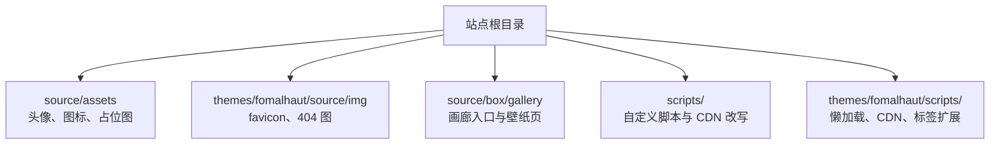
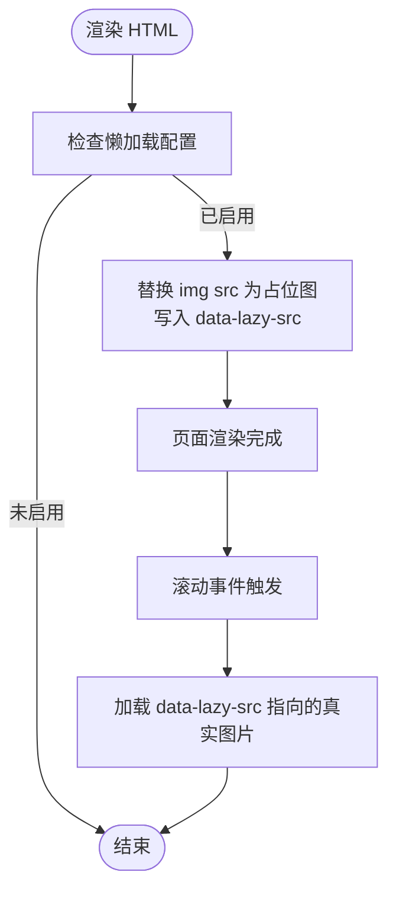
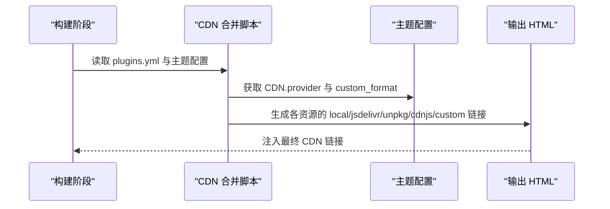
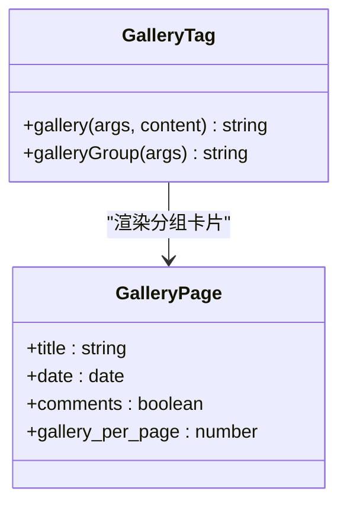

# 媒体资源管理

<cite>
**本文引用的文件**   
- [_config.yml](file://_config.yml)
- [_config.fomalhaut.yml](file://_config.fomalhaut.yml)
- [themes/fomalhaut/_config.yml](file://themes/fomalhaut/_config.yml)
- [themes/fomalhaut/scripts/tag/gallery.js](file://themes/fomalhaut/scripts/tag/gallery.js)
- [source/box/gallery/index.md](file://source/box/gallery/index.md)
- [source/box/gallery/wallpaper/index.md](file://source/box/gallery/wallpaper/index.md)
- [themes/fomalhaut/scripts/filters/post_lazyload.js](file://themes/fomalhaut/scripts/filters/post_lazyload.js)
- [themes/fomalhaut/scripts/events/cdn.js](file://themes/fomalhaut/scripts/events/cdn.js)
- [scripts/tag-map-local.js](file://scripts/tag-map-local.js)
- [source/assets/avatar.webp](file://source/assets/avatar.webp)
- [source/assets/404_1.jpg](file://source/assets/404_1.jpg)
- [themes/fomalhaut/source/img/favicon.png](file://themes/fomalhaut/source/img/favicon.png)
</cite>

## 目录
1. [引言](#引言)
2. [项目结构与媒体资源定位](#项目结构与媒体资源定位)
3. [图片资源组织与命名规范](#图片资源组织与命名规范)
4. [图片优化策略](#图片优化策略)
5. [懒加载与灯箱效果](#懒加载与灯箱效果)
6. [CDN 配置与部署策略](#cdn-配置与部署策略)
7. [画廊功能实现与使用方法](#画廊功能实现与使用方法)
8. [视频、音频等多媒体资源处理](#视频音频等多媒体资源处理)
9. [性能优化与缓存建议](#性能优化与缓存建议)
10. [故障排查](#故障排查)
11. [结论](#结论)

## 引言
本文件面向博客中的媒体资源管理，重点说明图片资源的组织结构、命名规范、优化策略、懒加载与灯箱效果、CDN 配置、画廊功能的使用方法，以及视频、音频等多媒体资源的处理方式。文档同时给出可落地的性能优化建议和缓存策略，帮助你在内容增长时保持站点加载速度与用户体验稳定。

## 项目结构与媒体资源定位
当前仓库采用 Hexo + Butterfly 主题（fomalhaut）结构。媒体资源主要分布在以下位置：
- 站点级静态资源：`source/assets/`，用于头像、图标、占位图、光标等全局资源。
- 主题内置图片：`themes/fomalhaut/source/img/`，用于 favicon、404 图等主题资源。
- 文章内容与页面资源：通过 Markdown 正文或页面 Front-matter 引用外部链接或本地路径；画廊页面使用独立页面存放壁纸集合。
- 第三方库与插件脚本：部分第三方库被改写为站内自托管，例如地图相关 JS/CSS。

**图表来源**
- [_config.yml:28-40](file://_config.yml#L28-L40)
- [themes/fomalhaut/scripts/tag/gallery.js:1-35](file://themes/fomalhaut/scripts/tag/gallery.js#L1-L35)
- [scripts/tag-map-local.js:1-27](file://scripts/tag-map-local.js#L1-L27)

**章节来源**
- [_config.yml:28-40](file://_config.yml#L28-L40)
- [themes/fomalhaut/scripts/tag/gallery.js:1-35](file://themes/fomalhaut/scripts/tag/gallery.js#L1-L35)
- [scripts/tag-map-local.js:1-27](file://scripts/tag-map-local.js#L1-L27)

## 图片资源组织与命名规范
### 目录约定
- 站点级资源统一放在 `source/assets/`，例如头像、光标、占位图、404 背景图等。
- 主题内置图片放在 `themes/fomalhaut/source/img/`，如 favicon、友链 404 动图等。
- 画廊资源以页面形式组织：画廊入口在 `source/box/gallery/index.md`，壁纸集合在 `source/box/gallery/wallpaper/index.md`。

### 命名建议
- 使用语义化文件名，避免无意义字符，例如 `avatar.webp`、`404_1.jpg`、`favicon.png`。
- 对于多分辨率图片，建议使用尺寸后缀或不同目录区分，例如 `image-800w.webp`、`image-1200w.webp`。
- 对需要懒加载的图片，优先使用现代格式（WebP），并在必要时提供降级格式（JPEG/PNG）。

**章节来源**
- [source/assets/avatar.webp](file://source/assets/avatar.webp)
- [source/assets/404_1.jpg](file://source/assets/404_1.jpg)
- [themes/fomalhaut/source/img/favicon.png](file://themes/fomalhaut/source/img/favicon.png)
- [source/box/gallery/index.md:1-22](file://source/box/gallery/index.md#L1-L22)
- [source/box/gallery/wallpaper/index.md:1-66](file://source/box/gallery/wallpaper/index.md#L1-L66)

## 图片优化策略
### 格式选择
- 优先使用 WebP 提升压缩率与加载速度，例如头像使用 `.webp`。
- 对不支持 WebP 的旧浏览器，可通过服务端或 CDN 回退到 JPEG/PNG。
- 对于简单图标和透明背景，优先使用 SVG 或 PNG。

### 尺寸压缩
- 根据展示场景生成多尺寸缩略图，例如列表缩略图使用较小尺寸，详情页使用较大尺寸。
- 对大图进行有损压缩，平衡画质与体积；对关键首屏图使用无损或高质量压缩。
- 在画廊页面中，示例壁纸使用固定宽高比（如 1200x675），便于统一布局与懒加载。

### 元数据与缓存
- 清理图片 EXIF 元数据以减少体积。
- 为静态图片设置长期缓存头（如 `Cache-Control: public, max-age=31536000`），配合版本号或哈希文件名更新缓存。

**章节来源**
- [source/assets/avatar.webp](file://source/assets/avatar.webp)
- [source/box/gallery/wallpaper/index.md:12-66](file://source/box/gallery/wallpaper/index.md#L12-L66)

## 懒加载与灯箱效果
### 懒加载机制
- 主题启用懒加载，将 `` 的 `src` 替换为占位图，并将真实地址写入 `data-lazy-src`，由前端懒加载库在滚动进入视口时加载。
- 支持模糊占位效果（blur placeholder），在未加载完成时显示模糊预览，提升视觉体验。
- 懒加载作用范围可配置为全站或仅文章页。

**图表来源**
- [themes/fomalhaut/scripts/filters/post_lazyload.js:1-29](file://themes/fomalhaut/scripts/filters/post_lazyload.js#L1-L29)
- [_config.fomalhaut.yml:1147-1154](file://_config.fomalhaut.yml#L1147-L1154)

### 灯箱效果
- 主题启用 Fancybox 作为图片灯箱，用户点击缩略图可查看大图并支持缩放、切换等操作。
- 画廊分组图片默认禁用灯箱（`no-lightbox`），以避免在分组卡片中误触放大。

**章节来源**
- [themes/fomalhaut/scripts/filters/post_lazyload.js:1-29](file://themes/fomalhaut/scripts/filters/post_lazyload.js#L1-L29)
- [_config.fomalhaut.yml:1147-1154](file://_config.fomalhaut.yml#L1147-L1154)
- [themes/fomalhaut/_config.yml:734-744](file://themes/fomalhaut/_config.yml#L734-L744)
- [themes/fomalhaut/scripts/tag/gallery.js:15-31](file://themes/fomalhaut/scripts/tag/gallery.js#L15-L31)

## CDN 配置与部署策略
### CDN 合并与注入
- 主题在构建前合并 CDN 配置，将内部资源与第三方库统一映射到指定 CDN 源（如 jsDelivr、unpkg、cdnjs）。
- 支持自定义 CDN 格式，允许按 `${name}`、`${version}`、`${file}` 等变量生成链接。
- 内部资源（main、utils、translate、local_search、algolia_js）会根据版本与最小化规则生成 CDN 链接。

**图表来源**
- [themes/fomalhaut/scripts/events/cdn.js:1-95](file://themes/fomalhaut/scripts/events/cdn.js#L1-L95)
- [_config.fomalhaut.yml:1403-1420](file://_config.fomalhaut.yml#L1403-L1420)

### 第三方库自托管改写
- 针对国内访问不稳定的 CDN（如 jsDelivr），脚本将 hexo-tag-map 的库路径改写为站内路径，确保地图功能稳定可用。
- 该改写只影响 hexo-tag-map 自身的 5 个文件路径，不影响文章内容中的其他外链。

**章节来源**
- [themes/fomalhaut/scripts/events/cdn.js:1-95](file://themes/fomalhaut/scripts/events/cdn.js#L1-L95)
- [scripts/tag-map-local.js:1-27](file://scripts/tag-map-local.js#L1-L27)

## 画廊功能实现与使用方法
### 画廊入口与分组
- 画廊入口页面使用 `` 标签创建分组卡片，包含标题、描述、封面图与跳转链接。
- 分组卡片不会触发灯箱效果，适合快速浏览与导航。

**图表来源**
- [themes/fomalhaut/scripts/tag/gallery.js:1-35](file://themes/fomalhaut/scripts/tag/gallery.js#L1-L35)
- [source/box/gallery/index.md:1-22](file://source/box/gallery/index.md#L1-L22)

### 壁纸分页展示
- 壁纸页面通过 Front-matter 的 `gallery_per_page` 控制每页展示数量，示例设置为 12。
- 页面内使用 Markdown 图片语法插入大量壁纸，配合主题懒加载与分页逻辑实现分页展示。

**章节来源**
- [source/box/gallery/wallpaper/index.md:1-66](file://source/box/gallery/wallpaper/index.md#L1-L66)

### 使用步骤
1. 在画廊入口页面使用 `` 添加分组。
2. 在目标页面顶部设置 `gallery_per_page` 控制分页数量。
3. 在页面正文中使用 Markdown 图片语法插入图片，主题会自动应用懒加载与分页。
4. 如需禁用灯箱，可在图片外层包裹特定容器或使用主题提供的类名（如 `no-lightbox`）。

**章节来源**
- [source/box/gallery/index.md:1-22](file://source/box/gallery/index.md#L1-L22)
- [source/box/gallery/wallpaper/index.md:1-66](file://source/box/gallery/wallpaper/index.md#L1-L66)
- [themes/fomalhaut/scripts/tag/gallery.js:1-35](file://themes/fomalhaut/scripts/tag/gallery.js#L1-L35)

## 视频、音频等多媒体资源处理
### 音频
- 主题支持 APlayer/Meting 音乐播放器，但当前站点配置中未启用 `aplayerInject`。
- 若需启用，需在主题配置中开启 `aplayerInject.enable`，并在页面中引入相应的前端组件。
- 音频资源建议放置在 `source/assets/` 下，并通过相对路径引用，便于本地开发与部署一致性。

### 视频
- 当前仓库未发现显式的视频播放器配置或页面。建议在需要时引入轻量级播放器（如 Plyr、Video.js），并通过 CDN 或自托管方式加载。
- 视频资源建议分片存储（HLS/DASH）并结合 CDN 加速，以提升大文件的加载性能。

**章节来源**
- [themes/fomalhaut/_config.yml:784-788](file://themes/fomalhaut/_config.yml#L784-L788)
- [_config.yml:75-79](file://_config.yml#L75-L79)

## 性能优化与缓存建议
### 图片优化
- 使用 WebP 格式并提供降级方案。
- 生成多尺寸缩略图，按需加载。
- 清理 EXIF 元数据，减少体积。
- 对静态图片设置长期缓存头，结合版本号更新缓存。

### 懒加载与预连接
- 启用懒加载，减少首屏请求压力。
- 使用 `preconnect` 提前建立与关键 CDN 的连接，降低 DNS/TCP/TLS 握手开销。

### CDN 与缓存
- 将第三方库统一走稳定 CDN，并启用 Gzip/Brotli 压缩。
- 对静态资源启用强缓存，对动态接口启用短缓存或协商缓存。
- 对地图等易受网络影响的库，采用站内自托管或国内镜像。

### 构建与部署
- 使用 Hexo 的 `skip_render` 跳过不需要渲染的静态文件，减少构建时间。
- 在部署流水线中执行图片压缩与格式转换，确保发布产物最优。

**章节来源**
- [_config.yml:36-40](file://_config.yml#L36-L40)
- [_config.fomalhaut.yml:1177-1182](file://_config.fomalhaut.yml#L1177-L1182)
- [themes/fomalhaut/scripts/events/cdn.js:1-95](file://themes/fomalhaut/scripts/events/cdn.js#L1-L95)

## 故障排查
### 图片无法显示
- 检查图片路径是否正确，尤其是相对路径与 CDN 路径。
- 确认懒加载是否启用，以及 `data-lazy-src` 是否被正确写入。
- 查看浏览器控制台是否有跨域或 404 错误。

### 灯箱不生效
- 确认主题启用了 Fancybox 或 medium-zoom。
- 检查图片是否被包裹在禁用灯箱的容器中。

### CDN 资源加载失败
- 检查 CDN 提供商是否可达，必要时切换到备用 CDN。
- 查看 CDN 配置中的版本号与文件名是否匹配。

**章节来源**
- [themes/fomalhaut/scripts/filters/post_lazyload.js:1-29](file://themes/fomalhaut/scripts/filters/post_lazyload.js#L1-L29)
- [themes/fomalhaut/_config.yml:734-744](file://themes/fomalhaut/_config.yml#L734-L744)
- [themes/fomalhaut/scripts/events/cdn.js:1-95](file://themes/fomalhaut/scripts/events/cdn.js#L1-L95)

## 结论
本仓库通过 Hexo 与 Butterfly 主题实现了完善的媒体资源管理机制：图片资源集中管理、懒加载与灯箱效果提升用户体验、CDN 合并与自托管保障稳定性、画廊功能提供便捷的内容组织方式。在此基础上，建议持续优化图片格式与尺寸、启用长期缓存、合理配置 CDN，并根据业务需求引入视频与音频播放器，以获得更佳的性能与用户体验。