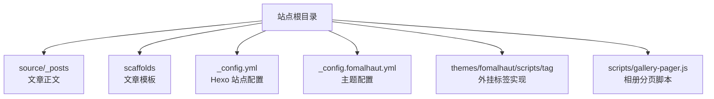
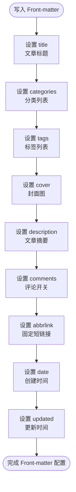
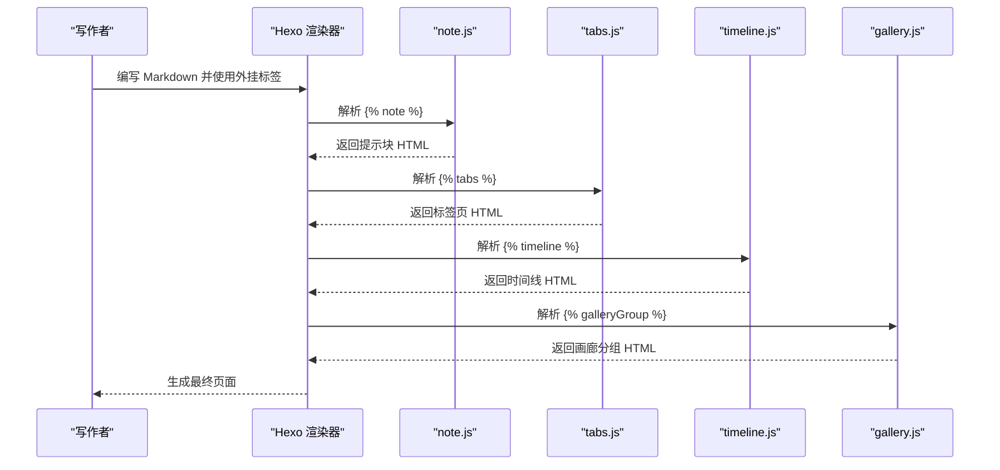
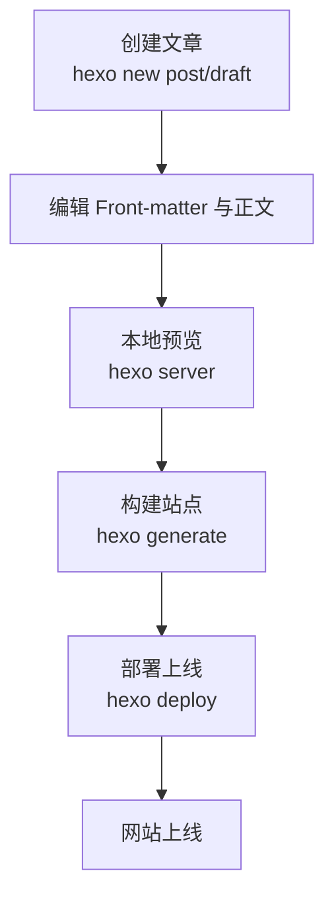
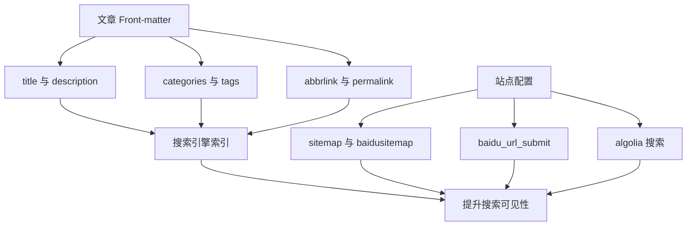

# 文章管理

<cite>
**本文引用的文件**   
- [scaffolds/post.md](file://scaffolds/post.md)
- [scaffolds/draft.md](file://scaffolds/draft.md)
- [source/_posts/2026-10-01-Hello-World.md](file://source/_posts/2026-10-01-Hello-World.md)
- [source/_posts/2026-10-02-外挂标签速查.md](file://source/_posts/2026-10-02-外挂标签速查.md)
- [_config.yml](file://_config.yml)
- [_config.fomalhaut.yml](file://_config.fomalhaut.yml)
- [themes/fomalhaut/scripts/tag/note.js](file://themes/fomalhaut/scripts/tag/note.js)
- [themes/fomalhaut/scripts/tag/timeline.js](file://themes/fomalhaut/scripts/tag/timeline.js)
- [themes/fomalhaut/scripts/tag/tabs.js](file://themes/fomalhaut/scripts/tag/tabs.js)
- [themes/fomalhaut/scripts/tag/gallery.js](file://themes/fomalhaut/scripts/tag/gallery.js)
- [scripts/gallery-pager.js](file://scripts/gallery-pager.js)
</cite>

## 目录
1. [简介](#简介)
2. [项目结构与文章位置](#项目结构与文章位置)
3. [文章命名与日期前缀规范](#文章命名与日期前缀规范)
4. [Front-matter 元数据字段说明](#front-matter-元数据字段说明)
5. [草稿与正式文章的区别](#草稿与正式文章的区别)
6. [Markdown 语法扩展与外挂标签](#markdown-语法扩展与外挂标签)
7. [文章发布流程](#文章发布流程)
8. [写作最佳实践](#写作最佳实践)
9. [SEO 优化建议](#seo-优化建议)
10. [常见问题排查](#常见问题排查)
11. [总结](#总结)

## 简介
本文面向使用 Hexo 和 Fomalhaut 主题维护个人博客的写作者，系统说明文章的基本结构、命名规范、Front-matter 字段含义、草稿与正式文章差异、外挂标签用法、发布流程，以及写作与 SEO 优化建议。文档中的示例均基于仓库中已有的示例文章和主题配置，便于直接对照修改。

## 项目结构与文章位置
本仓库采用 Hexo 标准目录结构：
- `source/_posts`：存放 Markdown 格式的文章。
- `scaffolds`：存放新建文章时使用的模板。
- `_config.yml`：Hexo 站点全局配置，包括 URL、permalink、abbrlink、渲染选项等。
- `_config.fomalhaut.yml`：Fomalhaut 主题配置，包括封面、评论、索引展示、数学公式、搜索等。
- `themes/fomalhaut/scripts/tag`：主题外挂标签实现，如 note、timeline、tabs、gallery 等。
- `scripts/gallery-pager.js`：相册自动分页脚本，用于按图片数量自动分页。

**图示来源**
- [source/_posts/2026-10-01-Hello-World.md:1-14](file://source/_posts/2026-10-01-Hello-World.md#L1-L14)
- [scaffolds/post.md:1-11](file://scaffolds/post.md#L1-L11)
- [_config.yml:14-23](file://_config.yml#L14-L23)
- [_config.fomalhaut.yml:144-158](file://_config.fomalhaut.yml#L144-L158)
- [themes/fomalhaut/scripts/tag/note.js:1-28](file://themes/fomalhaut/scripts/tag/note.js#L1-L28)
- [scripts/gallery-pager.js:1-14](file://scripts/gallery-pager.js#L1-L14)

**章节来源**
- [source/_posts/2026-10-01-Hello-World.md:1-14](file://source/_posts/2026-10-01-Hello-World.md#L1-L14)
- [scaffolds/post.md:1-11](file://scaffolds/post.md#L1-L11)
- [_config.yml:14-23](file://_config.yml#L14-L23)
- [_config.fomalhaut.yml:144-158](file://_config.fomalhaut.yml#L144-L158)
- [themes/fomalhaut/scripts/tag/note.js:1-28](file://themes/fomalhaut/scripts/tag/note.js#L1-L28)
- [scripts/gallery-pager.js:1-14](file://scripts/gallery-pager.js#L1-L14)

## 文章命名与日期前缀规范
Hexo 通过 `new_post_name` 控制新文章的默认文件名格式。当前站点配置为 `:year-:month-:day-:title.md`，即“年-月-日-标题.md”。这保证了文章按时间顺序排列，也便于归档和排序。

推荐约定：
- 文件名以日期开头，格式为 `YYYY-MM-DD-标题.md`。
- 标题部分建议使用英文或拼音，避免特殊字符导致链接异常。
- 若需要固定短链接，可在 Front-matter 中设置 `abbrlink`，并在 permalink 中使用 `posts/:abbrlink.html`。

示例参考：
- `2026-10-01-Hello-World.md`
- `2026-10-02-外挂标签速查.md`

**章节来源**
- [_config.yml:43-43](file://_config.yml#L43-L43)
- [_config.yml:22-22](file://_config.yml#L22-L22)
- [source/_posts/2026-10-01-Hello-World.md:1-14](file://source/_posts/2026-10-01-Hello-World.md#L1-L14)
- [source/_posts/2026-10-02-外挂标签速查.md:1-15](file://source/_posts/2026-10-02-外挂标签速查.md#L1-L15)

## Front-matter 元数据字段说明
Front-matter 是位于 Markdown 文件开头的 YAML 元数据块，用于描述文章属性。以下字段在本仓库中被广泛使用：

| 字段 | 用途 | 配置方式与建议 |
|---|---|---|
| `title` | 文章标题 | 必填；建议简洁明确，包含关键词，利于 SEO。 |
| `categories` | 分类列表 | 数组形式；建议层级清晰，如“开始使用”“算法笔记”等。 |
| `tags` | 标签列表 | 数组形式；建议粒度适中，便于检索与聚合。 |
| `cover` | 文章封面图 | 支持远程或本地路径；未设置时主题会从默认封面列表中随机选取。 |
| `description` | 文章摘要 | 首页卡片展示；建议控制在 500 字以内，突出核心内容。 |
| `comments` | 是否启用评论 | `true` 表示启用，`false` 表示关闭；由主题评论系统控制。 |
| `abbrlink` | 固定短链接标识 | 配合 `permalink: posts/:abbrlink.html` 生成稳定链接。 |
| `date` | 创建时间 | 格式为 `YYYY-MM-DD HH:mm:ss`；影响排序与显示。 |
| `updated` | 更新时间 | 可手动更新；也可由 `updated_option: mtime` 自动取文件修改时间。 |
| `mathjax` | 是否加载数学公式引擎 | 按需开启，减少首屏开销。 |

示例参考：
- `title`、`categories`、`tags`、`cover`、`description`、`comments`、`abbrlink`、`date`、`updated` 在示例文章中均有体现。
- 主题配置中 `index_post_content.method: 2` 表示优先使用 `description` 作为首页摘要。
- 主题配置中 `cover.default_cover` 提供大量默认封面图，未设置 `cover` 时随机展示。

**图示来源**
- [source/_posts/2026-10-01-Hello-World.md:1-14](file://source/_posts/2026-10-01-Hello-World.md#L1-L14)
- [source/_posts/2026-10-02-外挂标签速查.md:1-15](file://source/_posts/2026-10-02-外挂标签速查.md#L1-L15)
- [_config.fomalhaut.yml:441-447](file://_config.fomalhaut.yml#L441-L447)
- [_config.fomalhaut.yml:144-158](file://_config.fomalhaut.yml#L144-L158)
- [_config.yml:114-115](file://_config.yml#L114-L115)

**章节来源**
- [source/_posts/2026-10-01-Hello-World.md:1-14](file://source/_posts/2026-10-01-Hello-World.md#L1-L14)
- [source/_posts/2026-10-02-外挂标签速查.md:1-15](file://source/_posts/2026-10-02-外挂标签速查.md#L1-L15)
- [_config.fomalhaut.yml:441-447](file://_config.fomalhaut.yml#L441-L447)
- [_config.fomalhaut.yml:144-158](file://_config.fomalhaut.yml#L144-L158)
- [_config.yml:114-115](file://_config.yml#L114-L115)

## 草稿与正式文章的区别
- **草稿**：存放在 `source/_drafts`（默认），不会参与构建；适合未完成、暂不公开的内容。
- **正式文章**：存放在 `source/_posts`，会被 Hexo 渲染并生成静态页面。

本仓库中：
- `scaffolds/draft.md` 是草稿模板，仅包含基础字段如 `title`、`tags`。
- `scaffolds/post.md` 是正式文章模板，包含更完整的字段如 `date`、`description`、`categories`、`mathjax` 等。
- 示例文章位于 `source/_posts`，属于正式文章。

建议：
- 初稿先写草稿，完善后再移动到 `source/_posts`。
- 使用 `hexo new draft "标题"` 创建草稿，使用 `hexo new post "标题"` 创建正式文章。

**章节来源**
- [scaffolds/draft.md:1-5](file://scaffolds/draft.md#L1-L5)
- [scaffolds/post.md:1-11](file://scaffolds/post.md#L1-L11)
- [source/_posts/2026-10-01-Hello-World.md:1-14](file://source/_posts/2026-10-01-Hello-World.md#L1-L14)

## Markdown 语法扩展与外挂标签
Fomalhaut 主题提供了丰富的外挂标签，增强 Markdown 的表达力。常用标签如下：

| 标签 | 用途 | 基本用法 |
|---|---|---|
| `note` | 提示块，支持 info、primary、warning 等样式 | `说明文字` |
| `tabs` | 标签页，分组展示不同内容 | `...` |
| `hideToggle` | 折叠内容，适合答案、长代码或剧透 | `...` |
| `btn` | 按钮，带链接和图标 | `` |
| `label` | 小标签，带颜色 | `` |
| `span` | 居中标题或装饰性文本 | `` |
| `timeline` | 时间线，适合站史、里程碑 | `<!-- timeline 日期 -->...` |
| `galleryGroup` | 画廊分组，带封面和描述 | `` |
| `mermaid` | Mermaid 图表 | `...` |

这些标签的实现位于 `themes/fomalhaut/scripts/tag/`，例如：
- `note.js`：注册 `note` 和 `subnote` 标签，支持样式参数和图标。
- `tabs.js`：注册 `tabs`、`subtabs`、`subsubtabs`，支持多标签页和图标。
- `timeline.js`：注册 `timeline`，解析注释块生成时间线结构。
- `gallery.js`：注册 `gallery` 和 `galleryGroup`，用于画廊和分组展示。

此外，`scripts/gallery-pager.js` 提供相册自动分页功能：
- 在相册页 Front-matter 中设置 `gallery_per_page` 控制每页图片数。
- 正文中按顺序写图片链接即可，无需手写页码。
- 支持 `<!-- pagebreak -->` 强制分页。

**图示来源**
- [themes/fomalhaut/scripts/tag/note.js:9-27](file://themes/fomalhaut/scripts/tag/note.js#L9-L27)
- [themes/fomalhaut/scripts/tag/tabs.js:9-62](file://themes/fomalhaut/scripts/tag/tabs.js#L9-L62)
- [themes/fomalhaut/scripts/tag/timeline.js:8-41](file://themes/fomalhaut/scripts/tag/timeline.js#L8-L41)
- [themes/fomalhaut/scripts/tag/gallery.js:10-34](file://themes/fomalhaut/scripts/tag/gallery.js#L10-L34)

**章节来源**
- [source/_posts/2026-10-02-外挂标签速查.md:19-114](file://source/_posts/2026-10-02-外挂标签速查.md#L19-L114)
- [themes/fomalhaut/scripts/tag/note.js:1-28](file://themes/fomalhaut/scripts/tag/note.js#L1-L28)
- [themes/fomalhaut/scripts/tag/tabs.js:1-63](file://themes/fomalhaut/scripts/tag/tabs.js#L1-L63)
- [themes/fomalhaut/scripts/tag/timeline.js:1-42](file://themes/fomalhaut/scripts/tag/timeline.js#L1-L42)
- [themes/fomalhaut/scripts/tag/gallery.js:1-35](file://themes/fomalhaut/scripts/tag/gallery.js#L1-L35)
- [scripts/gallery-pager.js:1-14](file://scripts/gallery-pager.js#L1-L14)

## 文章发布流程
推荐的发布流程如下：

1. **创建文章**：使用 `hexo new post "标题"` 生成正式文章，或使用 `hexo new draft "标题"` 创建草稿。
2. **编辑 Front-matter**：填写 `title`、`categories`、`tags`、`cover`、`description`、`comments`、`abbrlink`、`date`、`updated` 等字段。
3. **编写正文**：使用 Markdown 语法和外挂标签组织内容。
4. **本地预览**：运行 `hexo server` 启动本地服务，访问 `http://localhost:4000` 预览。
5. **构建站点**：运行 `hexo generate` 生成静态文件，如需压缩可结合 `gulp`。
6. **部署上线**：根据 `_config.yml` 中的 `deploy` 配置自动推送到托管平台。

**图示来源**
- [source/_posts/2026-10-01-Hello-World.md:47-53](file://source/_posts/2026-10-01-Hello-World.md#L47-L53)
- [_config.yml:135-139](file://_config.yml#L135-L139)

**章节来源**
- [source/_posts/2026-10-01-Hello-World.md:47-53](file://source/_posts/2026-10-01-Hello-World.md#L47-L53)
- [_config.yml:135-139](file://_config.yml#L135-L139)

## 写作最佳实践
- **标题规范**：标题应简洁明确，包含核心关键词，避免过长或模糊表达。
- **分类与标签**：分类用于宏观归类，标签用于细粒度标记；避免过多或过少。
- **摘要优化**：`description` 应概括文章核心，控制在 500 字以内，提升首页可读性。
- **封面图选择**：优先使用高清、横版图片，尺寸建议 1200x675，符合主题默认比例。
- **外链处理**：站点配置已启用外部链接在新标签打开，注意外链安全性。
- **数学公式**：仅在必要时开启 `mathjax: true`，避免首屏性能损耗。
- **固定链接**：使用 `abbrlink` 生成稳定短链接，便于分享和引用。
- **更新时间**：定期更新 `updated` 字段，或使用 `updated_option: mtime` 自动同步。

**章节来源**
- [_config.yml:46-50](file://_config.yml#L46-L50)
- [_config.yml:68-73](file://_config.yml#L68-L73)
- [_config.yml:114-115](file://_config.yml#L114-L115)
- [_config.fomalhaut.yml:441-447](file://_config.fomalhaut.yml#L441-L447)
- [_config.fomalhaut.yml:144-158](file://_config.fomalhaut.yml#L144-L158)

## SEO 优化建议
- **标题与描述**：确保 `title` 和 `description` 准确反映文章内容，利于搜索引擎抓取。
- **URL 结构**：使用 `permalink: posts/:abbrlink.html` 生成简洁稳定的链接。
- **分类与标签页**：Hexo 自动生成分类和标签页，有助于内容聚合和索引。
- **站点地图**：启用 `sitemap` 和 `baidusitemap`，辅助搜索引擎收录。
- **主动推送**：配置 `baidu_url_submit`，向百度主动提交新链接。
- **搜索索引**：启用 Algolia 搜索，提升站内检索体验。
- **外部链接**：启用 `external_link.enable: true`，提升用户体验但需注意外链质量。

**图示来源**
- [_config.yml:22-22](file://_config.yml#L22-L22)
- [_config.yml:203-214](file://_config.yml#L203-L214)
- [_config.yml:151-167](file://_config.yml#L151-L167)
- [_config.yml:46-50](file://_config.yml#L46-L50)

**章节来源**
- [_config.yml:22-22](file://_config.yml#L22-L22)
- [_config.yml:203-214](file://_config.yml#L203-L214)
- [_config.yml:151-167](file://_config.yml#L151-L167)
- [_config.yml:46-50](file://_config.yml#L46-L50)

## 常见问题排查
- **封面不显示**：检查 `cover` 字段是否为空或路径错误；未设置时会从 `default_cover` 列表随机选取。
- **评论不生效**：确认 `comments: true` 且主题评论系统已正确配置。
- **摘要未显示**：检查 `description` 是否填写，以及 `index_post_content.method` 是否设置为 2。
- **外链在新标签打开**：确认 `external_link.enable: true`。
- **相册分页无效**：检查是否设置 `gallery_per_page`，并确保正文中图片链接格式正确。
- **MathJax 未加载**：在 Front-matter 中添加 `mathjax: true`。

**章节来源**
- [_config.fomalhaut.yml:144-158](file://_config.fomalhaut.yml#L144-L158)
- [_config.fomalhaut.yml:541-549](file://_config.fomalhaut.yml#L541-L549)
- [_config.fomalhaut.yml:441-447](file://_config.fomalhaut.yml#L441-L447)
- [_config.yml:46-50](file://_config.yml#L46-L50)
- [scripts/gallery-pager.js:1-14](file://scripts/gallery-pager.js#L1-L14)
- [_config.fomalhaut.yml:97-101](file://_config.fomalhaut.yml#L97-L101)

## 总结
本文系统梳理了 Hexo 文章的基本结构、命名规范、Front-matter 字段、草稿与正式文章差异、外挂标签用法、发布流程，以及写作与 SEO 优化建议。通过遵循本文规范，你可以更高效地撰写、管理和发布高质量文章，同时提升站点的可读性和搜索引擎可见性。建议在写作过程中保持标题、分类、标签、摘要的一致性，并合理使用外挂标签增强内容表现力。