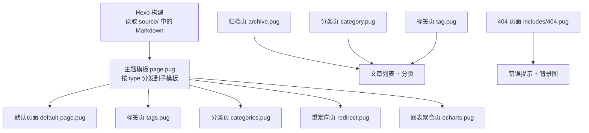
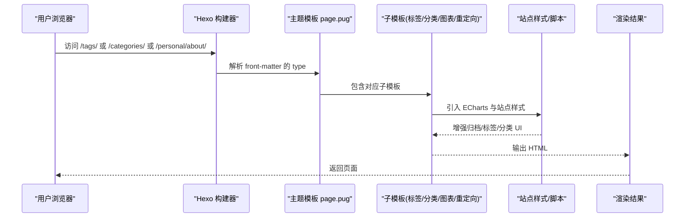
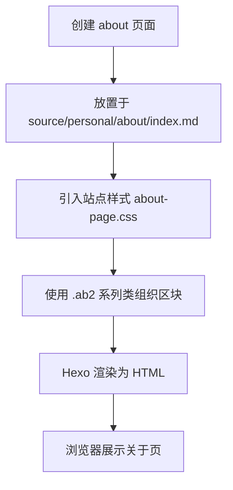
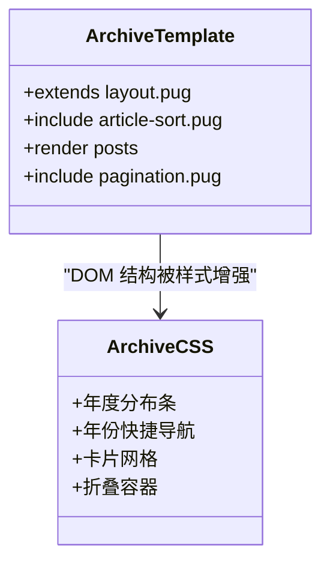
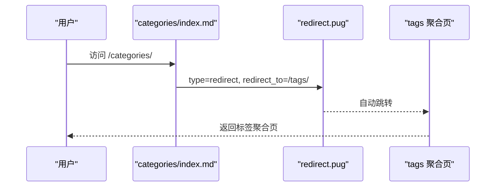
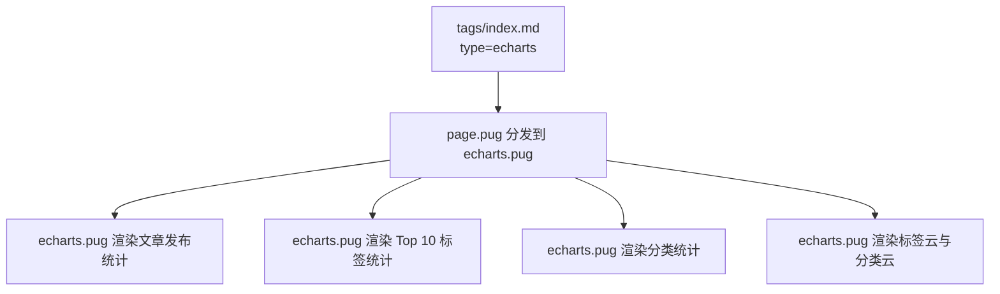
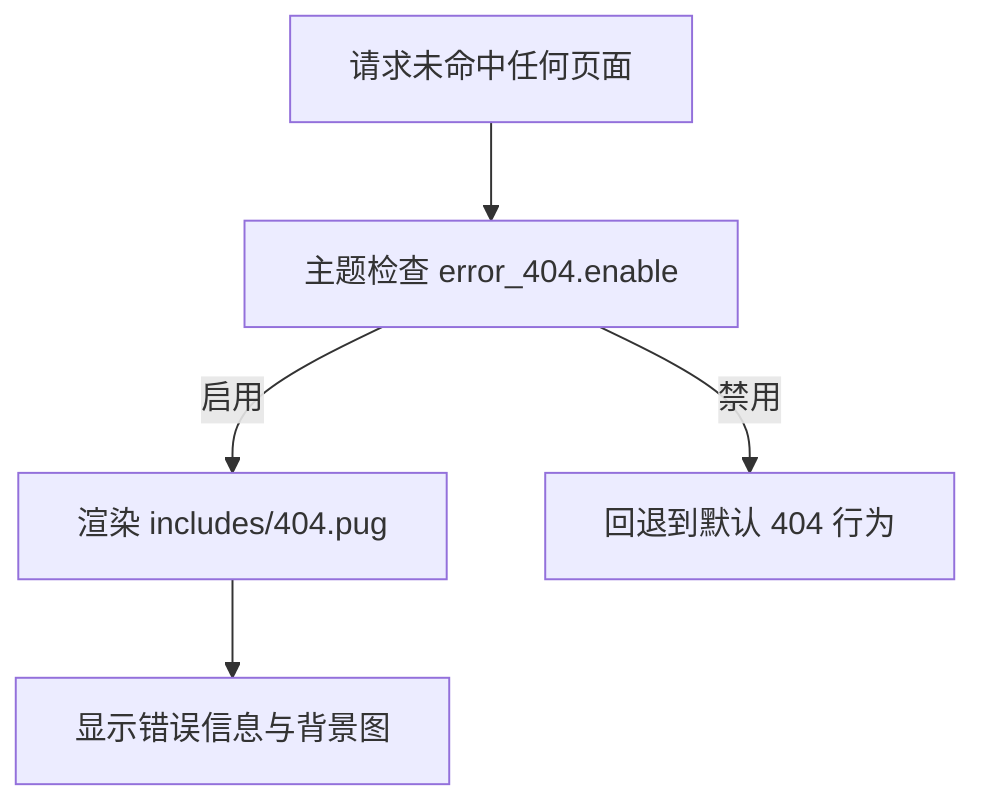
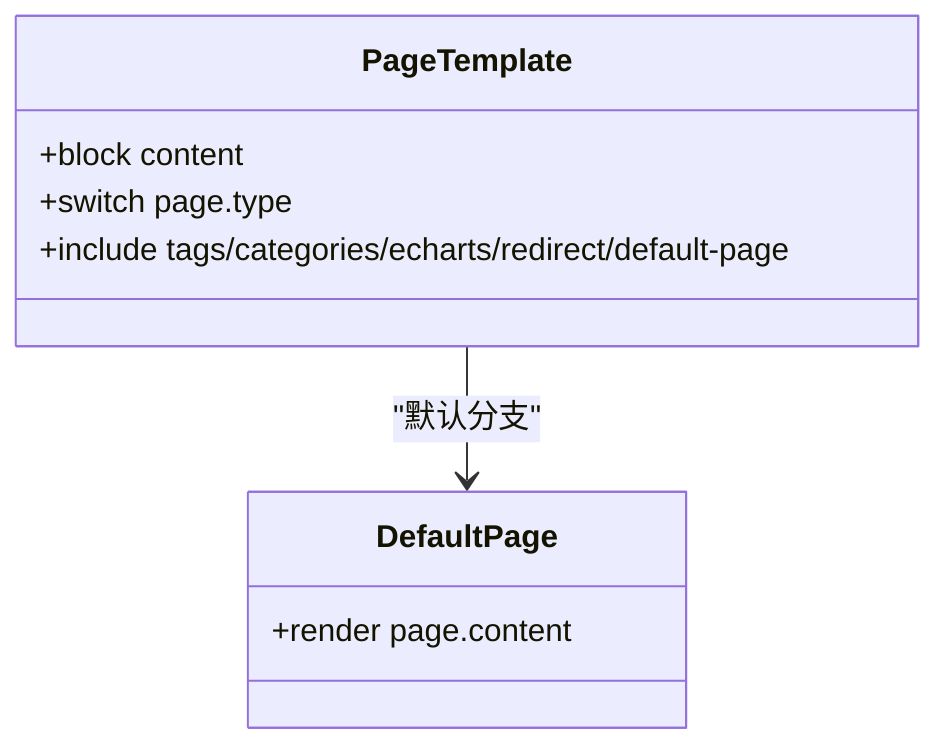
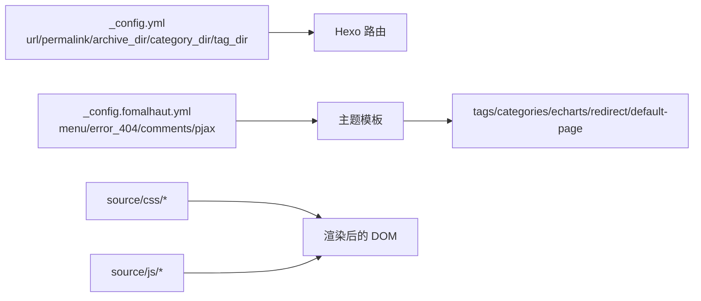

# 页面管理

<cite>
**本文引用的文件**   
- [根配置 _config.yml](file://_config.yml)
- [主题配置 themes/fomalhaut/_config.yml](file://themes/fomalhaut/_config.yml)
- [页面模板 themes/fomalhaut/layout/page.pug](file://themes/fomalhaut/layout/page.pug)
- [默认页面模板 themes/fomalhaut/layout/includes/page/default-page.pug](file://themes/fomalhaut/layout/includes/page/default-page.pug)
- [归档页模板 themes/fomalhaut/layout/archive.pug](file://themes/fomalhaut/layout/archive.pug)
- [分类页模板 themes/fomalhaut/layout/category.pug](file://themes/fomalhaut/layout/category.pug)
- [标签页模板 themes/fomalhaut/layout/tag.pug](file://themes/fomalhaut/layout/tag.pug)
- [标签页内容 themes/fomalhaut/layout/includes/page/tags.pug](file://themes/fomalhaut/layout/includes/page/tags.pug)
- [分类页内容 themes/fomalhaut/layout/includes/page/categories.pug](file://themes/fomalhaut/layout/includes/page/categories.pug)
- [重定向页内容 themes/fomalhaut/layout/includes/page/redirect.pug](file://themes/fomalhaut/layout/includes/page/redirect.pug)
- [图表聚合页内容 themes/fomalhaut/layout/includes/page/echarts.pug](file://themes/fomalhaut/layout/includes/page/echarts.pug)
- [404 页面模板 themes/fomalhaut/layout/includes/404.pug](file://themes/fomalhaut/layout/includes/404.pug)
- [关于页源文件 source/personal/about/index.md](file://source/personal/about/index.md)
- [关于页样式 source/css/about-page.css](file://source/css/about-page.css)
- [归档页样式 source/css/archive-page.css](file://source/css/archive-page.css)
- [分类页源文件 source/categories/index.md](file://source/categories/index.md)
- [标签页源文件 source/tags/index.md](file://source/tags/index.md)
- [页面脚手架 scaffolds/page.md](file://scaffolds/page.md)
</cite>

## 目录
1. [简介](#简介)
2. [项目结构与页面定位](#项目结构与页面定位)
3. [核心组件与页面类型](#核心组件与页面类型)
4. [架构总览](#架构总览)
5. [详细组件分析](#详细组件分析)
6. [依赖关系分析](#依赖关系分析)
7. [性能与可维护性](#性能与可维护性)
8. [故障排查](#故障排查)
9. [结论](#结论)
10. [附录：最佳实践清单](#附录最佳实践清单)

## 简介
本文件面向“页面管理”，聚焦静态页面的创建方式、目录结构、特殊页面类型（关于页、归档页、分类页、标签页、404 错误页等）、页面模板机制、路由与 URL 结构，以及内容组织和布局的最佳实践。该项目基于 Hexo 构建，使用 Fomalhaut 主题；页面内容由 Markdown 编写，由主题模板渲染为 HTML，并通过站点级 CSS/JS 增强展示效果。

## 项目结构与页面定位
- 站点内容位于 `source/`，普通文章在 `source/_posts/`，独立页面放在 `source/` 下的对应目录中，并以 `index.md` 作为入口。
- 主题模板位于 `themes/fomalhaut/layout/`，其中 `page.pug` 是通用页面模板，根据页面 front-matter 的 `type` 字段选择具体子模板。
- 站点级自定义样式放在 `source/css/`，脚本放在 `source/js/`，与主题源码分离，便于升级主题时保留自定义。

**图示来源**
- [themes/fomalhaut/layout/page.pug:8-20](file://themes/fomalhaut/layout/page.pug#L8-L20)
- [themes/fomalhaut/layout/archive.pug:1-10](file://themes/fomalhaut/layout/archive.pug#L1-L10)
- [themes/fomalhaut/layout/category.pug:1-14](file://themes/fomalhaut/layout/category.pug#L1-L14)
- [themes/fomalhaut/layout/tag.pug:1-14](file://themes/fomalhaut/layout/tag.pug#L1-L14)
- [themes/fomalhaut/layout/includes/404.pug:1-13](file://themes/fomalhaut/layout/includes/404.pug#L1-L13)

**章节来源**
- [根配置 _config.yml:28-33](file://_config.yml#L28-L33)
- [themes/fomalhaut/layout/page.pug:1-24](file://themes/fomalhaut/layout/page.pug#L1-L24)

## 核心组件与页面类型
- 通用页面模板：`page.pug` 根据 `page.type` 决定渲染哪个子模板。
- 默认页面：`default-page.pug` 直接输出 `page.content`，适合纯内容型页面。
- 特殊页面类型：
  - `tags`：标签统计与标签云。
  - `categories`：分类统计与分类列表。
  - `echarts`：聚合图表页，合并文章发布统计、标签统计、分类统计和标签/分类云。
  - `redirect`：自动跳转到目标路径。
- 归档页、分类页、标签页分别有独立模板，用于文章列表、分页和 UI 模式切换。
- 404 页面：独立的错误页模板，支持背景图和副标题配置。

**章节来源**
- [themes/fomalhaut/layout/page.pug:8-20](file://themes/fomalhaut/layout/page.pug#L8-L20)
- [themes/fomalhaut/layout/includes/page/default-page.pug:1-2](file://themes/fomalhaut/layout/includes/page/default-page.pug#L1-L2)
- [themes/fomalhaut/layout/includes/page/tags.pug:1-9](file://themes/fomalhaut/layout/includes/page/tags.pug#L1-L9)
- [themes/fomalhaut/layout/includes/page/categories.pug:1-10](file://themes/fomalhaut/layout/includes/page/categories.pug#L1-L10)
- [themes/fomalhaut/layout/includes/page/echarts.pug:1-43](file://themes/fomalhaut/layout/includes/page/echarts.pug#L1-L43)
- [themes/fomalhaut/layout/includes/page/redirect.pug:1-10](file://themes/fomalhaut/layout/includes/page/redirect.pug#L1-L10)
- [themes/fomalhaut/layout/archive.pug:1-10](file://themes/fomalhaut/layout/archive.pug#L1-L10)
- [themes/fomalhaut/layout/category.pug:1-14](file://themes/fomalhaut/layout/category.pug#L1-L14)
- [themes/fomalhaut/layout/tag.pug:1-14](file://themes/fomalhaut/layout/tag.pug#L1-L14)
- [themes/fomalhaut/layout/includes/404.pug:1-13](file://themes/fomalhaut/layout/includes/404.pug#L1-L13)

## 架构总览
页面从 Markdown 到最终 HTML 的流程如下：
1. Hexo 读取 `source/` 下的 Markdown 文件。
2. 主题 `page.pug` 判断 `page.type`，选择对应子模板。
3. 子模板加载 ECharts、调用 helper 函数生成图表或列表。
4. 站点级 CSS/JS 对归档类页面进行视觉增强（卡片化、分布条、年份导航）。
5. 404 页面通过主题配置启用并显示错误信息。

**图示来源**
- [themes/fomalhaut/layout/page.pug:8-20](file://themes/fomalhaut/layout/page.pug#L8-L20)
- [themes/fomalhaut/layout/includes/page/echarts.pug:1-43](file://themes/fomalhaut/layout/includes/page/echarts.pug#L1-L43)
- [source/css/archive-page.css:1-18](file://source/css/archive-page.css#L1-L18)

## 详细组件分析

### 关于页（About）
- 页面源文件：`source/personal/about/index.md`。
- 该页面采用丰富的 Markdown 结构和内联 HTML/CSS 类名，配合站点级样式 `source/css/about-page.css` 实现复杂布局。
- 样式作用域以 `.ab2` 开头，避免污染全局；深色模式通过 `[data-theme="dark"] .ab2` 覆盖变量。
- 页面内容涵盖线路信息、技术栈分层、个人简介等模块，强调可读性与可维护性。

**图示来源**
- [source/personal/about/index.md:1-297](file://source/personal/about/index.md#L1-L297)
- [source/css/about-page.css:1-12](file://source/css/about-page.css#L1-L12)

**章节来源**
- [source/personal/about/index.md:1-297](file://source/personal/about/index.md#L1-L297)
- [source/css/about-page.css:1-12](file://source/css/about-page.css#L1-L12)

### 归档页（Archive）
- 模板：`archive.pug`，负责渲染文章列表、标题和分页。
- 站点级样式 `archive-page.css` 将归档列表改造为卡片网格，并提供年度分布条、年份快捷导航、折叠展开等交互。
- 样式以 `#archive.ar-ready` 等选择器守卫，确保仅在匹配页面生效。

**图示来源**
- [themes/fomalhaut/layout/archive.pug:1-10](file://themes/fomalhaut/layout/archive.pug#L1-L10)
- [source/css/archive-page.css:1-18](file://source/css/archive-page.css#L1-L18)

**章节来源**
- [themes/fomalhaut/layout/archive.pug:1-10](file://themes/fomalhaut/layout/archive.pug#L1-L10)
- [source/css/archive-page.css:1-18](file://source/css/archive-page.css#L1-L18)

### 分类页（Categories）
- 页面源文件：`source/categories/index.md`，设置 `type: "redirect"`，并重定向到 `/tags/`。
- 分类列表模板：`includes/page/categories.pug`，加载 ECharts 并渲染分类统计图与分类列表。
- 分类单页模板：`category.pug`，根据 `theme.category_ui` 切换 UI 模式（首页风格或归档风格）。

**图示来源**
- [source/categories/index.md:1-9](file://source/categories/index.md#L1-L9)
- [themes/fomalhaut/layout/includes/page/redirect.pug:1-10](file://themes/fomalhaut/layout/includes/page/redirect.pug#L1-L10)
- [themes/fomalhaut/layout/includes/page/categories.pug:1-10](file://themes/fomalhaut/layout/includes/page/categories.pug#L1-L10)
- [themes/fomalhaut/layout/category.pug:1-14](file://themes/fomalhaut/layout/category.pug#L1-L14)

**章节来源**
- [source/categories/index.md:1-9](file://source/categories/index.md#L1-L9)
- [themes/fomalhaut/layout/includes/page/categories.pug:1-10](file://themes/fomalhaut/layout/includes/page/categories.pug#L1-L10)
- [themes/fomalhaut/layout/category.pug:1-14](file://themes/fomalhaut/layout/category.pug#L1-L14)

### 标签页（Tags）
- 页面源文件：`source/tags/index.md`，设置 `type: "echarts"`，用于聚合图表。
- 标签子模板：`includes/page/tags.pug`，加载 ECharts 并渲染 Top 10 标签统计图与标签云。
- 标签单页模板：`tag.pug`，根据 `theme.tag_ui` 切换 UI 模式。

**图示来源**
- [source/tags/index.md:1-6](file://source/tags/index.md#L1-L6)
- [themes/fomalhaut/layout/page.pug:15-16](file://themes/fomalhaut/layout/page.pug#L15-L16)
- [themes/fomalhaut/layout/includes/page/echarts.pug:1-43](file://themes/fomalhaut/layout/includes/page/echarts.pug#L1-L43)
- [themes/fomalhaut/layout/includes/page/tags.pug:1-9](file://themes/fomalhaut/layout/includes/page/tags.pug#L1-L9)
- [themes/fomalhaut/layout/tag.pug:1-14](file://themes/fomalhaut/layout/tag.pug#L1-L14)

**章节来源**
- [source/tags/index.md:1-6](file://source/tags/index.md#L1-L6)
- [themes/fomalhaut/layout/includes/page/tags.pug:1-9](file://themes/fomalhaut/layout/includes/page/tags.pug#L1-L9)
- [themes/fomalhaut/layout/tag.pug:1-14](file://themes/fomalhaut/layout/tag.pug#L1-L14)

### 404 错误页
- 模板：`includes/404.pug`，提供错误图片、标题和副标题。
- 主题配置 `_config.fomalhaut.yml` 中 `error_404` 控制是否启用、副标题文案和背景图。

**图示来源**
- [themes/fomalhaut/layout/includes/404.pug:1-13](file://themes/fomalhaut/layout/includes/404.pug#L1-L13)
- [themes/fomalhaut/_config.yml:133-138](file://themes/fomalhaut/_config.yml#L133-L138)

**章节来源**
- [themes/fomalhaut/layout/includes/404.pug:1-13](file://themes/fomalhaut/layout/includes/404.pug#L1-L13)
- [themes/fomalhaut/_config.yml:133-138](file://themes/fomalhaut/_config.yml#L133-L138)

### 页面模板与自定义方式
- 通用模板 `page.pug` 通过 `case page.type` 分发到不同子模板。
- 默认页面 `default-page.pug` 直接输出 `page.content`，适合简单内容页。
- 自定义页面可通过在 front-matter 中设置 `type` 来复用已有子模板，例如 `redirect`、`echarts`。
- 站点级样式与脚本放在 `source/css/` 与 `source/js/`，不影响主题源码，便于升级。

**图示来源**
- [themes/fomalhaut/layout/page.pug:1-24](file://themes/fomalhaut/layout/page.pug#L1-L24)
- [themes/fomalhaut/layout/includes/page/default-page.pug:1-2](file://themes/fomalhaut/layout/includes/page/default-page.pug#L1-L2)

**章节来源**
- [themes/fomalhaut/layout/page.pug:1-24](file://themes/fomalhaut/layout/page.pug#L1-L24)
- [themes/fomalhaut/layout/includes/page/default-page.pug:1-2](file://themes/fomalhaut/layout/includes/page/default-page.pug#L1-L2)

## 依赖关系分析
- 根配置 `_config.yml` 定义站点 URL、归档每页篇数、分类/标签目录等基础路由规则。
- 主题配置 `_config.fomalhaut.yml` 控制菜单、封面图、侧边栏、评论系统、Pjax、美化效果等。
- 页面模板依赖主题 helper 函数（如 `cloudTags`、`categories_pic`、`posts_echarts`），这些函数在主题脚本中提供。
- 站点样式与脚本增强特定页面（归档、标签、分类、关于页），不侵入主题源码。

**图示来源**
- [根配置 _config.yml:19-33](file://_config.yml#L19-L33)
- [themes/fomalhaut/_config.yml:133-138](file://themes/fomalhaut/_config.yml#L133-L138)
- [themes/fomalhaut/layout/page.pug:8-20](file://themes/fomalhaut/layout/page.pug#L8-L20)

**章节来源**
- [根配置 _config.yml:19-33](file://_config.yml#L19-L33)
- [themes/fomalhaut/_config.yml:133-138](file://themes/fomalhaut/_config.yml#L133-L138)
- [themes/fomalhaut/layout/page.pug:8-20](file://themes/fomalhaut/layout/page.pug#L8-L20)

## 性能与可维护性
- 归档类页面样式以 `.ar-ready` 守卫，避免在未匹配页面加载额外样式，降低无关开销。
- 关于页样式以 `.ab2` 作用域隔离，减少全局污染，便于局部升级。
- 图表页统一通过 ECharts CDN 加载，避免重复打包；如需离线部署，可替换为本地资源。
- 站点级 CSS/JS 与主题源码分离，升级主题不会丢失自定义样式与脚本。

[本节为通用指导，无需引用具体文件]

## 故障排查
- 如果分类页 `/categories/` 无法访问或跳转异常，检查 `source/categories/index.md` 的 `redirect_to` 是否正确指向 `/tags/`。
- 如果 404 页面不显示，检查主题配置 `_config.fomalhaut.yml` 中 `error_404.enable` 是否为 true，并确认背景图路径有效。
- 如果归档页没有卡片化效果，检查站点样式 `archive-page.css` 是否被正确引入，且页面 DOM 是否带有 `.ar-ready` 类。
- 如果关于页样式错乱，检查 `about-page.css` 是否被引入，以及页面 HTML 是否包含 `.ab2` 相关类名。

**章节来源**
- [source/categories/index.md:1-9](file://source/categories/index.md#L1-L9)
- [themes/fomalhaut/_config.yml:133-138](file://themes/fomalhaut/_config.yml#L133-L138)
- [source/css/archive-page.css:1-18](file://source/css/archive-page.css#L1-L18)
- [source/css/about-page.css:1-12](file://source/css/about-page.css#L1-L12)

## 结论
本项目通过 Hexo 与 Fomalhaut 主题实现了清晰的页面管理机制：Markdown 内容驱动、模板按类型分发、站点样式与脚本增强特定页面。关于页、归档页、分类页、标签页和 404 错误页均有明确的源文件与模板支撑，便于扩展与维护。遵循本文的路由规则、模板用法与最佳实践，可以快速创建高质量静态页面。

[本节为总结，无需引用具体文件]

## 附录：最佳实践清单
- 创建新页面时使用脚手架 `scaffolds/page.md`，保持 front-matter 一致。
- 对于需要跳转的页面，使用 `type: "redirect"` 与 `redirect_to` 配置。
- 对于统计与可视化页面，使用 `type: "echarts"` 复用图表聚合模板。
- 归档、分类、标签页优先使用主题模板，并在 `source/css/` 中追加样式增强。
- 关于页等复杂页面使用作用域类名（如 `.ab2`）隔离样式，避免全局污染。
- 404 页面通过主题配置启用，并确保背景图路径有效。

**章节来源**
- [scaffolds/page.md:1-5](file://scaffolds/page.md#L1-L5)
- [themes/fomalhaut/layout/includes/page/redirect.pug:1-10](file://themes/fomalhaut/layout/includes/page/redirect.pug#L1-L10)
- [themes/fomalhaut/layout/includes/page/echarts.pug:1-43](file://themes/fomalhaut/layout/includes/page/echarts.pug#L1-L43)
- [source/css/about-page.css:1-12](file://source/css/about-page.css#L1-L12)
- [themes/fomalhaut/layout/includes/404.pug:1-13](file://themes/fomalhaut/layout/includes/404.pug#L1-L13)