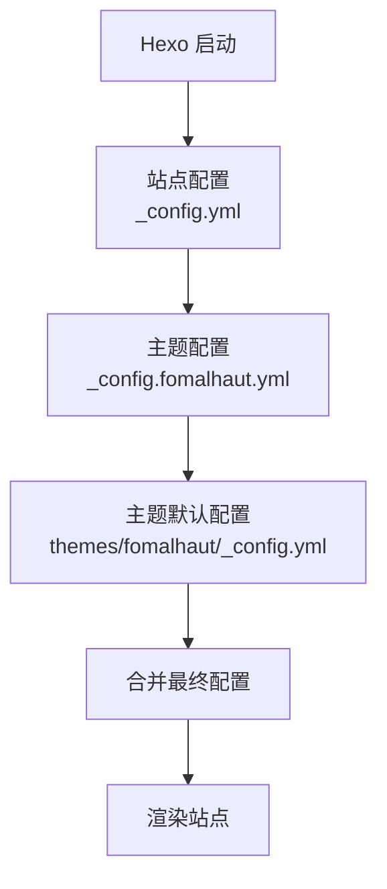

# 安装与环境配置

<cite>
**本文引用的文件**   
- [README.md](file://README.md)
- [package.json](file://package.json)
- [_config.yml](file://_config.yml)
- [_config.fomalhaut.yml](file://_config.fomalhaut.yml)
</cite>

## 目录
1. [简介](#简介)
2. [环境要求](#环境要求)
3. [安装步骤](#安装步骤)
4. [开发环境与本地预览](#开发环境与本地预览)
5. [构建与清理缓存](#构建与清理缓存)
6. [配置文件结构](#配置文件结构)
7. [常见问题与故障排除](#常见问题与故障排除)
8. [最佳实践建议](#最佳实践建议)
9. [结论](#结论)

## 简介
本仓库是一套「克隆即用」的 Hexo 卡片式博客源码，主题基于 Butterfly 深度二次开发，并把站点配置与主题代码彻底分开。你可以直接克隆仓库、安装依赖、启动本地预览，再逐步替换成自己的站点信息。

对于安装与环境配置来说，最关键的是：
- 使用受支持的 Node.js 版本；
- 通过 npm 安装依赖；
- 用 Hexo 命令启动本地预览；
- 区分站点级配置 `_config.yml` 和主题级配置 `_config.fomalhaut.yml`；
- 在需要时执行构建与清理操作。

## 环境要求
项目对运行环境有明确约束，核心依赖如下：

| 依赖 | 版本要求 | 说明 |
| --- | --- | --- |
| Node.js | **18 / 20 / 22 LTS**（推荐 22） | README 中明确列出三个 LTS 版本，GitHub Actions 工作流使用 `22.x` |
| npm | 9+ | 随 Node.js 一起安装即可 |
| Hexo | **6.3.0** | 根 `package.json` 的 `hexo.version` 指定了 Hexo 版本，可通过 `npx hexo` 调用 |
| Git | 任意较新版本 | 用于克隆仓库与部署 |

此外，项目不需要 Python，也不需要全局安装 `hexo-cli`，因为 Hexo 是通过 `package.json` 中的依赖和脚本调用的。

**章节来源**
- [README.md:344-353](file://README.md#L344-L353)
- [package.json:7-18](file://package.json#L7-L18)

## 安装步骤

### 前置准备
确保你已经安装并可以使用以下工具：
- Node.js（18、20 或 22 LTS）；
- npm；
- Git。

如果你不确定 Node.js 版本，可以在终端执行：
```bash
node -v
npm -v
git --version
```

如果 Node.js 版本低于 18，请先升级。推荐使用 Node.js 22 LTS，因为文档明确指出 GitHub Actions 工作流使用 `22.x`。

### 克隆仓库
在项目目录下执行：
```bash
git clone https://github.com/N1280851853/my_blog.git my-blog
cd my-blog
```

如果你想把远程仓库换成你自己的仓库，可以执行：
```bash
git remote set-url origin https://github.com/你的用户名/你的仓库名.git
```

注意：不要在这个目录里执行 `hexo init`，否则会重置 `_config.yml`，导致站点配置丢失。

### 安装依赖
进入项目目录后，执行：
```bash
npm install
```

也可以使用：
```bash
npm ci
```

`npm ci` 会读取 `package-lock.json`，安装更稳定且速度更快，适合 CI 或希望严格锁定依赖版本的场景。

**章节来源**
- [README.md:357-370](file://README.md#L357-L370)
- [package.json:20-63](file://package.json#L20-L63)

## 开发环境与本地预览

### 启动本地服务器
安装依赖后，执行：
```bash
npx hexo server
```

或者使用 npm 脚本：
```bash
npm run server
```

默认会在本地打开：
```
http://localhost:4000
```

### 自动刷新与模板限制
- 修改 `source/` 下的内容与 CSS 会自动重新渲染；
- 修改 `themes/` 下的 `.pug` 模板需要重启 server，因为 Hexo 只在启动时读模板。

### 常用开发流程
典型开发流程是：
1. 修改文章或页面内容；
2. 修改站点样式或脚本；
3. 在浏览器中查看效果；
4. 确认无误后执行构建；
5. 部署到托管平台。

**章节来源**
- [README.md:372-378](file://README.md#L372-L378)
- [package.json:10-16](file://package.json#L10-L16)

## 构建与清理缓存

### 清理缓存
Hexo 构建前建议先清理缓存，避免旧产物干扰：
```bash
npx hexo clean
```

或使用 npm 脚本：
```bash
npm run clean
```

### 生成静态页面
生成静态页面：
```bash
npx hexo generate
```

### 压缩与最终产物
项目构建链为：
```
hexo generate → gulp（HTML/CSS 压缩）→ public/
```

完整构建命令：
```bash
npx hexo clean && npx hexo generate && npx gulp
```

或使用 npm 脚本：
```bash
npm run build
```

构建产物位于 `public/` 目录，`gulp` 负责 HTML 与 CSS 压缩。

### 构建脚本说明
根 `package.json` 中的 `build` 脚本会执行：
```bash
hexo generate && node tools/qoder-static-links.js
```

这说明除了 Hexo 生成外，还会执行一个处理静态链接的工具脚本。

**章节来源**
- [README.md:432-438](file://README.md#L432-L438)
- [package.json:10-12](file://package.json#L10-L12)

## 配置文件结构

本项目采用三层配置优先级：**站点配置 → 主题配置（生效） → 主题默认配置**。

### 三层配置关系



**图表来源**
- [README.md:286-292](file://README.md#L286-L292)

### 站点级配置：`_config.yml`
`_config.yml` 是 Hexo 站点的主配置文件，主要负责：
- 站点基本信息：标题、副标题、描述、关键词、作者、语言、时区；
- URL 与永久链接规则；
- 目录结构：`source_dir`、`public_dir`、`tag_dir`、`archive_dir`、`category_dir`；
- 文章写入规则：新文章命名格式、默认布局、外部链接行为；
- 代码高亮与数学公式；
- 首页与归档页分页；
- 插件与主题选择；
- 部署配置；
- Algolia、搜索、轮播图、Git 贡献日历等扩展功能。

例如，当前仓库中：
- `theme: fomalhaut` 表示使用 Fomalhaut 主题；
- `url` 是当前站点的域名；
- `deploy` 配置了 Git 部署目标；
- `skip_render` 指定了一些不参与 Nunjucks 渲染的文件。

**章节来源**
- [_config.yml:5-13](file://_config.yml#L5-L13)
- [_config.yml:19-40](file://_config.yml#L19-L40)
- [_config.yml:128-138](file://_config.yml#L128-L138)
- [_config.yml:133-143](file://_config.yml#L133-L143)
- [_config.yml:36-40](file://_config.yml#L36-L40)

### 主题级配置：`_config.fomalhaut.yml`
`_config.fomalhaut.yml` 是本站真正使用的主题配置，也是大部分开关所在的地方。它覆盖 `themes/fomalhaut/_config.yml` 中的默认值。

常见配置项包括：
- 导航菜单 `menu`；
- 代码块主题与复制设置；
- 社交图标 `social`；
- 搜索配置（Algolia、本地搜索）；
- 头像 `avatar`；
- 首页顶部大图 `index_img`；
- 文章封面 `cover`；
- 评论系统 `comments`；
- 主题色 `theme_color`；
- 页脚 `footer`；
- 分析统计；
- 广告与站长验证；
- 美化与特效开关。

例如：
- `menu` 定义了首页、文章、八宝箱、社交、网站等一级和二级菜单；
- `comments.use` 设置为 `Twikoo`；
- `twikoo.envId` 指向评论服务地址；
- `theme_color.main` 控制主题主色；
- `footer.owner.since` 控制页脚建站年份。

**章节来源**
- [_config.fomalhaut.yml:5-23](file://_config.fomalhaut.yml#L5-L23)
- [_config.fomalhaut.yml:43-52](file://_config.fomalhaut.yml#L43-L52)
- [_config.fomalhaut.yml:106-118](file://_config.fomalhaut.yml#L106-L118)
- [_config.fomalhaut.yml:538-551](file://_config.fomalhaut.yml#L538-L551)
- [_config.fomalhaut.yml:629-636](file://_config.fomalhaut.yml#L629-L636)
- [_config.fomalhaut.yml:757-777](file://_config.fomalhaut.yml#L757-L777)
- [_config.fomalhaut.yml:695-702](file://_config.fomalhaut.yml#L695-L702)

### 主题默认配置：`themes/fomalhaut/_config.yml`
这是主题自带的默认配置模板，主要作为参考和兜底。实际生效的配置来自根目录的 `_config.fomalhaut.yml`。

因此，当你升级主题时，通常只需要替换 `themes/fomalhaut/`，而你的站点配置 `_config.yml` 和主题配置 `_config.fomalhaut.yml` 不会被覆盖。

**章节来源**
- [README.md:286-292](file://README.md#L286-L292)
- [README.md:628-642](file://README.md#L628-L642)

### 配置优先级总结

| 层级 | 文件 | 作用 | 是否建议频繁修改 |
| --- | --- | --- | --- |
| 站点 | `_config.yml` | 站点名、作者、URL、部署、插件、Hexo 基础行为 | 是，但改动要谨慎 |
| 主题（生效） | `_config.fomalhaut.yml` | 主题外观、功能开关、菜单、社交、评论、主题色 | 是，日常配置主要改这里 |
| 主题（默认） | `themes/fomalhaut/_config.yml` | 主题默认值模板 | 不建议直接改，优先覆盖到 `_config.fomalhaut.yml` |

**章节来源**
- [README.md:286-292](file://README.md#L286-L292)

## 常见问题与故障排除

### 问题一：Node.js 版本不满足要求
**现象**：安装依赖时报错，提示 Node.js 版本过低或不支持。  
**原因**：项目要求 Node.js 18、20 或 22 LTS，`package.json` 中声明 `engines.node >= 18`。  
**解决方法**：
1. 检查当前版本：`node -v`；
2. 升级到 18、20 或 22 LTS；
3. 推荐安装 Node.js 22 LTS。

**章节来源**
- [README.md:344-353](file://README.md#L344-L353)
- [package.json:7-9](file://package.json#L7-L9)

### 问题二：误执行 `hexo init` 导致配置丢失
**现象**：站点标题、作者、域名等配置被重置。  
**原因**：`hexo init` 会初始化一个新的 Hexo 站点，覆盖原有 `_config.yml`。  
**解决方法**：
1. 从 Git 恢复 `_config.yml`；
2. 以后不要在该项目目录执行 `hexo init`。

**章节来源**
- [README.md:367-370](file://README.md#L367-L370)

### 问题三：修改主题模板后本地预览不生效
**现象**：修改 `themes/fomalhaut/layout/*.pug` 后，浏览器没有更新。  
**原因**：Hexo 只在启动时读取 `.pug` 模板。  
**解决方法**：重启本地服务器：
```bash
npx hexo server
```

**章节来源**
- [README.md:372-378](file://README.md#L372-L378)

### 问题四：构建产物异常或样式错乱
**现象**：本地预览正常，但构建后的页面样式错乱或行为异常。  
**原因**：可能是旧缓存残留。  
**解决方法**：
```bash
npx hexo clean
npx hexo generate
npx gulp
```

**章节来源**
- [README.md:432-438](file://README.md#L432-L438)

### 问题五：主题升级后配置丢失
**现象**：升级主题后，主题外观或功能开关失效。  
**原因**：直接覆盖了主题源码，但没有保留 `_config.fomalhaut.yml`。  
**解决方法**：
1. 备份 `_config.fomalhaut.yml`；
2. 替换 `themes/fomalhaut/`；
3. 恢复 `_config.fomalhaut.yml`。

**章节来源**
- [README.md:249-250](file://README.md#L249-L250)
- [README.md:628-642](file://README.md#L628-L642)

### 问题六：找不到评论功能
**现象**：页面没有评论区。  
**原因**：可能未启用评论系统，或未正确配置 Twikoo。  
**解决方法**：
1. 检查 `_config.fomalhaut.yml` 中 `comments.use`；
2. 如果是 Twikoo，检查 `twikoo.envId`；
3. 确认已部署 Twikoo 服务端。

**章节来源**
- [_config.fomalhaut.yml:538-551](file://_config.fomalhaut.yml#L538-L551)
- [_config.fomalhaut.yml:629-636](file://_config.fomalhaut.yml#L629-L636)

### 问题七：主题色不生效
**现象**：自定义主题色没有应用到全站。  
**原因**：可能未开启主题色，或颜色值格式不正确。  
**解决方法**：
1. 检查 `_config.fomalhaut.yml` 中 `theme_color.enable`；
2. 检查 `theme_color.main` 是否为合法十六进制颜色；
3. 注意 YAML 中颜色值建议使用双引号包裹。

**章节来源**
- [_config.fomalhaut.yml:757-777](file://_config.fomalhaut.yml#L757-L777)

## 最佳实践建议

### 1. 始终使用受支持的 Node.js 版本
推荐使用 Node.js 22 LTS，因为它同时满足项目要求和 CI 工作流。

### 2. 优先使用 `npm ci` 进行依赖安装
如果你有 `package-lock.json`，`npm ci` 能提供更稳定的依赖安装体验，尤其适合自动化构建。

### 3. 不要把站点配置写进主题源码
所有站点级改动应放在：
- `_config.yml`：站点基础配置；
- `_config.fomalhaut.yml`：主题开关与外观配置；
- `source/css/`：站点级样式；
- `source/js/`：站点级脚本；
- `scripts/`：站点级 Hexo 插件。

这样可以保证升级主题时不会丢失你的改动。

### 4. 构建前先清理缓存
遇到构建异常时，优先执行：
```bash
npx hexo clean
```

### 5. 部署前执行完整构建
部署前应执行：
```bash
npx hexo clean && npx hexo generate && npx gulp
```

或使用 npm 脚本：
```bash
npm run build
```

### 6. 区分“本地预览”和“构建产物”
- 本地预览用 `npx hexo server`；
- 构建产物用 `npx hexo generate` + `npx gulp`；
- 不要只依赖本地预览判断部署质量。

**章节来源**
- [README.md:249-250](file://README.md#L249-L250)
- [README.md:357-438](file://README.md#L357-L438)
- [package.json:10-16](file://package.json#L10-L16)

## 结论
Fomalhaut 主题的安装与环境配置并不复杂，核心流程可以概括为：
1. 安装 Node.js 18/20/22 LTS；
2. 克隆仓库；
3. 执行 `npm install`；
4. 使用 `npx hexo server` 本地预览；
5. 根据需要修改 `_config.yml` 和 `_config.fomalhaut.yml`；
6. 使用 `npx hexo clean && npx hexo generate && npx gulp` 构建；
7. 部署到托管平台。

最重要的是理解三层配置优先级：站点配置 `_config.yml` 决定 Hexo 行为，主题配置 `_config.fomalhaut.yml` 决定主题外观和功能，主题默认配置 `themes/fomalhaut/_config.yml` 仅作为默认值。只要遵循这个原则，后续升级和维护都会更加轻松。