基于分析，我发现新增的 Qoder 静态链接处理工具已经集成到构建流程中。现在我将更新文档以反映这些变更：

# 开发工具与脚本

<cite>
**本文引用的文件**   
- [package.json](file://package.json)
- [gulpfile.js](file://gulpfile.js)
- [scripts/archive-index.js](file://scripts/archive-index.js)
- [scripts/gallery-pager.js](file://scripts/gallery-pager.js)
- [scripts/vercel-api-copy.js](file://scripts/vercel-api-copy.js)
- [scripts/ai-chat-inject.js](file://scripts/ai-chat-inject.js)
- [scripts/magnet-local-links.js](file://scripts/magnet-local-links.js)
- [scripts/post-copyright-local-link.js](file://scripts/post-copyright-local-link.js)
- [scripts/sticky-post.js](file://scripts/sticky-post.js)
- [tools/deploy-vercel.js](file://tools/deploy-vercel.js)
- [tools/qoder-static-links.js](file://tools/qoder-static-links.js)
- [tools/tests/navigation.test.cjs](file://tools/tests/navigation.test.cjs)
- [_config.fomalhaut.yml](file://_config.fomalhaut.yml)
</cite>

## 更新摘要
**所做更改**   
- 新增 Qoder 静态链接处理工具的详细说明
- 更新构建流程以包含平台适配步骤
- 增强部署与平台适配章节
- 更新依赖关系分析和架构图

## 目录
1. [简介](#简介)
2. [项目结构](#项目结构)
3. [核心组件](#核心组件)
4. [架构总览](#架构总览)
5. [详细组件分析](#详细组件分析)
6. [依赖关系分析](#依赖关系分析)
7. [性能与构建优化](#性能与构建优化)
8. [测试框架与执行方法](#测试框架与执行方法)
9. [开发环境搭建指南](#开发环境搭建指南)
10. [故障排查](#故障排查)
11. [最佳实践与代码规范](#最佳实践与代码规范)
12. [结论](#结论)

## 简介
本仓库是一个基于 Hexo 的卡片式博客主题与站点模板。围绕"开发工具与脚本"的目标，本文聚焦以下方面：
- 构建脚本与自动化任务：归档页索引生成、相册分页、API 文件复制、静态链接修复等。
- **新增**：Qoder 平台静态链接处理与产物清理。
- 测试框架与执行方式：回归测试、单元测试、性能相关断言的执行路径。
- Gulp 构建任务：JS/CSS/HTML 压缩、资源优化与缓存策略。
- 开发辅助工具：部署脚本、注入器、本地链接修正等。
- 开发环境与最佳实践：IDE 配置、插件建议、调试技巧与规范建议。

## 项目结构
仓库中与"开发工具与脚本"直接相关的目录和文件如下：
- scripts：Hexo 站点级脚本（过滤器、生成器、注入器等）。
- tools：部署脚本、平台适配脚本、测试用例。
- gulpfile.js：Gulp 构建任务定义。
- package.json：npm 脚本入口、依赖声明。
- _config.fomalhaut.yml：主题配置，影响注入、CDN、功能开关等。

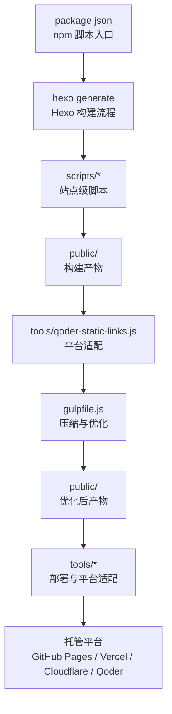

**图示来源**
- [package.json:10-15](file://package.json#L10-L15)
- [tools/qoder-static-links.js:1-45](file://tools/qoder-static-links.js#L1-L45)
- [gulpfile.js:12-64](file://gulpfile.js#L12-L64)

**章节来源**
- [package.json:1-75](file://package.json#L1-L75)
- [gulpfile.js:1-64](file://gulpfile.js#L1-L64)

## 核心组件
- npm 脚本与构建入口：通过 package.json 暴露 build、clean、deploy、server 等命令；build 会先执行 hexo generate，再运行 qoder-static-links.js 做平台适配。
- Gulp 构建任务：提供 compress（JS 压缩）、minify-css（CSS 压缩）、minify-html（HTML 清理与压缩）三个任务，默认并行执行。
- Hexo 站点脚本：archive-index（归档索引注入）、gallery-pager（相册自动分页）、vercel-api-copy（API 文件复制到 public）、ai-chat-inject（AI 助手注入）、magnet-local-links（磁贴链接本地化）、post-copyright-local-link（版权卡片链接本地化）、sticky-post（正文标记置顶）。
- **新增**：Qoder 静态链接处理工具（tools/qoder-static-links.js）：处理目录链接解析和平台特定清理。
- 部署与平台适配：deploy-vercel（代理模式一键部署）、qoder-static-links（Qoder 平台静态链接修复与函数产物清理）。
- 测试：navigation.test.cjs 使用 node:test 对导航 CSS、配置注入、主题模板哈希等进行回归断言。

**章节来源**
- [package.json:10-15](file://package.json#L10-L15)
- [gulpfile.js:12-64](file://gulpfile.js#L12-L64)
- [scripts/archive-index.js:1-138](file://scripts/archive-index.js#L1-L138)
- [scripts/gallery-pager.js:1-170](file://scripts/gallery-pager.js#L1-L170)
- [scripts/vercel-api-copy.js:1-47](file://scripts/vercel-api-copy.js#L1-L47)
- [scripts/ai-chat-inject.js:1-106](file://scripts/ai-chat-inject.js#L1-L106)
- [scripts/magnet-local-links.js:1-124](file://scripts/magnet-local-links.js#L1-L124)
- [scripts/post-copyright-local-link.js:1-123](file://scripts/post-copyright-local-link.js#L1-L123)
- [scripts/sticky-post.js:1-70](file://scripts/sticky-post.js#L1-L70)
- [tools/deploy-vercel.js:1-82](file://tools/deploy-vercel.js#L1-L82)
- [tools/qoder-static-links.js:1-45](file://tools/qoder-static-links.js#L1-L45)
- [tools/tests/navigation.test.cjs:1-395](file://tools/tests/navigation.test.cjs#L1-L395)

## 架构总览
整体构建与发布链路如下：

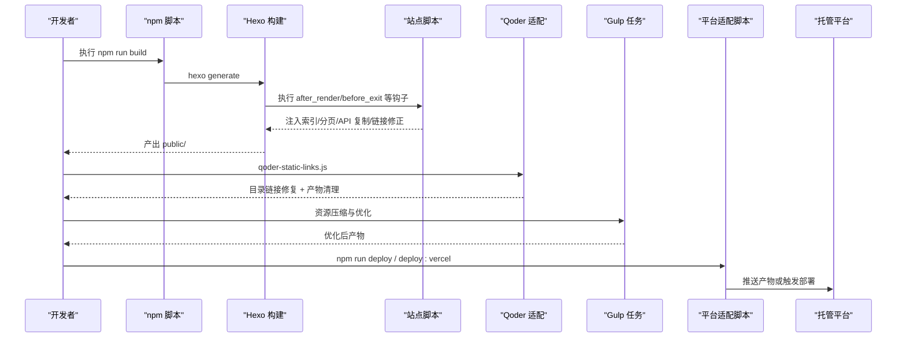

**图示来源**
- [package.json:10-15](file://package.json#L10-L15)
- [tools/qoder-static-links.js:21-43](file://tools/qoder-static-links.js#L21-L43)
- [scripts/vercel-api-copy.js:28-46](file://scripts/vercel-api-copy.js#L28-L46)
- [tools/deploy-vercel.js:68-81](file://tools/deploy-vercel.js#L68-L81)

## 详细组件分析

### 归档页索引生成（scripts/archive-index.js）
- 目标：为归档页（含分页）注入全站文章索引数据，供前端统计与卡片展示分类、阅读时长等信息。
- 机制：注册 after_render:html 过滤器，在归档页正文根节点之后插入 <script type="application/json" id="ar-index">，内容包含每篇文章的标题、路径、日期、分类、字数、阅读分钟数。
- 兼容性：若未找到正文根节点则回退到 head 中；异常时降级并记录日志。
- 复杂度：遍历全站 posts 并计算字数/阅读时间，时间复杂度 O(N)，空间复杂度取决于文章总量。

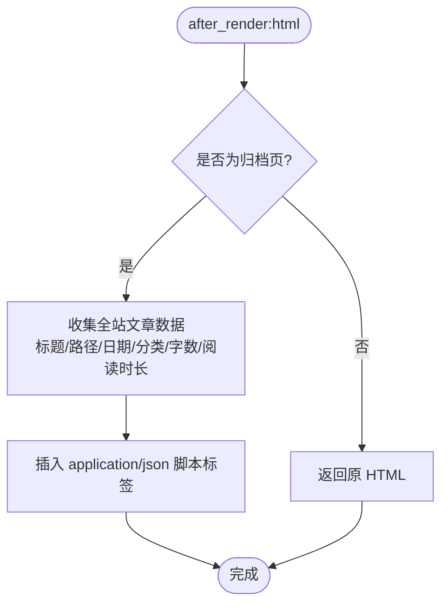

**图示来源**
- [scripts/archive-index.js:104-137](file://scripts/archive-index.js#L104-L137)

**章节来源**
- [scripts/archive-index.js:1-138](file://scripts/archive-index.js#L1-L138)

### 相册自动分页（scripts/gallery-pager.js）
- 目标：根据 front-matter 中的 gallery_per_page 将相册图片自动分页，复用主题的 paginator helper。
- 机制：解析页面 raw 内容，识别图片行与 <!-- pagebreak --> 分段，按 perPage 切分，调用 hexo-pagination 生成路由，渲染正文并追加分页导航。
- 兼容：保留主题 post_lazyload 等 after_post_render 过滤器；第一页路径不变，后续 p2.html/p3.html... 避免旧链接 404。

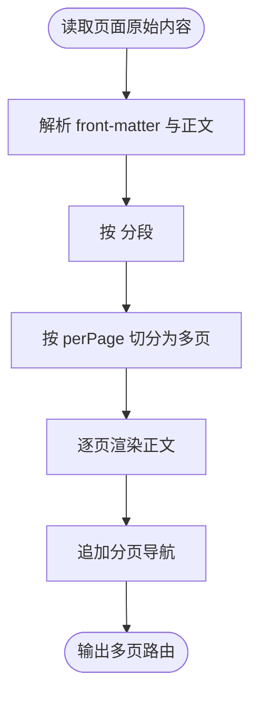

**图示来源**
- [scripts/gallery-pager.js:56-143](file://scripts/gallery-pager.js#L56-L143)

**章节来源**
- [scripts/gallery-pager.js:1-170](file://scripts/gallery-pager.js#L1-L170)

### API 文件复制（scripts/vercel-api-copy.js）
- 目标：让构建产物同时携带 Vercel 与 Cloudflare 所需的函数文件。
- 机制：在 after_generate 钩子中将 api/chat/completions.js、vercel.json、functions/api/chat/completions.js 复制到 public 对应路径。
- 容错：找不到源文件时记录警告；复制失败时记录错误信息。

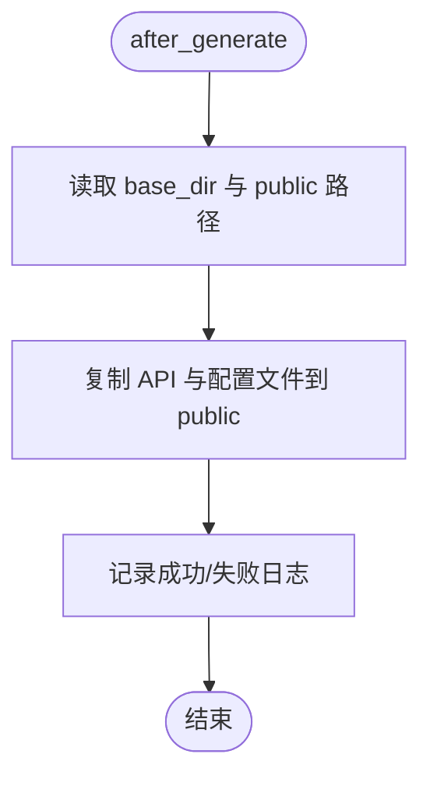

**图示来源**
- [scripts/vercel-api-copy.js:28-46](file://scripts/vercel-api-copy.js#L28-L46)

**章节来源**
- [scripts/vercel-api-copy.js:1-47](file://scripts/vercel-api-copy.js#L1-L47)

### AI 助手注入（scripts/ai-chat-inject.js）
- 目标：在每个 HTML 页面的 </body> 前注入 AI 助手配置与脚本，支持代理模式与本地 Key 两种模式。
- 机制：after_render:html 过滤器检测页面是否包含右侧部件挂载点，合并主题与站点配置，优先从环境变量或文件读取 API Key，必要时切换为同源代理。
- 缓存：为 ai-chat.js 附加版本号参数，避免浏览器缓存导致更新不生效。

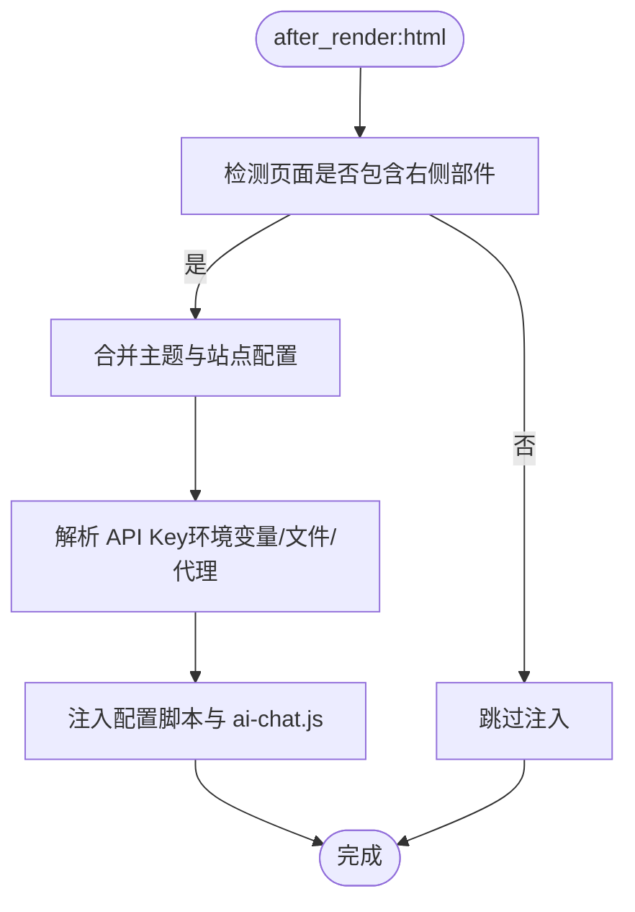

**图示来源**
- [scripts/ai-chat-inject.js:71-105](file://scripts/ai-chat-inject.js#L71-L105)

**章节来源**
- [scripts/ai-chat-inject.js:1-106](file://scripts/ai-chat-inject.js#L1-L106)

### 磁贴链接本地化（scripts/magnet-local-links.js）
- 问题：第三方插件生成的磁贴链接带站点绝对地址，镜像站或本地预览点击会跳回主域名。
- 解决：after_render:html 阶段仅改写 class 为 magnet_link/magnet_link_more 的 a 标签，将绝对地址替换为站内相对路径；before_exit/before_deploy 兜底扫描 public/ 修正产物。

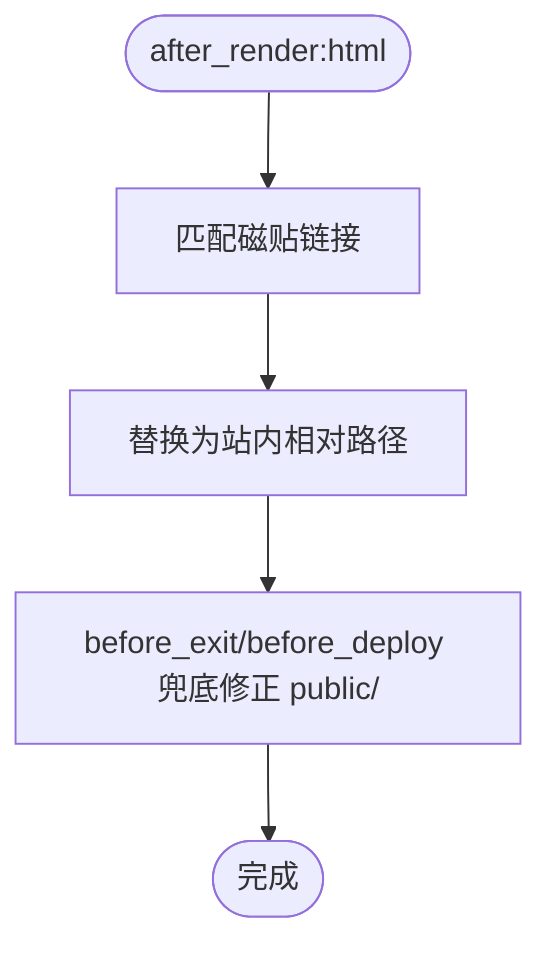

**图示来源**
- [scripts/magnet-local-links.js:61-70](file://scripts/magnet-local-links.js#L61-L70)
- [scripts/magnet-local-links.js:90-123](file://scripts/magnet-local-links.js#L90-L123)

**章节来源**
- [scripts/magnet-local-links.js:1-124](file://scripts/magnet-local-links.js#L1-L124)

### 版权卡片链接本地化（scripts/post-copyright-local-link.js）
- 问题：文章版权卡片中的"文章链接"为绝对地址，镜像站或本地预览点击会跳转至主域名。
- 解决：after_render:html 阶段定位 .post-copyright__type 块内的 a 标签，将 href 与显示文本替换为站内相对路径；before_exit/before_deploy 兜底修正 public/。

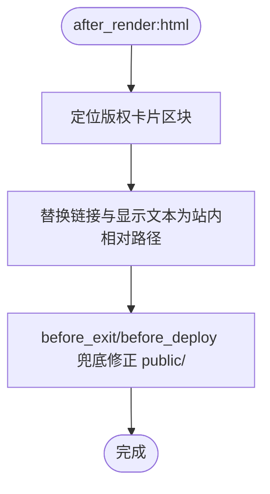

**图示来源**
- [scripts/post-copyright-local-link.js:66-73](file://scripts/post-copyright-local-link.js#L66-L73)
- [scripts/post-copyright-local-link.js:93-122](file://scripts/post-copyright-local-link.js#L93-L122)

**章节来源**
- [scripts/post-copyright-local-link.js:1-123](file://scripts/post-copyright-local-link.js#L1-L123)

### 正文标记置顶（scripts/sticky-post.js）
- 目标：允许在正文中写注释标记来置顶文章，等价于 Front-Matter 的 sticky 字段。
- 机制：after_post_render 过滤器解析 raw/content 中的标记，设置 data.sticky；同时清理标记以避免出现在摘要/RSS/搜索结果中。

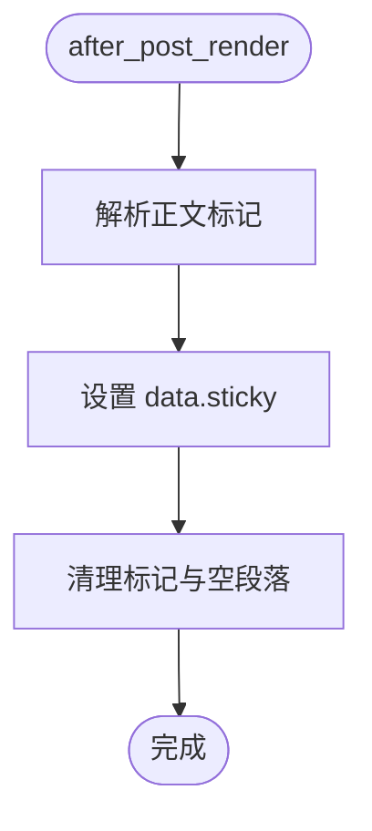

**图示来源**
- [scripts/sticky-post.js:46-69](file://scripts/sticky-post.js#L46-L69)

**章节来源**
- [scripts/sticky-post.js:1-70](file://scripts/sticky-post.js#L1-L70)

### **新增**：Qoder 静态链接处理工具（tools/qoder-static-links.js）
- **目标**：为 Qoder Sites 平台进行部署后处理，解决静态托管平台的特殊需求。
- **核心功能**：
  - 目录链接解析：将内部目录链接（如 `/archives/`）改写为显式的 `index.html`，因为 Qoder 平台不支持目录索引。
  - 平台特定清理：移除 Vercel/Cloudflare 专用产物（`/api`、`/functions`、`vercel.json`），这些在 Qoder 平台上无法运行且占用空间。
- **工作机制**：
  - 递归遍历 `public/` 目录下所有 HTML 文件。
  - 使用正则表达式匹配目录链接，验证目标文件存在性后追加 `index.html`。
  - 安全校验：确保路径不会跳出 `public/` 目录范围。
  - 批量清理：删除不必要的 serverless 函数文件和配置文件。
- **性能优化**：仅在检测到内容变化时才写入文件，减少 I/O 操作。

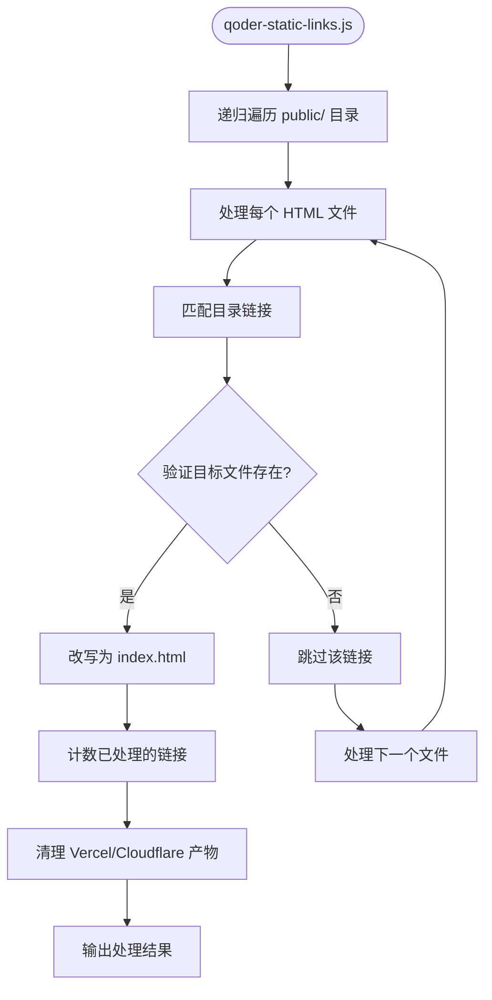

**图示来源**
- [tools/qoder-static-links.js:21-43](file://tools/qoder-static-links.js#L21-L43)

**章节来源**
- [tools/qoder-static-links.js:1-45](file://tools/qoder-static-links.js#L1-L45)

### 部署与平台适配
- 代理模式部署（tools/deploy-vercel.js）：从环境变量或 .ai-chat-key/_config.fomalhaut.yml 读取 API Key，注入构建环境，依次执行 hexo clean/generate/deploy；支持 --dry-run 预览模式。
- **新增**：Qoder 平台适配（tools/qoder-static-links.js）：将内部目录链接改写为显式 index.html，并移除 /api、/functions、vercel.json 等 serverless 产物。

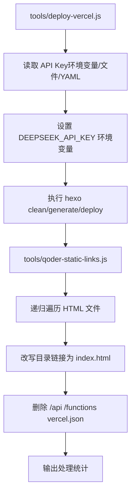

**图示来源**
- [tools/deploy-vercel.js:35-81](file://tools/deploy-vercel.js#L35-L81)
- [tools/qoder-static-links.js:21-43](file://tools/qoder-static-links.js#L21-L43)

**章节来源**
- [tools/deploy-vercel.js:1-82](file://tools/deploy-vercel.js#L1-L82)
- [tools/qoder-static-links.js:1-45](file://tools/qoder-static-links.js#L1-L45)

## 依赖关系分析
- npm 脚本依赖 Hexo 生态：hexo、hexo-renderer-*、hexo-generator-*、hexo-deployer-git 等。
- Gulp 任务依赖 gulp、gulp-terser、gulp-clean-css、gulp-html-minifier-terser、gulp-htmlclean。
- 站点脚本依赖 hexo-util、hexo-pagination、fs/path 等标准库与 Hexo 扩展接口。
- **新增**：Qoder 静态链接处理工具依赖 Node.js 内置的 fs 和 path 模块。
- 测试依赖 node:test、node:assert/strict、css、js-yaml。

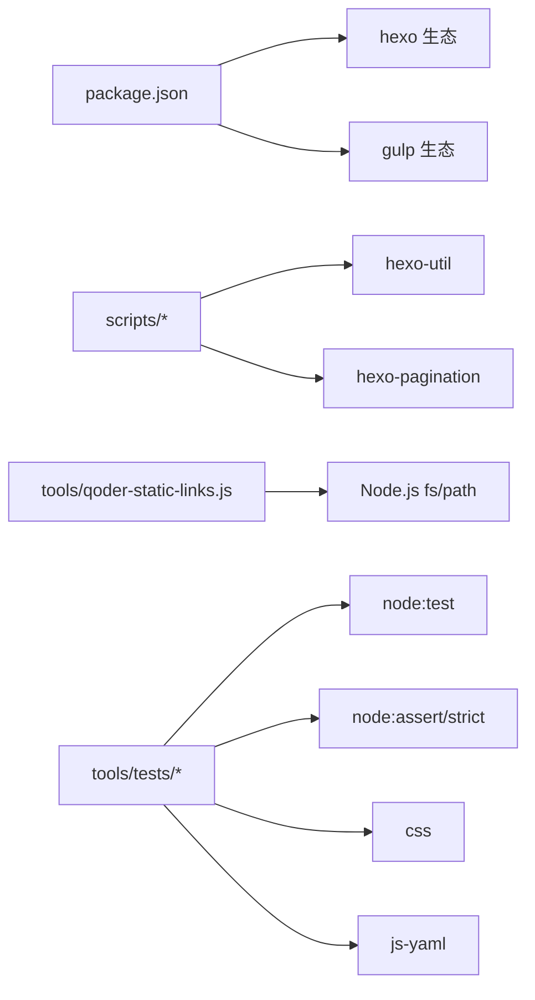

**图示来源**
- [package.json:20-73](file://package.json#L20-L73)
- [tools/qoder-static-links.js:8-9](file://tools/qoder-static-links.js#L8-L9)
- [tools/tests/navigation.test.cjs:6-12](file://tools/tests/navigation.test.cjs#L6-L12)

**章节来源**
- [package.json:1-75](file://package.json#L1-L75)
- [tools/qoder-static-links.js:1-45](file://tools/qoder-static-links.js#L1-L45)
- [tools/tests/navigation.test.cjs:1-395](file://tools/tests/navigation.test.cjs#L1-L395)

## 性能与构建优化
- JS 压缩：compress 任务对所有非 .min.js 的 JS 进行 terser 压缩，确保流式写入避免提前退出。
- CSS 压缩：minify-css 排除 site-inject.css 与 twikoo.css，避免 clean-css 对 @container 的支持问题；其余 CSS 走 IE11 兼容模式压缩。
- HTML 压缩：minify-html 清理注释、空白、布尔属性、脚本/样式 type 属性，并内联压缩页面 JS/CSS/URL。
- **新增**：Qoder 平台优化：静态链接处理仅在文件内容变化时写入，减少不必要的 I/O 操作。
- 缓存策略：ai-chat.js 通过 mtime+size 生成查询参数版本，避免浏览器缓存；主题注入的样式与脚本也带有版本号（见配置）。

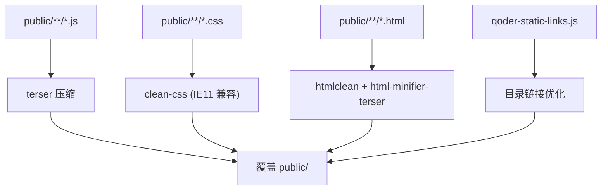

**图示来源**
- [gulpfile.js:12-59](file://gulpfile.js#L12-L59)
- [tools/qoder-static-links.js:21-38](file://tools/qoder-static-links.js#L21-L38)
- [scripts/ai-chat-inject.js:26-33](file://scripts/ai-chat-inject.js#L26-L33)

**章节来源**
- [gulpfile.js:1-64](file://gulpfile.js#L1-L64)
- [tools/qoder-static-links.js:1-45](file://tools/qoder-static-links.js#L1-L45)
- [scripts/ai-chat-inject.js:1-106](file://scripts/ai-chat-inject.js#L1-L106)

## 测试框架与执行方法
- 测试框架：Node.js 内置 node:test 与 node:assert/strict，无需额外安装测试运行时。
- 回归测试示例：navigation.test.cjs 对导航 CSS 规则、配置注入、主题模板哈希等进行断言，确保视觉与行为稳定。
- 执行方式：
  - 单测：node --test tools/tests/navigation.test.cjs
  - 全量：可在 CI 或本地批量执行 tools/tests/*.cjs（当前仓库未提供统一 test 脚本，可参考现有单测写法自行扩展）。

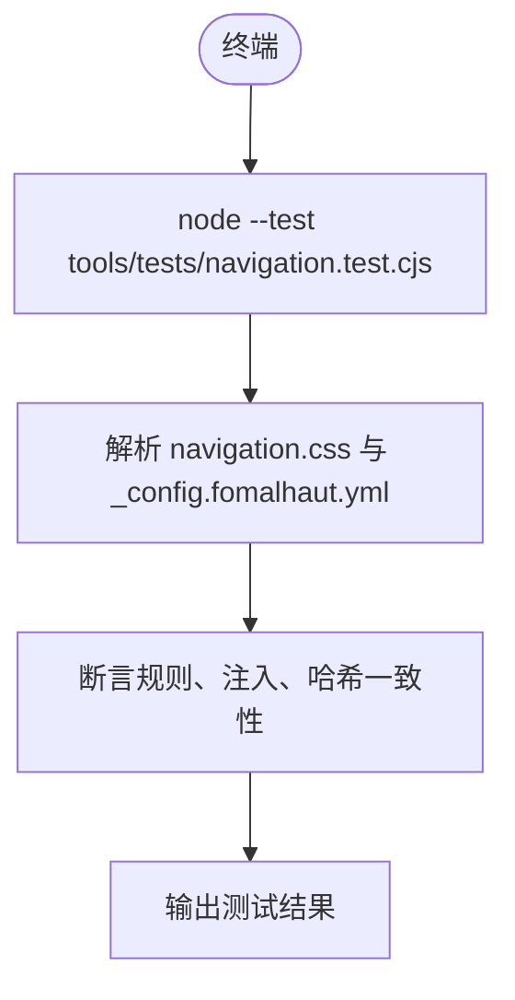

**图示来源**
- [tools/tests/navigation.test.cjs:1-15](file://tools/tests/navigation.test.cjs#L1-L15)
- [tools/tests/navigation.test.cjs:87-395](file://tools/tests/navigation.test.cjs#L87-L395)

**章节来源**
- [tools/tests/navigation.test.cjs:1-395](file://tools/tests/navigation.test.cjs#L1-L395)

## 开发环境搭建指南
- Node 版本：要求 >=18（由 engines 字段约束）。
- 依赖安装：npm install（安装 hexo、gulp 及相关插件）。
- 常用命令：
  - npm run build：生成站点并执行 Qoder 平台适配。
  - npm run server：启动本地预览服务。
  - npm run clean：清理构建产物。
  - npm run deploy：使用 Git 部署。
  - npm run deploy:vercel：代理模式一键部署（需准备 API Key）。
- IDE 与插件建议：
  - VS Code：启用 ESLint/Prettier（如引入）、YAML 语法高亮、Markdown 预览。
  - Hexo 插件：Hexo Helper、Hexo Preview。
  - Gulp：Gulp Snippets、Task Runner。
- 调试技巧：
  - 在脚本中使用 hexo.log.info/warn/error 查看构建期日志。
  - 使用 --dry-run 预览 deploy-vercel 的行为。
  - 在浏览器控制台检查注入的配置与脚本版本参数。
  - **新增**：检查 qoder-static-links.js 的输出日志，确认目录链接是否正确改写。

**章节来源**
- [package.json:7-15](file://package.json#L7-L15)
- [tools/deploy-vercel.js:11-20](file://tools/deploy-vercel.js#L11-L20)
- [tools/qoder-static-links.js:45](file://tools/qoder-static-links.js#L45)

## 故障排查
- 归档页统计缺失：检查 archive-index.js 是否正确注入 ar-index 脚本；确认页面存在 #archive 根节点。
- 相册分页异常：检查 front-matter 中是否设置 gallery_per_page；确认图片行符合 Markdown 图片语法。
- API 访问 404：确认 vercel-api-copy.js 已将 api/chat/completions.js 与 vercel.json 复制到 public；检查环境变量 DEEPSEEK_API_KEY。
- 链接跳转主域名：检查 magnet-local-links.js 与 post-copyright-local-link.js 是否在 after_render 与 before_exit 阶段执行。
- **新增**：Qoder 平台链接问题：检查 qoder-static-links.js 是否正确处理目录链接；确认 public/ 目录下存在对应的 index.html 文件。
- 样式异常：检查 gulp minify-css 是否误伤 @container；确认被排除的文件未被意外压缩。
- 部署失败：使用 deploy-vercel.js --dry-run 检查 Key 来源；确认 .ai-chat-key 存在且格式正确。

**章节来源**
- [scripts/archive-index.js:104-137](file://scripts/archive-index.js#L104-L137)
- [scripts/gallery-pager.js:56-143](file://scripts/gallery-pager.js#L56-L143)
- [scripts/vercel-api-copy.js:28-46](file://scripts/vercel-api-copy.js#L28-L46)
- [scripts/magnet-local-links.js:61-123](file://scripts/magnet-local-links.js#L61-L123)
- [scripts/post-copyright-local-link.js:66-122](file://scripts/post-copyright-local-link.js#L66-L122)
- [tools/qoder-static-links.js:21-43](file://tools/qoder-static-links.js#L21-L43)
- [gulpfile.js:20-38](file://gulpfile.js#L20-L38)
- [tools/deploy-vercel.js:35-81](file://tools/deploy-vercel.js#L35-L81)

## 最佳实践与代码规范
- 脚本职责单一：每个脚本只负责一个构建期任务，便于维护与回滚。
- 安全优先：API Key 不内联进页面，优先使用环境变量或代理模式；敏感文件加入 .gitignore。
- 向后兼容：新增样式与逻辑尽量通过注入与补丁实现，避免改动主题源码。
- 可观测性：关键步骤记录日志，便于定位问题。
- 测试先行：对关键 UI 与配置变更编写回归测试，保持视觉与行为稳定。
- 构建优化：谨慎使用 CSS 压缩，避免破坏特性；JS 压缩确保流式写入；HTML 清理保留必要属性。
- **新增**：平台适配：针对不同托管平台的特点，提供专门的适配脚本，确保跨平台兼容性。
- **新增**：路径安全：在处理文件系统操作时，始终进行路径验证，防止路径遍历攻击。

[本节为通用指导，不直接分析具体文件]

## 结论
本仓库通过 Hexo 站点脚本、Gulp 构建任务与部署脚本形成完整的开发与发布流水线。归档索引、相册分页、API 复制、链接本地化等功能以最小侵入的方式增强主题体验；**新增的 Qoder 静态链接处理工具**解决了静态托管平台的特殊需求；Gulp 提供稳定的资源优化能力；测试保障关键 UI 与配置的稳定性。遵循本文的最佳实践与规范，可进一步提升开发效率与交付质量。