# 开发辅助工具

<cite>
**本文引用的文件**   
- [README.md](file://README.md)
- [package.json](file://package.json)
- [_config.yml](file://_config.yml)
- [_config.fomalhaut.yml](file://_config.fomalhaut.yml)
- [vercel.json](file://vercel.json)
- [gulpfile.js](file://gulpfile.js)
- [tools/deploy-vercel.js](file://tools/deploy-vercel.js)
- [tools/qoder-static-links.js](file://tools/qoder-static-links.js)
- [scripts/sticky-post.js](file://scripts/sticky-post.js)
- [scripts/magnet-local-links.js](file://scripts/magnet-local-links.js)
</cite>

## 目录
1. [引言](#引言)
2. [项目结构与工具总览](#项目结构与工具总览)
3. [Vercel 部署与自动发布](#vercel-部署与自动发布)
4. [静态链接处理与 SEO 友好性](#静态链接处理与-seo-友好性)
5. [文章置顶机制](#文章置顶机制)
6. [磁力链接本地化工具](#磁力链接本地化工具)
7. [构建链与产物优化](#构建链与产物优化)
8. [开发环境配置指南](#开发环境配置指南)
9. [依赖关系分析](#依赖关系分析)
10. [性能与稳定性注意事项](#性能与稳定性注意事项)
11. [常见问题排查](#常见问题排查)
12. [开发最佳实践与代码规范建议](#开发最佳实践与代码规范建议)
13. [结论](#结论)

## 引言
本文面向本仓库的开发者与维护者，系统梳理开发过程中使用的辅助工具，重点覆盖以下方面：
- Vercel 部署工具的配置、环境变量注入与自动部署流程。
- 静态链接处理工具对路径改写、平台兼容与 SEO 的影响。
- 文章置顶工具的解析逻辑、排序方式与渲染位置。
- 磁力链接本地化工具如何修复第三方插件生成的绝对链接。
- 开发环境、IDE、调试与构建命令的使用建议。
- 基于仓库实际实现的工程化最佳实践与代码规范建议。

## 项目结构与工具总览
本项目是一个基于 Hexo 的站点模板，核心思路是“站点配置”和“主题代码”分离：站点级脚本放在根目录 `scripts/`，主题本体在 `themes/fomalhaut/`，构建产物输出到 `public/`，再由 Gulp 压缩后交给托管平台或脚本进一步处理。

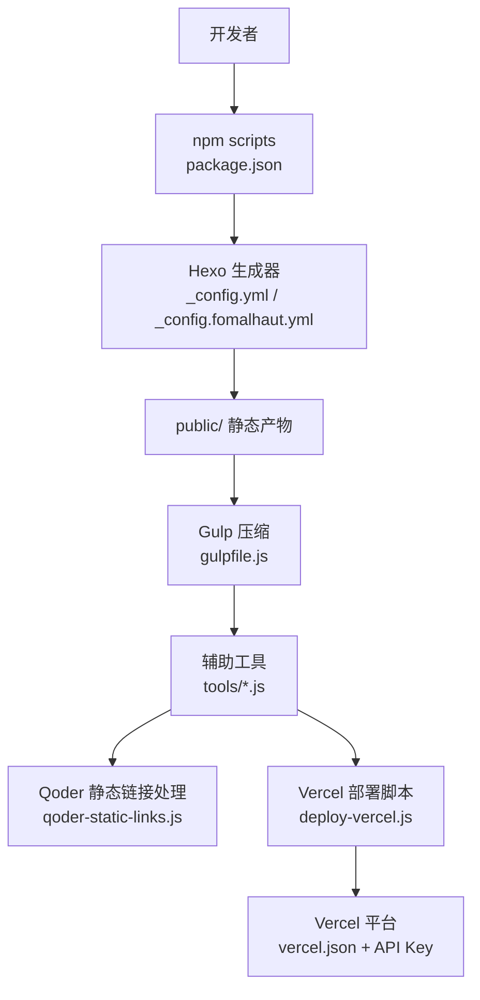

**图表来源**
- [package.json:10-15](file://package.json#L10-L15)
- [_config.yml:131-138](file://_config.yml#L131-L138)
- [gulpfile.js:12-64](file://gulpfile.js#L12-L64)
- [tools/qoder-static-links.js:1-45](file://tools/qoder-static-links.js#L1-L45)
- [tools/deploy-vercel.js:1-21](file://tools/deploy-vercel.js#L1-L21)
- [vercel.json:1-12](file://vercel.json#L1-L12)

**章节来源**
- [README.md:259-284](file://README.md#L259-L284)
- [README.md:472-504](file://README.md#L472-L504)
- [package.json:1-19](file://package.json#L1-L19)

## Vercel 部署与自动发布
### 部署入口与命令
项目通过 `package.json` 暴露了多个 npm 脚本，其中与 Vercel 相关的主要是：
- `build`：执行 `hexo generate` 后再运行静态链接处理脚本。
- `deploy:vercel`：调用 `tools/deploy-vercel.js`，用于“代理模式”一键构建并部署。
- `server`：本地预览。
- `clean`：清理构建缓存。
- `deploy`：走 Hexo 默认的 Git 部署。

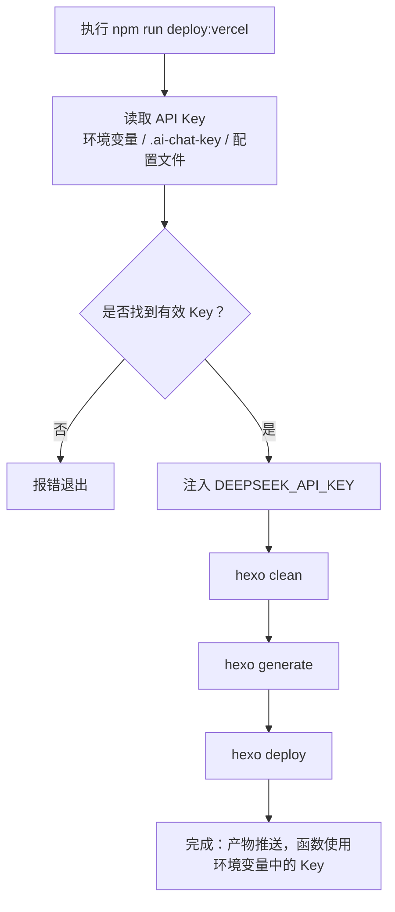

**图表来源**
- [package.json:10-15](file://package.json#L10-L15)
- [tools/deploy-vercel.js:32-81](file://tools/deploy-vercel.js#L32-L81)

### 环境变量管理
`tools/deploy-vercel.js` 的核心职责是保证 AI 助手在构建时能进入“代理模式”，而不是把真实 Key 写进 HTML。它按以下优先级获取 Key：
1. 进程环境变量 `DEEPSEEK_API_KEY`。
2. 站点根目录的 `.ai-chat-key` 文件（该文件应被忽略进版本库）。
3. `_config.fomalhaut.yml` 中 `ai_chat:` 段下的 `api_key`。

如果三者都找不到，脚本会直接报错退出，避免误部署一个没有 Key 的产物。

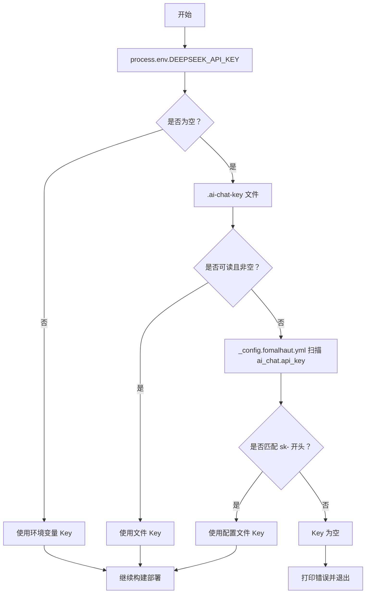

**图表来源**
- [tools/deploy-vercel.js:35-64](file://tools/deploy-vercel.js#L35-L64)

### Vercel 函数配置
`vercel.json` 声明了 Vercel 函数的运行时参数，当前主要配置 AI 补全接口：
- 函数路径：`api/chat/completions.js`
- 最大时长：60 秒
- 内存：512 MB
- 区域：`hkg1`

这意味着 Vercel 部署时，静态资源由静态托管提供，而 AI 请求通过函数转发，API Key 只存在于函数环境变量中，不会内联到前端页面。

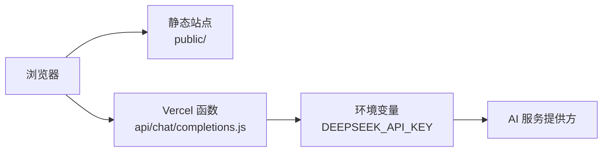

**图表来源**
- [vercel.json:1-12](file://vercel.json#L1-L12)
- [tools/deploy-vercel.js:1-21](file://tools/deploy-vercel.js#L1-L21)

### 域名绑定与多平台部署
根据 README 的部署说明，项目支持多种方案：
- GitHub Pages：需要自行添加 CI 工作流。
- Vercel：通过 `npx vercel` 关联项目，并在 Vercel 控制台的环境变量中添加 `DEEPSEEK_API_KEY`。
- Cloudflare Pages：构建命令为 `hexo clean && hexo generate && gulp`，输出目录为 `public`。
- 本地生成后手动推送：适合任意静态托管平台。

域名绑定本身由托管平台负责；仓库侧通过 `_config.yml` 的 `url` 字段决定站点 URL，并通过 `permalink` 控制文章链接格式。

**章节来源**
- [README.md:1229-1263](file://README.md#L1229-L1263)
- [_config.yml:19-26](file://_config.yml#L19-L26)
- [_config.yml:133-138](file://_config.yml#L133-L138)

## 静态链接处理与 SEO 友好性
### Qoder 静态链接处理脚本
`tools/qoder-static-links.js` 在 `hexo generate` 之后运行，解决两个问题：
1. 某些静态托管平台不支持目录索引，例如 `/archives/` 不会自动解析到 `index.html`。脚本会把指向真实存在目录的内部链接改写为显式 `index.html`。
2. 移除 Vercel/Cloudflare 专用产物：`/api`、`/functions` 以及 `vercel.json`，因为这些 serverless 函数在 Qoder 平台上无法运行，且属于保留路由。

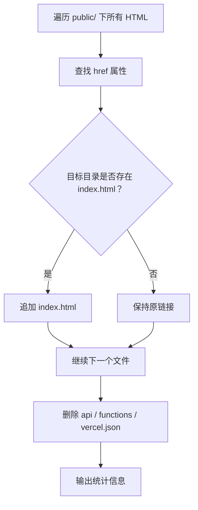

**图表来源**
- [tools/qoder-static-links.js:1-45](file://tools/qoder-static-links.js#L1-L45)

### 搜索结果的站内链接修正
搜索结果来自 Algolia 索引，索引中的 URL 是构建时按 `_config.yml` 的 `url` 写死的正式域名。如果在本地预览或镜像域名下打开，点击搜索结果可能跳出本站。`source/js/inject/search-lazy.js` 在运行时把与当前站点不同源的链接改写成根路径形式，从而保证：
- 任何域名下点开都留在当前站点。
- 中键点击或复制链接地址时拿到的是本站地址。

这虽然不是 `tools/` 下的脚本，但属于同一类“链接本地化”能力，对用户体验和 SEO 都有帮助。

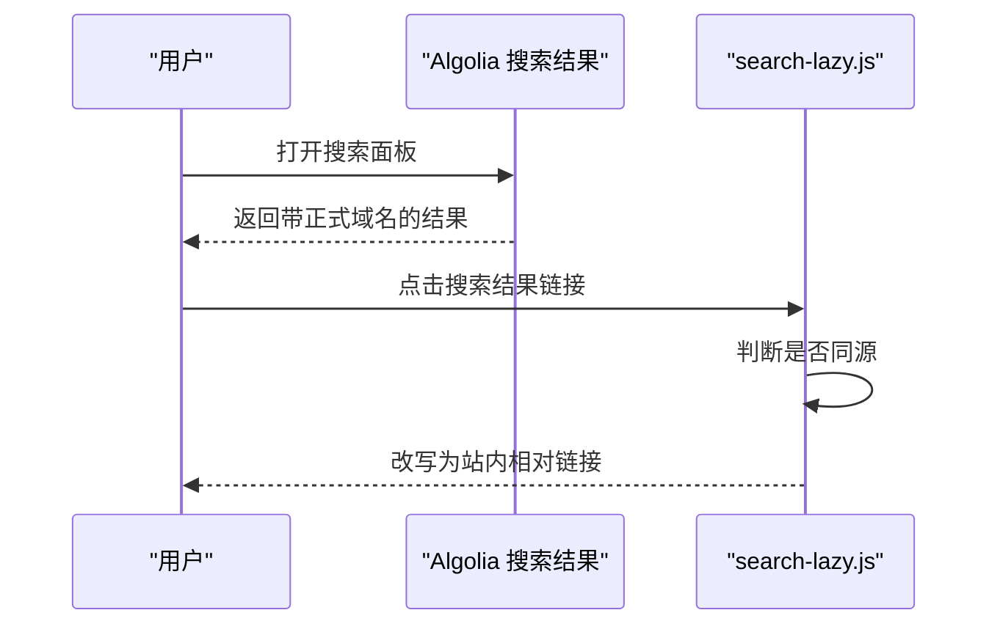

**图表来源**
- [source/js/inject/search-lazy.js:226-252](file://source/js/inject/search-lazy.js#L226-L252)

### SEO 影响与建议
- 固定链接使用 `posts/:abbrlink.html`，有利于搜索引擎抓取稳定 URL。
- 归档页、分类页、标签页等内部链接在 Qoder 等平台需要显式 `index.html`，否则可能出现 404。
- 搜索结果链接本地化可避免镜像站或本地预览时跳转到正式域名。
- 站点地图、百度主动推送、Algolia 索引等 SEO 相关功能在 `_config.yml` 中已有配置项。

**章节来源**
- [tools/qoder-static-links.js:1-45](file://tools/qoder-static-links.js#L1-L45)
- [source/js/inject/search-lazy.js:226-252](file://source/js/inject/search-lazy.js#L226-L252)
- [_config.yml:14-26](file://_config.yml#L14-L26)
- [_config.yml:203-214](file://_config.yml#L203-L214)

## 文章置顶机制
### 正文标记置顶
`scripts/sticky-post.js` 允许在文章正文任意位置写一行 HTML 注释来标记置顶：
- `<!-- sticky -->`：等价于 Front-Matter 中写 `sticky: 1`。
- `<!-- sticky: 2 -->`：数值越大越靠前，角标样式更醒目。

该标记会在渲染时被自动删除，不会出现在网页正文、摘要、RSS 或搜索结果里。Front-Matter 中的 `sticky` 值优先；正文标记只在 Front-Matter 没写时生效。

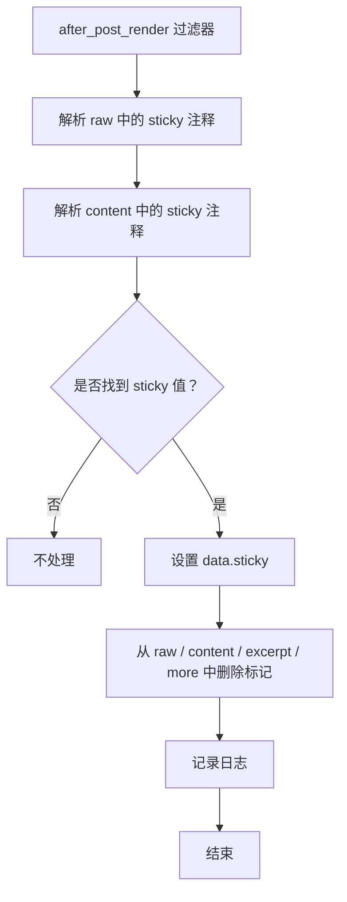

**图表来源**
- [scripts/sticky-post.js:27-69](file://scripts/sticky-post.js#L27-L69)

### 排序算法
置顶排序由 `hexo-generator-index@2.0.0` 负责，核心逻辑是按 `sticky` 字段降序排列：数值越大越靠前。因此本项目不需要额外安装置顶插件，只需让文章数据带上 `sticky` 字段即可。

角标渲染位于主题的 `post-ui.pug` 混入中，样式在主题自定义 CSS 中。

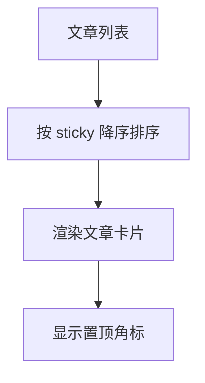

**图表来源**
- [scripts/sticky-post.js:15-20](file://scripts/sticky-post.js#L15-L20)

**章节来源**
- [scripts/sticky-post.js:1-70](file://scripts/sticky-post.js#L1-L70)

## 磁力链接本地化工具
### 问题背景
`hexo-magnet-fomal` 插件在首页生成“小冰磁贴”时，会拼出形如 `https://<站点URL>/categories/xxx/` 的绝对链接。由于插件内部没有“链接前缀”配置项，直接修改 `_config.yml` 的 `url` 并不能解决问题，而且 node_modules 中的插件代码在重装依赖时会丢失。

### 解决方案
`scripts/magnet-local-links.js` 通过 Hexo 的过滤器在两个阶段修复链接：
1. **渲染期**：注册 `after_render:html`，在所有页面渲染完成后，把 class 为 `magnet_link` 或 `magnet_link_more` 的 `<a>` 标签中的绝对链接改写为站内相对路径。
2. **兜底期**：注册 `before_exit` 和 `before_deploy`，扫描 `public/` 下的 HTML 与 JS 文件，再次替换可能遗漏的绝对链接。

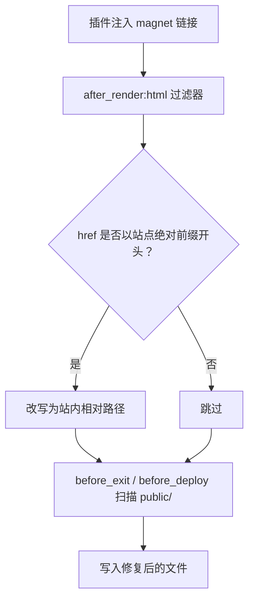

**图表来源**
- [scripts/magnet-local-links.js:1-26](file://scripts/magnet-local-links.js#L1-L26)
- [scripts/magnet-local-links.js:48-70](file://scripts/magnet-local-links.js#L48-L70)
- [scripts/magnet-local-links.js:90-124](file://scripts/magnet-local-links.js#L90-L124)

### 协议与兼容性
该工具主要处理 HTTP/HTTPS 站点绝对前缀，并把中文路径按站点约定进行编码。它不会改动其他位置的绝对地址，例如 canonical、og:url、sitemap 或分享链接，从而避免破坏 SEO 元数据。

**章节来源**
- [scripts/magnet-local-links.js:1-124](file://scripts/magnet-local-links.js#L1-L124)

## 构建链与产物优化
### 构建命令
项目的标准构建流程是：
1. `hexo clean`：清理旧产物。
2. `hexo generate`：生成静态页面。
3. `gulp`：压缩 JS、CSS、HTML。
4. 可选：`node tools/qoder-static-links.js`：处理 Qoder 平台兼容链接。

`package.json` 的 `build` 脚本把 `hexo generate` 和静态链接处理串联起来，适合自动化流水线。

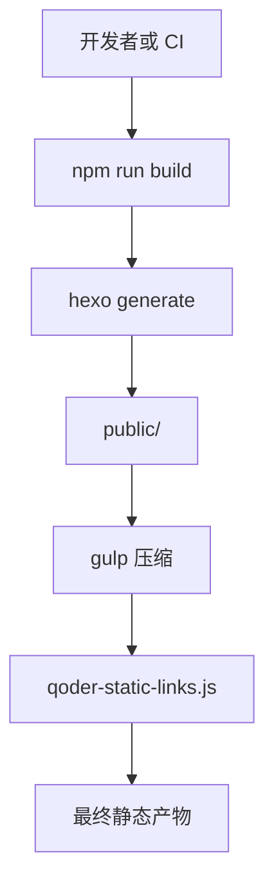

**图表来源**
- [package.json:10-15](file://package.json#L10-L15)
- [gulpfile.js:12-64](file://gulpfile.js#L12-L64)
- [tools/qoder-static-links.js:1-45](file://tools/qoder-static-links.js#L1-L45)

### Gulp 压缩策略
`gulpfile.js` 定义了三个任务：
- `compress`：压缩 `public/` 下未压缩的 JS。
- `minify-css`：压缩 CSS，但排除 `site-inject.css` 和 `twikoo.css`，因为后者包含容器查询等特性，可能被旧版 clean-css 误删。
- `minify-html`：清理注释、空白、布尔属性、多余 type 属性，并压缩页面内 JS/CSS/URL。

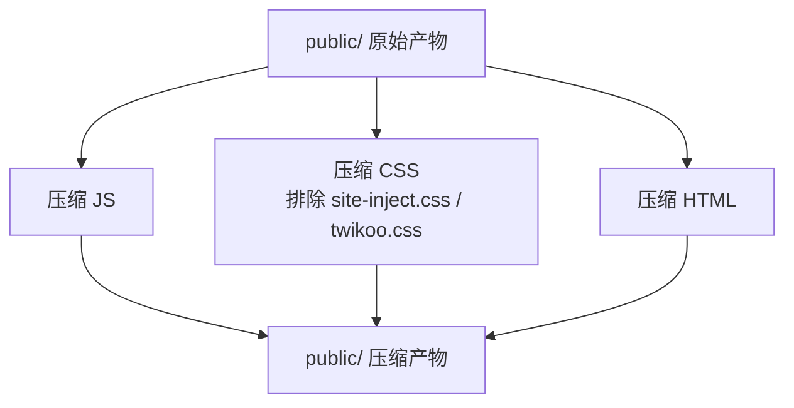

**图表来源**
- [gulpfile.js:12-64](file://gulpfile.js#L12-L64)

**章节来源**
- [package.json:10-15](file://package.json#L10-L15)
- [gulpfile.js:1-64](file://gulpfile.js#L1-L64)

## 开发环境配置指南
### 环境要求
根据 README，项目要求：
- Node.js：18、20 或 22 LTS，推荐 22。
- npm：9+。
- Hexo：6.3.0，通过 `package.json` 锁定，无需全局安装。
- Git：任意较新版本。

### IDE 与插件建议
虽然仓库没有强制 IDE 配置，但从技术栈可以推断合适的开发体验：
- 编辑器：VS Code 或支持 Pug、Stylus、YAML、Markdown 的现代编辑器。
- 插件方向：
  - Pug 语法高亮与格式化。
  - Stylus 语法高亮与格式化。
  - YAML 校验与格式化。
  - Markdown 预览与 Front-Matter 支持。
  - JavaScript/Node.js 调试。
  - Git 集成。

### 本地调试
常用命令：
- `npm install`：安装依赖。
- `npm run server`：启动本地预览。
- `npm run clean`：清理构建缓存。
- `npm run build`：生成静态页面并处理静态链接。
- `npm run deploy:vercel`：代理模式构建并部署。

本地预览时，Hexo 会监听 `source/` 下的内容与 CSS 自动重新渲染；修改主题模板 `.pug` 通常需要重启 server。

**章节来源**
- [README.md:344-353](file://README.md#L344-L353)
- [README.md:357-438](file://README.md#L357-L438)
- [package.json:7-15](file://package.json#L7-L15)

## 依赖关系分析
### 关键依赖
`package.json` 中的依赖体现了项目的工具链：
- 构建与渲染：`hexo`、`hexo-renderer-markdown-it`、`hexo-renderer-pug`、`hexo-renderer-stylus`。
- 内容增强：`hexo-abbrlink`、`hexo-wordcount-fomal`、`hexo-filter-nofollow`、`hexo-filter-gitcalendar`、`hexo-magnet-fomal`、`hexo-tag-map`。
- 搜索与索引：`hexo-algoliasearch`、`hexo-generator-search`、`hexo-generator-sitemap`、`hexo-generator-baidu-sitemap`。
- 部署与服务器：`hexo-deployer-git`、`hexo-server`。
- 构建压缩：`gulp`、`gulp-clean-css`、`gulp-html-minifier-terser`、`gulp-htmlclean`、`gulp-terser`。
- 前端工具：`vanilla-lazyload`、`workbox-build`。

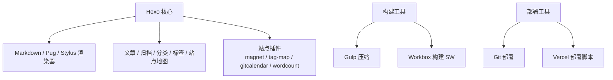

**图表来源**
- [package.json:20-63](file://package.json#L20-L63)

**章节来源**
- [package.json:1-75](file://package.json#L1-L75)

## 性能与稳定性注意事项
### 构建性能
- `hexo generate` 是全量构建，README 提到全量构建约 9 秒。
- Gulp 压缩任务必须正确 return stream，否则会提前结束导致 JS 压缩结果不稳定。
- CSS 压缩排除了部分文件，避免容器查询等现代特性被旧版 clean-css 误删。

### 运行时性能
- 搜索结果懒加载、图片懒加载、Pjax 换页守卫、Service Worker 缓存策略等都在前端层面做了优化。
- 静态链接处理脚本在构建期运行，不影响运行时性能，但能避免部署后出现 404。

### 稳定性
- `tools/deploy-vercel.js` 有防御检查，防止被 Hexo 当作插件加载时意外执行。
- `scripts/magnet-local-links.js` 同时覆盖渲染期和产物落盘期，降低漏改风险。
- `scripts/sticky-post.js` 在 `after_post_render` 中优先于摘要切分，确保标记不会进入 RSS 或摘要。

**章节来源**
- [gulpfile.js:12-19](file://gulpfile.js#L12-L19)
- [gulpfile.js:20-38](file://gulpfile.js#L20-L38)
- [tools/deploy-vercel.js:24-26](file://tools/deploy-vercel.js#L24-L26)
- [scripts/magnet-local-links.js:60-70](file://scripts/magnet-local-links.js#L60-L70)
- [scripts/magnet-local-links.js:122-124](file://scripts/magnet-local-links.js#L122-L124)
- [scripts/sticky-post.js:46-69](file://scripts/sticky-post.js#L46-L69)

## 常见问题排查
### 部署时报找不到 API Key
现象：运行 `npm run deploy:vercel` 后提示没有找到 API Key。

排查步骤：
1. 检查是否在 Vercel 控制台配置了环境变量 `DEEPSEEK_API_KEY`。
2. 检查本地是否有 `.ai-chat-key` 文件，且内容为有效的 Key。
3. 检查 `_config.fomalhaut.yml` 中 `ai_chat:` 段是否写了 `api_key`，且值以 `sk-` 开头。
4. 使用 `--dry-run` 参数确认脚本会采用哪种模式。

**章节来源**
- [tools/deploy-vercel.js:35-66](file://tools/deploy-vercel.js#L35-L66)

### 部署后归档页或分类页 404
现象：访问 `/archives/`、`/categories/xxx/` 等目录链接报 404。

原因：某些静态托管平台不支持目录索引。

解决：
- 使用 `npm run build`，它会执行 `tools/qoder-static-links.js`，把目录链接改写为 `index.html`。
- 如果是 Qoder 平台，确保产物经过该脚本处理。

**章节来源**
- [tools/qoder-static-links.js:1-45](file://tools/qoder-static-links.js#L1-L45)

### 磁力链接跳到外站
现象：首页磁贴点击后跳转到 `https://example.com/categories/xxx/`，而不是本站路径。

原因：第三方插件硬编码了站点绝对前缀。

解决：
- 确保 `scripts/magnet-local-links.js` 已加载。
- 检查渲染期过滤器是否命中。
- 检查 `public/` 下是否还有残留绝对链接，必要时触发 `before_exit` 或 `before_deploy` 兜底修复。

**章节来源**
- [scripts/magnet-local-links.js:1-26](file://scripts/magnet-local-links.js#L1-L26)
- [scripts/magnet-local-links.js:60-70](file://scripts/magnet-local-links.js#L60-L70)
- [scripts/magnet-local-links.js:90-124](file://scripts/magnet-local-links.js#L90-L124)

### 文章置顶不生效
现象：写了 `<!-- sticky -->` 但文章没有置顶。

排查：
1. 确认 Front-Matter 中没有覆盖性的 `sticky` 值。
2. 确认注释写法正确，且没有被摘要切分提前截断。
3. 确认文章确实生成了 `sticky` 字段。
4. 检查主题是否渲染了置顶角标。

**章节来源**
- [scripts/sticky-post.js:1-25](file://scripts/sticky-post.js#L1-L25)
- [scripts/sticky-post.js:27-69](file://scripts/sticky-post.js#L27-L69)

## 开发最佳实践与代码规范建议
### 构建与部署
- 优先使用 `npm run build` 或 `npm run deploy:vercel`，不要绕过静态链接处理脚本。
- 不要把 `.ai-chat-key` 提交到版本库；如需共享 Key，应通过托管平台的环境变量管理。
- 在 CI 中部署时，优先使用托管平台提供的环境变量注入机制，而不是在脚本中硬编码 Key。

### 链接与 SEO
- 内部链接尽量使用相对路径或 Hexo 的 URL 生成工具，避免写死正式域名。
- 新增页面后，检查归档、分类、标签、搜索是否能正确跳转。
- 对第三方插件生成的绝对链接，优先通过过滤器或构建期脚本修复，而不是修改 node_modules。

### 代码组织
- 站点级增强放在根目录 `scripts/`、`source/js/`、`source/css/`。
- 主题本体改动放在 `themes/fomalhaut/`，升级主题时可整体替换。
- 复杂逻辑拆成独立脚本，并在 README 或文件头注释中说明作用、触发时机和影响范围。

### 调试与测试
- 本地开发用 `npm run server` 快速验证。
- 构建问题用 `npm run clean && npm run build` 复现。
- 部署问题先用 `npm run deploy:vercel -- --dry-run` 确认 Key 来源。
- 对行为敏感的脚本，建议在 README 中补充回归测试或使用方式。

**章节来源**
- [README.md:357-438](file://README.md#L357-L438)
- [tools/deploy-vercel.js:1-21](file://tools/deploy-vercel.js#L1-L21)
- [tools/qoder-static-links.js:1-45](file://tools/qoder-static-links.js#L1-L45)
- [scripts/magnet-local-links.js:1-26](file://scripts/magnet-local-links.js#L1-L26)

## 结论
本仓库的开发辅助工具围绕“构建期处理 + 运行时增强 + 托管平台适配”展开：
- Vercel 部署脚本负责安全注入 API Key，并驱动 Hexo 构建与部署。
- 静态链接处理脚本解决多平台目录索引差异，提升部署稳定性。
- 文章置顶工具通过正文注释和 Hexo 过滤器实现轻量置顶。
- 磁力链接本地化工具修复第三方插件的绝对链接问题。
- Gulp 与 package.json 脚本共同构成可重复、可自动化的构建链。

这些工具的共同目标是：让开发者专注于内容与配置，同时保证构建产物在不同托管环境下都能稳定运行。