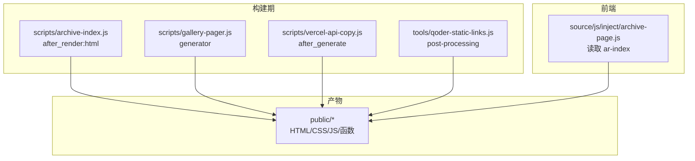
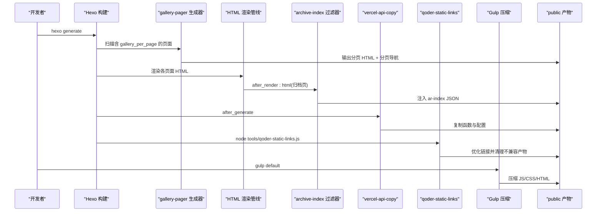
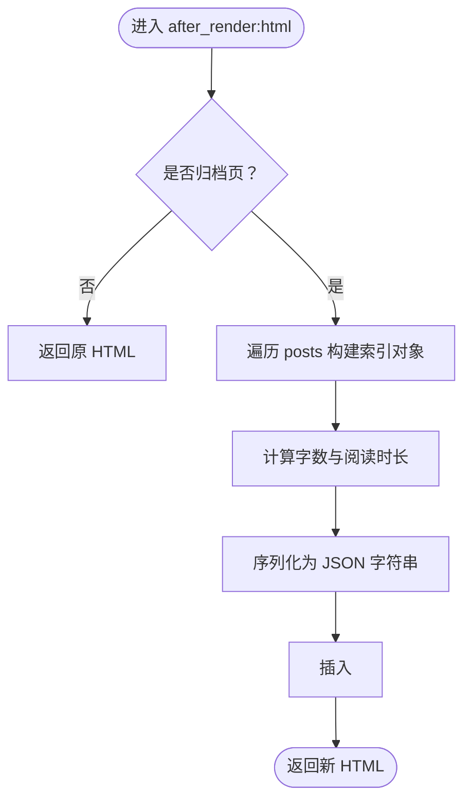
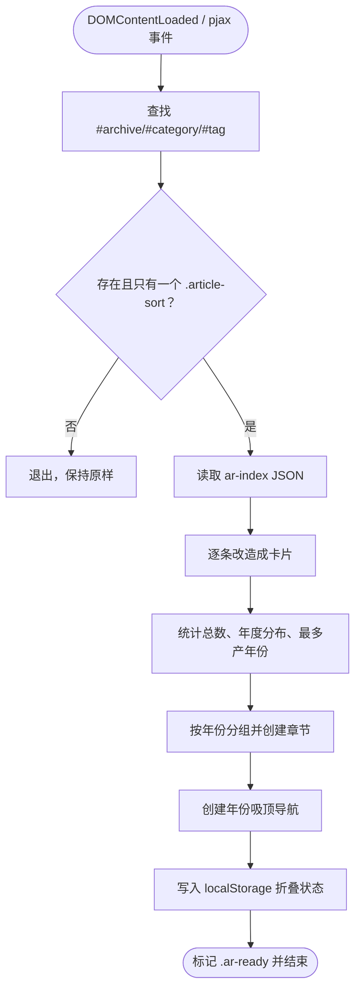
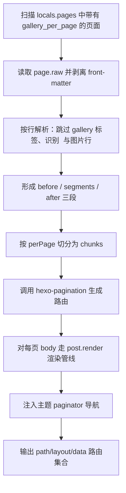
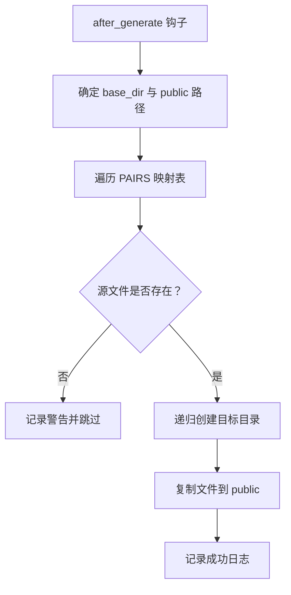
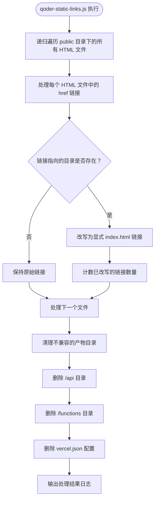
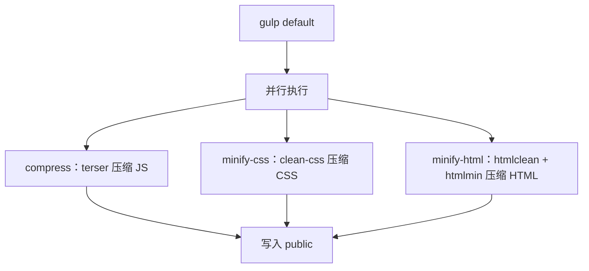
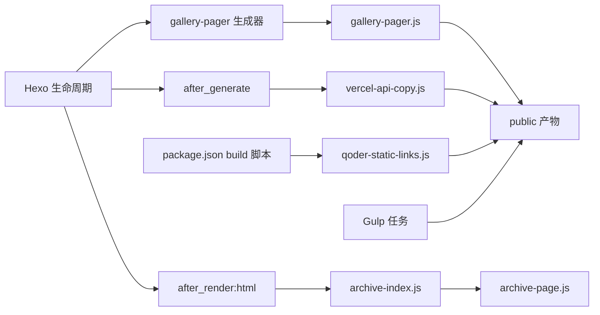

# 构建脚本

<cite>
**本文引用的文件**   
- [scripts/archive-index.js](file://scripts/archive-index.js)
- [source/js/inject/archive-page.js](file://source/js/inject/archive-page.js)
- [scripts/gallery-pager.js](file://scripts/gallery-pager.js)
- [scripts/vercel-api-copy.js](file://scripts/vercel-api-copy.js)
- [tools/qoder-static-links.js](file://tools/qoder-static-links.js)
- [gulpfile.js](file://gulpfile.js)
- [_config.yml](file://_config.yml)
- [package.json](file://package.json)
- [tools/deploy-vercel.js](file://tools/deploy-vercel.js)
</cite>

## 更新摘要
**变更内容**   
- 新增 Qoder Sites 部署后处理脚本，用于静态链接优化和平台兼容性处理
- 更新 package.json build 脚本，集成 qoder-static-links.js 后处理步骤
- 扩展构建流程，增加 Qoder 平台特定的产物清理逻辑

## 目录
1. [简介](#简介)
2. [项目结构](#项目结构)
3. [核心组件](#核心组件)
4. [架构总览](#架构总览)
5. [详细组件分析](#详细组件分析)
6. [依赖关系分析](#依赖关系分析)
7. [性能与优化](#性能与优化)
8. [故障排查](#故障排查)
9. [结论](#结论)
10. [附录：自定义与扩展指南](#附录自定义与扩展指南)

## 简介
本文聚焦 Hexo 构建过程中的站点级脚本与自动化任务，重点说明以下能力：
- 归档页索引生成：在构建期把全站文章标题、路径、日期、分类、字数和阅读时长注入归档页，供前端渲染统计条、年度分布图和卡片元信息。
- 相册分页：根据 Markdown 正文中的图片行自动切分并生成多页，复用主题分页样式，同时保留主题的懒加载处理。
- Vercel API 复制：在构建产物中复制函数入口与配置，使静态托管仓库也能运行 Vercel 或 Cloudflare Pages 函数。
- **Qoder Sites 部署兼容处理**：在构建完成后对静态链接进行优化，移除不兼容的函数产物，确保在 Qoder 平台的正确部署。
- Gulp 构建任务：对 JS/CSS/HTML 进行压缩与清理，提升部署体积与首屏性能。
- 自定义与扩展：如何在现有脚本基础上增加新的构建阶段、过滤器或 Gulp 任务。

## 项目结构
与构建脚本直接相关的目录与文件如下：
- scripts：Hexo 站点级脚本（过滤器、生成器）。
- source/js/inject：前端增强脚本，消费构建期注入的数据。
- tools：部署辅助脚本，包括 Qoder Sites 兼容性处理和 Vercel 部署脚本。
- gulpfile.js：Gulp 资源压缩流水线。
- _config.yml：Hexo 站点配置（归档分页、URL、插件等）。
- package.json：依赖与 npm scripts，包含新的 Qoder 构建步骤。

**图表来源**
- [scripts/archive-index.js:104-137](file://scripts/archive-index.js#L104-L137)
- [scripts/gallery-pager.js:146-168](file://scripts/gallery-pager.js#L146-L168)
- [scripts/vercel-api-copy.js:28-46](file://scripts/vercel-api-copy.js#L28-L46)
- [tools/qoder-static-links.js:21-43](file://tools/qoder-static-links.js#L21-L43)
- [source/js/inject/archive-page.js:54-78](file://source/js/inject/archive-page.js#L54-L78)

章节来源
- [scripts/archive-index.js:1-138](file://scripts/archive-index.js#L1-L138)
- [scripts/gallery-pager.js:1-170](file://scripts/gallery-pager.js#L1-L170)
- [scripts/vercel-api-copy.js:1-47](file://scripts/vercel-api-copy.js#L1-L47)
- [tools/qoder-static-links.js:1-45](file://tools/qoder-static-links.js#L1-L45)
- [source/js/inject/archive-page.js:1-481](file://source/js/inject/archive-page.js#L1-L481)

## 核心组件
- 归档索引生成器：注册 after_render:html，仅在归档页插入包含全站文章元数据的 JSON 脚本块。
- 归档页前端增强：读取 ar-index，渲染概览统计、年度柱状图、年份分组卡片、吸顶导航与折叠状态。
- 相册分页生成器：解析 Markdown 正文，按图片行切分，调用 hexo-pagination 生成多页路由，并追加分页导航。
- Vercel API 复制：在 after_generate 钩子把 api 与 functions 目录下的函数文件复制到 public，保证部署平台可识别。
- **Qoder Sites 兼容性处理**：在构建完成后优化静态链接，移除不兼容的函数产物，确保 Qoder 平台部署成功。
- Gulp 任务：压缩 JS、CSS、HTML，并在默认任务中并行执行。

章节来源
- [scripts/archive-index.js:34-68](file://scripts/archive-index.js#L34-L68)
- [source/js/inject/archive-page.js:93-109](file://source/js/inject/archive-page.js#L93-L109)
- [scripts/gallery-pager.js:56-144](file://scripts/gallery-pager.js#L56-L144)
- [scripts/vercel-api-copy.js:22-46](file://scripts/vercel-api-copy.js#L22-L46)
- [tools/qoder-static-links.js:21-43](file://tools/qoder-static-links.js#L21-L43)
- [gulpfile.js:12-64](file://gulpfile.js#L12-L64)

## 架构总览
构建流程从 Hexo 的生成阶段开始，经过 HTML 渲染后由站点脚本注入数据，再由 Gulp 对产物做最终压缩，最后通过 Qoder 兼容性处理脚本完成部署准备。

**图表来源**
- [scripts/gallery-pager.js:146-168](file://scripts/gallery-pager.js#L146-L168)
- [scripts/archive-index.js:104-137](file://scripts/archive-index.js#L104-L137)
- [scripts/vercel-api-copy.js:28-46](file://scripts/vercel-api-copy.js#L28-L46)
- [tools/qoder-static-links.js:21-43](file://tools/qoder-static-links.js#L21-L43)
- [gulpfile.js:61-64](file://gulpfile.js#L61-L64)

## 详细组件分析

### 归档页索引生成脚本
该脚本负责在归档页 HTML 中注入一个 id 为 ar-index 的 JSON 脚本块，内容包含每篇文章的短键字段：
- t：标题
- p：路径
- d：日期
- c：分类
- w：字数
- r：阅读分钟

它通过 after_render:html 钩子判断是否为归档页，遍历 hexo.locals.get('posts')，计算字数与阅读时长，并把结果序列化后插入到 #body-wrap 子树中，以兼容 pjax 换页。

**图表来源**
- [scripts/archive-index.js:104-137](file://scripts/archive-index.js#L104-L137)
- [scripts/archive-index.js:44-68](file://scripts/archive-index.js#L44-L68)

关键实现要点
- 只读归档页：通过 page.archive 判断，避免影响首页、文章页等其他页面。
- 安全插入位置：优先插入到 #archive 等正文根元素之后；若找不到则回退到 </head> 前。
- 兼容 pjax：使用 application/json 类型，避免被 pjax 重建脚本逻辑误删。
- 阅读时长口径：中文按 300 字/分钟、英文按 160 词/分钟，与 hexo-wordcount-fomal 的 min2read 默认参数一致。
- 降级策略：若脚本未执行，前端 archive-page.js 会退化为仅显示当前页数据，不破坏排版。

章节来源
- [scripts/archive-index.js:1-138](file://scripts/archive-index.js#L1-L138)

### 归档页前端增强脚本
该脚本读取构建期注入的 ar-index，完成以下工作：
- 将 .article-sort 列表改造为卡片栅格，补充封面、分类、阅读时长。
- 渲染概览统计条与年度分布柱状图。
- 按年份分组，支持折叠与 localStorage 记忆。
- 提供年份吸顶导航，滚动时高亮当前年份。
- 兼容 pjax 往返与 LazyLoad。

**图表来源**
- [source/js/inject/archive-page.js:93-109](file://source/js/inject/archive-page.js#L93-L109)
- [source/js/inject/archive-page.js:208-273](file://source/js/inject/archive-page.js#L208-L273)
- [source/js/inject/archive-page.js:275-337](file://source/js/inject/archive-page.js#L275-L337)
- [source/js/inject/archive-page.js:364-429](file://source/js/inject/archive-page.js#L364-L429)

关键实现要点
- 幂等与守卫：容器打 data-ar-archive，重复执行直接 return；选择器以 .ar-ready 开头，任一环节失败即整体失效。
- 封面处理：优先使用 data-lazy-src 的真实地址，失败时退回占位图，避免空白。
- 索引兼容：metaOf 同时兼容短键与长键，防止前后端键名不一致导致静默失效。
- 性能优化：滚动监听使用 requestAnimationFrame 合流；LazyLoad 更新实例以重新登记封面。

章节来源
- [source/js/inject/archive-page.js:1-481](file://source/js/inject/archive-page.js#L1-L481)

### 相册分页脚本
该生成器为相册页提供自动分页能力，无需手写页码。用户只需在 front-matter 设置 gallery_per_page，并在正文中按顺序写图片链接即可。

**图表来源**
- [scripts/gallery-pager.js:146-168](file://scripts/gallery-pager.js#L146-L168)
- [scripts/gallery-pager.js:56-144](file://scripts/gallery-pager.js#L56-L144)

关键实现要点
- 分页规则：第 1 页路径不变，后续页为 p2.html、p3.html 等，兼容旧链接。
- 强制分页：单独一行写 <!-- pagebreak --> 可在任意位置切分。
- 懒加载兼容：每页 body 走 ctx.post.render，触发 after_post_render 过滤器，主题的图片懒加载照旧生效。
- 日志输出：记录源文件、页数、每页张数与总张数，便于调试。

章节来源
- [scripts/gallery-pager.js:1-170](file://scripts/gallery-pager.js#L1-L170)

### Vercel API 复制脚本
该脚本在 after_generate 钩子中将函数入口与配置文件复制到 public 目录，确保静态托管仓库能同时满足 Vercel 与 Cloudflare Pages 的函数约定。

**图表来源**
- [scripts/vercel-api-copy.js:22-46](file://scripts/vercel-api-copy.js#L22-L46)

关键实现要点
- 双平台兼容：同时复制 api/chat/completions.js 与 functions/api/chat/completions.js，分别对应 Vercel 与 Cloudflare Pages。
- 容错处理：找不到源文件时记录警告，不影响其他文件复制。
- 环境变量：真 key 不在 HTML 中，函数运行时从 DEEPSEEK_API_KEY 读取。

章节来源
- [scripts/vercel-api-copy.js:1-47](file://scripts/vercel-api-copy.js#L1-L47)

### Qoder Sites 部署兼容性处理脚本
**新增** 该脚本在 `hexo generate` 命令后执行，专门处理 Qoder Sites 平台的部署兼容性问题。主要功能包括：

1. **静态链接优化**：将指向真实存在目录的内部链接改写为显式的 index.html，解决平台不支持目录索引的问题。
2. **不兼容产物清理**：移除 Vercel/Cloudflare 专用的函数产物（/api 与 /functions），因为这些 serverless 函数在 Qoder 平台上无法运行。

**图表来源**
- [tools/qoder-static-links.js:21-43](file://tools/qoder-static-links.js#L21-L43)

关键实现要点
- **目录索引修复**：检测所有 href 属性，如果链接指向存在的目录，自动追加 index.html，确保 Qoder 平台能正确访问。
- **平台特定清理**：删除 api、functions 和 vercel.json 文件，这些是 Vercel/Cloudflare 专用产物，在 Qoder 平台上会造成路由冲突。
- **安全性检查**：验证目标路径在 public 目录下，防止路径遍历攻击。
- **增量处理**：只对实际修改的文件进行写入操作，提高处理效率。

章节来源
- [tools/qoder-static-links.js:1-45](file://tools/qoder-static-links.js#L1-L45)

### Gulp 构建任务
Gulp 任务对 public 目录下的 JS、CSS、HTML 进行压缩与清理，默认任务并行执行三个子任务：
- compress：压缩 JS（排除已压缩的 .min.js）。
- minify-css：压缩 CSS（排除 site-inject.css 与 twikoo.css，避免兼容性问题）。
- minify-html：清理注释、合并空格、压缩内联 JS/CSS/URL。

**图表来源**
- [gulpfile.js:12-64](file://gulpfile.js#L12-L64)

关键实现要点
- 流式管道：每个任务都 return stream，避免任务提前结束。
- 兼容性保护：CSS 压缩排除特定文件，避免 @container 等特性被错误处理。
- 全量压缩：HTML 压缩开启 minifyJS/minifyCSS/minifyURLs，进一步减小体积。

章节来源
- [gulpfile.js:1-64](file://gulpfile.js#L1-L64)

## 依赖关系分析
- Hexo 生命周期：
  - generator：gallery-pager 注册为生成器，产出分页路由。
  - after_render:html：archive-index 注入 ar-index JSON。
  - after_generate：vercel-api-copy 复制函数文件。
- **构建脚本依赖**：
  - package.json 的 build 脚本现在包含 `node tools/qoder-static-links.js` 作为后处理步骤。
- 前端依赖：
  - archive-page.js 依赖 ar-index JSON 提供的全站索引。
- 构建工具依赖：
  - Gulp 依赖 terser、clean-css、htmlmin、htmlclean。
- 站点配置依赖：
  - _config.yml 定义归档分页、URL、插件等。
  - package.json 定义依赖与 npm scripts。

**图表来源**
- [scripts/gallery-pager.js:146-168](file://scripts/gallery-pager.js#L146-L168)
- [scripts/archive-index.js:104-137](file://scripts/archive-index.js#L104-L137)
- [scripts/vercel-api-copy.js:28-46](file://scripts/vercel-api-copy.js#L28-L46)
- [tools/qoder-static-links.js:21-43](file://tools/qoder-static-links.js#L21-L43)
- [gulpfile.js:61-64](file://gulpfile.js#L61-L64)
- [package.json:10-16](file://package.json#L10-L16)

章节来源
- [package.json:10-16](file://package.json#L10-L16)
- [_config.yml:89-98](file://_config.yml#L89-L98)

## 性能与优化
- 归档索引：
  - 在构建期计算阅读时长与字数，避免客户端额外请求。
  - 使用 application/json 类型脚本，避免 pjax 重建导致的丢失。
- 相册分页：
  - 复用主题分页 helper，减少前端逻辑复杂度。
  - 每页 body 走渲染管线，确保懒加载与标签插件正常工作。
- **Qoder 兼容性处理**：
  - 增量文件处理，只修改实际变化的 HTML 文件。
  - 预检查目录存在性，避免不必要的文件系统操作。
- Gulp 压缩：
  - JS/CSS/HTML 并行压缩，缩短构建时间。
  - 排除已知不兼容文件，避免样式异常。
- 前端交互：
  - 滚动监听使用 requestAnimationFrame 合流，降低布局抖动。
  - LazyLoad 实例更新，确保动态封面正确加载。

[本节为通用指导，不直接分析具体文件]

## 故障排查
- 归档页统计缺失：
  - 检查 ar-index JSON 是否存在于页面源码。
  - 确认 archive-page.js 是否被引入且未报错。
- 相册分页无效：
  - 确认 front-matter 中设置了 gallery_per_page。
  - 检查正文是否包含图片链接或 <!-- pagebreak -->。
- Vercel 函数 404：
  - 确认 public/api 与 public/functions 下存在对应函数文件。
  - 检查构建日志是否有"找不到源文件"的警告。
- **Qoder 部署问题**：
  - 检查构建日志中是否有 "qoder-static-links: X 个目录链接已改写为 index.html" 的输出。
  - 确认 public 目录下没有残留的 api、functions 或 vercel.json 文件。
  - 检查内部链接是否正确指向 index.html。
- Gulp 压缩异常：
  - 检查 CSS 是否被错误排除或压缩。
  - 确认 JS 未被提前压缩（.min.js 会被忽略）。

章节来源
- [scripts/archive-index.js:133-137](file://scripts/archive-index.js#L133-L137)
- [scripts/gallery-pager.js:159-162](file://scripts/gallery-pager.js#L159-L162)
- [scripts/vercel-api-copy.js:34-44](file://scripts/vercel-api-copy.js#L34-L44)
- [tools/qoder-static-links.js:41-45](file://tools/qoder-static-links.js#L41-L45)
- [gulpfile.js:20-38](file://gulpfile.js#L20-L38)

## 结论
本项目的构建脚本围绕 Hexo 的生命周期展开，通过生成器、过滤器与复制脚本，将全站索引、相册分页与函数文件无缝集成到构建产物中。**新增的 Qoder Sites 兼容性处理脚本**确保了在多平台部署场景下的统一体验，通过静态链接优化和不兼容产物清理，解决了不同部署平台的差异性问题。前端脚本消费构建期数据，提供丰富的归档页交互体验。Gulp 任务则在最后阶段对资源进行压缩，确保部署体积与性能。整体架构清晰、职责分离，便于扩展与维护。

[本节为总结性内容，不直接分析具体文件]

## 附录：自定义与扩展指南
- 新增归档页统计维度：
  - 在 archive-index.js 的索引构建循环中增加字段，并在 archive-page.js 的 metaOf 中兼容新键名。
- 调整相册分页规则：
  - 修改 gallery-pager.js 中的 DEFAULT_PER_PAGE 或 FORMAT 常量。
  - 在 front-matter 中覆盖 gallery_per_page。
- 扩展 Vercel API 复制：
  - 在 vercel-api-copy.js 的 PAIRS 数组中添加新的源/目标映射。
- **添加 Qoder 平台特定处理**：
  - 在 qoder-static-links.js 中添加新的清理规则或链接重写逻辑。
  - 在 package.json 的 build 脚本中调整执行顺序。
- 添加 Gulp 任务：
  - 在 gulpfile.js 中定义新任务，并在 default 任务中并行注册。
- 使用部署脚本：
  - 通过 npm run deploy:vercel 一键构建并部署，脚本会自动注入 DEEPSEEK_API_KEY。
  - 通过 npm run build 执行完整的构建流程，包括 Qoder 兼容性处理。

章节来源
- [scripts/archive-index.js:110-122](file://scripts/archive-index.js#L110-L122)
- [source/js/inject/archive-page.js:68-78](file://source/js/inject/archive-page.js#L68-L78)
- [scripts/gallery-pager.js:21-23](file://scripts/gallery-pager.js#L21-L23)
- [scripts/vercel-api-copy.js:22-26](file://scripts/vercel-api-copy.js#L22-L26)
- [tools/qoder-static-links.js:21-43](file://tools/qoder-static-links.js#L21-L43)
- [gulpfile.js:61-64](file://gulpfile.js#L61-L64)
- [tools/deploy-vercel.js:60-82](file://tools/deploy-vercel.js#L60-L82)
- [package.json:10-16](file://package.json#L10-L16)