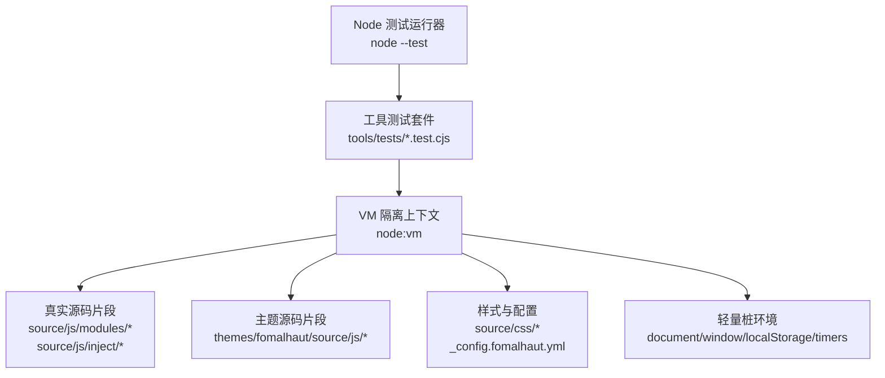
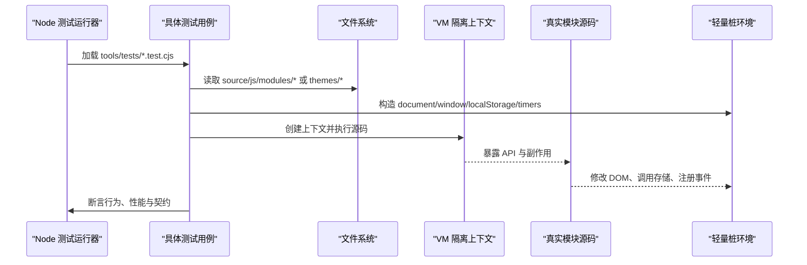
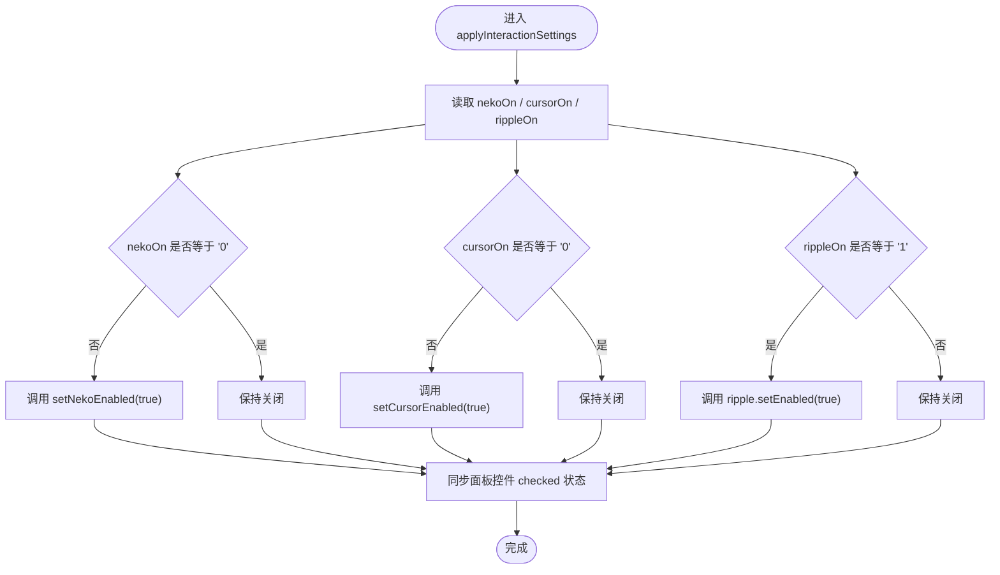
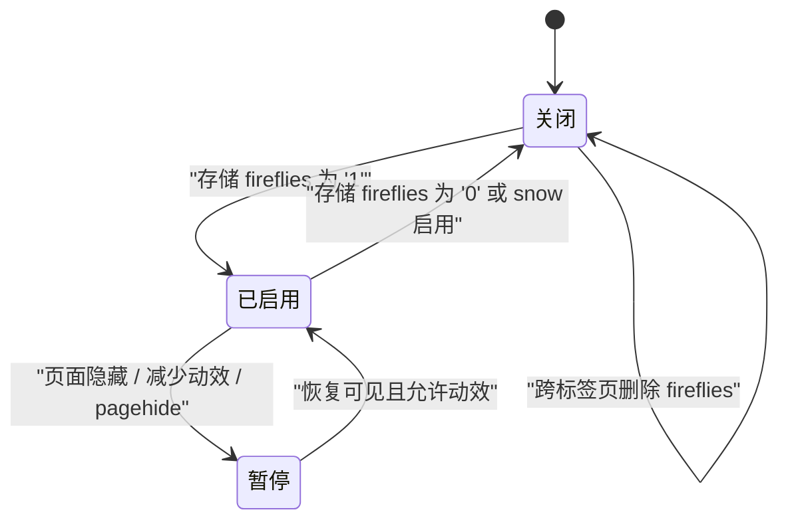
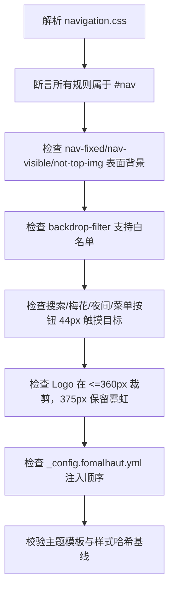
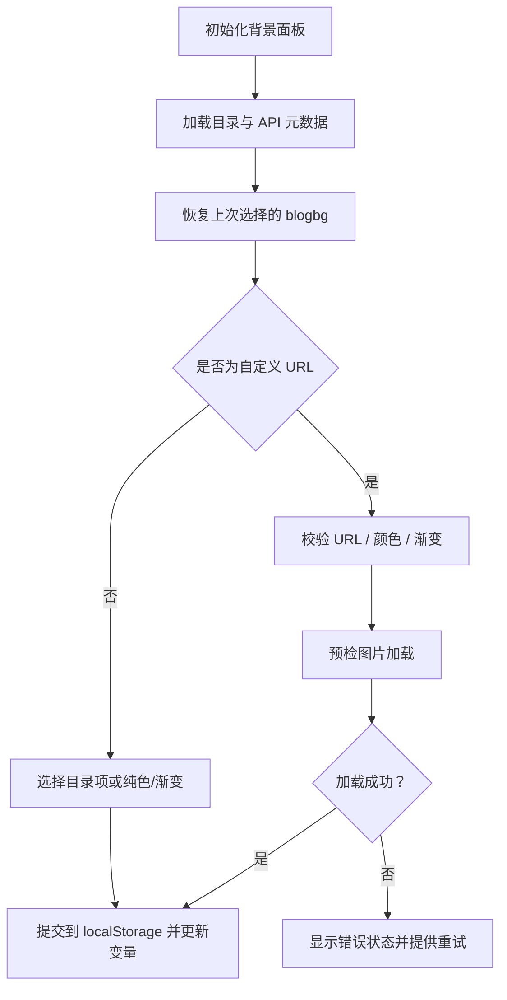
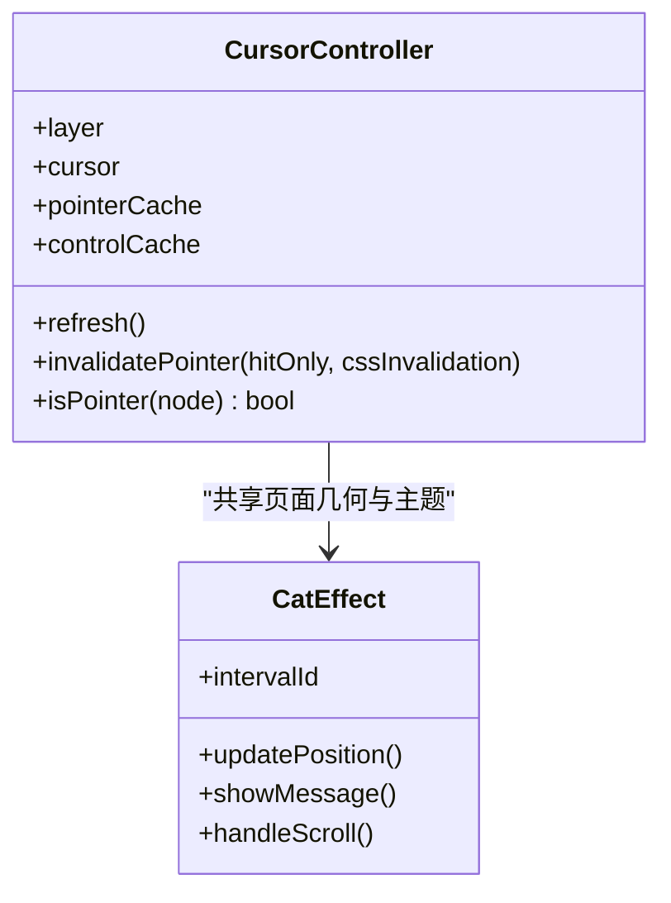
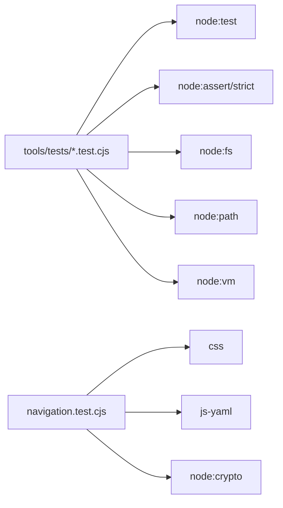

# 测试框架

<cite>
**本文引用的文件**   
- [package.json](file://package.json)
- [beauty-switches.test.cjs](file://tools/tests/beauty-switches.test.cjs)
- [fireflies.test.cjs](file://tools/tests/fireflies.test.cjs)
- [navigation.test.cjs](file://tools/tests/navigation.test.cjs)
- [appearance-backgrounds.test.cjs](file://tools/tests/appearance-backgrounds.test.cjs)
- [appearance-fonts.test.cjs](file://tools/tests/appearance-fonts.test.cjs)
- [cursor-effects.test.cjs](file://tools/tests/cursor-effects.test.cjs)
- [daynight-boot.test.cjs](file://tools/tests/daynight-boot.test.cjs)
- [fps-lifecycle.test.cjs](file://tools/tests/fps-lifecycle.test.cjs)
- [mobile-scrollbar.test.cjs](file://tools/tests/mobile-scrollbar.test.cjs)
- [ripple.test.cjs](file://tools/tests/ripple.test.cjs)
- [scroll-listeners.test.cjs](file://tools/tests/scroll-listeners.test.cjs)
- [snow.test.cjs](file://tools/tests/snow.test.cjs)
</cite>

## 目录
1. [简介](#简介)
2. [项目结构](#项目结构)
3. [核心组件](#核心组件)
4. [架构总览](#架构总览)
5. [详细组件分析](#详细组件分析)
6. [依赖关系分析](#依赖关系分析)
7. [性能与可维护性](#性能与可维护性)
8. [故障排查指南](#故障排查指南)
9. [结论](#结论)
10. [附录：执行命令与覆盖率建议](#附录执行命令与覆盖率建议)

## 简介
本仓库的测试体系基于 Node.js 内置测试运行器，采用“无浏览器、无构建、无网络”的契约式单元测试策略。每个测试模块直接读取真实源码片段，在隔离的 VM 环境中执行，并通过轻量 DOM、事件、存储和计时器等桩对象验证行为。测试覆盖外观背景、字体选择、美化开关、萤火虫、雪花、导航、滚动监听、FPS 监控、移动端滚动条、鼠标指针与涟漪等前端交互特性。

该方案的优势是：
- 不依赖 jsdom、Playwright 或 Puppeteer，启动快、可并行。
- 通过断言源码切片、CSS AST、YAML 配置和哈希基线，保证实现演进不会破坏既有契约。
- 对异步、节流、动画帧、PJAX、跨标签页同步等复杂场景提供确定性模拟。

## 项目结构
测试代码集中在 `tools/tests` 目录下，每个 `.test.cjs` 对应一个功能域；被测源码位于 `source/js/modules`、`source/js/inject`、`themes/fomalhaut/source/js` 以及主题样式与配置中。

**图示来源**
- [beauty-switches.test.cjs:1-10](file://tools/tests/beauty-switches.test.cjs#L1-L10)
- [fireflies.test.cjs:1-12](file://tools/tests/fireflies.test.cjs#L1-L12)
- [navigation.test.cjs:1-16](file://tools/tests/navigation.test.cjs#L1-L16)

**章节来源**
- [package.json:1-16](file://package.json#L1-L16)

## 核心组件
测试套件按功能划分为多个独立模块，每个模块负责一个特性或一组紧密相关的行为：

| 测试模块 | 被测目标 | 主要职责 |
|---|---|---|
| 美化开关测试 | `settings.js`、`beauty-boot.js` | 验证小猫咪、光标、涟漪等互动效果的默认状态、持久化、面板同步与重置逻辑 |
| 萤火虫效果测试 | `fireflies.js` | 验证启用条件、层级节点、响应式密度、可见性与减少动效暂停、PJAX 恢复、跨标签同步 |
| 导航功能测试 | `navigation.css`、主题模板与注入配置 | 验证 CSS 规则范围、毛玻璃增强、触控按钮尺寸、Logo 视觉、脚本注入顺序 |
| 外观背景测试 | `appearance-backgrounds.js` | 验证目录数据、懒加载、预览、应用、校验、回退与全局取消 |
| 外观字体测试 | `appearance-fonts.js` | 验证 Web Font 探测、系统字体、并发选择、超时与失败处理 |
| 鼠标指针与小猫测试 | `cursor.js` | 验证指针命中缓存、语义控件识别、FPS 文本结构、性能约束 |
| 日夜切换引导测试 | `daynight-boot.js`、`aside-calendar.js`、`settings.js` | 验证首屏模式、手动选择优先级、地理坐标、自动切换开关 |
| FPS 生命周期测试 | `reading.js`、`settings.js` | 验证帧率循环开启/关闭、后台暂停、设置开关与重置 |
| 移动端滚动条测试 | `shell.js` | 验证移动端自绘滚动条创建、节流、PJAX 替换与几何读写顺序 |
| 点击涟漪测试 | `ripple.js`、`site-inject.css`、`settings.js` | 验证默认关闭、按下绘制、回收上限、减少动效偏好与 z-index 契约 |
| 滚动监听测试 | `utils.js`、`main.js`、`nav.js`、`pjax.pug` | 验证节流器、头部显示、目录百分比、PJAX 清理与重复初始化 |
| 雪花效果测试 | `snow.js` | 验证精灵缓存、时间公平、堆积雪堆、多门控暂停与 PJAX 替换 |

**章节来源**
- [beauty-switches.test.cjs:1-171](file://tools/tests/beauty-switches.test.cjs#L1-L171)
- [fireflies.test.cjs:1-689](file://tools/tests/fireflies.test.cjs#L1-L689)
- [navigation.test.cjs:1-395](file://tools/tests/navigation.test.cjs#L1-L395)
- [appearance-backgrounds.test.cjs:1-417](file://tools/tests/appearance-backgrounds.test.cjs#L1-L417)
- [appearance-fonts.test.cjs:1-289](file://tools/tests/appearance-fonts.test.cjs#L1-L289)
- [cursor-effects.test.cjs:1-1017](file://tools/tests/cursor-effects.test.cjs#L1-L1017)
- [daynight-boot.test.cjs:1-303](file://tools/tests/daynight-boot.test.cjs#L1-L303)
- [fps-lifecycle.test.cjs:1-114](file://tools/tests/fps-lifecycle.test.cjs#L1-L114)
- [mobile-scrollbar.test.cjs:1-271](file://tools/tests/mobile-scrollbar.test.cjs#L1-L271)
- [ripple.test.cjs:1-215](file://tools/tests/ripple.test.cjs#L1-L215)
- [scroll-listeners.test.cjs:1-431](file://tools/tests/scroll-listeners.test.cjs#L1-L431)
- [snow.test.cjs:1-531](file://tools/tests/snow.test.cjs#L1-L531)

## 架构总览
所有测试都遵循统一流程：读取源码 → 构造轻量 DOM/事件/存储桩 → 使用 `node:vm` 执行真实代码 → 断言副作用、DOM 变更、存储写入、定时器与动画帧。

**图示来源**
- [beauty-switches.test.cjs:1-10](file://tools/tests/beauty-switches.test.cjs#L1-L10)
- [fireflies.test.cjs:1-12](file://tools/tests/fireflies.test.cjs#L1-L12)
- [snow.test.cjs:1-12](file://tools/tests/snow.test.cjs#L1-L12)

## 详细组件分析

### 美化开关测试
该模块验证互动效果（小猫咪、光标、涟漪）的默认值、独立持久化键、设置面板同步、初始化默认项与重置行为。它从 `settings.js` 和 `beauty-boot.js` 中抽取真实函数片段，用 Map 模拟 `localStorage`，用简单节点对象模拟 DOM，并记录 `setItem` 写入与外部辅助函数调用。

关键断言包括：
- 未显式保存为 `'0'` 时，小猫咪和光标默认开启，涟漪默认关闭。
- 每个开关只写入自己的偏好键，不影响其他键。
- 缺少面板控件时，切换函数应安全成为空操作，但初始偏好仍会应用。
- 面板同步只更新控件状态，不改变运行时效果，也不持久化。
- 美化引导脚本根据精确存储值决定是否添加隐藏类。

**图示来源**
- [beauty-switches.test.cjs:64-113](file://tools/tests/beauty-switches.test.cjs#L64-L113)

**章节来源**
- [beauty-switches.test.cjs:1-171](file://tools/tests/beauty-switches.test.cjs#L1-L171)

### 萤火虫效果测试
该测试直接执行真实的萤火虫控制器，并在 VM 中提供完整 DOM、媒体查询、可见性、PJAX 与跨标签页存储事件。它断言：
- 默认关闭，只有存储值为 `'1'` 才创建舞台层。
- 启用后与雪花互斥，自动将雪花设为关闭。
- 桌面端与移动端粒子数量不同，且相同密度下不重建节点。
- 页面隐藏、减少动效、pagehide/pageshow 会暂停而非禁用效果。
- PJAX 完成后恢复已移除的舞台，且不重复创建节点或监听器。
- 跨标签页修改 `fireflies` 或 `snow` 键会同步 UI 与状态。
- 存储读取/写入异常时，内存中的控制器仍可工作。

**图示来源**
- [fireflies.test.cjs:288-337](file://tools/tests/fireflies.test.cjs#L288-L337)
- [fireflies.test.cjs:349-450](file://tools/tests/fireflies.test.cjs#L349-L450)
- [fireflies.test.cjs:498-556](file://tools/tests/fireflies.test.cjs#L498-L556)

**章节来源**
- [fireflies.test.cjs:1-689](file://tools/tests/fireflies.test.cjs#L1-L689)

### 导航功能测试
导航测试不渲染页面，而是解析 `navigation.css` 的 AST，断言规则作用域、毛玻璃增强白名单、表面背景 RGBA 回退、触控按钮最小尺寸、Logo 裁剪阈值、悬停焦点样式，以及脚本注入顺序。它还锁定主题模板与样式的 SHA256 基线，防止意外改动。

重点契约：
- 所有规则必须限定在 `#nav` 范围内。
- 毛玻璃增强仅出现在受支持的媒体与支持条件内。
- 四个控制按钮保持 44px 方形触摸目标。
- 导航增强是纯 CSS，不新增滚动绑定。
- 配置中注入的样式链接排在 `site-inject.css` 之后，并保留运行时插槽。

**图示来源**
- [navigation.test.cjs:15-49](file://tools/tests/navigation.test.cjs#L15-L49)
- [navigation.test.cjs:87-141](file://tools/tests/navigation.test.cjs#L87-L141)
- [navigation.test.cjs:143-206](file://tools/tests/navigation.test.cjs#L143-L206)

**章节来源**
- [navigation.test.cjs:1-395](file://tools/tests/navigation.test.cjs#L1-L395)

### 外观背景测试
该模块验证背景目录、分类面板、API 壁纸、自定义输入、预览与应用流程。它嵌入一份独立的历史模板快照，确保缩略图、全图、渐变色、纯色与动态 API 列表不被篡改。测试断言：
- 模块加载时不访问 DOM、图片、存储或运行时 API 值。
- 目录数据与历史模板一致。
- 面板初始只加载可见分类，后续按需加载。
- 图片加载成功、失败、超时、取消与最新请求优先。
- 自定义 URL 与颜色经过严格校验，拒绝危险协议、凭据注入与 CSS 注入。
- 默认预览跟随主题与移动端断点，但不提前发起首页请求。

**图示来源**
- [appearance-backgrounds.test.cjs:235-252](file://tools/tests/appearance-backgrounds.test.cjs#L235-L252)
- [appearance-backgrounds.test.cjs:277-303](file://tools/tests/appearance-backgrounds.test.cjs#L277-L303)
- [appearance-backgrounds.test.cjs:357-368](file://tools/tests/appearance-backgrounds.test.cjs#L357-L368)

**章节来源**
- [appearance-backgrounds.test.cjs:1-417](file://tools/tests/appearance-backgrounds.test.cjs#L1-L417)

### 外观字体测试
该模块验证正文与代码字体的选择、Web Font 探测、系统字体回退、并发选择、超时与失败处理。它使用 `document.fonts.load` 桩模拟字体加载，断言：
- 公共 API 存在且加载时无副作用。
- 按钮标记包含语义属性，不提前加载每个字体。
- 当前选择反映在预览与状态区域。
- 无效键、未知类型、原型污染键不会被探测或持久化。
- 重复选择当前字体不会重新请求。
- 系统字体无需网络探测。
- 失败路径保留旧值、选择与预览，并给出可读状态。
- 最新选择胜出，陈旧请求被拒绝。
- 本地重置与全局取消正确处理并发请求。

**章节来源**
- [appearance-fonts.test.cjs:1-289](file://tools/tests/appearance-fonts.test.cjs#L1-L289)

### 鼠标指针与小猫测试
该模块同时覆盖自定义指针与右下角小猫挂件。它断言：
- 指针命中避免全量扫描，优先识别语义控件与 SVG。
- 指针状态缓存与 MutationObserver 失效策略合理。
- FPS 文本结构变化保守地清除语义缓存。
- 小猫合并鼠标与滚动事件，只写变化的样式。
- 底部时钟、不可滚动边界、PJAX 替换与点击穿透正确。
- 效果开关独立，关闭时不启动帧循环或观察器。

**图示来源**
- [cursor-effects.test.cjs:195-274](file://tools/tests/cursor-effects.test.cjs#L195-L274)
- [cursor-effects.test.cjs:676-742](file://tools/tests/cursor-effects.test.cjs#L676-L742)
- [cursor-effects.test.cjs:755-800](file://tools/tests/cursor-effects.test.cjs#L755-L800)

**章节来源**
- [cursor-effects.test.cjs:1-1017](file://tools/tests/cursor-effects.test.cjs#L1-L1017)

### 日夜切换引导测试
该模块验证站点旋钮的首屏模式、手动选择优先级、过期清理、地理坐标、主题键名、运行期配置与 8 小时自动切换逻辑。它固定 `Date.now()`，用 VM 执行引导脚本与设置片段，断言：
- 夜间无手动选择时首屏写入暗色模式。
- 白天无手动选择时不添加暗色类。
- 未过期手动选择优先，且不清理属性。
- 过期选择被清理，自动模式接管。
- 地理兜底使用访客时区经度，非法坐标回退。
- 8 小时自动切换尊重总开关，并优先听日夜引导实现。

**章节来源**
- [daynight-boot.test.cjs:1-303](file://tools/tests/daynight-boot.test.cjs#L1-L303)

### FPS 生命周期测试
该模块验证帧率监测循环的开启、停止、后台暂停、设置开关与重置。它断言：
- 开启一次只保留一个队列任务。
- 后台取消采样，前台重新建立一秒窗口。
- 禁用状态下不排队。
- 缺失 FPS DOM 时初始化与关闭仍安全。
- 设置开关真正停止、持久化偏好并重启一次。
- 重置默认值后恢复 FPS。

**章节来源**
- [fps-lifecycle.test.cjs:1-114](file://tools/tests/fps-lifecycle.test.cjs#L1-L114)

### 移动端滚动条测试
该模块验证移动端自绘滚动条的创建、节流、PJAX 替换与几何读写顺序。它断言：
- 桌面端跳过 DOM 创建与滚动高度读取。
- scroll/resize/pjax/DOMContentLoaded 合并为一个 rAF。
- 未滚动时不写入样式。
- 移动端转桌面再转移动端能恢复可见性。
- PJAX 替换 body 后不累积监听器与 rAF。
- 非可滚动页面隐藏滚动条，最小滑块与越界边界正确。
- 缺失 body 时安全，后续 PJAX 可用视口与滚动回退恢复。

**章节来源**
- [mobile-scrollbar.test.cjs:1-271](file://tools/tests/mobile-scrollbar.test.cjs#L1-L271)

### 点击涟漪测试
该模块验证涟漪效果默认关闭、按下绘制两圈、700ms 回收、同屏最多 6 个、主指针左键触发、关闭后清监听、减少动效偏好暂停、PJAX 与跨标签同步，以及 CSS 契约。

关键点：
- 默认不挂 `pointerdown` 监听。
- 只有显式存储值为 `'1'` 才启用。
- 涟漪层不参与命中测试，z-index 低于光标层。
- 动画时长与 TTL 需保证整轮动画完成前元素仍存在。
- 设置面板开关存在、默认关闭，且只写入 `'1'` 或 `'0'`。

**章节来源**
- [ripple.test.cjs:1-215](file://tools/tests/ripple.test.cjs#L1-L215)

### 滚动监听测试
该模块验证节流器、头部显示、目录百分比、PJAX 清理与重复初始化。它断言：
- 节流器有 leading/trailing 行为，支持 cancel。
- 头部监听节流重复事件，尾部读取最新滚动位置。
- TOC 百分比节流更新，保留最新百分比。
- PJAX send 取消两个节流回调，新页面只响应一次。
- PJAX cleanup 不仅移除监听，还取消持久节流定时器。
- 导航标题处理只保留命名空间监听，不干扰其他模块。

**章节来源**
- [scroll-listeners.test.cjs:1-431](file://tools/tests/scroll-listeners.test.cjs#L1-L431)

### 雪花效果测试
该模块验证雪花控制器的精灵缓存、时间公平、雪堆堆积、多门控暂停、PJAX 替换、DPR 适配、存储异常回退与 CSS 契约。它断言：
- 默认关闭时零分配、不调度 rAF。
- 控制器幂等，inspect 视图不可变。
- 六臂晶体精灵替代大圆雪球。
- 下落旋转与摆动由时间驱动，长帧不跳跃。
- 雪堆从零增长，保持在软上限内。
- 隐藏、暗色、移动端、减少动效、pagehide 都会暂停。
- 禁用后清空雪堆与粒子，取消回调安全。
- 与萤火虫互斥，全局重置先写雪花关闭再重置控制器。

**章节来源**
- [snow.test.cjs:1-531](file://tools/tests/snow.test.cjs#L1-L531)

## 依赖关系分析
测试本身只依赖 Node.js 内置模块与仓库已有的解析库：

- 测试运行器：`node:test`
- 断言库：`node:assert/strict`
- 文件与路径：`node:fs`、`node:path`
- 隔离执行：`node:vm`
- 导航测试额外使用：`css`、`js-yaml`、`crypto`

项目根 `package.json` 没有定义测试脚本，因此测试通过 Node 直接运行。开发依赖中包含构建与压缩工具，但没有引入浏览器自动化或覆盖率工具。

**图示来源**
- [beauty-switches.test.cjs:1-8](file://tools/tests/beauty-switches.test.cjs#L1-L8)
- [navigation.test.cjs:6-12](file://tools/tests/navigation.test.cjs#L6-L12)
- [package.json:64-73](file://package.json#L64-L73)

**章节来源**
- [package.json:1-75](file://package.json#L1-L75)

## 性能与可维护性
这套测试在性能方面强调“确定性”和“低开销”：

- 使用 VM 隔离真实源码，避免 jsdom 或浏览器启动成本。
- 大量使用轻量桩对象，只模拟必要行为，如 `addEventListener`、`getElementById`、`localStorage`、`requestAnimationFrame`、`setTimeout`。
- 对动画与节流使用可控时间推进，避免真实延迟。
- 对 DOM 变更进行计数与断言，防止多余写入、布局抖动与监听器泄漏。
- 对 CSS 使用 AST 解析，而不是字符串匹配全部样式。
- 对主题模板与样式使用哈希基线，防止无意破坏原有布局。
- 对并发请求、陈旧结果、取消与重置进行严格断言，保证 UI 一致性。

这些设计使测试适合在 CI 中快速并行执行，也便于回归问题定位。

## 故障排查指南
当测试失败时，可按以下思路排查：

1. **确认运行环境**
   - Node 版本需满足引擎要求。
   - 若测试需要环境变量指向备份源码，请按照测试文件注释设置，例如 `MOBILE_SCROLLBAR_SOURCE_ROOT`、`SCROLL_TEST_SOURCE_ROOT`、`FPS_TEST_SOURCE_ROOT`。

2. **区分源码与桩**
   - 大多数测试断言的是真实源码行为，桩对象只是环境模拟。
   - 如果断言涉及 DOM 写入、存储写入、定时器或 rAF，检查对应桩是否被正确触发。

3. **异步与动画帧**
   - 对于节流、rAF、setTimeout 的测试，需要推进时间或 flush 帧队列。
   - 注意陈旧回调不能复活新循环。

4. **存储与跨标签同步**
   - 检查 `storage` 事件是否触发，键名是否正确。
   - 检查存储读取/写入异常分支是否走回退逻辑。

5. **CSS 与配置**
   - 导航、雪花、涟漪等测试会断言 CSS 规则、注入顺序与配置哈希。
   - 修改样式或配置后，可能需要更新测试断言或哈希基线。

6. **PJAX 与 DOM 替换**
   - 检查旧节点是否被移除、监听器是否去重、rAF 是否取消。
   - 检查新页面初始化是否只绑定一次。

**章节来源**
- [mobile-scrollbar.test.cjs:3-5](file://tools/tests/mobile-scrollbar.test.cjs#L3-L5)
- [scroll-listeners.test.cjs:3-10](file://tools/tests/scroll-listeners.test.cjs#L3-L10)
- [fireflies.test.cjs:1-4](file://tools/tests/fireflies.test.cjs#L1-L4)
- [snow.test.cjs:1-4](file://tools/tests/snow.test.cjs#L1-L4)

## 结论
该项目的测试框架以 Node 内置测试运行器为核心，围绕真实源码编写高保真契约测试。它不追求模拟完整浏览器，而是聚焦关键行为：默认值、持久化、UI 同步、异步竞态、动画帧、节流、PJAX、跨标签同步、CSS 契约与配置注入顺序。这种设计既保证了前端交互特性的稳定性，又保持了测试的可读性与可维护性。

## 附录：执行命令与覆盖率建议

### 测试执行命令
- 运行单个测试文件：
  - `node --test tools/tests/beauty-switches.test.cjs`
  - `node --test tools/tests/fireflies.test.cjs`
  - `node --test tools/tests/navigation.test.cjs`
  - `node --test tools/tests/appearance-backgrounds.test.cjs`
  - `node --test tools/tests/appearance-fonts.test.cjs`
  - `node --test tools/tests/cursor-effects.test.cjs`
  - `node --test tools/tests/daynight-boot.test.cjs`
  - `node --test tools/tests/fps-lifecycle.test.cjs`
  - `node --test tools/tests/mobile-scrollbar.test.cjs`
  - `node --test tools/tests/ripple.test.cjs`
  - `node --test tools/tests/scroll-listeners.test.cjs`
  - `node --test tools/tests/snow.test.cjs`

- 运行全部测试：
  - `node --test tools/tests/*.test.cjs`

- 带过滤运行：
  - `node --test tools/tests --test-name-pattern=".*fireflies.*"`

- 指定源码根目录（部分测试支持）：
  - `MOBILE_SCROLLBAR_SOURCE_ROOT=bak/animation-lifecycle-20261005/before node --test tools/tests/mobile-scrollbar.test.cjs`
  - `SCROLL_TEST_SOURCE_ROOT=bak/scroll-listeners-20261005/before node --test tools/tests/scroll-listeners.test.cjs`
  - `FPS_TEST_SOURCE_ROOT=. node --test tools/tests/fps-lifecycle.test.cjs`

### 调试技巧
- 在测试文件中临时打印桩状态、存储内容、DOM 节点或定时器队列，帮助定位副作用。
- 对异步测试，逐步推进时间或帧，确认陈旧回调、取消与最新请求优先。
- 对 CSS 测试，先缩小断言范围，确认是选择器、声明值还是注入顺序问题。
- 对 PJAX 测试，分别验证 `pjax:send` 清理与 `pjax:complete` 恢复。

### 覆盖率与持续集成建议
当前仓库未安装覆盖率工具，也未在 `package.json` 中定义测试脚本。建议：

- 安装覆盖率工具：
  - 使用 Node 内置测试运行器的覆盖率选项，或在项目中引入 `c8`、`istanbul` 等工具。
  - 在 `package.json` 中添加测试脚本，例如 `test`、`test:unit`、`test:all`。

- 推荐 CI 步骤：
  - 安装依赖。
  - 运行全部测试。
  - 生成覆盖率报告。
  - 对导航、雪花、涟漪等关键测试增加失败告警。
  - 对主题模板与样式哈希基线失败时提示人工审查。

- 建议新增脚本示例（概念说明，非仓库现有内容）：
  - `"test": "node --test tools/tests/*.test.cjs"`
  - `"test:coverage": "c8 --reporter=lcov node --test tools/tests/*.test.cjs"`

**章节来源**
- [beauty-switches.test.cjs:1-3](file://tools/tests/beauty-switches.test.cjs#L1-L3)
- [fireflies.test.cjs:1-3](file://tools/tests/fireflies.test.cjs#L1-L3)
- [navigation.test.cjs:1-5](file://tools/tests/navigation.test.cjs#L1-L5)
- [mobile-scrollbar.test.cjs:3-5](file://tools/tests/mobile-scrollbar.test.cjs#L3-L5)
- [scroll-listeners.test.cjs:3-10](file://tools/tests/scroll-listeners.test.cjs#L3-L10)
- [package.json:10-16](file://package.json#L10-L16)