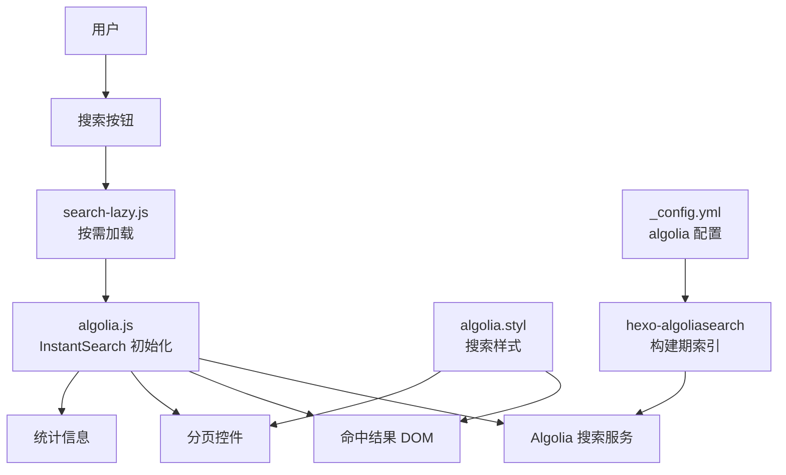
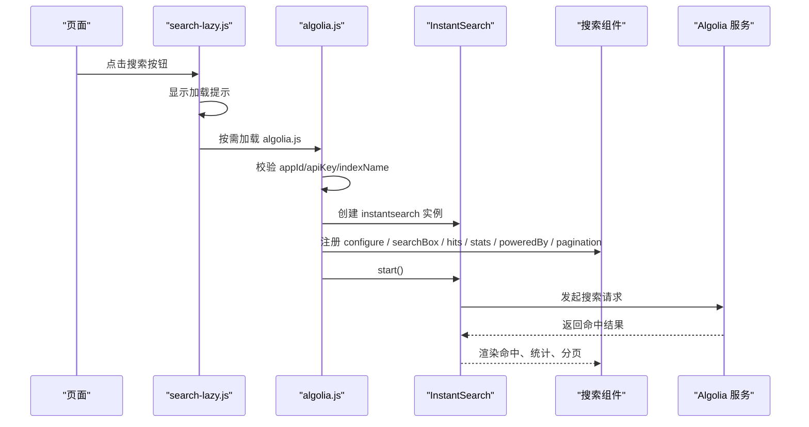
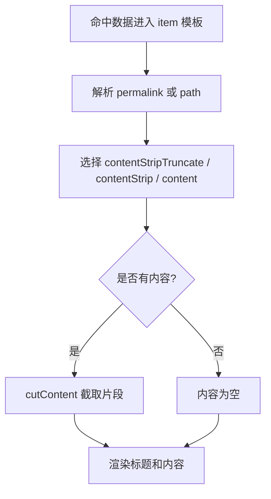

# Algolia 搜索引擎集成

<cite>
**本文引用的文件**   
- [algolia.js](file://themes/fomalhaut/source/js/search/algolia.js)
- [search-lazy.js](file://source/js/inject/search-lazy.js)
- [_config.yml](file://_config.yml)
- [_config.fomalhaut.yml](file://_config.fomalhaut.yml)
- [algolia.styl](file://themes/fomalhaut/source/css/_search/algolia.styl)
- [README.md](file://README.md)
</cite>

## 目录
1. [简介](#简介)
2. [项目结构中的搜索相关位置](#项目结构中的搜索相关位置)
3. [Algolia 配置参数说明](#algolia-配置参数说明)
4. [InstantSearch.js 初始化流程](#instantsearchjs-初始化流程)
5. [搜索结果展示机制](#搜索结果展示机制)
6. [搜索界面交互设计](#搜索界面交互设计)
7. [Algolia 索引构建流程](#algolia-索引构建流程)
8. [部署与运行环境要点](#部署与运行环境要点)
9. [故障排除指南](#故障排除指南)
10. [性能优化建议](#性能优化建议)
11. [结论](#结论)

## 简介
本技术文档围绕仓库中基于 Hexo + Butterfly/Fomalhaut 主题的 Algolia 云搜索实现，系统性说明以下方面：
- Algolia 的 `appId`、`apiKey`、`indexName` 等关键配置来源与作用。
- InstantSearch.js 的初始化过程，包括搜索客户端、搜索函数、组件注册。
- 搜索结果模板、内容截取算法、高亮显示逻辑。
- 搜索框行为、分页控制、空结果处理、面板开关与懒加载。
- 通过 `hexo-algoliasearch` 插件进行索引构建、字段选择与推送命令。
- 常见问题定位方法、错误提示路径以及可操作的排错步骤。

该方案的核心特点是：**前端使用 InstantSearch.js 渲染搜索面板，后端通过 Hexo 构建期插件把文章内容推送到 Algolia 索引**。

**章节来源**
- [README.md:786-818](file://README.md#L786-L818)
- [_config.yml:145-167](file://_config.yml#L145-L167)

## 项目结构中的搜索相关位置
Algolia 搜索在项目中由“主题脚本 + 注入脚本 + 主题样式 + 站点配置 + 构建插件”共同组成：

| 层级 | 文件 | 职责 |
|---|---|---|
| 主题运行时脚本 | `themes/fomalhaut/source/js/search/algolia.js` | 打开搜索面板、初始化 InstantSearch、注册搜索框、命中、统计、分页等组件 |
| 按需加载脚本 | `source/js/inject/search-lazy.js` | 点击搜索按钮后才加载 Algolia 资源，提供加载提示、失败回退、搜索历史、结果链接修正 |
| 主题样式 | `themes/fomalhaut/source/css/_search/algolia.styl` | 搜索弹窗、输入框、命中列表、分页、信息栏样式 |
| 站点配置 | `_config.yml` | 定义 `algolia` 配置段、启用 `hexo-algoliasearch` 插件 |
| 主题搜索开关 | `_config.fomalhaut.yml` | 控制 `algolia_search.enable`、每页命中数、文案标签 |
| 文档说明 | `README.md` | 说明 Algolia 搜索方案、索引推送命令与懒加载关系 |



**图表来源**
- [search-lazy.js:1-77](file://source/js/inject/search-lazy.js#L1-L77)
- [algolia.js:1-165](file://themes/fomalhaut/source/js/search/algolia.js#L1-L165)
- [algolia.styl:1-157](file://themes/fomalhaut/source/css/_search/algolia.styl#L1-L157)
- [_config.yml:151-167](file://_config.yml#L151-L167)

**章节来源**
- [algolia.js:1-165](file://themes/fomalhaut/source/js/search/algolia.js#L1-L165)
- [search-lazy.js:1-77](file://source/js/inject/search-lazy.js#L1-L77)
- [algolia.styl:1-157](file://themes/fomalhaut/source/css/_search/algolia.styl#L1-L157)
- [_config.yml:145-167](file://_config.yml#L145-L167)
- [_config.fomalhaut.yml:69-78](file://_config.fomalhaut.yml#L69-L78)
- [README.md:786-818](file://README.md#L786-L818)

## Algolia 配置参数说明
### 核心配置位置
Algolia 的前端访问配置位于站点级配置文件 `_config.yml` 的 `algolia` 段。当前仓库启用的是支持内容匹配的 `hexo-algoliasearch` 方案，而不是仅匹配标题的旧版 `hexo-algolia`。

关键配置项如下：

| 配置键 | 含义 | 说明 |
|---|---|---|
| `appId` | Algolia 应用 ID | 用于前端创建搜索客户端 |
| `apiKey` | 搜索 API Key | 前端只应使用可读权限的 Key |
| `adminApiKey` | 管理 API Key | 构建期推送索引时使用 |
| `chunkSize` | 分块大小 | 批量写入 Algolia 时每条请求的数据量 |
| `indexName` | 索引名称 | 前端搜索和后端索引都指向同一个索引名 |
| `fields` | 索引字段 | 指定要索引的内容、摘要、链接、标题等字段 |

### 前端读取方式
主题脚本 `algolia.js` 从全局配置对象 `GLOBAL_CONFIG.algolia` 中读取 `appId`、`apiKey`、`indexName`，并在三者都存在时才继续初始化；否则输出错误日志并退出。

这意味着：
- 如果这三个字段缺失或为空，搜索功能不会报错到页面，而是静默失败。
- 排查时应优先检查 `_config.yml` 是否已替换占位值，以及主题是否正确把站点配置注入为 `GLOBAL_CONFIG.algolia`。

### 主题搜索开关与文案
主题级配置 `_config.fomalhaut.yml` 中的 `algolia_search` 控制搜索功能的可见性与 UI 文案：

| 配置项 | 作用 |
|---|---|
| `algolia_search.enable` | 是否启用 Algolia 搜索入口 |
| `algolia_search.hits.per_page` | 主题层显示的每页命中数量 |
| `algolia_search.labels.input_placeholder` | 搜索框占位文案 |
| `algolia_search.labels.hits_empty` | 无结果时的提示文案 |
| `algolia_search.labels.hits_stats` | 搜索结果统计文案 |

注意：主题层的 `hits.per_page` 是 UI 展示层配置，而 InstantSearch 内部还通过 `configure` 组件设置了 `hitsPerPage: 5`。两者可能产生不一致，需要按实际体验调整。

**章节来源**
- [_config.yml:151-167](file://_config.yml#L151-L167)
- [algolia.js:63-67](file://themes/fomalhaut/source/js/search/algolia.js#L63-L67)
- [_config.fomalhaut.yml:69-78](file://_config.fomalhaut.yml#L69-L78)

## InstantSearch.js 初始化流程
### 初始化入口
主题脚本 `algolia.js` 在 `window.load` 事件后执行。它首先定义打开和关闭搜索面板的方法，然后绑定搜索按钮、遮罩和关闭按钮事件。

初始化顺序大致如下：



**图表来源**
- [search-lazy.js:470-506](file://source/js/inject/search-lazy.js#L470-L506)
- [algolia.js:1-165](file://themes/fomalhaut/source/js/search/algolia.js#L1-L165)

### 搜索客户端配置
InstantSearch 实例通过以下方式创建：

| 配置项 | 值来源 | 作用 |
|---|---|---|
| `indexName` | `GLOBAL_CONFIG.algolia.indexName` | 指定查询的 Algolia 索引 |
| `searchClient` | `algoliasearch(appId, apiKey)` | 使用 Algolia 轻量客户端连接服务 |
| `searchFunction` | 自定义函数 | 只有当查询字符串存在时才调用 `helper.search()` |

其中 `searchAsYouType: false` 表示不是每次输入都触发搜索，而是依赖回车或提交按钮触发。配合 `showSubmit: true`，用户可以点击搜索按钮发起查询。

### 组件注册
主题注册的 InstantSearch 组件包括：

| 组件 | 容器 | 主要职责 |
|---|---|---|
| `configure` | 无容器 | 设置 `hitsPerPage: 5` |
| `searchBox` | `#algolia-search-input` | 搜索输入框 |
| `hits` | `#algolia-hits` | 搜索结果条目 |
| `stats` | `#algolia-info > .algolia-stats` | 显示命中数量和耗时 |
| `poweredBy` | `#algolia-info > .algolia-poweredBy` | 显示 Algolia 标识 |
| `pagination` | `#algolia-pagination` | 翻页控件 |

这些组件通过 `search.addWidgets([...])` 统一注册，再调用 `search.start()` 启动。

**章节来源**
- [algolia.js:69-151](file://themes/fomalhaut/source/js/search/algolia.js#L69-L151)

## 搜索结果展示机制
### 命中结果模板
`hits` 组件的 `item` 模板负责渲染单条结果。其核心逻辑是：

1. 解析跳转链接：优先使用数据中的 `permalink`，否则拼接根路径和 `path`。
2. 解析高亮内容：优先取 `contentStripTruncate`，其次 `contentStrip`，最后 `content`。
3. 对内容调用本地截取函数，生成带省略号的预览文本。
4. 标题来自 `_highlightResult.title.value`。
5. 内容来自 `_highlightResult.content*` 对应字段。



**图表来源**
- [algolia.js:90-117](file://themes/fomalhaut/source/js/search/algolia.js#L90-L117)

### 内容截取算法
`cutContent` 是一个简单的片段截取函数，逻辑如下：

| 步骤 | 行为 |
|---|---|
| 空内容判断 | 如果内容为空，直接返回空字符串 |
| 定位高亮标记 | 查找第一个 `<mark>` 的位置 |
| 计算起始位置 | 以高亮位置前 30 字符作为起点 |
| 计算结束位置 | 以高亮位置后 120 字符作为终点 |
| 边界处理 | 起点小于 0 时从开头开始；终点超过长度时截到末尾 |
| 省略号 | 开头或结尾被截断时添加省略号 |

该算法适合快速展示命中上下文，但属于简单字符串截取，不保证 HTML 标签完整闭合。若索引内容包含大量富文本，可能出现轻微 HTML 结构异常。

**章节来源**
- [algolia.js:36-61](file://themes/fomalhaut/source/js/search/algolia.js#L36-L61)
- [algolia.js:90-117](file://themes/fomalhaut/source/js/search/algolia.js#L90-L117)

### 高亮显示
高亮由 Algolia 服务端返回的 `_highlightResult` 提供。主题模板直接使用高亮后的值，例如：

- 标题高亮：`result.title.value`
- 内容高亮：`result.contentStripTruncate.value`、`result.contentStrip.value`、`result.content.value`

样式层面，`algolia.styl` 中对 `mark` 标签做了高亮颜色处理，背景透明、文字加粗并使用搜索关键词高亮色。

**章节来源**
- [algolia.js:92-107](file://themes/fomalhaut/source/js/search/algolia.js#L92-L107)
- [algolia.styl:74-77](file://themes/fomalhaut/source/css/_search/algolia.styl#L74-L77)

## 搜索界面交互设计
### 搜索框行为
搜索框通过 InstantSearch 的 `searchBox` 组件渲染到 `#algolia-search-input`。其行为特点：

- 不显示重置按钮。
- 显示提交按钮。
- 关闭自动搜索，改为手动触发。
- 占位文案来自主题配置 `GLOBAL_CONFIG.algolia.languages.input_placeholder`。
- 显示加载指示器。

此外，`search-lazy.js` 在库就绪后会尝试聚焦 `.ais-SearchBox-input`，提升用户体验。

**章节来源**
- [algolia.js:81-88](file://themes/fomalhaut/source/js/search/algolia.js#L81-L88)
- [search-lazy.js:300-303](file://source/js/inject/search-lazy.js#L300-L303)

### 分页控制
分页组件挂载到 `#algolia-pagination`，并设置：

- `totalPages: 5`
- 首页、末页、上一页、下一页图标使用 Font Awesome 类名

需要注意的是，`configure` 组件设置了 `hitsPerPage: 5`，而分页组件又固定了 `totalPages: 5`。这表示最多显示 25 条结果，超出部分不会动态扩展。若索引量很大，建议根据实际需求调整这两个值。

**章节来源**
- [algolia.js:77-79](file://themes/fomalhaut/source/js/search/algolia.js#L77-L79)
- [algolia.js:137-146](file://themes/fomalhaut/source/js/search/algolia.js#L137-L146)

### 空结果处理
当没有命中结果时，`hits` 组件的 `empty` 模板会渲染一个带有 `id="algolia-hits-empty"` 的提示节点。文案来自主题配置 `GLOBAL_CONFIG.algolia.languages.hits_empty`，并通过 `${query}` 替换为用户输入的查询词。

**章节来源**
- [algolia.js:109-116](file://themes/fomalhaut/source/js/search/algolia.js#L109-L116)

### 面板开关与遮罩
主题脚本定义了 `openSearch` 和 `closeSearch`：

- 打开时锁定 body 滚动，显示遮罩和搜索对话框，延迟聚焦输入框。
- 关闭时恢复 body 样式，播放关闭动画。
- 支持 ESC 快捷键关闭。
- 点击遮罩或关闭按钮也会关闭面板。
- 在 pjax 完成后重新绑定按钮事件。

`search-lazy.js` 在库未就绪时接管面板开关，避免用户看到空白面板。

**章节来源**
- [algolia.js:2-34](file://themes/fomalhaut/source/js/search/algolia.js#L2-L34)
- [algolia.js:156-163](file://themes/fomalhaut/source/js/search/algolia.js#L156-L163)
- [search-lazy.js:264-303](file://source/js/inject/search-lazy.js#L264-L303)

### 搜索历史
`search-lazy.js` 实现了本地搜索历史：

- 存储键：`search-history-v1`
- 最大记录数：8
- 去重、最新在前
- 支持单条删除和清空
- 在搜索框下方显示
- 输入时收起，打开面板时恢复显示
- 点击历史记录会重新发起搜索

历史记录通过捕获阶段事件监听，避免被 InstantSearch 自身的事件处理干扰。

**章节来源**
- [search-lazy.js:305-468](file://source/js/inject/search-lazy.js#L305-L468)

## Algolia 索引构建流程
### 构建插件
项目在 `_config.yml` 中启用了 `hexo-algoliasearch` 插件，并在 `package.json` 中声明了依赖。该插件的作用是在 `hexo generate` 或专用命令期间，读取文章内容并推送到 Algolia 索引。

### 索引字段
`fields` 配置决定哪些字段会被写入 Algolia 索引。当前配置包含：

| 字段 | 用途 |
|---|---|
| `content:strip:truncate,0,30000` | 正文内容，去除 HTML 标签并截断到 30000 字符 |
| `excerpt:strip` | 文章摘要，去除 HTML 标签 |
| `gallery` | 相册相关字段 |
| `permalink` | 永久链接 |
| `photos` | 图片字段 |
| `slug` | 文章 slug |
| `tags` | 标签 |
| `title` | 标题 |

这些字段决定了前端 `_highlightResult` 中可用的内容。例如，前端优先读取 `contentStripTruncate`，因此后端必须确保该字段存在。

### 推送命令
根据 README 说明，完成配置后应执行：

```bash
npx hexo algolia
```

该命令会把站点内容推送到 Algolia。推送成功后，再执行：

```bash
npx hexo generate
```

生成静态页面，使前端能够读取到正确的索引数据。

**章节来源**
- [_config.yml:151-167](file://_config.yml#L151-L167)
- [_config.yml:270-272](file://_config.yml#L270-L272)
- [README.md:818](file://README.md#L818)

## 部署与运行环境要点
### 前端资源加载
主题默认会在页面中引入 Algolia 相关脚本。为了减少首屏负担，项目引入了 `search-lazy.js`，将 Algolia 资源改为按需加载：

- 空闲时预取三个脚本：`algoliasearch-lite.umd.js`、`instantsearch.production.min.js`、`/js/search/algolia.js`。
- 点击搜索按钮时再真正加载和执行。
- 如果加载失败，显示错误提示并允许重试。
- 如果主题脚本因配置无效而静默退出，会检测搜索框是否存在，并给出提示。

### CDN 配置
`search-lazy.js` 不写死 Algolia 脚本地址，而是从 `window.__SEARCH_LAZY__` 读取主题注入的 CDN 配置。该配置来源于 `_config.fomalhaut.yml` 的 CDN 选项。更换 CDN 时只需修改配置，不需要改动懒加载脚本。

### 结果链接修正
由于 Algolia 索引中的链接是构建时按站点 URL 生成的绝对地址，本地预览或镜像域名下点击结果可能会跳转到正式站。`search-lazy.js` 通过 `MutationObserver` 把与当前站点不同源的链接改写为相对路径，保证点击结果留在当前站点。

**章节来源**
- [search-lazy.js:1-77](file://source/js/inject/search-lazy.js#L1-L77)
- [search-lazy.js:227-262](file://source/js/inject/search-lazy.js#L227-L262)
- [search-lazy.js:138-177](file://source/js/inject/search-lazy.js#L138-L177)

## 故障排除指南
### 搜索面板打开后一直显示加载中
常见原因：

1. Algolia 脚本加载失败。
2. 主题脚本因 `appId`、`apiKey`、`indexName` 缺失而静默退出。
3. InstantSearch 初始化成功，但没有渲染出搜索框。

排查步骤：

1. 打开浏览器控制台，查看 `[search-lazy]` 开头的日志。
2. 检查网络面板中 `algoliasearch-lite.umd.js`、`instantsearch.production.min.js`、`/js/search/algolia.js` 是否加载成功。
3. 检查 `_config.yml` 中的 `algolia.appId`、`algolia.apiKey`、`algolia.indexName` 是否为真实值。
4. 确认是否执行过 `npx hexo algolia` 推送索引。

**章节来源**
- [search-lazy.js:35-51](file://source/js/inject/search-lazy.js#L35-L51)
- [search-lazy.js:157-176](file://source/js/inject/search-lazy.js#L157-L176)
- [algolia.js:63-67](file://themes/fomalhaut/source/js/search/algolia.js#L63-L67)

### 搜索框始终为空或无法聚焦
可能原因：

- 主题脚本未执行。
- 配置校验失败提前 return。
- 懒加载脚本检测到搜索框未渲染，主动回退。

排查重点：

1. 确认 `GLOBAL_CONFIG.algolia` 是否存在且包含必要字段。
2. 确认 `search-lazy.js` 是否成功执行。
3. 检查 `#algolia-search .ais-SearchBox-input` 是否存在。

**章节来源**
- [algolia.js:63-67](file://themes/fomalhaut/source/js/search/algolia.js#L63-L67)
- [search-lazy.js:157-164](file://source/js/inject/search-lazy.js#L157-L164)

### 搜索结果跳转到正式站而非本地预览
这是预期行为修复前的问题。`search-lazy.js` 已经通过 MutationObserver 把非同源链接改写为相对路径，从而让本地预览和镜像域名下的搜索结果留在当前站点。

如果仍然跳转，请检查：

1. 是否加载了旧版本脚本。
2. 是否禁用了 `search-lazy.js`。
3. 搜索结果 DOM 是否被其他脚本覆盖。

**章节来源**
- [search-lazy.js:56-61](file://source/js/inject/search-lazy.js#L56-L61)
- [search-lazy.js:227-262](file://source/js/inject/search-lazy.js#L227-L262)

### 搜索结果为空
可能原因：

1. 未执行 `npx hexo algolia`。
2. `indexName` 与 Algolia 控制台中的索引名不一致。
3. 索引字段不包含正文内容。
4. Algolia 应用权限不足。

排查步骤：

1. 登录 Algolia 控制台，确认索引存在。
2. 核对 `_config.yml` 中的 `indexName`。
3. 检查 `fields` 是否包含 `content:strip:truncate`。
4. 确认 `apiKey` 是搜索 Key，而不是管理 Key。

**章节来源**
- [_config.yml:151-167](file://_config.yml#L151-L167)
- [README.md:818](file://README.md#L818)

### 搜索历史不显示或不生效
可能原因：

1. 搜索库尚未就绪。
2. 搜索框容器不存在。
3. localStorage 不可用或被清理。

排查重点：

1. 打开搜索面板后再查看搜索框下方是否出现历史区域。
2. 检查 `search-history-v1` 是否在 localStorage 中。
3. 确认 `setupHistory` 是否被执行。

**章节来源**
- [search-lazy.js:305-468](file://source/js/inject/search-lazy.js#L305-L468)

## 性能优化建议
### 保持按需加载
当前实现已经通过 `search-lazy.js` 将 Algolia 资源延迟到用户点击搜索时加载，避免首屏阻塞。建议不要移除该脚本，也不要改回主题默认的全局引入方式。

### 合理设置每页命中数
主题层和 InstantSearch 层分别有 `hits.per_page` 和 `hitsPerPage: 5`。如果希望搜索结果更多，应同时调整两处，避免分页总数与实际命中数不一致。

### 控制索引字段体积
`content:strip:truncate,0,30000` 会把长文内容截断到 30000 字符。对于大型站点，这会显著影响索引大小和传输体积。可根据文章平均长度适当调小该值。

### 避免重复初始化
主题脚本包裹在 `window.addEventListener('load', …)` 中。`search-lazy.js` 在页面已 load 的情况下临时接管 `addEventListener`，同步执行主题初始化回调。请勿重复注入主题脚本，否则可能造成多次初始化。

**章节来源**
- [search-lazy.js:1-77](file://source/js/inject/search-lazy.js#L1-L77)
- [search-lazy.js:110-136](file://source/js/inject/search-lazy.js#L110-L136)
- [algolia.js:77-79](file://themes/fomalhaut/source/js/search/algolia.js#L77-L79)
- [_config.yml:158-159](file://_config.yml#L158-L159)

## 结论
该项目的 Algolia 搜索集成采用“构建期索引 + 前端 InstantSearch 渲染”的经典架构。核心优势在于：

- 前端使用按需加载，避免首屏性能损失。
- 后端通过 `hexo-algoliasearch` 插件生成结构化索引，支持全文高亮。
- 搜索面板具备完整的交互能力：搜索框、命中列表、统计信息、分页、空结果提示。
- 搜索历史和本地链接修正提升了本地预览和镜像站点的可用性。

在实际使用中，最关键的是正确填写 `_config.yml` 中的 `appId`、`apiKey`、`indexName`，并确保执行 `npx hexo algolia` 推送索引。若遇到面板卡住、结果为空或链接跳转异常，应优先检查脚本加载状态、配置有效性以及索引是否存在。