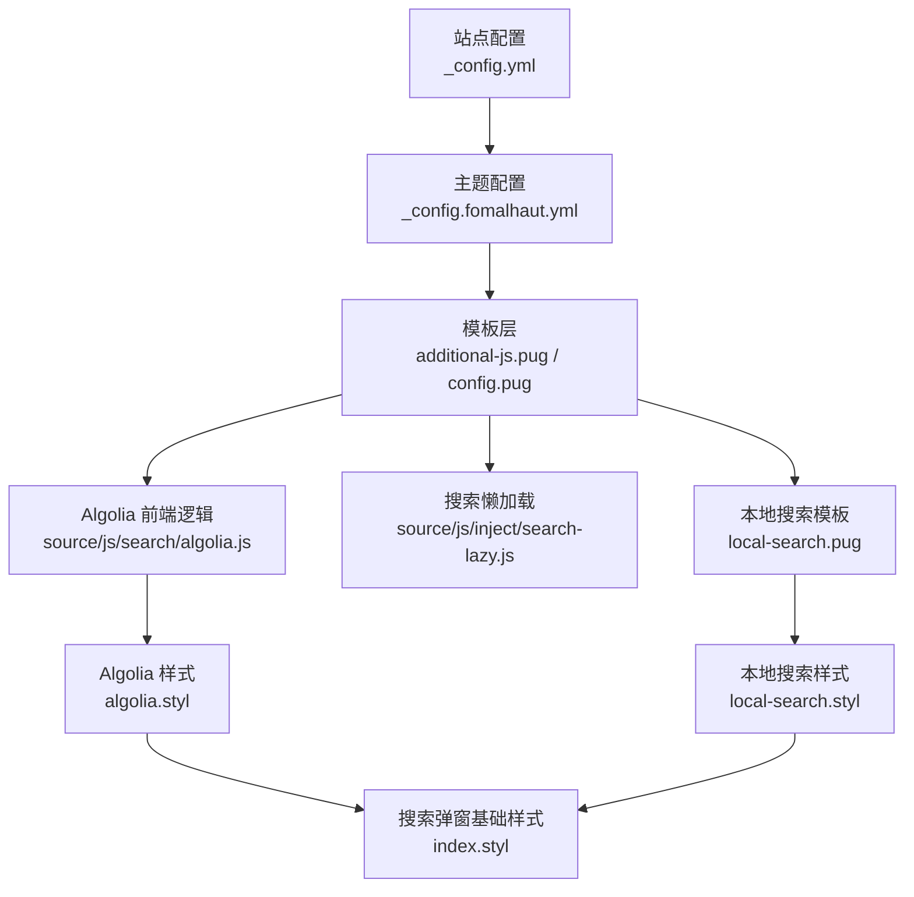
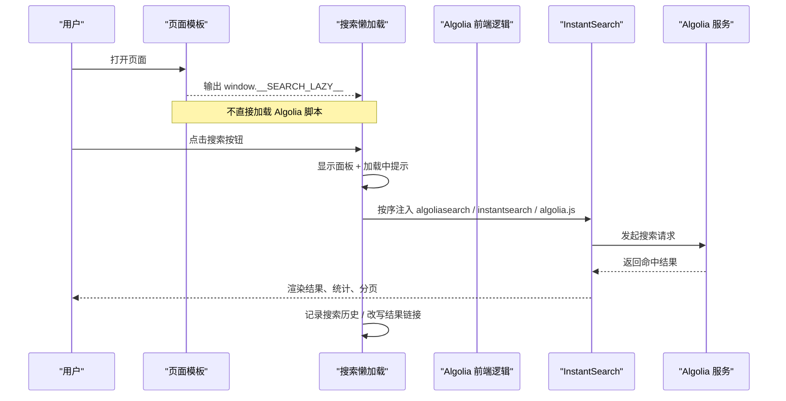
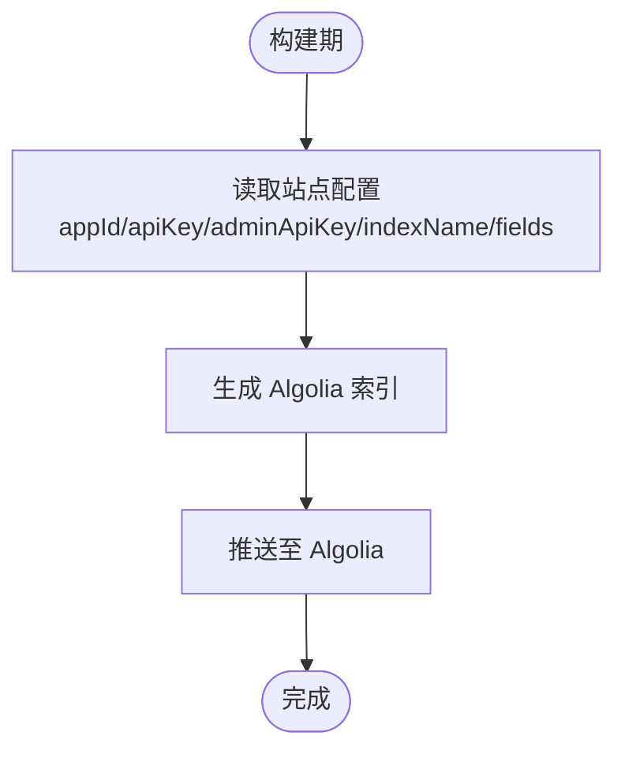
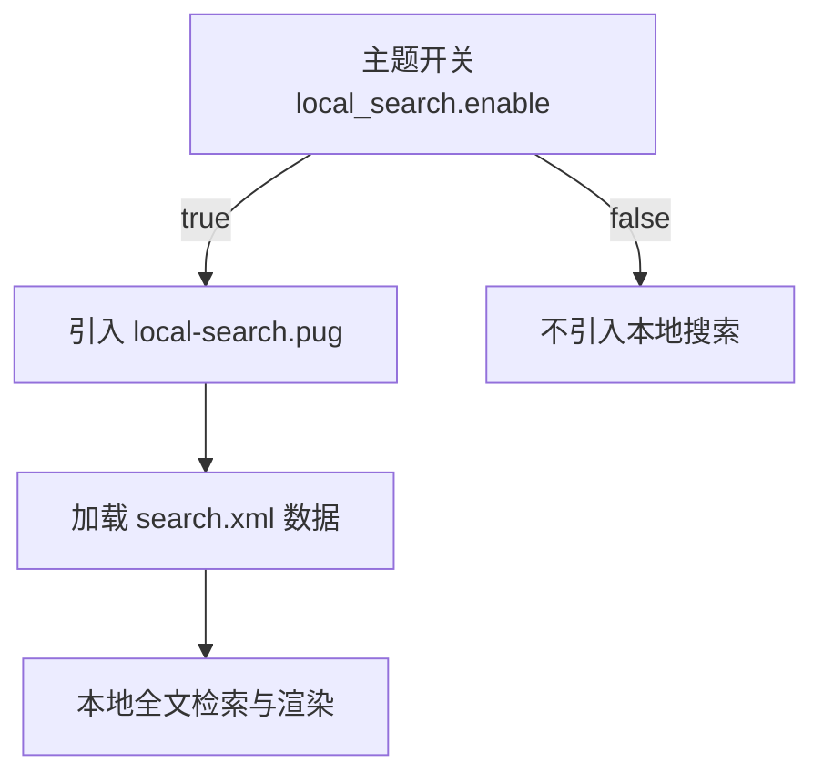
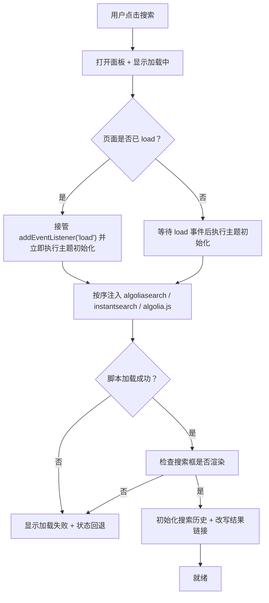
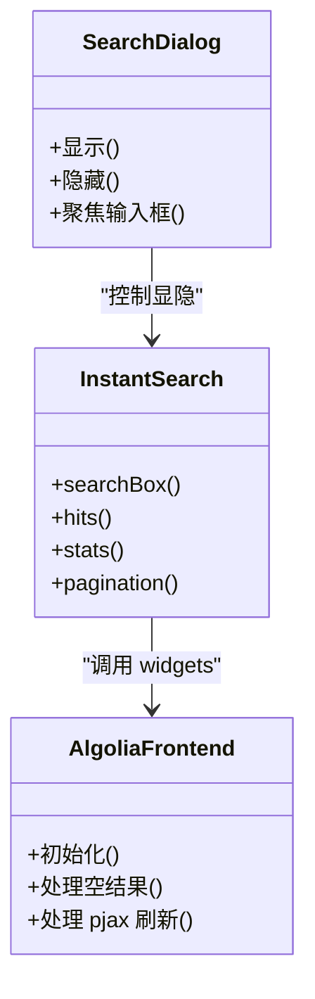
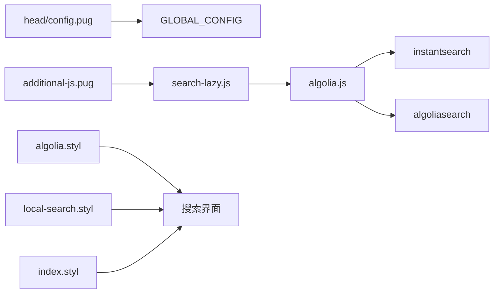

# 搜索系统集成

<cite>
**本文引用的文件**   
- [站点配置 _config.yml](file://_config.yml)
- [主题配置 _config.fomalhaut.yml](file://_config.fomalhaut.yml)
- [主题默认配置 themes/fomalhaut/_config.yml](file://themes/fomalhaut/_config.yml)
- [额外脚本注入 additional-js.pug](file://themes/fomalhaut/layout/includes/additional-js.pug)
- [全局配置注入 head/config.pug](file://themes/fomalhaut/layout/includes/head/config.pug)
- [第三方搜索入口 third-party/search/index.pug](file://themes/fomalhaut/layout/includes/third-party/search/index.pug)
- [本地搜索模板 local-search.pug](file://themes/fomalhaut/layout/includes/third-party/search/local-search.pug)
- [Algolia 前端逻辑 source/js/search/algolia.js](file://source/js/search/algolia.js)
- [搜索懒加载 source/js/inject/search-lazy.js](file://source/js/inject/search-lazy.js)
- [Algolia 样式 themes/fomalhaut/source/css/_search/algolia.styl](file://themes/fomalhaut/source/css/_search/algolia.styl)
- [本地搜索样式 themes/fomalhaut/source/css/_search/local-search.styl](file://themes/fomalhaut/source/css/_search/local-search.styl)
- [搜索弹窗基础样式 themes/fomalhaut/source/css/_search/index.styl](file://themes/fomalhaut/source/css/_search/index.styl)
</cite>

## 目录
1. [简介](#简介)
2. [项目结构](#项目结构)
3. [核心组件](#核心组件)
4. [架构总览](#架构总览)
5. [详细组件分析](#详细组件分析)
6. [依赖关系分析](#依赖关系分析)
7. [性能与优化](#性能与优化)
8. [部署指南](#部署指南)
9. [故障排除](#故障排除)
10. [结论](#结论)

## 简介
本项目基于 Hexo + Butterfly 主题构建，提供两套搜索能力：
- Algolia 云端搜索：通过 hexo-algoliasearch 插件在构建期生成索引并推送到 Algolia，前端使用 InstantSearch 渲染搜索框、结果、统计与分页。
- 本地搜索：由主题内置的本地搜索 UI 与数据源（search.xml）组成，当前仓库中本地搜索开关关闭，但模板与样式仍保留。

此外，项目对 Algolia 搜索进行了“按需加载”改造：不再在每页阻塞式加载 Algolia 相关脚本，改为空闲预取 + 点击时再执行，显著降低首屏开销；同时修复了搜索结果链接在不同域名下的跳转问题，并新增搜索历史。

## 项目结构
搜索相关代码主要分布在以下位置：
- 站点级配置：定义 Algolia 索引字段、chunkSize、indexName 等。
- 主题级配置：控制是否启用 Algolia 或本地搜索、UI 文案、分页条数等。
- 模板层：根据主题开关决定引入 Algolia 或本地搜索 UI。
- 前端脚本：Algolia 初始化逻辑、搜索懒加载逻辑。
- 样式层：搜索弹窗、输入框、结果列表、分页等视觉表现。

**图示来源**
- [站点配置 _config.yml:145-191](file://_config.yml#L145-L191)
- [主题配置 _config.fomalhaut.yml:65-84](file://_config.fomalhaut.yml#L65-L84)
- [额外脚本注入 additional-js.pug:25-35](file://themes/fomalhaut/layout/includes/additional-js.pug#L25-L35)
- [全局配置注入 head/config.pug:1-29](file://themes/fomalhaut/layout/includes/head/config.pug#L1-L29)
- [Algolia 前端逻辑 source/js/search/algolia.js:63-151](file://source/js/search/algolia.js#L63-L151)
- [搜索懒加载 source/js/inject/search-lazy.js:1-77](file://source/js/inject/search-lazy.js#L1-L77)
- [本地搜索模板 local-search.pug:1-20](file://themes/fomalhaut/layout/includes/third-party/search/local-search.pug#L1-L20)
- [Algolia 样式 algolia.styl:1-157](file://themes/fomalhaut/source/css/_search/algolia.styl#L1-L157)
- [本地搜索样式 local-search.styl:1-67](file://themes/fomalhaut/source/css/_search/local-search.styl#L1-L67)
- [搜索弹窗基础样式 index.styl:1-49](file://themes/fomalhaut/source/css/_search/index.styl#L1-L49)

**章节来源**
- [站点配置 _config.yml:145-191](file://_config.yml#L145-L191)
- [主题配置 _config.fomalhaut.yml:65-84](file://_config.fomalhaut.yml#L65-L84)
- [额外脚本注入 additional-js.pug:25-35](file://themes/fomalhaut/layout/includes/additional-js.pug#L25-L35)
- [全局配置注入 head/config.pug:1-29](file://themes/fomalhaut/layout/includes/head/config.pug#L1-L29)

## 核心组件
- 站点级 Algolia 配置：定义 appId、apiKey、adminApiKey、indexName、fields 等，用于构建期索引生成。
- 主题级搜索开关：algolia_search.enable 控制是否启用 Algolia；local_search.enable 控制是否启用本地搜索。
- 模板注入层：根据开关输出 GLOBAL_CONFIG 和 window.__SEARCH_LAZY__，供前端脚本消费。
- Algolia 前端逻辑：InstantSearch 实例化、搜索框、结果高亮、统计、分页。
- 搜索懒加载：空闲预取脚本、点击兜底加载、错误提示、搜索历史、结果链接改写。
- 本地搜索 UI：对话框、输入框、结果容器、遮罩层。
- 样式体系：Algolia 与本地搜索各自样式，以及公共弹窗样式。

**章节来源**
- [站点配置 _config.yml:145-191](file://_config.yml#L145-L191)
- [主题配置 _config.fomalhaut.yml:65-84](file://_config.fomalhaut.yml#L65-L84)
- [主题默认配置 themes/fomalhaut/_config.yml:41-56](file://themes/fomalhaut/_config.yml#L41-L56)
- [额外脚本注入 additional-js.pug:25-35](file://themes/fomalhaut/layout/includes/additional-js.pug#L25-L35)
- [全局配置注入 head/config.pug:1-29](file://themes/fomalhaut/layout/includes/head/config.pug#L1-L29)
- [Algolia 前端逻辑 source/js/search/algolia.js:63-151](file://source/js/search/algolia.js#L63-L151)
- [搜索懒加载 source/js/inject/search-lazy.js:1-77](file://source/js/inject/search-lazy.js#L1-L77)
- [本地搜索模板 local-search.pug:1-20](file://themes/fomalhaut/layout/includes/third-party/search/local-search.pug#L1-L20)

## 架构总览
搜索系统分为三层：
- 构建期：hexo-algoliasearch 读取站点配置，生成 Algolia 索引。
- 运行期（前端）：主题模板注入配置，Algolia 前端脚本初始化 InstantSearch，懒加载脚本负责按需加载与交互增强。
- 展示层：Algolia 与本地搜索共用弹窗样式，分别渲染输入框、结果、统计与分页。

**图示来源**
- [额外脚本注入 additional-js.pug:25-35](file://themes/fomalhaut/layout/includes/additional-js.pug#L25-L35)
- [搜索懒加载 source/js/inject/search-lazy.js:78-177](file://source/js/inject/search-lazy.js#L78-L177)
- [Algolia 前端逻辑 source/js/search/algolia.js:63-151](file://source/js/search/algolia.js#L63-L151)

## 详细组件分析

### Algolia 搜索引擎集成
- 索引构建：站点配置中启用 hexo-algoliasearch，设置 appId、apiKey、adminApiKey、indexName、fields 等。fields 包含 content 截断、excerpt、permalink、tags、title 等，便于前端高亮与摘要展示。
- 搜索配置：主题配置开启 algolia_search.enable，设置 hits.per_page 与 labels 文案。模板层将 appId/apiKey/indexName 注入 GLOBAL_CONFIG.algolia。
- 结果展示：InstantSearch 初始化 searchBox、hits、stats、poweredBy、pagination，支持回车或点击按钮触发搜索，避免每次输入都请求。

**图示来源**
- [站点配置 _config.yml:145-167](file://_config.yml#L145-L167)

**章节来源**
- [站点配置 _config.yml:145-167](file://_config.yml#L145-L167)
- [主题配置 _config.fomalhaut.yml:69-77](file://_config.fomalhaut.yml#L69-L77)
- [全局配置注入 head/config.pug:1-17](file://themes/fomalhaut/layout/includes/head/config.pug#L1-L17)
- [Algolia 前端逻辑 source/js/search/algolia.js:63-151](file://source/js/search/algolia.js#L63-L151)

### 本地搜索实现原理
- UI 模板：local-search.pug 定义搜索对话框、输入框、结果容器与遮罩层。
- 数据源：站点配置 search.path 指向 search.xml，主题模板根据 theme.local_search.enable 决定是否引入本地搜索脚本与样式。
- 分词与排序：仓库未包含本地搜索 JS 实现，具体分词算法与排序策略由主题提供的本地搜索脚本决定；当前本地搜索开关为 false，因此该路径不参与运行时。

**图示来源**
- [本地搜索模板 local-search.pug:1-20](file://themes/fomalhaut/layout/includes/third-party/search/local-search.pug#L1-L20)
- [站点配置 _config.yml:186-191](file://_config.yml#L186-L191)
- [主题配置 _config.fomalhaut.yml:79-84](file://_config.fomalhaut.yml#L79-L84)

**章节来源**
- [本地搜索模板 local-search.pug:1-20](file://themes/fomalhaut/layout/includes/third-party/search/local-search.pug#L1-L20)
- [站点配置 _config.yml:186-191](file://_config.yml#L186-L191)
- [主题配置 _config.fomalhaut.yml:79-84](file://_config.fomalhaut.yml#L79-L84)

### 搜索懒加载机制
- 空闲预取：页面 load 后使用 requestIdleCallback 插入 <link rel=prefetch>，仅下载不执行，避免阻塞首屏。
- 点击兜底：若用户提前点击搜索，先打开面板并显示“正在加载”，再按序注入 algoliasearch、instantsearch、algolia.js；若页面已 load，则临时接管 addEventListener('load') 以同步执行主题初始化逻辑。
- 失败可见：脚本 onerror 会 reject，显示“加载失败”并允许重试；若主题 algolia.js 因配置无效静默 return，则在就绪后检测 .ais-SearchBox-input 是否存在，不存在则提示。
- 搜索历史：localStorage['search-history-v1']，最多 8 条、去重、最新在前；支持单条删除与清空；在输入、提交、点击历史条目时记录。
- 结果链接改写：MutationObserver 监听 #algolia-hits，将与当前站点不同源的链接改写为根路径形式，保证本地预览或镜像域名下点击留在站内。

**图示来源**
- [搜索懒加载 source/js/inject/search-lazy.js:78-177](file://source/js/inject/search-lazy.js#L78-L177)
- [搜索懒加载 source/js/inject/search-lazy.js:227-262](file://source/js/inject/search-lazy.js#L227-L262)
- [搜索懒加载 source/js/inject/search-lazy.js:305-467](file://source/js/inject/search-lazy.js#L305-L467)

**章节来源**
- [搜索懒加载 source/js/inject/search-lazy.js:1-77](file://source/js/inject/search-lazy.js#L1-L77)
- [搜索懒加载 source/js/inject/search-lazy.js:78-177](file://source/js/inject/search-lazy.js#L78-L177)
- [搜索懒加载 source/js/inject/search-lazy.js:227-262](file://source/js/inject/search-lazy.js#L227-L262)
- [搜索懒加载 source/js/inject/search-lazy.js:305-467](file://source/js/inject/search-lazy.js#L305-L467)

### 搜索界面交互设计
- 输入提示：searchAsYouType 关闭，支持回车或点击按钮触发搜索，减少频繁请求。
- 结果高亮：InstantSearch 返回 _highlightResult，前端优先使用 contentStripTruncate 或 contentStrip 进行摘要截取与高亮。
- 分页加载：pagination 组件固定 totalPages=5，配合 stats 显示命中数量与耗时。
- 弹窗与遮罩：公共样式定义 .search-dialog 与 #search-mask，移动端全屏适配。

**图示来源**
- [Algolia 前端逻辑 source/js/search/algolia.js:63-151](file://source/js/search/algolia.js#L63-L151)
- [Algolia 样式 algolia.styl:1-157](file://themes/fomalhaut/source/css/_search/algolia.styl#L1-L157)
- [搜索弹窗基础样式 index.styl:1-49](file://themes/fomalhaut/source/css/_search/index.styl#L1-L49)

**章节来源**
- [Algolia 前端逻辑 source/js/search/algolia.js:63-151](file://source/js/search/algolia.js#L63-L151)
- [Algolia 样式 algolia.styl:1-157](file://themes/fomalhaut/source/css/_search/algolia.styl#L1-L157)
- [搜索弹窗基础样式 index.styl:1-49](file://themes/fomalhaut/source/css/_search/index.styl#L1-L49)

## 依赖关系分析
- 模板层依赖主题配置：additional-js.pug 根据 theme.algolia_search.enable 输出 window.__SEARCH_LAZY__，否则引入本地搜索脚本。
- 全局配置依赖环境变量：head/config.pug 从 process.env.ALGOLIA_* 或 config.algolia 读取 appId/apiKey/indexName，并注入 GLOBAL_CONFIG.algolia。
- 前端脚本依赖 InstantSearch：algolia.js 使用 algoliasearch 与 instantsearch 库，依赖主题 asset 路径解析。
- 样式依赖主题变量：搜索样式使用 $search-color、var(--search-bg) 等主题变量。

**图示来源**
- [全局配置注入 head/config.pug:1-29](file://themes/fomalhaut/layout/includes/head/config.pug#L1-L29)
- [额外脚本注入 additional-js.pug:25-35](file://themes/fomalhaut/layout/includes/additional-js.pug#L25-L35)
- [搜索懒加载 source/js/inject/search-lazy.js:78-177](file://source/js/inject/search-lazy.js#L78-L177)
- [Algolia 前端逻辑 source/js/search/algolia.js:63-151](file://source/js/search/algolia.js#L63-L151)
- [Algolia 样式 algolia.styl:1-157](file://themes/fomalhaut/source/css/_search/algolia.styl#L1-L157)
- [本地搜索样式 local-search.styl:1-67](file://themes/fomalhaut/source/css/_search/local-search.styl#L1-L67)
- [搜索弹窗基础样式 index.styl:1-49](file://themes/fomalhaut/source/css/_search/index.styl#L1-L49)

**章节来源**
- [全局配置注入 head/config.pug:1-29](file://themes/fomalhaut/layout/includes/head/config.pug#L1-L29)
- [额外脚本注入 additional-js.pug:25-35](file://themes/fomalhaut/layout/includes/additional-js.pug#L25-L35)
- [Algolia 前端逻辑 source/js/search/algolia.js:63-151](file://source/js/search/algolia.js#L63-L151)

## 性能与优化
- 按需加载：移除每页阻塞式加载 Algolia 三连脚本，改为空闲预取 + 点击执行，显著降低首屏带宽与解析开销。
- 请求去重：InstantSearch 的 searchFunction 仅在 helper.state.query 非空时触发搜索，避免空查询重复请求。
- 结果预取：prefetch 提前拉取脚本资源，提升首次搜索响应速度。
- 内存优化：懒加载脚本在库就绪后清理提示节点，避免残留 DOM；搜索历史限制长度并去重。
- 性能监控：stats 组件显示命中数量与耗时，便于观察搜索性能。

[本节为通用指导，不直接分析具体文件]

## 部署指南
- 构建期索引：
  - 在站点配置中填写 appId、apiKey、adminApiKey、indexName、fields。
  - 确保 plugins 中包含 hexo-algoliasearch。
- 运行期前端：
  - 主题配置开启 algolia_search.enable。
  - 保持 additional-js.pug 中的 window.__SEARCH_LAZY__ 输出，以便懒加载脚本消费。
  - 确保 head/config.pug 能正确注入 GLOBAL_CONFIG.algolia。
- 本地搜索（可选）：
  - 如需启用本地搜索，设置 theme.local_search.enable = true，并确保 search.xml 存在。
  - 注意当前仓库本地搜索开关为 false。

**章节来源**
- [站点配置 _config.yml:145-191](file://_config.yml#L145-L191)
- [主题配置 _config.fomalhaut.yml:69-84](file://_config.fomalhaut.yml#L69-L84)
- [额外脚本注入 additional-js.pug:25-35](file://themes/fomalhaut/layout/includes/additional-js.pug#L25-L35)
- [全局配置注入 head/config.pug:1-29](file://themes/fomalhaut/layout/includes/head/config.pug#L1-L29)

## 故障排除
- 搜索面板一直显示“正在加载”：
  - 检查脚本 onerror 是否被吞掉；当前实现会在失败时 reject 并显示错误提示。
  - 确认主题 algolia.js 能通过配置校验（appId/apiKey/indexName），否则会 console.error 并跳过初始化。
- 搜索结果链接跳转到正式站：
  - 当前已通过 MutationObserver 将不同源链接改写为根路径，确保本地预览或镜像域名下点击留在站内。
- 搜索框未渲染：
  - 懒加载脚本在就绪后 300ms 检查 .ais-SearchBox-input 是否存在，不存在则提示“搜索模块加载失败”。
- 本地搜索无结果：
  - 确认 theme.local_search.enable 为 true，且 search.xml 存在并可访问。

**章节来源**
- [搜索懒加载 source/js/inject/search-lazy.js:78-177](file://source/js/inject/search-lazy.js#L78-L177)
- [搜索懒加载 source/js/inject/search-lazy.js:227-262](file://source/js/inject/search-lazy.js#L227-L262)
- [Algolia 前端逻辑 source/js/search/algolia.js:63-67](file://source/js/search/algolia.js#L63-L67)

## 结论
本项目的搜索系统以 Algolia 为核心，结合主题模板与懒加载脚本，实现了高性能、低侵入的前端体验。构建期索引与运行期按需加载相结合，既保证了搜索质量，又避免了首屏性能损耗。本地搜索模板与样式完整保留，便于未来切换或扩展。通过 stats 与错误提示，运维者可快速定位问题并进行调优。