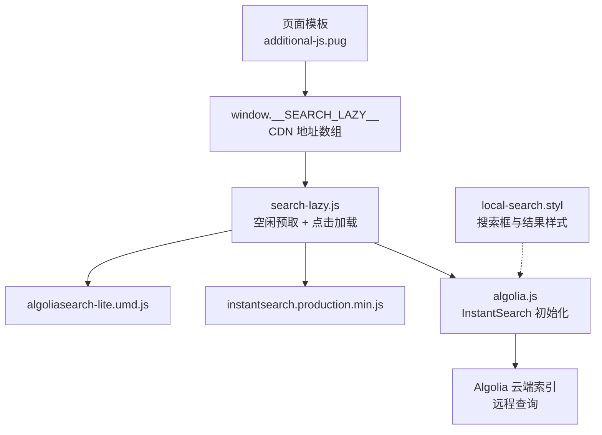
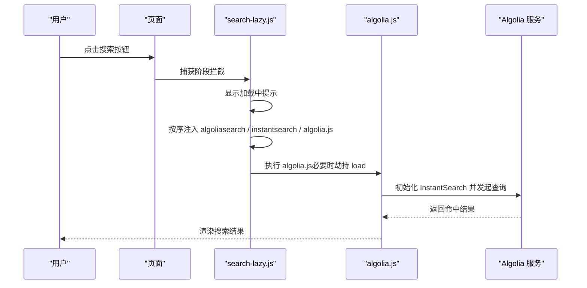
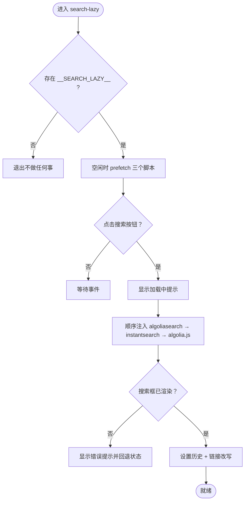
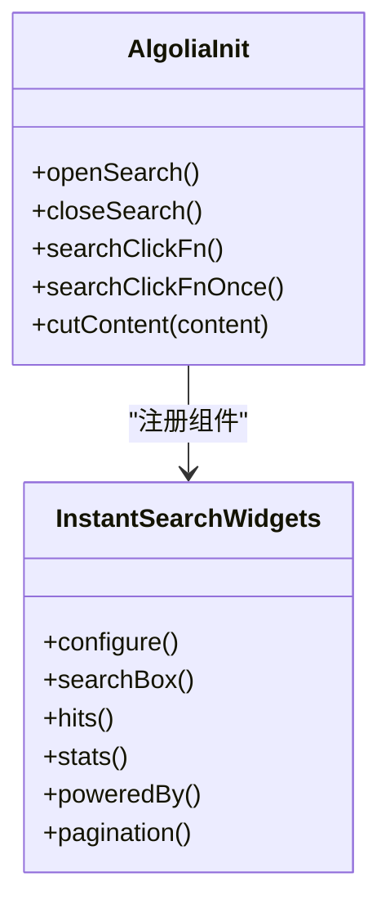
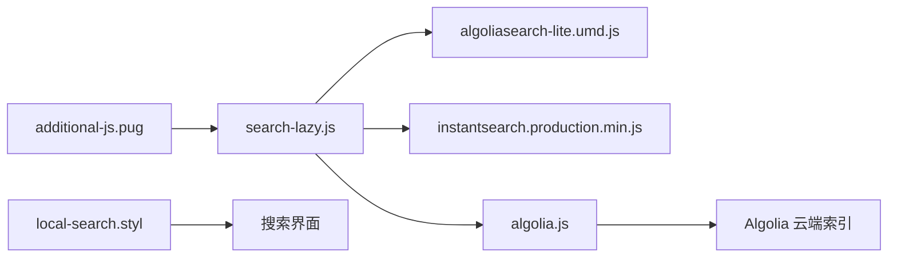
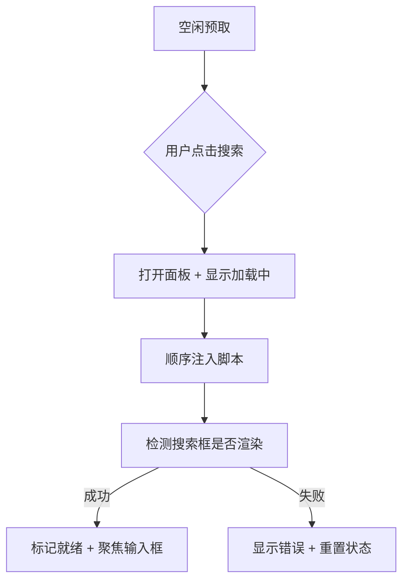
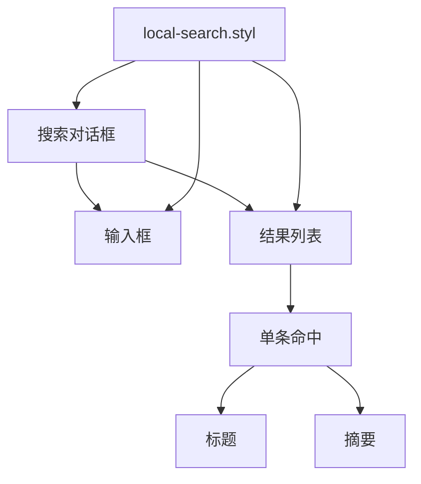

# 本地搜索实现

<cite>
**本文引用的文件**   
- [search-lazy.js](file://source/js/inject/search-lazy.js)
- [algolia.js](file://themes/fomalhaut/source/js/search/algolia.js)
- [additional-js.pug](file://themes/fomalhaut/layout/includes/additional-js.pug)
- [local-search.styl](file://themes/fomalhaut/source/css/_search/local-search.styl)
- [_config.fomalhaut.yml](file://_config.fomalhaut.yml)
</cite>

## 目录
1. [引言](#引言)
2. [项目结构](#项目结构)
3. [核心组件](#核心组件)
4. [架构总览](#架构总览)
5. [详细组件分析](#详细组件分析)
6. [依赖关系分析](#依赖关系分析)
7. [性能与懒加载机制](#性能与懒加载机制)
8. [数据结构与索引说明](#数据结构与索引说明)
9. [界面样式与响应式](#界面样式与响应式)
10. [配置项与自定义方法](#配置项与自定义方法)
11. [故障排查](#故障排查)
12. [结论](#结论)

## 引言
本项目当前默认启用的是基于 Algolia 的远程搜索能力，而非纯前端“本地全文索引”。仓库中确实存在“本地搜索”相关配置项与样式，但实际运行时并未启用本地搜索脚本；同时，主题对 Algolia 搜索做了“按需加载 + 空闲预取”的性能优化。因此，本文在严格依据源码的前提下，给出：
- 当前 Algolia 搜索的实现原理、数据流与界面样式；
- “本地搜索”在配置与样式层面的现状说明；
- 如何在此基础上扩展为真正的本地全文索引（方法论与步骤建议）。

## 项目结构
与搜索相关的代码主要分布在以下位置：
- 运行期注入与懒加载逻辑：`source/js/inject/search-lazy.js`
- 主题侧 Algolia 初始化与 UI 渲染：`themes/fomalhaut/source/js/search/algolia.js`
- 主题模板中按需注入脚本地址：`themes/fomalhaut/layout/includes/additional-js.pug`
- 搜索界面样式：`themes/fomalhaut/source/css/_search/local-search.styl`
- 主题配置（含 Algolia 与 local_search 占位）：`_config.fomalhaut.yml`

**图表来源**
- [additional-js.pug:25-35](file://themes/fomalhaut/layout/includes/additional-js.pug#L25-L35)
- [search-lazy.js:1-77](file://source/js/inject/search-lazy.js#L1-L77)
- [algolia.js:1-165](file://themes/fomalhaut/source/js/search/algolia.js#L1-L165)
- [local-search.styl:1-67](file://themes/fomalhaut/source/css/_search/local-search.styl#L1-L67)

**章节来源**
- [additional-js.pug:25-35](file://themes/fomalhaut/layout/includes/additional-js.pug#L25-L35)
- [search-lazy.js:1-77](file://source/js/inject/search-lazy.js#L1-L77)

## 核心组件
- search-lazy.js：负责 Algolia 搜索库的“空闲预取 + 点击时按需加载”，并处理面板开关、历史、结果链接改写等增强体验。
- algolia.js：主题自带的 InstantSearch 初始化脚本，负责搜索框、命中列表、统计、分页等 UI 组装。
- additional-js.pug：主题模板，根据主题配置输出 CDN 地址到 `window.__SEARCH_LAZY__`，由 search-lazy.js 消费。
- local-search.styl：搜索对话框、输入框、结果列表等样式。
- _config.fomalhaut.yml：包含 Algolia 搜索开关、标签文案以及 local_search 占位配置。

**章节来源**
- [search-lazy.js:1-77](file://source/js/inject/search-lazy.js#L1-L77)
- [algolia.js:1-165](file://themes/fomalhaut/source/js/search/algolia.js#L1-L165)
- [additional-js.pug:25-35](file://themes/fomalhaut/layout/includes/additional-js.pug#L25-L35)
- [local-search.styl:1-67](file://themes/fomalhaut/source/css/_search/local-search.styl#L1-L67)
- [_config.fomalhaut.yml:65-84](file://_config.fomalhaut.yml#L65-L84)

## 架构总览
当前搜索是“客户端 UI + 云端索引”的架构：
- 构建阶段：Algolia 索引由外部工具或平台生成，并在 Algolia 后台管理。
- 运行阶段：浏览器通过 algoliasearch 与 instantsearch 访问 Algolia 服务进行检索。
- 性能优化：search-lazy.js 将三个关键脚本从“阻塞加载”改为“空闲预取 + 点击加载”，避免首屏阻塞。

**图表来源**
- [search-lazy.js:93-177](file://source/js/inject/search-lazy.js#L93-L177)
- [algolia.js:63-151](file://themes/fomalhaut/source/js/search/algolia.js#L63-L151)

## 详细组件分析

### search-lazy.js：按需加载与体验增强
职责要点：
- 读取 `window.__SEARCH_LAZY__` 中的三条 CDN URL。
- 页面空闲时用 `<link rel=prefetch>` 预取脚本，不执行。
- 用户点击搜索按钮时，先打开面板并展示“正在加载”提示，再顺序注入脚本。
- 若页面已 load，则临时接管 `addEventListener('load')`，确保延迟注入的 algolia.js 能立即执行其内部初始化逻辑。
- 成功后检查搜索框是否渲染，失败则提示错误并可重试。
- 提供搜索历史（localStorage）、结果链接改写（跨域转站内相对路径）、面板开关兜底等。

**图表来源**
- [search-lazy.js:81-177](file://source/js/inject/search-lazy.js#L81-L177)
- [search-lazy.js:179-199](file://source/js/inject/search-lazy.js#L179-L199)
- [search-lazy.js:200-262](file://source/js/inject/search-lazy.js#L200-L262)
- [search-lazy.js:264-303](file://source/js/inject/search-lazy.js#L264-L303)

**章节来源**
- [search-lazy.js:1-77](file://source/js/inject/search-lazy.js#L1-L77)
- [search-lazy.js:81-177](file://source/js/inject/search-lazy.js#L81-L177)
- [search-lazy.js:179-199](file://source/js/inject/search-lazy.js#L179-L199)
- [search-lazy.js:200-262](file://source/js/inject/search-lazy.js#L200-L262)
- [search-lazy.js:264-303](file://source/js/inject/search-lazy.js#L264-L303)
- [search-lazy.js:305-468](file://source/js/inject/search-lazy.js#L305-L468)
- [search-lazy.js:470-507](file://source/js/inject/search-lazy.js#L470-L507)

### algolia.js：InstantSearch 初始化与 UI
职责要点：
- 校验 Algolia 配置（appId、apiKey、indexName），缺失则直接报错退出。
- 创建 InstantSearch 实例，绑定搜索框、命中列表、统计、分页等组件。
- 命中内容截取高亮片段，用于摘要展示。
- 监听 pjax 完成事件，关闭搜索面板并重新绑定交互。

**图表来源**
- [algolia.js:1-35](file://themes/fomalhaut/source/js/search/algolia.js#L1-L35)
- [algolia.js:36-67](file://themes/fomalhaut/source/js/search/algolia.js#L36-L67)
- [algolia.js:69-151](file://themes/fomalhaut/source/js/search/algolia.js#L69-L151)
- [algolia.js:153-165](file://themes/fomalhaut/source/js/search/algolia.js#L153-L165)

**章节来源**
- [algolia.js:1-165](file://themes/fomalhaut/source/js/search/algolia.js#L1-L165)

### additional-js.pug：脚本注入入口
职责要点：
- 当启用 Algolia 搜索时，向全局写入 `window.__SEARCH_LAZY__`，内容为三条 CDN URL。
- 当启用本地搜索时，直接引入主题的本地搜索脚本（当前未启用）。

**章节来源**
- [additional-js.pug:25-35](file://themes/fomalhaut/layout/includes/additional-js.pug#L25-L35)

### local-search.styl：搜索界面样式
职责要点：
- 定义搜索对话框、输入框、结果列表、关键词高亮等样式。
- 针对移动端做高度与内边距适配。

**章节来源**
- [local-search.styl:1-67](file://themes/fomalhaut/source/css/_search/local-search.styl#L1-L67)

## 依赖关系分析
- 模板层：additional-js.pug 根据主题配置决定是否注入 Algolia 或本地搜索脚本。
- 运行层：search-lazy.js 依赖 `window.__SEARCH_LAZY__`，并按需加载 algoliasearch、instantsearch 与 algolia.js。
- 业务层：algolia.js 依赖 GLOBAL_CONFIG.algolia 配置，使用 algoliasearch 与 instantsearch 与 Algolia 服务通信。
- 样式层：local-search.styl 为搜索 UI 提供视觉样式。

**图表来源**
- [additional-js.pug:25-35](file://themes/fomalhaut/layout/includes/additional-js.pug#L25-L35)
- [search-lazy.js:81-177](file://source/js/inject/search-lazy.js#L81-L177)
- [algolia.js:63-151](file://themes/fomalhaut/source/js/search/algolia.js#L63-L151)
- [local-search.styl:1-67](file://themes/fomalhaut/source/css/_search/local-search.styl#L1-L67)

**章节来源**
- [additional-js.pug:25-35](file://themes/fomalhaut/layout/includes/additional-js.pug#L25-L35)
- [search-lazy.js:81-177](file://source/js/inject/search-lazy.js#L81-L177)
- [algolia.js:63-151](file://themes/fomalhaut/source/js/search/algolia.js#L63-L151)

## 性能与懒加载机制
- 空闲预取：页面 load 后，使用 `requestIdleCallback`（降级用 setTimeout）插入 `<link rel=prefetch>`，仅下载不执行，避免首屏阻塞。
- 点击兜底：若用户提前点击搜索，先打开面板并显示“正在加载”，再顺序注入脚本，保证最差体验等于原行为，最好体验接近零等待。
- 事件劫持：当页面已 load 时，临时接管 `addEventListener('load')`，使延迟注入的 algolia.js 能立即执行其内部初始化逻辑。
- 失败可见：脚本 onerror 不再被当作成功，会显示错误提示并允许重试。
- 就绪检测：加载完成后检查搜索框是否存在，不存在则视为主题初始化失败，给出提示。

**图表来源**
- [search-lazy.js:179-199](file://source/js/inject/search-lazy.js#L179-L199)
- [search-lazy.js:110-177](file://source/js/inject/search-lazy.js#L110-L177)
- [search-lazy.js:264-303](file://source/js/inject/search-lazy.js#L264-L303)

**章节来源**
- [search-lazy.js:179-199](file://source/js/inject/search-lazy.js#L179-L199)
- [search-lazy.js:110-177](file://source/js/inject/search-lazy.js#L110-L177)
- [search-lazy.js:264-303](file://source/js/inject/search-lazy.js#L264-L303)

## 数据结构与索引说明
- 当前实现依赖 Algolia 云端索引，不在本地构建全文索引。
- 主题侧 algolia.js 从 Algolia 返回的数据中提取标题、高亮内容与摘要片段，用于渲染结果。
- 本地搜索配置项 `local_search.enable` 当前为 false，且未引入本地搜索脚本，因此不存在本地全文索引、分词算法或本地关键词匹配逻辑。

如需实现真正的本地搜索，可考虑：
- 构建阶段：使用 Hexo 插件或脚本生成站点文章索引 JSON（标题、路径、摘要、标签、分类等元数据）。
- 运行阶段：在前端引入轻量级搜索引擎（如 flexsearch、lunr.js），对索引进行分词与倒排索引构建。
- 查询阶段：前端本地匹配关键词，渲染结果列表。

注意：上述为方法论建议，非当前仓库已实现功能。

**章节来源**
- [_config.fomalhaut.yml:65-84](file://_config.fomalhaut.yml#L65-L84)
- [algolia.js:90-117](file://themes/fomalhaut/source/js/search/algolia.js#L90-L117)

## 界面样式与响应式
- 搜索对话框与输入框：圆角边框、主题色边框、背景与文字颜色变量化。
- 结果列表：限制最大高度并支持滚动，移动端调整底部内边距与最大高度。
- 关键词高亮：使用特定类名控制高亮颜色与加粗。

**图表来源**
- [local-search.styl:1-67](file://themes/fomalhaut/source/css/_search/local-search.styl#L1-L67)

**章节来源**
- [local-search.styl:1-67](file://themes/fomalhaut/source/css/_search/local-search.styl#L1-L67)

## 配置项与自定义方法
- Algolia 搜索：
  - 开关：`algolia_search.enable`
  - 每页命中数：`algolia_search.hits.per_page`
  - 文案：`algolia_search.labels.input_placeholder / hits_empty / hits_stats`
- 本地搜索：
  - 开关：`local_search.enable`（当前为 false）
  - 预加载：`local_search.preload`
  - CDN：`local_search.CDN`（当前为空）
- CDN 资源：
  - Algolia 与 InstantSearch 的 CDN 地址位于 `CDN.option` 段，供模板解析后注入 `window.__SEARCH_LAZY__`。

自定义建议：
- 切换为本地搜索：启用 `local_search.enable`，并提供本地搜索脚本与样式；同时在模板中引入该脚本。
- 替换 CDN：修改 `CDN.option` 中的 Algolia/InstantSearch 地址，无需改动 search-lazy.js。
- 调整搜索行为：可在 algolia.js 中修改 InstantSearch 的配置（如每页命中数、是否实时搜索等）。

**章节来源**
- [_config.fomalhaut.yml:65-84](file://_config.fomalhaut.yml#L65-L84)
- [_config.fomalhaut.yml:1403-1420](file://_config.fomalhaut.yml#L1403-L1420)
- [additional-js.pug:25-35](file://themes/fomalhaut/layout/includes/additional-js.pug#L25-L35)

## 故障排查
常见问题与定位思路：
- 搜索面板一直显示“正在加载”：
  - 检查 search-lazy.js 的错误提示分支与就绪检测逻辑。
  - 确认 Algolia 配置是否完整（appId、apiKey、indexName）。
- 搜索结果链接跳转到正式站：
  - search-lazy.js 已通过 MutationObserver 将不同源链接改写为站内相对路径。
  - 若仍跳转，检查是否在第三方脚本之后又覆盖了链接。
- 搜索框未渲染：
  - 主题 algolia.js 会在配置无效时直接 console.error 并退出。
  - search-lazy.js 会在就绪后检测 `.ais-SearchBox-input` 是否存在，不存在则提示错误。

**章节来源**
- [search-lazy.js:35-61](file://source/js/inject/search-lazy.js#L35-L61)
- [search-lazy.js:153-177](file://source/js/inject/search-lazy.js#L153-L177)
- [search-lazy.js:227-262](file://source/js/inject/search-lazy.js#L227-L262)
- [algolia.js:63-67](file://themes/fomalhaut/source/js/search/algolia.js#L63-L67)

## 结论
- 当前仓库默认启用的是 Algolia 远程搜索，并非本地全文索引。
- 主题对 Algolia 搜索实现了完善的按需加载与空闲预取，显著降低首屏阻塞。
- 本地搜索配置与样式已存在，但未启用；如需本地搜索，需要额外引入本地搜索引擎与索引构建流程。
- 建议在保持现有 Algolia 方案的同时，评估本地搜索的可行性与收益，并根据站点规模选择合适的本地搜索引擎与索引策略。