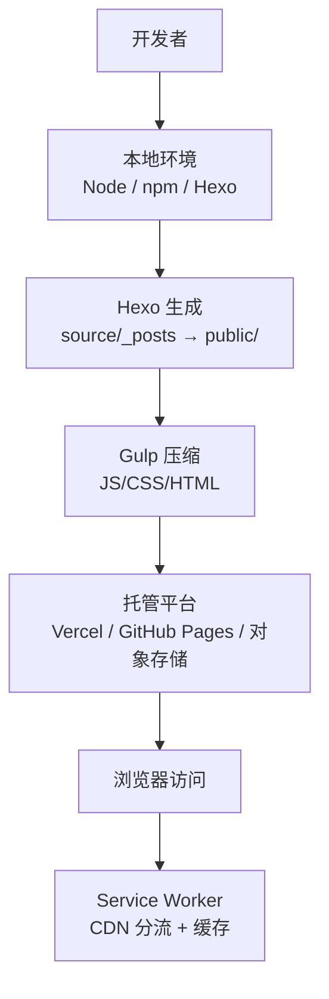
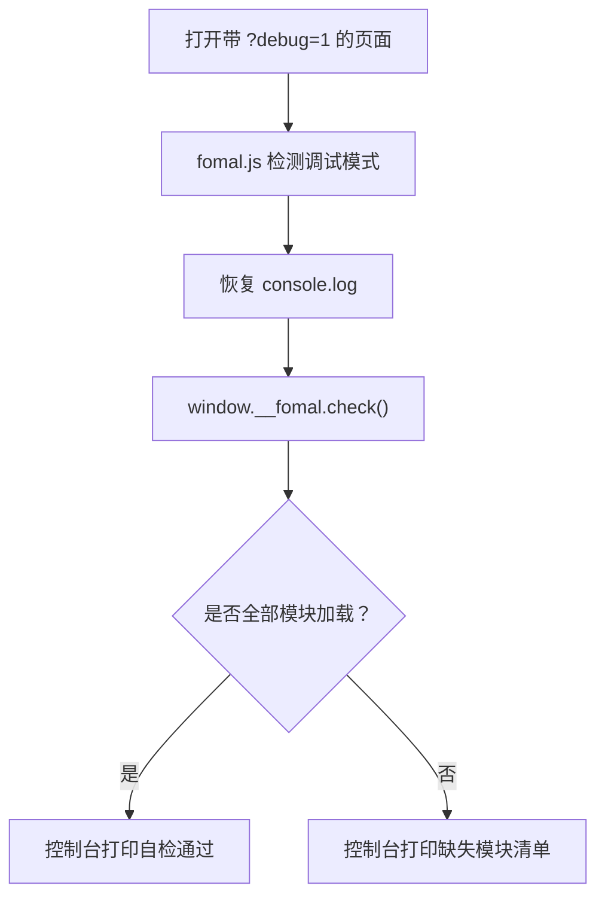
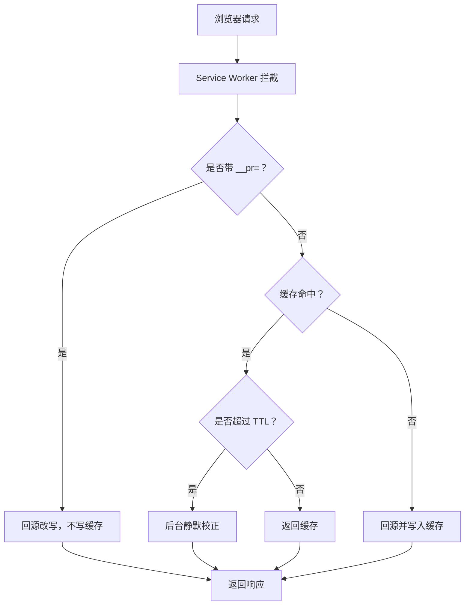

# 故障排除与常见问题

<cite>
**本文引用的文件**   
- [README.md](file://README.md)
- [_config.yml](file://_config.yml)
- [_config.fomalhaut.yml](file://_config.fomalhaut.yml)
- [package.json](file://package.json)
- [gulpfile.js](file://gulpfile.js)
- [vercel.json](file://vercel.json)
- [sw.js](file://themes/fomalhaut/source/sw.js)
- [fomal.js](file://source/js/fomal.js)
- [pjax-guard.js](file://source/js/pjax-guard.js)
- [completions.js（api）](file://api/chat/completions.js)
- [completions.js（functions）](file://functions/api/chat/completions.js)
</cite>

## 目录
1. [引言](#引言)
2. [项目结构与定位](#项目结构与定位)
3. [常见安装与环境问题](#常见安装与环境问题)
4. [配置错误与站点行为异常](#配置错误与站点行为异常)
5. [构建与部署失败排查](#构建与部署失败排查)
6. [运行时调试技巧](#运行时调试技巧)
7. [性能分析与优化建议](#性能分析与优化建议)
8. [兼容性、移动端与现代浏览器支持](#兼容性移动端与现代浏览器支持)
9. [错误代码对照表与定位方法](#错误代码对照表与定位方法)
10. [社区反馈的常见问题与官方修复](#社区反馈的常见问题与官方修复)
11. [结论](#结论)

## 引言
本文面向使用本 Hexo 卡片式博客主题的用户，聚焦「装不上、配不对、跑不动、慢、闪屏、换页异常、评论或 AI 助手不可用」等典型问题。文档从仓库实际实现出发，给出可操作的诊断步骤、根因解释和修复方案，并补充首屏加载、资源压缩、缓存策略、兼容性等方面的优化建议。

## 项目结构与定位
本项目不是单纯的 `themes/` 目录，而是一套可运行的 Hexo 站点模板：站点配置在根目录，主题本体在 `themes/fomalhaut/`，站点级脚本和样式在 `source/`，构建产物在 `public/`，并通过 Gulp 压缩后部署到托管平台。

**图表来源**
- [README.md:259-284](file://README.md#L259-L284)
- [gulpfile.js:12-64](file://gulpfile.js#L12-L64)
- [sw.js:1-46](file://themes/fomalhaut/source/sw.js#L1-L46)

**章节来源**
- [README.md:240-284](file://README.md#L240-L284)
- [package.json:1-19](file://package.json#L1-L19)

## 常见安装与环境问题

### Node 版本不匹配
- **现象**：`npm install` 报错、依赖安装失败、构建时报语法错误。
- **原因**：项目要求 Node 18/20/22 LTS，且 `engines.node` 限制为 `>=18`；若系统 Node 太旧，Hexo 插件或第三方库可能无法编译。
- **解决**：
  - 使用 nvm/nvs 切换到 Node 18、20 或 22。
  - 优先执行 `npm ci`，因为仓库有 `package-lock.json`，能更快更稳地还原依赖。
  - 不要在该目录执行 `hexo init`，否则会覆盖站点配置。

**章节来源**
- [README.md:344-353](file://README.md#L344-L353)
- [README.md:357-370](file://README.md#L357-L370)
- [package.json:7-9](file://package.json#L7-L9)

### 依赖缺失或版本冲突
- **现象**：`hexo generate` 报找不到模块、渲染器未注册、插件初始化失败。
- **排查**：
  - 检查是否安装了所有依赖：`npm ls`。
  - 确认 `package.json` 中的 Hexo 版本与插件兼容。
  - 清理后重装：`npx hexo clean && npm install`。

**章节来源**
- [package.json:20-63](file://package.json#L20-L63)
- [README.md:357-370](file://README.md#L357-L370)

### 端口占用或本地预览打不开
- **现象**：`npx hexo server` 启动失败，或浏览器打开空白。
- **排查**：
  - 默认端口是 `localhost:4000`，被占用会直接报错。
  - 如果改了 `_config.yml` 的 `url`，注意本地预览仍走 `localhost`，线上才生效。
  - 改 `.pug` 模板需要重启 server；只改 Markdown 或 `source/css` 通常会自动热更新。

**章节来源**
- [README.md:372-378](file://README.md#L372-L378)

## 配置错误与站点行为异常

### 主题配置写错位置
- **现象**：主题开关不生效，或者升级主题后配置丢失。
- **原因**：站点级配置在根 `_config.yml`，主题级配置在根 `_config.fomalhaut.yml`，主题默认值在 `themes/fomalhaut/_config.yml`。根 `_config.fomalhaut.yml` 才是本站真正生效的主题配置。
- **解决**：
  - 把头像、社交、菜单、封面、评论、搜索等主题开关放在 `_config.fomalhaut.yml`。
  - 站点名、作者、URL、部署、算法 Key 等放在 `_config.yml`。

**章节来源**
- [README.md:286-293](file://README.md#L286-L293)
- [README.md:399-422](file://README.md#L399-L422)
- [_config.yml:5-21](file://_config.yml#L5-L21)
- [_config.fomalhaut.yml:1-24](file://_config.fomalhaut.yml#L1-L24)

### 图片链接失效或显示 404
- **现象**：文章封面、侧栏头像、友链图标、背景图加载失败。
- **排查**：
  - 检查 `_config.fomalhaut.yml` 中 `avatar.img`、`index_img`、`cover.default_cover` 等路径。
  - 检查 `_config.fomalhaut.yml` 的 `error_img.flink` 与 `error_img.post_page` 兜底图是否存在。
  - 如果是外链图床，确认域名允许跨域、链接未被防盗链拦截。

**章节来源**
- [_config.fomalhaut.yml:110-118](file://_config.fomalhaut.yml#L110-L118)
- [_config.fomalhaut.yml:144-163](file://_config.fomalhaut.yml#L144-L163)
- [_config.fomalhaut.yml:1530-1533](file://_config.fomalhaut.yml#L1530-L1533)

### 评论系统不显示
- **现象**：页面底部没有评论区，或评论数不显示。
- **排查**：
  - 确认 `comments.use` 已设置为所用系统，例如 `Twikoo`。
  - Twikoo 需要填写 `twikoo.envId`，并且服务端已部署。
  - 开启 `lazyload` 后评论数可能失效，这是预期行为。
  - 如果用了第三方 CDN 加载评论 SDK，检查网络面板是否有跨域或 404。

**章节来源**
- [_config.fomalhaut.yml:541-551](file://_config.fomalhaut.yml#L541-L551)
- [_config.fomalhaut.yml:629-635](file://_config.fomalhaut.yml#L629-L635)
- [README.md:750-784](file://README.md#L750-L784)

### AI 助手不可用
- **现象**：右下角没有 AI 按钮，或点击后请求失败。
- **排查**：
  - 检查 `ai_chat.enable` 是否为 `true`。
  - 检查 `ai_chat.api_base`、`ai_chat.api_key` 或 `ai_chat.api_key_file`。
  - 如果使用 Vercel 函数代理，检查 `vercel.json` 中函数配置以及后端日志。
  - 如果 Key 写在 `_config.fomalhaut.yml` 里，可能被提交进 Git，应改用 `.ai-chat-key` 文件。

**章节来源**
- [_config.fomalhaut.yml:1559-1568](file://_config.fomalhaut.yml#L1559-L1568)
- [vercel.json:1-11](file://vercel.json#L1-L11)
- [completions.js（api）:147-205](file://api/chat/completions.js#L147-L205)
- [completions.js（functions）:131-156](file://functions/api/chat/completions.js#L131-L156)

## 构建与部署失败排查

### 构建命令不完整
- **现象**：`public/` 下 HTML/CSS/JS 存在但体积很大，或样式异常。
- **原因**：仅执行 `hexo generate` 不会运行 Gulp 压缩任务。
- **解决**：
  - 推荐流程：`npx hexo clean && npx hexo generate && npx gulp`。
  - 或使用脚本：`npm run build`。

**章节来源**
- [README.md:432-438](file://README.md#L432-L438)
- [gulpfile.js:61-64](file://gulpfile.js#L61-L64)

### CSS 被过度压缩导致布局异常
- **现象**：本地正常，部署后公告栏间距消失、窄卡样式错乱。
- **原因**：Gulp 的 `clean-css` 使用 `compatibility: 'ie11'`，会把现代 CSS 容器查询 `@container` 误删或展开，影响条件样式。
- **解决**：
  - 当前构建任务已排除 `site-inject.css` 与 `twikoo.css`，避免最敏感的两份样式被破坏。
  - 如果新增含 `@container` 的文件，考虑加入排除列表，或确保其规则不被压缩器误判。

**章节来源**
- [gulpfile.js:20-38](file://gulpfile.js#L20-L38)

### JS 压缩结果不稳定
- **现象**：有时 `public/` 下的 JS 没有被压缩，或压缩后缺失。
- **原因**：早期写法漏了 `return`，异步流提前结束。
- **现状**：当前 `compress` 任务已修正，明确 `return` Gulp 流，确保 terser 写完再结束。

**章节来源**
- [gulpfile.js:12-19](file://gulpfile.js#L12-L19)

### Vercel 函数超时或内存不足
- **现象**：AI 助手请求超时、函数返回 5xx。
- **排查**：
  - 检查 `vercel.json` 的 `maxDuration` 与 `memory`。
  - 检查后端函数是否长时间等待大模型响应。
  - 检查上游 API Key 是否有效、是否触发限流。

**章节来源**
- [vercel.json:1-11](file://vercel.json#L1-L11)
- [completions.js（api）:175-205](file://api/chat/completions.js#L175-L205)
- [completions.js（functions）:156-202](file://functions/api/chat/completions.js#L156-L202)

## 运行时调试技巧

### 启用站点调试模式
- **方法**：在地址后加 `?debug=1`。
- **效果**：
  - 恢复 `console.log`，不再静默输出。
  - 页面加载完成后自动执行 `__fomal.check()`，报告缺失的全局入口或模块。
- **适用场景**：模块没加载、全局函数找不到、pjax 换页后功能异常。

**图表来源**
- [fomal.js:51-62](file://source/js/fomal.js#L51-L62)
- [fomal.js:68-106](file://source/js/fomal.js#L68-L106)

**章节来源**
- [fomal.js:51-62](file://source/js/fomal.js#L51-L62)
- [fomal.js:68-106](file://source/js/fomal.js#L68-L106)

### 使用浏览器开发者工具
- **Network**：查看关键资源是否 404、跨域、重复请求、缓存命中情况。
- **Console**：关注 JS 异常、pjax 错误、SW 警告。
- **Performance**：录制首屏，观察长任务、强制同步布局、阻塞脚本。
- **Application**：查看 Service Worker、Cache Storage、IndexedDB、localStorage。
- **Elements**：检查注入的 `<script>`、`inject.head`、`inject.bottom` 是否按预期出现。

### 分析日志
- **前端日志**：
  - 正常模式下 `console.log` 被静音，但 `console.error` 与 `console.warn` 始终保留。
  - Service Worker 分流失败时会输出 `[sw] S3 分流失败，回退原始请求`。
  - AI 助手注入失败时会输出 `[ai-chat] 注入失败`。
- **后端日志**：
  - Vercel 函数日志可查看 JSON 解析失败、上游请求失败、响应体为空等问题。

**章节来源**
- [fomal.js:53-57](file://source/js/fomal.js#L53-L57)
- [sw.js:178-179](file://themes/fomalhaut/source/sw.js#L178-L179)
- [sw.js:210-217](file://themes/fomalhaut/source/sw.js#L210-L217)
- [completions.js（api）:147-205](file://api/chat/completions.js#L147-L205)

## 性能分析与优化建议

### 首屏加载优化
- **字体预加载**：正文字体增加 `preload`，减少首次字体闪烁。
- **夜间壁纸预热**：切换夜间时后台预热壁纸，避免切过去先白屏。
- **动画延迟降低**：首页卡片入场改为淡入，减少首屏等待缩放动画的时间。
- **外部脚本 defer**：统计、jQuery、51LA 等使用 `defer`，避免阻塞首屏渲染。

**章节来源**
- [README.md:204-207](file://README.md#L204-L207)
- [README.md:111-114](file://README.md#L111-L114)
- [README.md:54-57](file://README.md#L54-L57)
- [_config.fomalhaut.yml:1323-1328](file://_config.fomalhaut.yml#L1323-L1328)

### 资源压缩与构建
- **JS 压缩**：Gulp 对 `public/**/*.js` 执行 terser。
- **CSS 压缩**：对大部分 CSS 执行 clean-css，但排除 `site-inject.css` 与 `twikoo.css`。
- **HTML 压缩**：去除注释、合并空格、压缩内联 JS/CSS/URL。
- **建议**：
  - 不要把大量自定义 CSS 放进被 clean-css 严格处理的文件，必要时加入排除列表。
  - 静态资源尽量加版本号或时间戳，避免浏览器长期缓存旧文件。

**章节来源**
- [gulpfile.js:12-64](file://gulpfile.js#L12-L64)

### 缓存策略调优
- **Service Worker 文本 TTL 缩短**：HTML/JS/CSS/JSON/XML 等文本资源 TTL 从 24 小时降到 10 分钟，防止发版忘记改 `?v=` 时用户长期吃旧代码。
- **媒体资源保持长缓存**：图片、字体、音视频仍按 24 小时，省流优先。
- **探测请求不写缓存**：带 `?__pr=` 的请求只做回源改写，不写入 CacheStorage，避免无限膨胀。
- **版本哈希清缓存**：站点版本基于 `index.html` 内容哈希，变化后清空资源缓存，保证新 HTML 能触发旧缓存失效。

**图表来源**
- [sw.js:154-219](file://themes/fomalhaut/source/sw.js#L154-L219)

**章节来源**
- [sw.js:22-34](file://themes/fomalhaut/source/sw.js#L22-L34)
- [sw.js:35-46](file://themes/fomalhaut/source/sw.js#L35-L46)
- [sw.js:132-151](file://themes/fomalhaut/source/sw.js#L132-L151)
- [sw.js:166-181](file://themes/fomalhaut/source/sw.js#L166-L181)
- [sw.js:186-209](file://themes/fomalhaut/source/sw.js#L186-L209)

### 交互与帧率优化
- **AI 助手流式渲染**：分片累积文本，DOM 提交合并到一帧，尾块增量重建，滚动只写不读。
- **雪花/星空生命周期**：不可见即退出 rAF，恢复交给 `MutationObserver` / `resize` / `pjax:complete`。
- **FPS 监测**：只在面板开启时采样，切后台自动挂起。
- **指针事件优化**：小猫咪光标读写分离，高频输入只记最新值，下一帧批量写 DOM。

**章节来源**
- [README.md:164-170](file://README.md#L164-L170)
- [README.md:209-219](file://README.md#L209-L219)

## 兼容性、移动端与现代浏览器支持

### 移动端适配
- **抽屉菜单**：独立样式表，窄屏自动生效。
- **导航触控区**：桌面 44×44px，≤800px 缩小间距，≤480px 调整站名字号。
- **自绘滚动条**：手机端滚动条由脚本创建，读阶段采样、写阶段批量写入，减少强制布局。
- **数字框与输入框**：修复主题限宽导致的三位数裁切问题。

**章节来源**
- [README.md:323-324](file://README.md#L323-L324)
- [README.md:105-109](file://README.md#L105-L109)
- [README.md:218-219](file://README.md#L218-L219)
- [README.md:116-118](file://README.md#L116-L118)

### IE 兼容
- **Gulp CSS 压缩**：使用 `compatibility: 'ie11'`，说明构建链有意兼容较老浏览器。
- **风险点**：
  - 现代 CSS 特性如 `backdrop-filter`、`color-mix`、`@container` 在 IE 上不支持。
  - 主题已对磨砂效果做能力降级，但 IE 仍可能缺少部分视觉特性。
- **建议**：
  - 如需支持 IE，避免引入仅现代浏览器支持的 CSS/JS。
  - 谨慎使用 `@container`，必要时加入 Gulp 排除列表。

**章节来源**
- [gulpfile.js:20-38](file://gulpfile.js#L20-L38)
- [README.md:107-109](file://README.md#L107-L109)

### 现代浏览器特性
- **Service Worker**：需要支持 SW 的浏览器才能启用离线缓存与 CDN 分流。
- **Web Manifest / PWA**：主题提供 PWA 相关模板，需浏览器支持 manifest。
- **Canvas / rAF**：雪花、星空、涟漪等特效依赖 Canvas 或 requestAnimationFrame，低端设备或“减少动态”设置下会降级或暂停。

**章节来源**
- [README.md:328-329](file://README.md#L328-L329)
- [README.md:96-103](file://README.md#L96-L103)
- [README.md:209-219](file://README.md#L209-L219)

## 错误代码对照表与定位方法

| 现象 | 可能原因 | 定位方法 | 处理建议 |
| --- | --- | --- | --- |
| 页面一直显示加载遮罩 | pjax 换页异常，`pjax:complete` 未触发 | 打开 Console 看 pjax 错误；检查 `pjax-guard.js` 是否加载 | 刷新页面；检查导航选择器；确认 echarts 脚本已加载 |
| 进入或离开 `/tags/` 整页刷新 | pjax 选择器数量不一致 | Network 看是否触发完整跳转；Console 看 pjax 异常 | 让 `pjax-guard.js` 过滤坏选择器；确认统计页图表容器存在 |
| 图片 404 | 外链失效、路径错误、CDN 不可达 | Network 查具体 URL 状态码 | 替换为可用外链或本地资源；检查 `error_img` 兜底图 |
| 评论不加载 | 评论 SDK 未加载、envId 错误、跨域 | Console 看 SDK 报错；Network 看评论接口 | 检查 `comments.use`、`twikoo.envId`、CORS |
| AI 助手无按钮 | `ai_chat.enable=false` 或 Key 无效 | 检查配置与注入脚本；查看后端函数日志 | 开启总开关；校验 Key；检查 Vercel 函数配置 |
| AI 助手请求失败 | JSON 解析失败、上游限流、响应体为空 | 查看后端函数日志与 Network 响应 | 修正请求体；检查 API Key；重试或降级 |
| 部署后样式错位 | CSS 被 clean-css 误删 | 对比本地与部署后的 CSS；检查 `@container` | 将敏感样式加入排除列表或改用兼容写法 |
| 文本资源缓存太久 | 发版未改 `?v=`，SW 文本 TTL 过长 | Application 看 Cache Storage；Network 看缓存命中 | 加版本号；依赖当前 10 分钟 TTL 自我纠正 |
| 线路探测缓存膨胀 | `?__pr=` 请求被写入 CacheStorage | Application 看 ICDNCache 条目 | 当前实现已跳过探测请求写缓存 |

**章节来源**
- [pjax-guard.js:1-21](file://source/js/pjax-guard.js#L1-L21)
- [pjax-guard.js:22-142](file://source/js/pjax-guard.js#L22-L142)
- [_config.fomalhaut.yml:1530-1533](file://_config.fomalhaut.yml#L1530-L1533)
- [_config.fomalhaut.yml:541-551](file://_config.fomalhaut.yml#L541-L551)
- [_config.fomalhaut.yml:629-635](file://_config.fomalhaut.yml#L629-L635)
- [_config.fomalhaut.yml:1559-1568](file://_config.fomalhaut.yml#L1559-L1568)
- [completions.js（api）:147-205](file://api/chat/completions.js#L147-L205)
- [completions.js（functions）:131-156](file://functions/api/chat/completions.js#L131-L156)
- [gulpfile.js:20-38](file://gulpfile.js#L20-L38)
- [sw.js:166-181](file://themes/fomalhaut/source/sw.js#L166-L181)

## 社区反馈的常见问题与官方修复

### pjax 换页后加载遮罩一直转圈
- **问题**：主题 pjax 选择器包含只存在于 `/tags/` 的图表容器 ID，新旧文档元素个数不一致导致 pjax 抛错，`pjax:error` 不会关闭遮罩。
- **修复**：`pjax-guard.js` 移除坏选择器，并在 `pjax:send` 后 6 秒兜底关闭遮罩，同时监听 `pjax:error` 与 `pageshow(bfcache)`。

**章节来源**
- [pjax-guard.js:1-21](file://source/js/pjax-guard.js#L1-L21)
- [pjax-guard.js:128-142](file://source/js/pjax-guard.js#L128-L142)

### 归档页年份胶囊居中导致整页抖动
- **问题**：原实现用 `scrollIntoView`，会把整页顶下固定高度。
- **修复**：改用 `track.scrollBy`，并针对 `#page-header` 复用监听，避免重复抖动。

**章节来源**
- [README.md:63-66](file://README.md#L63-L66)

### 归档页卡片改版与零额外请求
- **问题**：归档页原本只是日期列表，分类与阅读时长需要额外计算或请求。
- **修复**：构建期向归档页注入全站文章的标题、路径、日期、分类、字数、阅读分钟 JSON，页面端直接读取，零额外请求。

**章节来源**
- [README.md:134-140](file://README.md#L134-L140)

### Service Worker 缓存策略导致旧代码长期生效
- **问题**：原来全量 24 小时缓存，发版只改 JS/CSS 却忘了改 `?v=`，回访者继续跑旧代码。
- **修复**：文本资源 TTL 降到 10 分钟，媒体资源保持 24 小时；`CACHE_NAME` 提到 v3，激活时清理旧缓存；探测请求不写缓存。

**章节来源**
- [README.md:172-177](file://README.md#L172-L177)
- [sw.js:22-34](file://themes/fomalhaut/source/sw.js#L22-L34)
- [sw.js:132-151](file://themes/fomalhaut/source/sw.js#L132-L151)
- [sw.js:166-181](file://themes/fomalhaut/source/sw.js#L166-L181)

### AI 助手流式输出掉帧
- **问题**：逐字插入 DOM 导致频繁重排，突发流时 FPS 下降明显。
- **修复**：文本累积、rAF 提交、尾块增量重建、滚动只写不读、空闲预热。

**章节来源**
- [README.md:164-170](file://README.md#L164-L170)

### 美化面板开关关掉后仍在后台运行
- **问题**：某些特效即使关闭也继续计时或轮询。
- **修复**：关闭时真停定时器、rAF、observer，开回来再恢复；涟漪、萤火虫、雪花等都有显式开关与互斥逻辑。

**章节来源**
- [README.md:79-82](file://README.md#L79-L82)
- [README.md:96-103](file://README.md#L96-L103)

## 结论
本项目的故障排除核心在于三点：  
第一，区分站点配置与主题配置，避免把开关写错位置；  
第二，善用 `?debug=1`、浏览器开发者工具、Service Worker 缓存面板与后端函数日志进行分层定位；  
第三，理解构建链与缓存策略，尤其是 Gulp 压缩对现代 CSS 的限制、Service Worker 的文本短 TTL 与探测请求不写缓存机制。  

遇到问题时，建议按「环境 → 配置 → 构建 → 部署 → 运行时 → 缓存」的顺序排查，并结合本文的错误对照表快速收敛根因。对于性能问题，优先关注首屏关键链、动画生命周期、流式渲染与资源压缩策略；对于兼容性问题，优先检查现代 CSS/JS 特性是否在目标浏览器中可用。