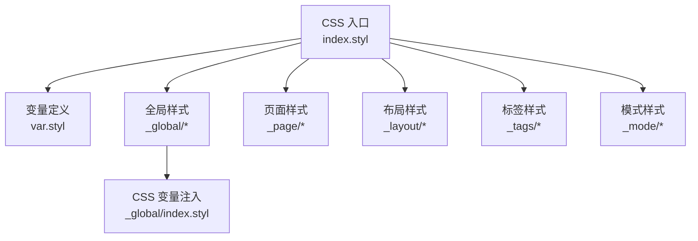
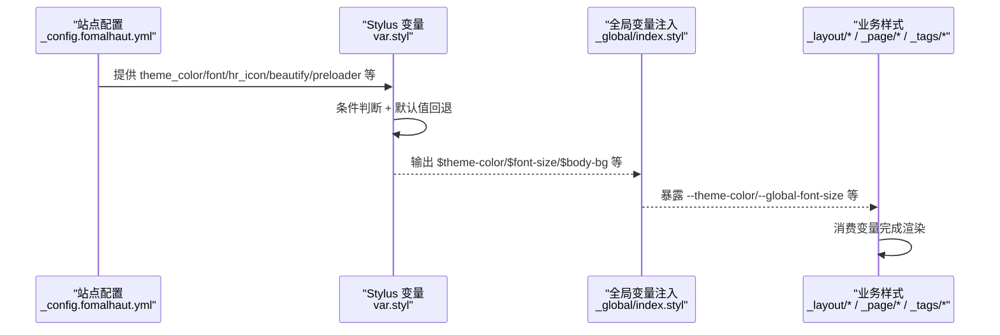
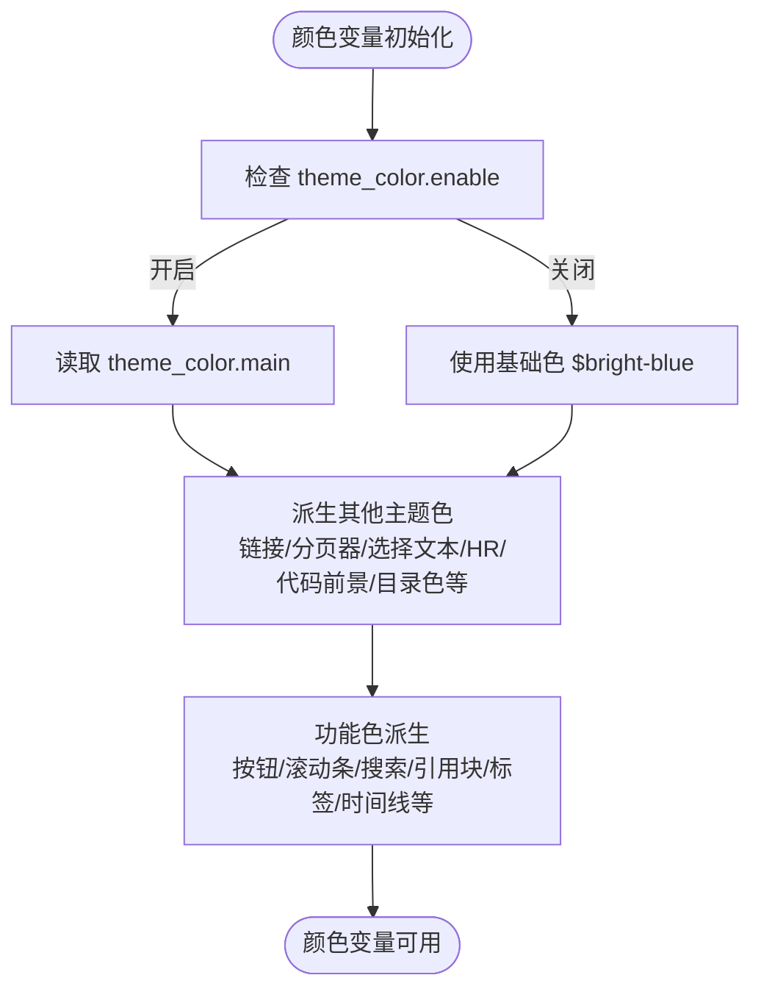
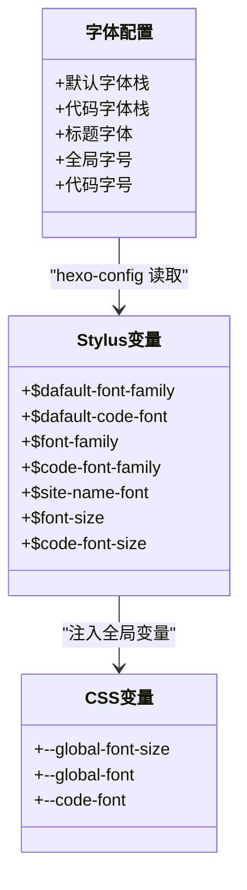
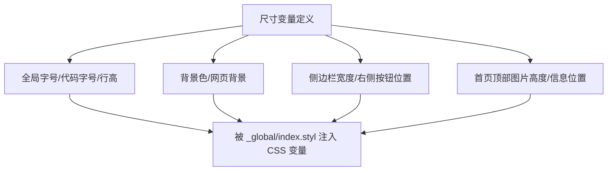
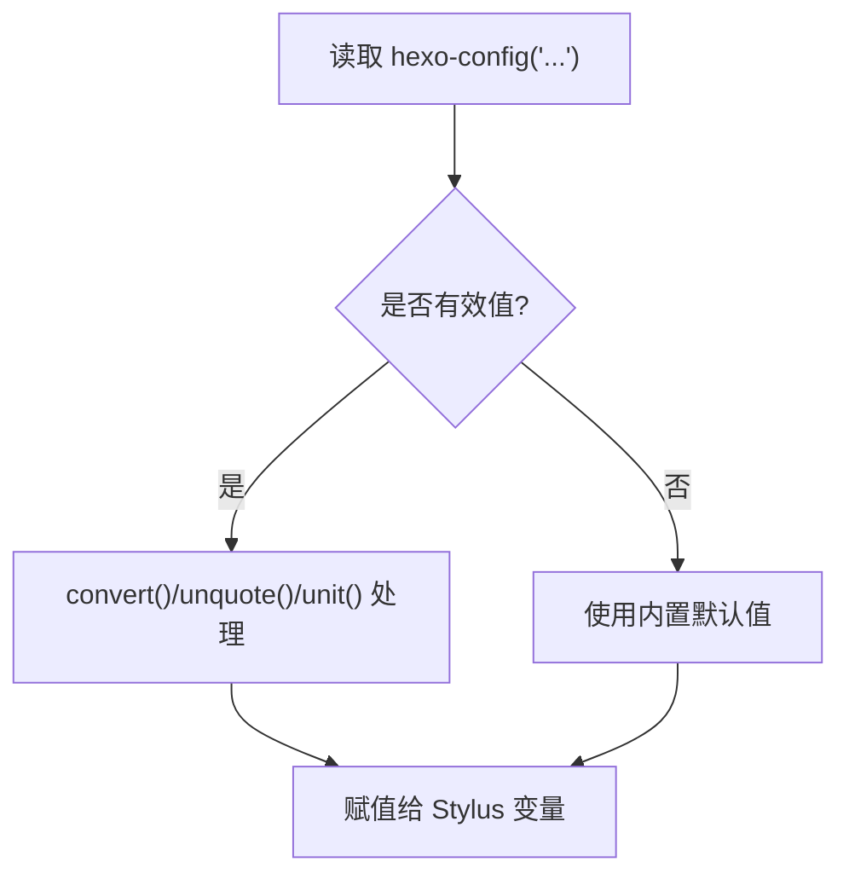
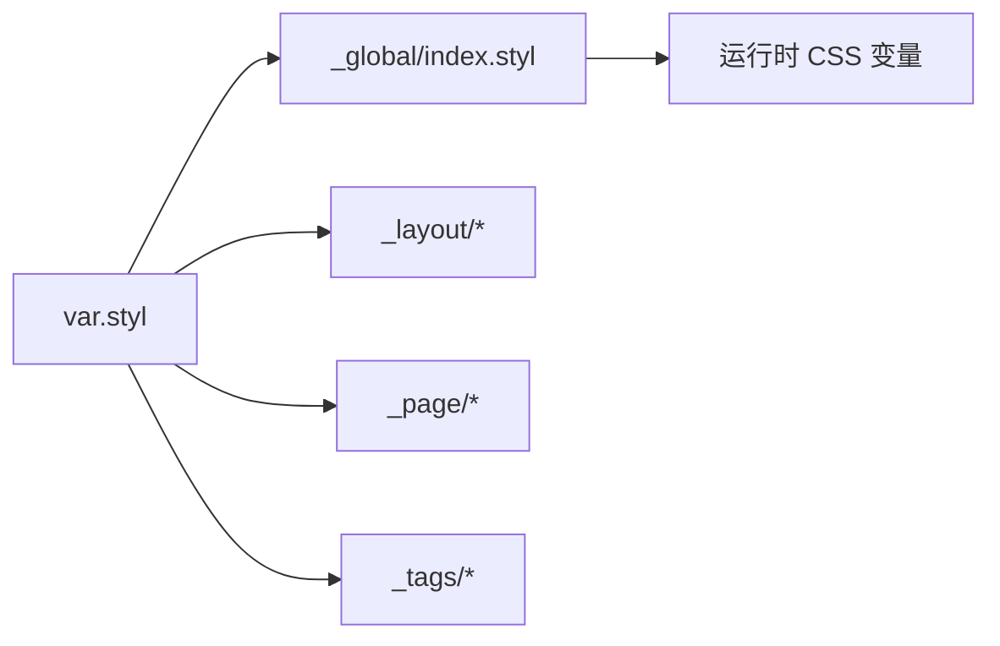

# Stylus 变量系统

<cite>
**本文引用的文件**   
- [var.styl](file://themes/fomalhaut/source/css/var.styl)
- [index.styl](file://themes/fomalhaut/source/css/index.styl)
- [_global/index.styl](file://themes/fomalhaut/source/css/_global/index.styl)
- [_global/function.styl](file://themes/fomalhaut/source/css/_global/function.styl)
- [_layout/aside.styl](file://themes/fomalhaut/source/css/_layout/aside.styl)
- [_layout/head.styl](file://themes/fomalhaut/source/css/_layout/head.styl)
- [_layout/post.styl](file://themes/fomalhaut/source/css/_layout/post.styl)
- [_tags/timeline.styl](file://themes/fomalhaut/source/css/_tags/timeline.styl)
- [_page/404.styl](file://themes/fomalhaut/source/css/_page/404.styl)
- [_highlight/highlight.styl](file://themes/fomalhaut/source/css/_highlight/highlight.styl)
- [_config.fomalhaut.yml](file://_config.fomalhaut.yml)
</cite>

## 目录
1. [引言](#引言)
2. [项目结构](#项目结构)
3. [核心组件](#核心组件)
4. [架构总览](#架构总览)
5. [详细组件分析](#详细组件分析)
6. [依赖关系分析](#依赖关系分析)
7. [性能与可维护性](#性能与可维护性)
8. [故障排查](#故障排查)
9. [结论](#结论)
10. [附录：变量清单与配置映射](#附录变量清单与配置映射)

## 引言
本文聚焦 Fomalhaut 主题中基于 Stylus 的变量系统，系统性解析颜色、字体、尺寸、条件开关等变量的定义层次、继承覆盖机制，以及如何在自定义样式中安全使用。重点包括：
- 颜色变量：基础色、主题色、功能色的分层组织
- 字体变量：默认字体栈、代码字体、标题字体的配置方式
- 尺寸变量：全局字号、行高、间距等布局相关变量
- 条件变量：hexo-config 动态读取与默认值回退逻辑
- 最佳实践：变量继承与覆盖策略，以及在自定义样式中的正确用法

## 项目结构
Stylus 变量系统的入口是主题 CSS 的聚合入口，它按顺序引入变量定义、全局样式、页面样式、布局样式、标签样式和模式样式。变量集中定义在 var.styl 中，并通过 _global/index.styl 将部分变量暴露为 CSS 自定义属性，供运行时或 JS 动态修改。

**图表来源**
- [index.styl:1-26](file://themes/fomalhaut/source/css/index.styl#L1-L26)
- [var.styl:1-185](file://themes/fomalhaut/source/css/var.styl#L1-L185)
- [_global/index.styl:1-10](file://themes/fomalhaut/source/css/_global/index.styl#L1-L10)

**章节来源**
- [index.styl:1-26](file://themes/fomalhaut/source/css/index.styl#L1-L26)

## 核心组件
- 变量定义中心：var.styl
- 全局 CSS 变量注入：_global/index.styl
- 条件判断与动画工具：_global/function.styl
- 配置源：_config.fomalhaut.yml（Hexo 站点配置）

这些组件共同构成“配置 → Stylus 变量 → CSS 变量 → 样式消费”的完整链路。

**章节来源**
- [var.styl:1-185](file://themes/fomalhaut/source/css/var.styl#L1-L185)
- [_global/index.styl:1-10](file://themes/fomalhaut/source/css/_global/index.styl#L1-L10)
- [_global/function.styl:100-140](file://themes/fomalhaut/source/css/_global/function.styl#L100-L140)
- [_config.fomalhaut.yml:757-778](file://_config.fomalhaut.yml#L757-L778)

## 架构总览
Stylus 变量系统遵循以下流程：
1. 站点配置 _config.fomalhaut.yml 提供 theme_color、font、hr_icon、beautify、preloader 等键值。
2. var.styl 通过 hexo-config() 读取配置，结合布尔开关与三元表达式，生成最终变量。
3. _global/index.styl 将关键变量转为 CSS 自定义属性，便于运行时调整。
4. 各模块样式文件引用这些变量，形成统一的设计语言。

**图表来源**
- [_config.fomalhaut.yml:757-778](file://_config.fomalhaut.yml#L757-L778)
- [var.styl:6-14](file://themes/fomalhaut/source/css/var.styl#L6-L14)
- [_global/index.styl:1-10](file://themes/fomalhaut/source/css/_global/index.styl#L1-L10)

## 详细组件分析

### 颜色变量体系
颜色变量分为三层：
- 基础色：如亮蓝、青色、浅橙、浅红等，作为派生基础
- 主题色：$theme-color 及其衍生变量，控制全站主色调
- 功能色：按钮、滚动条、搜索、引用块、标签、时间线等具体 UI 元素的颜色

实现要点：
- 通过 $themeColorEnable 开关决定是否启用主题色；若未启用，则回退到基础色
- 多数功能色以 $theme-color 为基础进行 lighten/darken/alpha 计算，保证一致性
- 部分功能色支持独立配置项，例如滚动条、引用块内边距背景、引用块背景、元信息颜色等

**图表来源**
- [var.styl:2-14](file://themes/fomalhaut/source/css/var.styl#L2-L14)
- [var.styl:39-50](file://themes/fomalhaut/source/css/var.styl#L39-L50)
- [var.styl:52-55](file://themes/fomalhaut/source/css/var.styl#L52-L55)
- [var.styl:70-75](file://themes/fomalhaut/source/css/var.styl#L70-L75)
- [var.styl:82-85](file://themes/fomalhaut/source/css/var.styl#L82-L85)
- [var.styl:167-185](file://themes/fomalhaut/source/css/var.styl#L167-L185)

**章节来源**
- [var.styl:2-14](file://themes/fomalhaut/source/css/var.styl#L2-L14)
- [var.styl:39-50](file://themes/fomalhaut/source/css/var.styl#L39-L50)
- [var.styl:52-55](file://themes/fomalhaut/source/css/var.styl#L52-L55)
- [var.styl:70-75](file://themes/fomalhaut/source/css/var.styl#L70-L75)
- [var.styl:82-85](file://themes/fomalhaut/source/css/var.styl#L82-L85)
- [var.styl:167-185](file://themes/fomalhaut/source/css/var.styl#L167-L185)
- [_config.fomalhaut.yml:757-778](file://_config.fomalhaut.yml#L757-L778)

### 字体变量体系
字体变量包含三类：
- 默认字体栈：用于正文显示，优先系统字体，其次常用中文/英文字体
- 代码字体栈：等宽字体，兼顾中文注释的回退
- 标题字体：站点名称与副标题的字体设置

实现要点：
- 默认字体栈与代码字体栈均支持从 font.font-family 与 font.code-font-family 读取
- 标题字体由 blog_title_font.font-family 单独配置
- 字体大小通过 font.global-font-size 与 font.code-font-size 控制，并注入 CSS 变量

**图表来源**
- [var.styl:15-20](file://themes/fomalhaut/source/css/var.styl#L15-L20)
- [var.styl:30-31](file://themes/fomalhaut/source/css/var.styl#L30-L31)
- [_global/index.styl:1-10](file://themes/fomalhaut/source/css/_global/index.styl#L1-L10)
- [_config.fomalhaut.yml:884-905](file://_config.fomalhaut.yml#L884-L905)

**章节来源**
- [var.styl:15-20](file://themes/fomalhaut/source/css/var.styl#L15-L20)
- [var.styl:30-31](file://themes/fomalhaut/source/css/var.styl#L30-L31)
- [_global/index.styl:1-10](file://themes/fomalhaut/source/css/_global/index.styl#L1-L10)
- [_config.fomalhaut.yml:884-905](file://_config.fomalhaut.yml#L884-L905)

### 尺寸与布局变量
尺寸变量涵盖全局字号、代码字号、行高、背景、侧边栏宽度、右侧按钮位置、首页顶部图片高度与信息位置等。它们通常直接来自配置或内置默认值，并在多处布局样式中被消费。

关键点：
- 全局字号与代码字号分别对应 $font-size 与 $code-font-size
- 行高 $text-line-height 控制正文行高
- 背景 $web-bg 与 $body-bg 控制网页与主体背景
- 侧边栏宽度 $sidebar-width 与右侧按钮位置 $rightside-bottom 控制布局
- 首页顶部图片高度 $index_top_img_height 与信息位置 $index_site_info_top 控制首屏布局

**图表来源**
- [var.styl:29-37](file://themes/fomalhaut/source/css/var.styl#L29-L37)
- [var.styl:57-63](file://themes/fomalhaut/source/css/var.styl#L57-L63)
- [var.styl:106-108](file://themes/fomalhaut/source/css/var.styl#L106-L108)
- [_global/index.styl:1-10](file://themes/fomalhaut/source/css/_global/index.styl#L1-L10)

**章节来源**
- [var.styl:29-37](file://themes/fomalhaut/source/css/var.styl#L29-L37)
- [var.styl:57-63](file://themes/fomalhaut/source/css/var.styl#L57-L63)
- [var.styl:106-108](file://themes/fomalhaut/source/css/var.styl#L106-L108)
- [_global/index.styl:1-10](file://themes/fomalhaut/source/css/_global/index.styl#L1-L10)

### 条件变量与默认值回退
条件变量通过 hexo-config() 读取配置，并结合布尔开关与三元表达式决定最终值。常见模式：
- 开关型：$themeColorEnable、$hrEnable、$beautifyEnable
- 取值型：$theme-color、$font-family、$font-size、$web-bg、$preloader-bg
- 类型校验：note.light_bg_offset 的类型判断与单位转换

**图表来源**
- [var.styl:6-14](file://themes/fomalhaut/source/css/var.styl#L6-L14)
- [var.styl:18-20](file://themes/fomalhaut/source/css/var.styl#L18-L20)
- [var.styl:22-28](file://themes/fomalhaut/source/css/var.styl#L22-L28)
- [var.styl:30-36](file://themes/fomalhaut/source/css/var.styl#L30-L36)
- [var.styl:110-111](file://themes/fomalhaut/source/css/var.styl#L110-L111)

**章节来源**
- [var.styl:6-14](file://themes/fomalhaut/source/css/var.styl#L6-L14)
- [var.styl:18-20](file://themes/fomalhaut/source/css/var.styl#L18-L20)
- [var.styl:22-28](file://themes/fomalhaut/source/css/var.styl#L22-L28)
- [var.styl:30-36](file://themes/fomalhaut/source/css/var.styl#L30-L36)
- [var.styl:110-111](file://themes/fomalhaut/source/css/var.styl#L110-L111)

### 变量继承与覆盖的最佳实践
- 优先使用主题提供的变量名，避免硬编码颜色或尺寸
- 通过 _config.fomalhaut.yml 的 theme_color、font、hr_icon、beautify、preloader 等键值进行覆盖
- 如需运行时调整，优先修改 _global/index.styl 暴露的 CSS 变量（如 --theme-color、--global-font-size、--global-font、--code-font）
- 自定义样式放在 source/css/_custom/custom.css，确保最后加载，以便覆盖主题默认规则
- 对复杂派生色，尽量基于 $theme-color 进行 lighten/darken/alpha 计算，保持视觉一致性

**章节来源**
- [index.styl:1-13](file://themes/fomalhaut/source/css/index.styl#L1-L13)
- [_global/index.styl:1-10](file://themes/fomalhaut/source/css/_global/index.styl#L1-L10)
- [_config.fomalhaut.yml:757-778](file://_config.fomalhaut.yml#L757-L778)
- [_config.fomalhaut.yml:884-905](file://_config.fomalhaut.yml#L884-L905)

## 依赖关系分析
Stylus 变量被多个模块消费，形成稳定的依赖关系：
- 高内聚：颜色、字体、尺寸集中在 var.styl
- 低耦合：消费方仅依赖变量名，不关心具体值
- 可扩展：新增功能色或尺寸只需在 var.styl 扩展，并在 _global/index.styl 暴露 CSS 变量

**图表来源**
- [var.styl:1-185](file://themes/fomalhaut/source/css/var.styl#L1-L185)
- [_global/index.styl:1-10](file://themes/fomalhaut/source/css/_global/index.styl#L1-L10)
- [_layout/aside.styl:280-340](file://themes/fomalhaut/source/css/_layout/aside.styl#L280-L340)
- [_layout/head.styl:350-370](file://themes/fomalhaut/source/css/_layout/head.styl#L350-L370)
- [_layout/post.styl:200-210](file://themes/fomalhaut/source/css/_layout/post.styl#L200-L210)
- [_tags/timeline.styl:1-30](file://themes/fomalhaut/source/css/_tags/timeline.styl#L1-L30)
- [_page/404.styl:30-40](file://themes/fomalhaut/source/css/_page/404.styl#L30-L40)
- [_highlight/highlight.styl:120-130](file://themes/fomalhaut/source/css/_highlight/highlight.styl#L120-L130)

**章节来源**
- [var.styl:1-185](file://themes/fomalhaut/source/css/var.styl#L1-L185)
- [_global/index.styl:1-10](file://themes/fomalhaut/source/css/_global/index.styl#L1-L10)
- [_layout/aside.styl:280-340](file://themes/fomalhaut/source/css/_layout/aside.styl#L280-L340)
- [_layout/head.styl:350-370](file://themes/fomalhaut/source/css/_layout/head.styl#L350-L370)
- [_layout/post.styl:200-210](file://themes/fomalhaut/source/css/_layout/post.styl#L200-L210)
- [_tags/timeline.styl:1-30](file://themes/fomalhaut/source/css/_tags/timeline.styl#L1-L30)
- [_page/404.styl:30-40](file://themes/fomalhaut/source/css/_page/404.styl#L30-L40)
- [_highlight/highlight.styl:120-130](file://themes/fomalhaut/source/css/_highlight/highlight.styl#L120-L130)

## 性能与可维护性
- 编译期计算：Stylus 在构建阶段完成 convert/unquote/unit 等计算，减少运行时开销
- 变量复用：通过 $theme-color 派生功能色，降低重复定义与维护成本
- 运行时可调：通过 CSS 变量暴露关键尺寸与颜色，便于 JS 动态切换主题或用户偏好
- 模块化导入：index.styl 按模块引入，便于定位问题与扩展新功能

[本节为通用指导，无需特定文件来源]

## 故障排查
常见问题与定位建议：
- 主题色未生效：检查 theme_color.enable 是否为 true，且 theme_color.main 是否设置了合法 HEX 值
- 字体未生效：确认 font.font-family 与 font.code-font-family 是否正确，注意引号与 unquote 的使用
- 字号异常：检查 font.global-font-size 与 font.code-font-size 的单位是否合法
- 背景未生效：检查 background.default 的值是否合法 URL 或颜色
- 分隔线图标未显示：确认 hr_icon.enable 与 hr_icon.icon 的设置
- 美化效果未生效：确认 beautify.enable 与 beautify.title-prefix-icon(-color) 的设置
- 预加载器颜色异常：检查 preloader.enable 与 preloader.load_color

定位步骤：
1. 查看 _config.fomalhaut.yml 对应键值
2. 核对 var.styl 中 hexo-config 路径与默认值
3. 检查 _global/index.styl 是否暴露了相应 CSS 变量
4. 在浏览器开发者工具中检查最终计算的 CSS 变量值

**章节来源**
- [_config.fomalhaut.yml:757-778](file://_config.fomalhaut.yml#L757-L778)
- [_config.fomalhaut.yml:884-905](file://_config.fomalhaut.yml#L884-L905)
- [_config.fomalhaut.yml:907-911](file://_config.fomalhaut.yml#L907-L911)
- [_config.fomalhaut.yml:932-938](file://_config.fomalhaut.yml#L932-L938)
- [var.styl:6-14](file://themes/fomalhaut/source/css/var.styl#L6-L14)
- [var.styl:18-20](file://themes/fomalhaut/source/css/var.styl#L18-L20)
- [var.styl:22-28](file://themes/fomalhaut/source/css/var.styl#L22-L28)
- [var.styl:30-36](file://themes/fomalhaut/source/css/var.styl#L30-L36)
- [var.styl:102-104](file://themes/fomalhaut/source/css/var.styl#L102-L104)

## 结论
Fomalhaut 主题的 Stylus 变量系统以 var.styl 为核心，通过 hexo-config 将站点配置转化为设计变量，再经由 _global/index.styl 暴露为 CSS 变量，供各模块样式消费。该体系具备清晰的层次划分、良好的可维护性与可扩展性，适合在不同主题场景下复用与定制。推荐在自定义样式中优先使用主题变量与 CSS 变量，避免硬编码，以保证整体设计语言一致与后期维护便捷。

[本节为总结性内容，无需特定文件来源]

## 附录：变量清单与配置映射

### 颜色变量与配置映射
- $theme-color ← theme_color.main（启用时），否则回退 $bright-blue
- $theme-paginator-color ← theme_color.paginator，否则回退 $strong-cyan
- $theme-text-selection-color ← theme_color.text_selection，否则回退 $strong-cyan
- $theme-link-color ← theme_color.link_color，否则回退 $bright-blue
- $theme-hr-color ← theme_color.hr_color，否则回退 $bright-blue
- $code-foreground ← theme_color.code_foreground，否则回退 $light-red
- $code-background ← theme_color.code_background，否则回退 rgba(27,31,35,.05)
- $theme-toc-color ← theme_color.toc_color，否则回退 $strong-cyan
- $blockquote-padding-color ← theme_color.blockquote_padding_color，否则回退 #49B1F5
- $blockquote-background-color ← theme_color.blockquote_background_color，否则派生自 padding color
- $scrollbar-color ← theme_color.scrollbar_color，否则回退 $theme-color
- $meta-color ← theme_color.meta_color，否则回退 #858585

**章节来源**
- [var.styl:6-14](file://themes/fomalhaut/source/css/var.styl#L6-L14)
- [var.styl:52-55](file://themes/fomalhaut/source/css/var.styl#L52-L55)
- [var.styl:60-75](file://themes/fomalhaut/source/css/var.styl#L60-L75)
- [_config.fomalhaut.yml:757-778](file://_config.fomalhaut.yml#L757-L778)

### 字体变量与配置映射
- $font-family ← font.font-family，否则回退 $dafault-font-family
- $code-font-family ← font.code-font-family，否则回退 $dafault-code-font
- $site-name-font ← blog_title_font.font-family
- $font-size ← font.global-font-size，否则回退 14px
- $code-font-size ← font.code-font-size，否则回退 var(--global-font-size)

**章节来源**
- [var.styl:15-20](file://themes/fomalhaut/source/css/var.styl#L15-L20)
- [var.styl:30-31](file://themes/fomalhaut/source/css/var.styl#L30-L31)
- [_config.fomalhaut.yml:884-905](file://_config.fomalhaut.yml#L884-L905)

### 尺寸与布局变量与配置映射
- $web-bg ← background.default
- $index_top_img_height ← index_top_img_height，否则回退 100vh
- $index_site_info_top ← index_site_info_top，否则回退 43%
- $sidebar-width ← 300px（内置）
- $rightside-bottom ← rightside-bottom，否则回退 40px

**章节来源**
- [var.styl:35-37](file://themes/fomalhaut/source/css/var.styl#L35-L37)
- [var.styl:62-63](file://themes/fomalhaut/source/css/var.styl#L62-L63)
- [var.styl:106-107](file://themes/fomalhaut/source/css/var.styl#L106-L107)
- [_config.fomalhaut.yml:796-804](file://_config.fomalhaut.yml#L796-L804)
- [_config.fomalhaut.yml:809-810](file://_config.fomalhaut.yml#L809-L810)

### 条件开关与配置映射
- $themeColorEnable ← theme_color.enable
- $hrEnable ← hr_icon.enable
- $beautifyEnable ← beautify.enable
- $preloader-bg ← preloader.enable && preloader.load_color，否则回退 #37474f

**章节来源**
- [var.styl:6-14](file://themes/fomalhaut/source/css/var.styl#L6-L14)
- [var.styl:22-28](file://themes/fomalhaut/source/css/var.styl#L22-L28)
- [var.styl:102-104](file://themes/fomalhaut/source/css/var.styl#L102-L104)
- [_config.fomalhaut.yml:757-778](file://_config.fomalhaut.yml#L757-L778)
- [_config.fomalhaut.yml:907-911](file://_config.fomalhaut.yml#L907-L911)
- [_config.fomalhaut.yml:932-938](file://_config.fomalhaut.yml#L932-L938)