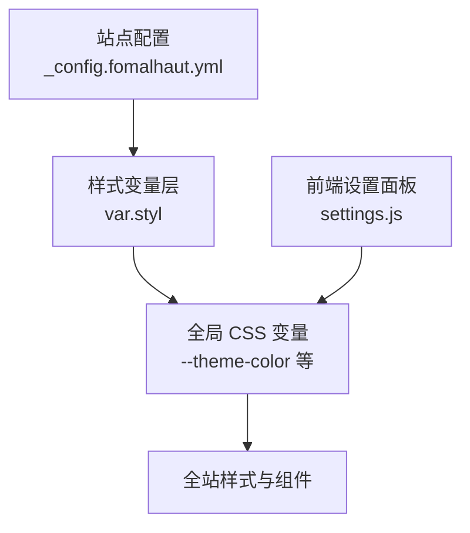
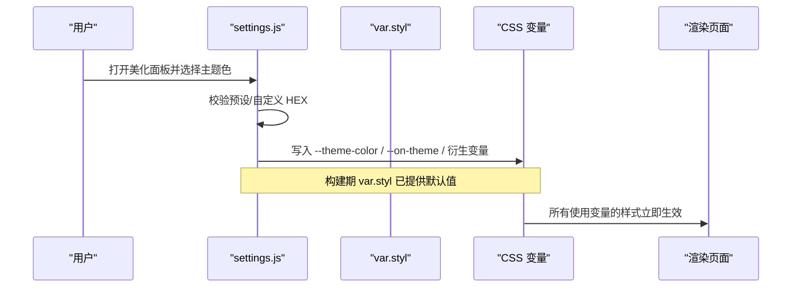
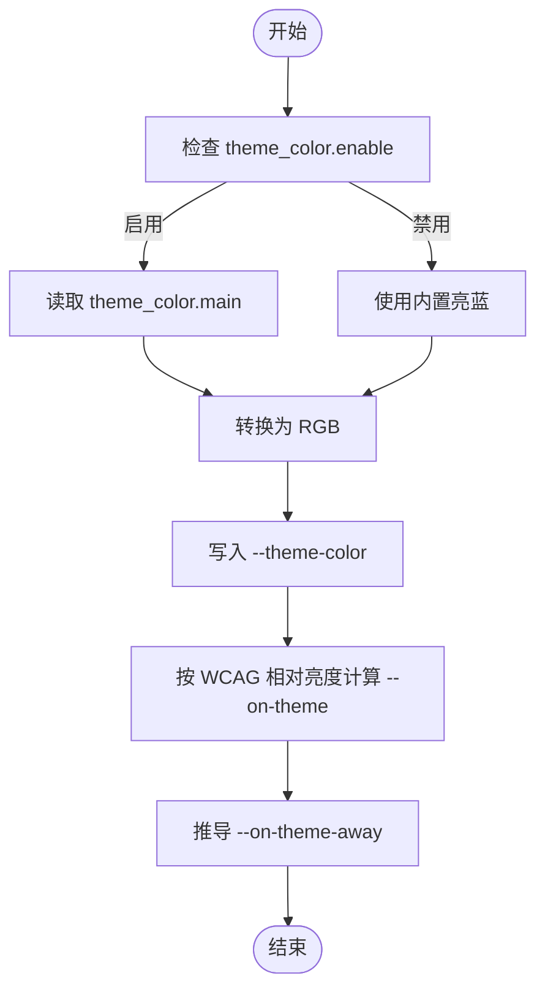
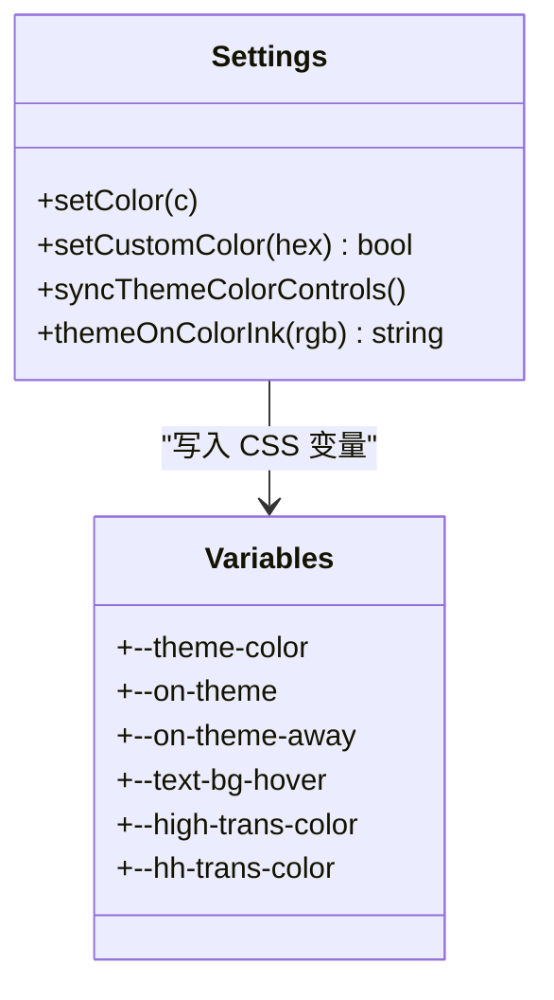
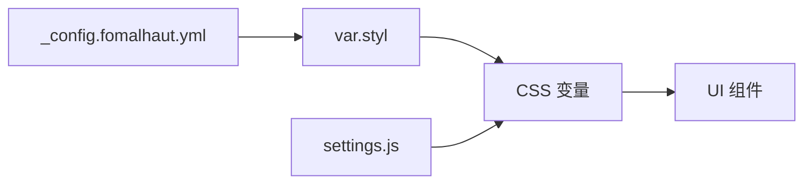

# 主题颜色管理

<cite>
**本文引用的文件**   
- [_config.fomalhaut.yml](file://_config.fomalhaut.yml)
- [var.styl](file://themes/fomalhaut/source/css/var.styl)
- [settings.js](file://source/js/modules/settings.js)
- [README.md](file://README.md)
</cite>

## 目录
1. [引言](#引言)
2. [项目结构](#项目结构)
3. [核心组件](#核心组件)
4. [架构总览](#架构总览)
5. [详细组件分析](#详细组件分析)
6. [依赖关系分析](#依赖关系分析)
7. [性能与可访问性考虑](#性能与可访问性考虑)
8. [故障排查指南](#故障排查指南)
9. [结论](#结论)
10. [附录：完整配置示例与最佳实践](#附录完整配置示例与最佳实践)

## 引言
本文件系统性解析站点“主题颜色管理系统”的设计与实现，覆盖以下目标：
- 主色调的配置方法与自动派生机制。
- 辅助色的生成逻辑（分页器、链接、HR 分隔线等）。
- 文本选择色的定制选项（选中背景色与边框色）。
- 代码块颜色的管理机制（前景色、背景色、引用块颜色）。
- 功能性颜色（按钮、滚动条、表格头背景色等）的配置方法。
- 完整的颜色配置示例与最佳实践。

该系统的核心思想是：通过站点配置文件提供一组颜色键值，由样式变量层统一读取并转换为 CSS 变量；同时在前端运行时根据用户选择动态更新 `--theme-color` 及其衍生变量，从而让全站 UI 随主题色实时变化。

## 项目结构
主题颜色相关的关键位置如下：
- 站点级主题色配置：根目录 `_config.fomalhaut.yml` 的 `theme_color` 段。
- 样式变量层：主题样式 `themes/fomalhaut/source/css/var.styl` 将配置映射为 Stylus 变量与全局 CSS 变量。
- 前端运行时：站点注入脚本 `source/js/modules/settings.js` 负责用户交互、预设/自定义主题色切换、CSS 变量更新与衍生色计算。
- 文档速查：仓库 README 中关于“最常改的地方”明确列出主题色修改入口。

图表来源
- [_config.fomalhaut.yml:760-777](file://_config.fomalhaut.yml#L760-L777)
- [var.styl:1-14](file://themes/fomalhaut/source/css/var.styl#L1-L14)
- [settings.js:218-263](file://source/js/modules/settings.js#L218-L263)

章节来源
- [_config.fomalhaut.yml:760-777](file://_config.fomalhaut.yml#L760-L777)
- [var.styl:1-14](file://themes/fomalhaut/source/css/var.styl#L1-L14)
- [settings.js:218-263](file://source/js/modules/settings.js#L218-L263)
- [README.md:1185](file://README.md#L1185)

## 核心组件
- 站点配置层：定义主题色开关、主色、辅助色、代码块颜色、滚动条颜色、元信息颜色等。
- 样式变量层：把配置项转为 Stylus 变量，并作为构建期默认值注入到 CSS 变量。
- 前端运行时：维护预设主题色与自定义 HEX 值，计算实底前景色 `--on-theme`，并同步一系列衍生变量。

章节来源
- [_config.fomalhaut.yml:760-777](file://_config.fomalhaut.yml#L760-L777)
- [var.styl:1-14](file://themes/fomalhaut/source/css/var.styl#L1-L14)
- [settings.js:218-263](file://source/js/modules/settings.js#L218-L263)

## 架构总览
主题颜色系统采用“配置驱动 + 运行时增强”的双层架构：
- 构建期：Stylus 从 Hexo 配置读取颜色键值，若未启用或未填写则回退到内置默认色。
- 运行期：JS 模块根据用户选择或本地缓存，动态写入 `--theme-color` 及衍生变量，使全站即时响应。

图表来源
- [settings.js:218-263](file://source/js/modules/settings.js#L218-L263)
- [var.styl:1-14](file://themes/fomalhaut/source/css/var.styl#L1-L14)

## 详细组件分析

### 主色调配置与自动派生
- 配置入口：`theme_color.enable` 控制是否启用主题色；`theme_color.main` 指定主色调。
- 变量映射：`var.styl` 在启用时读取 `theme_color.main`，否则使用内置亮蓝色。
- 运行时派生：`settings.js` 将最终 RGB 写入 `--theme-color`，并基于相对亮度计算 `--on-theme`（实底前景色），以及渐变方向锚点 `--on-theme-away`。

图表来源
- [_config.fomalhaut.yml:760-763](file://_config.fomalhaut.yml#L760-L763)
- [var.styl:6-7](file://themes/fomalhaut/source/css/var.styl#L6-L7)
- [settings.js:211-249](file://source/js/modules/settings.js#L211-L249)

章节来源
- [_config.fomalhaut.yml:760-763](file://_config.fomalhaut.yml#L760-L763)
- [var.styl:6-7](file://themes/fomalhaut/source/css/var.styl#L6-L7)
- [settings.js:211-249](file://source/js/modules/settings.js#L211-L249)

### 辅助色生成逻辑
- 分页器颜色：`theme_color.paginator` 对应 Stylus 变量 `$theme-paginator-color`，用于分页器高亮。
- 链接颜色：`theme_color.link_color` 对应 `$theme-link-color`，独立于主色，便于保持链接辨识度。
- HR 分隔线颜色：`theme_color.hr_color` 对应 `$theme-hr-color`，用于水平分割线。

这些变量在 `var.styl` 中统一从配置读取，并在未配置时回退到预设值。

章节来源
- [_config.fomalhaut.yml:762-769](file://_config.fomalhaut.yml#L762-L769)
- [var.styl:8-11](file://themes/fomalhaut/source/css/var.styl#L8-L11)

### 文本选择色的定制选项
- 选中背景色：`theme_color.text_selection` 对应 `$theme-text-selection-color`，影响 `::selection` 背景。
- 选中边框色：当前配置项仅暴露背景色；边框色通常跟随系统或浏览器默认行为，如需定制可在自定义 CSS 中覆盖 `::selection` 的 border 属性。

章节来源
- [_config.fomalhaut.yml:765](file://_config.fomalhaut.yml#L765)
- [var.styl:9](file://themes/fomalhaut/source/css/var.styl#L9)

### 代码块颜色管理机制
- 代码前景色：`theme_color.code_foreground` 对应 `$code-foreground`。
- 代码背景色：`theme_color.code_background` 对应 `$code-background`。
- 引用块颜色：
  - 左侧装饰条：`theme_color.blockquote_padding_color` 对应 `$blockquote-padding-color`。
  - 引用块背景：`theme_color.blockquote_background_color` 对应 `$blockquote-background-color`，默认以装饰条颜色为基础做透明度处理。

注意：代码高亮主题本身还受 `highlight_theme` 控制，但上述字段允许用主题色体系对部分代码区域进行二次着色。

章节来源
- [_config.fomalhaut.yml:770-775](file://_config.fomalhaut.yml#L770-L775)
- [var.styl:12-14](file://themes/fomalhaut/source/css/var.styl#L12-L14)
- [var.styl:54-55](file://themes/fomalhaut/source/css/var.styl#L54-L55)

### 功能性颜色配置
- 按钮颜色：
  - 按钮背景：使用 `$theme-color`（即主色）。
  - 按钮悬停色：`theme_color.button_hover` 对应 `$button-hover-color`。
- 滚动条颜色：`theme_color.scrollbar_color` 对应 `$scrollbar-color`，默认回退到主色。
- 表格头背景色：`$table-thead-bg` 使用固定色，未接入主题色配置。
- 其他功能色：如搜索高亮、标签激活边框、时间线颜色等，均通过 `$theme-color` 或专用变量参与整体配色。

章节来源
- [var.styl:69-77](file://themes/fomalhaut/source/css/var.styl#L69-L77)
- [var.styl:177-185](file://themes/fomalhaut/source/css/var.styl#L177-L185)

### 运行时主题色与衍生变量
`settings.js` 的核心职责包括：
- 预设主题色列表与自定义 HEX 校验。
- 将主题色写入 `--theme-color`，并计算 `--on-theme`（实底前景色）和 `--on-theme-away`（渐变方向锚点）。
- 同步衍生变量：`--text-bg-hover`、`--high-trans-color`、`--hh-trans-color`。
- 联动外部组件：贡献日历重绘、鼠标光标颜色刷新。

图表来源
- [settings.js:211-263](file://source/js/modules/settings.js#L211-L263)

章节来源
- [settings.js:211-263](file://source/js/modules/settings.js#L211-L263)

## 依赖关系分析
- 配置依赖：`var.styl` 依赖 Hexo 配置中的 `theme_color.*` 键。
- 样式依赖：各样式文件通过 Stylus 变量与 CSS 变量消费主题色。
- 运行时依赖：`settings.js` 直接操作 DOM 的 CSS 变量，不依赖第三方库。

图表来源
- [_config.fomalhaut.yml:760-777](file://_config.fomalhaut.yml#L760-L777)
- [var.styl:1-14](file://themes/fomalhaut/source/css/var.styl#L1-L14)
- [settings.js:218-263](file://source/js/modules/settings.js#L218-L263)

章节来源
- [_config.fomalhaut.yml:760-777](file://_config.fomalhaut.yml#L760-L777)
- [var.styl:1-14](file://themes/fomalhaut/source/css/var.styl#L1-L14)
- [settings.js:218-263](file://source/js/modules/settings.js#L218-L263)

## 性能与可访问性考虑
- 性能：运行时只写少量 CSS 变量，避免频繁重排；仅在颜色真正变化时触发外部组件刷新（如贡献日历）。
- 可访问性：`--on-theme` 基于 WCAG 相对亮度阈值选择近黑或纯白，确保浅色主题色上的文字可读性；面板选中态使用主题色边框与淡底色，保证对比度。

章节来源
- [settings.js:207-217](file://source/js/modules/settings.js#L207-L217)
- [settings.js:252-262](file://source/js/modules/settings.js#L252-L262)

## 故障排查指南
- 主题色未生效：
  - 确认 `_config.fomalhaut.yml` 中 `theme_color.enable` 为真且 `main` 有合法十六进制值。
  - 检查 `var.styl` 是否正确读取配置。
- 自定义主题色无效：
  - 确认自定义 HEX 符合六位十六进制格式；非法值会被忽略并回退默认。
- 链接颜色异常：
  - 检查 `theme_color.link_color` 是否被误置空或覆盖。
- 代码块颜色不匹配：
  - 核对 `code_foreground`、`code_background`、`blockquote_padding_color`、`blockquote_background_color` 的值。
- 滚动条颜色不生效：
  - 检查 `scrollbar_color` 是否配置；某些浏览器滚动条样式需额外兼容。

章节来源
- [_config.fomalhaut.yml:760-777](file://_config.fomalhaut.yml#L760-L777)
- [settings.js:232-268](file://source/js/modules/settings.js#L232-L268)

## 结论
主题颜色管理系统通过“配置 + 样式变量 + 运行时变量”三层协作，实现了主色调的统一管理与辅助色的灵活扩展。用户在面板中切换主题色后，全站 UI 会即时响应，同时保持可访问性与视觉一致性。对于尚未接入主题色的元素（如表格头背景），可在后续迭代中逐步纳入同一配色体系。

## 附录：完整配置示例与最佳实践

### 完整颜色配置示例
以下为可直接参考的配置键集合（请按需调整数值）：
- 主题色开关与主色：`theme_color.enable`、`theme_color.main`
- 辅助色：`theme_color.paginator`、`theme_color.link_color`、`theme_color.hr_color`
- 文本选择色：`theme_color.text_selection`
- 代码块颜色：`theme_color.code_foreground`、`theme_color.code_background`
- 引用块颜色：`theme_color.blockquote_padding_color`、`theme_color.blockquote_background_color`
- 滚动条颜色：`theme_color.scrollbar_color`
- 按钮悬停色：`theme_color.button_hover`
- 元信息颜色：`theme_color.meta_color`
- TOC 高亮色：`theme_color.toc_color`
- 系统主题栏颜色：`theme_color.meta_theme_color_light`、`theme_color.meta_theme_color_dark`

章节来源
- [_config.fomalhaut.yml:760-777](file://_config.fomalhaut.yml#L760-L777)

### 最佳实践指南
- 优先使用 `theme_color.main` 统一风格，再微调关键辅助色（链接、HR、分页器）。
- 保持链接色与主色适度区分，提升导航可读性。
- 代码块前景/背景应与正文对比度良好，避免刺眼或过暗。
- 引用块背景建议使用低透明度版本，避免喧宾夺主。
- 滚动条颜色建议与主色一致，保持界面一致性。
- 按钮悬停色可使用强调色，提升交互反馈。
- 使用运行时主题色面板时，注意自定义 HEX 的合法性与可访问性。

章节来源
- [README.md:1185](file://README.md#L1185)
- [settings.js:207-217](file://source/js/modules/settings.js#L207-L217)
- [settings.js:232-268](file://source/js/modules/settings.js#L232-L268)