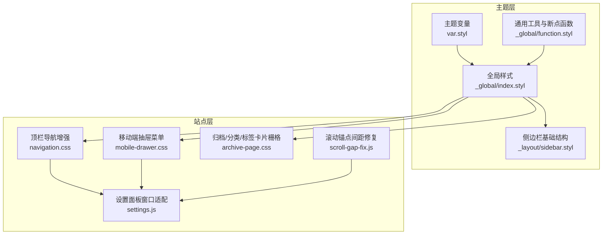
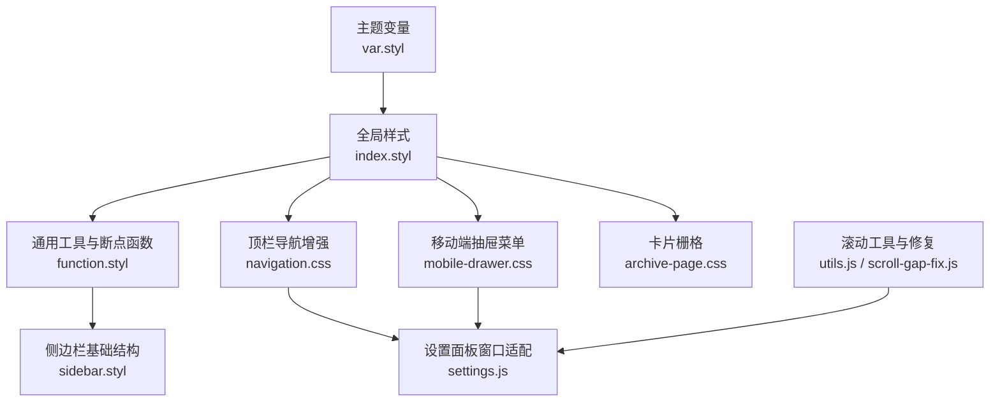
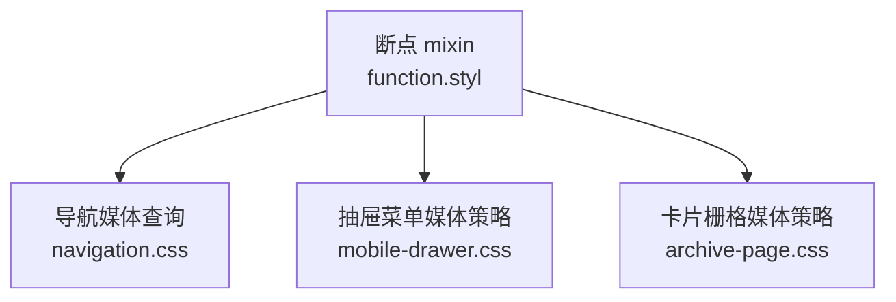
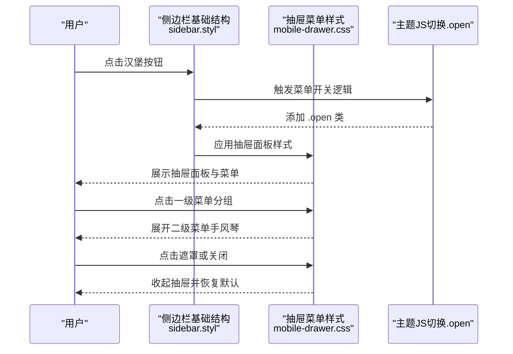
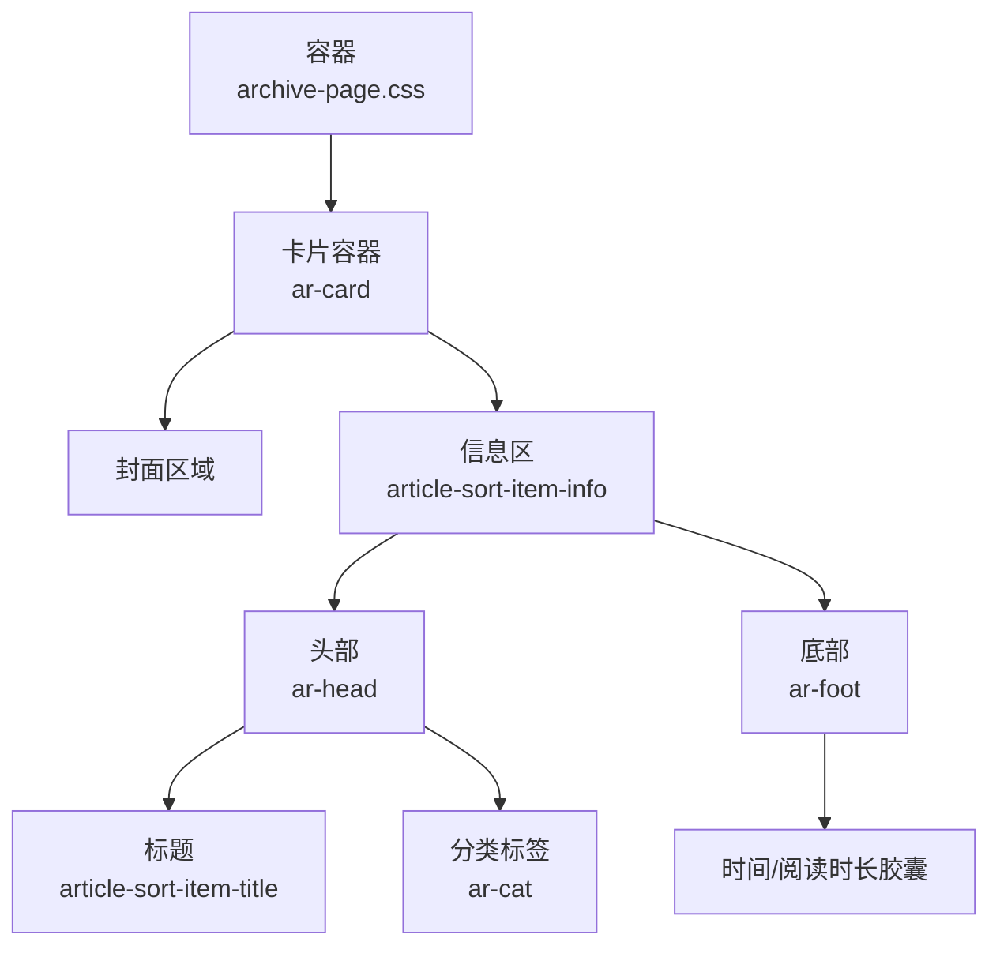
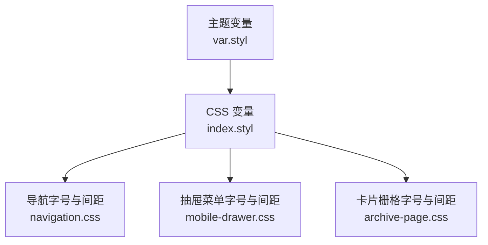
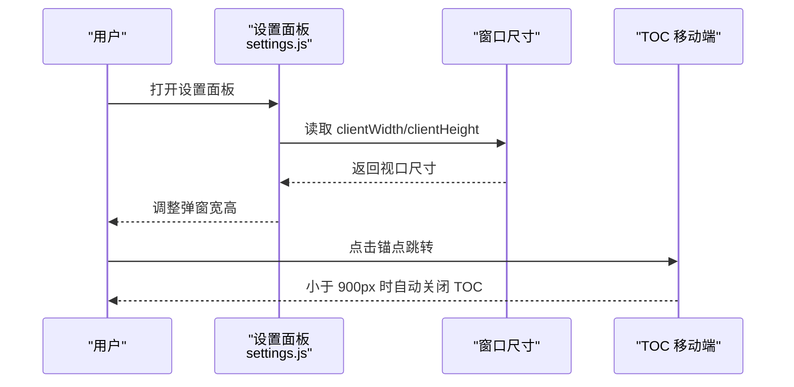
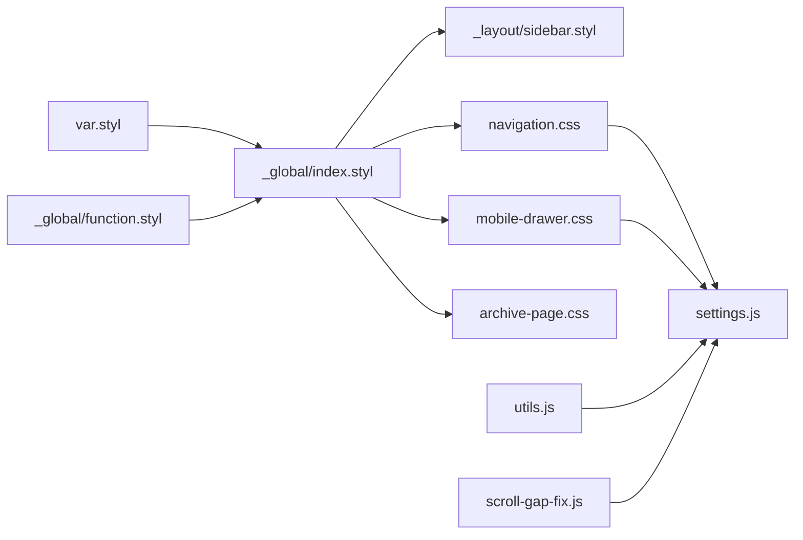

# 响应式设计系统

<cite>
**本文引用的文件**   
- [主题变量定义](file://themes/fomalhaut/source/css/var.styl)
- [全局样式入口](file://themes/fomalhaut/source/css/_global/index.styl)
- [通用工具与断点函数](file://themes/fomalhaut/source/css/_global/function.styl)
- [侧边栏基础结构](file://themes/fomalhaut/source/css/_layout/sidebar.styl)
- [顶栏导航站点增强样式](file://source/css/navigation.css)
- [移动端抽屉菜单样式](file://source/css/mobile-drawer.css)
- [归档/分类/标签卡片栅格样式](file://source/css/archive-page.css)
- [设置面板窗口尺寸适配逻辑](file://source/js/modules/settings.js)
- [滚动定位工具方法](file://themes/fomalhaut/source/js/utils.js)
- [滚动锚点间距修复脚本](file://source/js/inject/scroll-gap-fix.js)
- [站点配置（Hexo）](file://_config.yml)
- [主题配置（Fomalhaut）](file://_config.fomalhaut.yml)
</cite>

## 目录
1. [引言](#引言)
2. [项目结构与响应式边界](#项目结构与响应式边界)
3. [核心组件](#核心组件)
4. [架构总览](#架构总览)
5. [详细组件分析](#详细组件分析)
6. [依赖关系分析](#依赖关系分析)
7. [性能与可访问性](#性能与可访问性)
8. [故障排查指南](#故障排查指南)
9. [结论](#结论)
10. [附录：断点与适配策略速查](#附录断点与适配策略速查)

## 引言
本文件系统性地解析该博客在响应式设计上的实现，重点覆盖以下方面：
- 断点系统与媒体查询的组织方式。
- 移动端、平板端、桌面端的布局差异与适配策略。
- 侧边栏的折叠、抽屉式导航与触摸交互优化。
- 卡片布局的弹性网格与容器级视觉控制。
- 字体、间距与排版的相对单位与流体化思路。
- 移动设备特殊处理：触摸事件、手势、视口与滚动体验。
- 最佳实践与性能优化建议。

该项目采用 Hexo + Butterfly 主题派生风格（fomalhaut），并在站点层通过独立的 CSS 与 JS 对主题默认行为进行增强，从而在不直接修改主题源码的前提下完成响应式定制。

## 项目结构与响应式边界
从响应式视角看，代码组织遵循“主题层 + 站点层”的双层结构：
- 主题层负责基础排版、颜色变量、通用动画与基础布局。
- 站点层通过 `source/css` 与 `source/js` 注入更精细的断点、交互与视觉增强。

**图示来源**
- [主题变量定义:1-185](file://themes/fomalhaut/source/css/var.styl#L1-L185)
- [全局样式入口:1-220](file://themes/fomalhaut/source/css/_global/index.styl#L1-L220)
- [通用工具与断点函数:74-104](file://themes/fomalhaut/source/css/_global/function.styl#L74-L104)
- [侧边栏基础结构:1-68](file://themes/fomalhaut/source/css/_layout/sidebar.styl#L1-L68)
- [顶栏导航站点增强样式:1-278](file://source/css/navigation.css#L1-L278)
- [移动端抽屉菜单样式:1-492](file://source/css/mobile-drawer.css#L1-L492)
- [归档/分类/标签卡片栅格样式:386-609](file://source/css/archive-page.css#L386-L609)
- [设置面板窗口尺寸适配逻辑:1181-1212](file://source/js/modules/settings.js#L1181-L1212)
- [滚动锚点间距修复脚本:117-144](file://source/js/inject/scroll-gap-fix.js#L117-L144)

**章节来源**
- [主题变量定义:1-185](file://themes/fomalhaut/source/css/var.styl#L1-L185)
- [全局样式入口:1-220](file://themes/fomalhaut/source/css/_global/index.styl#L1-L220)
- [通用工具与断点函数:74-104](file://themes/fomalhaut/source/css/_global/function.styl#L74-L104)
- [侧边栏基础结构:1-68](file://themes/fomalhaut/source/css/_layout/sidebar.styl#L1-L68)
- [顶栏导航站点增强样式:1-278](file://source/css/navigation.css#L1-L278)
- [移动端抽屉菜单样式:1-492](file://source/css/mobile-drawer.css#L1-L492)
- [归档/分类/标签卡片栅格样式:386-609](file://source/css/archive-page.css#L386-L609)
- [设置面板窗口尺寸适配逻辑:1181-1212](file://source/js/modules/settings.js#L1181-L1212)
- [滚动锚点间距修复脚本:117-144](file://source/js/inject/scroll-gap-fix.js#L117-L144)

## 核心组件
- 主题变量与颜色体系：集中定义主题色、字体、侧边栏宽度等，为响应式提供统一语义变量。
- 全局样式：定义根变量、基础排版、滚动条、链接、图片懒加载模糊等。
- 通用工具与断点函数：提供 `maxWidth600()`、`maxWidth768()`、`minWidth768()`、`maxWidth1024()` 等 mixin，作为断点复用单元。
- 侧边栏基础结构：定义抽屉面板、遮罩、菜单项、分组展开等基础状态。
- 顶栏导航增强：在主题基础上增加触控区、磨砂背景降级、标题溢出处理、窄屏断点。
- 移动端抽屉菜单：独立站点样式，重新设计面板宽度、极光渐变、图标底衬、手风琴二级菜单、入场动效与深色模式。
- 卡片栅格：使用 CSS Grid 的 `auto-fit` 与 `minmax` 实现自适应列数，配合玻璃态与悬停反馈。
- 设置面板窗口适配：根据视口宽度动态调整弹窗宽高，保证首节开关完整可见。
- 滚动体验：平滑滚动、锚点偏移修正、移动端 TOC 自动关闭。

**章节来源**
- [主题变量定义:1-185](file://themes/fomalhaut/source/css/var.styl#L1-L185)
- [全局样式入口:1-220](file://themes/fomalhaut/source/css/_global/index.styl#L1-L220)
- [通用工具与断点函数:74-104](file://themes/fomalhaut/source/css/_global/function.styl#L74-L104)
- [侧边栏基础结构:1-68](file://themes/fomalhaut/source/css/_layout/sidebar.styl#L1-L68)
- [顶栏导航站点增强样式:1-278](file://source/css/navigation.css#L1-L278)
- [移动端抽屉菜单样式:1-492](file://source/css/mobile-drawer.css#L1-L492)
- [归档/分类/标签卡片栅格样式:386-609](file://source/css/archive-page.css#L386-L609)
- [设置面板窗口尺寸适配逻辑:1181-1212](file://source/js/modules/settings.js#L1181-L1212)
- [滚动锚点间距修复脚本:117-144](file://source/js/inject/scroll-gap-fix.js#L117-L144)

## 架构总览
响应式架构由“变量 → 全局 → 组件 → 页面增强”构成，断点以 mixin 与媒体查询共同驱动。

**图示来源**
- [主题变量定义:1-185](file://themes/fomalhaut/source/css/var.styl#L1-L185)
- [全局样式入口:1-220](file://themes/fomalhaut/source/css/_global/index.styl#L1-L220)
- [通用工具与断点函数:74-104](file://themes/fomalhaut/source/css/_global/function.styl#L74-L104)
- [侧边栏基础结构:1-68](file://themes/fomalhaut/source/css/_layout/sidebar.styl#L1-L68)
- [顶栏导航站点增强样式:1-278](file://source/css/navigation.css#L1-L278)
- [移动端抽屉菜单样式:1-492](file://source/css/mobile-drawer.css#L1-L492)
- [归档/分类/标签卡片栅格样式:386-609](file://source/css/archive-page.css#L386-L609)
- [设置面板窗口尺寸适配逻辑:1181-1212](file://source/js/modules/settings.js#L1181-L1212)
- [滚动工具与修复:122-158](file://themes/fomalhaut/source/js/utils.js#L122-L158)
- [滚动锚点间距修复脚本:117-144](file://source/js/inject/scroll-gap-fix.js#L117-L144)

## 详细组件分析

### 断点系统与媒体查询
- 主题提供一组断点 mixin：`maxWidth600()`、`maxWidth768()`、`minWidth768()`、`maxWidth1024()`、`maxWidth900()`、`minWidth901()`、`minWidth900()`、`minWidth2000()`。这些 mixin 将媒体查询封装为可复用的样式块，便于在不同组件中按设备范围应用规则。
- 站点层在导航与抽屉等组件中使用具体媒体查询：
  - 导航在 `<=800px` 时缩小内边距、压缩右侧按钮间距、隐藏页面标题占位；在 `<=480px` 时缩小站名字号；在 `<=360px` 时对品牌区域做裁剪与动画降级。
  - 抽屉菜单在窄屏下生效，宽度改为基于视口的最小值与上限组合，避免固定宽度在小屏上过窄。
  - 卡片栅格在 `<=1023px` 和 `<=768px` 等断点下调间距、字号与导航标签显示策略。

**图示来源**
- [通用工具与断点函数:74-104](file://themes/fomalhaut/source/css/_global/function.styl#L74-L104)
- [顶栏导航站点增强样式:229-277](file://source/css/navigation.css#L229-L277)
- [移动端抽屉菜单样式:36-70](file://source/css/mobile-drawer.css#L36-L70)
- [归档/分类/标签卡片栅格样式:644-693](file://source/css/archive-page.css#L644-L693)

**章节来源**
- [通用工具与断点函数:74-104](file://themes/fomalhaut/source/css/_global/function.styl#L74-L104)
- [顶栏导航站点增强样式:229-277](file://source/css/navigation.css#L229-L277)
- [移动端抽屉菜单样式:36-70](file://source/css/mobile-drawer.css#L36-L70)
- [归档/分类/标签卡片栅格样式:644-693](file://source/css/archive-page.css#L644-L693)

### 侧边栏响应式行为：折叠、抽屉与触摸优化
- 基础结构：侧边栏使用固定定位的抽屉面板，初始右外滑出，打开时通过类名切换位移；遮罩层覆盖全屏。
- 站点增强：
  - 抽屉宽度从固定像素改为基于视口的最小值与上限，确保小屏可用。
  - 面板背景使用多层渐变与星光点缀，滚动内容不带动画图层，提升滚动性能。
  - 一级菜单项采用图标方块 + 文字 + 箭头的一整行圆角布局，hover/active 有洗色与底色变化。
  - 二级菜单采用手风琴展开，通过 `max-height` 与 `opacity` 过渡，避免硬切。
  - 入场动效为上浮 + 淡入，头像同时保留呼吸灯动画，避免被主题入场动画覆盖。
  - 深色模式仅覆盖变量，规则本体一套，减少重复维护成本。
  - 无障碍：`prefers-reduced-motion` 下禁用动画，头像保持常亮光晕。

**图示来源**
- [侧边栏基础结构:1-68](file://themes/fomalhaut/source/css/_layout/sidebar.styl#L1-L68)
- [移动端抽屉菜单样式:72-104](file://source/css/mobile-drawer.css#L72-L104)
- [移动端抽屉菜单样式:239-376](file://source/css/mobile-drawer.css#L239-L376)
- [移动端抽屉菜单样式:378-405](file://source/css/mobile-drawer.css#L378-L405)
- [移动端抽屉菜单样式:407-491](file://source/css/mobile-drawer.css#L407-L491)

**章节来源**
- [侧边栏基础结构:1-68](file://themes/fomalhaut/source/css/_layout/sidebar.styl#L1-L68)
- [移动端抽屉菜单样式:36-104](file://source/css/mobile-drawer.css#L36-L104)
- [移动端抽屉菜单样式:239-376](file://source/css/mobile-drawer.css#L239-L376)
- [移动端抽屉菜单样式:378-405](file://source/css/mobile-drawer.css#L378-L405)
- [移动端抽屉菜单样式:407-491](file://source/css/mobile-drawer.css#L407-L491)

### 卡片布局自适应机制：弹性网格与容器级视觉控制
- 卡片栅格使用 CSS Grid 的 `grid-template-columns: repeat(auto-fit, minmax(310px, 1fr))`，实现列数随容器宽度自动调整，无需复杂媒体查询。
- 卡片本身采用网格布局划分封面与信息区，信息区再分为头部与底部，标题与分类标签使用弹性布局与截断策略。
- 玻璃态背景与悬停阴影提升质感，整体在窄屏下调间距与字号，保证可读性与触控友好。

**图示来源**
- [归档/分类/标签卡片栅格样式:386-454](file://source/css/archive-page.css#L386-L454)
- [归档/分类/标签卡片栅格样式:534-609](file://source/css/archive-page.css#L534-L609)

**章节来源**
- [归档/分类/标签卡片栅格样式:386-454](file://source/css/archive-page.css#L386-L454)
- [归档/分类/标签卡片栅格样式:534-609](file://source/css/archive-page.css#L534-L609)

### 字体与间距的响应式调整：流体排版与相对单位
- 主题变量集中定义全局字号、代码字号、行高、字体族等，并通过 CSS 变量暴露给运行时。
- 全局样式使用 `var(--global-font-size)` 作为基础字号，配合相对单位与行高，使不同屏幕下保持良好比例。
- 导航与抽屉菜单在窄屏下调整字号、内边距与间距，避免拥挤。
- 卡片栅格在窄屏下调字号与间距，保证信息密度与可读性平衡。

**图示来源**
- [主题变量定义:15-33](file://themes/fomalhaut/source/css/var.styl#L15-L33)
- [全局样式入口:1-45](file://themes/fomalhaut/source/css/_global/index.styl#L1-L45)
- [顶栏导航站点增强样式:244-248](file://source/css/navigation.css#L244-L248)
- [移动端抽屉菜单样式:114-139](file://source/css/mobile-drawer.css#L114-L139)
- [归档/分类/标签卡片栅格样式:674-693](file://source/css/archive-page.css#L674-L693)

**章节来源**
- [主题变量定义:15-33](file://themes/fomalhaut/source/css/var.styl#L15-L33)
- [全局样式入口:1-45](file://themes/fomalhaut/source/css/_global/index.styl#L1-L45)
- [顶栏导航站点增强样式:244-248](file://source/css/navigation.css#L244-L248)
- [移动端抽屉菜单样式:114-139](file://source/css/mobile-drawer.css#L114-L139)
- [归档/分类/标签卡片栅格样式:674-693](file://source/css/archive-page.css#L674-L693)

### 移动设备特殊处理：触摸事件、手势与视口适配
- 触摸与指针：
  - 设置面板的滑条增强支持 PointerEvent、鼠标与触摸事件，兼容多输入设备。
  - 滚动锚点修复在移动端小于 900px 时自动关闭移动端 TOC，避免遮挡。
- 视口适配：
  - 设置面板根据视口宽度计算弹窗宽高，保证首节开关完整可见。
  - 导航在窄屏下减小内边距与按钮间距，隐藏页面标题占位，避免挤压。
  - 抽屉菜单宽度基于视口百分比与上限，避免固定宽度导致的小屏不可用。

**图示来源**
- [设置面板窗口尺寸适配逻辑:1181-1212](file://source/js/modules/settings.js#L1181-L1212)
- [滚动锚点间距修复脚本:117-144](file://source/js/inject/scroll-gap-fix.js#L117-L144)

**章节来源**
- [设置面板窗口尺寸适配逻辑:1181-1212](file://source/js/modules/settings.js#L1181-L1212)
- [滚动锚点间距修复脚本:117-144](file://source/js/inject/scroll-gap-fix.js#L117-L144)

## 依赖关系分析
- 主题变量是全局样式的上游，影响所有组件的颜色与字体。
- 通用工具与断点函数被导航、抽屉、卡片等组件引用，形成统一的断点语义。
- 侧边栏基础结构是抽屉菜单样式的基础，站点样式在其之上增强。
- 导航与抽屉均受全局样式与主题变量影响，同时各自拥有站点层增强。
- 设置面板窗口适配逻辑依赖 DOM API 与窗口尺寸，与导航、抽屉的交互状态存在间接耦合。

**图示来源**
- [主题变量定义:1-185](file://themes/fomalhaut/source/css/var.styl#L1-L185)
- [全局样式入口:1-220](file://themes/fomalhaut/source/css/_global/index.styl#L1-L220)
- [通用工具与断点函数:74-104](file://themes/fomalhaut/source/css/_global/function.styl#L74-L104)
- [侧边栏基础结构:1-68](file://themes/fomalhaut/source/css/_layout/sidebar.styl#L1-L68)
- [顶栏导航站点增强样式:1-278](file://source/css/navigation.css#L1-L278)
- [移动端抽屉菜单样式:1-492](file://source/css/mobile-drawer.css#L1-L492)
- [归档/分类/标签卡片栅格样式:386-609](file://source/css/archive-page.css#L386-L609)
- [设置面板窗口尺寸适配逻辑:1181-1212](file://source/js/modules/settings.js#L1181-L1212)
- [滚动工具与修复:122-158](file://themes/fomalhaut/source/js/utils.js#L122-L158)
- [滚动锚点间距修复脚本:117-144](file://source/js/inject/scroll-gap-fix.js#L117-L144)

**章节来源**
- [主题变量定义:1-185](file://themes/fomalhaut/source/css/var.styl#L1-L185)
- [全局样式入口:1-220](file://themes/fomalhaut/source/css/_global/index.styl#L1-L220)
- [通用工具与断点函数:74-104](file://themes/fomalhaut/source/css/_global/function.styl#L74-L104)
- [侧边栏基础结构:1-68](file://themes/fomalhaut/source/css/_layout/sidebar.styl#L1-L68)
- [顶栏导航站点增强样式:1-278](file://source/css/navigation.css#L1-L278)
- [移动端抽屉菜单样式:1-492](file://source/css/mobile-drawer.css#L1-L492)
- [归档/分类/标签卡片栅格样式:386-609](file://source/css/archive-page.css#L386-L609)
- [设置面板窗口尺寸适配逻辑:1181-1212](file://source/js/modules/settings.js#L1181-L1212)
- [滚动工具与修复:122-158](file://themes/fomalhaut/source/js/utils.js#L122-L158)
- [滚动锚点间距修复脚本:117-144](file://source/js/inject/scroll-gap-fix.js#L117-L144)

## 性能与可访问性
- 性能优化：
  - 导航磨砂背景使用 `backdrop-filter`，并在不支持时回退到纯色背景，避免 GPU 检测带来的额外开销。
  - 抽屉面板背景使用 `background-attachment: local` 的渐变图层，滚动内容不带动画图层，降低重绘压力。
  - 卡片栅格使用 CSS Grid 的 `auto-fit`，减少媒体查询数量与复杂度。
  - 设置面板窗口尺寸计算仅在必要时执行，避免频繁重排。
- 可访问性：
  - 导航按钮与链接提供 `focus-visible` 样式，键盘可达性更好。
  - 抽屉菜单在 `prefers-reduced-motion` 下禁用动画，头像保持常亮光晕，保证感知一致性。
  - 滚动锚点修复在移动端小于 900px 时自动关闭 TOC，避免遮挡内容。

**章节来源**
- [顶栏导航站点增强样式:167-184](file://source/css/navigation.css#L167-L184)
- [移动端抽屉菜单样式:470-491](file://source/css/mobile-drawer.css#L470-L491)
- [归档/分类/标签卡片栅格样式:386-454](file://source/css/archive-page.css#L386-L454)
- [滚动锚点间距修复脚本:117-144](file://source/js/inject/scroll-gap-fix.js#L117-L144)

## 故障排查指南
- 抽屉菜单宽度异常：
  - 检查抽屉宽度变量与 `right` 是否一致，避免滑出后留缝。
  - 确认站点样式引入顺序，确保覆盖主题默认样式。
- 导航标题溢出或动画异常：
  - 检查 `<=360px` 下的裁剪与动画降级规则。
  - 确认 `overflow`、`text-overflow`、`white-space` 的设置。
- 卡片栅格错位：
  - 检查 `grid-template-columns` 与 `gap` 的值。
  - 确认窄屏断点下的字号与间距调整。
- 设置面板尺寸不合理：
  - 检查视口宽度判断与弹窗宽高计算逻辑。
  - 确认首节开关元素是否存在且可测量。

**章节来源**
- [移动端抽屉菜单样式:36-70](file://source/css/mobile-drawer.css#L36-L70)
- [顶栏导航站点增强样式:255-263](file://source/css/navigation.css#L255-L263)
- [归档/分类/标签卡片栅格样式:386-454](file://source/css/archive-page.css#L386-L454)
- [设置面板窗口尺寸适配逻辑:1181-1212](file://source/js/modules/settings.js#L1181-L1212)

## 结论
该项目的响应式设计以主题变量与全局样式为基础，通过站点层 CSS 与 JS 对导航、抽屉、卡片等关键组件进行精细化增强。断点系统以 mixin 与媒体查询结合的方式组织，兼顾可维护性与扩展性。移动端特别关注触摸交互、手势与视口适配，同时在性能与可访问性方面做了多项优化。整体架构清晰，适合在此基础上继续扩展更多响应式场景。

## 附录：断点与适配策略速查
- 主题断点 mixin：
  - `maxWidth600()`、`maxWidth768()`、`minWidth768()`、`maxWidth1024()`、`maxWidth900()`、`minWidth901()`、`minWidth900()`、`minWidth2000()`。
- 导航断点：
  - `<=800px`：缩小内边距、压缩右侧按钮间距、隐藏页面标题占位。
  - `<=480px`：缩小站名字号。
  - `<=360px`：品牌区域裁剪与动画降级。
- 抽屉菜单：
  - 宽度基于视口百分比与上限，避免固定宽度在小屏不可用。
  - 二级菜单手风琴展开，入场动效上浮 + 淡入。
- 卡片栅格：
  - `<=1023px` 与 `<=768px` 下调间距、字号与导航标签显示策略。
- 设置面板：
  - 根据视口宽度动态调整弹窗宽高，保证首节开关完整可见。

**章节来源**
- [通用工具与断点函数:74-104](file://themes/fomalhaut/source/css/_global/function.styl#L74-L104)
- [顶栏导航站点增强样式:229-277](file://source/css/navigation.css#L229-L277)
- [移动端抽屉菜单样式:36-70](file://source/css/mobile-drawer.css#L36-L70)
- [归档/分类/标签卡片栅格样式:644-693](file://source/css/archive-page.css#L644-L693)
- [设置面板窗口尺寸适配逻辑:1181-1212](file://source/js/modules/settings.js#L1181-L1212)