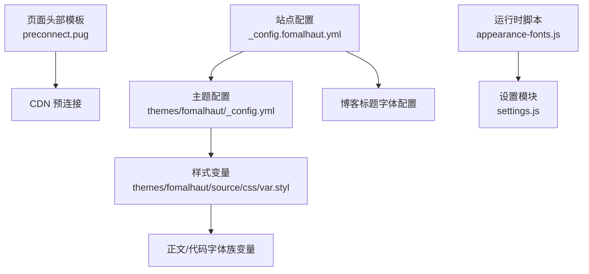
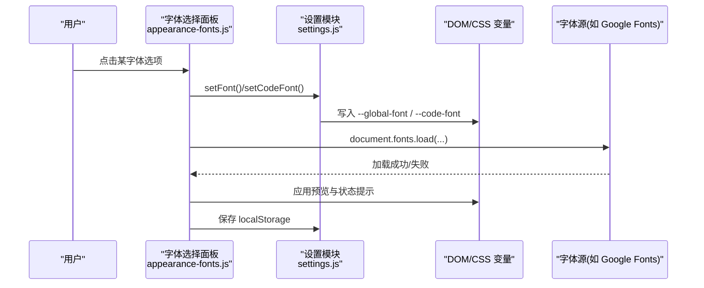
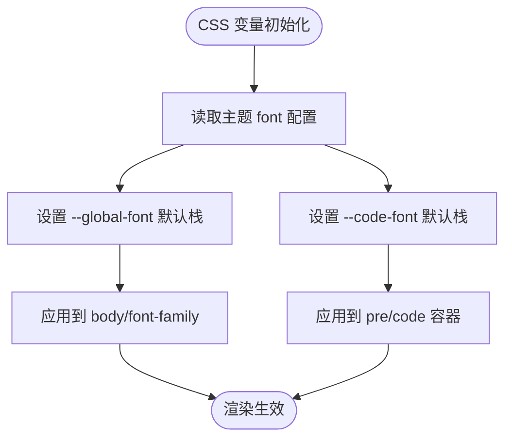
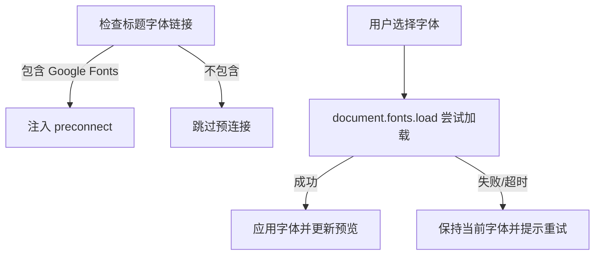
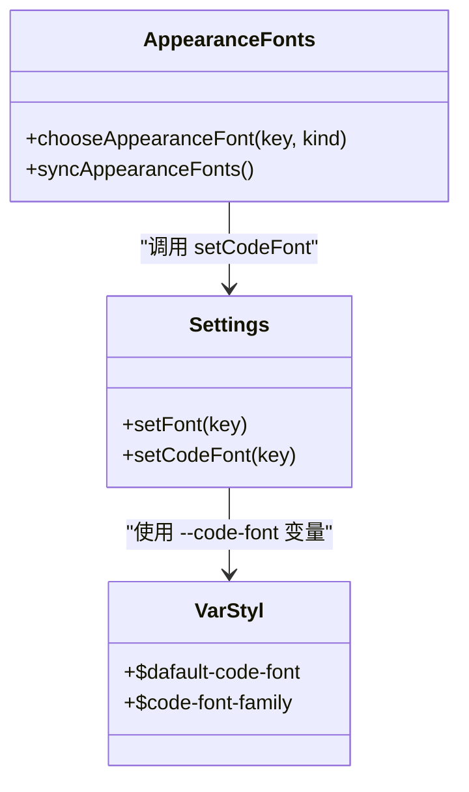
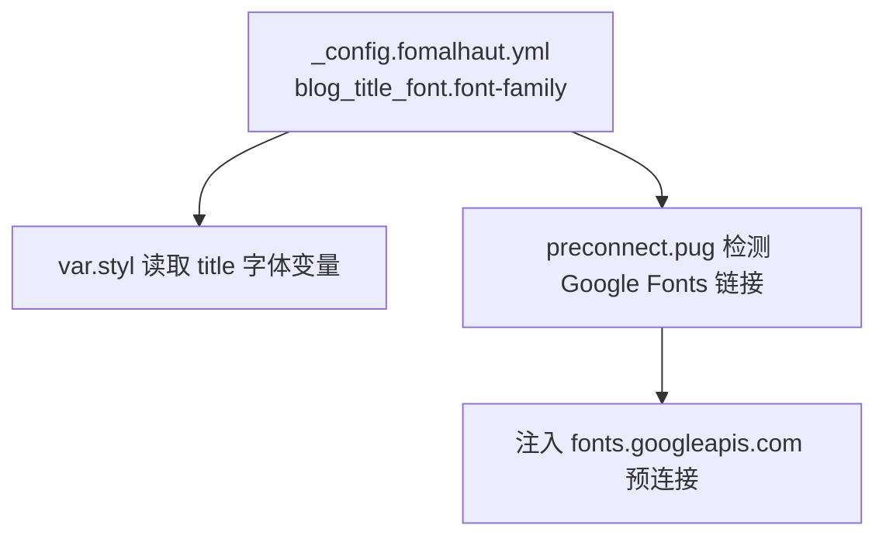
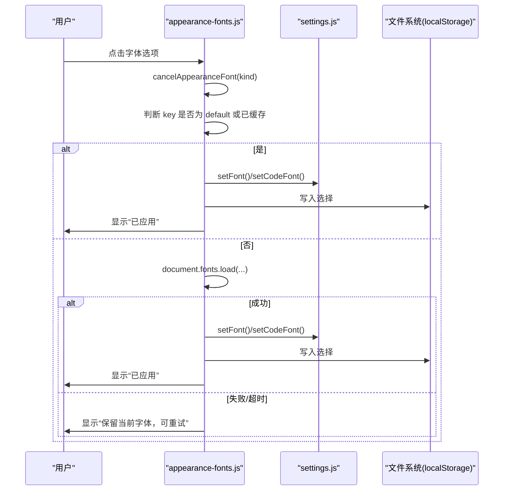
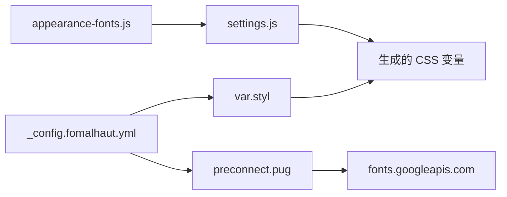

# 字体管理系统

<cite>
**本文引用的文件**   
- [source/js/modules/appearance-fonts.js](file://source/js/modules/appearance-fonts.js)
- [source/js/modules/settings.js](file://source/js/modules/settings.js)
- [themes/fomalhaut/source/css/var.styl](file://themes/fomalhaut/source/css/var.styl)
- [themes/fomalhaut/layout/includes/head/preconnect.pug](file://themes/fomalhaut/layout/includes/head/preconnect.pug)
- [_config.fomalhaut.yml](file://_config.fomalhaut.yml)
- [themes/fomalhaut/_config.yml](file://themes/fomalhaut/_config.yml)
</cite>

## 目录
1. [简介](#简介)
2. [项目结构](#项目结构)
3. [核心组件](#核心组件)
4. [架构总览](#架构总览)
5. [详细组件分析](#详细组件分析)
6. [依赖关系分析](#依赖关系分析)
7. [性能考量](#性能考量)
8. [故障排查指南](#故障排查指南)
9. [结论](#结论)
10. [附录：配置示例与最佳实践](#附录配置示例与最佳实践)

## 简介
本文件系统性地解析博客的字体管理方案，覆盖默认字体栈设计、系统/Web 安全字体优先级、Google Fonts 集成策略、代码等宽字体的特殊处理、博客标题字体的独立配置、以及预连接、懒加载、子集化等性能优化手段。文档同时提供可操作的配置示例与常见问题解决方案，帮助读者在不深入源码的情况下也能正确调优字体体验。

## 项目结构
与字体相关的实现分布在以下位置：
- 主题样式变量定义：themes/fomalhaut/source/css/var.styl
- 主题配置文件（含全局字体与标题字体）：themes/fomalhaut/_config.yml 与 _config.fomalhaut.yml
- 页面头部预连接注入：themes/fomalhaut/layout/includes/head/preconnect.pug
- 前端字体选择器与运行时字体切换：source/js/modules/appearance-fonts.js
- 设置持久化与默认值校验：source/js/modules/settings.js

**图示来源**
- [themes/fomalhaut/source/css/var.styl:15-31](file://themes/fomalhaut/source/css/var.styl#L15-L31)
- [themes/fomalhaut/layout/includes/head/preconnect.pug:1-22](file://themes/fomalhaut/layout/includes/head/preconnect.pug#L1-L22)
- [source/js/modules/appearance-fonts.js:1-24](file://source/js/modules/appearance-fonts.js#L1-L24)
- [source/js/modules/settings.js:140-175](file://source/js/modules/settings.js#L140-L175)
- [_config.fomalhaut.yml:884-905](file://_config.fomalhaut.yml#L884-L905)
- [themes/fomalhaut/_config.yml:582-595](file://themes/fomalhaut/_config.yml#L582-L595)

**章节来源**
- [themes/fomalhaut/source/css/var.styl:15-31](file://themes/fomalhaut/source/css/var.styl#L15-L31)
- [themes/fomalhaut/layout/includes/head/preconnect.pug:1-22](file://themes/fomalhaut/layout/includes/head/preconnect.pug#L1-L22)
- [source/js/modules/appearance-fonts.js:1-24](file://source/js/modules/appearance-fonts.js#L1-L24)
- [source/js/modules/settings.js:140-175](file://source/js/modules/settings.js#L140-L175)
- [_config.fomalhaut.yml:884-905](file://_config.fomalhaut.yml#L884-L905)
- [themes/fomalhaut/_config.yml:582-595](file://themes/fomalhaut/_config.yml#L582-L595)

## 核心组件
- 默认字体栈与变量：通过主题样式变量统一注入 CSS 变量，供全站使用。
- 运行时字体选择器：用户可在面板中选择阅读字体与代码字体，支持加载确认、超时回退与本地持久化。
- 设置持久化与默认值校验：确保脏值或旧键名被清理，保证面板高亮一致。
- Google Fonts 预连接：根据标题字体是否来自 Google Fonts，动态注入 preconnect。

**章节来源**
- [themes/fomalhaut/source/css/var.styl:15-31](file://themes/fomalhaut/source/css/var.styl#L15-L31)
- [source/js/modules/appearance-fonts.js:1-24](file://source/js/modules/appearance-fonts.js#L1-L24)
- [source/js/modules/settings.js:140-175](file://source/js/modules/settings.js#L140-L175)
- [themes/fomalhaut/layout/includes/head/preconnect.pug:18-19](file://themes/fomalhaut/layout/includes/head/preconnect.pug#L18-L19)

## 架构总览
字体管理由“配置层 + 样式层 + 运行层”三层协作完成：
- 配置层：主题与站点配置决定默认字体族、字号与标题字体来源。
- 样式层：Stylus 变量将配置编译为 CSS 变量，控制正文与代码块字体。
- 运行层：JS 模块负责用户选择、字体加载确认、状态同步与本地存储。

**图示来源**
- [source/js/modules/appearance-fonts.js:55-95](file://source/js/modules/appearance-fonts.js#L55-L95)
- [source/js/modules/settings.js:147-174](file://source/js/modules/settings.js#L147-L174)

## 详细组件分析

### 默认字体栈与设计原理
- 正文默认字体栈在 Stylus 中定义，优先使用系统字体族关键字，再回落到常见 Web 安全字体，最后以 sans-serif 兜底。Windows/macOS/Linux 各平台的关键字会按浏览器能力自动匹配到更合适的系统字体。
- 代码默认字体栈优先等宽字体，其次回落到通用无衬线体，保证中文注释可读性。

**图示来源**
- [themes/fomalhaut/source/css/var.styl:15-31](file://themes/fomalhaut/source/css/var.styl#L15-L31)

**章节来源**
- [themes/fomalhaut/source/css/var.styl:15-31](file://themes/fomalhaut/source/css/var.styl#L15-L31)

### Google Fonts 集成与加载策略
- 预连接：当标题字体链接指向 Google Fonts 时，模板会在 head 中注入对 fonts.googleapis.com 的 preconnect，减少 DNS/TLS 握手开销。
- 加载策略：运行时通过 document.fonts.load 进行按需加载与结果确认；若失败或超时，保留当前字体并提示重试。
- 回退机制：未启用字体检测的浏览器直接保留当前字体；加载失败时不改变已显示内容，避免闪烁。

**图示来源**
- [themes/fomalhaut/layout/includes/head/preconnect.pug:18-19](file://themes/fomalhaut/layout/includes/head/preconnect.pug#L18-L19)
- [source/js/modules/appearance-fonts.js:70-95](file://source/js/modules/appearance-fonts.js#L70-L95)

**章节来源**
- [themes/fomalhaut/layout/includes/head/preconnect.pug:18-19](file://themes/fomalhaut/layout/includes/head/preconnect.pug#L18-L19)
- [source/js/modules/appearance-fonts.js:70-95](file://source/js/modules/appearance-fonts.js#L70-L95)

### 代码字体的特殊处理
- 代码字体通过独立的 CSS 变量 --code-font 控制，不影响正文字体。
- 默认栈优先等宽字体，并在其后追加 var(--global-font)，使不含中文的等宽字体中的中文注释回退到正文字体，避免乱码或字形异常。
- 运行时 setCodeFont 仅修改 --code-font，配合样式表中的 pre/code 规则即可即时生效。

**图示来源**
- [source/js/modules/settings.js:166-174](file://source/js/modules/settings.js#L166-L174)
- [themes/fomalhaut/source/css/var.styl:17-19](file://themes/fomalhaut/source/css/var.styl#L17-L19)

**章节来源**
- [source/js/modules/settings.js:166-174](file://source/js/modules/settings.js#L166-L174)
- [themes/fomalhaut/source/css/var.styl:17-19](file://themes/fomalhaut/source/css/var.styl#L17-L19)

### 博客标题字体的独立配置
- 标题字体家族可通过 blog_title_font.font-family 单独配置，并可指定 font_link 引入外部字体。
- 当 font_link 指向 Google Fonts 时，模板会自动注入预连接以提升首屏速度。
- 标题字体与正文/代码字体相互独立，互不干扰。

**图示来源**
- [_config.fomalhaut.yml:903-905](file://_config.fomalhaut.yml#L903-L905)
- [themes/fomalhaut/layout/includes/head/preconnect.pug:18-19](file://themes/fomalhaut/layout/includes/head/preconnect.pug#L18-L19)

**章节来源**
- [_config.fomalhaut.yml:903-905](file://_config.fomalhaut.yml#L903-L905)
- [themes/fomalhaut/layout/includes/head/preconnect.pug:18-19](file://themes/fomalhaut/layout/includes/head/preconnect.pug#L18-L19)

### 运行时字体选择流程
- 用户点击字体选项后，先取消上一次异步操作，避免竞态。
- 若选择的是 default 或已缓存项，直接应用并更新界面。
- 否则调用 document.fonts.load 进行加载确认；失败或超时时保留当前字体并提示重试。
- 成功后写入 localStorage 并刷新面板状态与预览。

**图示来源**
- [source/js/modules/appearance-fonts.js:55-95](file://source/js/modules/appearance-fonts.js#L55-L95)
- [source/js/modules/settings.js:147-174](file://source/js/modules/settings.js#L147-L174)

**章节来源**
- [source/js/modules/appearance-fonts.js:55-95](file://source/js/modules/appearance-fonts.js#L55-L95)
- [source/js/modules/settings.js:147-174](file://source/js/modules/settings.js#L147-L174)

## 依赖关系分析
- 样式变量依赖主题配置：var.styl 从 hexo-config 读取 font 相关字段，生成 CSS 变量。
- 运行时脚本依赖设置模块：appearance-fonts.js 调用 settings.js 的 setFont/setCodeFont 来变更 CSS 变量。
- 模板依赖主题配置：preconnect.pug 根据 blog_title_font.font_link 决定是否注入 Google Fonts 预连接。

**图示来源**
- [themes/fomalhaut/source/css/var.styl:15-31](file://themes/fomalhaut/source/css/var.styl#L15-L31)
- [source/js/modules/appearance-fonts.js:55-95](file://source/js/modules/appearance-fonts.js#L55-L95)
- [source/js/modules/settings.js:147-174](file://source/js/modules/settings.js#L147-L174)
- [themes/fomalhaut/layout/includes/head/preconnect.pug:18-19](file://themes/fomalhaut/layout/includes/head/preconnect.pug#L18-L19)
- [_config.fomalhaut.yml:903-905](file://_config.fomalhaut.yml#L903-L905)

**章节来源**
- [themes/fomalhaut/source/css/var.styl:15-31](file://themes/fomalhaut/source/css/var.styl#L15-L31)
- [source/js/modules/appearance-fonts.js:55-95](file://source/js/modules/appearance-fonts.js#L55-L95)
- [source/js/modules/settings.js:147-174](file://source/js/modules/settings.js#L147-L174)
- [themes/fomalhaut/layout/includes/head/preconnect.pug:18-19](file://themes/fomalhaut/layout/includes/head/preconnect.pug#L18-L19)
- [_config.fomalhaut.yml:903-905](file://_config.fomalhaut.yml#L903-L905)

## 性能考量
- 预连接：针对 Google Fonts 与常用分析服务注入 preconnect，缩短首次请求延迟。
- 懒加载：字体仅在用户选择时加载，避免首屏不必要的网络开销。
- 超时保护：字体加载超过阈值即放弃，防止阻塞交互。
- 子集化建议：若引入自定义字体，建议使用子集化工具仅打包必要字符，降低体积。
- 字体回退：始终提供系统字体栈作为回退，保证任何情况下文本可读。

[本节为通用性能建议，不直接分析具体文件]

## 故障排查指南
- 字体无法加载
  - 现象：面板提示“字体未能加载/加载失败”，当前字体保持不变。
  - 原因：网络不可达、字体资源不存在、浏览器不支持 document.fonts.load。
  - 处理：重试选择；必要时改用系统默认字体；检查 font_link 是否正确。
  - 参考路径：[source/js/modules/appearance-fonts.js:70-95](file://source/js/modules/appearance-fonts.js#L70-L95)

- 标题字体未生效
  - 现象：标题仍使用默认字体。
  - 原因：未配置 blog_title_font.font-family 或 font_link 未指向有效资源。
  - 处理：在 _config.fomalhaut.yml 中填写 font-family 与 font_link；确认预连接已注入。
  - 参考路径：[_config.fomalhaut.yml:903-905](file://_config.fomalhaut.yml#L903-L905), [themes/fomalhaut/layout/includes/head/preconnect.pug:18-19](file://themes/fomalhaut/layout/includes/head/preconnect.pug#L18-L19)

- 代码字体中文注释异常
  - 现象：等宽字体不含中文导致注释显示异常。
  - 原因：代码字体栈未回退到正文字体。
  - 处理：确保 code-font-family 中包含 var(--global-font) 或中文字体。
  - 参考路径：[themes/fomalhaut/source/css/var.styl:17-19](file://themes/fomalhaut/source/css/var.styl#L17-L19)

- 面板高亮不一致
  - 现象：打开字体面板时没有选中项高亮。
  - 原因：localStorage 中存在脏值或旧键名。
  - 处理：设置模块会在启动时校验并回退到默认值；也可手动重置字体。
  - 参考路径：[source/js/modules/settings.js:140-146](file://source/js/modules/settings.js#L140-L146)

**章节来源**
- [source/js/modules/appearance-fonts.js:70-95](file://source/js/modules/appearance-fonts.js#L70-L95)
- [_config.fomalhaut.yml:903-905](file://_config.fomalhaut.yml#L903-L905)
- [themes/fomalhaut/layout/includes/head/preconnect.pug:18-19](file://themes/fomalhaut/layout/includes/head/preconnect.pug#L18-L19)
- [themes/fomalhaut/source/css/var.styl:17-19](file://themes/fomalhaut/source/css/var.styl#L17-L19)
- [source/js/modules/settings.js:140-146](file://source/js/modules/settings.js#L140-L146)

## 结论
该字体管理系统通过“配置驱动 + 样式变量 + 运行时选择”的分层设计，实现了灵活的字体定制与稳定的回退保障。Google Fonts 的预连接与按需加载策略在保证体验的同时兼顾性能。代码字体通过独立变量与回退栈解决了等宽字体中文显示问题。整体方案易于扩展，适合在不同设备与网络环境下稳定工作。

[本节为总结性内容，不直接分析具体文件]

## 附录：配置示例与最佳实践
- 正文与代码字体
  - 在 _config.fomalhaut.yml 的 font 段设置 global-font-size、code-font-size、font-family、code-font-family。
  - 推荐将 code-font-family 首位设为自定义等宽字体变量，随后追加 var(--global-font) 以保证中文注释可读。
  - 参考路径：[_config.fomalhaut.yml:884-897](file://_config.fomalhaut.yml#L884-L897)

- 博客标题字体
  - 在 blog_title_font 段设置 font-link 与 font-family；若使用 Google Fonts，请确保链接格式正确。
  - 参考路径：[_config.fomalhaut.yml:903-905](file://_config.fomalhaut.yml#L903-L905)

- 预连接优化
  - 当标题字体来自 Google Fonts 时，模板会自动注入预连接；无需手动添加。
  - 参考路径：[themes/fomalhaut/layout/includes/head/preconnect.pug:18-19](file://themes/fomalhaut/layout/includes/head/preconnect.pug#L18-L19)

- 运行时行为
  - 字体选择器支持加载确认、超时回退与本地持久化；失败时可重新点击重试。
  - 参考路径：[source/js/modules/appearance-fonts.js:55-95](file://source/js/modules/appearance-fonts.js#L55-L95)

- 主题默认变量
  - 如需调整默认字体栈，可在 var.styl 中修改 $dafault-font-family 与 $dafault-code-font。
  - 参考路径：[themes/fomalhaut/source/css/var.styl:15-19](file://themes/fomalhaut/source/css/var.styl#L15-L19)

**章节来源**
- [_config.fomalhaut.yml:884-897](file://_config.fomalhaut.yml#L884-L897)
- [_config.fomalhaut.yml:903-905](file://_config.fomalhaut.yml#L903-L905)
- [themes/fomalhaut/layout/includes/head/preconnect.pug:18-19](file://themes/fomalhaut/layout/includes/head/preconnect.pug#L18-L19)
- [source/js/modules/appearance-fonts.js:55-95](file://source/js/modules/appearance-fonts.js#L55-L95)
- [themes/fomalhaut/source/css/var.styl:15-19](file://themes/fomalhaut/source/css/var.styl#L15-L19)