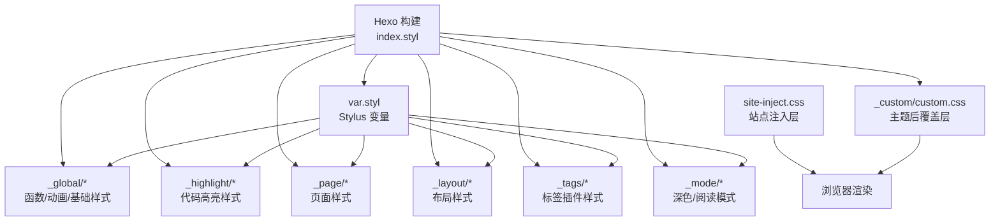
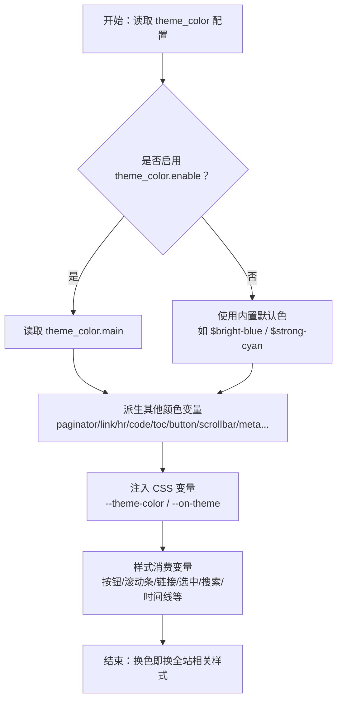
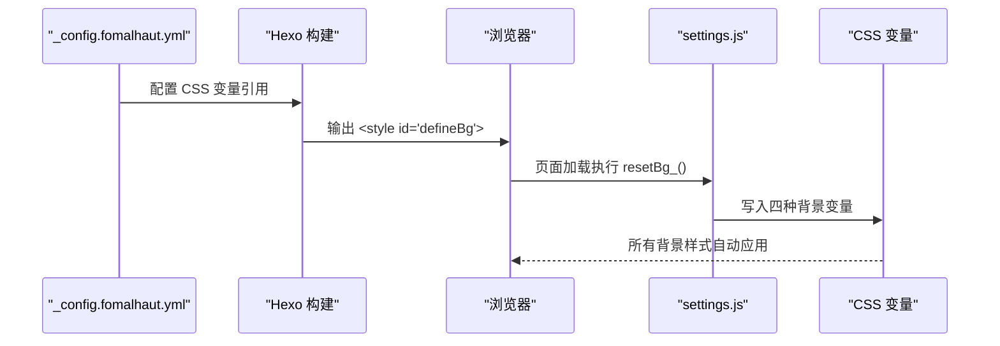
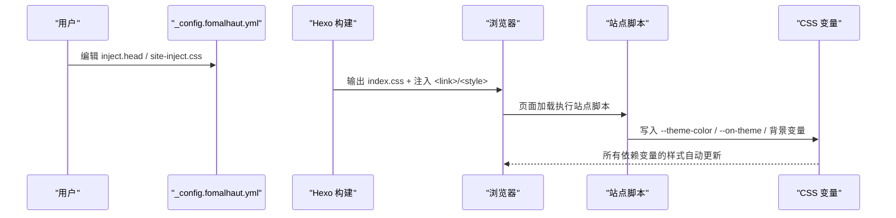
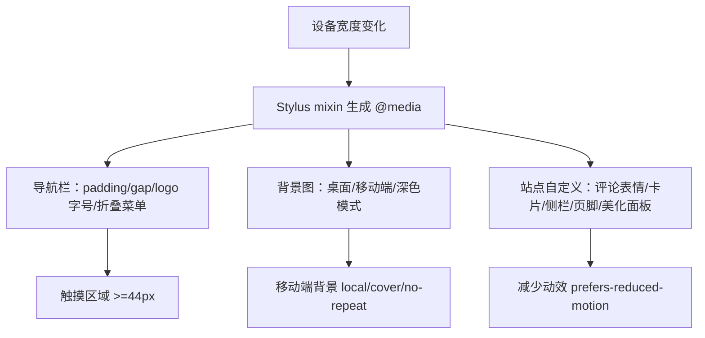
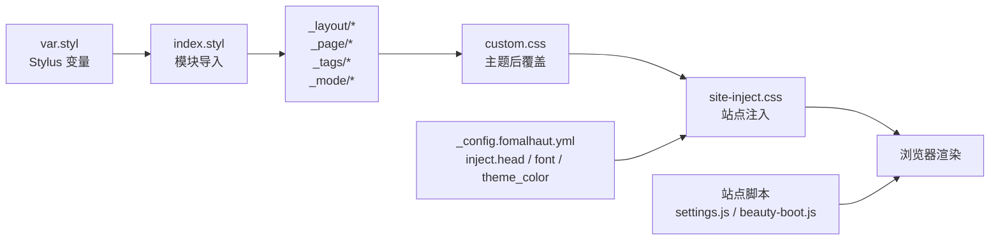
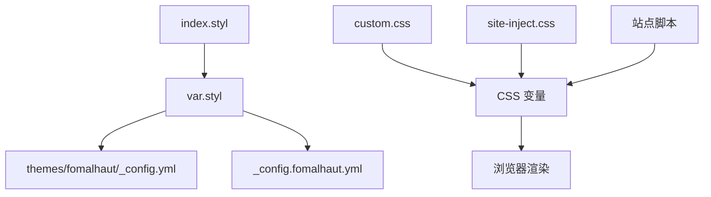

# 样式系统与主题定制

<cite>
**本文引用的文件**   
- [themes/fomalhaut/source/css/var.styl](file://themes/fomalhaut/source/css/var.styl)
- [themes/fomalhaut/source/css/index.styl](file://themes/fomalhaut/source/css/index.styl)
- [themes/fomalhaut/source/css/_global/function.styl](file://themes/fomalhaut/source/css/_global/function.styl)
- [themes/fomalhaut/source/css/_layout/web-bg.styl](file://themes/fomalhaut/source/css/_layout/web-bg.styl)
- [themes/fomalhaut/source/css/_mode/darkmode.styl](file://themes/fomalhaut/source/css/_mode/darkmode.styl)
- [themes/fomalhaut/source/css/_custom/custom.css](file://themes/fomalhaut/source/css/_custom/custom.css)
- [source/css/site-inject.css](file://source/css/site-inject.css)
- [_config.fomalhaut.yml](file://_config.fomalhaut.yml)
- [themes/fomalhaut/_config.yml](file://themes/fomalhaut/_config.yml)
- [tools/tests/navigation.test.cjs](file://tools/tests/navigation.test.cjs)
- [source/js/modules/settings.js](file://source/js/modules/settings.js)
- [source/js/inject/beauty-boot.js](file://source/js/inject/beauty-boot.js)
</cite>

## 更新摘要
**变更内容**   
- 背景图片系统已优化：从外部 picsum.photos URL 替换为本地静态资源 `/assets/first_index.jpg`
- `_config.fomalhaut.yml` 现在使用 CSS 变量（--default-bg, --darkmode-bg, --mobileday-bg, --mobilenight-bg）而非直接 URL
- 实际背景值通过 inject.head 的 defineBg 内联兜底在运行时提供
- 夜间模式不再需要单独的背景图片，通过 `#web_bg:before` 遮罩实现压暗效果
- 更新了背景图片相关的架构说明和最佳实践

## 目录
1. [引言](#引言)
2. [项目结构](#项目结构)
3. [核心组件](#核心组件)
4. [架构总览](#架构总览)
5. [详细组件分析](#详细组件分析)
6. [依赖关系分析](#依赖关系分析)
7. [性能与可访问性](#性能与可访问性)
8. [故障排查指南](#故障排查指南)
9. [结论](#结论)
10. [附录：主题定制清单](#附录主题定制清单)

## 引言
本文面向希望深入理解并定制本博客样式系统的读者，重点解释以下方面：
- Stylus 变量系统如何组织颜色、字体、尺寸等全局变量。
- 主题色派生机制：主色调、辅助色、文本色、代码块色、滚动条色等如何从配置推导。
- 自定义样式的注入方式：站点级样式、内联样式、动态样式生成。
- **背景图片系统优化**：从外部 picsum.photos URL 迁移到本地静态资源，使用 CSS 变量管理不同模式的背景。
- 字体管理策略：本地字体引入、回退链、Google Fonts 的使用现状。
- 响应式设计实现：断点、移动端适配、触摸交互优化。
- 主题定制完整指南与最佳实践。

## 项目结构
样式系统围绕 Hexo 的 Butterfly/Fomalhaut 主题展开，主要分层如下：
- 构建期入口：`themes/fomalhaut/source/css/index.styl` 负责按配置导入各模块。
- 全局变量：`themes/fomalhaut/source/css/var.styl` 集中定义颜色、字体、尺寸、Note/Button/Tab/Timeline 等变量。
- 通用函数与动画：`themes/fomalhaut/source/css/_global/function.styl` 提供媒体查询 mixin、动画关键帧。
- 布局与页面样式：`_layout/*`、`_page/*`、`_tags/*`、`_mode/*` 等模块。
- 站点自定义层：`themes/fomalhaut/source/css/_custom/custom.css` 是主题样式之后的最后一道覆盖层。
- 站点注入层：`source/css/site-inject.css` 由 `_config.fomalhaut.yml` 的 `inject.head` 注入，用于站点级覆盖和运行时空槽。
- 配置层：`themes/fomalhaut/_config.yml`（主题默认）与 `_config.fomalhaut.yml`（站点覆盖）。



**图表来源**
- [themes/fomalhaut/source/css/index.styl:1-26](file://themes/fomalhaut/source/css/index.styl#L1-L26)
- [themes/fomalhaut/source/css/var.styl:1-185](file://themes/fomalhaut/source/css/var.styl#L1-L185)

**章节来源**
- [themes/fomalhaut/source/css/index.styl:1-26](file://themes/fomalhaut/source/css/index.styl#L1-L26)
- [themes/fomalhaut/source/css/var.styl:1-185](file://themes/fomalhaut/source/css/var.styl#L1-L185)

## 核心组件
### Stylus 变量系统
Stylus 变量集中在 `var.styl`，分为以下几类：
- 颜色变量：主色调 `$theme-color`、分页色 `$theme-paginator-color`、链接色 `$theme-link-color`、HR 色 `$theme-hr-color`、代码前景/背景 `$code-foreground/$code-background`、引用块配色、按钮色、滚动条色、搜索色、时间线色等。
- 字体变量：正文字体 `$font-family`、代码字体 `$code-font-family`、站点标题字体 `$site-name-font`、全局字号 `$font-size`、代码字号 `$code-font-size`。
- 尺寸与布局变量：侧栏宽度 `$sidebar-width`、TOC 移动端宽度、右侧工具栏底部距离 `$rightside-bottom`、首页顶部图高度 `$index_top_img_height`、站点信息位置 `$index_site_info_top`。
- 功能开关变量：美化 `$beautifyEnable`、分隔线图标 `$hr-icon`、预加载背景 `$preloader-bg`、烟花层级 `$fireworks-zIndex` 等。
- Note/Button/Tab/Timeline 等标签插件变量：边框、背景、文本、图标、激活态、默认色等。

这些变量大多通过 `hexo-config(...)` 读取站点配置，若未配置则使用内置默认值；部分颜色还通过 `convert()` 或 `alpha()` 做单位转换与透明度处理。

**章节来源**
- [themes/fomalhaut/source/css/var.styl:1-185](file://themes/fomalhaut/source/css/var.styl#L1-L185)

### 主题色派生机制
主题色派生遵循"配置优先、变量统一、CSS 变量联动"的原则：
1. 启用判断：`$themeColorEnable = hexo-config('theme_color') && hexo-config('theme_color.enable')`。
2. 主色调：`$theme-color` 取 `hexo-config('theme_color.main')`，否则回退到 `$bright-blue`。
3. 衍生变量：分页器、文本选择、链接、HR、代码前景/背景、TOC、引用块边色/背景、按钮悬停、滚动条、元信息色等均根据 `$themeColorEnable` 决定是否走配置，否则使用默认色。
4. CSS 变量注入：站点自定义层在 `:root` 中设置 `--theme-color`，并通过 `--on-theme` 解决"主题色上的前景色对比度"问题；按钮、滚动条、选中背景等大量样式直接引用 `var(--theme-color)` 或 `var(--on-theme)`。
5. 运行时更新：站点脚本在切换预设或自定义颜色时更新 `--theme-color` 与 `--on-theme`，从而让所有依赖变量的样式同步刷新。



**图表来源**
- [themes/fomalhaut/source/css/var.styl:6-14](file://themes/fomalhaut/source/css/var.styl#L6-L14)
- [themes/fomalhaut/source/css/var.styl:39-75](file://themes/fomalhaut/source/css/var.styl#L39-L75)
- [themes/fomalhaut/source/css/_custom/custom.css:148-171](file://themes/fomalhaut/source/css/_custom/custom.css#L148-L171)
- [source/css/site-inject.css:690-768](file://source/css/site-inject.css#L690-L768)

**章节来源**
- [themes/fomalhaut/source/css/var.styl:6-14](file://themes/fomalhaut/source/css/var.styl#L6-L14)
- [themes/fomalhaut/source/css/var.styl:39-75](file://themes/fomalhaut/source/css/var.styl#L39-L75)
- [themes/fomalhaut/source/css/_custom/custom.css:148-171](file://themes/fomalhaut/source/css/_custom/custom.css#L148-L171)
- [source/css/site-inject.css:690-768](file://source/css/site-inject.css#L690-L768)

### 背景图片系统优化
**更新** 背景图片系统已进行重大优化，从外部 picsum.photos URL 迁移到本地静态资源，并使用 CSS 变量统一管理。

#### 新的背景图片架构
背景图片系统现在采用四层 CSS 变量管理：
- `--default-bg`: 默认背景（PC端日间模式）
- `--darkmode-bg`: PC端夜间模式背景
- `--mobileday-bg`: 移动端日间背景
- `--mobilenight-bg`: 移动端夜间背景

#### 配置层变更
`_config.fomalhaut.yml` 中的背景配置现在使用 CSS 变量：

```yaml
background:
  #【必选】默认背景 url(/assets/first_index.jpg)（实际值由运行时 --default-bg 提供）
  default: var(--default-bg)
  #【可选】PC端夜间模式背景 url(/assets/first_index.jpg)（夜间靠 #web_bg:before 遮罩压暗）
  darkmode: var(--darkmode-bg)
  #【可选】移动端日间默认背景 url(/assets/first_index.jpg)
  mobileday: var(--mobileday-bg)
  #【可选】移动端夜间模式背景 url(/assets/first_index.jpg)
  mobilenight: var(--mobilenight-bg)
```

#### 运行时注入机制
通过 `inject.head` 的 `defineBg` 内联样式提供默认值：

```html
<style id="defineBg">:root{
  --default-bg:url(/assets/first_index.jpg);
  --darkmode-bg:url(/assets/first_index.jpg);
  --mobileday-bg:url(/assets/first_index.jpg);
  --mobilenight-bg:url(/assets/first_index.jpg);
}</style>
```

#### 夜间模式优化
夜间模式不再需要单独的背景图片，而是通过 `#web_bg:before` 伪元素遮罩实现压暗效果：

```css
[data-theme="dark"] #web_bg:before {
  background-color: rgba(0, 0, 0, 0.5) !important;
}
```

#### JavaScript 运行时控制
`settings.js` 中的 `resetBg_()` 函数确保运行时背景变量的正确初始化：

```javascript
function resetBg_() {
  var el = document.getElementById("defineBg");
  if (!el) return;
  el.innerText = `:root{
    --default-bg: url(/assets/first_index.jpg);
    --darkmode-bg:url(/assets/first_index.jpg);
    --mobileday-bg: url(/assets/first_index.jpg);
    --mobilenight-bg: url(/assets/first_index.jpg);
  }`;
}
```



**图表来源**
- [_config.fomalhaut.yml:796-804](file://_config.fomalhaut.yml#L796-L804)
- [_config.fomalhaut.yml:1210-1213](file://_config.fomalhaut.yml#L1210-L1213)
- [source/js/modules/settings.js:751-762](file://source/js/modules/settings.js#L751-L762)
- [themes/fomalhaut/source/css/_custom/custom.css:493-495](file://themes/fomalhaut/source/css/_custom/custom.css#L493-L495)

**章节来源**
- [_config.fomalhaut.yml:796-804](file://_config.fomalhaut.yml#L796-L804)
- [_config.fomalhaut.yml:1210-1213](file://_config.fomalhaut.yml#L1210-L1213)
- [source/js/modules/settings.js:751-762](file://source/js/modules/settings.js#L751-L762)
- [themes/fomalhaut/source/css/_custom/custom.css:493-495](file://themes/fomalhaut/source/css/_custom/custom.css#L493-L495)

### 字体变量与管理策略
字体变量同样集中在 `var.styl`：
- `$dafault-font-family` 与 `$dafault-code-font` 是内置回退链。
- `$font-family` 与 `$code-font-family` 优先读取 `hexo-config('font.font-family')` 与 `hexo-config('font.code-font-family')`。
- `$site-name-font` 读取 `blog_title_font.font-family`。
- 站点配置 `_config.fomalhaut.yml` 将 `font-family` 与 `code-font-family` 设置为包含 CSS 变量 `var(--global-font)` 与 `var(--code-font)` 的回退链，便于运行时通过 JS 修改变量而不重写样式表。

字体加载策略：
- 主题源码没有直接使用 Google Fonts 的 `<link>` 引入；站点自定义层 `custom.css` 通过 `@font-face` 引入开源字体（LXGW WenKai、思源宋体、Noto Sans SC、JetBrains Mono、Fira Code、Source Code Pro），全部来自 jsDelivr 的 `@fontsource/*` 包。
- 正文与代码字体均保留系统字体与中文常用字体作为回退链，确保无网络或字体加载失败时仍可正常显示。
- 站点注入层 `site-inject.css` 为 `pre/code/kbd/samp` 统一接入 `var(--code-font, JetBrainsMono), var(--global-font), ...`，保证非文章区的代码也跟随面板设置。

关于 Google Fonts：
- 当前仓库未发现直接引入 Google Fonts 的代码；字体资源以本地 `@font-face` + CDN 为主。
- 若需集成 Google Fonts，推荐在站点注入层添加 `<link rel="preconnect" href="https://fonts.googleapis.com">` 与对应 `<link rel="stylesheet">`，并在 `font-family` 回退链中加入目标字体名。

**章节来源**
- [themes/fomalhaut/source/css/var.styl:15-31](file://themes/fomalhaut/source/css/var.styl#L15-L31)
- [_config.fomalhaut.yml:884-905](file://_config.fomalhaut.yml#L884-L905)
- [themes/fomalhaut/source/css/_custom/custom.css:284-343](file://themes/fomalhaut/source/css/_custom/custom.css#L284-L343)
- [source/css/site-inject.css:336-343](file://source/css/site-inject.css#L336-L343)

### 自定义样式注入方式
本项目支持三种注入方式：
1. **站点级样式文件**：`source/css/site-inject.css`，由 `_config.fomalhaut.yml` 的 `inject.head` 注入，优先级高于主题样式，适合站点级覆盖、运行时空槽、性能优化与 UX 修复。
2. **内联样式**：`_config.fomalhaut.yml` 的 `inject.head` 中包含多个 `<style id="...">` 空槽，例如 `#defineBg`、`#menu_shadow`、`#nav-display`、`#aside-show`、`#aside-pos`，由 JS 在运行时写入内容。
3. **动态样式生成**：站点脚本在运行时更新 CSS 变量（如 `--theme-color`、`--on-theme`、`--default-bg`、`--darkmode-bg`、`--mobileday-bg`、`--mobilenight-bg`），从而驱动全站样式变化，无需重新构建。



**图表来源**
- [_config.fomalhaut.yml:1209-1220](file://_config.fomalhaut.yml#L1209-L1220)
- [source/css/site-inject.css:1-39](file://source/css/site-inject.css#L1-L39)
- [source/css/site-inject.css:690-768](file://source/css/site-inject.css#L690-L768)

**章节来源**
- [_config.fomalhaut.yml:1209-1220](file://_config.fomalhaut.yml#L1209-L1220)
- [source/css/site-inject.css:1-39](file://source/css/site-inject.css#L1-L39)
- [source/css/site-inject.css:690-768](file://source/css/site-inject.css#L690-L768)

### 响应式设计与移动端适配
响应式能力主要由两部分组成：
- Stylus mixin：`function.styl` 定义了 `maxWidth600()`、`maxWidth768()`、`minWidth768()`、`maxWidth900()`、`minWidth901()`、`maxWidth1024()`、`minWidth2000()` 等媒体查询 mixin，供各模块复用。
- 具体断点与行为：
  - 导航栏在 `<=800px` 下调整 padding、gap、logo 字号，并隐藏部分元素。
  - 背景图在 `<=800px` 下切换移动端白天/夜间背景。
  - 站点自定义层 `custom.css` 与 `site-inject.css` 中有多处 `@media` 针对 768px、500px、900px、1024px、1200px、1400px 等断点进行适配。
  - 测试文件 `navigation.test.cjs` 对导航栏的触摸区域、间距、窄屏裁剪、减少动效等契约进行验证。



**图表来源**
- [themes/fomalhaut/source/css/_global/function.styl:74-104](file://themes/fomalhaut/source/css/_global/function.styl#L74-L104)
- [themes/fomalhaut/source/css/_layout/web-bg.styl:1-24](file://themes/fomalhaut/source/css/_layout/web-bg.styl#L1-L24)
- [themes/fomalhaut/source/css/_custom/custom.css:249-261](file://themes/fomalhaut/source/css/_custom/custom.css#L249-L261)
- [tools/tests/navigation.test.cjs:209-257](file://tools/tests/navigation.test.cjs#L209-L257)

**章节来源**
- [themes/fomalhaut/source/css/_global/function.styl:74-104](file://themes/fomalhaut/source/css/_global/function.styl#L74-L104)
- [themes/fomalhaut/source/css/_layout/web-bg.styl:1-24](file://themes/fomalhaut/source/css/_layout/web-bg.styl#L1-L24)
- [themes/fomalhaut/source/css/_custom/custom.css:249-261](file://themes/fomalhaut/source/css/_custom/custom.css#L249-L261)
- [tools/tests/navigation.test.cjs:209-257](file://tools/tests/navigation.test.cjs#L209-L257)

## 架构总览
样式系统采用"构建期变量 + 运行期变量 + 多层覆盖"的架构：
- 构建期：Stylus 将 `var.styl` 中的变量编译进最终 CSS，同时按 `index.styl` 的导入顺序组装模块。
- 运行期：站点脚本通过 DOM 操作更新 CSS 变量，实现主题色、背景、字体、滤镜等动态切换。
- 覆盖层：主题源码 → 站点自定义 `custom.css` → 站点注入 `site-inject.css`，优先级递增。



**图表来源**
- [themes/fomalhaut/source/css/index.styl:1-26](file://themes/fomalhaut/source/css/index.styl#L1-L26)
- [themes/fomalhaut/source/css/var.styl:1-185](file://themes/fomalhaut/source/css/var.styl#L1-L185)
- [_config.fomalhaut.yml:1209-1220](file://_config.fomalhaut.yml#L1209-L1220)

## 详细组件分析

### 颜色与主题色变量
- 主色调 `$theme-color` 是派生起点，影响链接、HR、按钮、滚动条、搜索、时间线等。
- 辅助色 `$theme-paginator-color`、`$theme-toc-color`、`$sticky-color` 等用于特定 UI 元素。
- 文本色 `$font-color`、高亮色 `$text-highlight-color`、悬停色 `$text-hover`、悬停背景 `$text-bg-hover` 构成基础文本体系。
- 代码块 `$code-foreground`、`$code-background`、引用块 `$blockquote-padding-color`、`$blockquote-background-color` 与主题色联动。
- 站点自定义层 `custom.css` 在 `:root` 中注入 `--theme-color`，并通过 `--on-theme` 解决前景色对比度问题。

**章节来源**
- [themes/fomalhaut/source/css/var.styl:1-14](file://themes/fomalhaut/source/css/var.styl#L1-L14)
- [themes/fomalhaut/source/css/var.styl:39-75](file://themes/fomalhaut/source/css/var.styl#L39-L75)
- [themes/fomalhaut/source/css/_custom/custom.css:148-171](file://themes/fomalhaut/source/css/_custom/custom.css#L148-L171)
- [source/css/site-inject.css:690-768](file://source/css/site-inject.css#L690-L768)

### 背景图片系统详解
**更新** 背景图片系统现已完全重构，采用 CSS 变量管理不同模式的背景图片。

#### 背景变量定义
系统定义了四个核心 CSS 变量来管理不同场景的背景：
- `--default-bg`: PC端日间模式默认背景
- `--darkmode-bg`: PC端夜间模式背景  
- `--mobileday-bg`: 移动端日间模式背景
- `--mobilenight-bg`: 移动端夜间模式背景

#### 配置层实现
`_config.fomalhaut.yml` 中的背景配置现在指向 CSS 变量而非直接 URL：

```yaml
background:
  default: var(--default-bg)
  darkmode: var(--darkmode-bg)
  mobileday: var(--mobileday-bg)
  mobilenight: var(--mobilenight-bg)
```

#### 运行时注入机制
通过 `inject.head` 的 `defineBg` 内联样式提供默认值，确保首屏立即显示背景：

```html
<style id="defineBg">:root{
  --default-bg:url(/assets/first_index.jpg);
  --darkmode-bg:url(/assets/first_index.jpg);
  --mobileday-bg:url(/assets/first_index.jpg);
  --mobilenight-bg:url(/assets/first_index.jpg);
}</style>
```

#### 夜间模式优化
夜间模式通过 `#web_bg:before` 伪元素遮罩实现压暗效果，无需单独的背景图片：

```css
[data-theme="dark"] #web_bg:before {
  background-color: rgba(0, 0, 0, 0.5) !important;
}
```

#### JavaScript 运行时控制
`settings.js` 中的函数确保运行时背景变量的正确初始化和管理：

```javascript
function resetBg_() {
  var el = document.getElementById("defineBg");
  if (!el) return;
  el.innerText = `:root{
    --default-bg: url(/assets/first_index.jpg);
    --darkmode-bg:url(/assets/first_index.jpg);
    --mobileday-bg: url(/assets/first_index.jpg);
    --mobilenight-bg: url(/assets/first_index.jpg);
  }`;
}
```

#### 优势对比
相比之前的外部 picsum.photos URL 方案，新方案具有以下优势：
- **性能提升**：本地静态资源加载更快，减少外部请求
- **可控性增强**：完全掌控背景图片内容和质量
- **一致性保证**：四种模式统一使用同一张图片，通过遮罩实现夜间效果
- **维护简化**：CSS 变量管理使背景切换更加灵活

**章节来源**
- [_config.fomalhaut.yml:796-804](file://_config.fomalhaut.yml#L796-L804)
- [_config.fomalhaut.yml:1210-1213](file://_config.fomalhaut.yml#L1210-L1213)
- [source/js/modules/settings.js:751-762](file://source/js/modules/settings.js#L751-L762)
- [themes/fomalhaut/source/css/_custom/custom.css:493-495](file://themes/fomalhaut/source/css/_custom/custom.css#L493-L495)

### 字体变量与回退链
- `$font-family` 与 `$code-font-family` 优先读取站点配置，否则使用内置回退链。
- 站点配置 `_config.fomalhaut.yml` 将 `font-family` 与 `code-font-family` 设置为包含 `var(--global-font)` 与 `var(--code-font)` 的回退链，便于运行时切换。
- `custom.css` 通过 `@font-face` 引入 LXGW、思源宋体、Noto Sans SC、JetBrains Mono、Fira Code、Source Code Pro。
- `site-inject.css` 为 `pre/code/kbd/samp` 统一接入代码字体变量，保证非文章区代码也跟随面板设置。

**章节来源**
- [themes/fomalhaut/source/css/var.styl:15-31](file://themes/fomalhaut/source/css/var.styl#L15-L31)
- [_config.fomalhaut.yml:884-905](file://_config.fomalhaut.yml#L884-L905)
- [themes/fomalhaut/source/css/_custom/custom.css:284-343](file://themes/fomalhaut/source/css/_custom/custom.css#L284-L343)
- [source/css/site-inject.css:336-343](file://source/css/site-inject.css#L336-L343)

### 尺寸与布局变量
- `$sidebar-width`、`$toc-mobile-width`、`$toc-mobile-maxWidth`、`$rightside-bottom`、`$index_top_img_height`、`$index_site_info_top` 控制侧栏、TOC、右侧工具栏、首页顶部图等布局。
- `web-bg.styl` 根据深色模式与移动端切换背景图。
- `function.styl` 提供媒体查询 mixin，配合各模块实现响应式。

**章节来源**
- [themes/fomalhaut/source/css/var.styl:30-37](file://themes/fomalhaut/source/css/var.styl#L30-L37)
- [themes/fomalhaut/source/css/var.styl:61-68](file://themes/fomalhaut/source/css/var.styl#L61-L68)
- [themes/fomalhaut/source/css/var.styl:106-108](file://themes/fomalhaut/source/css/var.styl#L106-L108)
- [themes/fomalhaut/source/css/_layout/web-bg.styl:1-24](file://themes/fomalhaut/source/css/_layout/web-bg.styl#L1-L24)
- [themes/fomalhaut/source/css/_global/function.styl:74-104](file://themes/fomalhaut/source/css/_global/function.styl#L74-L104)

### 深色模式与阅读模式
- `darkmode.styl` 在 `[data-theme='dark']` 下定义大量 CSS 变量，覆盖背景、文本、代码、搜索、Tab、滚动条、注释块等。
- 站点自定义层 `custom.css` 与 `site-inject.css` 中也存在大量 `[data-theme="dark"]` 规则，用于覆盖主题默认深色样式。
- 阅读模式在主题源码中有独立样式，站点注入层补充了窄屏兜底，避免标题风车图标被裁切。

**章节来源**
- [themes/fomalhaut/source/css/_mode/darkmode.styl:1-150](file://themes/fomalhaut/source/css/_mode/darkmode.styl#L1-L150)
- [themes/fomalhaut/source/css/_custom/custom.css:469-526](file://themes/fomalhaut/source/css/_custom/custom.css#L469-L526)
- [source/css/site-inject.css:351-372](file://source/css/site-inject.css#L351-L372)

### 标签插件变量
- Note 类型：`$note-types` 包含 default/primary/info/success/warning/danger，每种类型有 border/background/text/icon 及 modern 风格变量。
- Button/Label：`$color-types` 与 `$tagsP-*` 定义蓝/粉/红/紫/橙/绿等标签颜色。
- Tab：`$tab-border-color`、`$tab-botton-bg`、`$tab-button-hover-bg`、`$tab-active-border-color`、`$tab-button-active-bg`。
- Timeline：`$timeline-default-color` 跟随主题色。

**章节来源**
- [themes/fomalhaut/source/css/var.styl:109-185](file://themes/fomalhaut/source/css/var.styl#L109-L185)

## 依赖关系分析
- `index.styl` 依赖 `var.styl` 提供的变量，并按条件导入搜索、灯笼等模块。
- `var.styl` 依赖 `_config.yml` 与 `_config.fomalhaut.yml` 的配置项。
- `custom.css` 与 `site-inject.css` 依赖 CSS 变量 `--theme-color`、`--on-theme`、`--global-font`、`--code-font` 等。
- 站点脚本依赖 `localStorage` 与 DOM API 更新 CSS 变量，进而驱动样式变化。



**图表来源**
- [themes/fomalhaut/source/css/index.styl:1-26](file://themes/fomalhaut/source/css/index.styl#L1-L26)
- [themes/fomalhaut/source/css/var.styl:1-185](file://themes/fomalhaut/source/css/var.styl#L1-L185)
- [_config.fomalhaut.yml:1209-1220](file://_config.fomalhaut.yml#L1209-L1220)

**章节来源**
- [themes/fomalhaut/source/css/index.styl:1-26](file://themes/fomalhaut/source/css/index.styl#L1-L26)
- [themes/fomalhaut/source/css/var.styl:1-185](file://themes/fomalhaut/source/css/var.styl#L1-L185)
- [_config.fomalhaut.yml:1209-1220](file://_config.fomalhaut.yml#L1209-L1220)

## 性能与可访问性
- 动画与过渡：`function.styl` 提供多个 keyframes，站点自定义层对部分动画进行优化（如将 top/left 改为 transform，避免布局重排）。
- 减少动效：导航测试中对 `prefers-reduced-motion: reduce` 下的 transition/animation 进行约束，提升可访问性。
- 触摸区域：导航工具按钮最小 44×44px，符合移动端触摸交互标准。
- 滚动条：桌面端使用 `::-webkit-scrollbar`，移动端使用自绘滚动条 `#mscrollbar`，避免系统滚动条与自定义样式冲突。
- 对比度：`--on-theme` 解决主题色上前景色对比度不足的问题，确保按钮、选中、TOC 当前项等可读性。
- **背景图片性能优化**：本地静态资源替代外部 picsum.photos URL，减少网络请求延迟；夜间模式通过遮罩而非单独图片，降低内存占用。

**章节来源**
- [themes/fomalhaut/source/css/_global/function.styl:106-252](file://themes/fomalhaut/source/css/_global/function.styl#L106-L252)
- [themes/fomalhaut/source/css/_custom/custom.css:185-261](file://themes/fomalhaut/source/css/_custom/custom.css#L185-L261)
- [tools/tests/navigation.test.cjs:346-358](file://tools/tests/navigation.test.cjs#L346-L358)
- [source/css/site-inject.css:690-768](file://source/css/site-inject.css#L690-L768)

## 故障排查指南
- 主题色不生效：
  - 检查 `_config.fomalhaut.yml` 中 `theme_color.enable` 与 `theme_color.main` 是否正确配置。
  - 确认 `var.styl` 中 `$themeColorEnable` 与 `$theme-color` 是否被正确编译。
  - 检查站点自定义层 `custom.css` 与 `site-inject.css` 中 `--theme-color` 是否被脚本更新。
- **背景图片不显示**：
  - 检查 `_config.fomalhaut.yml` 中 `background.default` 等配置是否正确指向 CSS 变量。
  - 确认 `inject.head` 中的 `defineBg` 内联样式是否正确注入。
  - 检查 `settings.js` 中的 `resetBg_()` 函数是否正常执行。
  - 验证 `/assets/first_index.jpg` 文件是否存在且路径正确。
- 字体不显示或回退异常：
  - 检查 `_config.fomalhaut.yml` 中 `font.font-family` 与 `font.code-font-family` 是否包含正确的 CSS 变量与回退链。
  - 确认 `custom.css` 中 `@font-face` 的 `src` 是否可访问。
  - 检查 `site-inject.css` 中 `pre/code/kbd/samp` 是否统一接入 `var(--code-font)`。
- 响应式布局错乱：
  - 检查 `function.styl` 中的媒体查询 mixin 是否被正确使用。
  - 核对 `web-bg.styl` 与 `custom.css`、`site-inject.css` 中的 `@media` 断点是否与预期一致。
  - 参考 `navigation.test.cjs` 中的断言，确认导航栏在窄屏下的行为是否符合契约。
- 深色模式样式异常：
  - 检查 `darkmode.styl` 与 `custom.css`、`site-inject.css` 中 `[data-theme="dark"]` 规则是否覆盖正确。
  - 确认站点脚本是否正确切换 `data-theme` 属性。
  - 验证 `#web_bg:before` 遮罩是否正确应用。

**章节来源**
- [themes/fomalhaut/source/css/var.styl:6-14](file://themes/fomalhaut/source/css/var.styl#L6-L14)
- [_config.fomalhaut.yml:796-804](file://_config.fomalhaut.yml#L796-L804)
- [_config.fomalhaut.yml:1210-1213](file://_config.fomalhaut.yml#L1210-L1213)
- [source/js/modules/settings.js:751-762](file://source/js/modules/settings.js#L751-L762)
- [themes/fomalhaut/source/css/_custom/custom.css:493-495](file://themes/fomalhaut/source/css/_custom/custom.css#L493-L495)
- [_config.fomalhaut.yml:884-905](file://_config.fomalhaut.yml#L884-L905)
- [themes/fomalhaut/source/css/_custom/custom.css:284-343](file://themes/fomalhaut/source/css/_custom/custom.css#L284-L343)
- [source/css/site-inject.css:336-343](file://source/css/site-inject.css#L336-L343)
- [themes/fomalhaut/source/css/_global/function.styl:74-104](file://themes/fomalhaut/source/css/_global/function.styl#L74-L104)
- [themes/fomalhaut/source/css/_layout/web-bg.styl:1-24](file://themes/fomalhaut/source/css/_layout/web-bg.styl#L1-L24)
- [themes/fomalhaut/source/css/_mode/darkmode.styl:1-150](file://themes/fomalhaut/source/css/_mode/darkmode.styl#L1-L150)
- [tools/tests/navigation.test.cjs:209-257](file://tools/tests/navigation.test.cjs#L209-L257)

## 结论
本项目的样式系统以 Stylus 变量为核心，结合站点配置与 CSS 变量，实现了高度可定制的主题机制。颜色、字体、尺寸等变量均支持通过配置覆盖，并通过运行时代码动态更新 CSS 变量，从而实现主题色、背景、字体、滤镜等的实时切换。**背景图片系统经过重大优化，从外部 picsum.photos URL 迁移到本地静态资源，使用 CSS 变量统一管理不同模式的背景，并通过遮罩实现夜间效果，显著提升了性能和可控性。** 响应式设计通过 Stylus mixin 与多处 `@media` 断点实现，移动端适配与触摸交互优化均有明确契约。站点自定义层与注入层提供了强大的扩展能力，既不改主题源码，又能满足个性化需求。

## 附录：主题定制清单
- 修改主题色：
  - 在 `_config.fomalhaut.yml` 中启用 `theme_color.enable` 并设置 `theme_color.main`。
  - 可选覆盖 `paginator/link/hr/code_foreground/code_background/toc_color/blockquote_padding_color/blockquote_background_color/scrollbar_color/meta_color` 等。
- **修改背景图片**：
  - 在 `_config.fomalhaut.yml` 中修改 `background.default`、`background.darkmode`、`background.mobileday`、`background.mobilenight` 指向不同的 CSS 变量。
  - 在 `inject.head` 中修改 `defineBg` 内联样式，设置实际的背景图片 URL。
  - 确保 `/assets/first_index.jpg` 文件存在且路径正确。
  - 如需自定义夜间模式效果，修改 `custom.css` 中 `#web_bg:before` 的遮罩颜色和透明度。
- 修改字体：
  - 在 `_config.fomalhaut.yml` 中设置 `font.global-font-size`、`font.code-font-size`、`font.font-family`、`font.code-font-family`。
  - 如需新增字体，在 `custom.css` 中添加 `@font-face`，并在 `font-family` 回退链中加入新字体名。
- 注入自定义样式：
  - 在 `source/css/site-inject.css` 中添加站点级覆盖。
  - 在 `_config.fomalhaut.yml` 的 `inject.head` 中添加 `<link>` 或 `<style>` 空槽。
- 响应式调整：
  - 使用 `function.styl` 中的媒体查询 mixin，或在 `custom.css`、`site-inject.css` 中添加 `@media`。
- 深色模式适配：
  - 在 `custom.css`、`site-inject.css` 中添加 `[data-theme="dark"]` 规则，覆盖主题默认深色样式。
  - 调整 `#web_bg:before` 遮罩效果以实现更好的夜间体验。

**章节来源**
- [_config.fomalhaut.yml:796-804](file://_config.fomalhaut.yml#L796-L804)
- [_config.fomalhaut.yml:884-905](file://_config.fomalhaut.yml#L884-L905)
- [_config.fomalhaut.yml:1209-1220](file://_config.fomalhaut.yml#L1209-L1220)
- [themes/fomalhaut/source/css/_custom/custom.css:284-343](file://themes/fomalhaut/source/css/_custom/custom.css#L284-L343)
- [themes/fomalhaut/source/css/_custom/custom.css:493-495](file://themes/fomalhaut/source/css/_custom/custom.css#L493-L495)
- [source/css/site-inject.css:1-39](file://source/css/site-inject.css#L1-L39)
- [themes/fomalhaut/source/css/_global/function.styl:74-104](file://themes/fomalhaut/source/css/_global/function.styl#L74-L104)