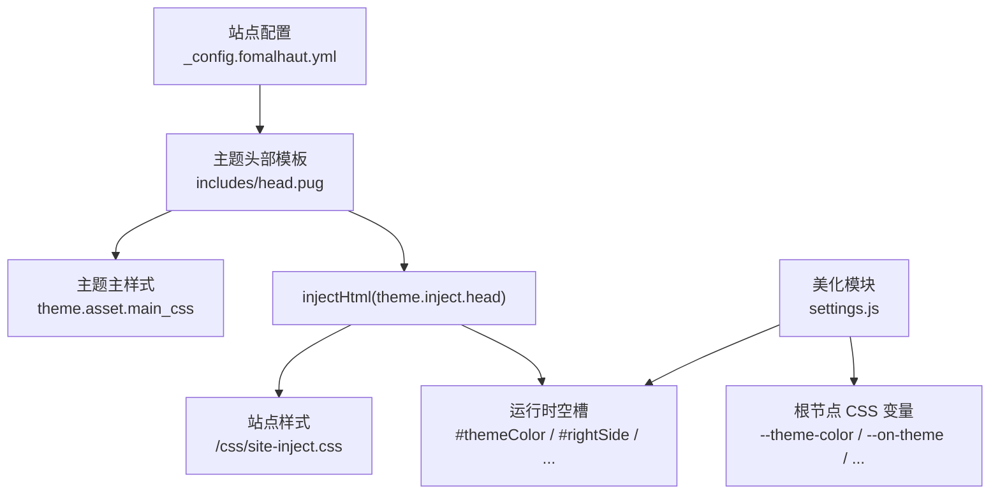
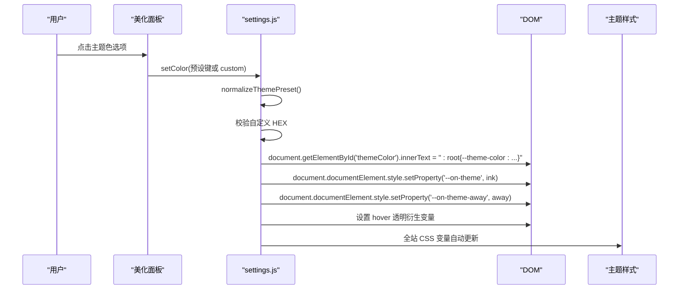
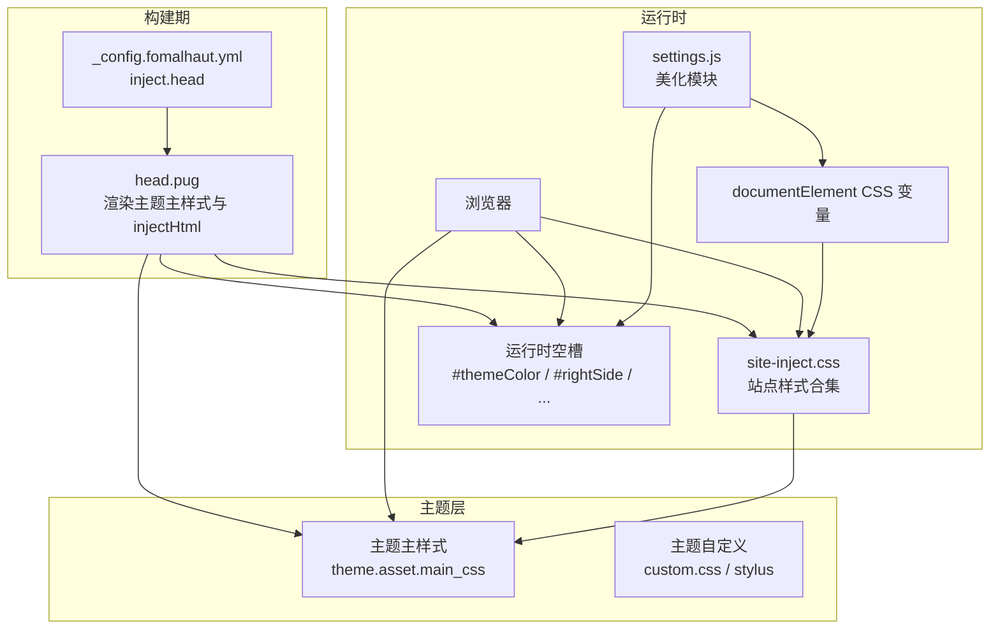

# 自定义样式注入

<cite>
**本文引用的文件**   
- [source/css/site-inject.css](file://source/css/site-inject.css)
- [_config.fomalhaut.yml](file://_config.fomalhaut.yml)
- [themes/fomalhaut/layout/includes/head.pug](file://themes/fomalhaut/layout/includes/head.pug)
- [source/js/modules/settings.js](file://source/js/modules/settings.js)
- [tools/tests/navigation.test.cjs](file://tools/tests/navigation.test.cjs)
- [README.md](file://README.md)
</cite>

## 目录

1. [引言](#引言)
2. [项目结构与注入入口](#项目结构与注入入口)
3. [站点级样式加载顺序与作用域](#站点级样式加载顺序与作用域)
4. [site-inject.css 的注入时机与优先级](#site-injectcss-的注入时机与优先级)
5. [内联样式的动态生成机制](#内联样式的动态生成机制)
6. [CSS 变量的实时修改流程](#css-变量的实时修改流程)
7. [主题覆盖策略与最佳实践](#主题覆盖策略与最佳实践)
8. [响应式自定义样式编写方法](#响应式自定义样式编写方法)
9. [样式调试与冲突排查指南](#样式调试与冲突排查指南)
10. [常见自定义示例与扩展建议](#常见自定义示例与扩展建议)
11. [架构总览图](#架构总览图)
12. [结论](#结论)

## 引言

本项目的“自定义样式注入”不是简单地在页面里加一段 CSS，而是围绕三个层次组织：

1. **构建期注入**：通过 Hexo 主题的 `inject.head` 配置，把站点样式表、运行时空槽和脚本按固定顺序插入 `<head>`。
2. **运行时注入**：由美化模块等 JavaScript 在浏览器中写入 `<style id="themeColor">` 等空槽，并设置 `document.documentElement.style.setProperty(...)` 更新 CSS 变量。
3. **样式层覆盖**：`source/css/site-inject.css` 作为站点级样式合集，集中覆盖默认主题结构，而不直接改动 `themes/fomalhaut/source/css/_custom/custom.css` 等主题源码。

这套机制的核心目标是：**让站点外观可定制、可回滚、可测试，同时保持主题升级时最小侵入。**

## 项目结构与注入入口

从仓库结构看，样式相关的关键位置集中在三处：

| 位置 | 职责 |
|---|---|
| `_config.fomalhaut.yml` 的 `inject.head` | 声明站点样式表、运行时空槽、第三方资源与站点脚本的加载顺序 |
| `themes/fomalhaut/layout/includes/head.pug` | 渲染主题主样式、全局配置、`injectHeadJs` 与 `injectHtml(theme.inject.head)` |
| `source/css/site-inect.css` | 站点级样式合集，包含公告栏、侧栏宽度、夜间切换、FPS 状态条、搜索面板、昼夜遮罩动画等 |
| `source/js/modules/settings.js` | 美化模块，负责主题色、字体、背景、右侧工具栏、开关面板等运行时逻辑 |



**图表来源**
- [_config.fomalhaut.yml:1205-1224](file://_config.fomalhaut.yml#L1205-L1224)
- [themes/fomalhaut/layout/includes/head.pug:49-77](file://themes/fomalhaut/layout/includes/head.pug#L49-L77)
- [source/js/modules/settings.js:238-263](file://source/js/modules/settings.js#L238-L263)

**章节来源**
- [_config.fomalhaut.yml:1205-1224](file://_config.fomalhaut.yml#L1205-L1224)
- [themes/fomalhaut/layout/includes/head.pug:49-77](file://themes/fomalhaut/layout/includes/head.pug#L49-L77)
- [README.md:506-525](file://README.md#L506-L525)

## 站点级样式加载顺序与作用域

### 注入清单中的关键顺序

在 `_config.fomalhaut.yml` 的 `inject.head` 中，站点样式注入遵循以下顺序：

1. 主题主样式 `theme.asset.main_css`（由 `head.pug` 渲染）。
2. 站点运行时空槽：`<style id="themeColor">`、`<style id="rightSide">`、`<style id="transPercent">`、`<style id="bgFilterParam">`、`<style id="defineBg">`、`<style id="menu_shadow">`、`<style id="nav-display">`、`<style id="aside-show">`、`<style id="aside-pos">`。
3. 站点样式合集 `/css/site-inject.css?v=...`。
4. 导航样式 `/css/navigation.css?v=...`。
5. 手机端抽屉菜单、头像呼吸灯、时间轴、关于页、评论、打字机、归档页等站点独立样式。

这意味着：

- **主题主样式最先加载**。
- **运行时空槽紧随其后**，供 JS 在运行时写入内容。
- **site-inject.css 在运行时空槽之后加载**，因此可以稳定覆盖这些空槽的内容。
- **navigation.css 在 site-inject.css 之后加载**，所以导航相关样式能覆盖 site-inject.css 的同权规则。

### 作用域设计原则

site-inject.css 的设计原则是：

- **尽量使用具体选择器**，避免污染全局。
- **优先覆盖主题已有类名**，而不是新增大量新类。
- **对插件或第三方组件使用容器守卫**，例如留言板页面用 `#page:has(#maincontent)` 限定作用域。
- **对阅读模式、移动端、深色模式分别处理**，避免一处改动影响所有场景。
- **不直接改主题源码**，只通过站点样式和配置注入。

**章节来源**
- [_config.fomalhaut.yml:1205-1224](file://_config.fomalhaut.yml#L1205-L1224)
- [_config.fomalhaut.yml:1222-1321](file://_config.fomalhaut.yml#L1222-L1321)
- [source/css/site-inject.css:374-519](file://source/css/site-inject.css#L374-L519)

## site-inject.css 的注入时机与优先级

### 注入时机

site-inject.css 通过 `_config.fomalhaut.yml` 的 `inject.head` 引入：

```yaml
- <link rel="stylesheet" href="/css/site-inject.css?v=20261015-fps4">
```

它会在主题主样式之后、站点其他独立样式之前被浏览器请求和解析。由于它是同步 `<link>`，会参与首屏样式计算；但它的职责主要是“修正默认主题行为”，而不是提供完整主题实现。

### 优先级模型

site-inject.css 的优先级主要来自三个方面：

1. **加载顺序**：它在主题主样式之后加载，同权重下后加载者胜。
2. **选择器特异性**：多处使用 ID、属性选择器、伪元素组合，提高特异性。
3. **必要时使用 `!important`**：主要用于覆盖主题写死的颜色、内联样式或第三方库样式。

例如：

- 版权卡片白天配色使用 `html[data-theme="light"] #post .post-copyright`，并通过 `!important` 覆盖主题原渐变。
- APlayer 音量条填充色使用 `background: var(--theme-color) !important`，因为 APlayer 自带内联样式优先级更高。
- 昼夜切换动画时长使用 `!important` 覆盖主题 `sun_moon.styl` 编译后的值。

### 文件内部块顺序

site-inject.css 顶部注释明确列出 17 个区块，并强调“层叠顺序等于本文件从上到下的顺序”。这包括：

| 区块编号 | 功能 | 说明 |
|---|---|---|
| 1 | 锚点滚动补偿 | `scroll-padding-top` 防止标题被常驻顶栏遮挡 |
| 2 | 公告栏改版 | 胶囊、线路延时徽标、欢迎信息 |
| 3 | PC 浅色主题版权卡 | 提升对比度，跟随主题色 |
| 4 | 侧栏宽度与布局 | 避开右侧悬浮工具条 |
| 5 | 列表分页按钮 | 对齐首页卡片风格 |
| 6 | 页面宽度限制 | 归档、标签、分类页最大宽度 |
| 7 | 右键模式按钮状态 | 显示右键模式开/关 |
| 8 | 小站资讯卡 | KPI、更新时间、访问统计 |
| 9 | 隐藏页脚本站友链 | 精准隐藏指定链接 |
| 10 | APlayer 音量条修复 | 解决内联样式覆盖问题 |
| 11 | 阅读模式标题风车兜底 | 窄屏下补回左内边距 |
| 12 | 留言板信封页 | 解除折叠、信笺台、评论区美化 |
| 13 | 首页卡片动画性能优化 | 改用 `transform` 合成层动画 |
| 14 | 加载遮罩隐藏后停动画 | 停止不可见动画 |
| 15 | 作者卡毛玻璃关闭 | 减少滚动时 backdrop-filter 开销 |
| 16 | 搜索面板 UX | 加载提示、搜索历史、结果区高度 |
| 17 | 昼夜切换速度 | 缩短天空、星球、日月互换时长 |
| 18 | 昼夜切换舞台 | 日落、暮色、星星、云、远山、流星 |

**章节来源**
- [source/css/site-inject.css:1-39](file://source/css/site-inject.css#L1-L39)
- [source/css/site-inject.css:41-39](file://source/css/site-inject.css#L41-L39)
- [source/css/site-inject.css:180-226](file://source/css/site-inject.css#L180-L226)
- [source/css/site-inject.css:336-349](file://source/css/site-inject.css#L336-L349)
- [source/css/site-inject.css:898-912](file://source/css/site-inject.css#L898-L912)

## 内联样式的动态生成机制

### 运行时空槽

项目在 `_config.fomalhaut.yml` 中预留了多个空 `<style>` 标签：

```html
<style id="themeColor"></style>
<style id="rightSide"></style>
<style id="transPercent"></style>
<style id="bgFilterParam"></style>
<style id="defineBg"></style>
<style id="menu_shadow"></style>
<style id="nav-display"></style>
<style id="aside-show"></style>
<style id="aside-pos"></style>
```

这些空标签被称为“运行时空槽”，它们的作用是：

- 在 HTML 构建阶段占位。
- 在浏览器运行时由 JavaScript 写入实际 CSS。
- 保证样式优先级高于普通样式表，适合高频更新的运行时样式。

### themeColor 空槽

最典型的是 `themeColor`。美化模块在用户切换主题色时，会把整段 CSS 写入该空槽：

```js
document.getElementById('themeColor').innerText = ':root{--theme-color:' + theme_color + ' !important}';
```

这样做的优点是：

- 主题色以 `:root` 级别变量形式生效，全站 CSS 都能读取。
- 使用 `!important` 确保覆盖主题默认值。
- 空槽位于 site-inject.css 之前，但 JS 写入的内容会立即生效，且优先级最高。

### defineBg 空槽

`defineBg` 用于设置默认背景图变量：

```html
<style id="defineBg">:root{--default-bg:url(...);--darkmode-bg:url(...);--mobileday-bg:url(...);--mobilenight-bg:url(...);}</style>
```

注释说明：即使 fomal.js 未执行，首屏也有背景图；运行时会被 fomal.js 覆盖。夜间图片地址必须与 `source/js/modules/settings.js` 的 `resetBg_()` 一致，否则同一张图可能被下载两次。

**章节来源**
- [_config.fomalhaut.yml:1205-1216](file://_config.fomalhaut.yml#L1205-L1216)
- [source/js/modules/settings.js:238-244](file://source/js/modules/settings.js#L238-L244)
- [_config.fomalhaut.yml:1210-1212](file://_config.fomalhaut.yml#L1210-L1212)

## CSS 变量的实时修改流程

### 主题色变量链

当用户点击预设主题色或自定义取色时，`settings.js` 的 `setColor(c)` 会触发以下流程：



**图表来源**
- [source/js/modules/settings.js:238-263](file://source/js/modules/settings.js#L238-L263)
- [source/css/site-inject.css:690-768](file://source/css/site-inject.css#L690-L768)

### 关键变量说明

| 变量 | 作用域 | 说明 |
|---|---|---|
| `--theme-color` | `:root` | 主题主色，由 JS 写入运行时空槽 |
| `--on-theme` | `documentElement` | 主题色实底上的前景色，根据亮度自动选白或近黑 |
| `--on-theme-away` | `documentElement` | 渐变按钮调色方向锚点，浅色预设往白，深色预设往黑 |
| `--text-bg-hover` | `documentElement` | 文本背景悬停色 |
| `--high-trans-color` | `documentElement` | 高透明度衍生色 |
| `--hh-trans-color` | `documentElement` | 低透明度衍生色 |
| `--global-font` | `documentElement` | 正文全局字体 |
| `--code-font` | `documentElement` | 代码块字体 |
| `--custom-theme-color` | `.settings .theme-rainbow::after` | 自定义取色环中间显示的颜色 |

### 变量派生策略

site-inject.css 大量使用 `color-mix(in srgb, var(--theme-color), ...)` 派生半透明色、深浅变体、边框色、阴影色。这样做的好处是：

- 不需要为每个主题色写一套 CSS。
- 深色模式只需覆盖变量，规则本体复用。
- 自定义主题色也能自动适配。

**章节来源**
- [source/js/modules/settings.js:211-263](file://source/js/modules/settings.js#L211-L263)
- [source/js/modules/settings.js:264-295](file://source/js/modules/settings.js#L264-L295)
- [source/css/site-inject.css:58-88](file://source/css/site-inject.css#L58-L88)
- [source/css/site-inject.css:690-768](file://source/css/site-inject.css#L690-L768)

## 主题覆盖策略与最佳实践

### 覆盖层级

本项目推荐的覆盖策略是：

1. **优先通过配置注入样式表**，而不是改主题源码。
2. **优先使用 CSS 变量**，而不是硬编码颜色。
3. **优先使用更具体的选择器**，而不是滥用 `!important`。
4. **只在必要时使用 `!important`**，例如覆盖内联样式、第三方库样式或主题写死的高优先级规则。
5. **对插件生成的 DOM 使用容器守卫**，避免影响其他页面。

### 已实现的覆盖案例

| 场景 | 覆盖方式 | 是否改主题源码 |
|---|---|---|
| 版权卡片白天配色 | 覆盖 `#post .post-copyright` 背景、文字、阴影 | 否 |
| 侧栏宽度 | 调整 `.layout` 右内边距和 `#aside-content` 宽度 | 否 |
| APlayer 音量条 | 覆盖内联 `background` | 否 |
| 阅读模式标题风车 | 窄屏补回 `padding-left` | 否 |
| 留言板信封页 | 使用 `#page:has(#maincontent)` 限定作用域 | 否 |
| 首页卡片动画 | 同名 `@keyframes` 覆盖，改用 `transform` | 否 |
| 加载遮罩隐藏后停动画 | 给 `.loading-img` 加 `animation: none` | 否 |
| 作者卡毛玻璃 | 覆盖 `backdrop-filter` | 否 |
| 昼夜切换速度 | 覆盖 `transition` 和 `animation-duration` | 否 |
| 昼夜切换舞台 | 新增 `.dm-stage` 遮罩动画 | 否 |

### 推荐的最佳实践

1. **为站点样式文件添加版本戳**：如 `/css/site-inject.css?v=20261015-fps4`，避免缓存导致样式不更新。
2. **保持选择器稳定**：不要频繁改类名，否则 JS 和测试可能失效。
3. **对媒体查询和容器查询做降级处理**：老浏览器不支持 `color-mix`、`:has()`、`@container` 时要有回退。
4. **尊重系统偏好**：使用 `prefers-reduced-motion` 关闭不必要的动画。
5. **区分桌面端和移动端**：使用 `@media screen and (min-width/max-width)` 控制不同断点。
6. **对复杂 UI 使用容器查询**：如公告栏胶囊在小容器内自动降档。
7. **保留回滚路径**：site-inject.css 多处注释写明“删掉本块即可回滚”。

**章节来源**
- [source/css/site-inject.css:180-226](file://source/css/site-inject.css#L180-L226)
- [source/css/site-inject.css:228-264](file://source/css/site-inject.css#L228-L264)
- [source/css/site-inject.css:336-349](file://source/css/site-inject.css#L336-L349)
- [source/css/site-inject.css:351-372](file://source/css/site-inject.css#L351-L372)
- [source/css/site-inject.css:521-575](file://source/css/site-inject.css#L521-L575)
- [source/css/site-inject.css:577-605](file://source/css/site-inject.css#L577-L605)
- [source/css/site-inject.css:898-1020](file://source/css/site-inject.css#L898-L1020)

## 响应式自定义样式编写方法

### 媒体查询的使用

site-inject.css 中常见的媒体查询包括：

| 断点 | 用途 |
|---|---|
| `max-width: 768px` | 阅读模式标题风车、留言板移动端适配 |
| `min-width: 901px and max-width: 1400px` | 侧栏布局右侧留工具条空间 |
| `min-width: 1401px` | 宽屏回收右侧内边距 |
| `min-width: 1200px` | 作者卡毛玻璃、备用背景增强 |
| `max-width: 600px` | FPS 状态条、设置面板、昼夜切换舞台 |
| `max-width: 480px` | 设置面板小屏适配 |
| `prefers-reduced-motion: reduce` | 关闭动画、雪花、萤火虫、昼夜遮罩 |

### 容器查询的使用

对于公告栏、小站资讯卡、设置面板等组件，项目优先使用 `@container`，因为它们需要随父容器宽度变化，而不是随视口变化：

- 公告栏在 `max-width: 320px` 时收窄行间距、标签列、胶囊尺寸。
- 在 `max-width: 268px` 时收起注记。
- 在 `max-width: 230px` 时收起线路延时徽标。
- 小站资讯卡在 `max-width: 284px` 时缩小字号。
- 设置面板在 `max-width: 560px` 时改为单列网格。

### 移动端适配要点

1. **触控区域不小于 44px**：主题色选择圈、按钮、输入框都遵循这一原则。
2. **避免横向溢出**：公告栏、留言表单、设置面板都做了换行和省略处理。
3. **小屏隐藏非必要装饰**：留言板信封口袋在手机端隐藏，昼夜切换舞台关掉云朵。
4. **字体可读性优先**：窄屏下适当缩小字号，但不牺牲核心信息。
5. **尊重安全区域**：FPS 状态条使用 `env(safe-area-inset-left, 0px)` 适配刘海屏。

**章节来源**
- [source/css/site-inject.css:137-156](file://source/css/site-inject.css#L137-L156)
- [source/css/site-inject.css:250-264](file://source/css/site-inject.css#L250-L264)
- [source/css/site-inject.css:312-315](file://source/css/site-inject.css#L312-L315)
- [source/css/site-inject.css:365-372](file://source/css/site-inject.css#L365-L372)
- [source/css/site-inject.css:511-519](file://source/css/site-inject.css#L511-L519)
- [source/css/site-inject.css:628-675](file://source/css/site-inject.css#L628-L675)
- [source/css/site-inject.css:820-822](file://source/css/site-inject.css#L820-L822)
- [source/css/site-inject.css:1009-1019](file://source/css/site-inject.css#L1009-L1019)

## 样式调试与冲突排查指南

### 浏览器开发者工具使用建议

1. **Elements 面板查看最终样式**：确认 site-inject.css 是否真正加载，以及是否有后续样式覆盖。
2. **Computed 面板检查 CSS 变量**：查看 `--theme-color`、`--on-theme` 是否被 JS 正确写入。
3. **Network 面板检查资源顺序**：确认主题主样式先于 site-inject.css，运行时空槽先于 JS 写入。
4. **Console 面板检查 JS 错误**：如果美化模块报错，可能导致主题色、背景、开关面板不生效。
5. **Performance 面板检查动画**：首页箭头、角标流光、雪花、萤火虫、昼夜遮罩都可能影响帧率。

### 常见冲突类型

| 冲突类型 | 表现 | 排查方法 |
|---|---|---|
| 主题主样式覆盖站点样式 | 自定义颜色无效 | 检查加载顺序和选择器特异性 |
| 内联样式优先级更高 | APlayer 音量条颜色不变 | 使用 `!important` 或覆盖内联属性 |
| JS 未执行 | 运行时空槽为空 | 检查控制台错误和资源加载 |
| 缓存未更新 | 改了 CSS 但没效果 | 检查 URL 中的版本戳 |
| 选择器作用域过大 | 样式污染其他页面 | 使用更具体的选择器或容器守卫 |
| 媒体查询断点不对 | 移动端/桌面端表现异常 | 在开发者工具中切换设备模拟 |
| 动画性能差 | 滚动掉帧、手机发热 | 检查 `backdrop-filter`、`top/left` 动画、canvas |

### 测试保障

项目通过自动化测试验证样式注入顺序：

- 确认 `navigation.css` 在 `site-inject.css` 之后加载。
- 确认运行时空槽 `themeColor`、`menu_shadow`、`nav-display`、`aside-show`、`aside-pos` 存在。
- 确认空槽在 site-inject.css 之前。
- 确认主题主样式在 `injectHtml(theme.inject.head)` 之前。

```mermaid
flowchart TD
Start(["开始排查"]) --> CheckLoad["检查 Network 资源加载顺序"]
CheckLoad --> OrderOK{"主题主样式先于 site-inject.css？"}
OrderOK --> |否| FixOrder["检查 head.pug 与 _config.fomalhaut.yml"]
OrderOK --> |是| CheckSlots["检查运行时空槽是否存在"]
CheckSlots --> SlotsOK{"#themeColor 等空槽存在？"}
SlotsOK --> |否| CheckJS["检查美化模块是否执行"]
SlotsOK --> |是| CheckCSS["检查最终 computed 样式"]
CheckCSS --> ConflictFound{"有后续样式覆盖？"}
ConflictFound --> |是| FixSelector["提高选择器特异性或使用 !important"]
ConflictFound --> |否| CheckCache["检查缓存与版本戳"]
CheckCache --> End(["完成"])
FixOrder --> End
CheckJS --> End
FixSelector --> End
```



**图表来源**
- [tools/tests/navigation.test.cjs:128-141](file://tools/tests/navigation.test.cjs#L128-L141)
- [_config.fomalhaut.yml:1205-1224](file://_config.fomalhaut.yml#L1205-L1224)
- [themes/fomalhaut/layout/includes/head.pug:49-77](file://themes/fomalhaut/layout/includes/head.pug#L49-L77)

**章节来源**
- [tools/tests/navigation.test.cjs:128-141](file://tools/tests/navigation.test.cjs#L128-L141)
- [source/css/site-inject.css:336-349](file://source/css/site-inject.css#L336-L349)
- [source/css/site-inject.css:521-575](file://source/css/site-inject.css#L521-L575)

## 常见自定义示例与扩展建议

### 示例一：修改主题主色

**适用场景**：想把默认青绿换成品牌色。  
**推荐做法**：

1. 打开右下角美化面板。
2. 选择预设色板中的某个颜色，或使用彩虹圈自定义 HEX。
3. 观察 `--theme-color` 是否更新。
4. 如果需要首屏就显示自定义色，可在 `beauty-boot.js` 或初始化逻辑中恢复 `custom`。

**注意**：不要直接改 `settings.js` 中的预设 RGB，除非你清楚这会改变所有访客的默认行为。

### 示例二：覆盖某组件颜色

**适用场景**：某个按钮、卡片、标签颜色不符合预期。  
**推荐做法**：

1. 在 site-inject.css 中添加更具体的选择器。
2. 优先使用 `var(--theme-color)` 派生颜色。
3. 如果覆盖的是内联样式或第三方库，再考虑加 `!important`。
4. 在深色模式下单独覆盖变量。

### 示例三：增加移动端专属样式

**适用场景**：某些样式在桌面端正常，但在手机上错位或被裁切。  
**推荐做法**：

1. 使用 `@media screen and (max-width: 768px)` 包裹移动端规则。
2. 对组件内部自适应使用 `@container`。
3. 对小屏幕隐藏非必要装饰元素。
4. 在开发者工具中切换多种设备宽度验证。

### 示例四：禁用某项动效

**适用场景**：某些用户觉得动画太花，或低端设备卡顿。  
**推荐做法**：

1. 使用 `@media (prefers-reduced-motion: reduce)` 关闭动画。
2. 对 canvas、`backdrop-filter`、频繁重绘的动画特别谨慎。
3. 参考萤火虫、雪花、昼夜遮罩的实现，提供降级方案。

### 示例五：为插件页面写专用样式

**适用场景**：留言板、归档页、关于页等插件或独立页面。  
**推荐做法**：

1. 新建独立 CSS 文件，放在 `source/css/`。
2. 使用容器守卫限定作用域，例如 `#page:has(#maincontent)`。
3. 在 `_config.fomalhaut.yml` 的 `inject.head` 中引入。
4. 在 README 或注释中说明作用域和回滚方式。

**章节来源**
- [source/js/modules/settings.js:218-295](file://source/js/modules/settings.js#L218-L295)
- [source/css/site-inject.css:374-519](file://source/css/site-inject.css#L374-L519)
- [source/css/site-inject.css:824-863](file://source/css/site-inject.css#L824-L863)
- [source/css/site-inject.css:898-1020](file://source/css/site-inject.css#L898-L1020)

## 架构总览图



**图表来源**
- [_config.fomalhaut.yml:1205-1224](file://_config.fomalhaut.yml#L1205-L1224)
- [themes/fomalhaut/layout/includes/head.pug:49-77](file://themes/fomalhaut/layout/includes/head.pug#L49-L77)
- [source/css/site-inject.css:1-39](file://source/css/site-inject.css#L1-L39)
- [source/js/modules/settings.js:238-263](file://source/js/modules/settings.js#L238-L263)

## 结论

本项目的自定义样式注入机制可以概括为：

- **构建期**通过 `_config.fomalhaut.yml` 和 `head.pug` 控制资源加载顺序。
- **运行时**通过美化模块向运行时空槽写入 CSS，并更新 `documentElement` 上的 CSS 变量。
- **样式层**通过 `source/css/site-inject.css` 集中覆盖默认主题行为，保持主题源码干净。
- **响应式**通过媒体查询和容器查询适配桌面端、移动端和窄容器。
- **可维护性**通过版本戳、注释、回滚说明和自动化测试降低长期维护成本。

如果你要在此基础上继续扩展，建议优先遵循现有约定：不改主题源码、优先使用 CSS 变量、优先使用具体选择器、优先写站点样式文件并在配置中引入，同时为运行时样式保留运行时空槽。