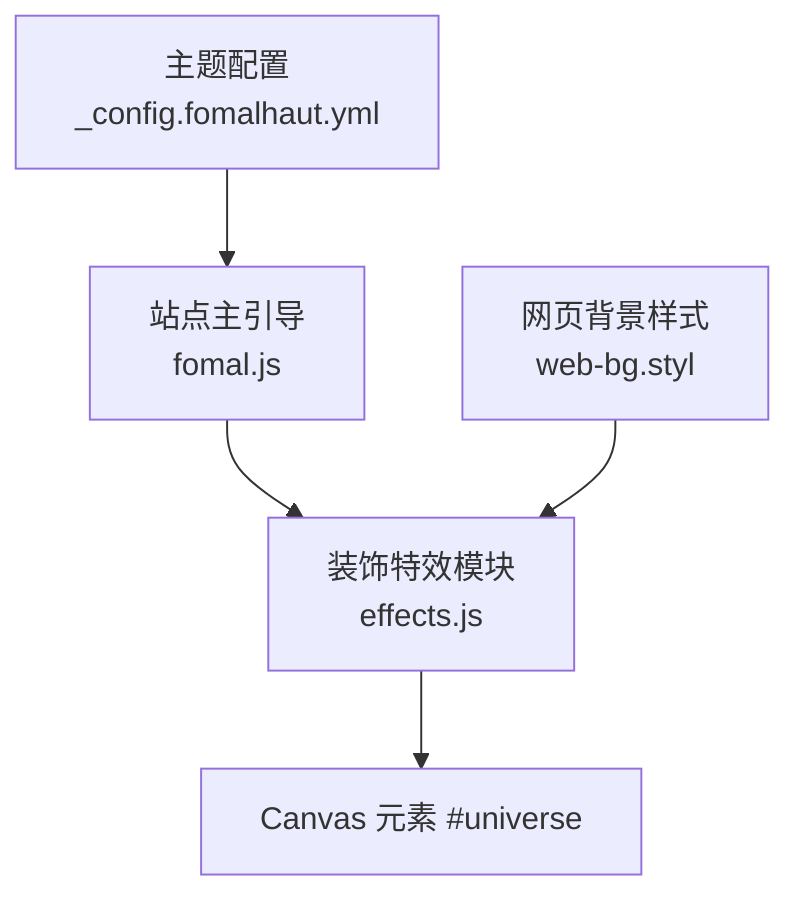
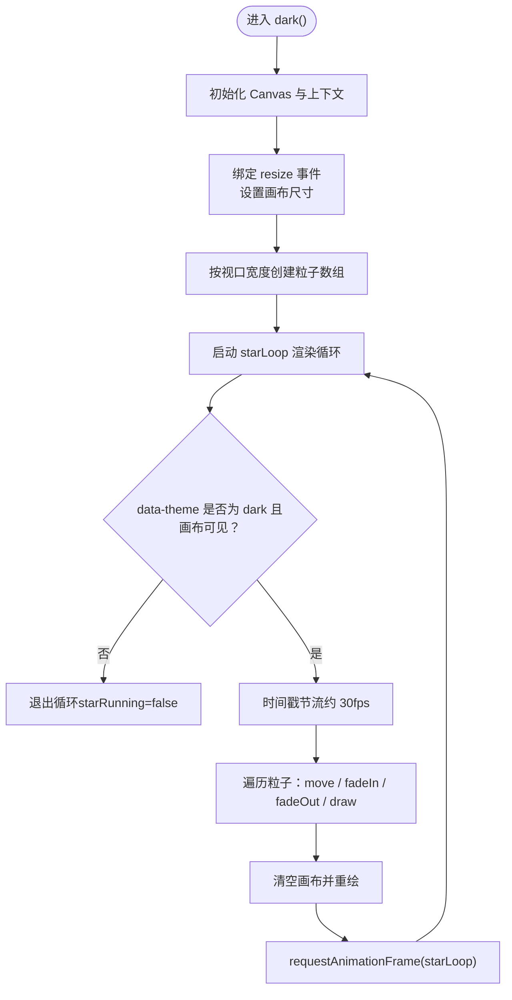
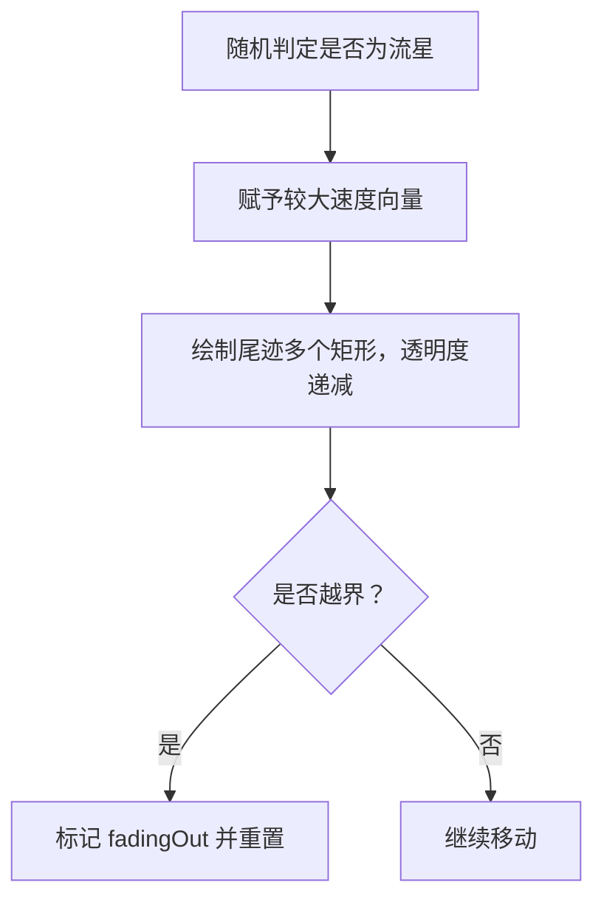
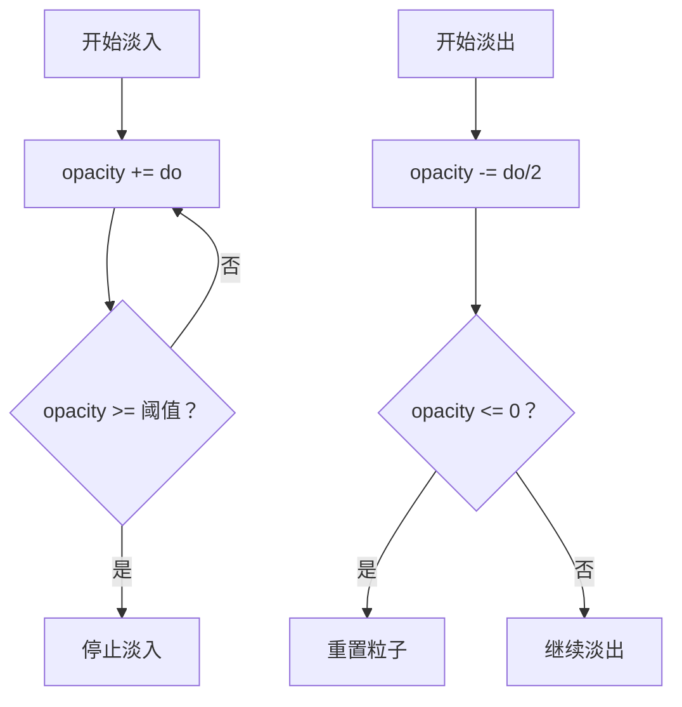
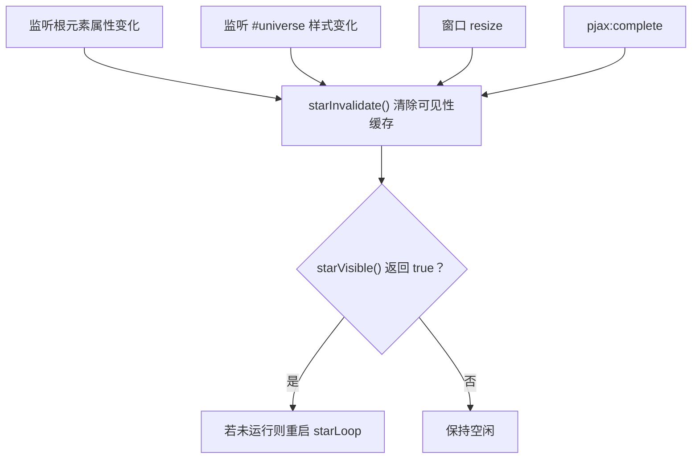
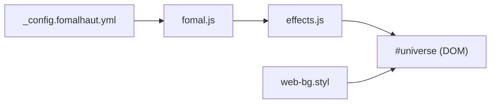

# 星空背景特效

<cite>
**本文引用的文件**   
- [source/js/modules/effects.js](file://source/js/modules/effects.js)
- [source/js/fomal.js](file://source/js/fomal.js)
- [_config.fomalhaut.yml](file://_config.fomalhaut.yml)
- [themes/fomalhaut/source/css/_layout/web-bg.styl](file://themes/fomalhaut/source/css/_layout/web-bg.styl)
</cite>

## 目录
1. [简介](#简介)
2. [项目结构](#项目结构)
3. [核心组件](#核心组件)
4. [架构总览](#架构总览)
5. [详细组件分析](#详细组件分析)
6. [依赖关系分析](#依赖关系分析)
7. [性能考量](#性能考量)
8. [故障排查指南](#故障排查指南)
9. [结论](#结论)
10. [附录](#附录)

## 简介
本文件系统化文档化站点中的“星空背景特效”，覆盖 Canvas 绘制系统、星星粒子生成与随机运动、闪烁算法、流星尾迹触发机制，以及暗色模式适配、响应式画布调整、可见性检测、requestAnimationFrame 节流等性能优化策略。同时给出配置参数说明、自定义星星样式的方法，以及常见问题排查与性能调优建议。

## 项目结构
星空特效由主题主引导脚本加载，实际实现位于模块文件中：
- 站点主引导负责模块地图与全局入口，确保 effects.js 在页面中可用。
- effects.js 提供星空动画函数 dark()，包含 Canvas 初始化、粒子生命周期、渲染循环与性能优化。
- 主题配置文件 _config.fomalhaut.yml 控制整体美化开关与显示模式。
- web-bg.styl 负责星空画布 #universe 的布局与显隐（通常通过 data-theme="dark" 控制）。



**图表来源**
- [source/js/fomal.js:1-107](file://source/js/fomal.js#L1-L107)
- [source/js/modules/effects.js:1-125](file://source/js/modules/effects.js#L1-L125)
- [_config.fomalhaut.yml:790-881](file://_config.fomalhaut.yml#L790-L881)
- [themes/fomalhaut/source/css/_layout/web-bg.styl](file://themes/fomalhaut/source/css/_layout/web-bg.styl)

**章节来源**
- [source/js/fomal.js:1-107](file://source/js/fomal.js#L1-L107)
- [source/js/modules/effects.js:1-125](file://source/js/modules/effects.js#L1-L125)
- [_config.fomalhaut.yml:790-881](file://_config.fomalhaut.yml#L790-L881)

## 核心组件
- 星空动画函数 dark()：负责整个星空特效的生命周期管理，包括 Canvas 尺寸设置、星星/流星粒子创建、移动与绘制、闪烁效果、可见性与主题判断、帧率节流等。
- 粒子对象模型：每个粒子具备位置、速度、半径、透明度、是否巨型星、是否流星等属性，并提供 reset、move、fadeIn、fadeOut、draw 等方法。
- 可见性与性能控制：使用 MutationObserver 监听主题切换与 DOM 变化；使用 requestAnimationFrame 结合时间戳节流到约 30fps；不可见时直接退出循环，避免空转。

**章节来源**
- [source/js/modules/effects.js:27-125](file://source/js/modules/effects.js#L27-L125)

## 架构总览
星空特效的运行流程如下：
- 页面加载后执行 dark()，初始化 Canvas 并绑定 resize 事件。
- 根据视口宽度计算初始星星数量，创建粒子数组。
- 启动 starLoop 渲染循环，仅在暗色模式且画布可见时进行绘制。
- 每帧遍历所有粒子，调用 move、fadeIn、fadeOut、draw 更新状态并绘制。
- 通过 MutationObserver 监听 data-theme、class、style 变化，必要时重新拉起渲染循环。

```mermaid
sequenceDiagram
participant Page as "页面"
participant Effects as "effects.js"
participant Canvas as "Canvas #universe"
participant Loop as "starLoop"
participant Particles as "粒子集合"
Page->>Effects : 加载并执行 dark()
Effects->>Canvas : 初始化尺寸与上下文
Effects->>Particles : 按视口宽度创建 N 个粒子
Effects->>Loop : 启动渲染循环
Loop->>Loop : 检查 data-theme 与可见性
alt 条件满足
Loop->>Particles : move / fadeIn / fadeOut / draw
Loop->>Canvas : 清空并重绘
Loop->>Loop : requestAnimationFrame(starLoop)
else 条件不满足
Loop-->>Page : 退出循环不再排帧
end
```

**图表来源**
- [source/js/modules/effects.js:27-125](file://source/js/modules/effects.js#L27-L125)

## 详细组件分析

### Canvas 绘制系统与星星粒子
- 画布初始化：获取 #universe 元素，设置 width/height 为视口宽高，获取 2D 上下文。
- 星星数量：基于视口宽度的比例系数计算初始星星数，保证在不同屏幕下密度一致。
- 粒子类型：
  - 普通星：矩形或圆形点，缓慢漂移，透明度渐变。
  - 巨型星：较大的圆点，颜色不同，用于视觉层次。
  - 流星：快速移动，带尾迹（多个小矩形），透明度随尾迹递减。
- 闪烁算法：fadeIn/fadeOut 控制 opacity，达到阈值后停止淡入/淡出；当粒子移出可视区域时触发淡出并重置。
- 绘制逻辑：根据粒子类型选择 arc 或 rect，使用 rgba 颜色与当前透明度填充。



**图表来源**
- [source/js/modules/effects.js:27-125](file://source/js/modules/effects.js#L27-L125)

**章节来源**
- [source/js/modules/effects.js:27-125](file://source/js/modules/effects.js#L27-L125)

### 流星效果的触发机制与尾迹绘制
- 触发概率：通过 m(t) 函数以较低概率判定某粒子是否为流星；初始阶段短暂禁用流星以避免首帧过密。
- 速度与方向：流星具有更大的 dx/dy，使其快速穿越画布。
- 尾迹绘制：对流星绘制固定数量的矩形片段，透明度从头部向尾部递减，形成拖尾效果。
- 边界处理：当流星超出右边界或上边界时标记 fadingOut，随后重置到新位置。



**图表来源**
- [source/js/modules/effects.js:47-64](file://source/js/modules/effects.js#L47-L64)

**章节来源**
- [source/js/modules/effects.js:47-64](file://source/js/modules/effects.js#L47-L64)

### 闪烁效果算法
- 淡入：opacity 逐步增加至阈值，超过阈值后停止淡入。
- 淡出：当粒子越界或 fadingOut 被标记时，opacity 逐渐减小至 0，然后重置粒子。
- 透明度阈值：根据粒子类型（普通星/流星）动态调整，流星阈值更低，使尾迹更快消散。
- 速率控制：do 值决定透明度变化速率，流星与普通星有不同的 do 值。



**图表来源**
- [source/js/modules/effects.js:47-64](file://source/js/modules/effects.js#L47-L64)

**章节来源**
- [source/js/modules/effects.js:47-64](file://source/js/modules/effects.js#L47-L64)

### 可见性检测与主题切换
- 可见性判断：使用 window.getComputedStyle(s).display !== "none" 判断 #universe 是否显示。
- 主题判断：读取 document.documentElement.getAttribute("data-theme") == "dark"。
- 监听器：
  - MutationObserver 监听根元素的 data-theme、class、style 变化。
  - MutationObserver 监听 #universe 的 style 属性变化。
  - 窗口 resize 与 pjax:complete 事件触发 starInvalidate，使 starOn 缓存失效并可能重启循环。



**图表来源**
- [source/js/modules/effects.js:92-122](file://source/js/modules/effects.js#L92-L122)

**章节来源**
- [source/js/modules/effects.js:92-122](file://source/js/modules/effects.js#L92-L122)

### 暗色模式适配与响应式画布调整
- 暗色模式：仅当 data-theme="dark" 时启用星空绘制；浅色模式下循环直接退出。
- 响应式：resize 事件中重新设置 Canvas 宽高，并根据新视口宽度调整重力与粒子速度比例，保证观感一致。
- 默认背景：appearance-backgrounds.js 提供默认壁纸选择，与星空特效配合，但星空本身由 effects.js 独立控制。

**章节来源**
- [source/js/modules/effects.js:27-125](file://source/js/modules/effects.js#L27-L125)
- [source/js/modules/appearance-backgrounds.js:417-423](file://source/js/modules/appearance-backgrounds.js#L417-L423)

## 依赖关系分析
- fomal.js 作为站点主引导，声明模块地图并注入 effects.js，确保 dark() 与 owoBig() 在全局作用域可用。
- effects.js 依赖 DOM 元素 #universe，该元素由主题模板注入并通过 CSS 控制显隐。
- _config.fomalhaut.yml 控制 display_mode 与 beautify.enable，间接影响星空是否可见。
- web-bg.styl 通过 [data-theme="dark"] 规则控制 #universe 的 display，从而决定是否显示星空。



**图表来源**
- [source/js/fomal.js:1-107](file://source/js/fomal.js#L1-L107)
- [source/js/modules/effects.js:1-125](file://source/js/modules/effects.js#L1-L125)
- [_config.fomalhaut.yml:790-881](file://_config.fomalhaut.yml#L790-L881)
- [themes/fomalhaut/source/css/_layout/web-bg.styl](file://themes/fomalhaut/source/css/_layout/web-bg.styl)

**章节来源**
- [source/js/fomal.js:1-107](file://source/js/fomal.js#L1-L107)
- [source/js/modules/effects.js:1-125](file://source/js/modules/effects.js#L1-L125)
- [_config.fomalhaut.yml:790-881](file://_config.fomalhaut.yml#L790-L881)

## 性能考量
- requestAnimationFrame 节流：将重绘频率限制到约 30fps（STAR_DRAW_INTERVAL=1000/30），减少不必要的绘制开销。
- 可见性检测：当 #universe 被隐藏或主题非暗色时，starLoop 直接 return 并不再排下一帧，彻底停止空转。
- MutationObserver 监听：仅在主题或样式变化时失效可见性缓存并可能重启循环，避免频繁重绘。
- 粒子数量控制：星星数量与视口宽度成比例，避免在小屏设备上过度绘制。
- 尾迹绘制优化：流星尾迹使用少量矩形绘制，透明度递减，避免复杂路径计算。

[本节为通用性能指导，不直接分析具体文件]

## 故障排查指南
- 星空不显示：
  - 检查 data-theme 是否为 "dark"。
  - 确认 #universe 的 display 不是 "none"。
  - 查看 settings.js 是否将 #universe 的 style.display 设为 none。
- 性能卡顿：
  - 检查 STAR_DRAW_INTERVAL 是否过小。
  - 确认 MutationObserver 是否频繁触发导致循环反复重启。
  - 观察浏览器性能面板中 Canvas 绘制耗时。
- 流星异常：
  - 检查 m(t) 概率函数是否被修改。
  - 确认流星速度向量 dx/dy 是否合理。
- 闪烁异常：
  - 检查 fadeIn/fadeOut 逻辑是否被误改。
  - 确认 opacityTresh 与 do 值是否符合预期。

**章节来源**
- [source/js/modules/effects.js:71-122](file://source/js/modules/effects.js#L71-L122)

## 结论
星空背景特效通过 Canvas 绘制星星与流星粒子，结合闪烁算法与随机运动轨迹营造夜空氛围。代码实现了完善的性能优化策略，包括可见性检测、requestAnimationFrame 节流与 MutationObserver 监听，确保在暗色模式下高效运行，同时在浅色模式下零开销。通过主题配置与样式控制，星空可无缝适配不同设备与主题状态。

[本节为总结性内容，不直接分析具体文件]

## 附录

### 配置参数说明
- display_mode：站点默认显示模式（light/dark），影响星空是否启用。
- beautify.enable：美化功能总开关，影响星空等装饰特效的加载。
- canvas_* 系列配置：其他 Canvas 特效（如 ribbon、nest）的开关与参数，与星空特效相互独立。

**章节来源**
- [_config.fomalhaut.yml:790-881](file://_config.fomalhaut.yml#L790-L881)

### 自定义星星样式方法
- 修改颜色变量：在 dark() 中调整 a、r、d 对应的 RGB 字符串，改变巨型星、普通星与流星的颜色。
- 调整粒子数量：修改 i 的计算方式（例如 .216 * n）以增减星星密度。
- 调整速度范围：修改 t 与 l(t, 6*t) 的范围，控制粒子漂移速度。
- 调整闪烁速率：修改 do 值与 opacityTresh，改变淡入淡出速度。
- 调整流星尾迹长度：修改尾迹矩形数量（例如 30）与透明度衰减步长。

**章节来源**
- [source/js/modules/effects.js:27-64](file://source/js/modules/effects.js#L27-L64)