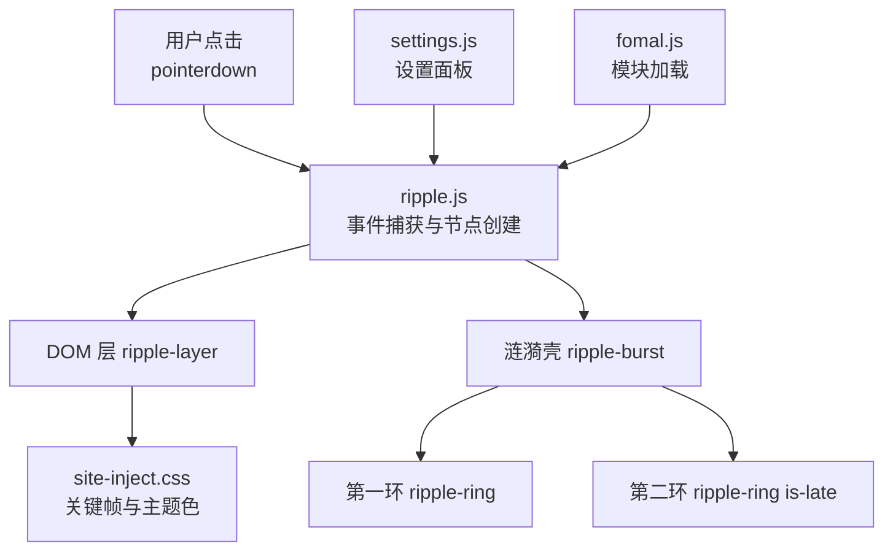
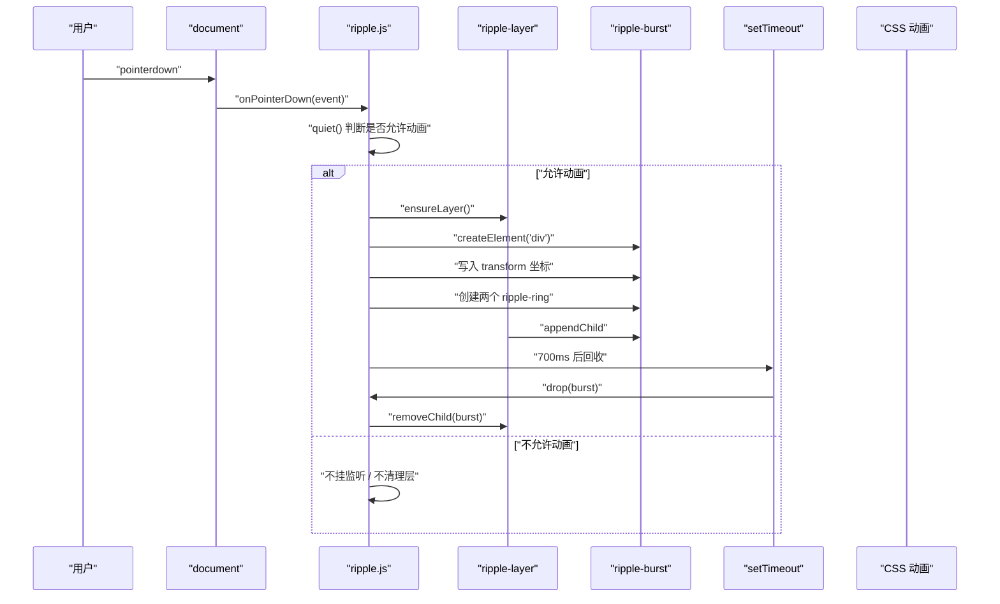
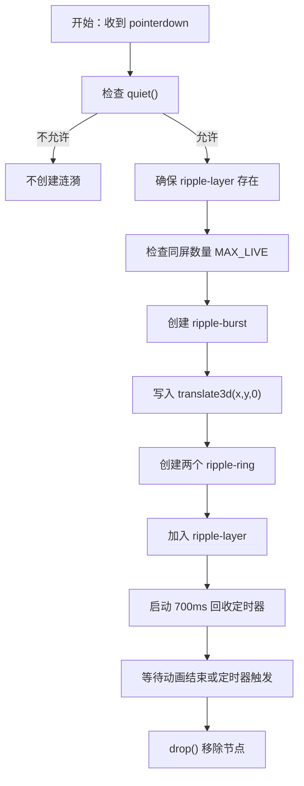
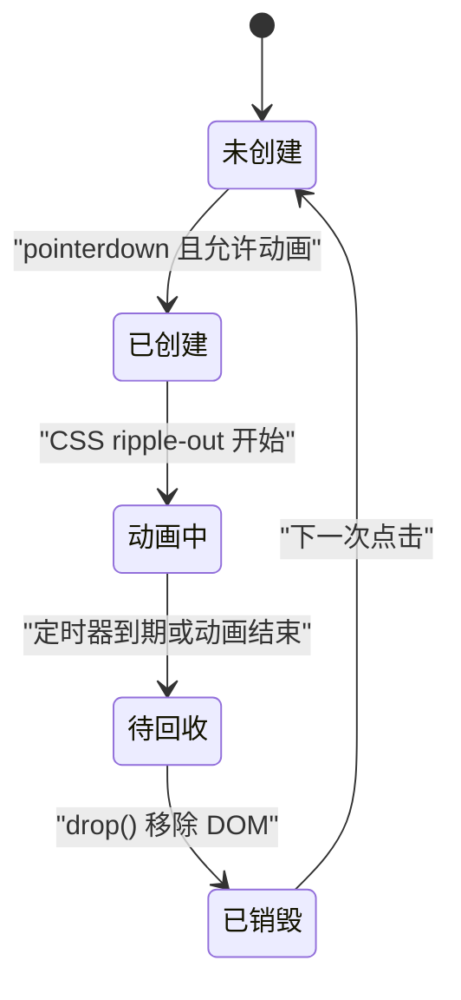
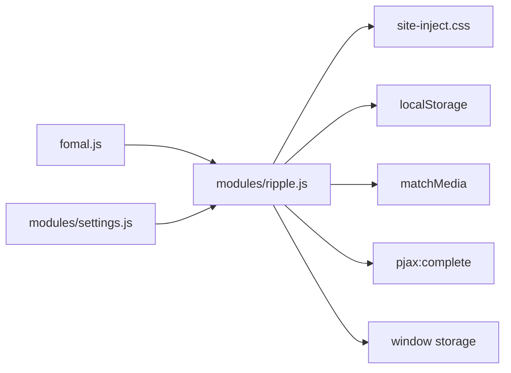

# 点击涟漪效果

<cite>
**本文引用的文件**   
- [ripple.js](file://source/js/modules/ripple.js)
- [site-inject.css](file://source/css/site-inject.css)
- [settings.js](file://source/js/modules/settings.js)
- [fomal.js](file://source/js/fomal.js)
- [ripple.test.cjs](file://tools/tests/ripple.test.cjs)
</cite>

## 目录
1. [简介](#简介)
2. [项目结构中的位置](#项目结构中的位置)
3. [核心组件总览](#核心组件总览)
4. [架构与数据流](#架构与数据流)
5. [详细实现分析](#详细实现分析)
6. [依赖关系分析](#依赖关系分析)
7. [性能与内存优化](#性能与内存优化)
8. [样式定制与主题联动](#样式定制与主题联动)
9. [与其他交互效果的冲突处理](#与其他交互效果的冲突处理)
10. [移动端与触摸事件处理](#移动端与触摸事件处理)
11. [故障排查指南](#故障排查指南)
12. [结论](#结论)

## 简介
点击涟漪效果是一个轻量级、按需创建的视觉反馈：用户按下鼠标或触摸屏幕时，在指针位置生成两圈同心水波纹动画，动画结束后自动销毁节点。该功能默认关闭，只有显式开启后才挂载事件监听；同时尊重系统“减少动态效果”偏好，避免在不适合的场景下触发动画。

它的设计目标是：
- 只在真正按下时才创建 DOM，不常驻渲染树。
- 使用 CSS 关键帧动画完成扩散，不依赖 `requestAnimationFrame` 循环。
- 通过固定层 + 坐标变换定位，避免布局抖动。
- 提供开关控制、提示文案同步、跨标签页状态同步。
- 与右键菜单、光标圆点、猫咪挂件等其它交互效果共存。

## 项目结构中的位置
点击涟漪由三部分协作完成：
- JavaScript 模块负责生命周期、事件委托、配置读写和清理。
- 站点注入样式负责涟漪容器、波纹环、关键帧动画和层级顺序。
- 设置面板负责持久化开关并驱动模块启用或禁用。

**图表来源**
- [ripple.js:10-122](file://source/js/modules/ripple.js#L10-L122)
- [site-inject.css:677-688](file://source/css/site-inject.css#L677-L688)
- [settings.js:305-333](file://source/js/modules/settings.js#L305-L333)
- [fomal.js:18-82](file://source/js/fomal.js#L18-L82)

**章节来源**
- [ripple.js:1-122](file://source/js/modules/ripple.js#L1-L122)
- [site-inject.css:677-688](file://source/css/site-inject.css#L677-L688)
- [settings.js:305-333](file://source/js/modules/settings.js#L305-L333)
- [fomal.js:18-82](file://source/js/fomal.js#L18-L82)

## 核心组件总览
涟漪效果的核心职责可以拆成以下部分：

| 组件 | 主要职责 | 关键行为 |
|---|---|---|
| 涟漪模块 | 读取开关、绑定事件、创建和销毁涟漪节点 | 暴露 `setEnabled`、`refresh`、`syncControls` |
| 涟漪层 | 作为所有涟漪的固定容器 | 不参与命中测试，z-index 低于光标圆点 |
| 涟漪壳 | 包裹两个波纹环，承载坐标和回收定时器 | 最多同屏保留 6 个 |
| 波纹环 | 执行扩散动画 | 第一环正常出发，第二环延迟 60ms |
| 设置面板 | 持久化开关、更新 UI 状态 | 只写 `'1'` 或 `'0'` |
| 样式表 | 定义容器、波纹环、关键帧、主题色派生 | 颜色从 `--theme-color` 派生 |

**章节来源**
- [ripple.js:13-16](file://source/js/modules/ripple.js#L13-L16)
- [ripple.js:26-70](file://source/js/modules/ripple.js#L26-L70)
- [site-inject.css:683-688](file://source/css/site-inject.css#L683-L688)
- [settings.js:328-333](file://source/js/modules/settings.js#L328-L333)

## 架构与数据流
涟漪效果的整体流程如下：

**图表来源**
- [ripple.js:52-78](file://source/js/modules/ripple.js#L52-L78)
- [ripple.js:72-89](file://source/js/modules/ripple.js#L72-L89)
- [ripple.js:100-107](file://source/js/modules/ripple.js#L100-L107)

**章节来源**
- [ripple.js:52-78](file://source/js/modules/ripple.js#L52-L78)
- [ripple.js:72-89](file://source/js/modules/ripple.js#L72-L89)
- [ripple.js:100-107](file://source/js/modules/ripple.js#L100-L107)

## 详细实现分析

### 涟漪节点的创建与销毁流程
涟漪节点不是页面初始化时就存在的，而是等到第一次有效点击才创建。创建过程包括：
1. 检查是否允许动画。
2. 确保存在固定层 `ripple-layer`。
3. 限制同屏涟漪数量，超过上限时先回收最旧的。
4. 创建涟漪壳 `ripple-burst`。
5. 用 `translate3d` 直接写入点击坐标。
6. 创建两个波纹环，第二环延迟出发。
7. 将涟漪壳加入固定层。
8. 启动最长 700ms 的兜底回收定时器。

销毁过程包括：
- 从活跃列表移除。
- 清除定时器。
- 从父节点删除 DOM。
- 关闭开关时清空全部涟漪并移除固定层。

**图表来源**
- [ripple.js:19-24](file://source/js/modules/ripple.js#L19-L24)
- [ripple.js:26-70](file://source/js/modules/ripple.js#L26-L70)
- [ripple.js:39-50](file://source/js/modules/ripple.js#L39-L50)

**章节来源**
- [ripple.js:26-70](file://source/js/modules/ripple.js#L26-L70)
- [ripple.js:39-50](file://source/js/modules/ripple.js#L39-L50)

### DOM 操作优化与内存泄漏防护
代码在 DOM 操作上做了多项优化：
- 固定层只在需要时创建，且复用已有实例。
- 涟漪坐标直接使用事件的 `clientX` / `clientY`，避免调用 `getBoundingClientRect` 触发布局计算。
- 使用 `transform: translate3d` 走合成层，减少重排。
- 每个涟漪壳自带定时器，动画结束后统一回收。
- 同屏最多保留 6 个涟漪，防止连点导致 DOM 堆积。
- 关闭开关时主动移除监听器、清空活跃列表、删除固定层。
- 支持 pjax 换页后重新刷新状态。
- 支持跨标签页 `storage` 事件同步开关。

这些策略共同降低了布局抖动、渲染压力和内存泄漏风险。

**章节来源**
- [ripple.js:13-16](file://source/js/modules/ripple.js#L13-L16)
- [ripple.js:26-50](file://source/js/modules/ripple.js#L26-L50)
- [ripple.js:52-70](file://source/js/modules/ripple.js#L52-L70)
- [ripple.js:80-89](file://source/js/modules/ripple.js#L80-L89)
- [ripple.js:111-121](file://source/js/modules/ripple.js#L111-L121)

### 动画生命周期管理
涟漪动画完全由 CSS 关键帧驱动：
- 第一环使用基础动画时长。
- 第二环延迟 60ms 出发，并且更细、更淡、时长略长。
- 动画从较小尺寸放大到较大尺寸，同时透明度从可见变为透明。
- JavaScript 的 TTL 是兜底回收机制，保证即使动画异常也不会长期残留 DOM。

**图表来源**
- [ripple.js:52-70](file://source/js/modules/ripple.js#L52-L70)
- [site-inject.css:685-688](file://source/css/site-inject.css#L685-L688)

**章节来源**
- [ripple.js:52-70](file://source/js/modules/ripple.js#L52-L70)
- [site-inject.css:685-688](file://source/css/site-inject.css#L685-L688)

### 事件委托机制
涟漪效果没有为每个可点击元素单独绑定事件，而是在文档级别监听 `pointerdown`：
- 只响应主指针。
- 只响应左键。
- 要求事件对象包含有效的 `clientX` / `clientY`。
- 右键留给右键菜单。
- 多指操作只取第一指，避免一次手势产生多个涟漪。

这种设计让涟漪效果对任意 DOM 都生效，不需要关心具体点击目标是什么。

**章节来源**
- [ripple.js:72-84](file://source/js/modules/ripple.js#L72-L84)
- [ripple.test.cjs:125-133](file://tools/tests/ripple.test.cjs#L125-L133)

### 坐标计算与涟漪中心定位
涟漪的定位逻辑非常直接：
- 涟漪层是 `position: fixed`，覆盖整个视口。
- 涟漪壳初始宽高为 0，位于层左上角。
- 波纹环通过负边距居中，形成以点击点为中心的圆形扩散。
- 坐标直接使用 `clientX` / `clientY`，与 `position: fixed` 坐标系一致。

这种方式避免了复杂的坐标换算，也减少了布局查询。

**章节来源**
- [ripple.js:52-68](file://source/js/modules/ripple.js#L52-L68)
- [site-inject.css:683-687](file://source/css/site-inject.css#L683-L687)

### 样式定制选项
涟漪样式集中在站点注入样式中，并与主题色联动：
- 涟漪层固定定位、零宽高、不参与命中测试。
- z-index 高于正文和侧栏，但低于光标圆点、猫咪挂件和右键菜单。
- 波纹环边框颜色从 `--theme-color` 派生。
- 第一环和第二环在粗细、透明度、延迟、时长上略有差异，形成水波感。
- 关键帧动画控制缩放和透明度变化。

如果需要自定义涟漪外观，建议优先调整主题变量和涟漪相关样式类，而不是直接修改内部实现。

**章节来源**
- [site-inject.css:677-688](file://source/css/site-inject.css#L677-L688)
- [ripple.test.cjs:188-197](file://tools/tests/ripple.test.cjs#L188-L197)

## 依赖关系分析
涟漪模块与项目中其他模块的关系如下：

**图表来源**
- [fomal.js:18-82](file://source/js/fomal.js#L18-L82)
- [ripple.js:10-121](file://source/js/modules/ripple.js#L10-L121)
- [settings.js:305-333](file://source/js/modules/settings.js#L305-L333)

**章节来源**
- [fomal.js:18-82](file://source/js/fomal.js#L18-L82)
- [ripple.js:10-121](file://source/js/modules/ripple.js#L10-L121)
- [settings.js:305-333](file://source/js/modules/settings.js#L305-L333)

## 性能与内存优化
涟漪效果的性能设计围绕“少画、少算、少留”展开：

| 优化点 | 实现方式 | 收益 |
|---|---|---|
| 无 RAF 循环 | 使用 CSS 关键帧动画 | 避免每帧 JS 回调 |
| 无定时器循环 | 每个涟漪只设一个一次性定时器 | 降低定时器压力 |
| 按需创建 DOM | 首次点击才建层和涟漪壳 | 默认不占渲染树 |
| 固定层复用 | 已有层直接复用 | 减少重复 DOM 操作 |
| 坐标直写 | 使用 `clientX` / `clientY` 和 `translate3d` | 避免布局查询 |
| 同屏上限 | 最多保留 6 个涟漪 | 防止连点堆叠 |
| 主动清理 | 关闭开关时移除监听器和 DOM | 防止内存泄漏 |
| 减少动效偏好 | 尊重 `prefers-reduced-motion` | 提升无障碍体验 |

**章节来源**
- [ripple.js:1-9](file://source/js/modules/ripple.js#L1-L9)
- [ripple.js:13-16](file://source/js/modules/ripple.js#L13-L16)
- [ripple.js:26-70](file://source/js/modules/ripple.js#L26-L70)
- [ripple.js:116-119](file://source/js/modules/ripple.js#L116-L119)

## 样式定制与主题联动
涟漪样式与主题系统的衔接点主要是 `--theme-color`：
- 波纹环边框颜色通过 `color-mix` 从主题色派生。
- 切换主题色时，涟漪颜色会自动跟随。
- 涟漪层不参与命中测试，因此不会干扰链接、按钮、表单控件的正常点击。
- z-index 经过测试确认低于光标圆点，避免遮挡光标指示。

如果希望进一步定制涟漪效果，推荐路径是：
1. 调整主题色变量。
2. 在站点注入样式中扩展 `.ripple-ring`、`.ripple-burst`、`.ripple-layer` 的样式。
3. 如需改变动画节奏，可同时调整 CSS 动画时长和 JavaScript 的 TTL，确保 TTL 能覆盖最长动画。

**章节来源**
- [site-inject.css:683-688](file://source/css/site-inject.css#L683-L688)
- [ripple.test.cjs:188-207](file://tools/tests/ripple.test.cjs#L188-L207)

## 与其他交互效果的冲突处理
涟漪效果在设计时考虑了与常见交互效果的共存：
- 右键菜单：涟漪只响应左键，右键留给右键菜单。
- 光标圆点：涟漪层 z-index 低于光标圆点，避免遮挡。
- 猫咪挂件：涟漪层 z-index 低于猫咪挂件。
- 美化面板：涟漪层 z-index 高于美化面板，但低于昼夜过渡遮罩。
- 文本选择：涟漪层 `pointer-events: none`，不影响用户选中文本。
- 滚动与锚点：涟漪层不参与命中测试，不干扰滚动行为。

这些约定由样式层级、事件过滤和模块开关共同保障。

**章节来源**
- [site-inject.css:677-688](file://source/css/site-inject.css#L677-L688)
- [ripple.test.cjs:188-197](file://tools/tests/ripple.test.cjs#L188-L197)
- [ripple.js:72-78](file://source/js/modules/ripple.js#L72-L78)

## 移动端与触摸事件处理
涟漪效果使用 `pointerdown` 事件，这是 Pointer Events API 的统一入口，能够同时覆盖鼠标、触控笔和触摸事件。模块还做了以下适配：
- 只响应主指针，避免多点触控产生多个涟漪。
- 只响应左键，兼容桌面端鼠标行为。
- 使用 `passive: true` 绑定监听器，减少滚动阻塞风险。
- 尊重系统“减少动态效果”偏好，必要时暂停动画。
- 默认关闭，避免在未明确开启的情况下增加移动端渲染负担。

对于移动端性能优化，建议：
- 保持默认关闭，仅在用户明确开启时使用。
- 避免在高频滚动区域叠加过多复杂动画。
- 在低性能设备上优先保证滚动流畅，再考虑装饰性效果。
- 利用 `prefers-reduced-motion` 自动降级。

**章节来源**
- [ripple.js:72-84](file://source/js/modules/ripple.js#L72-L84)
- [ripple.js:17-24](file://source/js/modules/ripple.js#L17-L24)
- [ripple.js:116-119](file://source/js/modules/ripple.js#L116-L119)

## 故障排查指南

| 现象 | 可能原因 | 排查建议 |
|---|---|---|
| 点击没有涟漪 | 开关未显式设为 `'1'` | 检查 `localStorage` 中 `rippleOn` 的值 |
| 开关打开但仍不显示 | 系统启用了“减少动态效果” | 检查 `prefers-reduced-motion` 偏好 |
| 右键点击出现涟漪 | 事件过滤异常 | 检查是否误改左键判断逻辑 |
| 涟漪一直不消失 | 定时器被拦截或 DOM 回收失败 | 检查浏览器存储权限和定时器环境 |
| 涟漪遮挡光标 | z-index 被外部样式覆盖 | 检查站点自定义样式是否覆盖了涟漪层层级 |
| 主题色变更后涟漪颜色不变 | 样式未正确派生主题色 | 检查 `.ripple-ring` 是否仍使用 `--theme-color` |
| pjax 换页后状态异常 | 模块未重新刷新 | 检查 `pjax:complete` 是否触发 `refresh()` |
| 跨标签页开关不同步 | `storage` 事件未触发 | 检查是否跨标签页修改 `rippleOn` |

**章节来源**
- [ripple.js:19-24](file://source/js/modules/ripple.js#L19-L24)
- [ripple.js:106-119](file://source/js/modules/ripple.js#L106-L119)
- [ripple.test.cjs:179-186](file://tools/tests/ripple.test.cjs#L179-L186)

## 结论
点击涟漪效果是一个典型的“轻量装饰型交互”：它把视觉反馈放在 CSS 动画层，把状态管理和生命周期放在 JavaScript 层，并通过设置面板与主题系统联动。其核心优势在于：
- 默认关闭，不干扰未启用场景。
- 按需创建 DOM，动画结束即销毁。
- 使用合成层动画，减少布局抖动。
- 尊重无障碍偏好，避免强制动画。
- 与右键菜单、光标、猫咪挂件等效果共存。

在实际使用中，应优先通过主题色和样式变量定制外观，避免频繁改动核心逻辑；在移动端和低性能设备上，应保持谨慎启用，并把流畅性和可访问性放在装饰效果之前。