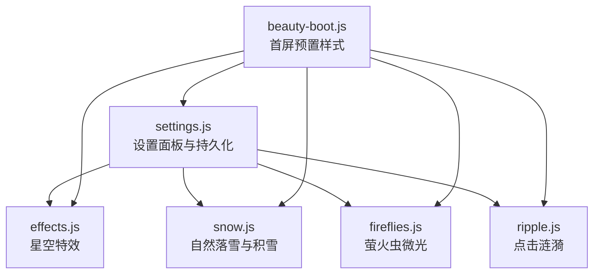
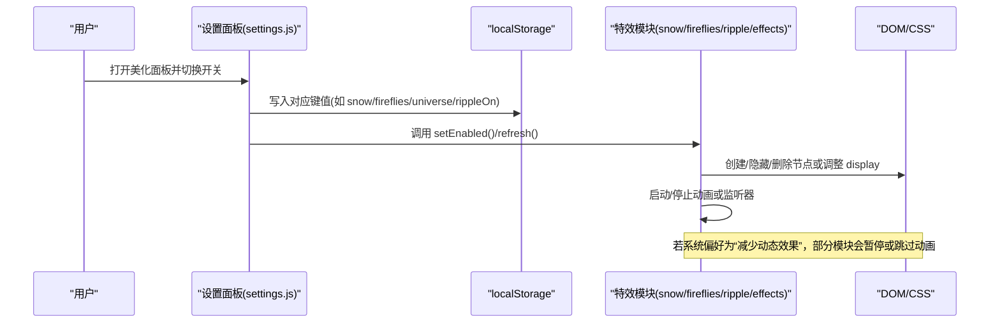
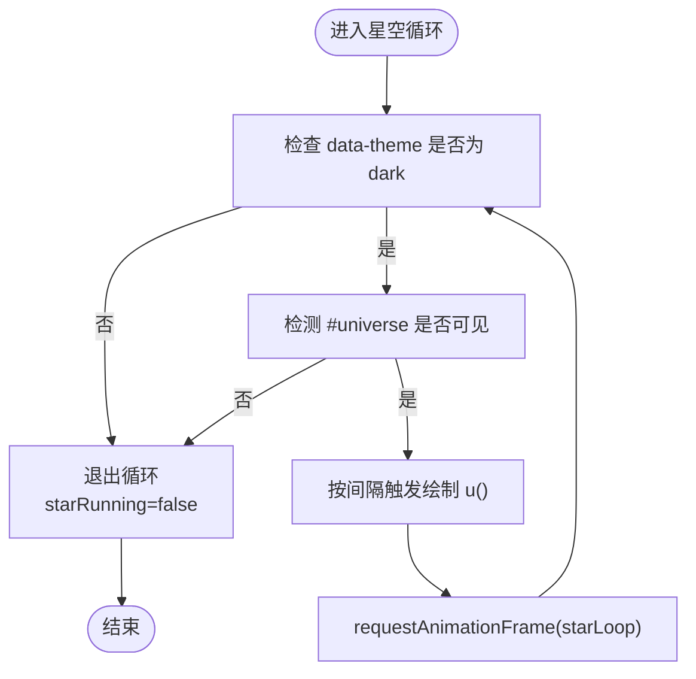
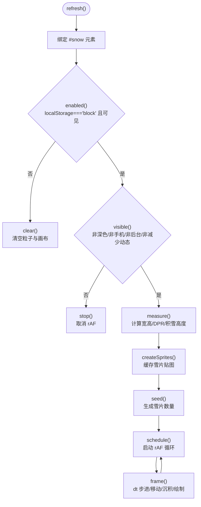
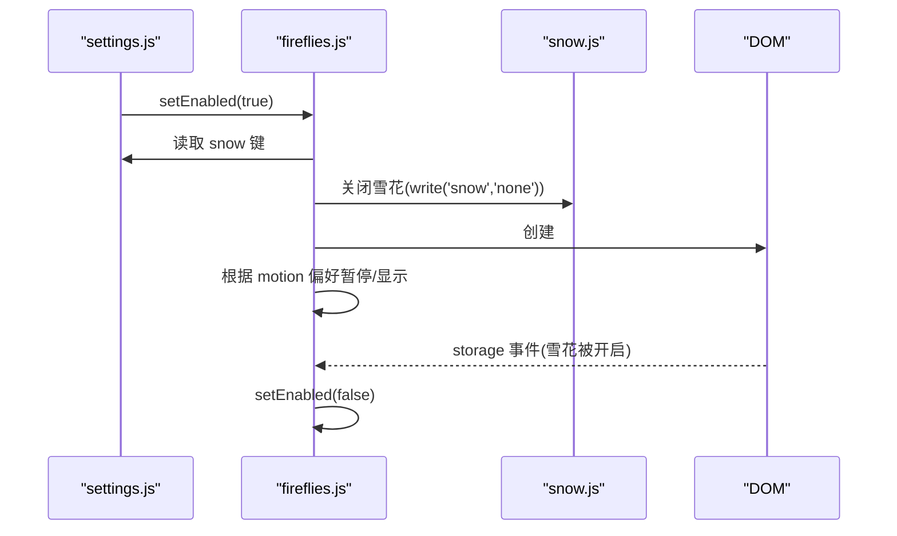
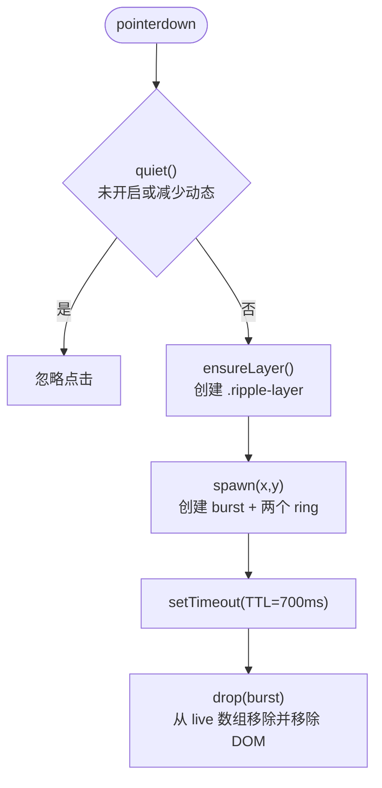
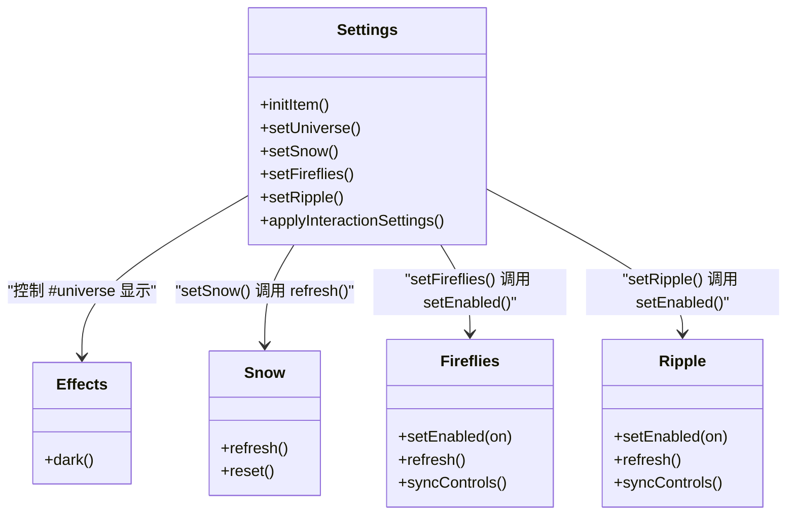
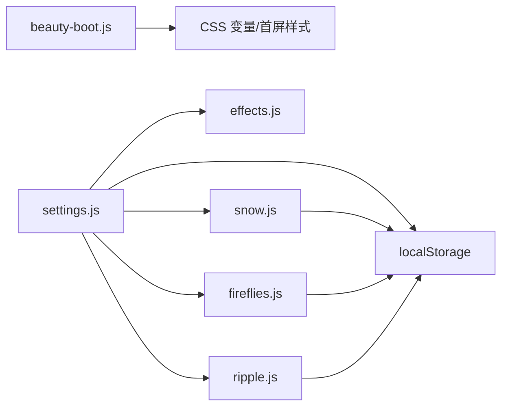

# 美化面板特效控制

<cite>
**本文引用的文件**   
- [source/js/modules/effects.js](file://source/js/modules/effects.js)
- [source/js/modules/snow.js](file://source/js/modules/snow.js)
- [source/js/modules/fireflies.js](file://source/js/modules/fireflies.js)
- [source/js/modules/ripple.js](file://source/js/modules/ripple.js)
- [source/js/modules/settings.js](file://source/js/modules/settings.js)
- [source/js/inject/beauty-boot.js](file://source/js/inject/beauty-boot.js)
- [docs/plans/2026-10-10-beauty-feature-switches.md](file://docs/plans/2026-10-10-beauty-feature-switches.md)
- [docs/plans/2026-10-10-snowfall.md](file://docs/plans/2026-10-10-snowfall.md)
- [docs/plans/2026-10-10-fireflies.md](file://docs/plans/2026-10-10-fireflies.md)
</cite>

## 目录
1. [引言](#引言)
2. [项目结构](#项目结构)
3. [核心组件](#核心组件)
4. [架构总览](#架构总览)
5. [详细组件分析](#详细组件分析)
6. [依赖关系分析](#依赖关系分析)
7. [性能影响评估](#性能影响评估)
8. [自定义特效添加指南](#自定义特效添加指南)
9. [常见问题与调试技巧](#常见问题与调试技巧)
10. [结论](#结论)

## 引言
本文聚焦“美化面板中的特效控制系统”，围绕以下目标展开：
- 说明星空、雪花、萤火虫、涟漪等特效的启用/禁用方式。
- 解释设置持久化机制：localStorage 存储、默认值管理、配置同步。
- 说明运行时切换原理：状态监听、DOM 更新、动画启停。
- 给出性能影响评估与优化建议。
- 提供自定义特效扩展指南与最佳实践。
- 汇总常见配置问题与调试方法。

## 项目结构
特效控制相关代码主要分布在 `source/js/modules` 与 `source/js/inject`，并由计划文档记录设计意图与验收结果。

**图表来源**
- [source/js/modules/settings.js:114-137](file://source/js/modules/settings.js#L114-L137)
- [source/js/modules/effects.js:24-125](file://source/js/modules/effects.js#L24-L125)
- [source/js/modules/snow.js:1-179](file://source/js/modules/snow.js#L1-L179)
- [source/js/modules/fireflies.js:1-89](file://source/js/modules/fireflies.js#L1-L89)
- [source/js/modules/ripple.js:1-122](file://source/js/modules/ripple.js#L1-L122)
- [source/js/inject/beauty-boot.js:13-79](file://source/js/inject/beauty-boot.js#L13-L79)

**章节来源**
- [source/js/modules/settings.js:1-137](file://source/js/modules/settings.js#L1-L137)
- [source/js/inject/beauty-boot.js:1-79](file://source/js/inject/beauty-boot.js#L1-L79)

## 核心组件
- settings.js：负责初始化默认值、读写 localStorage、构建并同步设置面板 UI、联动各特效模块。
- effects.js：实现星空 Canvas 动画与表情放大；已把雪花逻辑迁移到 snow.js。
- snow.js：Canvas 驱动的自然落雪与底部薄积雪，支持 DPR、时间步长、减少动态效果暂停。
- fireflies.js：纯 CSS 动画的萤火虫微光，无 RAF/Canvas，与雪花互斥。
- ripple.js：点击涟漪，按需创建 DOM，短生命周期回收，受减少动态效果偏好控制。
- beauty-boot.js：在 head 中尽早注入样式变量，避免刷新闪烁，并与 settings.js 取值一致。

**章节来源**
- [source/js/modules/settings.js:114-137](file://source/js/modules/settings.js#L114-L137)
- [source/js/modules/effects.js:1-19](file://source/js/modules/effects.js#L1-L19)
- [source/js/modules/snow.js:1-10](file://source/js/modules/snow.js#L1-L10)
- [source/js/modules/fireflies.js:1-10](file://source/js/modules/fireflies.js#L1-L10)
- [source/js/modules/ripple.js:1-10](file://source/js/modules/ripple.js#L1-L10)
- [source/js/inject/beauty-boot.js:1-11](file://source/js/inject/beauty-boot.js#L1-L11)

## 架构总览
整体流程分为三层：
- 配置层：settings.js 维护默认值与 localStorage 键值，并提供开关函数。
- 渲染层：各特效模块根据配置决定是否创建节点、启动动画或停止循环。
- 首屏层：beauty-boot.js 提前写入 CSS 变量，避免首帧闪烁。

**图表来源**
- [source/js/modules/settings.js:365-401](file://source/js/modules/settings.js#L365-L401)
- [source/js/modules/snow.js:150-179](file://source/js/modules/snow.js#L150-L179)
- [source/js/modules/fireflies.js:69-88](file://source/js/modules/fireflies.js#L69-L88)
- [source/js/modules/ripple.js:106-121](file://source/js/modules/ripple.js#L106-L121)

## 详细组件分析

### 星空特效（effects.js）
- 功能要点：暗色主题下使用 Canvas 绘制星星与流星；浅色主题不显示。
- 性能优化：
  - 当画布不可见时退出 rAF 循环，避免空转。
  - 重绘频率限制到约 30fps，降低每帧全量绘制开销。
  - 通过 MutationObserver 监听主题与样式变化，必要时重启循环。
- 与面板联动：settings.js 通过 `universe` 键控制 `#universe` 的 display，从而间接控制可见性。

**图表来源**
- [source/js/modules/effects.js:71-124](file://source/js/modules/effects.js#L71-L124)

**章节来源**
- [source/js/modules/effects.js:24-125](file://source/js/modules/effects.js#L24-L125)
- [source/js/modules/settings.js:365-378](file://source/js/modules/settings.js#L365-L378)

### 雪花特效（snow.js）
- 功能要点：六臂雪片缓存、时间步长驱动、视口底部薄积雪；DPR 最高取 2。
- 运行条件：
  - 仅当 `snow` 键为 `block` 且非深色主题、非移动端、未隐藏、未处于后台、未开启“减少动态效果”时运行。
  - resize/PJAX/visibilitychange/load/transitionend 等事件触发 refresh。
- 互斥策略：settings.js 开启雪花时会关闭萤火虫；fireflies.js 开启时会关闭雪花。

**图表来源**
- [source/js/modules/snow.js:20-64](file://source/js/modules/snow.js#L20-L64)
- [source/js/modules/snow.js:124-156](file://source/js/modules/snow.js#L124-L156)

**章节来源**
- [source/js/modules/snow.js:1-179](file://source/js/modules/snow.js#L1-L179)
- [source/js/modules/settings.js:380-395](file://source/js/modules/settings.js#L380-L395)
- [docs/plans/2026-10-10-snowfall.md:5-11](file://docs/plans/2026-10-10-snowfall.md#L5-L11)

### 萤火虫特效（fireflies.js）
- 功能要点：纯 CSS 动画的微光粒子，无 Canvas/RAF；桌面 14 个、<=600px 8 个。
- 互斥策略：
  - 开启萤火虫时自动关闭雪花，并同步雪花控件与显示状态。
  - 监听 storage 事件，当雪花被开启时自动关闭萤火虫。
- 可访问性与性能：
  - 尊重 prefers-reduced-motion，暂停时隐藏图层。
  - 关闭时移除 DOM 节点，避免常驻元素。

**图表来源**
- [source/js/modules/fireflies.js:21-38](file://source/js/modules/fireflies.js#L21-L38)
- [source/js/modules/fireflies.js:69-88](file://source/js/modules/fireflies.js#L69-L88)
- [source/js/modules/settings.js:397-401](file://source/js/modules/settings.js#L397-L401)

**章节来源**
- [source/js/modules/fireflies.js:1-89](file://source/js/modules/fireflies.js#L1-L89)
- [docs/plans/2026-10-10-fireflies.md:5-10](file://docs/plans/2026-10-10-fireflies.md#L5-L10)

### 点击涟漪（ripple.js）
- 功能要点：按下处生成两圈同心波纹，最多同屏 6 个，700ms 后回收。
- 行为特性：
  - 默认关闭，只有显式存储 `rippleOn='1'` 才开启。
  - 减少动态效果偏好下不挂 pointerdown 监听，也不创建节点。
  - 关闭时解绑监听并清理 DOM。

**图表来源**
- [source/js/modules/ripple.js:19-24](file://source/js/modules/ripple.js#L19-L24)
- [source/js/modules/ripple.js:52-70](file://source/js/modules/ripple.js#L52-L70)
- [source/js/modules/ripple.js:100-107](file://source/js/modules/ripple.js#L100-L107)

**章节来源**
- [source/js/modules/ripple.js:1-122](file://source/js/modules/ripple.js#L1-L122)
- [source/js/modules/settings.js:328-334](file://source/js/modules/settings.js#L328-L334)

### 设置面板与持久化（settings.js）
- 默认值：initItem 统一初始化所有键，包括 universe、snow、fireflies、rippleOn、nekoOn、cursorOn 等。
- 持久化：每个开关函数都会写入 localStorage，并在页面加载时恢复。
- 同步：
  - 面板 UI 与模块 API 双向同步（如 syncInteractionControls、syncControls）。
  - PJAX、resize、storage、visibilitychange 等事件触发 refresh 或重新应用。
- 互斥：
  - 开启雪花时关闭萤火虫。
  - 萤火虫开启时关闭雪花。
  - 涟漪默认关闭，需显式开启。

**图表来源**
- [source/js/modules/settings.js:114-137](file://source/js/modules/settings.js#L114-L137)
- [source/js/modules/settings.js:365-401](file://source/js/modules/settings.js#L365-L401)
- [source/js/modules/settings.js:328-334](file://source/js/modules/settings.js#L328-L334)
- [source/js/modules/effects.js:24-125](file://source/js/modules/effects.js#L24-L125)
- [source/js/modules/snow.js:150-179](file://source/js/modules/snow.js#L150-L179)
- [source/js/modules/fireflies.js:69-88](file://source/js/modules/fireflies.js#L69-L88)
- [source/js/modules/ripple.js:106-121](file://source/js/modules/ripple.js#L106-L121)

**章节来源**
- [source/js/modules/settings.js:114-137](file://source/js/modules/settings.js#L114-L137)
- [source/js/modules/settings.js:365-401](file://source/js/modules/settings.js#L365-L401)
- [docs/plans/2026-10-10-beauty-feature-switches.md:9-14](file://docs/plans/2026-10-10-beauty-feature-switches.md#L9-L14)

## 依赖关系分析
- settings.js 是中枢：它既读 localStorage，也写 localStorage，还调用各模块 API。
- effects.js 直接操作全局 Canvas 节点，受 settings.js 控制的 display 属性影响。
- snow.js、fireflies.js、ripple.js 各自维护自身状态，并通过 storage 事件与其他模块保持互斥一致性。
- beauty-boot.js 在更早阶段注入 CSS 变量，确保首屏不闪烁，随后由 settings.js 接管交互。

**图表来源**
- [source/js/inject/beauty-boot.js:13-79](file://source/js/inject/beauty-boot.js#L13-L79)
- [source/js/modules/settings.js:114-137](file://source/js/modules/settings.js#L114-L137)
- [source/js/modules/snow.js:172-172](file://source/js/modules/snow.js#L172-L172)
- [source/js/modules/fireflies.js:77-82](file://source/js/modules/fireflies.js#L77-L82)
- [source/js/modules/ripple.js:112-115](file://source/js/modules/ripple.js#L112-L115)

**章节来源**
- [source/js/inject/beauty-boot.js:1-79](file://source/js/inject/beauty-boot.js#L1-L79)
- [source/js/modules/settings.js:114-137](file://source/js/modules/settings.js#L114-L137)

## 性能影响评估
- 星空（effects.js）：
  - 原实现每帧全量绘制，现改为不可见时退出循环，并将绘制节流到约 30fps。
  - 对低端设备或高刷新率屏幕有明显收益。
- 雪花（snow.js）：
  - 使用 Canvas 与时间步长，雪片数量随视口宽度自适应，最高 DPR=2。
  - 仅在浅色主题、桌面端、前台且未开启减少动态效果时运行。
  - 积雪有上限，不会无限增高遮挡正文。
- 萤火虫（fireflies.js）：
  - 纯 CSS 动画，无 RAF/Canvas，资源消耗极低。
  - 关闭时移除 DOM，避免常驻节点。
- 涟漪（ripple.js）：
  - 只在点击时临时创建节点，700ms 后回收。
  - 减少动态效果偏好下完全跳过监听与绘制。
- 通用优化：
  - 所有模块均处理 pagehide/pageshow、visibilitychange、PJAX、resize 等场景，避免内存泄漏与重复绑定。
  - 优先使用 CSS 动画与按需 DOM 创建，减少 JS 主线程压力。

[本节为通用性能讨论，不直接分析具体代码行]

## 自定义特效添加指南
推荐遵循现有模块模式，新增一个独立模块并接入设置面板：

1. 新建模块文件
   - 路径：`source/js/modules/<your-effect>.js`
   - 导出统一 API：`setEnabled(on)`、`refresh()`、可选 `syncControls()`。
   - 内部使用 IIFE 命名空间，避免污染全局。

2. 默认值与持久化
   - 在 settings.js 的 initItem 中添加默认键值。
   - 提供对应的 setXxx 函数，写入 localStorage 并调用模块 API。

3. 面板 UI 同步
   - 在 syncInteractionControls 或类似函数中同步开关勾选状态。
   - 如需提示文案，参考 fireflies.js 的 syncControls 写法。

4. 首屏兼容
   - 若需要首屏样式，参考 beauty-boot.js，在 head 中尽早注入 CSS 变量或类名。

5. 生命周期与性能
   - 监听 pjax:complete、resize、visibilitychange、pagehide/pageshow。
   - 尊重 prefers-reduced-motion，必要时暂停或跳过动画。
   - 关闭时清理定时器、rAF、监听器与 DOM。

6. 互斥与兼容性
   - 如果与其他特效互斥，参考 snow/fireflies 的双向互斥实现。
   - 对 localStorage 异常做 try/catch 回退，保证健壮性。

**章节来源**
- [source/js/modules/fireflies.js:21-38](file://source/js/modules/fireflies.js#L21-L38)
- [source/js/modules/ripple.js:100-107](file://source/js/modules/ripple.js#L100-L107)
- [source/js/modules/settings.js:114-137](file://source/js/modules/settings.js#L114-L137)
- [source/js/inject/beauty-boot.js:13-79](file://source/js/inject/beauty-boot.js#L13-L79)

## 常见问题与调试技巧
- 开关无效或刷新后失效
  - 检查 localStorage 对应键是否存在且值正确。
  - 确认 settings.js 的 initItem 是否包含该键。
  - 查看模块是否监听 storage 事件并调用 refresh。
- 雪花与萤火虫同时出现
  - 确认互斥逻辑：开启雪花应关闭萤火虫，反之亦然。
  - 检查 fireflies.js 的 disableSnow 与 settings.js 的 setSnow/setFireflies。
- 星空不停耗电
  - 确认 effects.js 的 starLoop 是否在不可见时退出循环。
  - 检查 data-theme 与 #universe 的 display 是否正确。
- 涟漪不出现
  - 确认 rippleOn 是否显式为 '1'。
  - 检查 prefers-reduced-motion 是否导致 quiet 分支生效。
- 首屏闪烁
  - 确认 beauty-boot.js 是否提前注入 CSS 变量。
  - 核对 settings.js 与 beauty-boot.js 的取值逻辑一致。
- 调试建议
  - 使用浏览器控制台查看 localStorage 键值。
  - 在模块 refresh/setEnabled 处打日志，观察事件触发顺序。
  - 使用 Performance 面板观察 rAF 与 DOM 操作。
  - 针对 PJAX 场景，监听 pjax:complete 并验证模块是否重建。

**章节来源**
- [source/js/modules/settings.js:365-401](file://source/js/modules/settings.js#L365-L401)
- [source/js/modules/fireflies.js:69-88](file://source/js/modules/fireflies.js#L69-L88)
- [source/js/modules/effects.js:71-124](file://source/js/modules/effects.js#L71-L124)
- [source/js/modules/ripple.js:19-24](file://source/js/modules/ripple.js#L19-L24)
- [source/js/inject/beauty-boot.js:13-79](file://source/js/inject/beauty-boot.js#L13-L79)

## 结论
本项目的特效控制系统以 settings.js 为核心，结合各独立模块实现可插拔、可持久化的视觉增强能力。星空、雪花、萤火虫、涟漪分别采用 Canvas、CSS 动画与按需 DOM 的策略，在保证视觉效果的同时兼顾性能与可访问性。通过互斥机制、减少动态效果偏好、PJAX 与生命周期管理，系统在多场景下保持稳定。新增特效可沿用现有模式，快速集成到设置面板与持久化体系中。