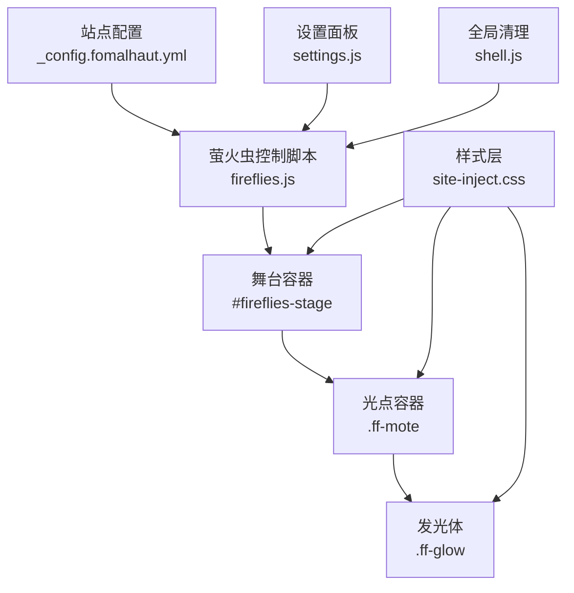
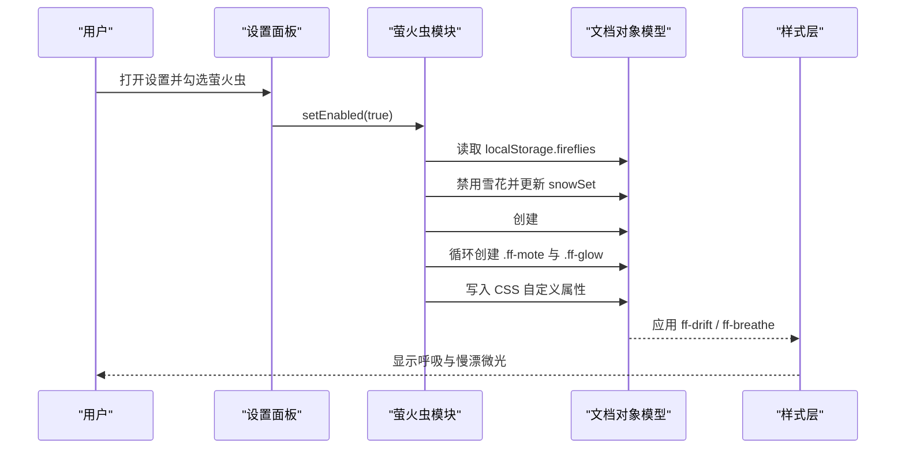
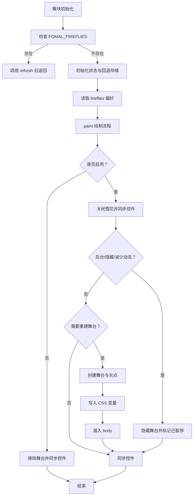
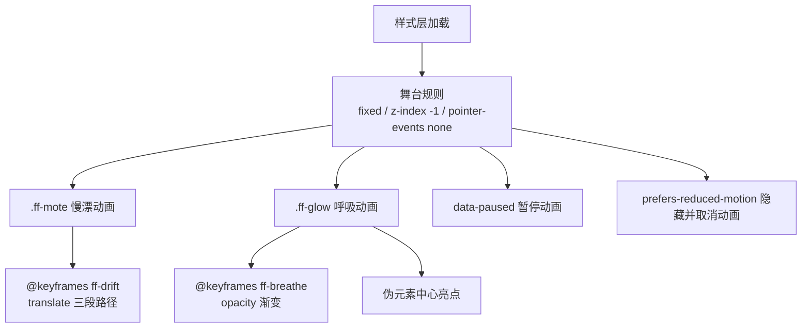
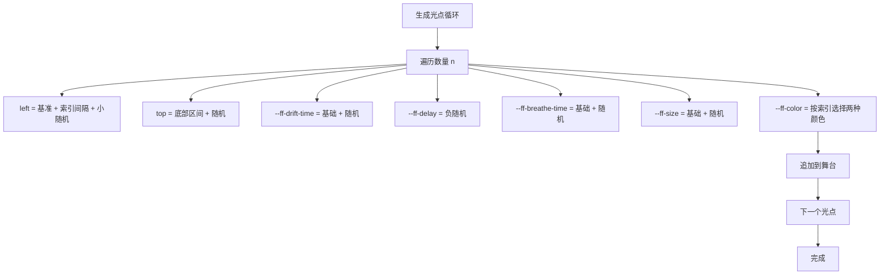
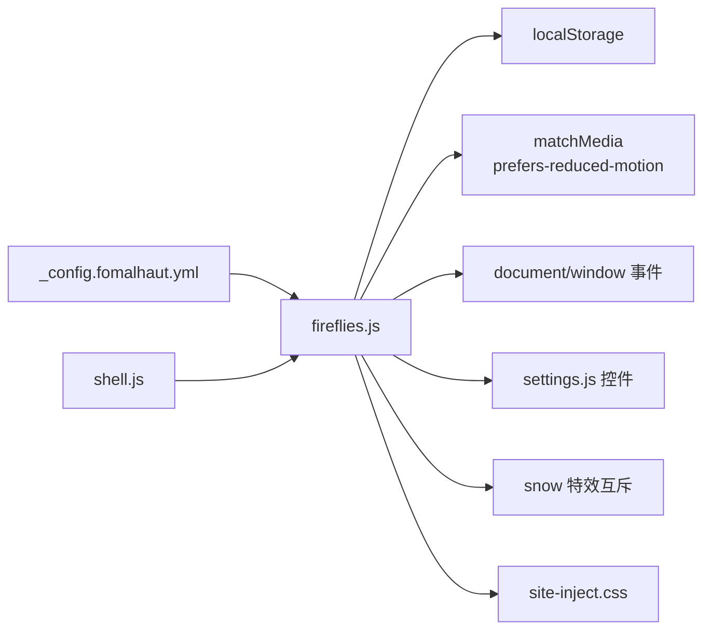

# 萤火虫微光效果

<cite>
**本文引用的文件**   
- [fireflies.js](file://source/js/modules/fireflies.js)
- [site-inject.css](file://source/css/site-inject.css)
- [2026-10-10-fireflies.md](file://docs/plans/2026-10-10-fireflies.md)
- [_config.fomalhaut.yml](file://_config.fomalhaut.yml)
- [settings.js](file://source/js/modules/settings.js)
- [shell.js](file://source/js/modules/shell.js)
- [fireflies.test.cjs](file://tools/tests/fireflies.test.cjs)
</cite>

## 目录
1. [简介](#简介)
2. [项目结构](#项目结构)
3. [核心组件](#核心组件)
4. [架构总览](#架构总览)
5. [详细组件分析](#详细组件分析)
6. [依赖关系分析](#依赖关系分析)
7. [性能与兼容性](#性能与兼容性)
8. [故障排查](#故障排查)
9. [结论](#结论)
10. [附录：参数定制指南](#附录参数定制指南)

## 简介
本方案实现一个“纯 CSS 动画 + 轻量 JS 控制”的萤火虫微光效果。JS 只负责创建少量 DOM、读取用户偏好、处理开关互斥和生命周期事件；实际闪烁、漂移等视觉表现全部由 CSS 关键帧完成，不依赖 Canvas、requestAnimationFrame、定时器轮询或第三方库。默认关闭，桌面端生成 14 个低密度光点，移动端减少到 8 个，位于页面底部背景层，不参与交互，且与雪花特效互斥。

## 项目结构
萤火虫效果由以下部分构成：
- 控制模块：`source/js/modules/fireflies.js`
- 样式层：`source/css/site-inject.css`
- 站点注入配置：`_config.fomalhaut.yml`
- 设置面板集成：`source/js/modules/settings.js`
- 全局清理逻辑：`source/js/modules/shell.js`
- 设计计划与验收说明：`docs/plans/2026-10-10-fireflies.md`
- 行为契约测试：`tools/tests/fireflies.test.cjs`

**图表来源**
- [_config.fomalhaut.yml:1358-1358](file://_config.fomalhaut.yml#L1358-L1358)
- [fireflies.js:47-64](file://source/js/modules/fireflies.js#L47-L64)
- [site-inject.css:825-858](file://source/css/site-inject.css#L825-L858)
- [settings.js:993-993](file://source/js/modules/settings.js#L993-L993)
- [shell.js:222-222](file://source/js/modules/shell.js#L222-L222)

**章节来源**
- [fireflies.js:1-90](file://source/js/modules/fireflies.js#L1-L90)
- [site-inject.css:825-863](file://source/css/site-inject.css#L825-L863)
- [_config.fomalhaut.yml:1358-1358](file://_config.fomalhaut.yml#L1358-L1358)

## 核心组件
- **萤火虫控制模块**：导出 `FOMAL_FIREFLIES.setEnabled`、`refresh`、`syncControls`，负责读取本地存储、创建舞台、生成光点、同步设置控件、响应 PJAX/resize/visibility/pagehide/pageshow/storage 等事件。
- **样式层**：定义舞台定位、层级、指针穿透、呼吸动画、慢漂动画、暂停状态、减少动态效果回退。
- **设置面板**：提供萤火虫开关、提示文案，并与雪花开关保持互斥。
- **站点注入**：通过主题配置引入脚本，确保在设置模块之前加载。
- **全局清理**：在站点级清理列表中保留萤火虫舞台 ID，避免误删。

**章节来源**
- [fireflies.js:4-71](file://source/js/modules/fireflies.js#L4-L71)
- [site-inject.css:825-863](file://source/css/site-inject.css#L825-L863)
- [settings.js:993-993](file://source/js/modules/settings.js#L993-L993)
- [_config.fomalhaut.yml:1358-1358](file://_config.fomalhaut.yml#L1358-L1358)
- [shell.js:222-222](file://source/js/modules/shell.js#L222-L222)

## 架构总览
萤火虫效果采用“JS 控制 + CSS 渲染”的分层架构：JS 只做最小必要工作，CSS 承担所有动画。

**图表来源**
- [fireflies.js:21-67](file://source/js/modules/fireflies.js#L21-L67)
- [site-inject.css:832-858](file://source/css/site-inject.css#L832-L858)

## 详细组件分析

### 萤火虫控制模块
该模块是一个立即执行函数，首次运行会检查全局命名空间，避免重复初始化。它维护舞台引用、数量、启用状态、后台标记、内存回退存储，以及系统“减少动态效果”媒体查询结果。

关键职责：
- 安全读写本地存储，异常时回退到内存对象。
- 删除舞台节点，重置计数。
- 同步设置控件与雪花互斥。
- 根据屏幕宽度决定光点数量。
- 按需重建舞台，避免重复监听和重复节点。
- 根据可见性、后台、减少动态偏好暂停或恢复动画。
- 订阅 PJAX、resize、pagehide/pageshow、storage、减少动态偏好变化。

**图表来源**
- [fireflies.js:4-67](file://source/js/modules/fireflies.js#L4-L67)

**章节来源**
- [fireflies.js:1-90](file://source/js/modules/fireflies.js#L1-L90)

### 样式层与动画
样式层将萤火虫分为三层：
- 舞台容器：固定定位到底部，负层级，不拦截点击，限制高度范围，使用 `contain: layout paint` 提升渲染隔离。
- 光点容器 `.ff-mote`：绝对定位，执行慢漂动画 `ff-drift`。
- 发光体 `.ff-glow`：径向渐变背景，执行呼吸动画 `ff-breathe`，并通过伪元素绘制中心亮点。

#### 呼吸动画
呼吸动画控制透明度渐变，模拟光点忽明忽暗：
- 起始与结束透明度较低。
- 中间段达到较高亮度。
- 后半段再次降低，形成自然起伏。

#### 慢漂动画
慢漂动画通过多段 `transform: translate(...)` 规划路径：
- 起点向左下偏移。
- 中段向右上偏移。
- 终点继续向右上方移动。
配合 `ease-in-out` 缓动函数，使运动更柔和。

#### 暂停与减少动态
- 当舞台带有 `data-paused="true"` 时，强制暂停所有动画。
- 当系统开启“减少动态效果”时，隐藏舞台并取消动画。

**图表来源**
- [site-inject.css:825-858](file://source/css/site-inject.css#L825-L858)

**章节来源**
- [site-inject.css:825-863](file://source/css/site-inject.css#L825-L863)

### 随机生成算法
萤火虫的光点由 JS 在启用时生成，每个光点包含外层容器和内层发光体。随机性体现在以下方面：

| 维度 | 实现方式 | 目的 |
|---|---|---|
| 水平位置 | 基于索引的线性分布加上小范围随机偏移 | 避免光点完全对齐，同时保持整体横向覆盖 |
| 垂直位置 | 百分比区间内随机 | 分布在底部背景区域 |
| 慢漂时长 | 基础值加随机增量 | 让不同光点漂移节奏错开 |
| 动画延迟 | 负延迟随机值 | 启动时已有不同相位，避免同步闪烁 |
| 呼吸时长 | 基础值加随机增量 | 让明暗节奏不一致 |
| 尺寸 | 像素区间随机 | 模拟远近层次 |
| 颜色 | 按索引在三类中选取两种主色 | 暖金与青绿交替，增加氛围感 |

**图表来源**
- [fireflies.js:51-62](file://source/js/modules/fireflies.js#L51-L62)

**章节来源**
- [fireflies.js:51-62](file://source/js/modules/fireflies.js#L51-L62)

### 与页面布局的集成
- **定位策略**：舞台使用 `position: fixed`，左右铺满，底部对齐，高度用 `vh` 控制，适合全屏背景层。
- **层级管理**：舞台 `z-index: -1`，位于正文卡片之后；内容层不会被遮挡。
- **事件处理**：
  - `visibilitychange`：页面隐藏时暂停。
  - `pjax:complete`：PJAX 换页后恢复或重建舞台。
  - `resize`：响应式调整光点数量。
  - `pagehide/pageshow`：后台切换时暂停与恢复。
  - `storage`：跨标签页同步开关与雪花互斥。
- **设置面板集成**：提供开关控件、提示文案，并在打开设置窗口时同步状态。
- **全局清理**：在站点清理列表中包含萤火虫舞台 ID，避免误删。

**章节来源**
- [site-inject.css:825-830](file://source/css/site-inject.css#L825-L830)
- [fireflies.js:72-88](file://source/js/modules/fireflies.js#L72-L88)
- [settings.js:993-993](file://source/js/modules/settings.js#L993-L993)
- [shell.js:222-222](file://source/js/modules/shell.js#L222-L222)

## 依赖关系分析
萤火虫模块与站点其他模块的关系如下：

**图表来源**
- [fireflies.js:7-16](file://source/js/modules/fireflies.js#L7-L16)
- [fireflies.js:72-88](file://source/js/modules/fireflies.js#L72-L88)
- [_config.fomalhaut.yml:1358-1358](file://_config.fomalhaut.yml#L1358-L1358)
- [shell.js:222-222](file://source/js/modules/shell.js#L222-L222)

**章节来源**
- [fireflies.js:7-16](file://source/js/modules/fireflies.js#L7-L16)
- [fireflies.js:72-88](file://source/js/modules/fireflies.js#L72-L88)
- [_config.fomalhaut.yml:1358-1358](file://_config.fomalhaut.yml#L1358-L1358)
- [shell.js:222-222](file://source/js/modules/shell.js#L222-L222)

## 性能与兼容性

### 性能特性
- **无 Canvas**：不使用绘图上下文，避免 GPU/CPU 混合开销。
- **无 requestAnimationFrame**：不维护动画循环，减少 JS 主线程压力。
- **无定时器轮询**：不依赖 `setInterval`/`setTimeout` 维持动画。
- **低密度光点**：桌面 14 个，移动端 8 个，数量可控。
- **CSS 动画**：浏览器原生优化，GPU 加速友好。
- **渲染隔离**：使用 `contain: layout paint` 限制重排重绘范围。
- **幂等初始化**：重复加载不会重复绑定事件或重复创建节点。
- **按需重建**：仅在数量变化或舞台丢失时重建 DOM。
- **暂停机制**：后台、隐藏、减少动态偏好下暂停动画，降低资源消耗。

### 兼容性说明
- 使用现代 CSS 自定义属性传递每光点参数。
- 使用 `matchMedia` 检测“减少动态效果”。
- 兼容旧版 `MediaQueryList` 的 `addListener` 与新版 `addEventListener('change')`。
- 对 `localStorage` 读写异常进行 try/catch 保护，并使用内存回退。
- 对缺失设置控件、雪花元素做防御性判断。
- 在“减少动态效果”模式下隐藏舞台并取消动画，尊重系统偏好。

**章节来源**
- [fireflies.js:7-16](file://source/js/modules/fireflies.js#L7-L16)
- [fireflies.js:72-88](file://source/js/modules/fireflies.js#L72-L88)
- [site-inject.css:825-863](file://source/css/site-inject.css#L825-L863)

## 故障排查

### 常见问题
| 现象 | 可能原因 | 处理建议 |
|---|---|---|
| 萤火虫未出现 | 默认关闭，未手动开启 | 在设置面板勾选萤火虫开关 |
| 开启后没有光点 | 系统开启“减少动态效果” | 关闭系统减少动态偏好，或接受无动画体验 |
| 光点被点击拦截 | 样式未生效或覆盖异常 | 检查 `pointer-events:none` 与 `z-index:-1` |
| 切换页面后消失 | PJAX 替换了 DOM | 等待 `pjax:complete`，模块会自动恢复 |
| 后台切回后仍暂停 | 页面仍隐藏或减少动态偏好未释放 | 恢复页面可见性并关闭减少动态偏好 |
| 与雪花冲突 | 两者互斥 | 开启萤火虫会自动关闭雪花，反之亦然 |
| 跨标签页设置不同步 | storage 事件未触发或异常 | 检查浏览器隐私模式、第三方 Cookie 限制 |
| 控制台报错但功能正常 | localStorage 不可用 | 模块已使用内存回退，可忽略持久化失败 |

### 调试步骤
1. 确认 `_config.fomalhaut.yml` 中萤火虫脚本已注入且位于设置模块之前。
2. 打开设置面板，确认萤火虫开关存在且默认关闭。
3. 检查 `#fireflies-stage` 是否存在于 `body` 末尾。
4. 检查 `.ff-mote` 与 `.ff-glow` 是否拥有正确的 CSS 变量。
5. 检查 `data-paused` 是否为 `false`。
6. 检查系统“减少动态效果”是否开启。
7. 检查雪花是否被意外启用。
8. 使用测试用例验证行为契约，包括默认关闭、数量、互斥、暂停、PJAX、storage 异常等。

**章节来源**
- [_config.fomalhaut.yml:1358-1358](file://_config.fomalhaut.yml#L1358-L1358)
- [settings.js:993-993](file://source/js/modules/settings.js#L993-L993)
- [fireflies.test.cjs:288-689](file://tools/tests/fireflies.test.cjs#L288-L689)

## 结论
萤火虫微光效果以最小 JS 控制配合完整 CSS 动画，实现了低密度、低功耗、可访问的氛围效果。其设计重点在于：
- 默认关闭，不干扰首屏。
- 纯 CSS 动画，避免运行时循环。
- 响应式数量，移动端更轻。
- 与雪花互斥，避免视觉冲突。
- 尊重系统减少动态偏好。
- 支持 PJAX、后台切换、跨标签页设置同步。
- 具备完整测试覆盖，便于后续维护与扩展。

## 附录：参数定制指南

### 萤火虫数量调节
- 桌面端默认 14 个。
- 视口宽度小于等于 600px 时默认 8 个。
- 修改位置：`fireflies.js` 中根据 `innerWidth` 计算数量的逻辑。

**章节来源**
- [fireflies.js:44-45](file://source/js/modules/fireflies.js#L44-L45)

### 动画参数定制
可通过为每个光点设置 CSS 自定义属性调整视觉效果：

| 属性 | 含义 | 默认范围 | 建议 |
|---|---|---|---|
| `--ff-drift-time` | 慢漂动画时长 | 约 20s 至 34s | 增大使漂移更缓慢 |
| `--ff-delay` | 动画起始延迟 | 负值随机 | 用于错开启动相位 |
| `--ff-breathe-time` | 呼吸动画时长 | 约 4s 至 8s | 增大使明暗变化更舒缓 |
| `--ff-size` | 中心亮点尺寸 | 约 2.2px 至 3.6px | 控制核心光点大小 |
| `--ff-color` | RGB 颜色三元组 | 青绿或暖金 | 可替换为主题色或季节色 |

修改位置：
- 数值生成：`fireflies.js` 中为每个光点设置 CSS 变量的循环。
- 动画定义：`site-inject.css` 中的 `@keyframes ff-drift` 与 `@keyframes ff-breathe`。

**章节来源**
- [fireflies.js:57-61](file://source/js/modules/fireflies.js#L57-L61)
- [site-inject.css:835-858](file://source/css/site-inject.css#L835-L858)

### 开关与互斥
- 设置面板提供萤火虫开关，默认关闭。
- 开启萤火虫会关闭雪花，并同步 `snowSet` 控件。
- 开启雪花会关闭萤火虫，并同步 `firefliesSet` 控件。
- 跨标签页通过 `storage` 事件同步。

**章节来源**
- [settings.js:993-993](file://source/js/modules/settings.js#L993-L993)
- [fireflies.js:21-38](file://source/js/modules/fireflies.js#L21-L38)
- [fireflies.js:77-82](file://source/js/modules/fireflies.js#L77-L82)

### 浏览器兼容性注意事项
- 若浏览器不支持 CSS 自定义属性，光点尺寸与颜色可能无法按预期生效。
- 若浏览器不支持 `matchMedia`，减少动态偏好检测会降级为 null。
- 若 `localStorage` 不可用，模块会使用内存回退，但刷新后偏好不持久。
- 若系统开启“减少动态效果”，萤火虫会被隐藏，这是符合无障碍预期的行为。

**章节来源**
- [fireflies.js:7-16](file://source/js/modules/fireflies.js#L7-L16)
- [site-inject.css:859-863](file://source/css/site-inject.css#L859-L863)