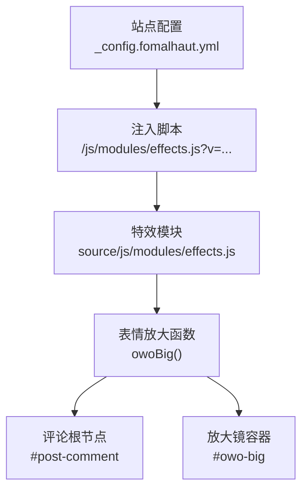
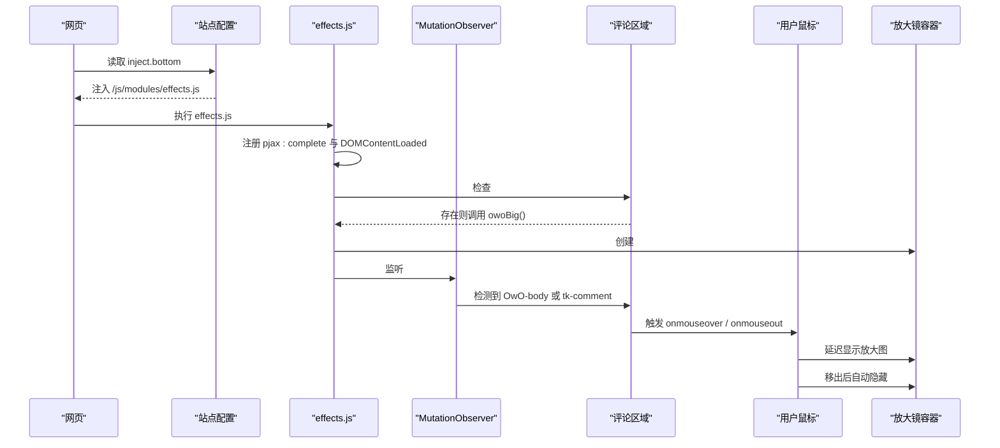
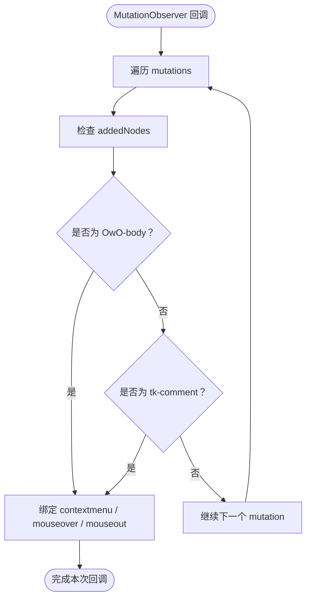
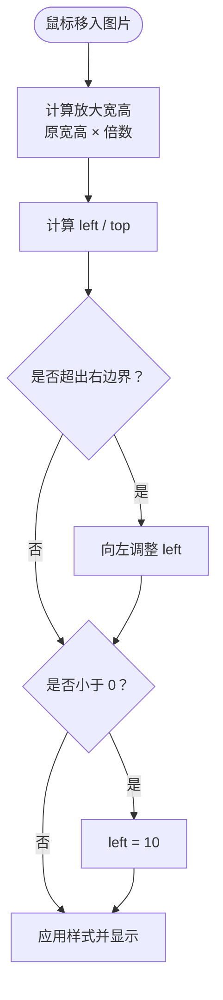
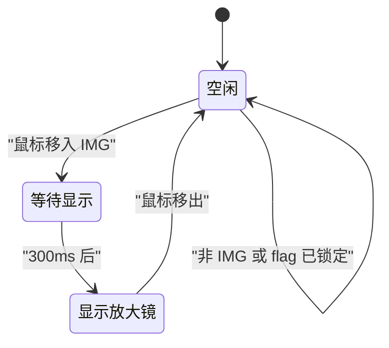
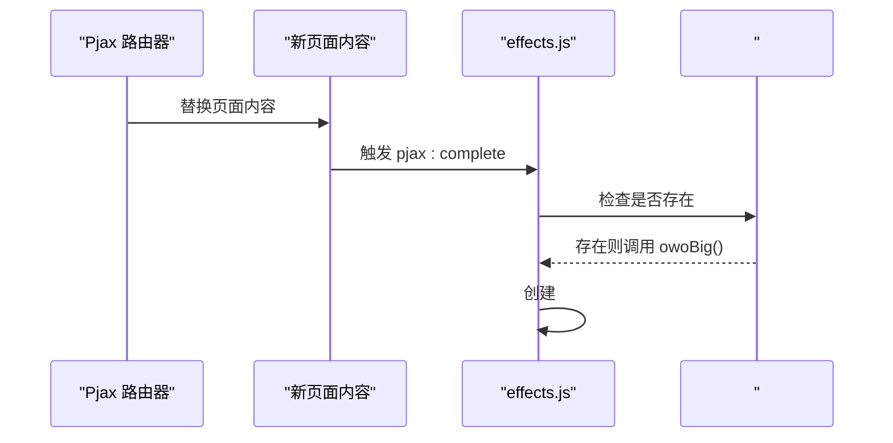
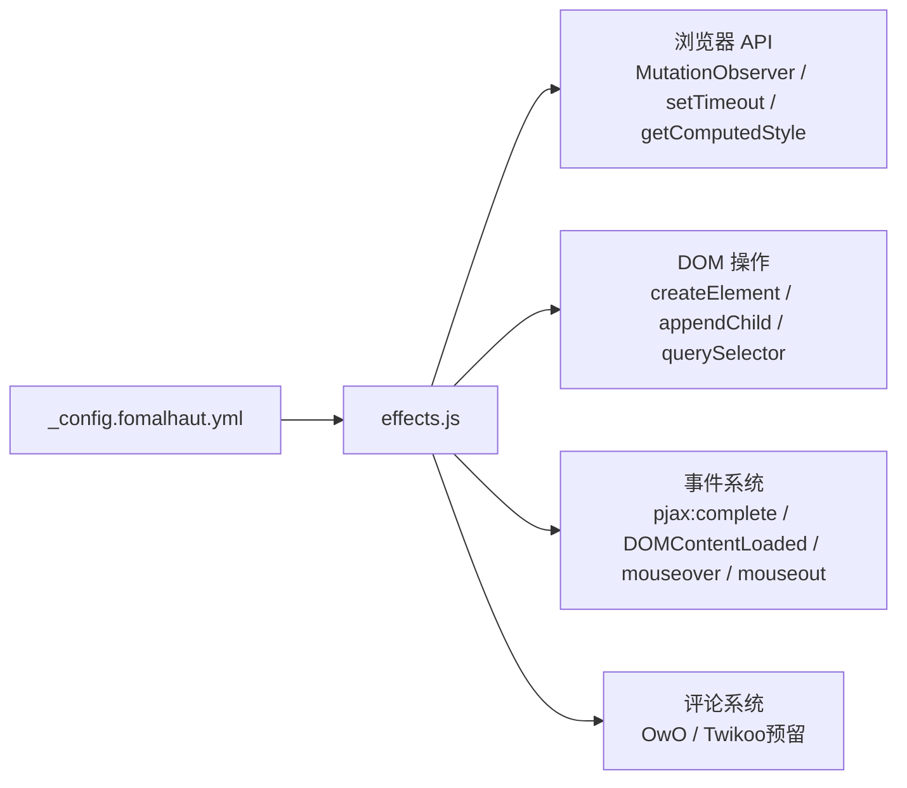

# 表情放大功能

<cite>
**本文引用的文件**   
- [effects.js](file://source/js/modules/effects.js)
- [_config.fomalhaut.yml](file://_config.fomalhaut.yml)
</cite>

## 目录
1. [简介](#简介)
2. [项目结构定位](#项目结构定位)
3. [核心组件与职责](#核心组件与职责)
4. [架构总览](#架构总览)
5. [详细实现分析](#详细实现分析)
6. [依赖关系分析](#依赖关系分析)
7. [性能与优化建议](#性能与优化建议)
8. [故障排查指南](#故障排查指南)
9. [结论](#结论)

## 简介
本文件全面文档化博客中的“表情放大”功能。该功能用于在评论区域中，当鼠标悬停在表情图片上时，延迟显示一个放大的预览容器，帮助用户更清楚地查看小尺寸表情。其核心机制包括：
- 使用 `MutationObserver` 监听评论区域的动态节点变化；
- 创建并管理一个全局放大镜容器；
- 基于鼠标事件实现悬停检测、延迟显示和自动隐藏；
- 根据屏幕宽度进行边界检测与定位修正；
- 通过主题配置注入脚本，并在 Pjax 路由切换后重新初始化。

## 项目结构定位
表情放大功能位于主题的装饰特效模块中，由站点配置文件在页面底部以延迟加载方式引入。

**图表来源**
- [_config.fomalhaut.yml:1351](file://_config.fomalhaut.yml#L1351)
- [effects.js:130-135](file://source/js/modules/effects.js#L130-L135)
- [effects.js:138-189](file://source/js/modules/effects.js#L138-L189)

**章节来源**
- [_config.fomalhaut.yml:1351](file://_config.fomalhaut.yml#L1351)
- [effects.js:1-19](file://source/js/modules/effects.js#L1-L19)

## 核心组件与职责
| 组件 | 职责 | 关键行为 |
|---|---|---|
| 站点配置 | 决定表情放大脚本是否被加载 | 在 `inject.bottom` 列表中引入 `effects.js` |
| 特效模块 | 提供星空与表情放大等视觉特效 | 暴露全局函数，供模板或外部脚本调用 |
| 表情放大函数 | 初始化评论区监听、创建放大镜、绑定交互 | 注册 `pjax:complete` 与 `DOMContentLoaded` 钩子 |
| 评论根节点 | 作为 `MutationObserver` 的监听目标 | 要求存在 `id="post-comment"` |
| 放大镜容器 | 显示放大后的表情图片 | 固定定位、宽高按倍数计算、左右边界检测 |
| 观察者回调 | 响应评论区新增节点 | 识别 OwO 表情面板或评论项，绑定鼠标事件 |

**章节来源**
- [effects.js:1-19](file://source/js/modules/effects.js#L1-L19)
- [effects.js:130-189](file://source/js/modules/effects.js#L130-L189)

## 架构总览
表情放大功能的运行流程如下：

**图表来源**
- [_config.fomalhaut.yml:1351](file://_config.fomalhaut.yml#L1351)
- [effects.js:130-135](file://source/js/modules/effects.js#L130-L135)
- [effects.js:138-189](file://source/js/modules/effects.js#L138-L189)

## 详细实现分析

### MutationObserver 的使用
表情放大功能通过 `MutationObserver` 监听评论区域的动态内容变化，确保即使评论是异步加载或通过第三方评论系统渲染，也能正确绑定交互逻辑。

- **监听目标**：`document.getElementById('post-comment')`
- **监听选项**：`subtree: true, childList: true`
- **变更检测逻辑**：
  - 遍历新增节点数组；
  - 若新增节点长度为 2 且第二个节点类名为 `OwO-body`，则将其作为表情面板主体；
  - 代码中预留了针对 Twikoo 评论的分支：若新增节点长度为 1 且类名为 `tk-comment`，也可启用评论内表情放大（当前为注释状态）；
  - 其他情况直接跳过。

**图表来源**
- [effects.js:151-189](file://source/js/modules/effects.js#L151-L189)

**章节来源**
- [effects.js:151-189](file://source/js/modules/effects.js#L151-L189)

### 放大镜容器的创建与管理
放大镜容器是一个全局唯一的 `div` 元素，ID 为 `owo-big`，在首次初始化时创建并插入到 `body` 末尾。

- **创建时机**：`owoBig()` 函数执行时；
- **容器 ID**：`owo-big`；
- **插入位置**：`document.querySelector('body').appendChild(div)`；
- **样式设置**：通过 `style.cssText` 动态设置 `display`、`height`、`width`、`left`、`top`；
- **内容更新**：将当前悬停的图片 `src` 插入到容器中。

需要注意：当前实现每次调用 `owoBig()` 都会再次创建容器，若多次初始化可能导致重复节点。建议在后续优化中加入“已存在则复用”的判断。

**章节来源**
- [effects.js:138-148](file://source/js/modules/effects.js#L138-L148)
- [effects.js:177-179](file://source/js/modules/effects.js#L177-L179)

### 定位算法与边界检测
放大镜的定位基于鼠标事件坐标和目标图片尺寸计算，并进行屏幕边界修正。

- **基础定位**：
  - `left = (e.x - e.offsetX) - (width - e.path[0].clientWidth) / 2`
  - `top = e.y - e.offsetY`
- **右边缘检测**：若 `left + width > body.clientWidth`，则向左偏移超出部分并额外留 10px 边距；
- **左边缘检测**：若 `left < 0`，则强制设为 10px；
- **垂直方向**：未做顶部或底部边界检测，可能在小屏设备上出现溢出。

**图表来源**
- [effects.js:168-177](file://source/js/modules/effects.js#L168-L177)

**章节来源**
- [effects.js:168-177](file://source/js/modules/effects.js#L168-L177)

### 鼠标交互逻辑
表情放大功能通过原生 DOM 事件处理鼠标悬停行为。

- **节流控制**：使用 `flag` 变量防止重复触发；
- **目标过滤**：仅当 `e.target.tagName == 'IMG'` 时处理；
- **延迟显示**：使用 `setTimeout` 延迟 300ms 显示放大镜，避免误触；
- **自动隐藏**：在 `onmouseout` 事件中隐藏容器、重置 `flag`、清除定时器；
- **移动端适配**：当 `document.body.clientWidth <= 768` 时禁用右键菜单，避免长按弹出系统菜单干扰体验。

**图表来源**
- [effects.js:139-184](file://source/js/modules/effects.js#L139-L184)

**章节来源**
- [effects.js:139-184](file://source/js/modules/effects.js#L139-L184)

### 图片放大倍数的计算方法
当前实现中，放大倍数硬编码为常量 `m = 3`，即放大镜宽高均为原图宽高的 3 倍。

- **优点**：简单直观，适合大多数小表情；
- **缺点**：缺乏可配置性，无法根据图片尺寸或用户偏好调整；
- **潜在问题**：对于较大图片，3 倍放大可能导致容器过大，影响布局。

建议未来扩展为可配置参数，例如：
- 最小尺寸阈值：小于某尺寸的图才启用放大；
- 最大放大倍数：限制最大缩放比例；
- 自适应倍数：根据图片原始尺寸动态计算。

**章节来源**
- [effects.js:139-141](file://source/js/modules/effects.js#L139-L141)

### 功能开关配置与自定义样式
表情放大功能通过站点配置文件注入，属于可选装饰特效。

- **注入位置**：`_config.fomalhaut.yml` 的 `inject.bottom` 列表；
- **脚本路径**：`/js/modules/effects.js?v=20261010-snow1`；
- **加载方式**：`<script defer>`，延迟加载不影响首屏；
- **关闭方法**：从 `inject.bottom` 中移除该行即可禁用整个特效模块；
- **样式定制**：可通过 CSS 覆盖 `#owo-big` 的样式，例如调整边框、阴影、圆角、背景色等。

示例定制思路（不修改源码）：
- 添加边框：`border: 1px solid var(--theme-color);`
- 添加阴影：`box-shadow: 0 4px 12px rgba(0,0,0,0.15);`
- 圆角：`border-radius: 8px;`
- 背景：`background: var(--card-bg);`

**章节来源**
- [_config.fomalhaut.yml:1351](file://_config.fomalhaut.yml#L1351)
- [effects.js:143-148](file://source/js/modules/effects.js#L143-L148)

### Pjax 路由切换后的重新初始化
由于站点使用 Pjax 进行无刷新路由切换，表情放大功能需要在页面内容更新后重新初始化。

- **初始化钩子**：
  - `pjax:complete`：Pjax 请求完成后触发；
  - `DOMContentLoaded`：初始页面加载完成时触发；
- **初始化条件**：仅当 `document.getElementById('post-comment')` 存在时才调用 `owoBig()`；
- **局限性**：若同一页面多次触发初始化，会重复创建 `#owo-big` 容器，需后续优化。

**图表来源**
- [effects.js:130-135](file://source/js/modules/effects.js#L130-L135)
- [effects.js:138-189](file://source/js/modules/effects.js#L138-L189)

**章节来源**
- [effects.js:130-135](file://source/js/modules/effects.js#L130-L135)
- [effects.js:138-189](file://source/js/modules/effects.js#L138-L189)

## 依赖关系分析
表情放大功能的依赖关系如下：

**图表来源**
- [_config.fomalhaut.yml:1351](file://_config.fomalhaut.yml#L1351)
- [effects.js:130-189](file://source/js/modules/effects.js#L130-L189)

**章节来源**
- [_config.fomalhaut.yml:1351](file://_config.fomalhaut.yml#L1351)
- [effects.js:130-189](file://source/js/modules/effects.js#L130-L189)

## 性能与优化建议
当前实现较为简洁，但在性能和健壮性方面有改进空间：

| 方面 | 现状 | 建议 |
|---|---|---|
| 容器创建 | 每次初始化都创建新容器 | 增加“已存在则复用”判断 |
| 事件绑定 | 每个新增节点都绑定新事件 | 使用事件委托减少绑定次数 |
| 节流机制 | 仅用 `flag` 防抖 | 结合 `requestAnimationFrame` 或防抖函数 |
| 边界检测 | 仅水平方向检测 | 增加垂直方向检测，避免溢出视口 |
| 放大倍数 | 硬编码为 3 | 改为可配置参数 |
| Pjax 初始化 | 可能重复初始化 | 增加初始化标记，避免重复执行 |
| 移动端支持 | 禁用右键但未禁用 hover | 考虑触摸设备上的点击放大 |

推荐优化步骤：
1. 封装 `initOwoBig()` 函数，内部判断是否已初始化；
2. 使用事件委托统一绑定 `mouseover` / `mouseout`；
3. 将放大倍数、延迟时间、边界余量等提取为配置对象；
4. 增加 `visibilitychange` 监听，页面不可见时暂停定时器；
5. 对超大图片进行尺寸限制，避免放大镜过大。

**章节来源**
- [effects.js:138-189](file://source/js/modules/effects.js#L138-L189)

## 故障排查指南
| 现象 | 可能原因 | 排查方法 | 解决方案 |
|---|---|---|---|
| 表情不放大 | 评论根节点不存在 | 检查控制台是否有 `post-comment` | 确认评论系统已加载 |
| 放大镜不显示 | 鼠标未悬停在图片上 | 检查 `e.target.tagName` | 确认悬停目标是 `IMG` |
| 放大镜位置错误 | 屏幕宽度变化未重算 | 调整窗口大小后重试 | 增加 `resize` 监听 |
| 多次初始化报错 | 重复创建 `#owo-big` | 检查 DOM 中是否有多个同名容器 | 增加唯一性检查 |
| 移动端长按弹出菜单 | 未禁用右键 | 检查 `clientWidth` | 确认移动端条件生效 |
| Pjax 后失效 | 未重新初始化 | 检查 `pjax:complete` 是否触发 | 确认钩子正常注册 |

**章节来源**
- [effects.js:130-189](file://source/js/modules/effects.js#L130-L189)

## 结论
表情放大功能是一个轻量级的用户体验增强特性，通过 `MutationObserver` 动态监听评论区域，结合鼠标事件实现延迟显示的放大镜效果。其实现简洁、侵入性低，适合小型博客场景。

主要优势：
- 无需第三方库，纯原生实现；
- 与 Pjax 兼容，支持无刷新路由；
- 易于通过配置开启或关闭；
- 支持 OwO 表情面板，预留 Twikoo 扩展点。

待改进方向：
- 提升健壮性，避免重复初始化；
- 增强移动端适配；
- 提供更灵活的配置选项；
- 优化性能，减少不必要的 DOM 操作。

整体而言，该功能在当前项目中表现稳定，适合作为基础交互能力保留，并在后续迭代中逐步完善。