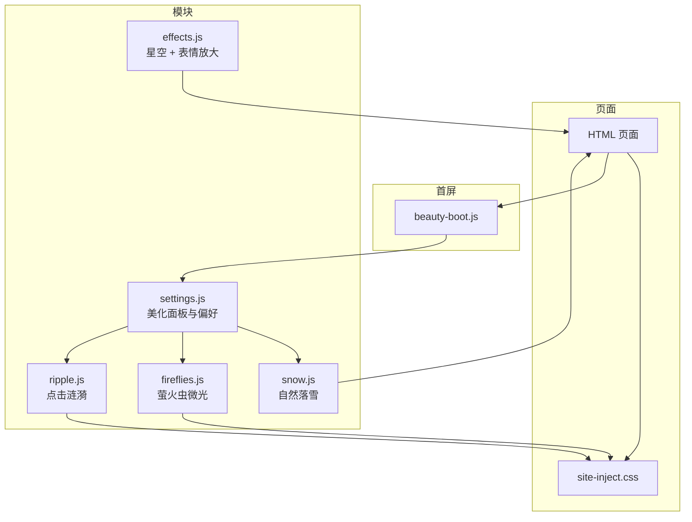
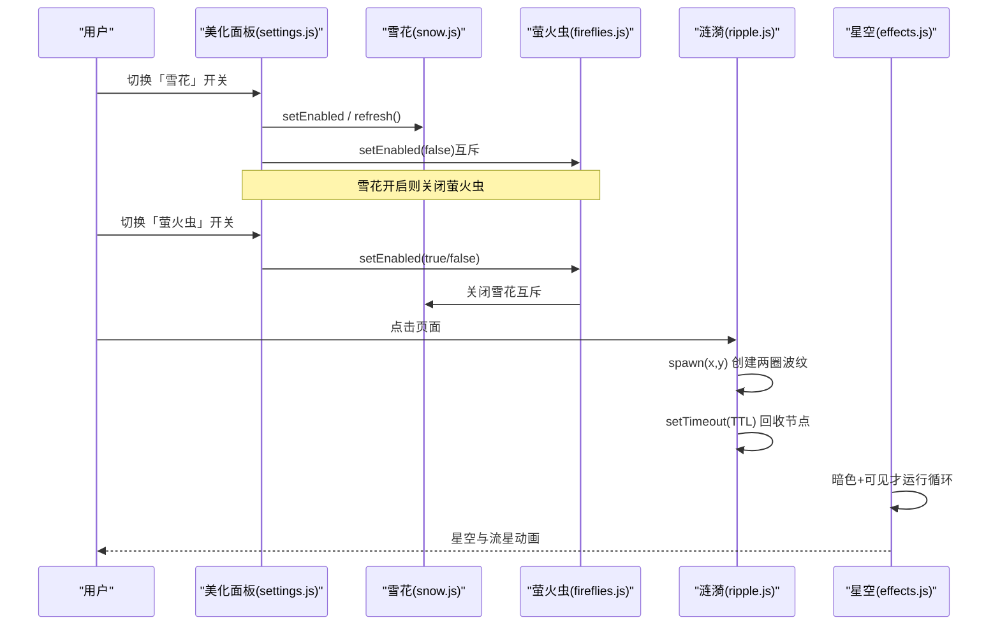
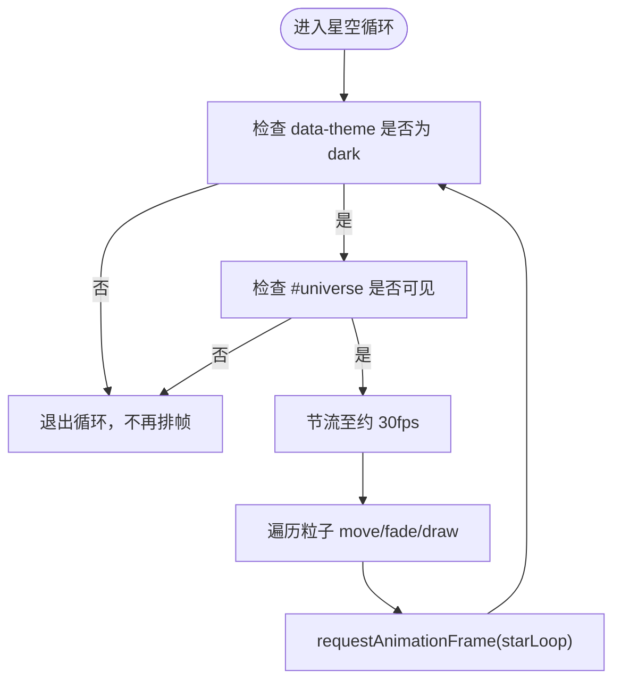
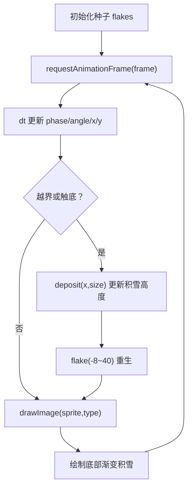
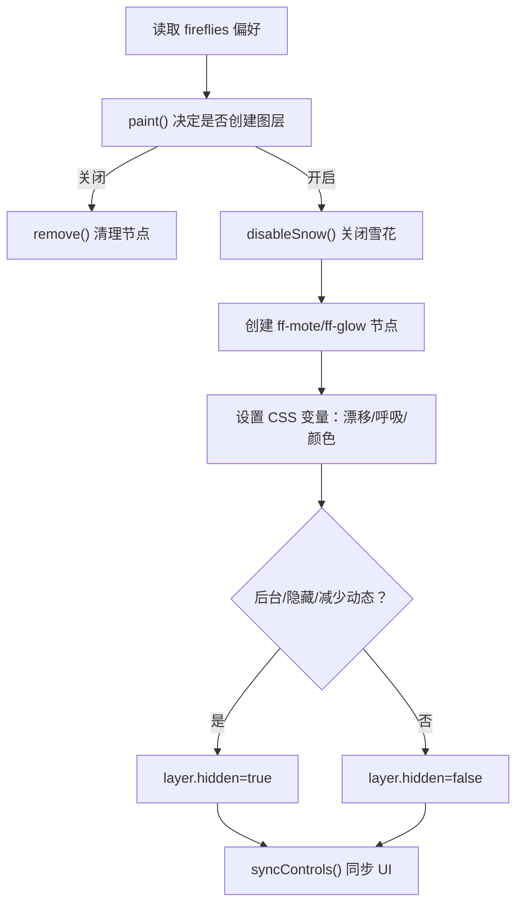
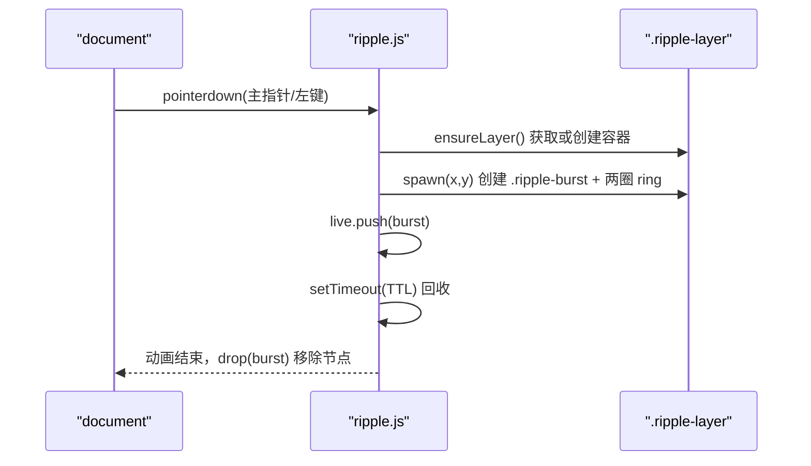
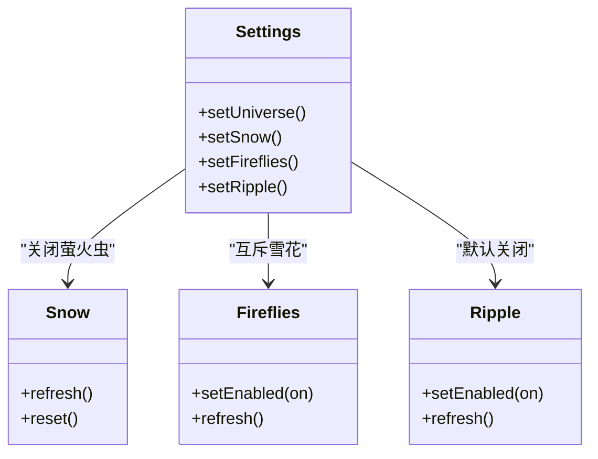
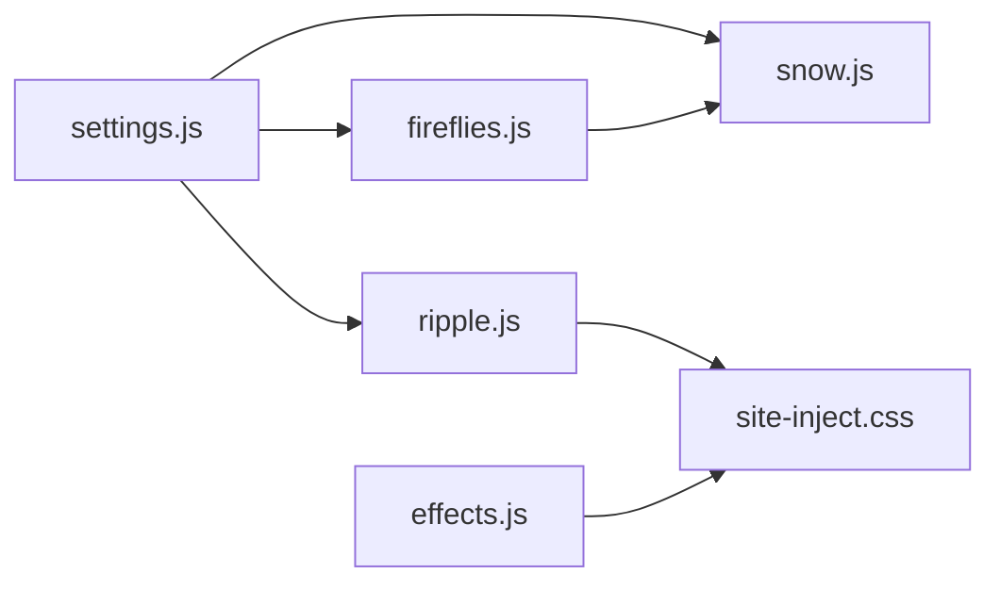

# 视觉效果与动画系统

<cite>
**本文引用的文件**   
- [source/js/modules/effects.js](file://source/js/modules/effects.js)
- [source/js/modules/snow.js](file://source/js/modules/snow.js)
- [source/js/modules/fireflies.js](file://source/js/modules/fireflies.js)
- [source/js/modules/ripple.js](file://source/js/modules/ripple.js)
- [source/css/site-inject.css](file://source/css/site-inject.css)
- [source/js/modules/settings.js](file://source/js/modules/settings.js)
- [source/js/inject/beauty-boot.js](file://source/js/inject/beauty-boot.js)
- [docs/plans/2026-10-10-snowfall.md](file://docs/plans/2026-10-10-snowfall.md)
- [docs/plans/2026-10-10-fireflies.md](file://docs/plans/2026-10-10-fireflies.md)
- [docs/plans/2026-10-10-beauty-feature-switches.md](file://docs/plans/2026-10-10-beauty-feature-switches.md)
</cite>

## 目录
1. [引言](#引言)
2. [项目结构](#项目结构)
3. [核心组件](#核心组件)
4. [架构总览](#架构总览)
5. [详细组件分析](#详细组件分析)
6. [依赖关系分析](#依赖关系分析)
7. [性能考量](#性能考量)
8. [故障排查指南](#故障排查指南)
9. [结论](#结论)
10. [附录：自定义视觉效果开发指南](#附录自定义视觉效果开发指南)

## 引言
本文件系统性地文档化博客的视觉效果与动画体系，重点覆盖以下能力：
- 星空背景效果：Canvas 绘制、粒子模型、可见性与帧率控制。
- 雪花飘落动画：预渲染雪片、时间驱动、底部薄积雪、视口适配与降级策略。
- 萤火虫微光效果：纯 CSS 呼吸与慢漂、互斥开关、无常驻循环。
- 点击涟漪效果：触发机制、节点生命周期与回收策略。
- 美化面板特效开关：雪花、星空、萤火虫、涟漪等开关的行为与降级处理。
- 自定义视觉效果开发规范：可插拔、可观测、可回收、可降级的通用实践。

## 项目结构
视觉效果相关代码主要分布在站点注入层与模块层：
- 模块层：`source/js/modules/*` 提供独立、幂等的视觉功能。
- 样式层：`source/css/site-inject.css` 集中承载站点级视觉样式与交互反馈。
- 配置与首屏：`source/js/inject/beauty-boot.js` 在首屏前写入主题色、字体、透明度等关键变量，避免闪烁。
- 设置面板：`source/js/modules/settings.js` 负责持久化偏好并联动各模块。
- 设计计划：`docs/plans/*` 记录雪花、萤火虫、美化开关的设计目标与验收结果。

**图表来源**
- [source/js/inject/beauty-boot.js:13-79](file://source/js/inject/beauty-boot.js#L13-L79)
- [source/css/site-inject.css:665-688](file://source/css/site-inject.css#L665-L688)
- [source/js/modules/settings.js:114-137](file://source/js/modules/settings.js#L114-L137)

**章节来源**
- [source/js/inject/beauty-boot.js:1-80](file://source/js/inject/beauty-boot.js#L1-L80)
- [source/css/site-inject.css:1-40](file://source/css/site-inject.css#L1-L40)
- [source/js/modules/settings.js:1-78](file://source/js/modules/settings.js#L1-L78)

## 核心组件
- 星空背景：由 `effects.js` 中的 `dark()` 函数实现，使用 Canvas 绘制星星与流星，并在暗色模式且画布可见时运行；不可见或浅色主题时退出循环，避免空转。
- 雪花飘落：由 `snow.js` 独立管理，预渲染两张六臂雪片图，按时间步长更新位置，底部维护有限高度的积雪高度图；支持 DPR、resize、PJAX、减少动态效果等场景。
- 萤火虫微光：由 `fireflies.js` 生成少量 DOM 节点，配合 CSS 动画实现呼吸与慢漂；默认关闭，开启后自动关闭雪花，二者互斥。
- 点击涟漪：由 `ripple.js` 监听指针按下事件，按需创建两圈同心波纹，动画结束后统一回收；默认关闭，受“减少动态效果”影响暂停。
- 美化面板：由 `settings.js` 管理所有视觉开关与持久化键值，并与各模块 API 联动。

**章节来源**
- [source/js/modules/effects.js:24-125](file://source/js/modules/effects.js#L24-L125)
- [source/js/modules/snow.js:1-179](file://source/js/modules/snow.js#L1-L179)
- [source/js/modules/fireflies.js:1-89](file://source/js/modules/fireflies.js#L1-L89)
- [source/js/modules/ripple.js:1-122](file://source/js/modules/ripple.js#L1-L122)
- [source/js/modules/settings.js:365-401](file://source/js/modules/settings.js#L365-L401)

## 架构总览
整体采用“轻量模块 + 样式注入 + 设置面板”的分层架构：
- 模块层各自维护状态、DOM 与事件，对外暴露 `setEnabled/refresh/syncControls` 等稳定接口。
- 样式层通过 `site-inject.css` 集中定义视觉表现，避免分散到主题源码。
- 设置面板作为用户入口，读写 `localStorage`，并调用模块 API 同步 UI 与行为。
- 首屏脚本 `beauty-boot.js` 提前写入关键 CSS 变量，消除刷新时的闪烁。

**图表来源**
- [source/js/modules/settings.js:380-401](file://source/js/modules/settings.js#L380-L401)
- [source/js/modules/fireflies.js:32-38](file://source/js/modules/fireflies.js#L32-L38)
- [source/js/modules/ripple.js:52-70](file://source/js/modules/ripple.js#L52-L70)
- [source/js/modules/effects.js:92-121](file://source/js/modules/effects.js#L92-L121)

## 详细组件分析

### 星空背景效果
- 实现要点
  - 使用 Canvas 绘制静态星点与随机流星，颜色与大小随机化。
  - 引入可见性判断：仅当 `data-theme="dark"` 且 `#universe` 计算样式为显示时才运行。
  - 帧率限制：将重绘间隔控制在约 30fps，降低高刷设备上的空转压力。
  - 生命周期：通过 MutationObserver 监听主题、类名与样式变化，结合 resize 与 PJAX 事件重新拉起循环。
- 性能优化
  - 不可见即退出循环，不再排队下一帧。
  - 星星移动缓慢，30fps 肉眼无明显差异。
  - 仅在暗色模式下启用，浅色常驻状态下不消耗 GPU。

**图表来源**
- [source/js/modules/effects.js:92-121](file://source/js/modules/effects.js#L92-L121)

**章节来源**
- [source/js/modules/effects.js:24-125](file://source/js/modules/effects.js#L24-L125)

### 雪花飘落动画
- 实现要点
  - 预渲染两张雪片精灵图：细晶六臂与分枝六臂，按 size/type 选择贴图，避免每帧重复几何绘制。
  - 时间驱动：以 dt 累加相位与角度，速度随尺寸分层，横向摇摆增加自然感。
  - 底部积雪：维护宽度方向的高度数组，落到底部时按高斯分布沉积，最高厚度随视口高度限定。
  - 视口适配：DPR 缩放、resize 重绑、PJAX 重建、MutationObserver 监听主题与样式变化。
- 降级策略
  - 移动端、深色主题、后台标签页、减少动态效果偏好下暂停。
  - 关闭雪花时清空粒子与积雪，释放 Canvas。

**图表来源**
- [source/js/modules/snow.js:93-148](file://source/js/modules/snow.js#L93-L148)

**章节来源**
- [source/js/modules/snow.js:1-179](file://source/js/modules/snow.js#L1-L179)
- [docs/plans/2026-10-10-snowfall.md:1-30](file://docs/plans/2026-10-10-snowfall.md#L1-L30)

### 萤火虫微光效果
- 实现要点
  - 纯 CSS 动画：每个光点包含 `.ff-mote` 与 `.ff-glow`，通过 CSS 变量控制漂移时长、延迟、呼吸时长、尺寸与颜色。
  - 低密度：桌面 14 个、<=600px 8 个，位于 body 下方，pointer-events:none，不参与命中测试。
  - 互斥逻辑：开启萤火虫自动关闭雪花；开启雪花自动关闭萤火虫；UI 勾选与 localStorage 同步。
  - 生命周期：后台、pagehide、减少动态偏好暂停；恢复后继续；关闭时删除图层。
- 性能特征
  - 无 Canvas、无 requestAnimationFrame、无定时器轮询。
  - 节点数量固定，CSS 动画由浏览器合成层执行。

**图表来源**
- [source/js/modules/fireflies.js:39-67](file://source/js/modules/fireflies.js#L39-L67)

**章节来源**
- [source/js/modules/fireflies.js:1-89](file://source/js/modules/fireflies.js#L1-L89)
- [docs/plans/2026-10-10-fireflies.md:1-24](file://docs/plans/2026-10-10-fireflies.md#L1-L24)

### 点击涟漪效果
- 触发机制
  - 监听 pointerdown，仅响应主指针与左键，取 clientX/clientY 直接定位。
  - 每次点击创建一个 `.ripple-burst`，内含两个 `<i class="ripple-ring">`，第二环错开 60ms。
- 节点回收
  - 同屏最多保留 MAX_LIVE=6 个，超出则丢弃最老的一个。
  - 每个 burst 带 TTL=700ms 超时兜底，动画结束后连壳一起移除。
- 降级策略
  - 未开启或系统偏好减少动态效果时，不绑定 pointerdown 监听，也不创建节点。
  - 样式层 z-index 低于正文与工具条，不影响交互。

**图表来源**
- [source/js/modules/ripple.js:52-70](file://source/js/modules/ripple.js#L52-L70)
- [source/css/site-inject.css:677-688](file://source/css/site-inject.css#L677-L688)

**章节来源**
- [source/js/modules/ripple.js:1-122](file://source/js/modules/ripple.js#L1-L122)
- [source/css/site-inject.css:677-688](file://source/css/site-inject.css#L677-L688)

### 美化面板中的特效开关
- 星空背景：`setUniverse()` 控制 `#universe` 的 display 与 localStorage 键 `universe`。
- 雪花：`setSnow()` 控制 `#snow` 的 display，联动 `FOMAL_SNOW.refresh()`，并关闭萤火虫。
- 萤火虫：`setFireflies()` 调用 `FOMAL_FIREFLIES.setEnabled()`，开启时关闭雪花。
- 涟漪：`setRipple()` 调用 `FOMAL_RIPPLE.setEnabled()`，默认关闭，只有显式存过 `'1'` 才算开。
- 首屏一致性：`beauty-boot.js` 在 head 中提前写入主题色、透明度、侧栏等变量，避免刷新闪烁。

**图表来源**
- [source/js/modules/settings.js:365-401](file://source/js/modules/settings.js#L365-L401)
- [source/js/modules/settings.js:328-334](file://source/js/modules/settings.js#L328-L334)
- [source/js/inject/beauty-boot.js:23-51](file://source/js/inject/beauty-boot.js#L23-L51)

**章节来源**
- [source/js/modules/settings.js:365-401](file://source/js/modules/settings.js#L365-L401)
- [source/js/modules/settings.js:328-334](file://source/js/modules/settings.js#L328-L334)
- [source/js/inject/beauty-boot.js:1-80](file://source/js/inject/beauty-boot.js#L1-L80)
- [docs/plans/2026-10-10-beauty-feature-switches.md:1-31](file://docs/plans/2026-10-10-beauty-feature-switches.md#L1-L31)

## 依赖关系分析
- 模块间耦合
  - `settings.js` 作为控制面板，依赖各模块的公开 API，但不反向被模块依赖。
  - `fireflies.js` 与 `snow.js` 存在双向互斥：开启一方会关闭另一方。
  - `ripple.js` 与样式层强耦合，但逻辑上独立，不依赖其他模块。
- 外部依赖
  - 均依赖原生 Web API：Canvas、requestAnimationFrame、matchMedia、MutationObserver、localStorage。
  - 样式层依赖 CSS 变量与动画，不引入第三方库。
- 潜在风险
  - 若 `localStorage` 不可用，模块内部有 fallback 或忽略错误。
  - 若 Canvas 不支持，雪花与星空会安全降级（不抛错）。

**图表来源**
- [source/js/modules/settings.js:380-401](file://source/js/modules/settings.js#L380-L401)
- [source/js/modules/fireflies.js:32-38](file://source/js/modules/fireflies.js#L32-L38)
- [source/css/site-inject.css:677-688](file://source/css/site-inject.css#L677-L688)

**章节来源**
- [source/js/modules/settings.js:365-401](file://source/js/modules/settings.js#L365-L401)
- [source/js/modules/fireflies.js:1-89](file://source/js/modules/fireflies.js#L1-L89)
- [source/js/modules/ripple.js:1-122](file://source/js/modules/ripple.js#L1-L122)
- [source/js/modules/effects.js:24-125](file://source/js/modules/effects.js#L24-L125)

## 性能考量
- 星空背景
  - 仅暗色且可见时运行，不可见即退出循环。
  - 帧率限制至约 30fps，降低高刷设备开销。
- 雪花飘落
  - 预渲染精灵图，避免每帧几何计算。
  - 时间驱动而非帧数驱动，dt 上限 50ms，暂停恢复不补跑。
  - 底部积雪高度有限，不挡阅读。
- 萤火虫微光
  - 纯 CSS 动画，无 RAF、Canvas、定时器轮询。
  - 节点数量固定，后台/隐藏/减少动态偏好暂停。
- 点击涟漪
  - 按需创建节点，TTL 回收，同屏上限控制。
  - 关闭开关时不绑定监听，零开销。
- 首屏一致性
  - `beauty-boot.js` 提前写入主题色、透明度、侧栏等变量，避免闪烁。

[本节为通用性能讨论，不直接分析具体文件]

## 故障排查指南
- 星空不显示
  - 检查当前主题是否为暗色，以及 `#universe` 是否被设置为 `display:none`。
  - 确认 MutationObserver 能监听到 `data-theme`、`class`、`style` 变化。
- 雪花不飘落
  - 检查 `localStorage.snow` 是否为 `block`。
  - 确认非移动端、非深色主题、非后台标签页、未开启减少动态效果。
  - 查看 Canvas 是否存在且可获取 2d 上下文。
- 萤火虫不出现
  - 检查 `localStorage.fireflies` 是否为 `'1'`。
  - 确认未同时开启雪花（互斥）。
  - 检查 body 是否已挂载，节点是否被插入。
- 涟漪无效
  - 检查 `localStorage.rippleOn` 是否为 `'1'`。
  - 确认系统未开启减少动态效果。
  - 检查 `.ripple-layer` 是否已创建且未被移除。

**章节来源**
- [source/js/modules/effects.js:92-121](file://source/js/modules/effects.js#L92-L121)
- [source/js/modules/snow.js:30-43](file://source/js/modules/snow.js#L30-L43)
- [source/js/modules/fireflies.js:21-38](file://source/js/modules/fireflies.js#L21-L38)
- [source/js/modules/ripple.js:19-24](file://source/js/modules/ripple.js#L19-L24)

## 结论
该视觉效果与动画系统以模块化、可降级、可观测为核心原则：
- 星空与雪花基于 Canvas，但严格控制运行条件与帧率。
- 萤火虫与涟漪优先使用 CSS 与 DOM，避免常驻循环。
- 美化面板统一管理偏好，确保多模块间的互斥与一致性。
- 首屏脚本保障关键变量提前生效，提升用户体验。

[本节为总结性内容，不直接分析具体文件]

## 附录：自定义视觉效果开发指南
- 设计原则
  - 幂等：模块加载多次只生效一次，导出 `refresh/setEnabled/syncControls`。
  - 可观测：监听 visibilitychange、pjax:complete、resize、storage、prefers-reduced-motion。
  - 可回收：动画结束后及时移除节点或停止循环，避免内存泄漏。
  - 可降级：在缺少 API 或用户偏好禁止时优雅降级。
- 推荐实现路径
  - 优先使用 CSS 动画与合成层属性（transform、opacity），避免布局抖动。
  - 如需 Canvas，预渲染精灵图，限制粒子数量与 DPR，节流帧率。
  - 通过 `localStorage` 存储偏好，并提供全局 reset 恢复默认。
  - 与现有模块保持互斥约定（如雪花与萤火虫），避免冲突。
- 最佳实践
  - 在 `source/js/modules/*` 新增独立模块，在 `source/css/site-inject.css` 添加样式。
  - 在 `settings.js` 中添加开关与持久化逻辑，调用模块 API。
  - 在 `beauty-boot.js` 中提前写入首屏关键变量，避免闪烁。
  - 编写测试用例，覆盖默认值、开关、互斥、降级与生命周期。

[本节为通用指导，不直接分析具体文件]