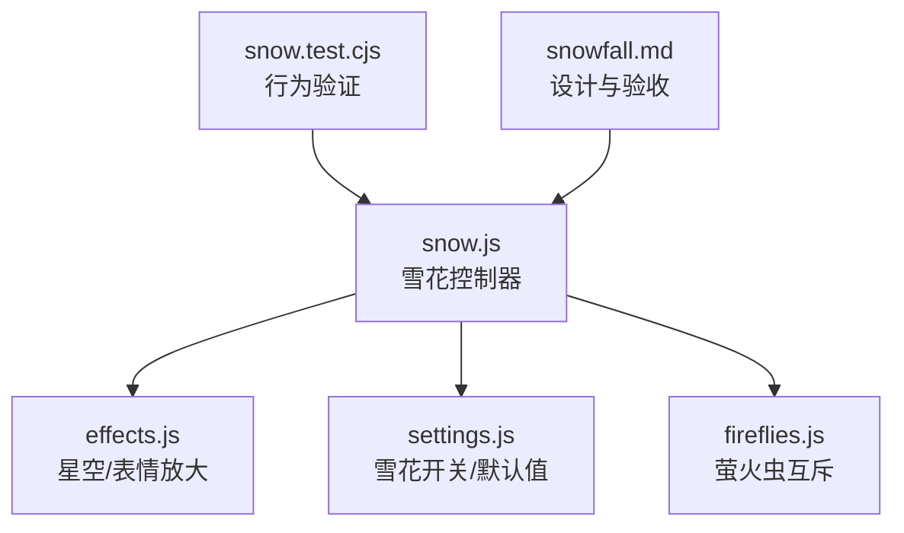
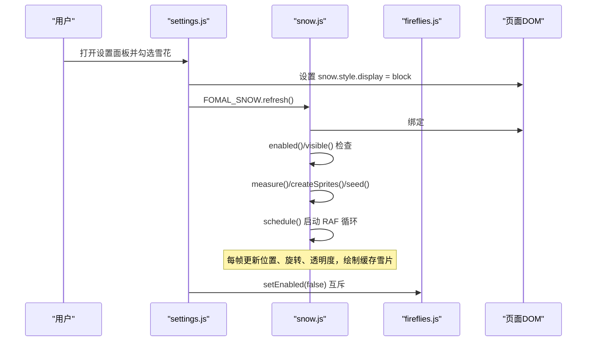
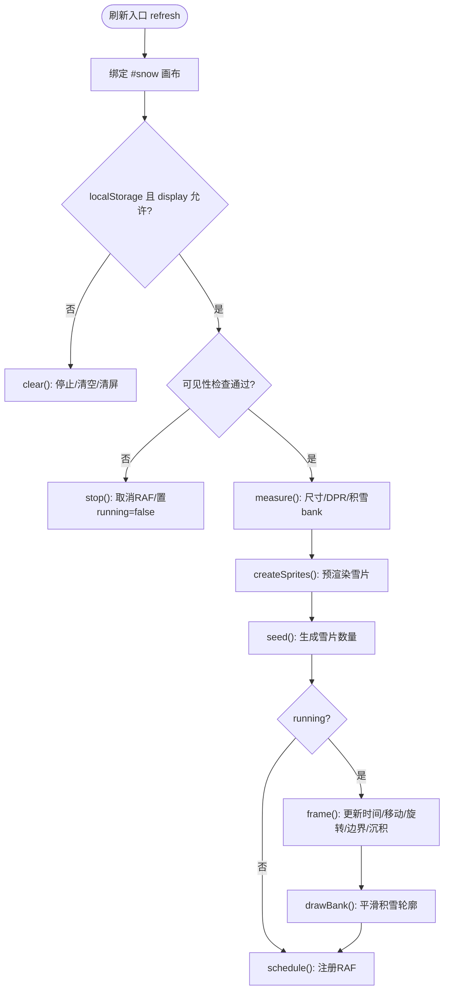
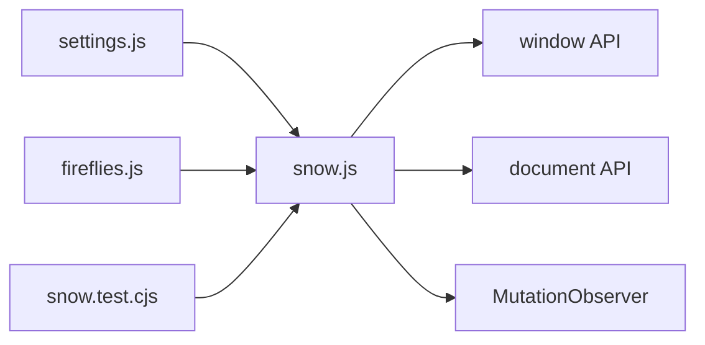

# 雪花飘落动画

<cite>
**本文引用的文件**   
- [source/js/modules/snow.js](file://source/js/modules/snow.js)
- [source/js/modules/effects.js](file://source/js/modules/effects.js)
- [source/js/modules/fireflies.js](file://source/js/modules/fireflies.js)
- [source/js/modules/settings.js](file://source/js/modules/settings.js)
- [tools/tests/snow.test.cjs](file://tools/tests/snow.test.cjs)
- [docs/plans/2026-10-10-snowfall.md](file://docs/plans/2026-10-10-snowfall.md)
</cite>

## 目录
1. [简介](#简介)
2. [项目结构](#项目结构)
3. [核心组件](#核心组件)
4. [架构总览](#架构总览)
5. [详细组件分析](#详细组件分析)
6. [依赖关系分析](#依赖关系分析)
7. [性能与优化](#性能与优化)
8. [主题集成与移动端适配](#主题集成与移动端适配)
9. [雪片密度与速度配置](#雪片密度与速度配置)
10. [故障排除指南](#故障排除指南)
11. [结论](#结论)

## 简介
本文件系统化文档化博客中的“雪花飘落动画”实现。该效果使用 Canvas 预渲染六臂雪片，按时间步长驱动下落、旋转和横向摇摆；底部维护有限厚度的积雪层；默认关闭，仅在桌面浅色主题下运行，并与萤火虫微光互斥。文档覆盖预渲染雪片、分层速度与视差感、边界检测与重置、帧率控制、DOM 复用、内存管理、主题系统对接、移动端策略、密度与速度调节方法，以及故障排查与性能监控建议。

## 项目结构
雪花动画由独立模块提供，不侵入原有装饰特效：
- 雪花控制器：`source/js/modules/snow.js`
- 旧装饰入口（保留星空与表情放大）：`source/js/modules/effects.js`
- 萤火虫互斥逻辑：`source/js/modules/fireflies.js`
- 设置面板与开关：`source/js/modules/settings.js`
- 回归测试与行为断言：`tools/tests/snow.test.cjs`
- 设计计划与验收说明：`docs/plans/2026-10-10-snowfall.md`

**图表来源**
- [source/js/modules/snow.js:1-179](file://source/js/modules/snow.js#L1-L179)
- [source/js/modules/effects.js:1-22](file://source/js/modules/effects.js#L1-L22)
- [source/js/modules/fireflies.js:1-90](file://source/js/modules/fireflies.js#L1-L90)
- [source/js/modules/settings.js:380-395](file://source/js/modules/settings.js#L380-L395)
- [tools/tests/snow.test.cjs:1-531](file://tools/tests/snow.test.cjs#L1-L531)
- [docs/plans/2026-10-10-snowfall.md:1-30](file://docs/plans/2026-10-10-snowfall.md#L1-L30)

**章节来源**
- [source/js/modules/snow.js:1-179](file://source/js/modules/snow.js#L1-L179)
- [source/js/modules/effects.js:1-22](file://source/js/modules/effects.js#L1-L22)
- [source/js/modules/fireflies.js:1-90](file://source/js/modules/fireflies.js#L1-L90)
- [source/js/modules/settings.js:380-395](file://source/js/modules/settings.js#L380-L395)
- [tools/tests/snow.test.cjs:1-531](file://tools/tests/snow.test.cjs#L1-L531)
- [docs/plans/2026-10-10-snowfall.md:1-30](file://docs/plans/2026-10-10-snowfall.md#L1-L30)

## 核心组件
- 雪花控制器 `FOMAL_SNOW`：暴露 `refresh`、`reset`、`inspect`，负责绑定画布、可见性判断、尺寸测量、雪片生成、帧循环、积雪绘制与状态清理。
- 设置模块：初始化默认值、读写 `localStorage`、切换雪花开关并联动萤火虫。
- 萤火虫模块：与雪花互斥，开启萤火虫时自动关闭雪花，反之亦然。
- 旧装饰模块：不再创建雪花动画循环，仅保留星空与表情放大。
- 测试套件：以 Node VM 模拟浏览器环境，断言雪花行为、帧公平性、暂停恢复、PJAX、DPR、不可用 API 安全等。

**章节来源**
- [source/js/modules/snow.js:158-179](file://source/js/modules/snow.js#L158-L179)
- [source/js/modules/settings.js:114-137](file://source/js/modules/settings.js#L114-L137)
- [source/js/modules/settings.js:380-395](file://source/js/modules/settings.js#L380-L395)
- [source/js/modules/fireflies.js:21-41](file://source/js/modules/fireflies.js#L21-L41)
- [source/js/modules/effects.js:21-22](file://source/js/modules/effects.js#L21-L22)
- [tools/tests/snow.test.cjs:220-239](file://tools/tests/snow.test.cjs#L220-L239)

## 架构总览
雪花动画采用“控制器 + 设置 + 互斥 + 测试”的解耦结构：
- 控制器通过 `MutationObserver` 监听主题、样式变化，通过事件监听 PJAX、resize、visibility 等生命周期。
- 设置模块统一写入 `localStorage`，并在 UI 切换时调用控制器刷新。
- 萤火虫模块在启用时禁用雪花，避免两个视觉层同时运行。
- 测试套件保证行为稳定，防止未来改动破坏帧公平性或资源释放。

**图表来源**
- [source/js/modules/settings.js:385-395](file://source/js/modules/settings.js#L385-L395)
- [source/js/modules/snow.js:20-43](file://source/js/modules/snow.js#L20-L43)
- [source/js/modules/snow.js:150-156](file://source/js/modules/snow.js#L150-L156)
- [source/js/modules/fireflies.js:32-41](file://source/js/modules/fireflies.js#L32-L41)

## 详细组件分析

### 雪花控制器（snow.js）
- 生命周期与可见性
  - 通过 `enabled()` 读取 `localStorage('snow') === 'block'` 并结合 inline `display` 判断是否允许启用。
  - `visible()` 进一步检查后台标签页、移动端 UA、视口宽度、减少动态偏好、深色主题、计算样式可见性，以及 `requestAnimationFrame` 可用性。
  - 监听 `data-theme`、`class`、`style`、`visibilitychange`、`pjax:complete`、`resize`、`load`、`transitionend`、`animationend`、`pagehide/pageshow`、`storage` 等事件触发 `refresh()`。
- 画布与离屏精灵
  - `measure()` 根据 `devicePixelRatio` 缩放 Canvas 像素尺寸，限制 ratio 在 1–2 之间；重建积雪 bank 数组并按比例映射旧 bank。
  - `createSprites()` 预渲染两张离屏 Canvas 雪片：细晶六臂与带分枝六臂，按 DPR 缓存，避免每帧重复几何绘制。
- 雪片数据与运动
  - `flake()` 生成雪片对象，包含 x/y、size、speed、phase、angle、spin、opacity、type。
  - 速度随 size 线性增长，相位正弦产生横向摇摆，角度累积 spin 实现轻微旋转。
  - 时间步长 dt 上限 50ms，避免长时间暂停后突然跳跃。
- 边界检测与重置
  - 当雪片 y 坐标触及底部积雪高度时，调用 `deposit()` 增加局部积雪厚度，并将该雪片重置到顶部随机位置。
  - 左右边界超出屏幕时从另一侧重新进入。
- 积雪绘制
  - `bank` 是离散高度图，`drawBank()` 使用二次曲线平滑连接点，填充冷白渐变，最高厚度受 `maxDepth` 限制。
- 帧循环与取消保护
  - `schedule()` 使用 epoch 标记，取消后的旧回调不会影响新一轮动画。
  - `frame()` 清空画布、更新所有雪片、绘制积雪、调度下一帧。
- 对外 API
  - `refresh()`：重新绑定、检查启用与可见、测量、生成精灵、播种雪片、启动循环。
  - `reset()`：清空 flakes/bank、清屏，再 refresh。
  - `inspect()`：返回 running、flakes、depth、maxDepth、width、height 等只读指标。

**图表来源**
- [source/js/modules/snow.js:150-156](file://source/js/modules/snow.js#L150-L156)
- [source/js/modules/snow.js:44-64](file://source/js/modules/snow.js#L44-L64)
- [source/js/modules/snow.js:65-86](file://source/js/modules/snow.js#L65-L86)
- [source/js/modules/snow.js:87-97](file://source/js/modules/snow.js#L87-L97)
- [source/js/modules/snow.js:98-123](file://source/js/modules/snow.js#L98-L123)
- [source/js/modules/snow.js:124-149](file://source/js/modules/snow.js#L124-L149)

**章节来源**
- [source/js/modules/snow.js:1-179](file://source/js/modules/snow.js#L1-L179)

### 设置模块（settings.js）
- 默认值初始化：将 `snow` 初始化为 `none`，`fireflies` 初始化为 `0`。
- 雪花开关：
  - 勾选时设置 `snow.style.display = 'block'`，保存 `localStorage('snow', 'block')`，并调用 `FOMAL_FIREFLIES.setEnabled(false)` 关闭萤火虫。
  - 取消勾选时设置 `display = 'none'`，保存 `localStorage('snow', 'none')`。
  - 无论开或关，都调用 `FOMAL_SNOW.refresh()` 让控制器重新评估。
- 全局恢复默认：会先写回默认值（包括 `snow=none`），再调用控制器 reset，确保积雪清除且不改变其他设置。

**章节来源**
- [source/js/modules/settings.js:114-137](file://source/js/modules/settings.js#L114-L137)
- [source/js/modules/settings.js:380-395](file://source/js/modules/settings.js#L380-L395)
- [tools/tests/snow.test.cjs:381-394](file://tools/tests/snow.test.cjs#L381-L394)

### 萤火虫模块（fireflies.js）
- 互斥逻辑：
  - 开启萤火虫时，若雪花已开启则写 `snow=none`，隐藏 `#snow`，并同步 UI 控件。
  - 关闭萤火虫时不会自动开启雪花，保持最后开启的一项生效。
- 控制面板同步：
  - 根据当前状态同步 `snowSet` 复选框与提示文案。
  - 支持 `prefers-reduced-motion` 时显示“已开启 · 减少动态效果偏好下暂停”。

**章节来源**
- [source/js/modules/fireflies.js:21-41](file://source/js/modules/fireflies.js#L21-L41)
- [source/js/modules/fireflies.js:77-81](file://source/js/modules/fireflies.js#L77-L81)
- [tools/tests/snow.test.cjs:367-379](file://tools/tests/snow.test.cjs#L367-L379)

### 旧装饰模块（effects.js）
- 明确声明雪花由 `snow.js` 管理，本文件不再创建第二个动画循环。
- 保留星空与表情放大功能，避免历史依赖断裂。

**章节来源**
- [source/js/modules/effects.js:1-22](file://source/js/modules/effects.js#L1-L22)

## 依赖关系分析
- 控制器依赖：
  - `window`：`innerWidth`、`innerHeight`、`devicePixelRatio`、`matchMedia`、`requestAnimationFrame`、`cancelAnimationFrame`、`localStorage`。
  - `document`：`getElementById`、`addEventListener`、`hidden`、`documentElement`、`createElement`。
  - `MutationObserver`：监听主题、类名、样式属性变化。
- 外部耦合：
  - `settings.js`：通过全局 `FOMAL_SNOW.refresh()` 刷新控制器。
  - `fireflies.js`：通过全局 `FOMAL_FIREFLIES.setEnabled(false)` 关闭萤火虫。
- 测试依赖：
  - 使用 Node VM 注入 window/document/MutationObserver/matchMedia/Math 等，断言无轮询、无多余 RAF、无泄漏。

**图表来源**
- [source/js/modules/snow.js:1-179](file://source/js/modules/snow.js#L1-L179)
- [source/js/modules/settings.js:380-395](file://source/js/modules/settings.js#L380-L395)
- [source/js/modules/fireflies.js:21-41](file://source/js/modules/fireflies.js#L21-L41)
- [tools/tests/snow.test.cjs:1-531](file://tools/tests/snow.test.cjs#L1-L531)

**章节来源**
- [source/js/modules/snow.js:1-179](file://source/js/modules/snow.js#L1-L179)
- [source/js/modules/settings.js:380-395](file://source/js/modules/settings.js#L380-L395)
- [source/js/modules/fireflies.js:21-41](file://source/js/modules/fireflies.js#L21-L41)
- [tools/tests/snow.test.cjs:1-531](file://tools/tests/snow.test.cjs#L1-L531)

## 性能与优化
- 帧率控制
  - 基于时间步长 dt，上限 50ms，避免长时间暂停后补跑导致跳跃。
  - 测试断言不同 FPS（30/60/120）下积雪增长近似一致，证明时间公平。
- DOM 节点复用
  - 雪片形状预渲染为两张离屏 Canvas，按 DPR 缓存；DPR 不变时不重建几何。
  - 主 Canvas 每帧只 `drawImage` 贴图，不重复绘制弧线或圆。
- 内存管理
  - `clear()` 清空 flakes 与 bank，并清屏；`stop()` 取消 RAF 并递增 epoch，防止旧回调污染新循环。
  - PJAX 替换画布时断开旧 observer，避免监听器增长。
- 资源分配
  - 默认关闭时不分配雪片、不测量 bank、不启动循环。
  - DPR 限制在 1–2，避免高分屏过度消耗显存。
- 可见性与暂停
  - 后台标签页、移动端、减少动态偏好、深色主题、CSS 不可见均暂停循环，不增加积雪。
  - 恢复时排除暂停期间的 wall time，避免补偿式跳跃。

**章节来源**
- [source/js/modules/snow.js:11-19](file://source/js/modules/snow.js#L11-L19)
- [source/js/modules/snow.js:44-64](file://source/js/modules/snow.js#L44-L64)
- [source/js/modules/snow.js:65-86](file://source/js/modules/snow.js#L65-L86)
- [source/js/modules/snow.js:124-149](file://source/js/modules/snow.js#L124-L149)
- [tools/tests/snow.test.cjs:246-263](file://tools/tests/snow.test.cjs#L246-L263)
- [tools/tests/snow.test.cjs:294-300](file://tools/tests/snow.test.cjs#L294-L300)
- [tools/tests/snow.test.cjs:331-342](file://tools/tests/snow.test.cjs#L331-L342)
- [tools/tests/snow.test.cjs:344-353](file://tools/tests/snow.test.cjs#L344-L353)

## 主题集成与移动端适配
- 明暗模式
  - 控制器在浅色主题下运行，深色主题直接判定不可见。
  - 设置模块默认 `snow=none`，需用户主动开启。
- 移动端
  - UA 匹配常见移动端关键字，且视口宽度 ≤768 时暂停。
  - 萤火虫模块对窄屏降低粒子数，雪花模块在移动端不运行。
- 减少动态效果
  - 监听 `prefers-reduced-motion: reduce`，满足条件时暂停动画。
  - 测试断言 CSS 中也有对应规则，作为降级兜底。

**章节来源**
- [source/js/modules/snow.js:35-43](file://source/js/modules/snow.js#L35-L43)
- [source/js/modules/snow.js:8-9](file://source/js/modules/snow.js#L8-L9)
- [source/js/modules/settings.js:114-137](file://source/js/modules/settings.js#L114-L137)
- [tools/tests/snow.test.cjs:477-493](file://tools/tests/snow.test.cjs#L477-L493)

## 雪片密度与速度配置
- 密度
  - 雪片数量基于视口宽度估算：`Math.max(48, Math.min(96, Math.round(width / 16)))`。
  - 宽度越大，雪片越多，但上限 96，避免过密。
- 速度与大小
  - 每个雪片 size 在 1.8–6.6 之间随机，速度 `16 + size * 5`，大雪花更快。
  - 透明度 `0.35 + size * 0.085`，大雪花更明显。
- 分层与视差感
  - 雪片通过 phase 正弦摆动与 angle 旋转形成层次差异；bank 高度随落点分布，形成底部薄积雪。
- 可调节项
  - 当前实现未暴露公开配置接口；如需调整密度/速度，可在 `seed()` 与 `flake()` 附近修改常量或公式。
  - 推荐优先通过测试用例验证改动的时间公平性与堆积上限。

**章节来源**
- [source/js/modules/snow.js:87-97](file://source/js/modules/snow.js#L87-L97)
- [source/js/modules/snow.js:98-123](file://source/js/modules/snow.js#L98-L123)
- [tools/tests/snow.test.cjs:294-300](file://tools/tests/snow.test.cjs#L294-L300)

## 故障排除指南
- 雪花不出现
  - 检查 `localStorage('snow')` 是否为 `block`，且 `#snow` 的 inline `display` 为 `block`。
  - 确认不是深色主题、非移动端、非后台标签页、未开启减少动态偏好。
  - 查看计算样式 `display/visibility/opacity` 是否被 CSS 隐藏。
- 雪花卡顿或掉帧
  - 检查 DPR 是否过高；控制器限制 ratio ≤2，但仍可能在高 DPI 下压力大。
  - 确认没有同时开启萤火虫；两者互斥，避免双重视觉层。
  - 观察是否有多个 RAF 循环；控制器保证单 loop，测试断言队列大小 ≤1。
- 积雪不消失
  - 使用 `FOMAL_SNOW.reset()` 清空 flakes 与 bank，并清屏。
  - 全局恢复默认会先写 `snow=none`，再调用 reset，确保积雪清除。
- PJAX 后异常
  - 控制器监听 `pjax:complete`，会重新绑定画布并断开旧 observer。
  - 测试断言多次替换画布不会增加 observer/listener 数量。
- 存储访问失败
  - 控制器捕获 localStorage 异常，回退到 inline `display` 判断，不写回设置。
  - 萤火虫模块也有 fallback 机制，避免阻塞。

**章节来源**
- [source/js/modules/snow.js:30-43](file://source/js/modules/snow.js#L30-L43)
- [source/js/modules/snow.js:150-157](file://source/js/modules/snow.js#L150-L157)
- [source/js/modules/settings.js:380-395](file://source/js/modules/settings.js#L380-L395)
- [tools/tests/snow.test.cjs:344-360](file://tools/tests/snow.test.cjs#L344-L360)
- [tools/tests/snow.test.cjs:450-455](file://tools/tests/snow.test.cjs#L450-L455)

## 结论
雪花飘落动画通过预渲染雪片、时间驱动运动、有限积雪层与严格的生命周期管理，实现了高性能、低干扰的视觉效果。它与设置面板、萤火虫模块、主题系统紧密协作，默认关闭、仅桌面浅色运行，并提供完善的测试保障。对于需要自定义密度或速度的场景，建议在 `seed()` 与 `flake()` 附近调整参数，并通过测试套件验证时间公平性与资源释放。