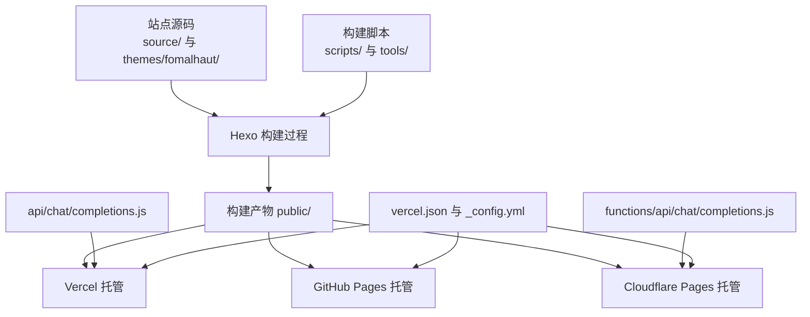
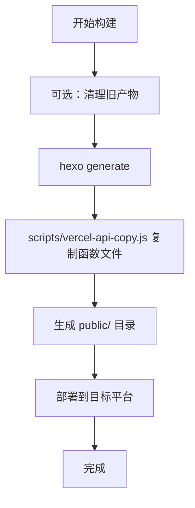
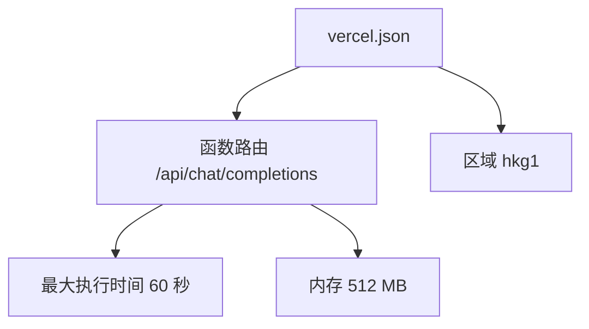
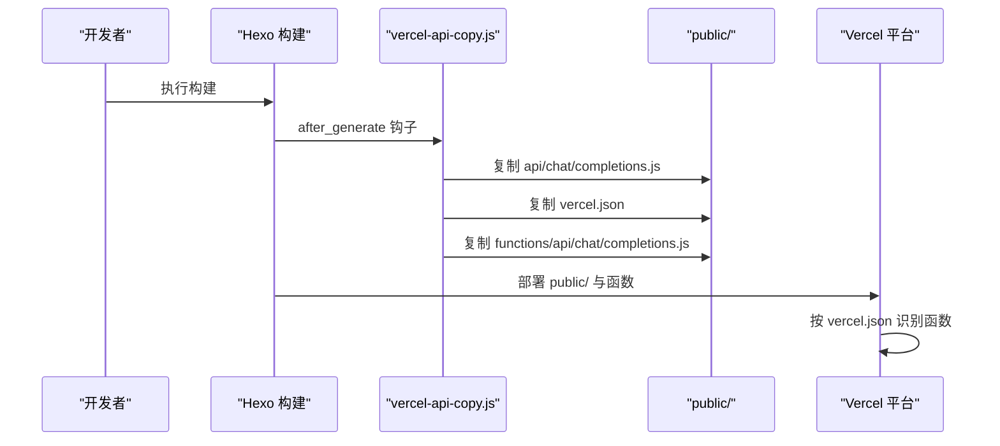
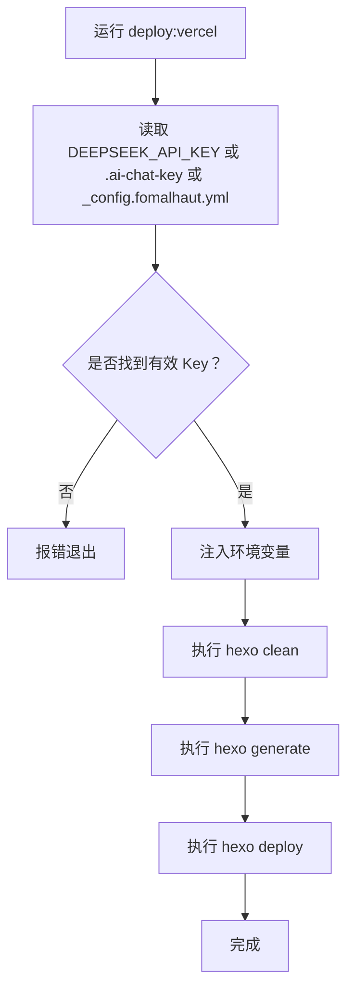
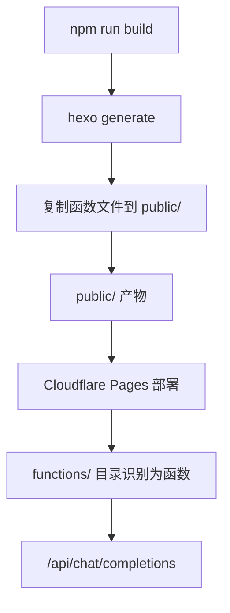
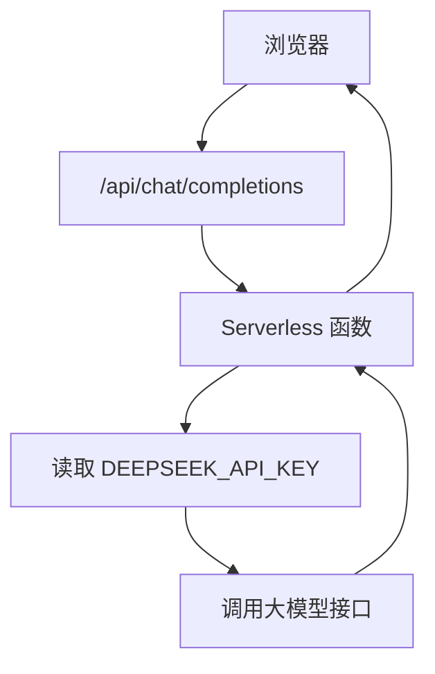

# 多平台部署配置

<cite>
**本文引用的文件**   
- [vercel.json](file://vercel.json)
- [package.json](file://package.json)
- [_config.yml](file://_config.yml)
- [_config.fomalhaut.yml](file://_config.fomalhaut.yml)
- [tools/deploy-vercel.js](file://tools/deploy-vercel.js)
- [scripts/vercel-api-copy.js](file://scripts/vercel-api-copy.js)
- [api/chat/completions.js](file://api/chat/completions.js)
- [functions/api/chat/completions.js](file://functions/api/chat/completions.js)
</cite>

## 目录
1. [引言](#引言)
2. [项目结构与部署边界](#项目结构与部署边界)
3. [核心构建与产物](#核心构建与产物)
4. [Vercel 部署完整流程](#vercel-部署完整流程)
5. [GitHub Pages 部署方案](#github-pages-部署方案)
6. [Cloudflare Pages 部署方案](#cloudflare-pages-部署方案)
7. [环境变量与安全策略](#环境变量与安全策略)
8. [平台对比与选择建议](#平台对比与选择建议)
9. [常见问题排查](#常见问题排查)
10. [结论](#结论)

## 引言
本仓库是一个基于 Hexo 的静态博客站点，主题采用 Butterfly 二次开发的 `hexo-theme-fomalhaut`。站点默认输出到 `public` 目录，并通过 Git 推送产物仓库完成部署；同时仓库内包含 AI 聊天代理函数，用于把浏览器请求转发到大模型接口。

本文重点说明以下部署能力：
- Vercel 部署：包括 `vercel.json`、环境变量、Serverless 函数、构建脚本。
- GitHub Pages 部署：分支策略、构建脚本、自定义域名。
- Cloudflare Pages 部署：构建命令、输出目录、函数路由、缓存策略。
- 各平台优缺点对比、命令行示例和常见错误处理。

## 项目结构与部署边界
从部署视角看，仓库可划分为三类内容：

| 类别 | 路径或文件 | 作用 |
|---|---|---|
| 站点源码 | `source/`、`themes/fomalhaut/` | Hexo 渲染文章、页面、样式和主题逻辑 |
| 构建脚本 | `scripts/`、`tools/`、`gulpfile.js` | 生成站点、压缩资源、复制函数文件 |
| 函数实现 | `api/chat/completions.js`、`functions/api/chat/completions.js` | Vercel 与 Cloudflare Pages 的 AI 代理函数 |
| 平台配置 | `vercel.json`、`package.json`、`_config.yml` | 平台识别、构建命令、站点基础配置 |

**图表来源**
- [package.json:10-15](file://package.json#L10-L15)
- [_config.yml:29-30](file://_config.yml#L29-L30)
- [scripts/vercel-api-copy.js:22-46](file://scripts/vercel-api-copy.js#L22-L46)
- [vercel.json:1-11](file://vercel.json#L1-L11)

**章节来源**
- [package.json:1-15](file://package.json#L1-L15)
- [_config.yml:29-30](file://_config.yml#L29-L30)
- [scripts/vercel-api-copy.js:1-46](file://scripts/vercel-api-copy.js#L1-L46)

## 核心构建与产物
项目的构建入口由 `package.json` 中的脚本定义：

| 脚本 | 行为 |
|---|---|
| `build` | 执行 `hexo generate`，再运行 `node tools/qoder-static-links.js` |
| `clean` | 清理构建缓存 |
| `deploy` | 执行 `hexo deploy` |
| `deploy:vercel` | 运行 `node tools/deploy-vercel.js` |
| `server` | 本地启动 Hexo 预览服务 |

站点根配置 `_config.yml` 中声明：
- 站点标题、作者、语言、时区等元信息。
- URL 与永久链接规则。
- 源码目录 `source` 与输出目录 `public`。
- 主题使用 `fomalhaut`。
- 部署目标包含 Git 仓库（当前为占位地址）。

**图表来源**
- [package.json:10-15](file://package.json#L10-L15)
- [_config.yml:29-30](file://_config.yml#L29-L30)
- [scripts/vercel-api-copy.js:28-46](file://scripts/vercel-api-copy.js#L28-L46)

**章节来源**
- [package.json:10-15](file://package.json#L10-L15)
- [_config.yml:5-30](file://_config.yml#L5-L30)
- [_config.yml:133-144](file://_config.yml#L133-L144)
- [scripts/vercel-api-copy.js:28-46](file://scripts/vercel-api-copy.js#L28-L46)

## Vercel 部署完整流程

### 1. 构建阶段
Vercel 会读取仓库根目录的 `package.json`，并自动识别 Node.js 环境。本项目要求 Node.js 版本不低于 18。

推荐在 Vercel 项目中设置：
- **构建命令**：`npm run build`
- **输出目录**：`public`
- **Node.js 版本**：`>=18`

构建过程会：
1. 安装依赖。
2. 执行 `hexo generate`。
3. 执行 `node tools/qoder-static-links.js`。
4. 通过 Hexo 的 `after_generate` 钩子，把函数文件和配置文件复制到 `public/`。

### 2. vercel.json 配置详解
`vercel.json` 是 Vercel 的平台级配置，当前仓库中主要定义了函数和资源区域：

| 字段 | 值 | 含义 |
|---|---|---|
| `functions.api.chat.completions.js.maxDuration` | `60` | AI 代理函数的最大执行时间 |
| `functions.api.chat.completions.js.memory` | `512` | AI 代理函数的内存上限 |
| `regions` | `["hkg1"]` | 指定函数或站点资源优先使用的区域 |

该配置让 Vercel 把 `api/chat/completions.js` 识别为 Serverless 函数，而不是普通静态文件。

**图表来源**
- [vercel.json:1-11](file://vercel.json#L1-L11)

**章节来源**
- [vercel.json:1-11](file://vercel.json#L1-L11)
- [package.json:7-15](file://package.json#L7-L15)

### 3. 函数部署配置
仓库中存在两套函数实现：

| 文件 | 平台 | 路由 |
|---|---|---|
| `api/chat/completions.js` | Vercel | `/api/chat/completions` |
| `functions/api/chat/completions.js` | Cloudflare Pages | `/api/chat/completions` |

构建过程中，`scripts/vercel-api-copy.js` 会把以下文件复制到 `public/`：
- `api/chat/completions.js`
- `vercel.json`
- `functions/api/chat/completions.js`

这样产物仓库既能被 Vercel 识别函数，也能被其他平台复用。

**图表来源**
- [scripts/vercel-api-copy.js:22-46](file://scripts/vercel-api-copy.js#L22-L46)
- [vercel.json:1-11](file://vercel.json#L1-L11)

**章节来源**
- [scripts/vercel-api-copy.js:1-46](file://scripts/vercel-api-copy.js#L1-L46)
- [api/chat/completions.js:1-16](file://api/chat/completions.js#L1-L16)

### 4. 一键部署脚本
`tools/deploy-vercel.js` 提供“代理模式”的一键部署体验。它的主要职责是：
- 从环境变量 `.ai-chat-key` 文件或 `_config.fomalhaut.yml` 中读取 API Key。
- 将 Key 注入到后续 `hexo clean/generate/deploy` 的环境变量中。
- 防止脚本被 Hexo 作为插件误加载。
- 支持 `--dry-run` 只检查 Key，不真正执行构建。

**图表来源**
- [tools/deploy-vercel.js:35-81](file://tools/deploy-vercel.js#L35-L81)

**章节来源**
- [tools/deploy-vercel.js:1-81](file://tools/deploy-vercel.js#L1-L81)

## GitHub Pages 部署方案

### 1. 分支策略
当前仓库的 `_config.yml` 中已存在 Git 部署配置，但仓库地址为占位值。对于 GitHub Pages，通常有两种方式：

| 方式 | 分支 | 说明 |
|---|---|---|
| 直接托管源码 | `main` 或 `gh-pages` | GitHub Actions 或 GitHub Pages 直接从源码构建 |
| 托管产物 | `main` 推送到独立产物仓库 | 适合 Vercel 直接托管产物仓库的方案 |

本项目更偏向“产物仓库”思路：本地 `hexo generate` 后，把 `public/` 推送到专门用于托管的仓库，再由 Vercel 或 GitHub Pages 托管。

### 2. 构建脚本配置
如果使用 GitHub Actions 构建，建议在 Action 中执行：
- 安装依赖：`npm ci` 或 `npm install`
- 构建站点：`npm run build`
- 上传 `public/` 作为 GitHub Pages 的部署源

如果直接使用 GitHub Pages 的“部署自分支”，则需要在 GitHub Pages 设置中选择对应分支，并确保该分支包含 `public/` 或能触发构建。

### 3. 自定义域名绑定
在 GitHub Pages 设置中绑定自定义域名后，需要：
- 添加 CNAME 记录指向 `username.github.io` 或项目域名。
- 确保站点 URL 配置与实际域名一致。
- 若启用 HTTPS，GitHub 会自动签发证书。

站点 URL 由 `_config.yml` 中的 `url` 控制，部署前应根据实际域名更新。

**章节来源**
- [_config.yml:19-26](file://_config.yml#L19-L26)
- [_config.yml:133-144](file://_config.yml#L133-L144)
- [package.json:10-15](file://package.json#L10-L15)

## Cloudflare Pages 部署方案

### 1. 构建命令与输出目录
Cloudflare Pages 可以自动检测 Node.js 项目。推荐设置：
- **构建命令**：`npm run build`
- **输出目录**：`public`

这与 Vercel 的配置基本一致，便于同一套源码适配多个平台。

### 2. 函数路由差异
Cloudflare Pages 不识别 Vercel 的 `api/*.js` 约定，而是使用仓库根目录下的 `functions/` 目录。因此仓库中额外提供了 `functions/api/chat/completions.js`。

构建时，`scripts/vercel-api-copy.js` 会把该文件复制到 `public/functions/api/chat/completions.js`，而 Cloudflare Pages 部署时会优先读取根目录的 `functions/`，从而暴露 `/api/chat/completions` 路由。

**图表来源**
- [scripts/vercel-api-copy.js:22-46](file://scripts/vercel-api-copy.js#L22-L46)
- [functions/api/chat/completions.js:1-11](file://functions/api/chat/completions.js#L1-L11)

**章节来源**
- [scripts/vercel-api-copy.js:1-46](file://scripts/vercel-api-copy.js#L1-L46)
- [functions/api/chat/completions.js:1-16](file://functions/api/chat/completions.js#L1-L16)

### 3. 缓存策略
Cloudflare Pages 默认会对静态资源启用 CDN 缓存。结合本项目的 Service Worker 测试用例可以看出，站点还涉及前端缓存命名、TTL 分类等机制。部署时可关注：
- 静态资源文件名是否带哈希，以便缓存失效。
- 大体积媒体资源是否允许更长缓存时间。
- 动态 API 请求是否绕过缓存。

由于本仓库未提供完整的 Service Worker 源码，仅能从测试文件中看到缓存命名和 TTL 相关断言，因此不建议在生产环境中随意修改缓存策略，除非明确理解其影响。

**章节来源**
- [tools/tests/sw-cache.test.cjs:64-95](file://tools/tests/sw-cache.test.cjs#L64-L95)

## 环境变量与安全策略

### 1. 必需环境变量
AI 助手功能依赖后端代理，关键环境变量如下：

| 变量名 | 是否必填 | 用途 |
|---|---:|---|
| `DEEPSEEK_API_KEY` | 是 | 调用大模型接口的密钥，仅服务端使用 |
| `AI_PROXY_ORIGINS` | 否 | 额外放行的前端域名，逗号分隔 |

### 2. 各平台设置位置
| 平台 | 设置位置 |
|---|---|
| Vercel | Settings → Environment Variables |
| Cloudflare Pages | Settings → Environment variables |

### 3. 安全原则
- 真密钥不应写入 HTML 或公共静态资源。
- 密钥应通过平台环境变量注入函数运行时。
- 前端只访问同源 `/api/chat/completions`，避免直接在前端暴露密钥。

**图表来源**
- [api/chat/completions.js:124-139](file://api/chat/completions.js#L124-L139)
- [functions/api/chat/completions.js:109-124](file://functions/api/chat/completions.js#L109-L124)

**章节来源**
- [api/chat/completions.js:1-16](file://api/chat/completions.js#L1-L16)
- [api/chat/completions.js:124-139](file://api/chat/completions.js#L124-L139)
- [functions/api/chat/completions.js:1-16](file://functions/api/chat/completions.js#L1-L16)
- [functions/api/chat/completions.js:109-124](file://functions/api/chat/completions.js#L109-L124)
- [tools/deploy-vercel.js:35-68](file://tools/deploy-vercel.js#L35-L68)

## 平台对比与选择建议

| 维度 | Vercel | GitHub Pages | Cloudflare Pages |
|---|---|---|---|
| 静态托管 | 支持 | 支持 | 支持 |
| Serverless 函数 | 原生支持 `api/*.js` | 不支持 | 使用 `functions/` 目录 |
| 构建速度 | 较快，自动检测 Node.js | 取决于 Actions 或预构建产物 | 较快，自动检测 Node.js |
| 区域与网络 | 可选择区域 | 依赖 GitHub CDN | 依赖 Cloudflare CDN |
| 函数超时与内存 | 可通过 `vercel.json` 配置 | 无函数能力 | 函数能力受 Pages Functions 限制 |
| 适合场景 | 需要函数 + 快速部署 | 纯静态站点或已有产物仓库 | 需要函数 + CDN 加速 |

**选择建议：**
- 如果只是纯静态博客，且已有产物仓库，GitHub Pages 最简单。
- 如果需要 Serverless 函数、区域选择和较灵活的函数配置，Vercel 更合适。
- 如果希望利用 Cloudflare 的 CDN 生态，并且接受 `functions/` 函数约定，Cloudflare Pages 是良好选择。

[本节为概念性总结，不直接分析具体代码文件]

## 常见问题排查

### 1. 部署后 AI 接口返回 404
可能原因：
- `vercel.json` 未正确部署。
- `api/chat/completions.js` 未被复制到 `public/`。
- 函数环境变量 `DEEPSEEK_API_KEY` 未配置。

排查步骤：
1. 确认 `vercel.json` 存在于仓库根目录。
2. 确认构建日志中出现函数文件复制信息。
3. 检查 Vercel 环境变量是否包含 `DEEPSEEK_API_KEY`。

**章节来源**
- [vercel.json:1-11](file://vercel.json#L1-L11)
- [scripts/vercel-api-copy.js:28-46](file://scripts/vercel-api-copy.js#L28-L46)
- [api/chat/completions.js:124-139](file://api/chat/completions.js#L124-L139)

### 2. Cloudflare Pages 返回 405
可能原因：
- 请求被当作静态文件处理，而不是函数。
- 没有使用 `functions/` 目录下的函数实现。

解决方式：
- 使用 `functions/api/chat/completions.js`。
- 确保构建产物中包含函数文件。
- 在 Cloudflare Pages 中检查函数路由是否正确。

**章节来源**
- [functions/api/chat/completions.js:1-11](file://functions/api/chat/completions.js#L1-L11)
- [scripts/vercel-api-copy.js:22-46](file://scripts/vercel-api-copy.js#L22-L46)

### 3. 本地构建失败或找不到 API Key
可能原因：
- 未设置 `DEEPSEEK_API_KEY`。
- 本地缺少 `.ai-chat-key` 文件。
- `_config.fomalhaut.yml` 中没有有效的 API Key 段。

解决方式：
- 在环境变量中设置 `DEEPSEEK_API_KEY`。
- 或在站点根目录创建 `.ai-chat-key`。
- 或使用 `--dry-run` 先检查 Key 是否生效。

**章节来源**
- [tools/deploy-vercel.js:35-68](file://tools/deploy-vercel.js#L35-L68)

### 4. 自定义域名无法访问
可能原因：
- DNS 记录未正确配置。
- 站点 URL 与实际域名不一致。
- 平台未启用 HTTPS 或未等待证书生效。

解决方式：
- 检查 CNAME 或 A 记录。
- 更新 `_config.yml` 中的 `url`。
- 等待平台证书签发完成。

**章节来源**
- [_config.yml:19-26](file://_config.yml#L19-L26)

## 结论
本项目以 Hexo 为核心构建静态站点，并通过 Git 产物仓库的方式兼容多种部署平台。Vercel 通过 `vercel.json` 和 `api/chat/completions.js` 提供 Serverless 函数能力；Cloudflare Pages 通过 `functions/` 目录提供等价函数路由；GitHub Pages 更适合纯静态托管。

在实际部署时，建议优先保证：
- 构建命令与输出目录与平台匹配。
- 函数环境变量安全注入。
- 域名与站点 URL 配置一致。
- 根据业务需求选择具备函数能力的平台。

[本节为总结性内容，不直接分析具体代码文件]