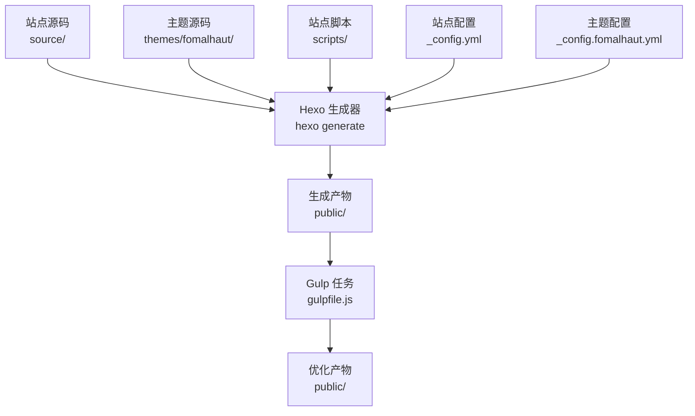
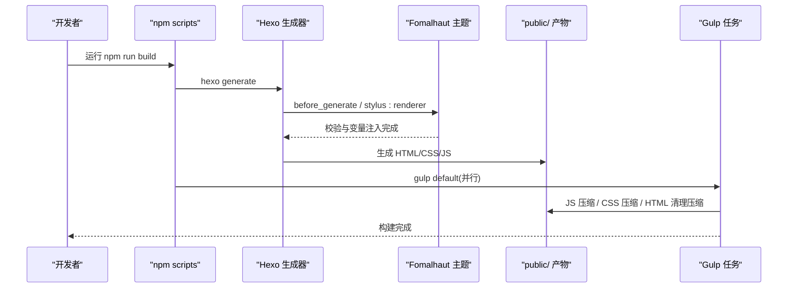
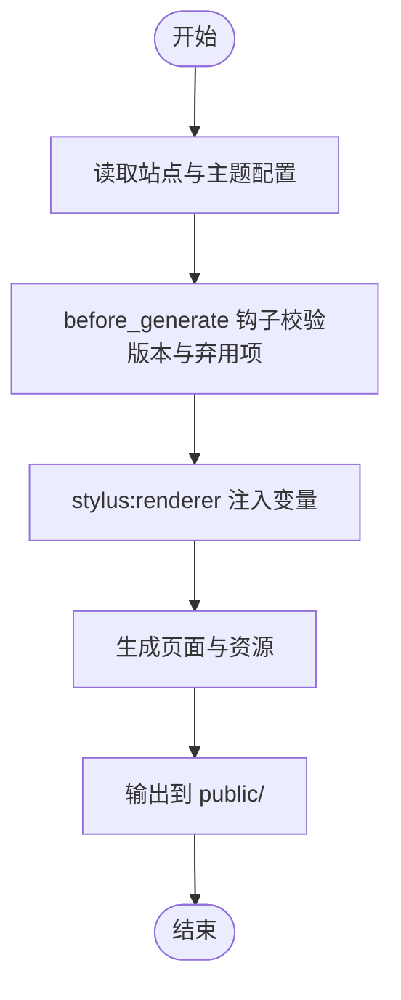
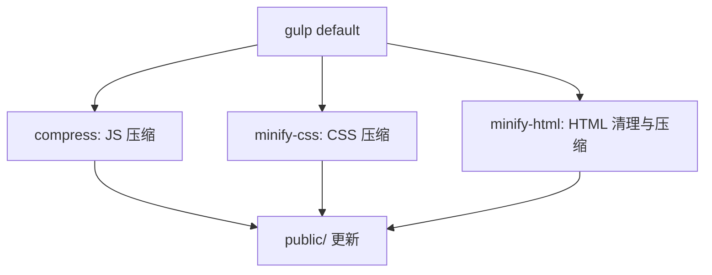
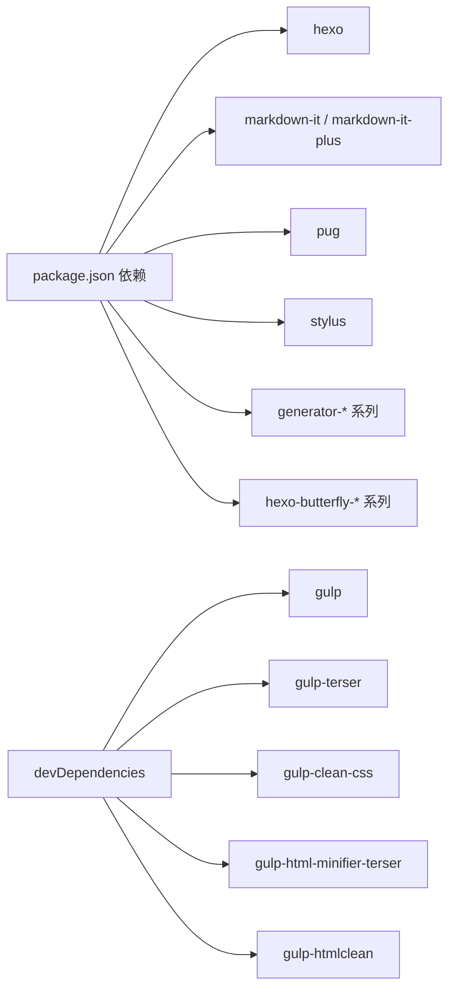

# 构建流程与优化

<cite>
**本文引用的文件**   
- [package.json](file://package.json)
- [gulpfile.js](file://gulpfile.js)
- [_config.yml](file://_config.yml)
- [_config.fomalhaut.yml](file://_config.fomalhaut.yml)
- [themes/fomalhaut/_config.yml](file://themes/fomalhaut/_config.yml)
- [themes/fomalhaut/scripts/events/init.js](file://themes/fomalhaut/scripts/events/init.js)
- [themes/fomalhaut/scripts/events/stylus.js](file://themes/fomalhaut/scripts/events/stylus.js)
- [scripts/gallery-pager.js](file://scripts/gallery-pager.js)
- [source/personal/about/index.md](file://source/personal/about/index.md)
- [source/_posts/2026-10-01-Hello-World.md](file://source/_posts/2026-10-01-Hello-World.md)
</cite>

## 目录
1. [引言](#引言)
2. [项目结构](#项目结构)
3. [核心组件](#核心组件)
4. [架构总览](#架构总览)
5. [详细组件分析](#详细组件分析)
6. [依赖关系分析](#依赖关系分析)
7. [性能考虑](#性能考虑)
8. [故障排查指南](#故障排查指南)
9. [结论](#结论)
10. [附录：自定义构建任务开发指南](#附录自定义构建任务开发指南)

## 引言
本文面向 Hexo + Gulp 的静态站点构建体系，围绕主题编译、资源处理、内容渲染的完整链路展开，解释 Gulp 在压缩、清理、合并等自动化任务中的作用，并给出并行化、缓存、增量构建、产物组织、调试与性能分析方法。同时提供自定义构建任务的扩展指南，帮助你在不破坏主题升级的前提下增强构建能力。

## 项目结构
本仓库采用“站点源码 + 主题源码 + 构建脚本”的分层组织方式：
- 站点源码位于 `source/`，包含文章、页面、样式、脚本、数据等。
- 主题源码位于 `themes/fomalhaut/`，包含模板、样式、主题配置和 Hexo 钩子。
- 根级构建脚本由 `gulpfile.js` 定义，负责生成后的资源优化。
- 站点级脚本位于 `scripts/`，用于扩展 Hexo 生成行为（如相册分页）。
- 站点与主题配置分别位于 `_config.yml` 与 `_config.fomalhaut.yml`。

图表来源
- [package.json:10-15](file://package.json#L10-L15)
- [gulpfile.js:12-64](file://gulpfile.js#L12-L64)
- [_config.yml:28-41](file://_config.yml#L28-L41)

章节来源
- [package.json:1-15](file://package.json#L1-L15)
- [gulpfile.js:1-64](file://gulpfile.js#L1-L64)
- [_config.yml:28-41](file://_config.yml#L28-L41)

## 核心组件
- Hexo 站点生成器：负责解析 Markdown、渲染模板、生成静态 HTML/CSS/JS 到 `public/`。
- 主题系统：基于 Butterfly 二次开发的 Fomalhaut 主题，使用 Pug 模板、Stylus 样式、EJS/YAML 配置。
- Gulp 任务系统：对 `public/` 中的 JS、CSS、HTML 进行压缩与清理。
- 站点脚本：扩展 Hexo 生成逻辑，例如相册自动分页。
- 配置中心：站点配置 `_config.yml` 与主题配置 `_config.fomalhaut.yml` 共同决定生成行为与输出。

章节来源
- [source/personal/about/index.md:209-239](file://source/personal/about/index.md#L209-L239)
- [themes/fomalhaut/_config.yml:1-25](file://themes/fomalhaut/_config.yml#L1-L25)
- [gulpfile.js:12-64](file://gulpfile.js#L12-L64)

## 架构总览
整体构建链路如下：
- 用户执行 `npm run build`，触发 `hexo generate` 与后续脚本。
- Hexo 读取站点与主题配置，加载插件与渲染器，解析 `source/` 下的内容与模板。
- 主题事件钩子在生成前检查版本与兼容性，并在 Stylus 渲染时注入变量。
- 生成产物写入 `public/`。
- Gulp 默认任务并行执行 JS 压缩、CSS 压缩、HTML 清理与压缩。
- 最终产物可用于部署到多个托管平台。

图表来源
- [package.json:10-15](file://package.json#L10-L15)
- [themes/fomalhaut/scripts/events/init.js:3-21](file://themes/fomalhaut/scripts/events/init.js#L3-L21)
- [themes/fomalhaut/scripts/events/stylus.js:7-15](file://themes/fomalhaut/scripts/events/stylus.js#L7-L15)
- [gulpfile.js:12-64](file://gulpfile.js#L12-L64)

## 详细组件分析

### Hexo 站点生成与主题渲染
- 站点配置 `_config.yml` 指定主题、URL、目录、渲染器、插件等；主题配置 `_config.fomalhaut.yml` 控制菜单、搜索、数学公式、封面、评论、侧边栏等。
- 主题通过 `before_generate` 钩子检查 Hexo 版本与弃用配置，确保兼容性与正确性。
- Stylus 渲染阶段通过 `stylus:renderer` 注入高亮与 PrismJS 开关变量，影响样式分支。
- 站点脚本 `scripts/gallery-pager.js` 扩展相册分页，复用主题的分页辅助函数，保持 UI 一致。

图表来源
- [_config.yml:131-131](file://_config.yml#L131-L131)
- [_config.fomalhaut.yml:1-25](file://_config.fomalhaut.yml#L1-L25)
- [themes/fomalhaut/scripts/events/init.js:3-21](file://themes/fomalhaut/scripts/events/init.js#L3-L21)
- [themes/fomalhaut/scripts/events/stylus.js:7-15](file://themes/fomalhaut/scripts/events/stylus.js#L7-L15)
- [scripts/gallery-pager.js:1-31](file://scripts/gallery-pager.js#L1-L31)

章节来源
- [_config.yml:131-131](file://_config.yml#L131-L131)
- [_config.fomalhaut.yml:1-25](file://_config.fomalhaut.yml#L1-L25)
- [themes/fomalhaut/scripts/events/init.js:3-21](file://themes/fomalhaut/scripts/events/init.js#L3-L21)
- [themes/fomalhaut/scripts/events/stylus.js:7-15](file://themes/fomalhaut/scripts/events/stylus.js#L7-L15)
- [scripts/gallery-pager.js:1-31](file://scripts/gallery-pager.js#L1-L31)

### Gulp 任务系统与资源优化
Gulp 定义了三个核心任务：
- `compress`：遍历 `public/**/*.js`，排除已压缩文件，使用 Terser 压缩后写回 `public/`。
- `minify-css`：遍历 `public/**/*.css`，排除特定文件（避免兼容性问题），使用 clean-css 压缩。
- `minify-html`：遍历 `public/**/*.html`，先清理再压缩，启用注释移除、空白折叠、布尔属性省略、空属性删除、脚本/样式 type 属性移除、内联 JS/CSS 压缩、URL 压缩。
- `default`：并行执行上述三个任务，提升构建效率。

图表来源
- [gulpfile.js:12-64](file://gulpfile.js#L12-L64)

章节来源
- [gulpfile.js:12-64](file://gulpfile.js#L12-L64)

### 内容渲染与链接策略
- 固定链接使用 abbrlink 插件生成短链接，配合 permalink 规则输出 `.html` 页面。
- `skip_render` 配置跳过某些第三方库或独立页面的 Nunjucks 渲染，直接复制原文件，避免不必要的处理。
- 站点示例文章说明如何创建新文章、本地预览与构建命令。

章节来源
- [_config.yml:14-22](file://_config.yml#L14-L22)
- [_config.yml:36-41](file://_config.yml#L36-L41)
- [source/_posts/2026-10-01-Hello-World.md:47-53](file://source/_posts/2026-10-01-Hello-World.md#L47-L53)

### 主题事件与样式注入
- `init.js` 在生成前检查 Hexo 版本，若低于要求则报错退出；同时检测弃用的 `butterfly.yml` 并提示迁移。
- `stylus.js` 将站点配置中的高亮与 PrismJS 开关注入 Stylus 变量，使样式能根据配置动态分支。

章节来源
- [themes/fomalhaut/scripts/events/init.js:3-21](file://themes/fomalhaut/scripts/events/init.js#L3-L21)
- [themes/fomalhaut/scripts/events/stylus.js:7-15](file://themes/fomalhaut/scripts/events/stylus.js#L7-L15)

## 依赖关系分析
- 运行时依赖包括 Hexo、Markdown 渲染器、Pug/Stylus/EJS 渲染器、各类生成器与插件。
- 开发依赖包括 Gulp 及其相关压缩工具（Terser、clean-css、html-minifier-terser、htmlclean）。
- 主题依赖 Hexo 渲染器以支持 Pug 与 Stylus。

图表来源
- [package.json:20-73](file://package.json#L20-L73)
- [themes/fomalhaut/package.json:24-27](file://themes/fomalhaut/package.json#L24-L27)

章节来源
- [package.json:20-73](file://package.json#L20-L73)
- [themes/fomalhaut/package.json:24-27](file://themes/fomalhaut/package.json#L24-L27)

## 性能考虑
- 并行处理：Gulp 默认任务使用 `gulp.parallel` 并行执行 JS、CSS、HTML 优化，减少串行等待。
- 增量构建：Hexo 本身具备增量构建能力；结合 `skip_render` 跳过不必要渲染可进一步缩短时间。
- 缓存机制：建议引入 Gulp 缓存插件（如 `gulp-cache`）对压缩结果做缓存，避免重复计算。
- 图片优化：文档中提及外部工具链（Imagine 有损压缩、imagesTool 转 WebP），可在 CI 中作为独立步骤执行。
- 字体优化：通过 fonttools 子集化与 WOFF2 转换减小体积。
- 前端优化：Service Worker 预缓存与请求分流、懒加载、defer 脚本等已在站点运行时层面实现。

[本节为通用性能建议，不直接分析具体文件]

## 故障排查指南
- 构建失败或产物缺失：确认 `gulpfile.js` 中 `compress` 任务是否返回流，避免异步未 await 导致任务提前结束。
- CSS 异常：注意 `minify-css` 排除了含容器查询的文件，避免 clean-css 误删规则；必要时调整排除列表。
- HTML 异常：`minify-html` 启用了内联 JS/CSS 压缩，若页面脚本依赖特定格式，需关闭对应选项或单独处理。
- 主题兼容问题：检查 `before_generate` 钩子日志，确认 Hexo 版本与弃用配置。
- 样式变量未生效：检查 `stylus:renderer` 是否正确注入站点配置变量。

章节来源
- [gulpfile.js:12-19](file://gulpfile.js#L12-L19)
- [gulpfile.js:20-38](file://gulpfile.js#L20-L38)
- [gulpfile.js:40-59](file://gulpfile.js#L40-L59)
- [themes/fomalhaut/scripts/events/init.js:3-21](file://themes/fomalhaut/scripts/events/init.js#L3-L21)
- [themes/fomalhaut/scripts/events/stylus.js:7-15](file://themes/fomalhaut/scripts/events/stylus.js#L7-L15)

## 结论
本项目以 Hexo 为核心生成器，结合 Fomalhaut 主题与 Gulp 任务系统，形成完整的静态站点构建链路。通过并行任务、跳过不必要渲染、外部图片与字体优化工具链，以及前端 Service Worker 与懒加载，实现了较高效的构建与用户体验。建议在 CI 中引入缓存与增量构建策略，并持续监控构建时间与产物体积，逐步优化关键路径。

[本节为总结性内容，不直接分析具体文件]

## 附录：自定义构建任务开发指南
- 新增 Gulp 任务：在 `gulpfile.js` 中定义新任务，遵循现有模式（返回流、使用 pipe 链式处理、输出到 `public/`）。
- 并行编排：使用 `gulp.parallel` 组合任务，避免阻塞。
- 条件处理：根据文件类型与特性选择合适插件（如 Terser、clean-css、html-minifier-terser）。
- 与 Hexo 集成：如需在生成前后执行逻辑，可在主题 `scripts/events/` 下注册钩子（如 `before_generate`、`after_generate`）。
- 站点级扩展：在 `scripts/` 下编写 Hexo generator/filter/helper/tag，复用主题辅助函数以保持 UI 一致性。
- 测试与验证：使用 Node 语法检查与单元测试，确保新增任务不影响既有功能。

章节来源
- [gulpfile.js:12-64](file://gulpfile.js#L12-L64)
- [themes/fomalhaut/scripts/events/init.js:3-21](file://themes/fomalhaut/scripts/events/init.js#L3-L21)
- [scripts/gallery-pager.js:1-31](file://scripts/gallery-pager.js#L1-L31)