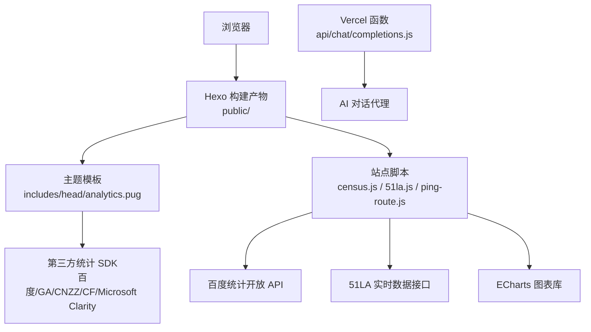
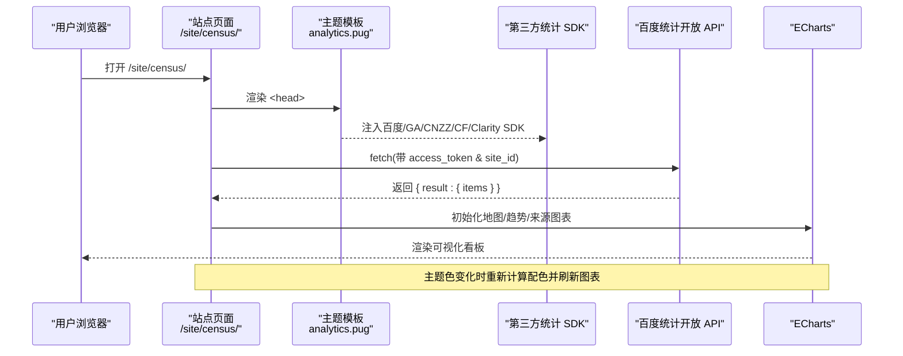
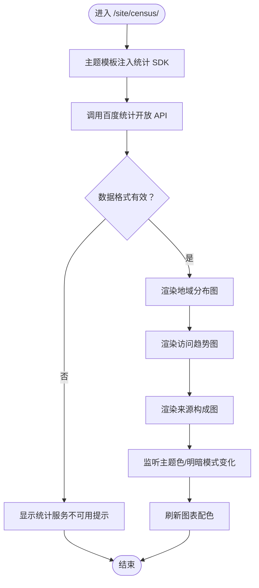
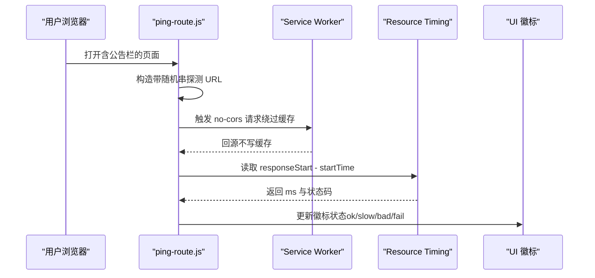
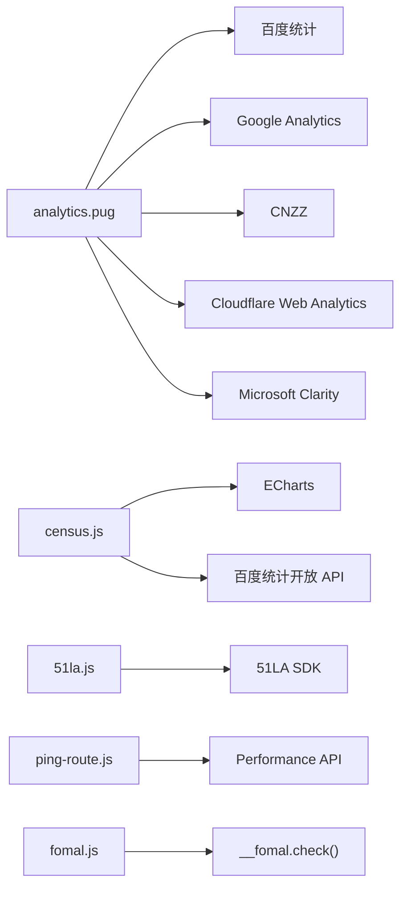

# 监控与运维管理

<cite>
**本文引用的文件**   
- [README.md](file://README.md)
- [_config.yml](file://_config.yml)
- [_config.fomalhaut.yml](file://_config.fomalhaut.yml)
- [source/site/census/index.md](file://source/site/census/index.md)
- [source/js/census.js](file://source/js/census.js)
- [source/js/51la.js](file://source/js/51la.js)
- [themes/fomalhaut/layout/includes/head/analytics.pug](file://themes/fomalhaut/layout/includes/head/analytics.pug)
- [source/js/fomal.js](file://source/js/fomal.js)
- [source/js/modules/reading.js](file://source/js/modules/reading.js)
- [source/js/inject/ping-route.js](file://source/js/inject/ping-route.js)
- [source/js/inject/about-route-probe.js](file://source/js/inject/about-route-probe.js)
- [source/js/modules/nav.js](file://source/js/modules/nav.js)
- [api/chat/completions.js](file://api/chat/completions.js)
</cite>

## 目录
1. [引言](#引言)
2. [项目结构](#项目结构)
3. [核心组件](#核心组件)
4. [架构总览](#架构总览)
5. [详细组件分析](#详细组件分析)
6. [依赖关系分析](#依赖关系分析)
7. [性能考虑](#性能考虑)
8. [故障排查指南](#故障排查指南)
9. [结论](#结论)
10. [附录](#附录)

## 引言
本文件面向站点运维与监控，聚焦以下目标：
- 访问统计系统：用户行为追踪、页面访问量统计、来源分析。
- 性能监控方案：页面加载时间、API 响应时间、错误率监控。
- 日志收集与分析策略：前端错误捕获、用户反馈收集、性能指标上报。
- 运维最佳实践：健康检查、告警配置、容量规划。
- 常见问题诊断与解决。

本项目基于 Hexo + Butterfly 主题二次开发，站点侧通过 `source/` 下的脚本与样式扩展功能；主题侧提供模板与默认配置。监控相关能力由第三方统计 SDK（百度统计、Google Analytics、Cloudflare Web Analytics、Microsoft Clarity、51LA）与站点自研脚本共同实现。

**章节来源**
- [README.md:240-340](file://README.md#L240-L340)

## 项目结构
从监控与运维视角，关键路径如下：
- 站点配置层：根 `_config.yml` 与主题配置 `_config.fomalhaut.yml` 决定启用哪些统计服务与注入方式。
- 模板注入层：主题模板在 `<head>` 中按需注入各统计 SDK。
- 前端脚本层：站点级 JS 负责数据拉取、图表渲染、延迟探测、FPS 监测等。
- 可视化看板：`/site/census/` 聚合展示实时访客、地域分布、趋势与来源构成。
- 后端代理：Vercel 函数用于 AI 对话代理，附带基础健康检查与限流逻辑。

**图示来源**
- [themes/fomalhaut/layout/includes/head/analytics.pug:1-31](file://themes/fomalhaut/layout/includes/head/analytics.pug#L1-L31)
- [source/js/census.js:1-15](file://source/js/census.js#L1-L15)
- [source/js/51la.js:1-10](file://source/js/51la.js#L1-L10)
- [source/js/inject/ping-route.js:1-25](file://source/js/inject/ping-route.js#L1-L25)
- [api/chat/completions.js:118-129](file://api/chat/completions.js#L118-L129)

**章节来源**
- [README.md:259-284](file://README.md#L259-L284)
- [_config.yml:131-138](file://_config.yml#L131-L138)
- [_config.fomalhaut.yml:704-727](file://_config.fomalhaut.yml#L704-L727)

## 核心组件
- 统计 SDK 注入：主题模板根据主题配置动态插入百度统计、GA、CNZZ、Cloudflare、Clarity 的初始化脚本。
- 访问统计看板：`/site/census/` 页面使用百度统计开放 API 拉取 PV/UV 等指标，并用 ECharts 绘制地图、趋势、来源饼图。
- 实时访客面板：51LA 提供实时访客数据，站点侧抓取并格式化展示。
- 网络延迟探测：公告栏线路与关于页线路卡分别通过 `ping-route.js` 与 `about-route-probe.js` 测量本机到目标线路的一次往返耗时。
- 页面性能观测：阅读进度条与 FPS 检测模块提供滚动性能与帧率采样。
- API 健康检查：Vercel 函数 GET/HEAD 返回代理可用性、模型、速率限制等元信息。

**章节来源**
- [themes/fomalhaut/layout/includes/head/analytics.pug:1-31](file://themes/fomalhaut/layout/includes/head/analytics.pug#L1-L31)
- [source/site/census/index.md:1-122](file://source/site/census/index.md#L1-L122)
- [source/js/census.js:1-15](file://source/js/census.js#L1-L15)
- [source/js/51la.js:1-10](file://source/js/51la.js#L1-L10)
- [source/js/inject/ping-route.js:1-25](file://source/js/inject/ping-route.js#L1-L25)
- [source/js/modules/reading.js:1-18](file://source/js/modules/reading.js#L1-L18)
- [api/chat/completions.js:118-129](file://api/chat/completions.js#L118-L129)

## 架构总览
下图展示一次“网站统计”页面的端到端流程：页面请求 → 模板注入统计 SDK → 站点脚本拉取百度统计 API → 渲染 ECharts 图表 → 主题色与明暗模式联动刷新配色。

**图示来源**
- [themes/fomalhaut/layout/includes/head/analytics.pug:1-31](file://themes/fomalhaut/layout/includes/head/analytics.pug#L1-L31)
- [source/site/census/index.md:1-122](file://source/site/census/index.md#L1-L122)
- [source/js/census.js:175-254](file://source/js/census.js#L175-L254)
- [source/js/census.js:256-387](file://source/js/census.js#L256-L387)
- [source/js/census.js:389-468](file://source/js/census.js#L389-L468)

## 详细组件分析

### 访问统计系统
- 用户行为追踪
  - 通过百度统计、Google Analytics、Cloudflare Web Analytics、Microsoft Clarity 等 SDK 采集 PV/UV、页面浏览、事件等行为数据。
  - 站点模板按主题配置条件注入对应 SDK，避免未启用服务的冗余开销。
- 页面访问量统计
  - `/site/census/` 页面通过百度统计开放 API 获取月度访问趋势、省份分布、来源渠道等数据，并以 ECharts 可视化。
  - 51LA 提供实时访客 KPI（总访问量、本月访问、今日人数等），站点侧抓取并格式化显示。
- 来源分析
  - 百度统计来源接口返回各渠道占比，站点侧用环形图展示，并通过主题色派生调色板保证明暗模式可读性。

**图示来源**
- [source/site/census/index.md:1-122](file://source/site/census/index.md#L1-L122)
- [source/js/census.js:143-173](file://source/js/census.js#L143-L173)
- [source/js/census.js:175-254](file://source/js/census.js#L175-L254)
- [source/js/census.js:256-387](file://source/js/census.js#L256-L387)
- [source/js/census.js:389-468](file://source/js/census.js#L389-L468)
- [source/js/census.js:519-565](file://source/js/census.js#L519-L565)

**章节来源**
- [themes/fomalhaut/layout/includes/head/analytics.pug:1-31](file://themes/fomalhaut/layout/includes/head/analytics.pug#L1-L31)
- [source/site/census/index.md:1-122](file://source/site/census/index.md#L1-L122)
- [source/js/census.js:1-15](file://source/js/census.js#L1-L15)
- [source/js/census.js:143-173](file://source/js/census.js#L143-L173)
- [source/js/census.js:519-565](file://source/js/census.js#L519-L565)
- [source/js/51la.js:1-10](file://source/js/51la.js#L1-L10)

### 性能监控方案
- 页面加载时间
  - 公告栏线路与关于页线路卡通过 `fetch(no-cors)` + Resource Timing 测量本机到目标线路的一次往返耗时，并在 UI 上以徽标形式呈现。
  - 探测在 `window.load` 之后空闲时段执行，串行错开，避免首屏阻塞。
- API 响应时间
  - Vercel 函数 GET/HEAD 返回代理可用性与速率限制参数，便于前端或外部探针做健康检查。
- 错误率监控
  - 站点主引导脚本在非调试环境静音 `console.log`，但保留 `console.error/warn`，确保异常可被观察。
  - 统计图表在接口异常时显示友好 fallback 提示，避免空白页。

**图示来源**
- [source/js/inject/ping-route.js:54-62](file://source/js/inject/ping-route.js#L54-L62)
- [source/js/inject/ping-route.js:80-117](file://source/js/inject/ping-route.js#L80-L117)
- [source/js/inject/ping-route.js:136-158](file://source/js/inject/ping-route.js#L136-L158)
- [api/chat/completions.js:118-129](file://api/chat/completions.js#L118-L129)
- [source/js/fomal.js:51-62](file://source/js/fomal.js#L51-L62)
- [source/js/census.js:143-173](file://source/js/census.js#L143-L173)

**章节来源**
- [source/js/inject/ping-route.js:1-25](file://source/js/inject/ping-route.js#L1-L25)
- [source/js/inject/ping-route.js:80-117](file://source/js/inject/ping-route.js#L80-L117)
- [source/js/inject/about-route-probe.js:1-17](file://source/js/inject/about-route-probe.js#L1-L17)
- [api/chat/completions.js:118-129](file://api/chat/completions.js#L118-L129)
- [source/js/fomal.js:51-62](file://source/js/fomal.js#L51-L62)
- [source/js/modules/reading.js:1-18](file://source/js/modules/reading.js#L1-L18)

### 日志收集与分析策略
- 前端错误捕获
  - 非调试环境关闭 `console.log`，保留 `console.error/warn`，便于定位 pjax 换页失败、搜索初始化异常等问题。
  - 搜索懒加载脚本对 Algolia 初始化失败进行错误输出，辅助排查配置问题。
- 用户反馈收集
  - 分享按钮将标题与链接复制到剪贴板，配合通知组件提示成功；复制失败时输出错误日志。
- 性能指标上报
  - 站点侧未内置统一上报通道；建议结合已启用的 Microsoft Clarity 或 Cloudflare Web Analytics 进行会话回放与性能埋点。
  - 如需自定义上报，可在 `fomal.js` 自检通过后，基于 `__fomal.check()` 结果决定是否开启上报。

**章节来源**
- [source/js/fomal.js:51-62](file://source/js/fomal.js#L51-L62)
- [source/js/inject/search-lazy.js:117-172](file://source/js/inject/search-lazy.js#L117-L172)
- [source/js/modules/nav.js:201-227](file://source/js/modules/nav.js#L201-L227)
- [themes/fomalhaut/layout/includes/head/analytics.pug:25-31](file://themes/fomalhaut/layout/includes/head/analytics.pug#L25-L31)

### 运维最佳实践
- 健康检查
  - 使用 Vercel 函数 GET/HEAD 端点检查 AI 代理是否可用、是否配置了密钥、当前速率限制参数。
  - 对百度统计开放 API 的 token 过期与返回格式异常进行兜底处理，避免看板空白。
- 告警配置
  - 建议在托管平台为 Vercel 函数设置错误率与延迟告警；对百度统计 API 的错误码（如 token 过期）建立告警规则。
  - 利用 Microsoft Clarity 或 Cloudflare Web Analytics 的异常事件与性能阈值告警。
- 容量规划
  - 百度统计 API 拉取频率受 token 有效期与配额限制，建议仅在统计页面拉取，避免全量重复请求。
  - 延迟探测采用串行错开与超时重试，避免并发风暴；必要时调整 `stagger` 与 `attempts`。

**章节来源**
- [api/chat/completions.js:118-129](file://api/chat/completions.js#L118-L129)
- [source/js/census.js:143-173](file://source/js/census.js#L143-L173)
- [source/js/inject/ping-route.js:160-221](file://source/js/inject/ping-route.js#L160-L221)
- [themes/fomalhaut/layout/includes/head/analytics.pug:25-31](file://themes/fomalhaut/layout/includes/head/analytics.pug#L25-L31)

## 依赖关系分析
- 主题模板依赖主题配置：`analytics.pug` 读取 `theme.baidu_analytics`、`theme.google_analytics` 等字段决定是否注入 SDK。
- 站点脚本依赖第三方库：`census.js` 依赖 ECharts 与百度统计开放 API；`51la.js` 依赖 51LA SDK。
- 延迟探测依赖浏览器能力：`ping-route.js` 依赖 `performance.now` 与 `performance.getEntriesByName`，降级到 wall clock。
- 站点主引导提供自检：`fomal.js` 暴露 `__fomal.check()`，用于验证全局入口与模块是否加载成功。

**图示来源**
- [themes/fomalhaut/layout/includes/head/analytics.pug:1-31](file://themes/fomalhaut/layout/includes/head/analytics.pug#L1-L31)
- [source/js/census.js:1-15](file://source/js/census.js#L1-L15)
- [source/js/51la.js:1-10](file://source/js/51la.js#L1-L10)
- [source/js/inject/ping-route.js:80-117](file://source/js/inject/ping-route.js#L80-L117)
- [source/js/fomal.js:64-95](file://source/js/fomal.js#L64-L95)

**章节来源**
- [themes/fomalhaut/layout/includes/head/analytics.pug:1-31](file://themes/fomalhaut/layout/includes/head/analytics.pug#L1-L31)
- [source/js/census.js:1-15](file://source/js/census.js#L1-L15)
- [source/js/51la.js:1-10](file://source/js/51la.js#L1-L10)
- [source/js/inject/ping-route.js:80-117](file://source/js/inject/ping-route.js#L80-L117)
- [source/js/fomal.js:64-95](file://source/js/fomal.js#L64-L95)

## 性能考虑
- 首屏关键链优化
  - 统计 SDK 使用 `async/defer` 注入，避免阻塞解析。
  - 延迟探测在 `window.load` 后空闲时段执行，不抢占首屏带宽。
- 滚动与渲染
  - 阅读进度条使用 rAF 合流滚动回调，减少强制布局次数。
  - FPS 检测仅在面板开启时运行，后台标签自动挂起。
- 缓存策略
  - 延迟探测使用随机查询串与 `no-store`，避免命中缓存导致测量失真。
  - Service Worker 对文本资源与媒体资源采用不同 TTL，降低代码陈旧风险。

**章节来源**
- [source/js/modules/reading.js:31-40](file://source/js/modules/reading.js#L31-L40)
- [source/js/modules/reading.js:165-184](file://source/js/modules/reading.js#L165-L184)
- [source/js/inject/ping-route.js:54-62](file://source/js/inject/ping-route.js#L54-L62)
- [source/js/inject/ping-route.js:240-255](file://source/js/inject/ping-route.js#L240-L255)

## 故障排查指南
- 统计服务不可用
  - 现象：统计页面显示“统计服务暂不可用”。
  - 排查：检查百度统计开放 API 的 `access_token` 是否过期、`site_id` 是否正确；查看返回的 `error_code` 与 `error_msg`。
  - 参考：[source/js/census.js:143-173](file://source/js/census.js#L143-L173)
- 实时访客数据为空
  - 现象：KPI 数字未更新或显示“统计数据暂时拿不到”。
  - 排查：确认 51LA ID 与 CK 已替换；检查跨域与网络拦截。
  - 参考：[source/site/census/index.md:90-120](file://source/site/census/index.md#L90-L120)、[source/js/51la.js:1-10](file://source/js/51la.js#L1-L10)
- 延迟徽标一直显示“—”
  - 现象：公告栏或关于页线路卡徽标始终为失败态。
  - 排查：检查目标域名是否可达、是否被防火墙拦截；确认 Resource Timing 可用；查看控制台是否有超时或 abort 日志。
  - 参考：[source/js/inject/ping-route.js:80-117](file://source/js/inject/ping-route.js#L80-L117)、[source/js/inject/about-route-probe.js:118-157](file://source/js/inject/about-route-probe.js#L118-L157)
- 搜索初始化异常
  - 现象：控制台输出 Algolia 设置无效或搜索框未渲染。
  - 排查：核对 `_config.fomalhaut.yml` 中的 Algolia 配置；确认搜索懒加载脚本已正确引入。
  - 参考：[source/js/inject/search-lazy.js:117-172](file://source/js/inject/search-lazy.js#L117-L172)
- API 代理不可用
  - 现象：GET/HEAD 返回 `hasKey: false` 或无密钥。
  - 排查：检查环境变量 `DEEPSEEK_API_KEY` 是否配置；确认部署平台已注入环境变量。
  - 参考：[api/chat/completions.js:118-129](file://api/chat/completions.js#L118-L129)

**章节来源**
- [source/js/census.js:143-173](file://source/js/census.js#L143-L173)
- [source/site/census/index.md:90-120](file://source/site/census/index.md#L90-L120)
- [source/js/51la.js:1-10](file://source/js/51la.js#L1-L10)
- [source/js/inject/ping-route.js:80-117](file://source/js/inject/ping-route.js#L80-L117)
- [source/js/inject/about-route-probe.js:118-157](file://source/js/inject/about-route-probe.js#L118-L157)
- [source/js/inject/search-lazy.js:117-172](file://source/js/inject/search-lazy.js#L117-L172)
- [api/chat/completions.js:118-129](file://api/chat/completions.js#L118-L129)

## 结论
本项目的监控与运维体系以“主题模板注入 + 站点脚本增强”为核心：
- 访问统计通过多 SDK 覆盖行为追踪，并通过百度统计开放 API 与 51LA 提供可视化看板与实时数据。
- 性能监控借助 Performance API 与 ECharts 实现延迟探测与帧率观测，辅以友好的错误兜底。
- 日志与错误捕获遵循“最小噪音、最大线索”的原则，便于快速定位问题。
- 运维层面建议结合托管平台告警与第三方分析工具，完善健康检查、告警与容量规划。

## 附录
- 配置入口
  - 主题统计配置：`_config.fomalhaut.yml` 中的 `baidu_analytics`、`google_analytics`、`cnzz_analytics`、`cloudflare_analytics`、`microsoft_clarity`。
  - 站点统计页面：`source/site/census/index.md` 与 `source/js/census.js`。
  - 实时访客：`source/js/51la.js`。
  - 延迟探测：`source/js/inject/ping-route.js`、`source/js/inject/about-route-probe.js`。
  - API 健康检查：`api/chat/completions.js`。

**章节来源**
- [_config.fomalhaut.yml:704-727](file://_config.fomalhaut.yml#L704-L727)
- [source/site/census/index.md:1-122](file://source/site/census/index.md#L1-L122)
- [source/js/census.js:1-15](file://source/js/census.js#L1-L15)
- [source/js/51la.js:1-10](file://source/js/51la.js#L1-L10)
- [source/js/inject/ping-route.js:1-25](file://source/js/inject/ping-route.js#L1-L25)
- [source/js/inject/about-route-probe.js:1-17](file://source/js/inject/about-route-probe.js#L1-L17)
- [api/chat/completions.js:118-129](file://api/chat/completions.js#L118-L129)