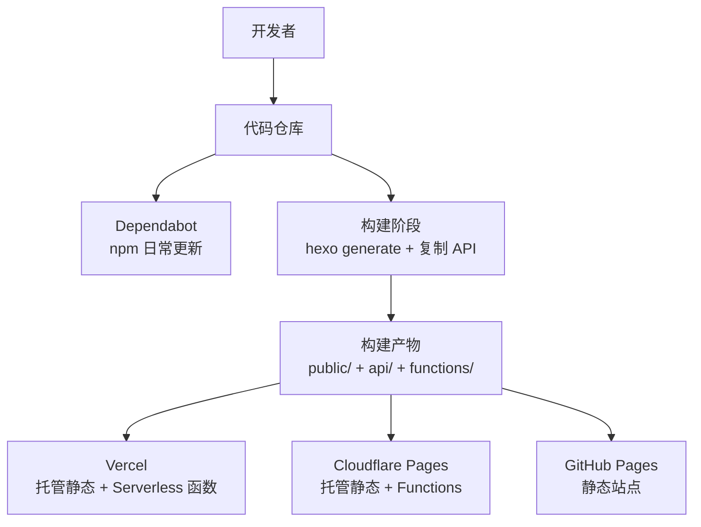
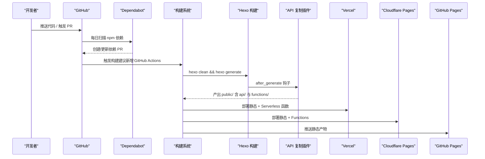
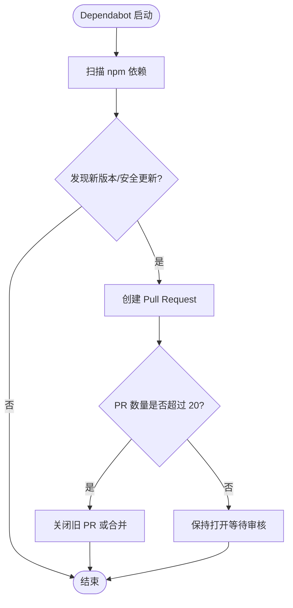
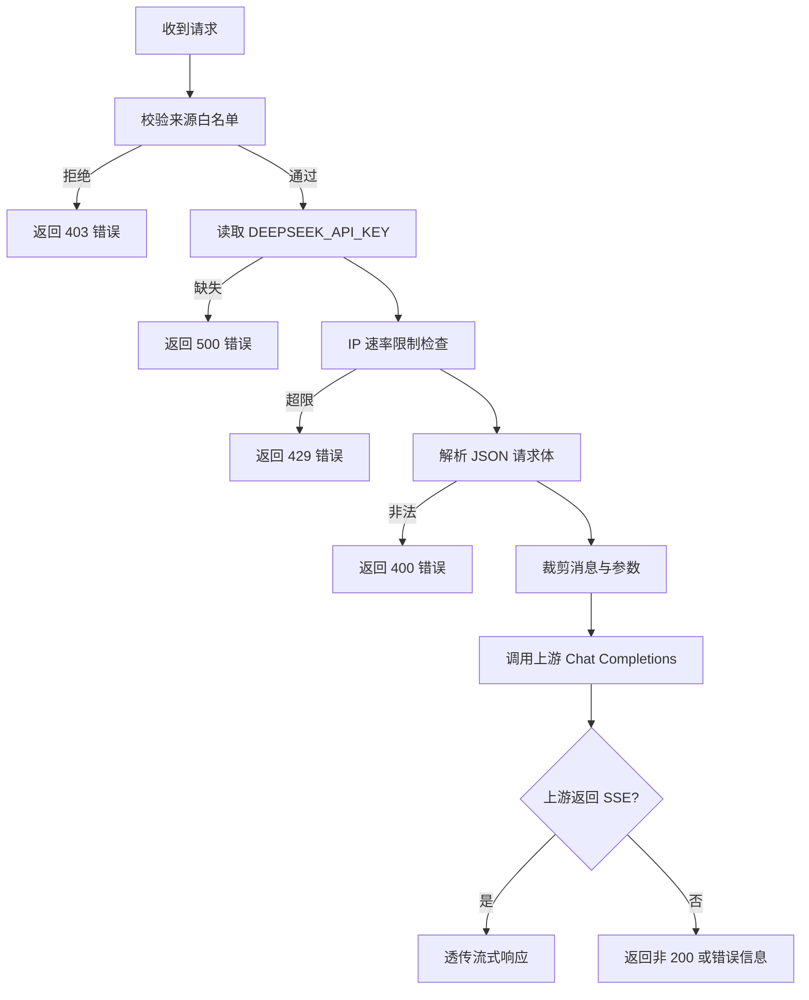
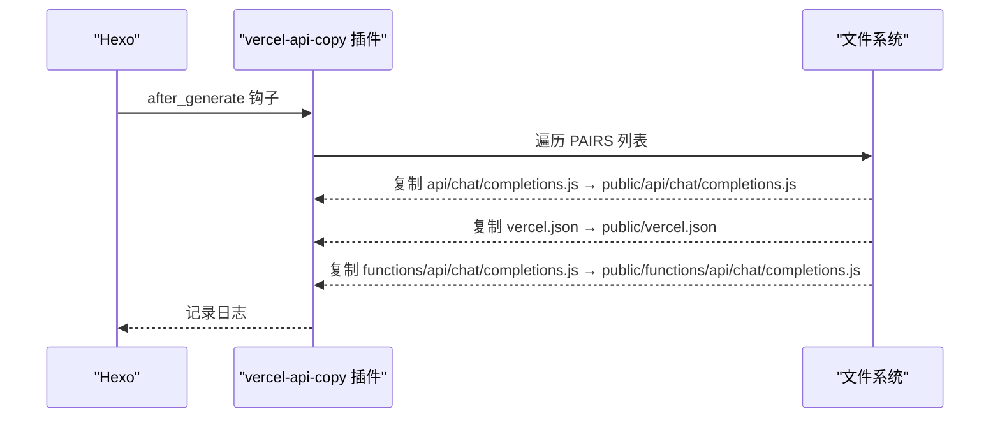
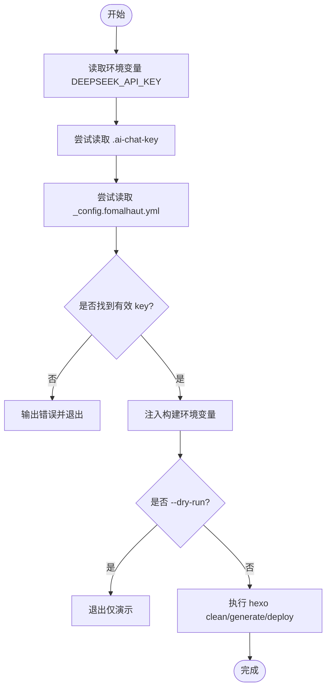
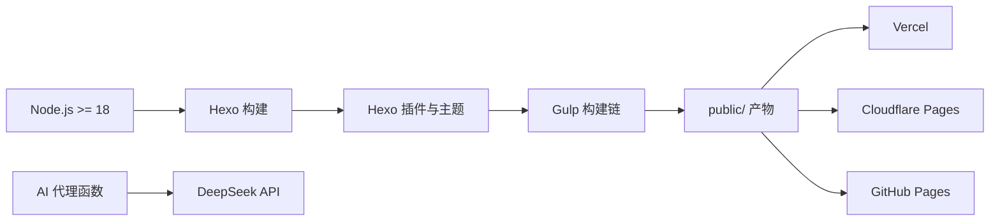
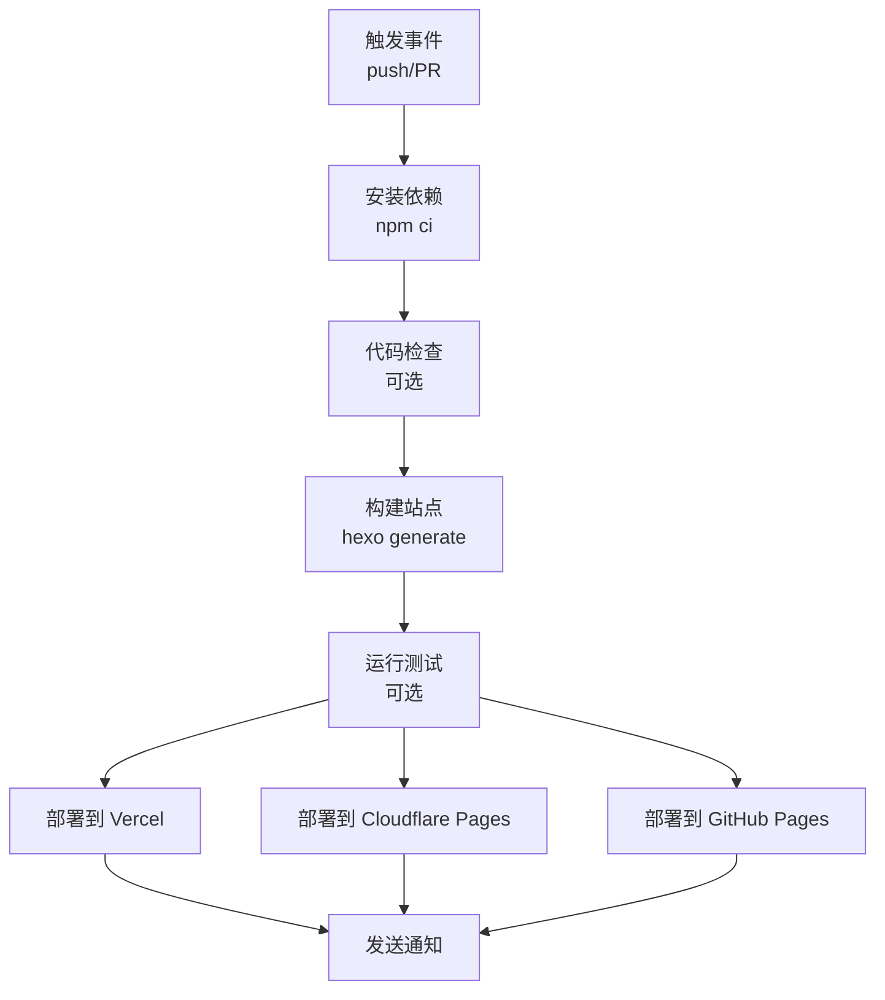

# 自动化部署与CI/CD

<cite>
**本文引用的文件**   
- [.github/dependabot.yml](file://.github/dependabot.yml)
- [package.json](file://package.json)
- [vercel.json](file://vercel.json)
- [functions/api/chat/completions.js](file://functions/api/chat/completions.js)
- [scripts/vercel-api-copy.js](file://scripts/vercel-api-copy.js)
- [tools/deploy-vercel.js](file://tools/deploy-vercel.js)
- [README.md](file://README.md)
</cite>

## 目录
1. [引言](#引言)
2. [项目结构](#项目结构)
3. [核心组件](#核心组件)
4. [架构总览](#架构总览)
5. [详细组件分析](#详细组件分析)
6. [依赖关系分析](#依赖关系分析)
7. [性能与容量规划](#性能与容量规划)
8. [故障恢复与回滚策略](#故障恢复与回滚策略)
9. [自定义 CI/CD 管道开发指南](#自定义-cicd-管道开发指南)
10. [结论](#结论)

## 引言
本仓库是一个基于 Hexo 的静态博客主题与站点模板，同时提供 AI 聊天代理函数。当前仓库没有内置 GitHub Actions 工作流，但提供了：
- Dependabot 依赖更新配置；
- Vercel 函数配置与部署脚本；
- 构建后自动复制 API 函数到产物目录的 Hexo 插件；
- 面向 Cloudflare Pages 的同源代理函数实现；
- README 中关于多平台部署（GitHub Pages、Vercel、Cloudflare Pages）的说明。

本文围绕“自动化部署与持续集成”目标，梳理现有能力，并给出可落地的 CI/CD 设计、API 函数发布流程、本地到生产链路、故障恢复与回滚方案，以及自定义管道的开发指南。

## 项目结构
从自动化与部署视角，关键目录与文件如下：
- `.github/dependabot.yml`：Dependabot 对 npm 生态的日常安全与版本更新。
- `package.json`：Hexo 构建脚本、Node 引擎要求、依赖清单。
- `vercel.json`：Vercel Serverless 函数的超时、内存与区域配置。
- `functions/api/chat/completions.js`：Cloudflare Pages Function 的 AI 代理实现。
- `scripts/vercel-api-copy.js`：Hexo after_generate 钩子，把 API 函数与 vercel.json 复制到 public 产物。
- `tools/deploy-vercel.js`：一键读取密钥、注入环境变量并执行 hexo clean/generate/deploy。
- `README.md`：多平台部署说明与历史工作流参考。

图表来源
- [.github/dependabot.yml:1-8](file://.github/dependabot.yml#L1-L8)
- [package.json:10-15](file://package.json#L10-L15)
- [scripts/vercel-api-copy.js:28-46](file://scripts/vercel-api-copy.js#L28-L46)
- [vercel.json:1-12](file://vercel.json#L1-L12)
- [README.md:1229-1263](file://README.md#L1229-L1263)

章节来源
- [.github/dependabot.yml:1-8](file://.github/dependabot.yml#L1-L8)
- [package.json:1-75](file://package.json#L1-L75)
- [vercel.json:1-12](file://vercel.json#L1-L12)
- [scripts/vercel-api-copy.js:1-47](file://scripts/vercel-api-copy.js#L1-L47)
- [README.md:1229-1263](file://README.md#L1229-L1263)

## 核心组件
- Dependabot 配置：每日扫描 npm 依赖，最多保留 20 个未合并 PR。
- 构建脚本：`build` 会先执行 Hexo 生成，再运行静态链接修复脚本；`deploy:vercel` 调用工具脚本完成带密钥的构建与部署。
- Vercel 函数配置：为 `/api/chat/completions` 设置最大时长、内存与区域。
- API 函数实现：Cloudflare Pages Function 版本的同源代理，负责来源校验、限流、参数清洗、上游转发与 SSE 流式响应。
- 构建后复制插件：在 Hexo 生成完成后，将 API 函数与 vercel.json 复制到 public 产物，确保 Vercel 和 Cloudflare Pages 都能识别函数路由。
- 部署工具脚本：从环境变量或本地文件读取 DeepSeek API Key，注入构建环境，依次执行 hexo clean/generate/deploy。

章节来源
- [.github/dependabot.yml:1-8](file://.github/dependabot.yml#L1-L8)
- [package.json:10-15](file://package.json#L10-L15)
- [vercel.json:1-12](file://vercel.json#L1-L12)
- [functions/api/chat/completions.js:1-184](file://functions/api/chat/completions.js#L1-L184)
- [scripts/vercel-api-copy.js:1-47](file://scripts/vercel-api-copy.js#L1-L47)
- [tools/deploy-vercel.js:1-82](file://tools/deploy-vercel.js#L1-L82)

## 架构总览
下图展示从代码提交到多平台发布的整体链路，包括 Dependabot 依赖更新、构建产物生成、API 函数同步与多平台托管。

图表来源
- [.github/dependabot.yml:1-8](file://.github/dependabot.yml#L1-L8)
- [scripts/vercel-api-copy.js:28-46](file://scripts/vercel-api-copy.js#L28-L46)
- [README.md:1229-1263](file://README.md#L1229-L1263)

## 详细组件分析

### Dependabot 依赖管理
- 作用域：npm 包，根目录。
- 调度频率：每日。
- PR 上限：20。
- 适用场景：安全补丁与常规版本升级；建议配合分支保护规则与人工审核。

图表来源
- [.github/dependabot.yml:1-8](file://.github/dependabot.yml#L1-L8)

章节来源
- [.github/dependabot.yml:1-8](file://.github/dependabot.yml#L1-L8)

### API 函数与同源代理
API 函数提供 `/api/chat/completions` 的同源代理能力，支持：
- 来源白名单校验（origin/referer），默认放行 example.com 及其子域，也放行本地调试与平台预览域名；
- 请求体大小、消息条数、单条消息长度限制；
- 速率限制（按 IP 小时级计数）；
- 上游 DeepSeek Chat Completions 接口转发；
- 流式响应（SSE）透传；
- 健康检查 GET/HEAD/OPTIONS。

图表来源
- [functions/api/chat/completions.js:36-184](file://functions/api/chat/completions.js#L36-L184)

章节来源
- [functions/api/chat/completions.js:1-184](file://functions/api/chat/completions.js#L1-L184)

### 构建后 API 函数复制插件
该 Hexo 插件在 `after_generate` 钩子中将以下文件复制到 `public/`：
- `api/chat/completions.js`（Vercel 函数）
- `vercel.json`（Vercel 函数配置）
- `functions/api/chat/completions.js`（Cloudflare Pages Function）

这保证了同一份产物可同时被 Vercel 与 Cloudflare Pages 识别为函数。

图表来源
- [scripts/vercel-api-copy.js:22-46](file://scripts/vercel-api-copy.js#L22-L46)

章节来源
- [scripts/vercel-api-copy.js:1-47](file://scripts/vercel-api-copy.js#L1-L47)

### Vercel 部署脚本与环境变量注入
`tools/deploy-vercel.js` 的作用：
- 从环境变量、`.ai-chat-key` 文件或 `_config.fomalhaut.yml` 中读取 DeepSeek API Key；
- 若未找到 key，直接退出；
- 将 key 注入构建环境，依次执行 `hexo clean`、`hexo generate`、`hexo deploy`；
- 支持 `--dry-run` 模式仅验证 key 是否存在。

图表来源
- [tools/deploy-vercel.js:35-82](file://tools/deploy-vercel.js#L35-L82)

章节来源
- [tools/deploy-vercel.js:1-82](file://tools/deploy-vercel.js#L1-L82)

### Vercel 函数配置
`vercel.json` 声明了 `/api/chat/completions` 函数的运行时参数：
- 最大时长：60 秒；
- 内存：512 MB；
- 区域：hkg1。

这些参数影响函数冷启动、并发与延迟表现，需结合流量模型评估。

章节来源
- [vercel.json:1-12](file://vercel.json#L1-L12)

### 多平台部署说明
README 指出：
- GitHub Pages + GitHub Actions：需要自行添加工作流；
- Vercel：使用 `vercel.json` 配置函数，并在项目环境变量中添加 `DEEPSEEK_API_KEY`；
- Cloudflare Pages：构建命令与输出目录明确，函数目录为根 `functions/`；
- 本地生成 + 手动推送：可直接生成 `public/` 并推送到任意静态托管。

章节来源
- [README.md:1229-1263](file://README.md#L1229-L1263)

## 依赖关系分析
- 构建依赖：Hexo 6.x、渲染器与主题插件、Gulp 构建链。
- 运行时依赖：Node.js >= 18。
- 外部服务：DeepSeek Chat Completions API（通过代理函数转发）。
- 部署平台：Vercel、Cloudflare Pages、GitHub Pages。

图表来源
- [package.json:7-73](file://package.json#L7-L73)
- [README.md:1229-1263](file://README.md#L1229-L1263)

章节来源
- [package.json:1-75](file://package.json#L1-L75)
- [README.md:1229-1263](file://README.md#L1229-L1263)

## 性能与容量规划
- 函数超时与内存：Vercel 函数最大时长 60 秒、内存 512 MB，适合流式转发的长连接场景；如需更高吞吐，可在平台侧调整配额与并发。
- 速率限制：代理函数按 IP 小时级计数，默认 120 次/小时，可通过环境变量调整；建议在 CDN/WAF 层叠加全局限流。
- 上游超时与重试：上游 DeepSeek API 可能不稳定，建议在代理层增加重试与熔断策略。
- 构建时间：Hexo 全量构建约 9 秒（见站点技术栈说明），CI 中应缓存 node_modules 与构建缓存以缩短流水线时间。

[本节为通用指导，不直接分析具体文件]

## 故障恢复与回滚策略
- 依赖更新失败：
  - Dependabot PR 由人工审核；若测试失败，优先回退依赖版本或关闭 PR。
- 构建失败：
  - 在 CI 中捕获构建步骤退出码，失败时通知团队并阻止部署；
  - 使用缓存减少重复安装依赖的时间。
- API 函数异常：
  - 若上游 DeepSeek API 不可用，代理函数返回错误信息；建议在平台侧启用灰度发布与快速回滚；
  - 若环境变量缺失，代理函数返回 500 错误，需在平台控制台补全密钥并重新部署。
- 多平台回滚：
  - Vercel：使用平台提供的部署历史进行回滚；
  - Cloudflare Pages：使用平台提供的部署历史进行回滚；
  - GitHub Pages：通过 Git 标签与分支切换回滚到上一个稳定版本。

章节来源
- [functions/api/chat/completions.js:108-184](file://functions/api/chat/completions.js#L108-L184)
- [README.md:1229-1263](file://README.md#L1229-L1263)

## 自定义 CI/CD 管道开发指南
建议新增 GitHub Actions 工作流，覆盖以下阶段：
- 触发条件：push 到 main 分支、Pull Request。
- 依赖安装：`npm ci`。
- 代码质量：可选 ESLint/Prettier 检查。
- 构建：`hexo clean && hexo generate`。
- 复制 API 函数：Hexo 插件会自动执行，无需额外步骤。
- 测试：如有单元测试，在此阶段执行。
- 部署：
  - Vercel：使用 `vercel deploy` 或平台 CLI，注入 `DEEPEK_API_KEY`；
  - Cloudflare Pages：使用平台 CLI 或 GitHub 集成；
  - GitHub Pages：使用 `hexo-deployer-git` 推送静态产物。
- 通知：成功/失败通知到 Slack/邮件等。

[此图为概念性流程图，不直接映射具体源码文件]

## 结论
本项目已具备：
- Dependabot 依赖更新机制；
- Vercel 函数配置与部署脚本；
- 构建后自动复制 API 函数到产物的 Hexo 插件；
- Cloudflare Pages Function 的同源代理实现；
- 多平台部署说明。

为实现完整的自动化部署与持续集成，建议补充 GitHub Actions 工作流，统一触发构建、测试与多平台部署，并结合平台提供的灰度与回滚能力，形成从本地开发到生产环境的完整闭环。