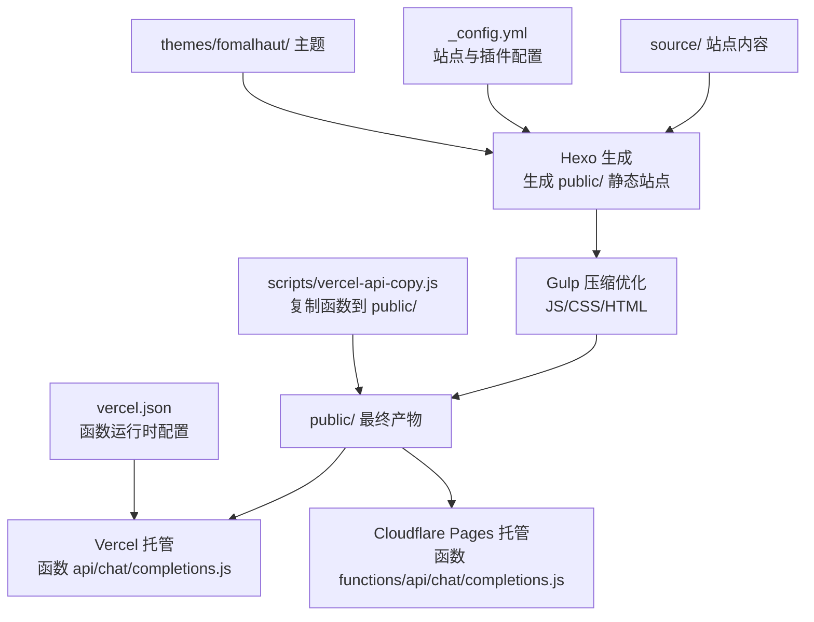
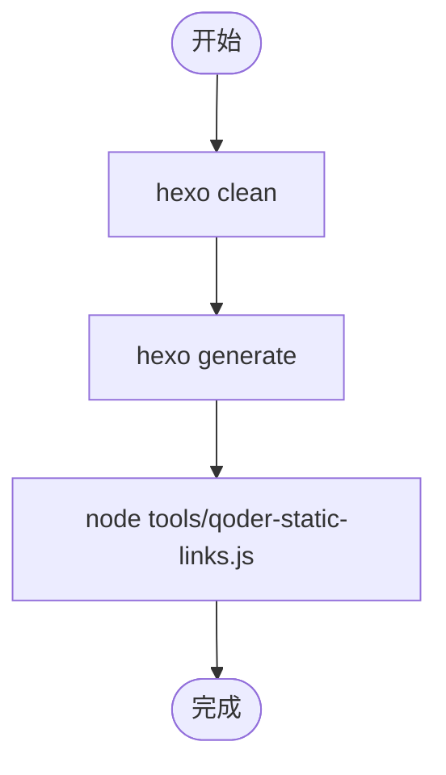
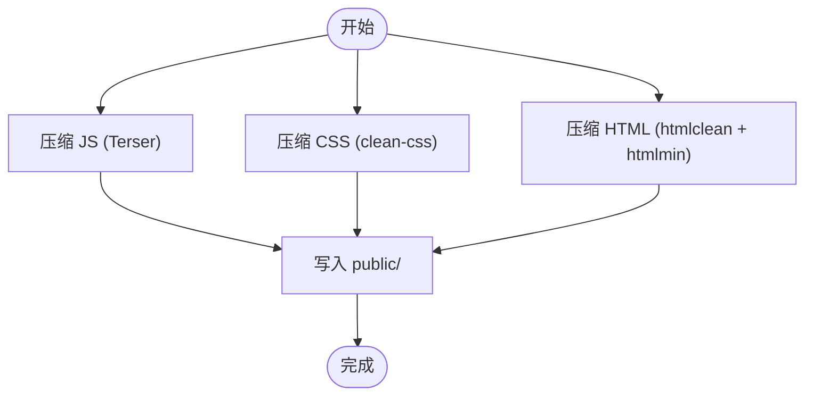
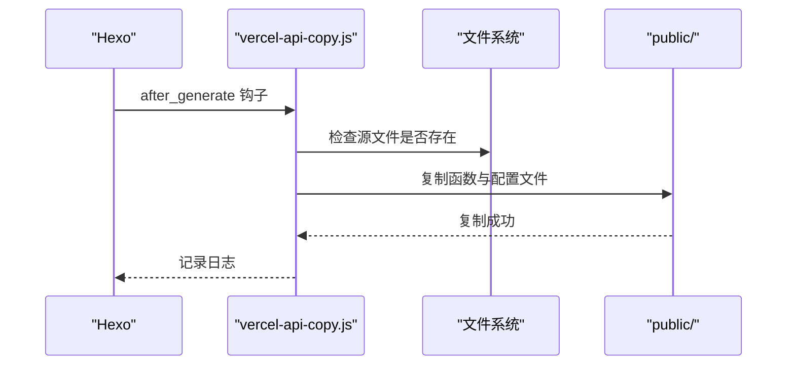

# 部署与运维

<cite>
**本文引用的文件**   
- [package.json](file://package.json)
- [_config.yml](file://_config.yml)
- [gulpfile.js](file://gulpfile.js)
- [vercel.json](file://vercel.json)
- [.github/dependabot.yml](file://.github/dependabot.yml)
- [tools/deploy-vercel.js](file://tools/deploy-vercel.js)
- [scripts/vercel-api-copy.js](file://scripts/vercel-api-copy.js)
</cite>

## 目录
1. [引言](#引言)
2. [项目结构与构建总览](#项目结构与构建总览)
3. [多平台部署方案](#多平台部署方案)
4. [构建流程详解](#构建流程详解)
5. [自动化部署配置](#自动化部署配置)
6. [性能监控与日志收集](#性能监控与日志收集)
7. [运维最佳实践](#运维最佳实践)
8. [常见问题与故障排除](#常见问题与故障排除)
9. [结论](#结论)

## 引言
本文面向博客站点的部署与运维，覆盖以下目标：
- 多平台部署：Vercel、GitHub Pages、Cloudflare Pages。
- 构建链路：Hexo 生成静态站点、Gulp 压缩优化、资源复制与函数产物处理。
- 自动化：Dependabot 依赖更新、可扩展的 CI/CD 流水线设计。
- 可观测性：访问统计、错误追踪、性能指标。
- 运维规范：备份策略、版本管理、灾难恢复。
- 排障指南：常见部署问题的定位与修复建议。

本仓库是一个基于 Hexo 的博客站点模板，主题位于 `themes/fomalhaut`，站点内容在 `source/`，构建产物输出到 `public/`，并通过脚本和配置文件适配 Vercel 与 Cloudflare Pages 的函数约定。

**章节来源**
- [package.json:1-75](file://package.json#L1-L75)
- [_config.yml:1-319](file://_config.yml#L1-L319)

## 项目结构与构建总览
该项目的关键目录与职责如下：
- `source/`：站点内容与自定义样式、脚本。
- `themes/fomalhaut/`：主题模板、布局、样式与插件扩展。
- `public/`：Hexo 生成的静态站点根目录（构建后产出）。
- `api/chat/completions.js`：Vercel 函数入口，提供 AI 对话代理路由。
- `functions/api/chat/completions.js`：Cloudflare Pages Function 入口，同名路由。
- `vercel.json`：Vercel 函数运行时配置（超时、内存、区域）。
- `tools/deploy-vercel.js`：一键代理模式构建部署脚本，注入 API Key 并执行 Hexo 命令。
- `scripts/vercel-api-copy.js`：Hexo 钩子，将函数与配置文件复制到 `public/`，使两个平台都能识别函数。
- `gulpfile.js`：对 `public/` 下的 JS/CSS/HTML 进行压缩与清理。
- `.github/dependabot.yml`：自动检测 npm 依赖更新并创建 PR。

**图表来源**
- [package.json:10-16](file://package.json#L10-L16)
- [_config.yml:131-143](file://_config.yml#L131-L143)
- [gulpfile.js:12-64](file://gulpfile.js#L12-L64)
- [vercel.json:1-12](file://vercel.json#L1-L12)
- [scripts/vercel-api-copy.js:22-46](file://scripts/vercel-api-copy.js#L22-L46)

**章节来源**
- [package.json:10-16](file://package.json#L10-L16)
- [_config.yml:131-143](file://_config.yml#L131-L143)
- [gulpfile.js:12-64](file://gulpfile.js#L12-L64)
- [vercel.json:1-12](file://vercel.json#L1-L12)
- [scripts/vercel-api-copy.js:22-46](file://scripts/vercel-api-copy.js#L22-L46)

## 多平台部署方案

### Vercel 部署
- 部署方式：将包含 `public/` 的仓库作为 Vercel 托管源；Vercel 会识别根目录的 `api/chat/completions.js` 为函数。
- 函数配置：`vercel.json` 中设置函数最大运行时间、内存与区域。
- 构建产物：通过本地或 CI 执行 `hexo generate` 生成 `public/`，再推送到 Vercel 托管仓库。
- 代理模式：使用 `tools/deploy-vercel.js` 注入环境变量 `DEEPSEEK_API_KEY`，页面走同源 `/api` 代理，避免前端直连暴露密钥。

步骤要点：
1. 准备 Vercel 账户并关联托管仓库。
2. 在 Vercel 项目设置中添加环境变量 `DEEPSEEK_API_KEY`。
3. 本地或 CI 执行 `npm run deploy:vercel`，脚本会读取密钥并依次执行 `hexo clean/generate/deploy`。
4. 确认 `vercel.json` 的区域与函数限制符合预期。

**章节来源**
- [vercel.json:1-12](file://vercel.json#L1-L12)
- [tools/deploy-vercel.js:1-82](file://tools/deploy-vercel.js#L1-L82)
- [package.json:10-16](file://package.json#L10-L16)

### GitHub Pages 部署
- 部署方式：Hexo 的 Git 部署器将 `public/` 推送到 GitHub Pages 仓库（例如 `yourname.github.io`）。
- 配置位置：`_config.yml` 中的 `deploy` 段指定 Git 仓库地址与分支。
- 注意事项：GitHub Pages 不支持服务器端函数，因此 AI 对话需通过外部服务或预渲染；若需要函数能力，建议使用 Vercel 或 Cloudflare Pages。

步骤要点：
1. 在 `_config.yml` 中配置 `deploy.type=git`、`repository` 与 `branch`。
2. 推送代码到主分支，触发 GitHub Actions 或手动执行 `hexo deploy`。
3. 验证站点 URL 与主题渲染是否正常。

**章节来源**
- [_config.yml:135-143](file://_config.yml#L135-L143)
- [package.json:10-16](file://package.json#L10-L16)

### Cloudflare Pages 部署
- 部署方式：将包含 `public/` 与 `functions/` 的仓库作为 Cloudflare Pages 托管源。
- 函数约定：Cloudflare Pages 识别根目录的 `functions/` 为函数目录，因此需要将函数复制到该路径。
- 复制逻辑：`scripts/vercel-api-copy.js` 在 Hexo 生成后把 `functions/api/chat/completions.js` 复制到 `public/functions/...`，确保 Pages 能识别函数。

步骤要点：
1. 在 Cloudflare Pages 项目中关联仓库并选择正确的分支。
2. 构建命令设置为 `npm run build`（即 `hexo generate`），输出目录为 `public`。
3. 确认 `functions/api/chat/completions.js` 存在且被复制到 `public/functions/...`。
4. 在 Cloudflare Pages 环境变量中添加 `DEEPSEEK_API_KEY`。

**章节来源**
- [scripts/vercel-api-copy.js:1-47](file://scripts/vercel-api-copy.js#L1-L47)
- [package.json:10-16](file://package.json#L10-L16)

## 构建流程详解

### Hexo 生成
- 入口脚本：`package.json` 的 `build` 脚本调用 `hexo generate`，随后执行静态链接修正脚本。
- 站点配置：`_config.yml` 定义站点元信息、URL、主题、插件、搜索、地图等。
- 跳过渲染：`skip_render` 指定某些第三方库与独立页面原样复制，不做 Nunjucks 渲染。

**图表来源**
- [package.json:10-16](file://package.json#L10-L16)
- [_config.yml:14-41](file://_config.yml#L14-L41)

**章节来源**
- [package.json:10-16](file://package.json#L10-L16)
- [_config.yml:14-41](file://_config.yml#L14-L41)

### Gulp 压缩与优化
- JS 压缩：`gulpfile.js` 的 `compress` 任务对 `public/**/*.js` 进行 Terser 压缩，排除已存在的 `.min.js`。
- CSS 压缩：`minify-css` 任务使用 clean-css 压缩 CSS，但排除含容器查询的文件以避免兼容性问题。
- HTML 压缩：`minify-html` 任务清理注释、空白、属性，并内联压缩页面内的 JS/CSS。
- 默认任务：`default` 并行执行上述三个任务。

**图表来源**
- [gulpfile.js:12-64](file://gulpfile.js#L12-L64)

**章节来源**
- [gulpfile.js:12-64](file://gulpfile.js#L12-L64)

### 资源复制与函数产物
- 目的：让 Vercel 与 Cloudflare Pages 同时识别函数。
- 实现：`scripts/vercel-api-copy.js` 在 `after_generate` 钩子中将 `api/chat/completions.js`、`vercel.json`、`functions/api/chat/completions.js` 复制到 `public/` 对应路径。
- 结果：Vercel 从 `public/api/...` 识别函数；Cloudflare Pages 从 `public/functions/...` 识别函数。

**图表来源**
- [scripts/vercel-api-copy.js:22-46](file://scripts/vercel-api-copy.js#L22-L46)

**章节来源**
- [scripts/vercel-api-copy.js:1-47](file://scripts/vercel-api-copy.js#L1-L47)

## 自动化部署配置

### Dependabot 依赖更新
- 作用：每日扫描 npm 依赖，发现新版本时自动创建 Pull Request。
- 配置：`.github/dependabot.yml` 设置包生态、目录、调度频率与 PR 数量上限。

建议：
- 定期审查 Dependabot 创建的 PR，合并前进行本地测试。
- 对于重大版本升级，先在开发分支验证兼容性。

**章节来源**
- [.github/dependabot.yml:1-8](file://.github/dependabot.yml#L1-L8)

### CI/CD 流水线设计（可扩展）
当前仓库未包含 GitHub Actions 工作流文件，可按以下思路扩展：
- 触发条件：Push 到 main 分支或创建 Pull Request。
- 环境：Node.js >= 18（依据 `package.json` 的 engines 字段）。
- 步骤：
  1. 安装依赖：`npm ci`。
  2. 构建站点：`npm run build`。
  3. 运行测试（如有）：`npm test`。
  4. 部署：根据平台选择 `hexo deploy` 或上传 `public/` 到 Vercel/Cloudflare Pages。
- 缓存：缓存 `node_modules` 与 Hexo 缓存目录以加速构建。

注意：
- 若启用 Vercel 代理模式，需在 CI 环境变量中设置 `DEEPSEEK_API_KEY`。
- 若仅部署 GitHub Pages，无需函数相关配置。

**章节来源**
- [package.json:7-16](file://package.json#L7-L16)

## 性能监控与日志收集

### 访问统计
- 集成方案：站点包含 `51la.js` 与 `stats.js`，可用于访问统计与基础指标采集。
- 配置位置：`source/js/51la.js` 与 `source/js/stats.js`。
- 建议：
  - 在隐私合规前提下开启统计。
  - 结合平台自带分析（如 Vercel Analytics、Cloudflare Analytics）交叉验证。

**章节来源**
- [source/js/51la.js](file://source/js/51la.js)
- [source/js/stats.js](file://source/js/stats.js)

### 错误追踪
- 前端错误：可通过全局错误捕获脚本（如 `source/js/inject/ping-route.js`）上报异常。
- 后端函数错误：Vercel 与 Cloudflare Pages 均提供函数日志查看界面，建议在函数中统一错误格式并记录必要上下文。

建议：
- 在生产环境关闭详细堆栈输出，仅记录错误码与请求摘要。
- 使用 Sentry 或类似服务集中管理前端错误。

**章节来源**
- [source/js/inject/ping-route.js](file://source/js/inject/ping-route.js)

### 性能指标
- 核心指标：首屏加载时间、FCP/LCP、CLS、TTI。
- 工具链：
  - Lighthouse 审计。
  - WebPageTest 与 PageSpeed Insights。
  - 浏览器开发者工具 Performance 面板。
- 优化点：
  - 图片懒加载与 WebP/AVIF。
  - 字体子集化与自托管。
  - 静态资源 CDN 与缓存策略。

[本节为通用指导，不直接分析具体文件]

## 运维最佳实践

### 备份策略
- 代码备份：Git 仓库本身即为代码备份，建议开启双分支保护（main 与 develop）。
- 数据备份：
  - 站点内容：`source/_posts/` 定期归档。
  - 配置备份：`_config.yml`、`_config.fomalhaut.yml`、`vercel.json`。
  - 函数代码：`api/chat/completions.js`、`functions/api/chat/completions.js`。
- 制品备份：保留每次构建的 `public/` 压缩包，便于回滚。

### 版本管理
- 语义化版本：遵循 `major.minor.patch`，在发布前打标签。
- 变更日志：维护 `CHANGELOG.md`，记录功能、修复与破坏性变更。
- 分支策略：
  - `main`：生产稳定分支。
  - `develop`：集成开发分支。
  - `feature/*`：功能分支。
  - `hotfix/*`：紧急修复分支。

### 灾难恢复
- 快速回滚：通过 Git 标签或平台控制台回滚到上一个稳定版本。
- 数据恢复：从备份恢复站点内容与配置。
- 故障演练：定期模拟函数不可用、CDN 失效等场景，验证降级策略。

[本节为通用指导，不直接分析具体文件]

## 常见问题与故障排除

### Vercel 函数 404
- 现象：访问 `/api/chat/completions` 返回 404。
- 原因：`public/` 中缺少 `api/chat/completions.js`。
- 排查：
  - 确认 `scripts/vercel-api-copy.js` 已执行并复制函数。
  - 检查 `api/chat/completions.js` 是否存在于源码根目录。
  - 查看构建日志是否有复制失败警告。

**章节来源**
- [scripts/vercel-api-copy.js:28-46](file://scripts/vercel-api-copy.js#L28-L46)

### Vercel 函数超时或内存不足
- 现象：函数执行中断或 OOM。
- 原因：`vercel.json` 中 `maxDuration` 或 `memory` 设置过低。
- 解决：提高超时与内存限制，或优化函数逻辑。

**章节来源**
- [vercel.json:1-12](file://vercel.json#L1-L12)

### Gulp CSS 压缩导致样式异常
- 现象：公告栏样式缺失或间距异常。
- 原因：clean-css 对 `@container` 容器查询支持不佳，误删规则。
- 解决：排除相关文件不参与 CSS 压缩，交由平台 Brotli 压缩。

**章节来源**
- [gulpfile.js:20-38](file://gulpfile.js#L20-L38)

### 未配置 API Key 导致代理失效
- 现象：AI 助手提示未配置 API Key。
- 原因：未设置 `DEEPSEEK_API_KEY` 或未通过 `tools/deploy-vercel.js` 注入。
- 解决：
  - 在 Vercel/Cloudflare Pages 环境变量中添加 `DEEPSEEK_API_KEY`。
  - 或使用 `tools/deploy-vercel.js` 从 `.ai-chat-key` 或 `_config.fomalhaut.yml` 读取密钥。

**章节来源**
- [tools/deploy-vercel.js:35-65](file://tools/deploy-vercel.js#L35-L65)

### GitHub Pages 无法运行函数
- 现象：部署后 `/api/...` 返回 404 或 405。
- 原因：GitHub Pages 仅托管静态资源，不支持服务器端函数。
- 解决：改用 Vercel 或 Cloudflare Pages，或将函数逻辑迁移至外部服务。

**章节来源**
- [scripts/vercel-api-copy.js:5-16](file://scripts/vercel-api-copy.js#L5-L16)

## 结论
本项目通过 Hexo 生成静态站点，并结合 Gulp 进行资源压缩优化，同时通过脚本与配置文件适配 Vercel 与 Cloudflare Pages 的函数约定。借助 Dependabot 实现依赖自动化更新，并可扩展 CI/CD 流水线以提升交付效率。在运维层面，建议建立完善的备份、版本管理与灾难恢复机制，并结合平台分析与前端监控提升可观测性。遇到问题时，优先检查函数复制逻辑、环境变量与平台函数配置，逐步定位并修复。

[本节为总结性内容，不直接分析具体文件]