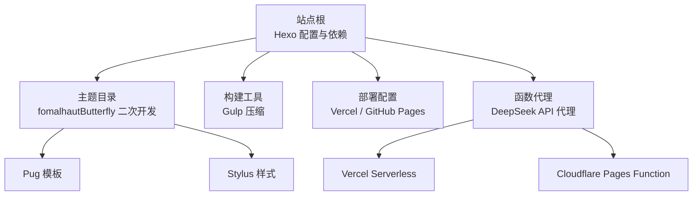
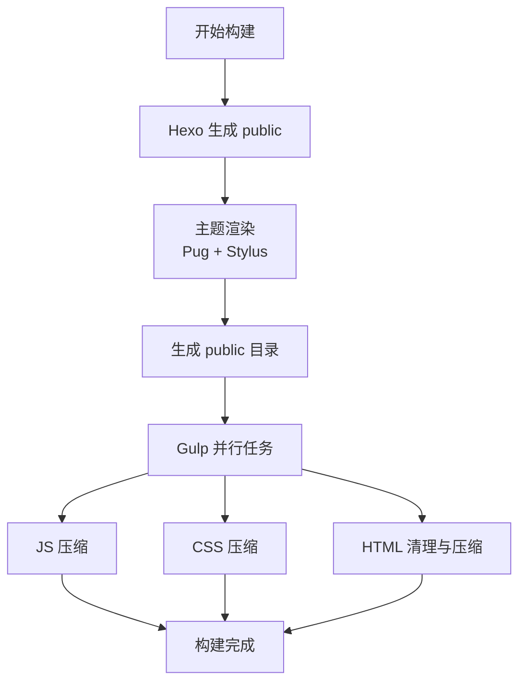
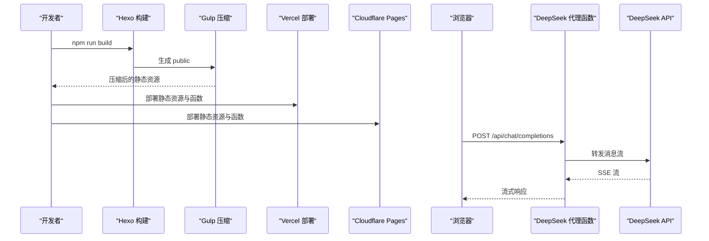
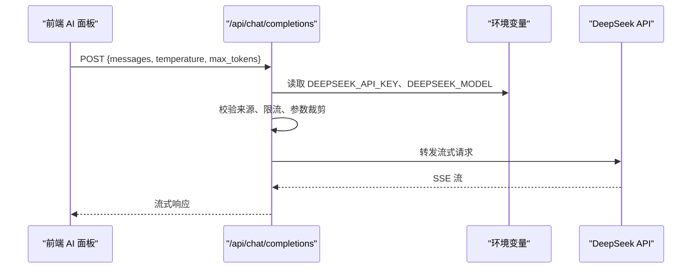
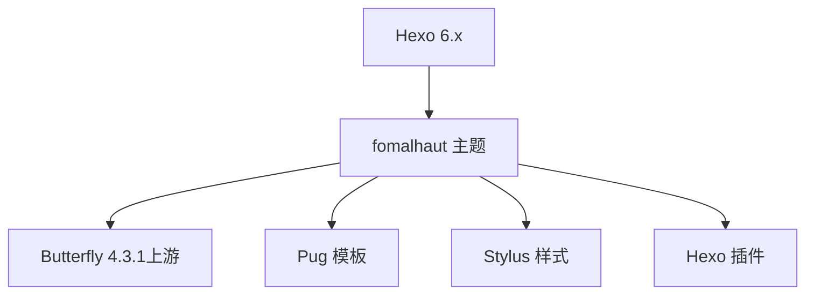
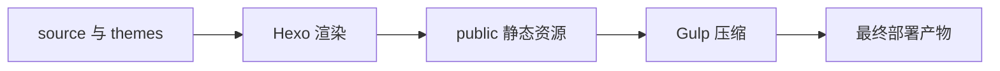

# 技术栈概览

<cite>
**本文引用的文件**   
- [package.json](file://package.json)
- [_config.yml](file://_config.yml)
- [_config.fomalhaut.yml](file://_config.fomalhaut.yml)
- [themes/fomalhaut/package.json](file://themes/fomalhaut/package.json)
- [themes/fomalhaut/_config.yml](file://themes/fomalhaut/_config.yml)
- [themes/fomalhaut/scripts/butterfly-version.js](file://themes/fomalhaut/scripts/butterfly-version.js)
- [gulpfile.js](file://gulpfile.js)
- [vercel.json](file://vercel.json)
- [api/chat/completions.js](file://api/chat/completions.js)
- [functions/api/chat/completions.js](file://functions/api/chat/completions.js)
</cite>

## 目录
1. [引言](#引言)
2. [项目结构与技术边界](#项目结构与技术边界)
3. [核心技术栈总览](#核心技术栈总览)
4. [构建与部署流水线](#构建与部署流水线)
5. [第三方服务集成](#第三方服务集成)
6. [运行环境与兼容性](#运行环境与兼容性)
7. [架构关系图](#架构关系图)
8. [技术优势、限制与升级计划](#技术优势限制与升级计划)
9. [常见问题排查](#常见问题排查)
10. [结论](#结论)

## 引言
本文件为 hexo-theme-fomalhaut 博客主题的技术栈文档。该仓库是一个基于 Hexo 的站点模板，并深度二次开发 Butterfly 主题；它同时承担“静态站点生成 + 主题二次开发 + Vercel/Cloudflare 函数代理 + Gulp 产物压缩”的多重职责。本文从系统架构、组件关系、数据流、工具链、部署平台、第三方服务、兼容性与未来升级方向等维度进行说明，帮助读者在不深入源码的情况下理解整个技术体系。

## 项目结构与技术边界
仓库不是单一主题包，而是“站点根 + 主题子目录 + 函数实现 + 构建脚本”的组合：
- 站点根负责 Hexo 配置、依赖声明、Gulp 压缩、Vercel 部署配置以及 DeepSeek API 代理函数。
- `themes/fomalhaut` 是 Butterfly 主题的二次开发分支，包含 Pug 模板、Stylus 样式、主题配置和事件脚本。
- `api/chat/completions.js` 面向 Vercel Serverless Function。
- `functions/api/chat/completions.js` 面向 Cloudflare Pages Function。
- `scripts` 与 `tools` 提供构建期注入、链接修复、Vercel 部署辅助等功能。

**图表来源**
- [package.json:1-75](file://package.json#L1-L75)
- [themes/fomalhaut/package.json:1-32](file://themes/fomalhaut/package.json#L1-L32)
- [gulpfile.js:1-64](file://gulpfile.js#L1-L64)
- [vercel.json:1-12](file://vercel.json#L1-L12)
- [api/chat/completions.js:1-209](file://api/chat/completions.js#L1-L209)
- [functions/api/chat/completions.js:1-184](file://functions/api/chat/completions.js#L1-L184)

**章节来源**
- [package.json:1-75](file://package.json#L1-L75)
- [themes/fomalhaut/package.json:1-32](file://themes/fomalhaut/package.json#L1-L32)

## 核心技术栈总览
| 技术 | 版本或范围 | 在项目中的作用 | 选择原因 | 主要影响 |
|---|---:|---|---|---|
| Node.js | `>=18` | 运行 Hexo、安装依赖、执行 Gulp 与自定义脚本 | 现代 Node LTS 支持 fetch、模块语法、更稳定的异步流 | 旧环境无法直接运行；需使用 18/20/22 LTS |
| Hexo | `^6.2.0`，主题声明 `hexo: 6.3.0` | 静态站点生成器，负责渲染 Markdown、加载主题、生成 public 目录 | 生态成熟、插件丰富、适合个人博客 | 主题与插件需兼容 Hexo 6.x |
| Butterfly 基础主题 | fork 自 `4.3.1` | 提供卡片式 UI、布局、侧边栏、搜索、评论、CDN 管理等能力 | 扩展性强、可二次开发、社区活跃 | 升级 Butterfly 时需同步更新 `butterfly-version.js` |
| Pug 模板引擎 | `hexo-renderer-pug ^3.0.0` | 主题 layout 与 includes 使用 Pug 编写页面结构 | 缩进语法清晰、适合复杂嵌套布局 | 需要正确缩进与变量注入 |
| Stylus CSS 预处理器 | `hexo-renderer-stylus ^2.1.0` | 主题样式以 Stylus 组织，支持变量、混入、模块化 | 语法简洁、适合主题级样式管理 | 编译产物进入 public/css |
| Gulp | `^4.0.2` | 对生成的 JS/CSS/HTML 进行压缩与清理 | 任务化构建、可并行处理 | 需注意 `@container` 等特性被 clean-css 误删的问题 |
| Vercel | Serverless Function 部署 | 托管前端静态资源与 `/api/chat/completions` 代理 | 零配置部署、环境变量安全、支持 Edge 区域 | 函数超时、内存、限流受平台限制 |
| Cloudflare Pages | Pages Function 部署 | 提供与 Vercel 同路径的 DeepSeek 代理函数 | 多平台兼容、Edge 网络 | 函数命名约定与 Vercel 不同，需单独实现 |
| Algolia 搜索 | `hexo-algoliasearch` | 构建时索引文章，前端通过 Algolia 搜索 | 全文检索能力强、可扩展字段 | 需要 appId、apiKey、indexName |
| Twikoo 评论 | 主题配置启用 Twikoo | 评论系统后端由 Twikoo 提供 | 轻量、可自建、支持多种存储 | 需要 envId 与部署环境 |
| DeepSeek API | 服务端代理 | 浏览器不直接暴露密钥，通过同源函数转发请求 | 保护 API Key、统一限流与校验 | 需要设置环境变量与域名白名单 |

**章节来源**
- [package.json:1-75](file://package.json#L1-L75)
- [themes/fomalhaut/package.json:1-32](file://themes/fomalhaut/package.json#L1-L32)
- [themes/fomalhaut/scripts/butterfly-version.js:1-16](file://themes/fomalhaut/scripts/butterfly-version.js#L1-L16)
- [_config.yml:145-167](file://_config.yml#L145-L167)
- [_config.fomalhaut.yml:629-635](file://_config.fomalhaut.yml#L629-L635)
- [api/chat/completions.js:1-209](file://api/chat/completions.js#L1-L209)
- [functions/api/chat/completions.js:1-184](file://functions/api/chat/completions.js#L1-L184)

## 构建与部署流水线
### 构建阶段
1. 用户执行 `npm run build`，实际调用 `hexo generate && node tools/qoder-static-links.js`。
2. Hexo 读取 `_config.yml` 与 `themes/fomalhaut/_config.yml`，加载主题、插件、Markdown 渲染器、Pug/Stylus 渲染器。
3. 主题事件脚本会输出 Butterfly 上游版本信息，并参与 CDN 地址拼接。
4. 生成产物位于 `public` 目录。
5. Gulp 默认任务并行执行：
   - 压缩 `public/**/*.js`（排除已 `.min.js`）。
   - 压缩 `public/**/*.css`（排除 `site-inject.css` 与 `twikoo.css`，避免 clean-css 破坏容器查询规则）。
   - 清理并压缩 HTML。

**图表来源**
- [package.json:10-15](file://package.json#L10-L15)
- [gulpfile.js:12-64](file://gulpfile.js#L12-L64)
- [themes/fomalhaut/scripts/butterfly-version.js:1-16](file://themes/fomalhaut/scripts/butterfly-version.js#L1-L16)

**章节来源**
- [package.json:10-15](file://package.json#L10-L15)
- [gulpfile.js:12-64](file://gulpfile.js#L12-L64)

### 部署阶段
- **GitHub Pages**：可通过 Hexo deployer-git 将 `public` 推送到 GitHub Pages 仓库。
- **Vercel**：通过 `vercel.json` 配置函数路由与区域，`api/chat/completions.js` 作为 Serverless Function 运行。
- **Cloudflare Pages**：通过 `functions/api/chat/completions.js` 提供同名路由的函数实现。

**图表来源**
- [vercel.json:1-12](file://vercel.json#L1-L12)
- [api/chat/completions.js:118-209](file://api/chat/completions.js#L118-L209)
- [functions/api/chat/completions.js:108-184](file://functions/api/chat/completions.js#L108-L184)

**章节来源**
- [vercel.json:1-12](file://vercel.json#L1-L12)
- [api/chat/completions.js:1-209](file://api/chat/completions.js#L1-L209)
- [functions/api/chat/completions.js:1-184](file://functions/api/chat/completions.js#L1-L184)

## 第三方服务集成
### Algolia 搜索
- 站点根 `_config.yml` 中启用了 `hexo-algoliasearch`，并配置了 `appId`、`apiKey`、`adminApiKey`、`indexName` 与字段列表。
- 主题层也保留 Algolia 搜索开关，但当前站点配置更偏向构建期索引。

**章节来源**
- [_config.yml:145-167](file://_config.yml#L145-L167)
- [themes/fomalhaut/_config.yml:45-56](file://themes/fomalhaut/_config.yml#L45-L56)

### Twikoo 评论
- 主题配置启用 Twikoo，并通过 `comments.use` 指定评论系统。
- 站点层还包含 Twikoo 相关样式与懒加载逻辑。

**章节来源**
- [_config.fomalhaut.yml:541-551](file://_config.fomalhaut.yml#L541-L551)
- [_config.fomalhaut.yml:629-635](file://_config.fomalhaut.yml#L629-L635)
- [themes/fomalhaut/_config.yml:338-345](file://themes/fomalhaut/_config.yml#L338-L345)

### DeepSeek API 代理
- 浏览器不直接持有 DeepSeek 密钥，而是调用同源 `/api/chat/completions`。
- Vercel 与 Cloudflare 分别提供函数实现，均做来源白名单、请求体大小限制、消息条数限制、token 上限、每小时限流。
- 健康检查 GET 返回代理模式、模型名、是否配置密钥等信息。

**图表来源**
- [api/chat/completions.js:118-209](file://api/chat/completions.js#L118-L209)
- [functions/api/chat/completions.js:116-184](file://functions/api/chat/completions.js#L116-L184)

**章节来源**
- [api/chat/completions.js:1-209](file://api/chat/completions.js#L1-L209)
- [functions/api/chat/completions.js:1-184](file://functions/api/chat/completions.js#L1-L184)

## 运行环境与兼容性
### Node.js 版本要求
- 站点根 `package.json` 声明 `engines.node >=18`。
- 这意味着推荐使用 Node.js 18、20 或 22 LTS。
- 若使用更低版本，可能遇到模块解析、fetch、Promise 行为差异等问题。

**章节来源**
- [package.json:7-9](file://package.json#L7-L9)

### Hexo 与主题版本
- 站点根 `package.json` 中 Hexo 依赖为 `^6.2.0`，并在 `hexo.version` 中声明 `6.3.0`。
- 主题 fork 自 Butterfly `4.3.1`，由 `themes/fomalhaut/scripts/butterfly-version.js` 维护。
- 升级 Butterfly 时需要修改该版本号，否则 CDN 地址与启动横幅可能不一致。

**章节来源**
- [package.json:17-19](file://package.json#L17-L19)
- [themes/fomalhaut/scripts/butterfly-version.js:1-16](file://themes/fomalhaut/scripts/butterfly-version.js#L1-L16)

### 模板与样式引擎
- 主题依赖 `hexo-renderer-pug` 与 `hexo-renderer-stylus`。
- Pug 用于 layout、includes、widget、third-party 等模板。
- Stylus 用于全局样式、布局、页面样式、标签样式、搜索样式等。

**章节来源**
- [themes/fomalhaut/package.json:24-27](file://themes/fomalhaut/package.json#L24-L27)

## 架构关系图
### 主题与 Hexo 的关系

**图表来源**
- [package.json:20-63](file://package.json#L20-L63)
- [themes/fomalhaut/package.json:24-27](file://themes/fomalhaut/package.json#L24-L27)
- [themes/fomalhaut/scripts/butterfly-version.js:1-16](file://themes/fomalhaut/scripts/butterfly-version.js#L1-L16)

### 构建产物与压缩关系

**图表来源**
- [gulpfile.js:12-64](file://gulpfile.js#L12-L64)

## 技术优势、限制与升级计划
### 优势
- **生态完整**：Hexo + Butterfly 提供成熟的主题框架，Pug/Stylus 让模板与样式易于组织。
- **可二次开发**：主题 fork Butterfly，便于在保持上游能力的同时扩展功能。
- **多平台部署**：同时支持 Vercel 与 Cloudflare Pages 函数，适配不同部署场景。
- **安全性较好**：DeepSeek API Key 放在服务端，浏览器只访问同源函数。
- **构建可控**：Gulp 任务明确，可对 JS/CSS/HTML 分别优化。

### 限制
- **Node.js 版本门槛**：要求 `>=18`，旧环境无法直接使用。
- **clean-css 兼容性问题**：Gulp 中已排除含 `@container` 的文件，避免样式被错误压缩。
- **第三方依赖风险**：Algolia、Twikoo、DeepSeek 等服务依赖外部平台稳定性。
- **函数限流非严格全局**：Cloudflare 函数限流基于 isolate 内存计数，冷启动会重置。
- **主题与上游版本解耦**：主题版本与 Butterfly 上游版本分开维护，升级时需同步。

### 未来升级建议
- 持续跟踪 Hexo 6.x 到 7.x 的迁移路径。
- 评估将 Stylus 迁移至 PostCSS 或 Tailwind 的可能性，提升现代 CSS 生态兼容性。
- 将 Gulp 任务逐步迁移至更现代的构建工具，如 Vite 或 Esbuild，提高构建性能。
- 对 Algolia 索引策略进行增量更新优化，减少全量重建成本。
- 对 DeepSeek 代理增加更严格的配额、审计日志与告警机制。
- 升级 Butterfly 时同步更新 `butterfly-version.js`，并回归测试主题样式与功能。

[本节为通用建议，不直接分析具体代码文件]

## 常见问题排查
### 本地构建后公告栏样式异常
- 现象：本地正常，部署后公告栏样式缺失。
- 原因：clean-css 不认识 `@container`，会把容器查询包裹内的规则摊平或删除。
- 处理：Gulp 已排除 `site-inject.css` 与 `twikoo.css`，避免该问题。

**章节来源**
- [gulpfile.js:20-38](file://gulpfile.js#L20-L38)

### Vercel 函数健康检查失败
- 现象：访问 `/api/chat/completions` 未返回预期健康状态。
- 原因：未配置 `DEEPSEEK_API_KEY` 环境变量。
- 处理：在 Vercel Settings → Environment Variables 中添加密钥并重新部署。

**章节来源**
- [api/chat/completions.js:118-140](file://api/chat/completions.js#L118-L140)

### Cloudflare Pages 函数 405
- 现象：POST 到 `/api/chat/completions` 返回 405。
- 原因：Cloudflare Pages 不识别 `api/chat/completions.js` 为函数，需使用 `functions/` 目录。
- 处理：使用 `functions/api/chat/completions.js` 作为 Pages Function 实现。

**章节来源**
- [functions/api/chat/completions.js:1-21](file://functions/api/chat/completions.js#L1-L21)

### Algolia 搜索不可用
- 现象：搜索框无结果或报错。
- 原因：未配置 `appId`、`apiKey`、`indexName`，或索引未构建。
- 处理：检查 `_config.yml` 中 algolia 配置，并确保构建时生成索引。

**章节来源**
- [_config.yml:145-167](file://_config.yml#L145-L167)

### Twikoo 评论无法加载
- 现象：评论区域空白或报错。
- 原因：未配置 `envId` 或评论服务不可用。
- 处理：检查 `_config.fomalhaut.yml` 中 twikoo 配置，确认服务可用。

**章节来源**
- [_config.fomalhaut.yml:629-635](file://_config.fomalhaut.yml#L629-L635)

## 结论
hexo-theme-fomalhaut 是一个以 Hexo 6.x 为核心、Butterfly 4.3.1 为基础、Pug 与 Stylus 为模板与样式引擎的博客主题方案。它在传统静态站点生成之上，叠加了 Gulp 构建优化、Vercel/Cloudflare 函数代理、Algolia 搜索与 Twikoo 评论等现代 Web 能力。其优势在于生态成熟、扩展性强、部署灵活；限制在于 Node.js 版本门槛、第三方服务依赖与部分构建工具的兼容性问题。未来可在构建工具、CSS 生态、索引策略与服务治理方面继续演进，以提升性能、可维护性与安全性。

[本节为总结性内容，不直接分析具体代码文件]