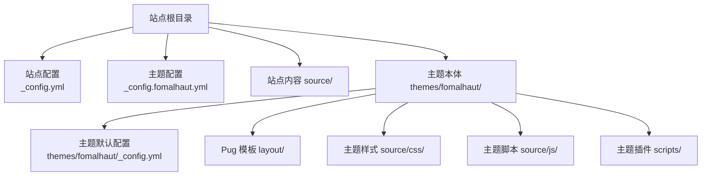
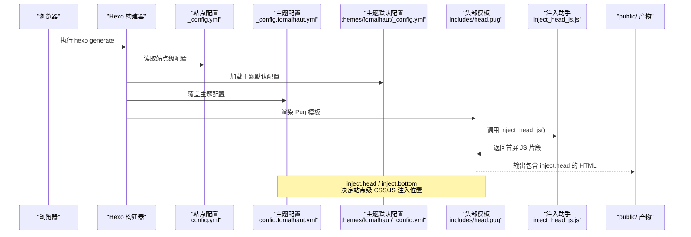
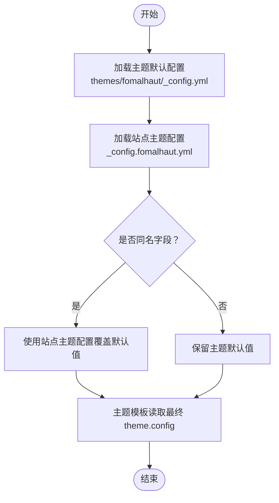
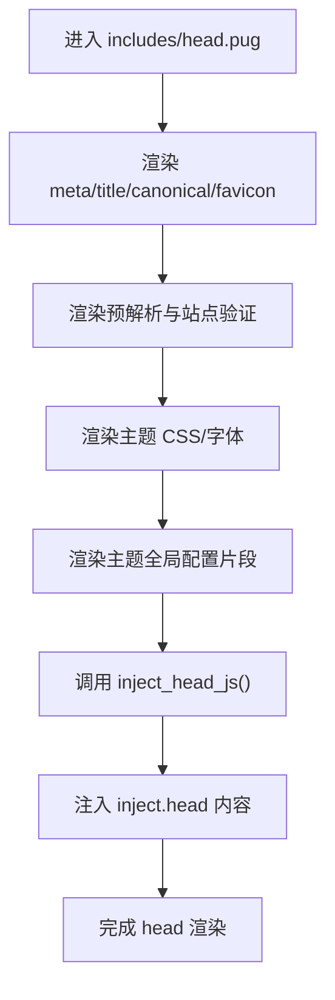
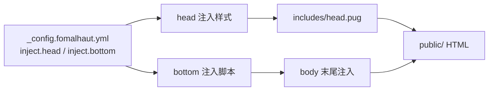
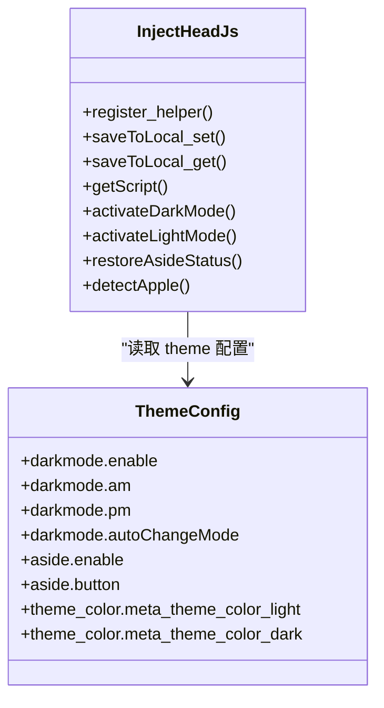
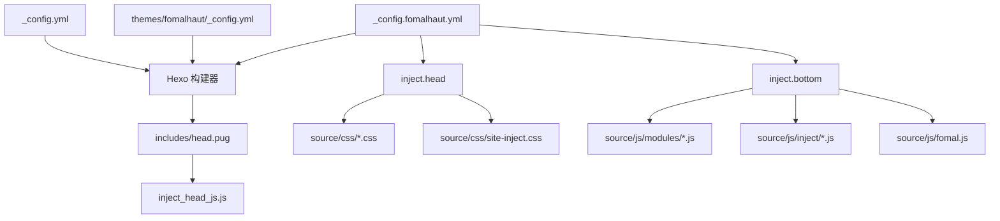

# 架构设计理念

<cite>
**本文引用的文件**   
- [站点配置 _config.yml](file://_config.yml)
- [主题配置 _config.fomalhaut.yml](file://_config.fomalhaut.yml)
- [主题默认配置 themes/fomalhaut/_config.yml](file://themes/fomalhaut/_config.yml)
- [主题 README themes/fomalhaut/README.md](file://themes/fomalhaut/README.md)
- [项目总览 README.md](file://README.md)
- [头部模板 includes/head.pug](file://themes/fomalhaut/layout/includes/head.pug)
- [注入头脚本 helpers/inject_head_js.js](file://themes/fomalhaut/scripts/helpers/inject_head_js.js)
</cite>

## 目录
1. [引言](#引言)
2. [项目结构](#项目结构)
3. [核心组件](#核心组件)
4. [架构总览](#架构总览)
5. [详细组件分析](#详细组件分析)
6. [依赖关系分析](#依赖关系分析)
7. [性能与可维护性](#性能与可维护性)
8. [故障排查指南](#故障排查指南)
9. [结论](#结论)

## 引言
本设计文档围绕 hexo-theme-fomalhaut 的「站点配置与主题代码彻底分离」理念展开，解释三层配置优先级、目录结构分离原则以及 `inject.head` / `inject.bottom` 注入机制如何共同解决传统 Hexo 主题定制中“改源码难升级”的问题。通过模块化拆分站点样式与脚本、把主题逻辑保留在 `themes/fomalhaut/` 内，站点侧改动可以以配置和独立文件形式存在；主题升级时只需替换主题目录，而不必重新合并大量自定义修改。

## 项目结构
仓库采用「站点根目录 + 主题目录」双轨组织：

- `source/`：站点内容（文章、页面、站点级 CSS/JS、静态资源）。
- `themes/fomalhaut/`：主题本体（Pug 模板、Stylus 样式、主题脚本、主题级 Hexo 插件）。
- `_config.yml`：Hexo 站点级配置。
- `_config.fomalhaut.yml`：站点对 fomalhaut 主题的覆盖配置，是实际生效的主题配置入口。
- `themes/fomalhaut/_config.yml`：主题默认配置模板，用于参考和兜底。

**图表来源**
- [项目总览 README.md:261-284](file://README.md#L261-L284)
- [主题 README themes/fomalhaut/README.md:7-20](file://themes/fomalhaut/README.md#L7-L20)

**章节来源**
- [项目总览 README.md:261-284](file://README.md#L261-L284)
- [主题 README themes/fomalhaut/README.md:7-20](file://themes/fomalhaut/README.md#L7-L20)

## 核心组件
本项目的核心由三类组件构成：

| 组件 | 职责 | 关键位置 |
| --- | --- | --- |
| 站点配置层 | 定义站点元信息、URL、部署、第三方插件等全局行为 | `_config.yml` |
| 主题配置层 | 定义导航、搜索、评论、外观、效果、注入等主题开关 | `_config.fomalhaut.yml` |
| 主题默认配置层 | 提供主题自带默认值，作为参考与兜底 | `themes/fomalhaut/_config.yml` |

三层配置遵循 Hexo 5+ 的 `_config.[theme].yml` 机制：站点根目录下的 `_config.fomalhaut.yml` 会覆盖主题默认配置中的同名字段，而 `_config.yml` 负责站点自身而非主题细节。

**章节来源**
- [站点配置 _config.yml:1-131](file://_config.yml#L1-L131)
- [主题配置 _config.fomalhaut.yml:1-120](file://_config.fomalhaut.yml#L1-L120)
- [主题默认配置 themes/fomalhaut/_config.yml:1-80](file://themes/fomalhaut/_config.yml#L1-L80)
- [主题 README themes/fomalhaut/README.md:33-36](file://themes/fomalhaut/README.md#L33-L36)
- [项目总览 README.md:286-292](file://README.md#L286-L292)

## 架构总览
下图展示从用户请求到最终 HTML 输出的整体流程，以及三层配置与注入机制的作用点。

**图表来源**
- [头部模板 includes/head.pug:70-78](file://themes/fomalhaut/layout/includes/head.pug#L70-L78)
- [注入头脚本 helpers/inject_head_js.js:8-150](file://themes/fomalhaut/scripts/helpers/inject_head_js.js#L8-L150)
- [项目总览 README.md:261-284](file://README.md#L261-L284)

## 详细组件分析

### 三层配置优先级
三层配置的优先级如下：

1. **站点级 `_config.yml`**  
   负责 Hexo 站点基础信息，例如标题、作者、语言、URL、permalink、部署目标、Algolia、本地搜索、归档分页、插件列表等。它不直接承担主题外观开关，而是为整个站点提供运行上下文。

2. **主题级 `_config.fomalhaut.yml`**  
   这是本站真正生效的主题配置入口。导航菜单、社交图标、搜索系统、数学公式、封面图、评论系统、页脚、分析统计、广告、美化效果、主题色、背景、侧栏卡片、AI 助手等全部集中在这里。该文件还承载 `inject.head` 与 `inject.bottom`，是站点向主题注入自定义资源的统一入口。

3. **主题默认配置 `themes/fomalhaut/_config.yml`**  
   作为主题自带的默认值模板。主题 README 明确指出：修改主题目录内的这份文件不会生效，实际生效的是站点根目录的 `_config.fomalhaut.yml`。

**图表来源**
- [主题 README themes/fomalhaut/README.md:33-36](file://themes/fomalhaut/README.md#L33-L36)
- [项目总览 README.md:286-292](file://README.md#L286-L292)

**章节来源**
- [站点配置 _config.yml:1-131](file://_config.yml#L1-L131)
- [主题配置 _config.fomalhaut.yml:1-120](file://_config.fomalhaut.yml#L1-L120)
- [主题默认配置 themes/fomalhaut/_config.yml:1-80](file://themes/fomalhaut/_config.yml#L1-L80)
- [主题 README themes/fomalhaut/README.md:33-36](file://themes/fomalhaut/README.md#L33-L36)
- [项目总览 README.md:286-292](file://README.md#L286-L292)

### 目录结构分离原则
项目将「站点内容」与「主题代码」严格分开：

| 目录 | 归属 | 说明 |
| --- | --- | --- |
| `source/` | 站点内容 | Markdown 文章、独立页面、站点级 CSS/JS、静态资源、数据文件 |
| `themes/fomalhaut/` | 主题代码 | Pug 模板、Stylus 样式、主题脚本、主题级 Hexo 插件、多语言文案 |
| `scripts/` | 站点级 Hexo 插件 | 构建期过滤器、辅助脚本，不参与运行时页面渲染 |
| `tools/tests/` | 回归测试 | 针对导航、滚动、夜间模式、主题色等行为的自动化校验 |

这种分离带来的好处是：

- 站点样式集中在 `source/css/*.css` 与 `themes/fomalhaut/source/css/_custom/custom.css`。
- 站点脚本拆分为模块 `source/js/modules/` 与注入脚本 `source/js/inject/`。
- 主题升级时只替换 `themes/fomalhaut/`，不必重新合并站点侧的大量魔改。

**章节来源**
- [项目总览 README.md:249-252](file://README.md#L249-L252)
- [项目总览 README.md:310-314](file://README.md#L310-L314)
- [项目总览 README.md:472-504](file://README.md#L472-L504)
- [项目总览 README.md:506-525](file://README.md#L506-L525)
- [项目总览 README.md:573-587](file://README.md#L573-L587)
- [项目总览 README.md:628-642](file://README.md#L628-L642)

### 注入机制实现：inject.head 与 inject.bottom
`inject.head` 与 `inject.bottom` 是站点向主题输出注入自定义资源的通道：

- `inject.head`：插入到 `</head>` 之前，适合引入预连接、字体预加载、站点级 CSS、首屏必要脚本、运行时空槽等。
- `inject.bottom`：插入到 `</body>` 之前，适合引入统计脚本、第三方库、站点主引导脚本、模块脚本、按需加载脚本等。

头部模板在渲染过程中会：

1. 渲染主题基础 meta、title、canonical、favicon。
2. 渲染预解析、网站验证、PWA、Google Adsense、Analytics 等公共片段。
3. 渲染主题主样式与字体。
4. 调用 `inject_head_js()` 生成首屏必要的 JavaScript。
5. 通过 `injectHtml(theme.inject.head)` 注入站点自定义 head 内容。
6. 继续渲染其余模板片段。

**图表来源**
- [头部模板 includes/head.pug:33-78](file://themes/fomalhaut/layout/includes/head.pug#L33-L78)
- [注入头脚本 helpers/inject_head_js.js:8-150](file://themes/fomalhaut/scripts/helpers/inject_head_js.js#L8-L150)

`inject.head` 的实际内容包括：

- 外部域名预连接与 DNS 预取。
- 字体预加载。
- 站点级样式：统计页样式、Twikoo 美化、综合美化模块、导航改版、手机端抽屉菜单、头像呼吸灯、旧时光时间轴、关于页改版、公告栏线路延时徽标、归档页改版等。
- 运行时空槽：主题色、侧边栏、透明度、背景滤镜、菜单发光、菜单栏常驻、侧栏显隐、侧栏位置等 `<style id="...">` 占位。
- 首屏注入脚本：美化模块预置、日夜模式预置、打字机优化、右键菜单状态同步等。

`inject.bottom` 的实际内容包括：

- 统计与监控脚本。
- jQuery、clipboard、pace-js、winbox、图标字体等第三方依赖。
- 站点主引导脚本 `fomal.js`。
- 模块脚本：控制台字符画、shell、雪景、星空、阅读进度、导航、鼠标、页脚计时器、字体预览、背景预览、萤火虫、涟漪、设置面板等。
- 功能脚本：微信二维码、节日提醒、作者状态、文章统计、页脚音乐、pjax 守卫、Algolia 搜索懒加载、锚点跳转补偿等。

**图表来源**
- [主题配置 _config.fomalhaut.yml:1174-1369](file://_config.fomalhaut.yml#L1174-L1369)
- [头部模板 includes/head.pug:70-78](file://themes/fomalhaut/layout/includes/head.pug#L70-L78)

**章节来源**
- [主题配置 _config.fomalhaut.yml:1174-1369](file://_config.fomalhaut.yml#L1174-L1369)
- [头部模板 includes/head.pug:33-78](file://themes/fomalhaut/layout/includes/head.pug#L33-L78)
- [项目总览 README.md:308-314](file://README.md#L308-L314)

### 注入头脚本 helpers/inject_head_js.js
`inject_head_js.js` 是主题提供的模板辅助函数，负责在 `<head>` 中注入一段轻量级首屏 JavaScript。其核心职责包括：

- 暴露 `win.saveToLocal`，基于 localStorage 实现带过期时间的键值存储。
- 暴露 `win.getScript`，动态加载远程脚本并支持 Promise。
- 根据 `theme.darkmode` 配置生成深浅色切换逻辑，包括系统偏好、定时自动切换、手动选择持久化。
- 根据 `theme.aside.button` 恢复侧栏隐藏状态。
- 检测 Apple 设备并在 `<html>` 上添加标识类。

这段脚本是主题运行时能力的基础设施，而不是站点自定义逻辑。站点自定义逻辑应放在 `source/js/` 并通过 `inject.bottom` 引入。

**图表来源**
- [注入头脚本 helpers/inject_head_js.js:8-150](file://themes/fomalhaut/scripts/helpers/inject_head_js.js#L8-L150)

**章节来源**
- [注入头脚本 helpers/inject_head_js.js:1-152](file://themes/fomalhaut/scripts/helpers/inject_head_js.js#L1-L152)

## 依赖关系分析
下图展示配置、模板、注入机制与站点资源之间的依赖关系。

**图表来源**
- [站点配置 _config.yml:1-131](file://_config.yml#L1-L131)
- [主题配置 _config.fomalhaut.yml:1174-1369](file://_config.fomalhaut.yml#L1174-L1369)
- [头部模板 includes/head.pug:70-78](file://themes/fomalhaut/layout/includes/head.pug#L70-L78)
- [注入头脚本 helpers/inject_head_js.js:8-150](file://themes/fomalhaut/scripts/helpers/inject_head_js.js#L8-L150)

**章节来源**
- [项目总览 README.md:261-284](file://README.md#L261-L284)
- [项目总览 README.md:472-504](file://README.md#L472-L504)
- [项目总览 README.md:573-587](file://README.md#L573-L587)

## 性能与可维护性

### 性能特性
- 使用 `preconnect` 与 `dns-prefetch` 提前建立外部域名连接，减少首屏 RTT。
- 使用 `preload` 预加载字体，避免关键链阻塞。
- 使用 `defer` 与 `async` 控制脚本加载时机，避免阻塞首屏渲染。
- 将大体积第三方库与站点脚本分层加载，优先保证首屏关键路径。
- 通过 `inject.head` 的空槽机制，让运行时 JS 动态写入主题色、背景、侧栏等样式，避免重复下载。

### 可维护性特性
- 所有站点自定义样式集中在 `source/css/*.css`，选择器尽量限定作用域，避免污染主题全局样式。
- 所有站点自定义脚本拆成模块，主引导脚本 `fomal.js` 作为模块地图与全局入口，降低单文件复杂度。
- 主题默认配置与实际配置分离，升级主题时不需要重新合并大量自定义修改。
- 配置注释明确标注回滚方式，便于撤销某次站点级改动。

**章节来源**
- [主题配置 _config.fomalhaut.yml:1174-1369](file://_config.fomalhaut.yml#L1174-L1369)
- [项目总览 README.md:249-252](file://README.md#L249-L252)
- [项目总览 README.md:310-314](file://README.md#L310-L314)
- [项目总览 README.md:628-642](file://README.md#L628-L642)

## 故障排查指南

| 问题现象 | 可能原因 | 排查建议 |
| --- | --- | --- |
| 主题配置未生效 | 修改了 `themes/fomalhaut/_config.yml` 而非 `_config.fomalhaut.yml` | 确认实际生效的配置位于站点根目录 `_config.fomalhaut.yml` |
| 自定义样式未加载 | `inject.head` 中未引入对应 CSS | 检查 `_config.fomalhaut.yml` 的 `inject.head` 是否包含对应 `<link>` |
| 自定义脚本未执行 | `inject.bottom` 中未引入对应 JS | 检查 `_config.fomalhaut.yml` 的 `inject.bottom` 是否包含对应 `<script>` |
| 首屏闪烁或主题色异常 | 运行时空槽被删除或顺序错误 | 不要删除 `inject.head` 中的 `<style id="...">` 空槽 |
| 主题升级后样式错乱 | 直接修改了主题源码 | 将改动迁移到 `source/css/*.css` 或 `themes/fomalhaut/source/css/_custom/custom.css` |
| 夜间模式行为异常 | 站点脚本与主题内联脚本冲突 | 检查 `daynight-boot.js` 与主题默认昼夜逻辑是否一致 |

**章节来源**
- [主题 README themes/fomalhaut/README.md:33-36](file://themes/fomalhaut/README.md#L33-L36)
- [主题配置 _config.fomalhaut.yml:1174-1369](file://_config.fomalhaut.yml#L1174-L1369)
- [项目总览 README.md:628-642](file://README.md#L628-L642)

## 结论
hexo-theme-fomalhaut 通过三层配置优先级、严格的目录结构分离、以及 `inject.head` / `inject.bottom` 注入机制，实现了「站点配置与主题代码彻底分离」。站点侧的样式、脚本、数据都放在 `source/` 或通过配置注入，主题逻辑保留在 `themes/fomalhaut/`。这样既解决了传统 Hexo 主题定制中“改源码难升级”的问题，也提升了主题升级安全性与长期可维护性。对于使用者而言，最安全的做法是：**能用配置解决的走 `_config.fomalhaut.yml`，不能解决的写进站点 CSS/JS 并通过注入机制引入，尽量避免直接修改主题源码。**